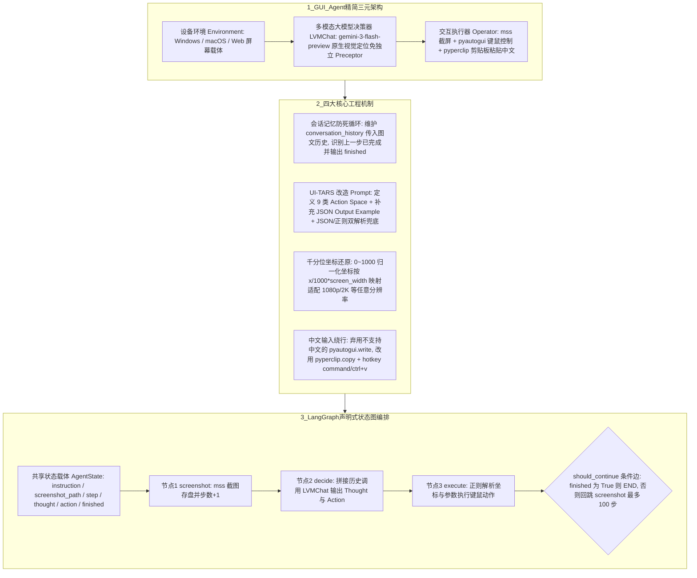

# GUI Agent 入门

## 1. TL;DR

本文手把手演示了如何在 **半小时内从 0 到 1** 基于原生具备强 GUI 视觉定位能力的通用多模态大模型（以 **`gemini-3-flash-preview`** 为例）与 **LangGraph** 状态图框架，搭建一个跨平台（Windows/macOS/Web）的 PC 端 **GUI Agent**。核心结论是：
1. **架构去感知器化**：由于新一代通用多模态大模型已原生具备直接输出 UI 元素坐标的视觉 Grounding 能力，不再需要额外训练/外挂独立的 UI 检测感知器（Preceptor），仅需“**设备环境（Environment） + 多模态大模型（决策器） + 键鼠执行器（Operator）**”即可跑通“截图感知 $\to$ 模型决策 $\to$ 动作执行”闭环。
2. **四大工程实现关键点**：（1）**必须维护多轮会话记忆（`conversation_history`）**，否则模型不记得上一轮已执行过输入操作，会陷入无限重复输入死循环；（2）**中文输入避坑**：`pyautogui.write()` 不支持中文，必须改用 `pyperclip.copy(text)` 配合 `Command+V / Ctrl+V` 剪贴板粘贴；（3）**千分位坐标归一化（0–1000 映射）**：将模型输出的归一化坐标 `(x, y)` 按 `actual_x = int(x / 1000.0 * screen_width)` 还原为不同分辨率屏幕的真实像素坐标；（4）**基于 UI-TARS 改进的 Prompt 与 LangGraph 声明式状态机**：在 UI-TARS 官方 Prompt 基础上补充 JSON `Output Example` 稳定输出格式，并用 `StateGraph(AgentState)` 管理 `screenshot -> decide -> execute` 条件循环（设置 `recursion_limit: 100`）。

## 2. 问题定义与背景

### 2.1 什么是 GUI Agent 及其 2025–2026 演进趋势
GUI Agent 是能够像人类一样“看懂”手机、PC 或 Web 屏幕截图并自动模拟键鼠/触控操作完成复杂任务（如“整理文件”、“打开浏览器搜索 Wikipedia”）的智能体。
过去构建 GUI Agent 门槛极高，因为早期通用大模型缺乏屏幕坐标定位能力，必须额外部署一套复杂的 OCR/图标检测模型充当“感知系统（Preceptor）”。而随着通用大模型向 Agentic 与原生 GUI 理解方向演进（如 `Gemini 3 Flash`），**模型自身已能直接输出操作对象的精确坐标**，使开发者半小时即可手搓出高可用 PC GUI Agent。

## 3. 知识框架

## 4. 核心内容拆解

### 4.1 多模态对话与“会话记忆防死循环”机制
1. **基础多模态图文调用（`LVMChat`）**：将本地截图读取并编码为 `base64`（`data:image/jpeg;base64,...`），与文本指令组装为 OpenAI 兼容格式消息调用 `gemini-3-flash-preview`。测试“这张图片里输入框坐标？”即可直接获得模型定位坐标，省去外置感知器。
2. **为什么 GUI Agent 绝不能“无状态单轮调用”？**
   - **失忆死循环案例**：假设任务是“在输入框输入‘你好’”。若每次调用不带历史记忆（`use_history=False`），Agent 在第 1 轮输入“你好”后，第 2 轮看到截图里有输入框，由于不记得自己上一轮刚输入过，会**无限循环重复输入“你好”**。
   - **带历史上下文闭环（`conversation_history`）**：开启 `use_history=True` 后，每次请求将 `self.conversation_history + [current_message]` 一并发送，并在拿到响应后追加 `user` 与 `assistant` 记录。第 2 轮模型结合历史记录与当前截图看到文案已出现在输入框中，便会输出 `{'Thought': '上一轮已经完成输入操作...', 'Action': 'finished()'}` 正常终止。

### 4.2 执行器（Operator）、Prompt 空间与千分位坐标映射
1. **键鼠执行器（`Operation` 类）的三大实现细节**：
   - **截图**：使用轻量快速的 `mss` 库（`sct.shot(output=save_path)`）按步骤时间戳保存至 `s/step_{step}_{timestamp}.png`。
   - **关闭角落保护**：设置 `pyautogui.FAILSAFE = False`，允许鼠标移动到屏幕边角而不抛出异常中断（注：生产环境需注意安全边界）。
   - **剪贴板粘贴解决中文输入痛点**：由于 `pyautogui.write()` 原生**不支持中文输入**，必须通过 `pyperclip.copy(text)` 将文本写入系统剪贴板，再调用 `pyautogui.hotkey('command', 'v')`（macOS）或 `('ctrl', 'v')`（Windows）完成中英文及特殊字符粘贴。
2. **基于 UI-TARS 改造的 Prompt 与 9 类动作空间（Action Space）**：
   - 动作空间完整定义：`click(point='<point>x1 y1</point>')`、`left_double(...)`、`right_single(...)`、`drag(start_point=..., end_point=...)`（执行时 `duration=0.5` 并等待 1 秒）、`hotkey(key='ctrl c')`、`type(content='xxx')`、`scroll(point=..., direction='down/up/right/left')`（向上/左滚为 `3`，向下/右为 `-3`）、`wait()`（默认睡眠 **5 秒**）、`finished(content='xxx')`。
   - **格式稳定性加固**：作者实测发现 `Gemini 3 Flash` 直接用原版 UI-TARS Prompt 时输出格式不够稳定，因此在 Prompt 末尾显式增加了 **`## Output Example`（强制规定 `{"Thought": "...", "Action": "..."}` JSON 结构）**，并在代码解析层采用 **`json.loads` + 正则表达式（`re.search`）双兜底**（同时兼容带 `<point>` 标签与不带标签的坐标格式）。
3. **千分位归一化坐标转换（`normalize_coords`）**：
   不同显示器分辨率各异（如 `1920x1080`、`2560x1440`），模型统一输出 **`0–1000` 范围的千分位归一化坐标**（例如 `(500, 500)` 代表屏幕正中心）。执行前通过 `pyautogui.size()` 获取当前屏幕宽高，按公式还原：
   $$\text{actual\_x} = \lfloor \frac{x}{1000.0} \times \text{screen\_width} \rfloor, \quad \text{actual\_y} = \lfloor \frac{y}{1000.0} \times \text{screen\_height} \rfloor$$

### 4.3 基于 LangGraph 的声明式工作流组装
相比传统硬编码 `while not finished` 循环，采用 **LangGraph `StateGraph(AgentState)`** 声明式构建：
- **状态结构 `AgentState`**：包含 `instruction`、`screenshot_path`、`step`、`thought`、`action`、`finished` 六个字段。
- **三节点与条件边**：注册 `screenshot` $\to$ `decide` $\to$ `execute` 三个节点，并在 `execute` 后挂载条件边 `should_continue`（若 `finished` 为真则跳转 `END`，否则回跳 `screenshot`），最后通过 `app.invoke(..., config={"recursion_limit": 100})` 启动自动化循环。

## 5. 数据速查表

| 指标 / 配置项 | 原文数值 / 表达式 | 语境 / 条件 |
| :--- | :--- | :--- |
| **从 0 到 1 手搓搭建耗时** | **半小时左右** | 基于 `gemini-3-flash-preview` 原生 GUI 定位能力，无需自建感知器 |
| **模型输出坐标归一化范围** | **`0–1000`（千分位归一化）** | `(500, 500)` 对应 `1920x1080` 的 `(960, 540)` 及 `2560x1440` 的 `(1280, 720)` |
| **LangGraph 最大递归步数限制** | `recursion_limit: 100` | `app.invoke` 时的安全防死循环上限配置 |
| **Action Space 动作指令总数** | **9 类基础动作** | `click`, `left_double`, `right_single`, `drag`, `hotkey`, `type`, `scroll`, `wait`, `finished` |
| **`wait()` 与 `drag()` 默认耗时参数** | `wait` 休眠 **5 秒** / `drag` 持续 **0.5 秒** + 等待 **1 秒** | 预留给页面加载与拖拽动画响应的缓冲窗口 |
| **`scroll()` 滚动步幅参数** | `up/left` 为 **`+3`**，`down/right` 为 **`-3`** | 调用 `pyautogui.scroll(scroll_amount)` 的滚动量 |

## 6. 踩坑与教训 / 可迁移的设计原则

| 错误做法 | 失败表现或原因 | 原文应对（可迁移的设计原则） |
| :--- | :--- | :--- |
| **每次截图决策时作为独立单轮请求发给多模态模型（不传 `conversation_history`）** | 模型不记得上一轮刚执行过输入或点击动作，面对相似页面陷入“无限重复输入‘你好’”的死循环 | **多模态轨迹记忆必传原则**：在 GUI Agent 循环中必须开启 `use_history=True`，将历史截图、Thought 与 Action 完整串入上下文以判断 `finished` |
| **直接调用 `pyautogui.write(text)` 在输入框中输入中文** | `pyautogui.write()` 底层仅模拟英文键盘按键，遇到中文字符直接失效或乱码 | **剪贴板中转粘贴（Clipboard Paste）原则**：先用 `pyperclip.copy(text)` 写入剪贴板，再调用 `pyautogui.hotkey('command'/'ctrl', 'v')` 完美兼容中英文与特殊符号 |
| **直接把模型返回的坐标数值当作屏幕像素点传给 `pyautogui.click`** | 模型输出的是 `0–1000` 归一化坐标，在不同分辨率（1080p/2K/Retina）屏幕上点击位置完全偏移 | **千分位归一化坐标动态映射原则**：启动时通过 `pyautogui.size()` 读取真实屏幕宽高，执行前统一按 `x / 1000.0 * width` 换算 |
| **直接照搬开源模型（如 UI-TARS）原版 Prompt 给 Gemini 3 Flash 且只用严格 `json.loads` 解析** | 不同模型对格式遵循习性不同，偶发输出非标准 JSON 或坐标缺少 `<point>` 标签导致程序崩溃中断 | **Output Example 显式示范 + 双重正则容错解析原则**：在 Prompt 中加入 JSON 输出样例；解析层先试 `json.loads` 失败再回退正则，且同时兼容 `<point>x y</point>` 与 `'x y'` 两种坐标写法 |

## 7. 记忆锚点

- **GUI Agent 极简三件套**：“**`mss` 截屏当眼睛，`Gemini 3 Flash`（带历史 + UI-TARS Prompt）当大脑，`pyautogui` + `pyperclip` 当手脚。**”
- **三大必防工程坑**：“**不带历史必死循环，不走剪贴板打不出中文，不除 1000 乘宽高点不准坐标。**”

## 8. 复习卡片

为什么使用 Gemini 3 Flash 等新一代通用大模型搭建 GUI Agent 时，不再需要单独设计“感知系统（Preceptor）”？::因为新一代通用多模态大模型自身已经训练了强大的 GUI 页面理解与视觉定位（Grounding）能力，能够直接根据截图输出目标 UI 元素的坐标位置，只需保留“设备环境 + 大模型决策器 + 交互执行器（Operator）”即可。
在 GUI Agent 中，如果每次调用多模态大模型都不传入会话历史（`conversation_history`），会导致什么严重问题？::会导致 Agent“失忆”并陷入动作死循环；例如执行“在输入框输入‘你好’”时，因为不记得上一轮已经执行过输入操作，会在输入框中无限次重复输入而不会触发 `finished` 停止。
使用 Python 的 `pyautogui` 实现 GUI Agent 的文本输入（`type` 动作）时，有什么常见坑点，应如何解决？::`pyautogui.write()` 不支持输入中文；解决方案是使用 `pyperclip.copy(text)` 先将文本复制到系统剪贴板，再通过 `pyautogui.hotkey('command', 'v')`（Mac）或 `('ctrl', 'v')`（Windows）粘贴，即可完美支持中英文与特殊字符。
GUI Agent 是如何解决不同电脑屏幕分辨率（如 1920x1080 与 2560x1440）下的坐标适配问题的？::采用“千分位坐标归一化（0–1000 范围）”策略：模型统一返回 0 到 1000 之间的相对坐标（如 `(500, 500)` 代表屏幕中心），执行器再根据 `pyautogui.size()` 获取的真实屏幕宽高，按 `actual_x = int(x / 1000.0 * screen_width)` 还原为实际像素坐标。
作者在将 UI-TARS 官方 Prompt 迁移到 Gemini 3 Flash 时做了什么改进以保证解析稳定？::1. 在 Prompt 中新增了 `## Output Example` 显式规定 `{"Thought": "...", "Action": "..."}` 的 JSON 格式；2. 在代码解析层对模型返回采用 `json.loads` + 正则提取双兜底，并对点击/拖拽坐标同时兼容 `<point>x y</point>` 和纯数字字符串两种正则匹配。

## 9. 知识关联

- **本库通用主题**：[Agent工程循环](../../20_topics/Agent%E5%B7%A5%E7%A8%8B%E5%BE%AA%E7%8E%AF.md) · [桌面Agent与工作流](../../20_topics/%E6%A1%8C%E9%9D%A2Agent%E4%B8%8E%E5%B7%A5%E4%BD%9C%E6%B5%81.md)
- **候选双链**：[[UI-TARS与视觉Grounding]] · [[LangGraph状态图编排]] · [[ReAct原理与架构]] · [[多模态会话记忆管理]]

## 10. 原文参考资料

- 原文标题：《有手就行，教你从 0 到 1 快速手搓搭建个 GUI Agent》（作者：zishanshi，发布于 2026-01-19）
- 核心技术栈：Google `gemini-3-flash-preview`、`LangGraph`（`StateGraph`）、`UI-TARS` Prompt 规范、`pyautogui`、`pyperclip`、`mss`。

> [!note]- 校对报告
> - **页码溯源汇总**：
>   - `p.1–3`：GUI Agent 定义、2025 年通用大模型原生 GUI 能力演进（半小时从 0 到 1 搭建）、四大基础组件（设备环境、感知系统 Preceptor 在 Gemini 3 Flash 下可省略、大模型决策器、交互系统 Operator）及“感知 $\to$ 决策 $\to$ 执行”循环。
>   - `p.3–7`：`LVMChat` 基础图文对话实现与加入 `conversation_history` 解决“无限重复输入‘你好’”死循环的完整代码与原理演示。
>   - `p.7–10`：Operator 执行器（`pyautogui.FAILSAFE = False`、`pyperclip.copy` + `command/v` 解决 `pyautogui.write()` 不支持中文问题、`mss` 截图）、基于 UI-TARS 改造的 9 类 Action Space Prompt（增加 `Output Example`）、`0–1000` 千分位归一化坐标转换公式及 LangGraph `StateGraph(AgentState)` 声明式编排。
>   - `p.11–18`：`GUIAgent` 主程序完整组装（JSON + 正则双解析兜底、带 `<point>` 与不带标签双兼容、`recursion_limit: 100`）、打开浏览器查询 Wikipedia 实测效果与总结。
> - **核验结论**：全文所有模块设计、动作空间语法、坐标换算公式与避坑技巧均与原文逐页核对一致。
