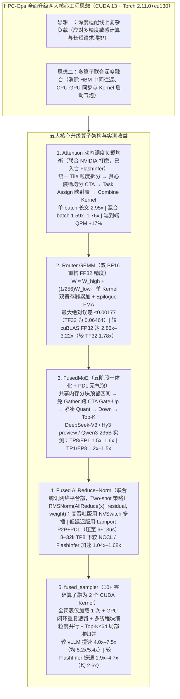

# 腾讯混元 AI Infra 进化：HPC-Ops 推理核心算子全面升级

> **原文信息**：发布于 2026-06-11 01:20（广东），公众号「腾讯技术工程」。

---

## 1. TL;DR

1. **开源定位与两大工程思想** —— **HPC-Ops**（`https://github.com/Tencent/hpc-ops`）是腾讯混元 AI Infra 团队开源的工业级高性能大模型推理底层算子库；本次围绕**「深度适配线上复杂负载（多精度与长短请求混排）」**与**「多算子联合融合优化」**全面升级五大核心算子（评测基于 `CUDA 13` + `Torch 2.11.0+cu130`）。
2. **Attention 动态调度负载均衡（联合 NVIDIA 打磨，已同步适配 FlashInfer）** —— 针对 Decode 阶段请求长度波动与长短混排导致传统静态 `split-kv` 失衡痛点，按统一 **Tile 粒度拆分 + 贪心装桶算法 + `Task Assign` 映射表 + `Combine Kernel`** 实现运行时动态均衡；单 batch 长文本最高加速 **2.95x**、混合长度 batch 加速 **1.59x–1.76x**、端到端服务压测 **QPM 最高提升 17%**。
3. **Router GEMM 双 BF16 重构 FP32（精度与 Tensor Core 算力兼得）** —— 离线将 FP32 权重拆为高位与低位残差两组 BF16 张量（$W \approx W_{\text{high}} + \frac{1}{256}W_{\text{low}}$），推理时激活保持 BF16 在 Tensor Core 执行双路 GEMM 并融合于单 Kernel（双寄存器累加器 + Epilogue 一次 FMA 修正，免 HBM 往返）；在 $N=192, K=4096, M=2\sim 4096$ 下**最大绝对误差不超 `0.00177`**（远优于 cuBLAS TF32 的 `0.06464`），相比 cuBLAS FP32 最高加速 **3.22x**（$M=512$ 处 `3.22x`，$M=4096$ 处 `2.86x`），相比 cuBLAS TF32 最高加速 **1.78x**。
4. **FusedMoE 全流水线重构与 Fused AllReduce+Norm 通算融合** ——
   - **FusedMoE**：整合「共享内存分块索引预留连续显存 → 免 Gather 且取消 Warp Specialization 改跨 CTA 硬件调度的 Gate-Up GEMM → 紧凑激活量化 → Down GEMM → Top-K 加权聚合」五阶段并用 **PDL** 消除气泡；在 DeepSeek-V3、Hy3 preview、Qwen3-235B（per-tensor FP8）上较 vLLM CUTLASS/Triton 与 SGLang 在 `TP=8/EP=1` 提速 **1.5x–1.6x**、`TP=1/EP=8` 提速 **1.2x–1.5x**。
   - **Fused AllReduce+Norm**（联合腾讯网络平台部）：封装 NVLink 原生 `RMSNorm(AllReduce(x) + residual, weight)`（Two-shot 策略），大 Token Prefill 走 **NVSwitch 多播**高吞吐版，小 Token Decode 走 **Lamport P2P + PDL** 低延迟版（通信后处理压至 **`9~13us`**），8–32k TP8 下较 NCCL/FlashInfer 最高提速 **1.68x**（`1.04x–1.68x`）。
5. **Sampler 极致后处理融合（补齐推理末端短板）** —— 将重复惩罚、温度缩放、Top-K/Top-P、Softmax、随机采样等 10 余个零碎 Kernel 端到端融为 **2 个核心 CUDA Kernel（`fused_sampler`）**，全词表 GPU 读取压至 **1 次**、GPU 内部闭环惩罚掩码（零 CPU-GPU 拷贝）、$\text{Max Top-K} \le 64$ 局部堆归并；较 vLLM 提速 **4.0x–7.5x**（平均 **5.2x / 5.4x**），较 FlashInfer 提速 **1.9x–4.7x**（平均 **2.6x**）。

---

## 2. 问题定义与背景

### 2.1 为什么要写这篇？

大模型推理系统进入大规模生产深水区后，单点静态算子已无法应对真实线上瓶颈：**长短请求混排引发的 Attention 长尾延迟**、**MoE 路由对 FP32 级高精度的刚需与 Tensor Core 利用率矛盾**、**MoE 多阶段显存往返与频繁 Kernel 启动**、**张量并行跨卡通信与归一化割裂**、以及**解码末端 10+ 个采样小算子导致的碎片化同步开销**。本文详细拆解了腾讯混元 AI Infra 团队在开源库 **HPC-Ops** 中针对这五大核心瓶颈的架构设计与 `CUDA 13` 实测数据。

---

## 3. 知识框架

---

## 4. 核心内容拆解

### 4.1 Attention 动态调度与 Router GEMM 双 BF16 重构

1. **Attention 动态调度负载均衡（根治 Decode 长尾延迟）**：
   - **痛点**：传统静态 `split-kv` 在面对均匀长度请求时表现稳定，但在线上长短请求混杂的 Batch 中，长序列需大 `split-kv` 保并行度、短序列只需小拆分，固定策略无法兼顾。
   - **机制（联合 NVIDIA 打磨并已同步适配 FlashInfer）**：① 将所有请求按统一 **Tile 粒度**拆分；② 依据全局 Tile 总量通过**贪心装桶算法**实现各 CTA 任务规模极致均分；③ 每次推理前由 `Task Assign` 模块生成专属任务映射表；④ 各层 Attention Kernel 精准领任务，最后由 `Combine Kernel` 统一合并 `split-kv` 结果。
   - **实测表现**：单 batch 长文本单算子最高加速 **2.95x**，混合长度 batch 加速 **1.59x–1.76x**，端到端服务压测 **QPM 最高提升 17%**。
2. **Router GEMM：双 BF16 组合模拟 FP32 级精度**：
   - **痛点**：MoE Router 与稀疏 Attention 等模块对数值精度极其敏感（常规 BF16 损精度，cuBLAS TF32 在 $N=192, K=4096$ 下最大绝对误差高达 **`0.06464`**；而升 FP32 则只能跑在低吞吐 CUDA Core 上并产生逐元素类型转换开销）。
   - **机制**：离线将 FP32 权重拆分为高位 BF16 与低位残差 BF16：**$W \approx W_{\text{high}} + \text{scale} \times W_{\text{low}}$**（$\text{scale} = 1/256$，对齐 BF16 的 8 位尾数）；推理时激活保持 BF16 在 **BF16 Tensor Core** 上跑两次 GEMM，且融合进单一 Kernel（输入仅搬运一次，双寄存器累加器分别缓存两路结果，Epilogue 经一次 FMA 修正写出，零 HBM 中间往返）。
   - **实测表现**：在 $N=192, K=4096, M=2\sim 4096$ 下**最大绝对误差不超过 `0.00177`**（比 TF32 精确数十倍）；相比 cuBLAS FP32 在 $M=512$ 处最高提速 **3.22x**、在 $M=4096$ 处保持 **2.86x** 提速，相比 cuBLAS TF32 最高提速 **1.78x**。

---

### 4.2 FusedMoE、Fused AllReduce+Norm 与 Sampler 深度融合

1. **FusedMoE 全流水线重构**：
   - 将 **路由与索引预处理**（共享内存分块统计预留连续显存区间）、**Gate-Up GEMM**（通过路由索引直读原始输入省去独立 Gather，且**取消 Warp Specialization** 改由同一 Warp Group 完成搬运与计算，从 CTA 内软件流水升级为**跨 CTA 硬件调度**以提升单 SM 驻留线程块数）、**激活量化**（按专家维度紧凑写入）、**Down GEMM**、**Top-K 加权聚合** 五大阶段整合，并通过 **PDL** 串联为无气泡链路。
   - 在 **DeepSeek-V3、Hy3 preview、Qwen3-235B**（per-tensor FP8）实测中，较 vLLM CUTLASS、vLLM Triton 和 SGLang，在 `TP=8/EP=1` 下获得 **1.5x–1.6x** 加速，在 `TP=1/EP=8` 下获得 **1.2x–1.5x** 加速。
2. **Fused AllReduce+Norm 通信计算一体化**：
   - 联合腾讯网络平台部将跨卡通信、残差相加与 RMSNorm 封装为 NVLink 原生操作 `RMSNorm(AllReduce(x) + residual, weight)`（基于 CUDA `multimem` 多播与 P2P，采用 `Reduce-Scatter + All-Gather` 的 **two-shot 策略**）：
     - **高吞吐版（`fuse_allreduce_rmsnorm_high_throughput`）**：依托 **NVSwitch 多播**完成归约，适配大规模 Token 的 Prefill 场景；
     - **低延迟版（`fuse_allreduce_rmsnorm_low_latency`）**：基于 **Lamport P2P + PDL 双 Kernel 重叠**，将小 Token Decode 场景下的通信后处理链路压缩至 **`9~13us`**。
   - 在 8–32k tokens 的 TP8 场景下，相比 NCCL 与 FlashInfer 同类路径实现 **1.04x–1.68x** 提速。
3. **Sampler（`fused_sampler`）终结后处理瓶颈**：
   - 将重复惩罚、温度缩放、Top-K、Top-P、Softmax、随机采样等 10+ 个零碎 Kernel 融合为 **2 个核心 CUDA Kernel**，具备五大优化：① 全局词表 GPU 加载压至 **1 次**；② 重复惩罚掩码在 GPU 内闭环计算（零 CPU-GPU 拷贝）；③ 单请求拆分至多线程块细粒度并行；④ 当 **$\text{Max Top-K} \le 64$** 时用**局部堆归并**替代全局阈值扫描或拒绝采样；⑤ 将 Top-K 归约与 Softmax 的最大/求和计算融合。
   - 相比 vLLM/PyTorch 提速 **4.0x–7.5x**（简单温度采样平均 **5.2x**，完整采样平均 **5.4x**），相比 FlashInfer 提速 **1.9x–4.7x**（简单与完整采样平均均为 **2.6x**）。

---

## 5. 数据速查表

| 指标 | 原文数值 | 语境 / 条件 |
| :--- | :--- | :--- |
| 实验基准环境配置 | **`CUDA 13` + `Torch 2.11.0+cu130`** | 单算子与端到端性能采集环境 |
| Attention 动态调度加速与端到端收益 | **单 batch 长文最高 2.95x / 混合 batch 1.59x–1.76x / 端到端 QPM 最高 +17%** | 已同步适配 HPC-Ops 与 FlashInfer 仓库 |
| Router GEMM 绝对误差对比 | **HPC-Ops 最大绝对误差 $\le 0.00177$ vs cuBLAS TF32 最高约 `0.06464`** | $N=192, K=4096, M=2\sim 4096$，误差相差数十倍 |
| Router GEMM 算子加速比 | **较 cuBLAS FP32 达 2.86x–3.22x（$M=512$ 处 3.22x，$M=4096$ 处 2.86x）/ 较 TF32 最高约 1.78x** | 双 BF16 拆分比例 $\text{scale}=1/256$ |
| FusedMoE 实测加速比 | **TP8/EP1 提速 1.5x–1.6x / TP1/EP8 提速 1.2x–1.5x** | 基于 DeepSeek-V3、Hy3 preview、Qwen3-235B（per-tensor FP8）对比 vLLM/SGLang |
| Fused AllReduce+Norm 延迟与加速比 | **小 Token 低延迟模式压至 `9~13us` / 较 NCCL 与 FlashInfer 提速 1.04x–1.68x** | 覆盖 8–32k tokens TP8 张量并行场景 |
| Sampler 融合前后 Kernel 数与加速比 | **10+ 个融为 2 个 CUDA Kernel；较 vLLM 提速 4.0x–7.5x（均 5.2x/5.4x），较 FlashInfer 提速 1.9x–4.7x（均 2.6x）** | 全词表 GPU 加载压至 **1 次**，$\text{Max Top-K} \le 64$ 局部堆归并 |

---

## 6. 踩坑与教训 / 可迁移的设计原则

| 错误做法 | 失败表现或原因 | 原文应对 |
| :--- | :--- | :--- |
| 在长短请求混杂的线上 Decode 场景中沿用静态固定的 `split-kv` 划分 | 长序列并行不足产生严重长尾延迟，短序列拆分过细增加开销，拖累整体 QPM | 引入**统一 Tile 拆分 + 贪心装桶均分 + `Task Assign` 映射表**的运行时动态调度，QPM 提升 17% |
| 在 MoE 路由中用 cuBLAS TF32 近似替代 FP32，或强行升精度到 CUDA Core 跑 FP32 | TF32 最大绝对误差达 `0.06464` 损害路由精度；CUDA Core 跑 FP32 算力低且带类型转换开销 | 离线按 $\text{scale}=1/256$ 拆分为**高低位双 BF16 张量**，单 Kernel 双累加器在 Tensor Core 计算后经一次 FMA 修正，误差压至 $\le 0.00177$ 且提速 3.22x |
| 在 MoE 的 Gate-Up GEMM 中执行显式 Gather 搬运并沿用 CTA 内软件流水（Warp Specialization） | 独立 Gather 浪费显存带宽，且软件流水限制了单 SM 可驻留的线程块数量 | 通过路由索引直读原始输入省去 Gather，**取消 Warp Specialization 升级为跨 CTA 硬件调度**，并用 PDL 串联五阶段消除气泡 |
| 解码末端采样采用 10 余个独立小 Kernel 串联，且在 CPU-GPU 间拷贝重复惩罚掩码 | 每次小 Kernel 都重新读取一次全局大词表，加上 CPU-GPU 同步开销成为推理末端瓶颈 | 封装为 2 个核心 Kernel 的 **`fused_sampler`**：全词表仅读 1 次、GPU 闭环算重复惩罚、$\text{Max Top-K}\le 64$ 采用局部堆归并并与 Softmax 融合 |

---

## 7. 记忆锚点

1. **五大升级算子速记卡**：
   - **Attention**：Tile 贪心装桶 + `Task Assign` → 单算子 **2.95x**，端到端 **QPM +17%**（已进 FlashInfer）；
   - **Router GEMM**：双 BF16（$\text{scale}=1/256$）重构 FP32 → 误差 **$\le 0.00177$**（TF32 为 `0.06464`），较 FP32 提速 **3.22x**；
   - **FusedMoE**：5 阶段一体化 + 跨 CTA 调度 + PDL → DeepSeek-V3 / Hy3 / Qwen3-235B 提速 **1.2x–1.6x**；
   - **Fused AllReduce+Norm**：NVSwitch 多播（高吞吐）+ Lamport P2P（低延迟 `9~13us`）→ 提速 **1.04x–1.68x**；
   - **Sampler**：10+ 融 2 Kernel + 词表读 1 次 + $\text{Top-K}\le 64$ 局部堆归并 → 较 vLLM 提速 **4.0x–7.5x**。

---

## 8. 复习卡片

1. HPC-Ops 本次全面升级围绕哪两大核心工程思想展开，升级了哪五个关键算子？::围绕「深度适配线上复杂负载（多精度计算与长短请求混排）」和「多算子联合融合优化」两大思想展开；升级了 Attention（动态负载均衡）、Router GEMM（双 BF16 重构 FP32）、FusedMoE（五阶段全流水线重构）、Fused AllReduce+Norm（通信计算融合）和 Sampler（采样后处理大融合）五大核心算子。
2. HPC-Ops 与 NVIDIA 联合打磨的「Attention 动态调度方案」是如何解决长短请求混排长尾延迟的，取得了什么收益？::将所有请求按统一 Tile 粒度拆分，依据全局 Tile 总量通过贪心装桶算法均分各 CTA 任务，由 `Task Assign` 模块在每次推理前生成映射表供各层 Attention Kernel 领取，最后由 `Combine Kernel` 合并；单 batch 长文最高加速 2.95x，混合 batch 加速 1.59x–1.76x，端到端 QPM 最高提升 17%（已同步适配 FlashInfer）。
3. 为什么在 MoE Router GEMM 中不能直接用 cuBLAS TF32 或普通 FP32，HPC-Ops 的「双 BF16 重构 FP32」在误差和速度上表现如何？::因为 cuBLAS TF32 在 $N=192, K=4096$ 下最大绝对误差高达 `0.06464` 影响路由精度，而纯 FP32 只能用 CUDA Core 算力受限；HPC-Ops 离线将权重拆为 $W \approx W_{\text{high}} + \frac{1}{256}W_{\text{low}}$ 两组 BF16，单 Kernel 双累加器在 Tensor Core 计算后于 Epilogue 一次 FMA 修正，最大绝对误差不超过 `0.00177`，比 cuBLAS FP32 最高提速 3.22x（比 TF32 最高提速 1.78x）。
4. HPC-Ops 的 `Fused AllReduce+Norm` 是如何针对 Prefill 和 Decode 不同场景提供差异化实现的？::联合腾讯网络平台部将 AllReduce、残差相加与 RMSNorm 封装为 NVLink 原生一体化操作（采用 Reduce-Scatter + All-Gather 的 two-shot 策略）：高吞吐版本依托 NVSwitch 多播机制适配大规模 Token 的 Prefill 场景；低延迟版本基于 Lamport P2P 机制与 PDL 双 Kernel 重叠适配小批量 Decode 场景（延迟压至 `9~13us`），在 8–32k TP8 下较 NCCL/FlashInfer 提速 1.04x–1.68x。
5. `fused_sampler` 采样融合算子通过哪五项优化将速度较 vLLM 提升了 4.0x–7.5x？::将 10 余个零碎 Kernel 融为 2 个核心 CUDA Kernel：① 全流程全局词表 GPU 加载压至 1 次；② 重复惩罚掩码在 GPU 内闭环计算（消除 CPU-GPU 拷贝）；③ 单请求拆分至多线程块细粒度并行；④ 当 $\text{Max Top-K} \le 64$ 时用局部堆归并替代全局扫描或拒绝采样；⑤ 将 Top-K 归约与 Softmax 最大/求和计算合并。

---

## 9. 知识关联

- **已有主题**：[Harness与模型协同](../../20_topics/Harness%E4%B8%8E%E6%A8%A1%E5%9E%8B%E5%8D%8F%E5%90%8C.md) · [Agent成本与上下文预算](../../20_topics/Agent%E6%88%90%E6%9C%AC%E4%B8%8E%E4%B8%8A%E4%B8%8B%E6%96%87%E9%A2%84%E7%AE%97.md) · [Agent评测与反馈](../../20_topics/Agent%E8%AF%84%E6%B5%8B%E4%B8%8E%E5%8F%8D%E9%A6%88.md) · [大模型推理与算子优化](../../20_topics/%E5%A4%A7%E6%A8%A1%E5%9E%8B%E6%8E%A8%E7%90%86%E4%B8%8E%E7%AE%97%E5%AD%90%E4%BC%98%E5%8C%96.md)
- **候选新主题**：[[HPC-Ops算子库]] · [[双BF16重构FP32]] · [[NVSwitch多播与LamportP2P融合]]

---

## 10. 原文参考资料

1. **HPC-Ops 开源仓库**：`https://github.com/Tencent/hpc-ops`
2. **对比框架与测试模型**：vLLM（CUTLASS / Triton / PyTorch Sampler）、SGLang、FlashInfer、cuBLAS、NCCL；测试模型包括 DeepSeek-V3、腾讯混元 `Hy3 preview`、Qwen3-235B。

> [!note]- 校对报告
> - **校对状态**：已根据 `MD.md` 全文（共 9 页 PDF 转写文本）逐一核对。
> - **核心数据与事实页码溯源**：
>   - HPC-Ops 开源定位、五大核心算子升级概览与 GitHub 链接（`https://github.com/Tencent/hpc-ops`）：见 PDF 第 1–2 页。
>   - 两大工程思想、Attention 动态调度（Tile 拆分 + 贪心装桶 + `Task Assign` + `Combine Kernel`，联合 NVIDIA 打磨并同步适配 FlashInfer）、Router GEMM 双 BF16 模拟 FP32（$\text{scale}=1/256$、双寄存器累加器 + Epilogue FMA）：见 PDF 第 2–3 页。
>   - FusedMoE 五阶段重构与跨 CTA 硬件调度 + PDL、Fused AllReduce+Norm（联合腾讯网络平台部，`multimem` 多播 + P2P two-shot 策略，高吞吐 NVSwitch 多播版与低延迟 Lamport P2P + PDL 版）、`fused_sampler`（10+ 融为 2 个 CUDA Kernel、5 大增益维度含 $\text{Max Top-K}\le 64$ 局部堆归并）：见 PDF 第 4–5 页。
>   - 实验环境（`CUDA13` + `Torch2.11.0+cu130`）与五大算子详细评测结果（Attention 单算子 2.95x / 混合 1.59x–1.76x / QPM +17%；Router GEMM 最大绝对误差 `0.00177` vs TF32 `0.06464`，加速 3.22x/2.86x/1.78x；FusedMoE 在 DeepSeek-V3/Hy3 preview/Qwen3-235B 提速 1.5x–1.6x 与 1.2x–1.5x；Fused AllReduce+Norm 低延迟 `9~13us`、最高 1.68x；Sampler 简单采样平均 5.2x/2.6x、完整采样平均 5.4x/2.6x，范围 4.0x–7.5x 与 1.9x–4.7x）：见 PDF 第 5–8 页。
