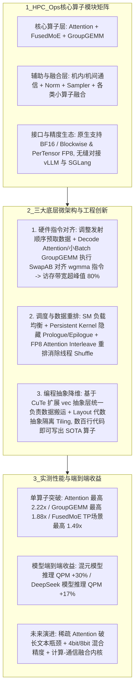

# HPC-Ops高性能算子

## 1. TL;DR

本文介绍了腾讯混元 AI Infra 团队基于 **CUDA 与 CuTe** 从零构建并开源（`Tencent/hpc-ops`）的生产级高性能 LLM 推理核心算子库 **HPC-Ops**。针对业界主流算子库（如 FlashInfer、DeepGEMM、CUTLASS）多以 H800 或 Blackwell 训练/旗舰卡为首要优化目标、在国内主流推理卡（如 **H20**）上难以发挥硬件峰值且二次修改门槛极高的痛点，HPC-Ops 通过**指令级对齐（Decode Attention 与小 Batch GroupGEMM 矩阵 SwapAB 对齐 `wgmma` 指令，使访存带宽利用率达 80% 以上）、Persistent Kernel 隐藏头尾开销、FP8 Attention 的 Interleave 数据重排消除线程间 Shuffle、以及基于 CuTe 扩展 `vec` 数据搬运与 `Layout` 代数抽象**，实现了显著性能突破：在真实线上场景中，**混元模型推理 QPM 提升 30%，DeepSeek 模型推理 QPM 提升 17%**；单算子维度，**Attention 相比 FlashInfer/FlashAttention 最高提升 2.22 倍，GroupGEMM 相比 DeepGEMM 最高提升 1.88 倍，FusedMoE 相比 TensorRT-LLM 最高提升 1.49 倍**。

## 2. 问题定义与背景

### 2.1 现有主流开源算子库在生产落地中的两大痛点
1. **使用与改造门槛极高（算子滞后拖累算法创新）**：主流算子库核心 Kernel 封装极深，普通 AI 研究者难以在其上定制适配新量化或投机采样算法（例如早期 4bit/8bit 量化算法虽在理论上减少了数据加载量，但因缺乏高效低精度算子配合，在很长一段时间内反而呈现“负优化”）。
2. **目标硬件错位（H800/Blackwell vs H20 等国内主流推理卡）**：FlashInfer、DeepGEMM 多针对 H800 优化，NVIDIA CUTLASS 新特性更偏向 Blackwell 架构；而国内大规模线上推理主力多为 **H20** 等推理型计算卡（算力与显存带宽比值同 H800 截然不同），直接照搬现有 SOTA 算子库无法吃满硬件真实上限，且亟需原生支持 `Blockwise FP8` 等复杂量化策略。

## 3. 知识框架

## 4. 核心内容拆解

### 4.1 三大核心技术突破
1. **任务特性与硬件微架构指令对齐（SwapAB 对齐 `wgmma`）**：
   - 针对受限于数据加载速度的访存密集型（Memory-bound）算子，针对国内主流推理显卡（如 H20）调整指令发射顺序实施数据预取，确保数据传输单元持续满载，并剔除冗余低效指令。
   - **SwapAB 关键优化**：在 **Decode Attention** 和**小 Batch 下的 GroupGEMM** 中，由于动态侧维度较小，直接按常规顺序送入 Tensor Core 效率低下；团队通过 **AB 矩阵交换（SwapAB）** 技巧对齐底层硬件的 **`wgmma`（Warp Group Matrix Multiply-Accumulate）指令**，使实际访存带宽达到硬件峰值能力的 **80% 以上**。
2. **精细化任务调度与数据重排（Persistent Kernel + FP8 Interleave）**：
   - 重新设计分块调度策略，兼顾所有流多处理器（SM）的负载均衡与 Cache 局部连续性，并采用 **Persistent Kernel（持久化内核）** 模式隐藏 Kernel 启动（Prologue）与收尾（Epilogue）开销。
   - **FP8 Attention 的 Interleave 重排**：在 FP8 Attention Kernel 中创新性地引入 **Interleave（交错）数据重排技术**，解决了低精度数据布局与 Tensor Core 矩阵指令寄存器排布不匹配的问题，大幅减少线程间的数据 `shuffle` 开销。
3. **基于 CuTe 的编程抽象（`vec` + `Layout` 代数隔离）**：
   - GPU 编程的大量心智负担来自为了匹配硬件指令而进行的反复指针重解释与坐标变换。HPC-Ops 基于 `CuTe` 扩展开发了 **`vec` 抽象层**统一接管高效向量化数据搬运，并利用 **`Layout` 代数抽象**将复杂的 Tiling 切分与核心数学计算逻辑彻底隔离，使开发者仅需**数百行代码**即可构建出逼近硬件极限的 SOTA 算子。

### 4.2 核心算子与端到端基准实测对比
1. **GroupGEMM（对比 `DeepGEMM v2.2.0`）**：
   - 在 `Batch <= 64` 的低延迟场景下优势极为显著，较 DeepGEMM 最佳表现最高提升 **1.88x**；
   - 利用流水线掩盖（Pipeline Overlapping）技术，使开销更大的 **Blockwise FP8 量化与 PerTensor 量化的执行性能几乎持平**；
   - 在大 Batch 场景下仍保持约 **1.1x** 领先，且同时兼容紧密排布与 Token 不连续输入，显著减少临时显存占用。
2. **FusedMoE（对比 `vLLM v0.11.0` 与 `TensorRT-LLM v1.1.0`）**：
   - 完整封装了“前序数据重排 + GroupGEMM + 后续 Reduce 加权平均”全流程，针对不同输入长度采取差异化重排策略；
   - 在序列长度取 16 倍数的均衡分配规格下，**TP（张量并行）场景相比 TensorRT-LLM 最高提升 1.49x**，在 **EP（专家并行）模拟均衡场景下最高提升 1.09x**。
3. **Attention（对比 `FlashInfer / FlashAttention`）**：
   - **Prefill 阶段（测试 `128 ~ 64K` 输入长度）**：小 Batch 下 BF16 精度相比 SOTA 提升 **1.3x**，大 Batch 下与 SOTA 对齐；
   - **Decode 阶段（按线上 SLO 约束组合 Batch 与序列长度）**：BF16 精度下提升 **1.35x ~ 2.22x**；FP8 精度下短序列与 SOTA 相当，长序列（Sequence Length 较大时）相比 SOTA 提升 **1.09x ~ 2.0x**。

## 5. 数据速查表

| 指标 / 算子模块 | 原文数值 | 语境 / 条件 |
| :--- | :--- | :--- |
| **混元模型端到端推理吞吐提升** | QPM 提升 **30%** | 腾讯混元大规模真实生产环境接入 HPC-Ops 后实测 |
| **DeepSeek 模型端到端推理吞吐提升** | QPM 提升 **17%** | DeepSeek 模型真实线上推理场景接入 HPC-Ops 后实测 |
| **Attention 单算子加速比** | 最高提升 **2.22 倍** | Decode 阶段 BF16 提升 **1.35x~2.22x**；长序列 FP8 提升 **1.09x~2.0x**；小 Batch Prefill (128~64K) BF16 提升 **1.3x** |
| **GroupGEMM 单算子加速比** | 最高提升 **1.88 倍** | 对比 `DeepGEMM v2.2.0`，在 `Batch <= 64` 低延迟场景达 1.88x，大 Batch 保持 **~1.1x** |
| **FusedMoE 模块加速比** | 最高提升 **1.49 倍** | 对比 `TensorRT-LLM v1.1.0` 与 `vLLM v0.11.0`，TP 场景最高 1.49x，EP 模拟均衡场景最高 **1.09x** |
| **SwapAB 优化后硬件访存带宽利用率** | 达硬件峰值 **80% 以上** | Decode Attention 与小 Batch GroupGEMM 交换 AB 矩阵对齐 `wgmma` 指令 |
| **构建 SOTA 算子的代码量级** | **数百行代码** | 基于 CuTe、`vec` 搬运抽象与 `Layout` 代数抽象 |

## 6. 踩坑与教训 / 可迁移的设计原则

| 错误做法 | 失败表现或原因 | 原文应对（可迁移的设计原则） |
| :--- | :--- | :--- |
| **在 H20 等推理卡上直接照搬针对 H800 或 Blackwell 训练卡调优的开源算子库（如 DeepGEMM / FlashInfer）** | 不同 GPU 的算力与显存带宽配比（Roofline）截然不同，在小 Batch Decode 与 MoE 场景下硬件数据传输单元与 Tensor Core 严重失配 | **面向目标推理卡微架构定制预取与指令对齐原则**：针对推理卡访存瓶颈重排指令发射顺序，并在小 Batch 下通过 SwapAB 对齐 `wgmma` 指令，将带宽利用率推至 80%+ |
| **仅在算法层引入 4bit/8bit 或 Blockwise FP8 量化，却缺乏配套流水线掩盖与数据重排的底层算子** | 反量化开销与寄存器布局错位引发大量线程间 `shuffle`，导致低精度量化不仅不快反而变成“负优化” | **量化格式与算子重排协同设计（Interleave + 流水线掩盖）原则**：在 FP8 Attention 中用 Interleave 重排消除线程间 Shuffle，在 GroupGEMM 中用流水线掩盖让 Blockwise FP8 逼近 PerTensor 性能 |
| **在编写高性能 CUDA 算子时将指针重解释、Tiling 切分与核心数学逻辑硬编码耦合在一起** | 代码动辄数千行且极度晦涩，普通算法研究员根本无法在其上迭代新算子 | **`vec` 搬运层 + `Layout` 代数层与计算逻辑解耦原则**：基于 CuTe 用 `vec` 封装高效向量化搬运、用 `Layout` 隐藏 Tiling 坐标变换，将开发门槛降至数百行代码 |

## 7. 记忆锚点

- **HPC-Ops 战绩口诀**：“**混元 QPM 涨三成（30%），DeepSeek 涨一成七（17%）；Attention 翻倍二点二（2.22x），GroupGEMM 一点八八（1.88x），FusedMoE 一点四九（1.49x）。**”
- **三大底层绝活**：“**SwapAB 对齐 `wgmma`（吃满 80% 带宽），Persistent Kernel 藏头尾，FP8 Interleave 消 Shuffle，CuTe `vec`+`Layout` 数百行写 SOTA。**”

## 8. 复习卡片

为什么现有的主流开源算子库（如 FlashInfer、DeepGEMM、CUTLASS）在国内大规模线上推理场景中往往难以发挥硬件峰值性能？::因为主流算子库多以 NVIDIA H800 或 Blackwell 等高配训练/旗舰卡为首要优化目标，而国内大规模线上推理主力多采用 H20 等推理型计算卡（算力与显存带宽配比不同），且现有算子库封装极深、二次改造适配复杂量化（如 Blockwise FP8）的门槛极高。
HPC-Ops 在 Decode Attention 和小 Batch GroupGEMM 中采用了什么核心技巧使访存带宽达到硬件峰值的 80% 以上？::采用了“AB 矩阵交换（SwapAB）”结合指令发射顺序调整的数据预取优化，使小 Batch 下的矩阵维度完美对齐硬件架构上的 `wgmma` 指令，消除了冗余低效指令。
HPC-Ops 是如何解决 FP8 Attention Kernel 中指令与数据布局不匹配问题的？::创新性地采用了 Interleave（交错）数据重排技术，并配合 Persistent Kernel 隐藏 Kernel 启动（Prologue）和收尾（Epilogue）开销，大幅减少了线程间的数据 `shuffle` 与额外显存占用。
HPC-Ops 如何降低高性能 CUDA 算子的开发门槛，使开发者用数百行代码就能写出 SOTA 算子？::基于 CuTe 扩展开发了 `vec` 抽象层来统一负责高效的数据搬运，并利用 `Layout` 代数抽象将复杂的 Tiling 切分与核心计算逻辑隔离，让开发者无需手动处理繁琐的数据重解释和坐标变换。
HPC-Ops 的 GroupGEMM、FusedMoE 和 Attention 三个核心算子相比业界 SOTA 分别取得了怎样的加速比？::1. GroupGEMM：在 `Batch <= 64` 低延迟场景较 DeepGEMM (v2.2.0) 最高提升 1.88 倍，且使 Blockwise 与 PerTensor FP8 性能几乎持平；2. FusedMoE：在 TP 场景较 TensorRT-LLM (v1.1.0) 最高提升 1.49 倍（EP 均衡场景最高 1.09 倍）；3. Attention：Decode 阶段 BF16 最高提升 2.22 倍（FP8 长序列提升 1.09x~2.0x），小 Batch Prefill BF16 提升 1.3 倍。

## 9. 知识关联

- **本库通用主题**：[模型与开发工具发布](../../20_topics/%E6%A8%A1%E5%9E%8B%E4%B8%8E%E5%BC%80%E5%8F%91%E5%B7%A5%E5%85%B7%E5%8F%91%E5%B8%83.md) · [大模型推理与算子优化](../../20_topics/%E5%A4%A7%E6%A8%A1%E5%9E%8B%E6%8E%A8%E7%90%86%E4%B8%8E%E7%AE%97%E5%AD%90%E4%BC%98%E5%8C%96.md)
- **候选双链**：[[MoE推理与Agent算子优化]] · [[英伟达GPU选型科普]] · [[CUTLASS与CuTe算子开发]] · [[Blockwise-FP8量化推理]]

## 10. 原文参考资料

- 原文标题：《腾讯混元 AI Infra 核心技术重磅开源：推理吞吐提升 30%！》（作者：腾讯混元 AI Infra 团队，发布于 2026-01-27）
- 开源仓库地址：`https://github.com/Tencent/hpc-ops`（支持无缝对接 vLLM、SGLang 等主流推理框架）。

> [!note]- 校对报告
> - **页码溯源汇总**：
>   - `p.1`：开源发布导语、混元 QPM +30% / DeepSeek QPM +17% 端到端收益、单算子最高加速比（Attention 2.22x / GroupGEMM 1.88x / FusedMoE 1.49x）、GitHub 地址及主流算子库两大痛点（使用改造门槛高、H800/Blackwell 与 H20 硬件不匹配）。
>   - `p.2–3`：HPC-Ops 架构模块与三大技术细节（1. Decode Attention 与小 Batch GroupGEMM 的 SwapAB 对齐 `wgmma` 指令达 80%+ 峰值带宽；2. Persistent Kernel 与 FP8 Attention Interleave 重排减少线程 Shuffle；3. 基于 CuTe 的 `vec` 抽象层与 `Layout` 代数抽象）。
>   - `p.3–5`：GroupGEMM（对比 DeepGEMM v2.2.0，`Batch<=64` 提升 1.88x，Blockwise 与 PerTensor 持平）、FusedMoE（对比 vLLM v0.11.0 与 TensorRT-LLM v1.1.0，TP 最高 1.49x、EP 1.09x）、Attention（Prefill 128~64K 小 Batch BF16 1.3x；Decode BF16 1.35x~2.22x、FP8 长序列 1.09x~2.0x）实验对比及稀疏 Attention / 4bit-8bit 混合精度 / 计算通信融合未来规划。
> - **核验结论**：全文所有量化数据、基线版本号与微架构优化机制均与原文逐页核对一致。
