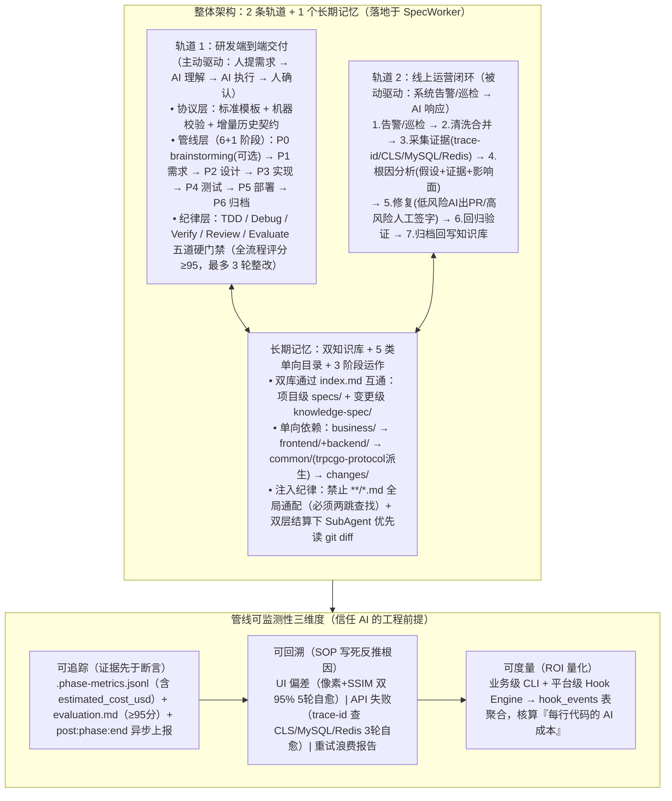

# 开启Harness Engineering探索之旅

> **原文信息**：作者 `fanniemeng`（腾讯电竞团队），发布于 2026-06-29 02:36（广东），公众号「腾讯技术工程」原创。

---

## 1. TL;DR

1. **核心定义与三次工程迁移** —— `Agent = Model（模型）+ Harness（模型外的运行框架）`；AI 工程关注点经历了 **Prompt Engineering（2022–2024，教模型怎么说话）→ Context Engineering（2025，保证上班有足够信息）→ Harness Engineering（2026，设计模型怎么工作，让 Agent 犯过的错靠外部工程永不再犯）**；之所以 AI 出码率走高但整体研发提效有限，是因为 AI 只砍掉了《人月神话》中的「附属复杂度」，而「理解、对齐、追溯、沉淀、验证」等「本质复杂度」反而因代码激增成了新瓶颈。
2. **「2 条轨道 + 1 个长期记忆」全局架构（落地于 SpecWorker）** ——
   - **轨道 1（研发端到端交付）**：分协议层（输入输出契约）、管线层（`P0 brainstorming [可选] → P1 requirements → P2 design → P3 implementation → P4 e2e-test → P5 deploy → P6 archive` 6+1 阶段）、纪律层（TDD / Debug / Verify / Review / Evaluate 五道硬门禁，全流程评分卡 **`total_score ≥ 95`** 才准过，最多 **3 轮**整改）。
   - **轨道 2（线上运营被动响应）**：共享同一份知识库与 `trace-id` 检索 SOP，跑通「告警/巡检 → 清洗合并 → 采集证据 → 根因分析（假设+证据+影响面）→ AI/人工修复 → 回归验证 → 归档」7 步闭环。
   - **长期记忆（双知识库 + 单向 5 层目录）**：并存项目级 `specs/` 与变更级 `knowledge-spec/`，严格遵循 `business/ → frontend/+backend/ → common/ → changes/` 单向向下依赖。
3. **P1–P6 管线硬核设计亮点** —— **P1** 从 TAPD 引原始口径，AC 强制 `WHEN-THEN-SHALL` 可测格式且 `requirements.md` 与 `test-cases.md` 同源；**P2** 将 `design.md` 写成机器可读契约（含前端 `sandbox_mode` 与 `D-x` 改动点工单池，配 `P0/P1/P2` 三档澄清与两道 STOP）；**P3** 前端 D2C 拆 3 个 Skill 配合**像素差异 + SSIM 双 95% 五轮自愈校准**，后端 `code-reviewer` 读 `git diff` 输出 `Critical/Important/Suggestion` 三档；**P4** 后端 `api-test-debugger` 失败时按 `trace-id` 自动查 **CLS 日志 + MySQL 数据行 + Redis key**（最多 3 轮自愈）；**P5** 后端任何 **SQL DDL/DML 变更强制用户显式 `yes/no` 确认**；**P6** 强制跑 `changes-sync`、`knowledge-sync`、`specs-generator`（基于 `delta-spec.md` 四类标记增量合并）。
4. **管线可监测性三维度** —— **可追踪**（落盘 `.phase-metrics.jsonl` 流水账、独立 `evaluation.md` 评分、`event_type=post:phase:end` 后台异步上报）；**可回溯**（写死 UI 还原、API 测试挂、跨阶段重试三类失败的检索 SOP）；**可度量**（业务级 CLI + 平台级 Hook Engine 汇聚至 `hook_events` 表，核算每行代码的 AI 成本）。
5. **反直觉 Token 洞察与「4 原则 + 4 典型问题」** —— 揭示 **SubAgent 是独立计费开销而非免单银弹**，强制所有 SubAgent **优先读 `git diff` 而非全文**，且检索严禁 `**/*.md` 全局通配（必须 `index.md → 相关 spec` 两跳命中）；在工具调用上采用 **`CodeBuddy IDE → SKILL Script → MCP Server`** 渐进式披露替代直接挂载过多 MCP，以规避上下文常驻膨胀。

---

## 2. 问题定义与背景

### 2.1 概念演进时间线与「出码率 vs 提效」裂缝

1. **Harness Engineering 概念结晶脉络**：
   - **2025 年 8 月**：OpenAI Codex 团队在 `agent-first` 内部实验中指出「早期进展比预期慢，并不是因为 Codex 不具备相应能力，而是因为环境的规范不够明确」。
   - **2026 年 2 月**：Mitchell Hashimoto 正式命名 **Harness Engineering**——*“每当你发现 Agent 犯了一个错，你就花时间在它外面工程化一个方案，让它永远不再犯同样的错。”*
   - **后续体系化**：LangChain 提出 `Agent = Model + Harness`；Böckeler / Thoughtworks 将其拆解为 `guides`（引导）与 `sensors`（传感器）；学界提出 `ETCLOVG` 七层分类。
2. **为什么 AI 写代码快了十倍，版本整体节奏却没快多少？（三大根因）**
   - **根因一（Brooks《人月神话》与《没有银弹》视角）**：软件复杂度分为**附属复杂度**（accidental，语法/工具翻译成本）和**本质复杂度**（essential，概念构造、需求可变性）。AI 砍掉的只是附属复杂度，本质复杂度一分没少，甚至因代码量激增导致下游对齐、Review 与维护更重。
   - **根因二（局部加速导致瓶颈转移）**：把「写」踩到十倍速，而「理解、对齐、追溯、沉淀、验证」一步未动，瓶颈只是从「写」挪到了「收」。
   - **根因三（隐性约束不可见）**：团队规范、领域知识、历史依赖等散落在人脑中，AI 一概看不见。

---

## 3. 知识框架

---

## 4. 核心内容拆解

### 4.1 轨道 1：SpecWorker 研发端到端交付「6+1 阶段」深度拆解

- **P1 需求（TAPD 拉取 + AC 可测 + `test-cases` 同源）**：
  1. 从 TAPD 拉取官方描述作为 `requirements.md` 的「原始口径」，严禁 AI 自行复述歪曲；
  2. 每条 AC（验收标准）必须写成可测的 **`WHEN（前置条件）→ THEN（系统 SHALL ...）`** 格式（含 `AND` 子句），禁止「性能要好」等模糊描述；
  3. **同源双产物**：由 `specworker-requirement-analyzer`（提澄清问题交用户回答）与 `specworker-integration-testcase-generator` 两个 SubAgent 串联，基于同一份 AC 同时生成 `requirements.md`（给 P2）与 `test-cases.md`（给 P4）。
- **P2 设计（契约先行 + `sandbox_mode` + `D-x` 改动点 + 两道 STOP）**：
  1. `design.md` 不是说明文档而是**机器可读契约**（Markdown 表格 + Mermaid 时序/数据流图，无待定暗藏字段）；
  2. 前端顶部强制声明 `sandbox_mode: true / false`（决定 P3 是先写沙箱隔离还是直写目标文件）；
  3. 拆解 **`D-1 / D-2 / D-3 ...` 改动点列表**，逐项标注「`文件:行号 @ 函数名` + `目的` + `实现` + `关键代码片段`」，作为 P3 实现与 CR 的工单池；
  4. `specworker-clarify-design` SubAgent 先做代码分析，按 **`P0（阻断）/ P1（高优先）/ P2（中优先）`** 抛出技术澄清问题，经「用户回答 → 用户确认摘要方案」**两道 STOP 卡点**后才生成 `design.md`。
- **P3 实现（前端 D2C 双 95% 五轮自愈 + 后端 `code-reviewer` 三档）**：
  1. **前端 D2C 三技能串联**：`specworker-d2c-get-figma`（拉设计稿+资源本地化+生成 `pages.config.json`）→ `specworker-d2c-refactor`（支持 Hippy/通用 Web 多模板与 multi-slug 并行）→ `specworker-ui-calibration`；
  2. **UI 校准修正闭环**：自动截图计算**像素差异 + SSIM 双指标**，任一 **`< 95%`** 即触发 `specworker-ui-calibration-fixer-fe` 拿差异 diff 与当前 DOM 局部修改，**最多循环 5 轮**（5 轮未过自动 fallback 交用户决策）；
  3. **后端契约审查**：每实现一个分组自动调 `specworker-code-reviewer`（优先读 `git diff`），对照 `design.md` 输出三档：**`Critical`（必修，必须人审+签字+留痕，严禁 AI 自己改了就过）**、**`Important`（必标，写明已知偏差与原因记入 `evaluation` 日志）**、**`Suggestion`（自由处置）**。
- **P4 集成测试（前后端双流程 + 后端 `trace-id` 三源自动排障）**：
  1. **前端分发**：Web 走 `specworker-web-automator-test`（Playwright），小程序走 `specworker-miniprogram-automator-test` + `cloudtest` 真机云测；
  2. **后端自愈链路**：`specworker-api-test` 从 `uat/api_test_cases.md` 按 `SC-N` 生成 Node.js（原生 `fetch`）脚本并从 `deploy.md / .env.test` 抓取环境变量跑 `pytest`；一旦失败，**`specworker-api-test-debugger`** 提取失败请求的 `trace-id` → **自动去 CLS 拉日志 → 去 MySQL 查相关数据行 → 去 Redis 看相关 key 状态** → 产出「失败根因 + 建议修法」诊断报告交还实现 Agent 修复重跑；**同一用例 3 轮未修通则 STOP**，交由人工调用 `specworker-debugging` 兜底。
- **P5 部署（前端轮询 + 后端 SQL 强制人工确认 + 95 分红线）**：
  1. **前端 P5**：强制 `<type>(<scope>): <subject>` 提交规范（限定 `feat/fix/refactor/style/test/chore`），触发 CI/CD 后**最多轮询等待 10 分钟（每 30 秒一次）**，落盘 `{change_dir}/frontend/deploy.md`；
  2. **后端 P5**：`specworker-p5-deploy-be` 将 `deploy.md` 解析为「数据库变更类 / 流水线发布类 / 其他类」复选框任务；**铁律：任何数据库 DDL/DML 变更严禁 AI 自动执行，必须拼成可读 SQL diff 由用户显式 `yes/no` 确认（即使 Critical 修复也不例外）**；全流程 P1~P6 统一要求评分卡 **`total_score ≥ 95`（缺失字段上限 60 分，最多 3 轮整改）**，没部署成功严禁先归档。
- **P6 归档（三件套强制复利，未跑完不准启动下一需求 P1）**：
  1. `changes-sync`（对齐 git 实际改动与设计文档）；
  2. `knowledge-sync`（提炼复用设计、坑点与契约进项目级 `specs/`）；
  3. `specs-generator`（根据 `delta-spec.md` 的 **`ADDED / MODIFIED / REMOVED / RENAMED`** 四类标记增量合并至 `specs/[module]/spec.md`，防止全量复制导致知识库膨胀）。

---

### 4.2 知识库工程与反直觉的 Token 双层结算

1. **5 类单向依赖目录与三级递进粒度**：
   - 目录结构：`business/`（业务规范，不依赖任何端）← `frontend/` + `backend/`（端侧规范）← `common/`（由 `trpcgo-protocol` 的 `.proto` 派生，绝不反向依赖实现）← `changes/`（需求演进），外加 `archives/` 与 `issues/`；术语只在 `glossary.md` 定义一次（SSOT）。
   - 三级粒度：顶层概述（粗）→ 模块/服务 `spec`（中）→ 子页面/接口详情（细）；所有检索**强制 `index.md → 相关 spec` 两跳命中，明令禁止 `**/*.md` 全局通配**。
2. **知识库三阶段运作**：
   - **阶段一（存量初始化）**：「AI 跑出初稿 + 人工剔除过时/废弃接口 + 人工补关键约束」三步盘清老项目家底；
   - **阶段二（迭代演进）**：P6 归档三件套硬卡；
   - **阶段三（持续治理）**：老化与淘汰机制待实现。
3. **反直觉洞察：Token 双层结算与 SubAgent 优先读 `git diff`**：
   - 团队最初让 `code-reviewer` SubAgent 读全文件做契约审查，核对账单才发现：**SubAgent 的上下文是独立计费的**——它每读一遍全文件，主 Agent 毫无感知，但实际相当于另起了一份账单；
   - **统一约定**：将 P3 `code-reviewer`、P4 `api-test-debugger`、P6 `changes-sync` 等所有 SubAgent 全部重写为**优先读 `git diff` + 关键片段**，仅在 diff 过大或上下文不足时才读全文件。

---

### 4.3 实践心得：4 条工程原则 + 4 个典型问题标准应对

1. **A 组：4 条工程原则**
   - **原则 1（工作流编排追求确定性 `Fixed Flow`）**：状态持久化落盘、程序化硬门禁、标准化输入模板、对抗式纪律（TDD/Debug/Verify + 独立 Evaluate 打分防自我合理化）。
   - **原则 2（上下文控制即控制信噪比）**：避免触发 CodeBuddy 长上下文有损压缩——重要规则固化到 `rules`、无关联任务开新 `session`、Skill 按需读文件、控制单文件长度。
   - **原则 3（Token 成本优化）**：「便宜模型 + 紧凑上下文 + 干净会话」常胜过「最强模型 + 一锅炖」。
   - **原则 4（确定性过程用脚本实现，用 SKILL Script 中转 MCP）**：直接挂载过多 MCP 会固定占用上下文、工具不可灵活选配且配置繁琐；采用 **`CodeBuddy IDE → SKILL Script → MCP Server`** 按渐进式披露完成鉴权与调用，兼顾 Skill 轻量优势与 MCP 生态。
2. **B 组：4 个典型问题的标准解法**
   - **问题 1（AI 指令遵循差、跳步骤）**：因上下文压缩与注意力衰减导致 AI「真没看见」→ 用 **TODO 文件驱动** + **拆解 SubAgent** + **渐进式披露**把指令搬到当前帧。
   - **问题 2（自然语言需求歧义）**：执行前强制多轮提问澄清 + 统一转为 **`GIVEN-WHEN-THEN`** 结构化规范。
   - **问题 3（Figma 设计稿还原失真）**：AI 不擅长从「图像」一步到位生成「代码」→ **在中间插一层结构化中间产物（`A 图像 → C (html + css + 切图) → B 目标代码`）** + 多轮截图校准。
   - **问题 4（生成代码可靠性）**：自验证循环 + **单元测试驱动开发（UTDD，先生成测试用例再生成实现代码）** + 交叉审查 Agent 门控。

---

## 5. 数据速查表

| 指标 | 原文数值 | 语境 / 条件 |
| :--- | :--- | :--- |
| AI 工程关注点三次迁移时间轴 | **Prompt (2022–2024) → Context (2025) → Harness (2026)** | 加上 2025.08 OpenAI Codex 实验与 2026.02 Mitchell Hashimoto 命名 |
| 全局体系架构构成 | **2 条轨道（研发端到端交付 + 线上运营）+ 1 个长期记忆（知识库）** | 研发轨道落地于 SpecWorker，运营轨道为 7 步被动响应链路 |
| 研发交付管线阶段与评分门槛 | **6+1 阶段（P0~P6），全流程 `total_score ≥ 95`（缺失字段上限 60%），最多 3 轮整改** | 每个阶段由独立 `specworker-evaluation` 打分，未达 95 分打回重做 |
| P2 技术澄清问题分级与卡点 | **3 档（`P0 阻断 / P1 高优先 / P2 中优先`）+ 两道 STOP 卡点** | `specworker-clarify-design` 分析后经用户回答与摘要确认两道 STOP |
| P3 前端 UI 校准自愈指标与轮次 | **像素差异 + SSIM 双指标 `≥ 95%`，最多循环 5 轮** | 任一 `< 95%` 触发 `specworker-ui-calibration-fixer-fe` 局部修改 |
| P4 后端 API 测试失败自愈上限 | **最多 3 轮诊断修复（查 CLS + MySQL + Redis）** | 3 轮未修通则 STOP 并交由人工拉起 `specworker-debugging` |
| P5 前端部署状态轮询参数 | **最多等待 10 分钟，每 30 秒查询一次** | 超时输出警告询问用户，不武断判败 |
| P6 增量归档 `delta-spec.md` 标记 | **4 类标记（`ADDED / MODIFIED / REMOVED / RENAMED`）** | 由 `specs-generator` 增量合并至 `specs/[module]/spec.md` |
| 知识库检索跳数限制 | **两跳命中（`index.md → 相关 spec`），严禁 `**/*.md` 全局通配** | 配合三级粒度递进（顶层概述 → 模块/服务 spec → 子页面/接口详情） |

---

## 6. 踩坑与教训 / 可迁移的设计原则

| 错误做法 | 失败表现或原因 | 原文应对 |
| :--- | :--- | :--- |
| 只盯着「AI 出码率」指标，忽视上下游「理解、对齐、验证、归档」等非编码环节 | AI 写得越快，下游 Review、测试与维护越被动，瓶颈从「写」转移到「收」，版本整体提效甚微 | 构建覆盖 `P1~P6` 研发轨道与 7 步线上运营轨道的 **Harness Engineering** 体系，用契约、门禁与知识库治理本质复杂度 |
| 让 SubAgent 默认读取整个源码文件进行代码审查或排障 | **SubAgent 上下文是独立计费的**，主 Agent 端毫无感知但实际另起了一份高昂账单 | 确立 **Token 双层结算纪律**：所有 SubAgent（CR、测试排障、归档同步）统一**优先读取 `git diff` + 关键片段**，并禁止 `**/*.md` 全局通配 |
| 允许 AI 在 P5 部署阶段自动执行数据库 DDL / DML 变更 | 部署阶段错误代价是直接造成线上生产事故 | 立下铁律：**任何数据库 SQL 变更严禁 AI 自动执行**，即使 Critical 修复也必须拼成可读 diff 由用户显式 `yes/no` 确认 |
| 将大量 MCP Server 直接配置并常驻挂载到 IDE 中供模型调用 | 固定占用大量上下文长度、工具无法按需选配、数量过多拉低模型表现且 IDE 配置繁琐 | 采用 **`CodeBuddy IDE → SKILL Script → MCP Server`** 中转架构，按「渐进式披露」通过脚本完成鉴权与调用 |
| 让 AI 从 Figma 设计稿图像一步到位直接生成业务前端代码（`A → B`） | 布局、切图与样式极易失真，还原效果差 | 插入结构化中间产物层（**`A 设计稿 → C (html + css + 切图) → B 目标代码`**），并叠加**像素 + SSIM 双 95% 五轮截图自愈循环** |
| 代码合并上线后跳过 P6 归档，或直接把整个变更目录复制进知识库 | 跳过归档导致下次同类需求从零踩坑；全量复制导致知识库迅速膨胀腐化 | 纪律层硬卡：未跑完 P6 三件套不准启动下一需求 P1；且通过 **`delta-spec.md`（四类标记）** 做原位增量合并 |

---

## 7. 记忆锚点

1. **三次迁移与核心等式**：`Prompt (2022–2024) → Context (2025) → Harness (2026)`；`Agent = Model + Harness`（把 AI 看不见的隐性约束搬到它一定看得见的地方）。
2. **SpecWorker 数字密码**：
   - **`6+1` 阶段与 `95` 分红线**：`P0(可选) ~ P6` 全流程评分卡 `≥ 95` 分（最多 3 轮整改）；
   - **UI 双 `95%` × `5` 轮**：前端 D2C 像素差异 + SSIM 双指标 `< 95%` 自动触发最多 5 轮局部自愈；
   - **API 排障 `3` 源 × `3` 轮**：`trace-id` 自动查 **CLS + MySQL + Redis**，最多 3 轮自愈；
   - **知识库 `2` 跳与 `4` 标记**：`index.md → spec` 两跳查找（禁 `**/*.md`），`ADDED / MODIFIED / REMOVED / RENAMED` 增量归档。

---

## 8. 复习卡片

1. 什么是 Harness Engineering，它与 Prompt Engineering、Context Engineering 的演进关系是什么，为什么「AI 出码率走高但研发整体没快多少」？::`Agent = Model + Harness`，Prompt 教模型怎么说话（单次调用），Context 保证上班有足够信息（每一步），Harness 给模型搭一套能持续干活的工程环境（整个长链任务，让 Agent 犯过的错靠外部工程方案永不再犯）；因为 AI 只砍掉了语法翻译等「附属复杂度」，而理解、对齐、验证、沉淀等「本质复杂度」一分没少，瓶颈只是从「写」转移到了「收」。
2. SpecWorker 的「P1 需求」和「P2 设计」阶段是如何通过契约化防止下游跑偏的？::P1 强制从 TAPD 引用原始口径，将每条 AC 写成可测的 `WHEN → THEN (SHALL)` 格式，并由双 SubAgent 同源生成 `requirements.md` 和 `test-cases.md`；P2 将 `design.md` 写成机器可读契约（含前端 `sandbox_mode` 与标注到 `文件:行号@函数名` 的 `D-x` 改动点工单池），并经 `P0/P1/P2` 三档技术澄清与两道 STOP 卡点确认后才落盘。
3. 在「P3 实现」和「P4 集成测试」阶段，前端 UI 还原偏差和后端 API 测试失败分别是如何实现自动闭环自愈的？::前端 D2C 重构后由 `specworker-ui-calibration` 截图计算像素差异 + SSIM 双指标，任一 `< 95%` 即调起 fixer SubAgent 局部修改 DOM，最多循环 5 轮；后端 API 测试失败时由 `specworker-api-test-debugger` 提取 `trace-id`，按写死的 SOP 自动去 CLS 拉日志、MySQL 查数据行、Redis 看 key 状态生成诊断报告交实现 Agent 修复，最多 3 轮（未通则转人工 `specworker-debugging`）。
4. 为什么说「可监测性」是信任 AI 研发管线的工程前提，团队从哪三个维度落地了可监测性？::因为执行主体变成 AI 后，没有可监测性管线就会退化为黑盒；团队落地了三维度：① 可追踪（强制落盘 `.phase-metrics.jsonl` 流水账、独立 `evaluation.md` `≥95` 分门禁、`post:phase:end` 异步上报）；② 可回溯（针对 UI 偏差、API 失败、跨阶段重试写死检索 SOP）；③ 可度量（业务级 CLI + 平台级 Hook Engine 汇聚至 `hook_events` 表，量化每行代码的 AI 成本）。
5. 团队在知识库构建与上下文注入中发现了什么关于 SubAgent 计费的「反直觉洞察」，制定了哪些检索与归档纪律？::发现 SubAgent 的上下文是独立计费的（每读一遍全文件就另起一份账单，主 Agent 无感知），因此强制所有 SubAgent 优先读 `git diff` + 关键片段；检索上严格遵循 `business/ → frontend/+backend/ → common/ → changes/` 单向依赖与 `index.md → spec` 两跳查找（严禁 `**/*.md` 全局通配）；归档上在 P6 强制按 `delta-spec.md` 四类标记增量合并。
6. 为什么团队在第四条工程原则中主张「使用 SKILL 而不是直接挂载 MCP」，又是如何处理 Figma 设计稿还原难题的？::直接挂载过多 MCP 会固定占用上下文长度、工具无法灵活选配且拉低模型效果，因此采用 `CodeBuddy IDE → SKILL Script → MCP Server` 渐进式披露中转方案；针对 AI 不擅长从图像直接生成代码（`A → B`），在中间插入一层结构化中间产物（`html + css + 切图`，即 `A → C → B`），让每一段转换都落在 AI 擅长区间。

---

## 9. 知识关联

- **已有主题**：[Harness与模型协同](../../20_topics/Harness%E4%B8%8E%E6%A8%A1%E5%9E%8B%E5%8D%8F%E5%90%8C.md) · [Agent评测与反馈](../../20_topics/Agent%E8%AF%84%E6%B5%8B%E4%B8%8E%E5%8F%8D%E9%A6%88.md) · [Agent长期记忆](../../20_topics/Agent%E9%95%BF%E6%9C%9F%E8%AE%B0%E5%BF%86.md) · [Agent成本与上下文预算](../../20_topics/Agent%E6%88%90%E6%9C%AC%E4%B8%8E%E4%B8%8A%E4%B8%8B%E6%96%87%E9%A2%84%E7%AE%97.md) · [Agent工程循环](../../20_topics/Agent%E5%B7%A5%E7%A8%8B%E5%BE%AA%E7%8E%AF.md)
- **候选新主题**：[[SpecWorker研发管线]] · [[UI双95自愈校准]] · [[SubAgent双层计费治理]]

---

## 10. 原文参考资料

1. **理论与行业参照**：Fred Brooks《人月神话》与《没有银弹》（附属复杂度 vs 本质复杂度）、OpenAI Codex 团队 Harness 工程博客（2025.08）、Mitchell Hashimoto 关于 Harness Engineering 的定义（2026.02）、LangChain `Agent = Model + Harness`、Böckeler / Thoughtworks（`guides` 与 `sensors`）、学界 `ETCLOVG` 七层分类、以及业界 AHE（Agentic Harness Engineering）方向。
2. **内部系统与工具栈**：SpecWorker、CodeBuddy IDE、TAPD、CLS（日志服务）、MySQL、Redis、Hippy、Playwright、小程序真机云测（`miniprogram-cloudtest`）、`trpcgo-protocol`、腾讯电竞 TGA 办赛工具（`ves.qq.com`）。

> [!note]- 校对报告
> - **校对状态**：已根据 `MD.md` 全文（共 23 页 PDF 转写文本）逐一核对。
> - **核心数据与事实页码溯源**：
>   - OpenAI Codex 博客观察、`Agent = Model + Harness`、Mitchell Hashimoto（2026.02）定义、Prompt (2022–2024) → Context (2025) → Harness (2026) 三次迁移、LangChain / Thoughtworks (`guides` & `sensors`) / `ETCLOVG` 七层分类：见 PDF 第 1–2 页。
>   - 出码率与提效裂缝三大根因（Brooks 附属复杂度 vs 本质复杂度、局部加速瓶颈转移、隐性约束不可见）、「2 条轨道 + 1 个长期记忆」与 SpecWorker 落地：见 PDF 第 3–4 页。
>   - P0~P6（6+1 阶段）：P1（TAPD 原始口径、`WHEN-THEN-SHALL` AC、`requirements.md` 与 `test-cases.md` 同源双 SubAgent）、P2（`design.md` 契约、`sandbox_mode`、`D-x` 改动点、`P0/P1/P2` 三档澄清与两道 STOP）、P3（D2C 三技能、像素差异+SSIM 双 95% 最多 5 轮自愈、后端 `code-reviewer` 三档 `Critical/Important/Suggestion`）：见 PDF 第 5–8 页。
>   - P4（Playwright / 小程序云测、后端 `specworker-api-test-debugger` 按 `trace-id` 查 CLS + MySQL + Redis 最多 3 轮自愈）、P5（前端轮询最多 10 分钟/每 30 秒一次、后端 SQL DDL/DML 强制用户 `yes/no` 确认、全流程评分卡 `total_score ≥ 95` 缺失字段 60% 上限最多 3 轮整改）、P6（`changes-sync` + `knowledge-sync` + `specs-generator` 按 `delta-spec.md` 四类标记增量合并）：见 PDF 第 8–11 页。
>   - 可监测性三维度（`.phase-metrics.jsonl` 含 `estimated_cost_usd`、`evaluation.md`、`post:phase:end` 异步上报、三类失败回溯表、业务级 CLI + 平台级 Hook Engine 汇聚 `hook_events` 表）、纪律层五道防线（TDD/Debug/Verify/Review/Evaluate）：见 PDF 第 11–14 页。
>   - 轨道 2 线上运营 7 步链路、知识库双库（`specs/` 与 `knowledge-spec/`）+ 5 类单向依赖目录 + 三级粒度 + `index.md` 两跳查找禁 `**/*.md` + 三阶段运作 + SubAgent 独立计费优先读 `git diff`：见 PDF 第 14–18 页。
>   - 4 条工程原则（含 `CodeBuddy IDE → SKILL Script → MCP Server` 中转）+ 4 个典型问题（TODO 驱动、`GIVEN-WHEN-THEN`、`html+css+切图` 中间产物、UTDD）及结语 6 项待解挑战：见 PDF 第 18–21 页。
