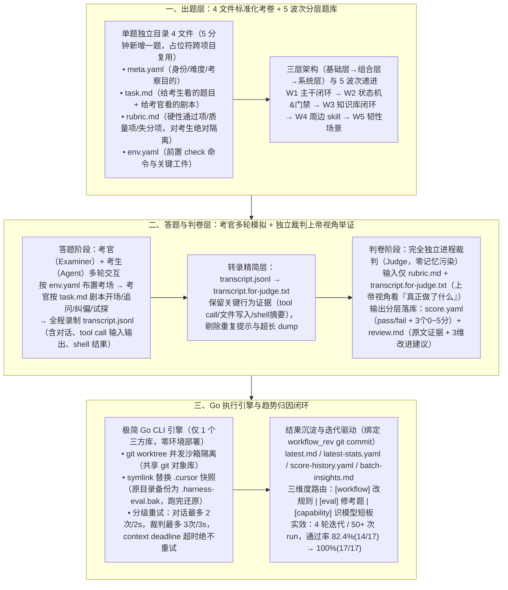

# 你的 Harness 工作流真的在进步吗？我们用一场考试撕掉了遮羞布

> **原文信息**：作者 `chaseren`，发布于 2026-06-18 03:20（内蒙古），公众号「腾讯技术工程」原创。

---

## 1. TL;DR

1. **告别「主观 Vibes」驱动的薛定谔式退化** —— Harness 工作流本质是「规则驱动的概率程序」（输出由 `Prompt + Rules + Skills + Model` 共同决定），微调任一环都可能修好 1 个 bad case 却暗中破坏 3 个 good case；为此团队构建了轻量可回归的闭环评测系统 **Harness Eval**，完成从「二值测试（验证对不对）」到「多维考试（评估好不好 + 证据 + 改进建议）」的思维跃迁，坚守**可重复 > 精确、可归因 > 高分、闭环 > 单向**三大原则。
2. **5 分钟新增一题的 4 文件标准考卷 + 5 波次题库** —— 每道题是一个独立目录，由 **`meta.yaml`（试卷头）、`task.md`（题面+考官剧本）、`rubric.md`（阅卷标准，考生绝对不可见）、`env.yaml`（考场环境前提）** 4 个文件构成（路径/服务名用占位符实现跨项目复用）；题库按「**波次 1 主干闭环 → 波次 2 状态机与门禁 → 波次 3 知识库闭环 → 波次 4 周边 skill → 波次 5 韧性场景**」5 个递进层次铺开。
3. **反直觉设计：引入「考官（Examiner）」与「判卷完全独立于对话」** —— 真实场景不是把 `task.md` 丢给 Agent 自嗨，而是由 LLM 扮演 **考官（Examiner）** 按剧本与考生（被测 Agent）多轮交互（追问、纠偏、故意试探未确认分支的操作）并全程录制 `transcript.jsonl`；同时吸取早期「让考官顺便判分导致极高误判率（考官只有对话视角看不到 tool call 细节）」的惨痛教训，由**完全独立进程的裁判（Judge）** 消费 `rubric.md` 与精简后的 **`transcript.for-judge.txt`（上帝视角）** 逐帧举证打分。
4. **双轨制打分 + 强制三维度归因闭环** —— 裁判分层输出 **`score.yaml`**（`result: pass/fail` + `compliance / execution_quality / overall` 三个 `0~5` 分维度 + `summary`）与 **`review.md`**（必须引用 `transcript` 原文的 `evidence` + 强制按 **`[workflow]` / `[eval]` / `[capability]`** 三维度分类的 `improvements`），汇总进 `batch-insights.md` 并绑定 `workflow_rev`（git commit）追踪每次迭代涨跌。
5. **零框架单二进制 Go 引擎与实战提效** —— 执行引擎用 **Go 编写为单一 CLI 程序（仅引入 1 个外部三方库，无 ORM/Web Server）**，利用 **`git worktree`** 实现多题并发沙箱隔离，用 **`symlink`（原配置备份为 `.harness-eval.bak`）** 动态挂载被测工作流快照，并实施分级瞬时错误重试（对话最多 2 次/间隔 2s，裁判最多 3 次/间隔 3s，超时绝不重试）；内部经 **4 轮 `workflow_rev` 迭代、50+ 次自动化 run**，使工作流整体通过率从 **82.4%（14/17）提升至 100%（17/17）**，多道关键题从 1–2 分升至满分 5 分。

---

## 2. 问题定义与背景

### 2.1 为什么要写这篇？

许多团队花了两周打磨出一套包含十几条 Rules 和 Skills 的 Harness 工作流后，评估好坏却全靠「感觉这版稳了不少」「昨天那版好像更聪明」的**主观 Vibes**。
- **为什么传统软件的 `assertEqual` 单元测试不够用？** 传统软件是确定性的二值判定；而 Harness 工作流是受 `Prompt + Rules + Skills + Model` 联合影响的**概率程序**，完成任务的方式是一个光谱（主动确认 vs 被追问才补、先跑 `dry-run` vs 直接改线上配置、遇异常主动汇报 vs 擅自冒险）。没有量化评测兜底，工作流就会陷入**「薛定谔式的退化」**——你永远不知道哪次改 Rule 把好好的历史能力改崩了。
- **三大不可妥协的设计原则**：
  1. **可重复 > 精确**：追求多次运行的统计显著趋势，而非单次满分；
  2. **可归因 > 高分**：必须说清是工作流规则漏洞、题目歧义还是模型能力短板；
  3. **闭环 > 单向**：评测终点不是一张成绩单，而是直接生成下一轮修改清单。

---

## 3. 知识框架

---

## 4. 核心内容拆解

### 4.1 出题设计：4 文件解耦、占位符复用与 5 波次递进

1. **一道题 = 4 个标准文件（外加可选 `fixtures`）**：
   - **`meta.yaml`（试卷头）**：定义题目 `id`、版本、类别、难度、考察目的；
   - **`task.md`（题干与剧本）**：包含给考生看的题目原话 + 给考官看的多轮应答剧本；
   - **`rubric.md`（答案与给分标准）**：明确硬性通过项、质量项与典型失分项（**严格隔离：考生只能看到 `task.md`，永远看不到 `rubric.md`**，杜绝照抄答案）；
   - **`env.yaml`（考场布置）**：声明前置条件 `check` 命令与关键工件。
   - **低门槛与跨项目复用**：新出题人无需懂代码，按模板填 4 个文件 **5 分钟**即可新增一题；所有路径、服务名、需求 ID 统一使用**占位符**，换项目接入只需更新「变量配置文件」。
2. **题库分层与 5 波次覆盖路线**：
   - **三层结构**：基础层（一题一焦点）→ 组合层（能力串联）→ 系统层（端到端）。
   - **5 波次递进主题**：
     - **波次 1（主干闭环）**：`规划 → 执行 → 检查 → 归档` 的最小可用闭环；
     - **波次 2（状态机 & 门禁）**：`HARD GATE` 拦截、分支确认、范围锁定；
     - **波次 3（知识库闭环）**：检索引用、写入冲突检测、全量审计；
     - **波次 4（周边 skill）**：提交规范、TDD 纪律、发布验证；
     - **波次 5（韧性场景）**：失败修复循环、`Critical` 拦截、多分支冲突。

---

### 4.2 答题与阅卷：为什么必须引入「考官」且让「裁判」彻底独立？

1. **为什么不能直接把 `task.md` 丢给 Agent 单轮跑完？（考官 Examiner 的价值）**
   - 真实世界里用户与 Agent 是多轮交互的（用户初期表述带模糊、中途会追问、关键节点做决策）。去掉交互测出来的只是「Agent 自嗨的能力」。
   - **考官（Examiner）机制**：由 LLM 按 `task.md` 剧本扮演用户——例如剧本规定*「如果考生没有主动确认分支名就直接操作，考官要追问一句『你确定是在正确的分支上吗？』」*；全过程完整录制为 `transcript.jsonl`（含每轮对话、每次 `tool call` 输入输出、每条 `shell` 执行结果）。
2. **过程质量区分度：不只看「做没做到」，更看「怎么做到的」**
   - 同样完成任务，A 在第一步主动确认关键参数、执行前跑 `dry-run`、遇异常主动汇报等待决策；B 被追问才补参数、直接改线上配置、擅自决定高风险方案——单看结果都是 `pass`，但过程行为质量天差地别。
3. **最痛踩坑复盘：为什么绝不能让「考官」顺便判分？**
   - **早期踩坑**：最初让全程参与对话的考官顺便打分，结果误判率极高！因为**考官只有「对话视角」**，只能看到 Agent 嘴上说了句「我已完成操作」，却看不到发生在 `tool call` 里的写文件、跑命令细节，导致 Agent 明明完美执行了所有步骤却被考官判 `fail`（「未充分展示执行过程」）。
   - **独立裁判（Judge）+ 精简转录（`transcript.for-judge.txt`）**：
     - 裁判作为**完全独立的进程**启动，无任何对话记忆污染；
     - 为防止动辄几万行的原始 `transcript.jsonl` 淹没裁判注意力，先压缩生成 **`transcript.for-judge.txt`**（保留所有 `tool call`、文件写入、shell 输出摘要与关键对话节点，剔除重复系统提示与超长文件 dump），赋予裁判高信噪比的**「上帝视角」**。

---

### 4.3 裁判双轨输出与三维度归因路由

裁判拿到 `rubric.md` 与 `transcript.for-judge.txt` 后，严格按 5 步阅卷（逐项核对硬性标准找不到证据即不过 → 评估主动/被动过程质量 → 三维独立打分 → 引用 `transcript` 原文举证 → 强制分类改进建议），分层落盘为两个文件：
1. **`score.yaml`（5 字段结构化指标，适合画趋势图）**：
   - `result`: `pass` | `fail`（二元结论）；
   - `compliance`: `0~5`（流程遵循度）；
   - `execution_quality`: `0~5`（执行/交付质量）；
   - `overall`: `0~5`（综合分）；
   - `summary`: 一句话核心表现摘要。
2. **`review.md`（详细诊断：原文证据 + 三维度改进建议）**：
   - `reason` + `evidence`（必须附上 `transcript` 中的具体 Turn 与原文引用，严禁「整体表现不错」等空泛评语）；
   - **`improvements` 强制三维度分类标签**：
     - **`[workflow]`**：工作流自身（`rules / skills / agents`）该补什么 gate、改什么提示；
     - **`[eval]`**：题目自身问题（`rubric` 模糊、`task` 误导、`env` 不合理，如未区分「主动确认」与「被追问后补充」）；
     - **`[capability]`**：考生暴露的通用模型能力短板（工具使用、多步推理丢失约束）。

---

### 4.4 极简 Go 执行引擎与评测实战成效

1. **单一 Go CLI 执行引擎的三大工程巧思**：
   - **零框架轻量部署**：纯 Go 编写的单一 CLI 程序，**仅引入 1 个外部三方库**，无评测框架、无 ORM、无 Web Server，`go build` 后任何机器直接跑。
   - **`git worktree` + `symlink` 并发无损沙箱**：每个并发 `run` 通过 `git worktree` 创建独立沙箱目录树（共享底层 git 对象库，并发跑 5 道题互不干扰）；评测期间用 **`symlink` 软链接**将沙箱内的 IDE 配置目录（如 `.cursor`）替换为本轮工作流快照，原目录重命名为 **`.harness-eval.bak`** 备份，跑完后原封不动还原（「考试时收走课本换考卷，考完还回课本」）。
   - **分级瞬时错误（transient error）重试策略**：
     - **对话调用（考官/考生每轮交互）**：最多 **2 次尝试，2 秒间隔**，仅对 CLI 崩溃和执行错误重试；
     - **裁判调用（独立判分）**：最多 **3 次尝试，3 秒间隔**，对所有 transient 错误重试；
     - **`context deadline`（超时）**：**绝不重试、绝不兜底**——超时就是超时，重试只会白白浪费 Token。
2. **四类聚合产物与内部落地实效**：
   - 自动生成 `latest.md`、`latest-stats.yaml`、`score-history.yaml`（带 **`workflow_rev` / `coworkflow_rev`** 记录每次工作流 git commit，秒级定位如 `v0.3 (0.4) → v0.4 (0.8) → v0.5 (0.6)` 的退化 commit）及 `batch-insights.md`（按三维度聚类改进建议）。
   - **实战成绩单**：通过标准化考题、**4 轮 `workflow_rev` 迭代、50+ 次自动化 `run`**，系统暴露并修复了范围锁定、`Critical` 拦截、归档沉淀、提交规范、TDD 纪律等缺陷，使团队 Harness 工作流整体通过率从 **82.4%（14/17）提升至 100%（17/17）**，多道关键题 `overall` 从 **1–2 分修复至满分 5 分**。

---

## 5. 数据速查表

| 指标 | 原文数值 | 语境 / 条件 |
| :--- | :--- | :--- |
| 单道考题目录标准文件数與出题耗时 | **4 个核心文件（外加可选 `fixtures`）/ 5 分钟新增一题** | `meta.yaml`、`task.md`、`rubric.md`、`env.yaml` |
| 题库能力分层与铺开波次数 | **3 层（基础/组合/系统）× 5 波次** | 主干闭环、状态机&门禁、知识库闭环、周边 skill、韧性场景 |
| 裁判输出字段总数与落盘文件拆分 | **共 8 个字段，拆分为 `score.yaml`（5 字段）+ `review.md`（3 字段）** | 分数区间均为 **`0~5` 分**（`compliance / execution_quality / overall`） |
| 改进建议（`improvements`）强制分类数 | **3 个维度** | `[workflow]`（工作流规则）、`[eval]`（考题质量）、`[capability]`（模型能力） |
| Go 执行引擎引入的外部三方库数量 | **仅 1 个外部三方库** | 无评测框架、无 ORM、无 Web Server，单二进制 CLI |
| 对话调用与裁判调用瞬时错误重试配置 | **对话最多 2 次（间隔 2s）/ 裁判最多 3 次（间隔 3s）** | 对 `context deadline` 超时错误**0 重试、不兜底** |
| 团队内部评测迭代轮次与自动化运行次数 | **4 轮 `workflow_rev` 迭代 / 50+ 次自动化 `run`** | 驱动「评测 - 修复 - 回归」闭环 |
| 团队 Harness 工作流整体通过率提升 | **从 82.4%（14/17）提升至 100%（17/17）** | 多道关键题目 `overall` 从 **1–2 分修复到满分 5 分** |

---

## 6. 踩坑与教训 / 可迁移的设计原则

| 错误做法 | 失败表现或原因 | 原文应对 |
| :--- | :--- | :--- |
| 靠团队成员「感觉这版稳了不少」的主观 Vibes 迭代 Rules 和 Skills | 陷入「薛定谔式的退化」——修好 1 个 bad case 却暗中破坏 3 个 good case 而不自知，无法回答版本对比与归因 | 建立 **Harness Eval** 闭环考试体系，将每次运行与工作流 git commit（`workflow_rev`）绑定，用量化分布与归因替代体感 |
| 评测时直接把静态 `task.md` 丢给 Agent 单轮跑完看最终结果 | 脱离真实多轮交互场景（测成了「Agent 自嗨能力」），且无法区分「主动确认参数、先跑 `dry-run`」与「被追问才补、直接改线上」的过程质量差异 | 引入由 LLM 扮演的 **考官（Examiner）** 按剧本多轮追问、纠偏与试探，并全程录制 `transcript.jsonl` 考察过程决策质量 |
| 让参与多轮对话的考官（Examiner）「顺便」给考生的表现打分 | **误判率极高**：考官只有「对话视角」（只看到 Agent 嘴上说已完成），看不到 `tool call` 里的写文件与跑命令细节，导致完美执行的考生被判 fail | **判卷与对话彻底解耦**：启动完全独立进程的 **裁判（Judge）**，输入仅含 `rubric.md` 与保留 `tool call` 证据的精简版 **`transcript.for-judge.txt`（上帝视角）** |
| 把动辄几万行的原始 `transcript.jsonl` 原封不动丢给裁判模型，或允许裁判输出空泛评语 | 裁判被冗余系统提示和超长文件 dump 淹没导致判断失准；空泛分数无法指导下一步改什么 | 先做一层转录压缩剔除噪声；强制要求裁判每条判定**必须引用 `transcript` 原文作为 `evidence`**，且改进建议必须按 **`[workflow] / [eval] / [capability]`** 三维分类 |
| 多道考题并发评测时直接操作同一个工作区与 `.cursor` 配置目录，或对超时错误无脑重试 | 并发任务互相覆盖 `.cursor` 软链、搅乱 git 分支；对 `context deadline` 超时重试纯属白烧 Token | 用 **`git worktree`** 隔离并发沙箱，用 **`symlink` + `.harness-eval.bak`** 无损挂载并还原配置；仅对瞬时崩溃重试（对话 2次/2s、裁判 3次/3s），**超时绝不重试** |

---

## 7. 记忆锚点

1. **核心金句**：「**测试验证的是『对不对』（二值判定），考试评估的是『好不好』（多维度打分 + 原文证据 + 三维改进建议）——不可量化的东西，不可优化**。」
2. **三角色解耦链**：**考生（Agent，只看 `task.md`）** ↔ **考官（Examiner，按剧本多轮对话，无权判分）** → **精简转录（`transcript.for-judge.txt`）** → **独立裁判（Judge，拿 `rubric.md` 以『上帝视角』逐帧举证打分，输出 `[workflow] / [eval] / [capability]`）**。
3. **实战提效数字**：**4 个考卷文件（5 分钟出题）** × **5 波次题库** × **4 轮 `workflow_rev` / 50+ 次 run** → 通过率 **82.4% (14/17) 跃升至 100% (17/17)**。

---

## 8. 复习卡片

1. 为什么传统的单元测试（`assertEqual`）无法满足 Harness 工作流的评估需求，Harness Eval 确立了哪三条核心原则？::因为 Harness 工作流是由 `Prompt + Rules + Skills + Model` 共同决定的「规则驱动的概率程序」，其正确性不是非黑即白的布尔值，而是包含主动性、严谨度在内的过程光谱；为此确立了三条原则：① 可重复 > 精确（看多次运行的统计趋势）；② 可归因 > 高分（必须分清是规则漏洞、题目歧义还是模型短板）；③ 闭环 > 单向（直接产出下一轮修改清单）。
2. 在 Harness Eval 中，一道标准考题由哪 4 个文件构成，是如何做到「防作弊」与「跨项目一键复用」的？::由 `meta.yaml`（题目身份与难度）、`task.md`（题面与考官剧本）、`rubric.md`（阅卷标准）、`env.yaml`（环境前提）4 个文件构成（5 分钟即可新增一题）；防作弊上严格隔离题面与阅卷标准，考生只能看到 `task.md`、绝看不到 `rubric.md`；跨项目复用上将所有路径、服务名、需求 ID 统一写为占位符，换项目只需更新变量配置文件。
3. 为什么 Harness Eval 要引入「考官（Examiner）」角色，又为什么早期让考官「顺便判分」会踩大坑？::引入考官是为了模拟真实世界中用户与 Agent 的多轮交互（追问、纠偏、试探是否确认分支），避免测成「Agent 自嗨能力」；但考官只有「对话视角」，只能看到 Agent 嘴上说了什么，看不到发生在 `tool call` 里的写文件和跑命令细节，导致误判率极高；因此必须将判卷交由完全独立进程的裁判（Judge），消费包含 `tool call` 摘要的精简版 `transcript.for-judge.txt`（上帝视角）。
4. 独立裁判（Judge）输出的结果是如何分层落盘的，其中 `improvements` 字段的强制三维度分类有什么工程价值？::分层落盘为 `score.yaml`（含 `pass/fail` 及 `compliance / execution_quality / overall` 三个 `0~5` 分维度与 `summary`）和 `review.md`（含必须引用 `transcript` 原文的 `evidence` 及 `improvements`）；`improvements` 强制标注 `[workflow]`（工作流规则缺陷）、`[eval]`（考题本身模糊或误导）、`[capability]`（模型通用能力短板），汇总进 `batch-insights.md` 后可直接路由给不同负责人改进。
5. Harness Eval 的 Go 执行引擎是如何通过 `git worktree`、`symlink` 和分级重试机制实现无人值守并发评测的？::引擎用纯 Go 编写为仅含 1 个外部三方库的单一 CLI；通过 `git worktree` 为每个并发 run 创建共享对象库的独立沙箱；用 `symlink` 将沙箱内的 `.cursor` 等配置替换为本轮工作流快照（原目录备份为 `.harness-eval.bak`，跑完还原）；对对话瞬时崩溃最多重试 2 次（间隔 2s），对裁判最多重试 3 次（间隔 3s），而对 `context deadline` 超时绝不重试以免浪费 Token。
6. 团队使用 Harness Eval 在内部完成了怎样的迭代闭环，取得了什么量化效果？::题库按「主干闭环 → 状态机&门禁 → 知识库闭环 → 周边 skill → 韧性场景」5 波次铺开，每次运行绑定 `workflow_rev`（git commit）；经 4 轮 `workflow_rev` 迭代、50+ 次自动化 run，系统暴露并修复了范围锁定、Critical 拦截、TDD 纪律等缺陷，使整体通过率从 82.4%（14/17）提升至 100%（17/17），多道关键题从 1–2 分升至满分 5 分。

---

## 9. 知识关联

- **已有主题**：[Agent评测与反馈](../../20_topics/Agent%E8%AF%84%E6%B5%8B%E4%B8%8E%E5%8F%8D%E9%A6%88.md) · [Harness与模型协同](../../20_topics/Harness%E4%B8%8E%E6%A8%A1%E5%9E%8B%E5%8D%8F%E5%90%8C.md) · [因果推断与评测归因](../../20_topics/%E5%9B%A0%E6%9E%9C%E6%8E%A8%E6%96%AD%E4%B8%8E%E8%AF%84%E6%B5%8B%E5%BD%92%E5%9B%A0.md)
- **候选新主题**：[[HarnessEval工作流考试]] · [[考官与独立裁判解耦]] · [[三维归因反馈闭环]]

---

## 10. 原文参考资料

1. **Harness Eval 系统组件與工具链**：Go CLI 执行引擎、`git worktree`、Cursor / CodeBuddy CLI、以及内部评测产出的 `score.yaml`、`review.md`、`latest.md`、`score-history.yaml`、`batch-insights.md`。

> [!note]- 校对报告
> - **校对状态**：已根据 `MD.md` 全文（共 13 页 PDF 转写文本）逐一核对。
> - **核心数据与事实页码溯源**：
>   - 主观 Vibes 驱动痛点、Harness Eval 定位、「规则驱动的概率程序（`Prompt + Rules + Skills + Model`）」、薛定谔式退化、从「测试（对不对）」到「考试（好不好）」跃迁、三大原则（可重复>精确、可归因>高分、闭环>单向）：见 PDF 第 1–2 页。
>   - 出题→答题→改卷闭环图、单题 4 文件表（`meta.yaml`、`task.md`、`rubric.md`、`env.yaml`）、5 分钟新增一题、考生看不到 `rubric.md`、占位符跨项目复用、三层架构与 5 波次题库表：见 PDF 第 3–4 页。
>   - 考官（Examiner）多轮交互设计、五步考试流程、`transcript.jsonl` 全程录像、A 与 B 过程决策质量对比、早期让考官顺便判分导致高误判率踩坑（对话视角看不到 `tool call`）：见 PDF 第 5–6 页。
>   - 独立进程裁判（Judge）、`transcript.for-judge.txt` 压缩（上帝视角）、5 步阅卷流程、`score.yaml`（5 字段，`0~5` 分）与 `review.md`（原文 `evidence` + `[workflow]/[eval]/[capability]` 三维分类）共 8 个字段分层落库：见 PDF 第 6–8 页。
>   - Go 单一 CLI 执行引擎（仅 1 个三方库）、`git worktree` 并发跑 5 道题隔离、`symlink` 替换 `.cursor` 与 `.harness-eval.bak` 备份还原、分级重试（对话最多 2 次/2s 间隔、裁判最多 3 次/3s 间隔、`context deadline` 超时绝不重试）、四类结果文件与 `workflow_rev` 追踪：见 PDF 第 8–10 页。
>   - 评测效果：整体通过率从 82.4%（14/17）提升到 100%（17/17），4 轮 `workflow_rev` 迭代、50+ 次自动化 run，关键题目 `overall` 从 1–2 分升至满分 5 分：见 PDF 第 10–11 页。
