# 技术教科书：顶级开发团队设计的Harness工程项目源码什么样

## 1. TL;DR

1. **51.2 万行工业级 Harness 源码全景揭示核心铁律——“模型调用代码占比不到 5%”**：通过对某顶级 AI Agent 团队（Claude Code 架构级）**1,884 个 TypeScript 文件、512,000+ 行代码** 的深度拆解，发现核心 `query()` 主循环的 **16 个步骤中只有第 8 步是“调用模型”，其余 15 个步骤全部用于前置预算、四级压缩、权限拦截与恢复验证**——证明生产级 Agent 的真正壁垒不在模型调用，而在围绕模型构建的“高速公路与护栏”。
2. **毫秒级偏执的四层启动链与 34 行极简状态管理**：选用比 Node.js 启动快 **4~6 倍** 的 **Bun** 运行时，利用编译时特性门控 `feature()` 实现死代码剥离（DCE），对 `OpenTelemetry (~400KB)`、`gRPC (~700KB)`、`insights.ts (113KB)` 与内置 Fork 版 `Ink` 渲染引擎（48 个文件、核心 `246KB`）实施极致按需懒加载；抛弃 30KB 的 Redux，仅用 **34 行代码** 实现带不可变约束的 Observer `MiniStore`。
3. **异步生成器（Async Generator）查询引擎、四级压缩管道与流式工具并发**：`query()` 采用 `async generator` 实现流式 UI 渲染、Ctrl+C 任意 `yield` 点中断与天然背压控制；内置 **`Snip Compact → Micro Compact → Context Collapse → Auto Compact` 四级上下文压缩管道** 与三层 `max_output_tokens` 截断恢复策略；`StreamingToolExecutor` 在模型流式输出中途即并发启动只读安全工具（如 `WebFetch / WebSearch`），并通过每次 `query()` 锁定 **Statsig/GrowthBook 特性开关快照** 保证单次查询内行为确定性。
4. **7 种任务类型、控制/数据面分离的 Agent Swarms 与 AutoDream 睡眠记忆**：支持 `local_bash (b)`、`local_agent (a)`、`remote_agent (r)`、`in_process_teammate (t)`、`local_workflow (w)`、`monitor_mcp (m)`、`dream (d)` **7 类任务**；Coordinator 线程仅保留 **3 个调度工具**（`AgentTool / TaskStopTool / SendMessageTool`）严禁亲自写代码，Teammates 间通过 **Unix Domain Socket（延迟 `~50μs` vs HTTP `~500μs`）** 通信；更内置需满足“至少 5 次会话 + 文件锁空闲”门控的 **AutoDream（66 行整合 Prompt）** 后台记忆整理、`Mulberry32` 确定性宠物 **Buddy** 与 `/btw` 旁路 Fork 问答。

## 2. 问题定义与背景

### 2.1 从 Prompt / Context 到 Harness Engineering 的代际跃迁
| 演进阶段 | 时间窗口 | 核心解决的问题 | 形象类比 |
| :--- | :--- | :--- | :--- |
| **Prompt Engineering** | 2023–2024 | 如何让模型听懂单次意图 | 对马喊话的技巧 |
| **Context Engineering** | 2025 | 如何给模型提供正确的知识边界 | 给马看地图 |
| **Harness Engineering** | 2026– | **如何让 Agent 在长周期复杂环境中可靠、持续、不失控** | **造高速公路，配护栏、收费站和限速牌** |

### 2.2 为什么顶级 CLI Agent 代码量高达 51.2 万行？
对比同类开源工具（Aider 约 `30K` 行、OpenHands 约 `100K` 行），该项目包含 `~1,332` 个 `.ts` 与 `~552` 个 `.tsx` 共 **1,884 个文件、512,000+ 行严格类型（TypeScript strict）代码**（其中最大单文件 `screens/REPL.tsx` 达 **875KB / 约 25,000 行**，次大文件 `main.tsx` 约 `4,684 行 / 编译后 785KB`，系统提示词模板 `constants/prompts.ts` 达 `53KB`）。如此庞大的体量并非业务冗余，而是为了在终端里跑通一套包含自研 TUI 渲染引擎、完整 Vim 状态机、五层纵深权限、流式工具调度与多 Agent 协同的完整操作系统。

## 3. 知识框架

```mermaid
flowchart TD
    subgraph PerfBoot["一、Part 1~2：技术选型与毫秒级四层启动链"]
        Bun["Bun 运行时 (比 Node.js 启动快 4~6倍) + 编译时 feature() DCE 死代码剥离"]
        Lazy["极致懒加载: OpenTelemetry(~400KB) · gRPC(~700KB) · insights(113KB) · 非交互模式免载 Ink"]
        Store["极简架构: 34行 Observer MiniStore (替代30KB Redux) + 内置 Fork 版 Ink (48文件/246KB)"]
        Bun --> Lazy --> Store
    end

    subgraph EngineAndTool["二、Part 3~4：泛型工具基座与 16 步 Async Generator 查询引擎"]
        Tool["Tool<Input,Output,Progress> 泛型契约 + 五层权限纵深防御<br/>Deny Rules(不可见) → Tool Permissions → Generic Rules → AutoClassifier → 用户弹窗<br/>StreamingToolExecutor: 流式生成中途并发抢跑只读安全工具"]
        Loop["query() 异步生成器主循环 (16步中仅第8步调模型，其余15步全为验证/压缩/恢复)<br/>• 四级压缩管道: Snip Compact → Micro Compact → Context Collapse → Auto Compact<br/>• 三层 max_output_tokens 截断恢复 · Statsig/GrowthBook 会话内快照防漂移"]
        Tool --> Loop
    end

    subgraph MultiAgent["三、Part 5~8：多 Agent 编排、TUI 与认知科学彩蛋"]
        Swarm["7种任务类型 (b/a/r/t/w/m/d) & 控制面/数据面分离<br/>Coordinator 仅持 3 个调度工具 · Worker 持全套读写工具<br/>Teammates 走 Unix Domain Socket (~50μs 延迟 vs HTTP ~500μs)"]
        Easter["认知科学与工程彩蛋<br/>• AutoDream (d): ≥5次会话+文件锁门控，66行 Prompt 四阶段后台睡眠整合记忆<br/>• /btw: 零污染 Fork 独立子 Agent 回答旁路问题<br/>• Buddy 终端精灵: Mulberry32 种子确定性生成 + fromCharCode 绕过构建 Canary 扫描"]
        Swarm --> Easter
    end

    PerfBoot --> EngineAndTool --> MultiAgent
```

## 4. 核心内容拆解

### 4.1 性能工程：四层启动链、编译期裁剪与 34 行状态机

1. **四层极速启动链與并行预热**：
   - **Layer 1（`cli.tsx` 零导入快筛）**：遇到 `--version` 直接输出退出（零模块导入）；遇到 `--dump-system-prompt` 走最小导入路径；遇到后台守护进程参数直接拉起 `run_daemon_worker`；同时利用 Bun bundler 的 `feature()` 实现编译期特性门控（未开启特性的代码在打包时被彻底剔除）。
   - **Layer 2（`main.tsx` 并行预加载）**：在解析 CLI 参数的同时并发启动配置文件读取、凭证校验与环境探测三个耗时 I/O 操作。
   - **重量级模块懒加载清单**：`OpenTelemetry`（`~400 KB`）延后至遥测初始化加载、`gRPC (grpc-js)`（`~700 KB`）进一步延后至 Exporter 激活、`/insights` 命令模块（`113 KB`）通过 Shim 在用户输入命令时才加载，且在 `-p` 非交互模式下完全跳过 React/Ink 渲染树加载。
2. **Fork 内置 Ink 引擎与 34 行 `MiniStore`**：
   - 为彻底掌控终端重绘、光标闪烁与自定义布局，团队没有直接引用外部 npm 包，而是将 **Ink 渲染引擎（48 个文件、核心文件 `246 KB`）完整 Fork 内置** 于 `src/ink/`，并在 `src/vim/` 下手写了包含 `motions.ts`、`operators.ts`、`textObjects.ts` 的完整 Vim 模态编辑器（尽管作者也指出 `screens/REPL.tsx` 膨胀至 **875KB / 2.5 万行** 属于“先跑通再拆分”的巨型组件反模式）。
   - 状态管理舍弃了动辄 `30KB` 且带中间件遍历开销的 Redux，用仅 **34 行代码** 编写了带 `@frozen` 不可变类型约束的 `MiniStore`。

### 4.2 工具系统与 16 步 `query()` 异步生成器核心循环

1. **强类型 `Tool<Input, Output, Progress>` 与五层权限纵深防御**：
   - 每个工具不仅定义执行逻辑，还内聚 UI 渲染方法（`renderToolUseMessage`）与安全分类器转换接口（`toAutoClassifierInput`），并显式声明是否**并发安全**与是否**只读**（如 `WebFetchTool`、`WebSearchTool` 为并发安全+只读；`SkillTool`、`TodoWriteTool` 为非并发安全）。
   - **五层权限防线（Fail-Closed）**：`Deny Rules`（黑名单工具对模型完全不可见）→ `Tool-level Permissions`（工具自检）→ `Generic Rules`（路径/命令规则匹配）→ `AutoClassifier`（安全分类器实时风险评估）→ 终端用户交互确认。
   - **`StreamingToolExecutor` 流式抢跑**：不等 LLM 吐完整个 Turn 的全部文本，只要流式解析出一个完整的 `tool_use` 块且判定为并发安全，立即在后台线程启动执行（状态流转：`queued → executing → completed → yielded`）。
2. **为什么核心主循环 `query()` 要用异步生成器（Async Generator）？**
   - ① **流式 UI 渲染**：每产生一条中间消息或工具进度即 `yield`，外层 `async for` 实时驱动终端重绘；② **任意点优雅中断**：用户按下 `Ctrl+C` 时，可在任意 `yield` 挂起点直接调用 `.close()` 终止并清理资源；③ **天然背压控制（Backpressure）**：UI 渲染消费慢时生成端自然暂停，绝不无限堆积内存。
3. **16 步循环里的“1 vs 15”真相与四级压缩管道**：
   - 在 `query()` 的 `while(true)` 16 个步骤中，**只有第 8 步是 `callModel`（调用大模型），其余 15 步全是工程护栏**：
     - **四级上下文压缩管道**：**Level 1 `Snip Compact`**（裁剪历史冗余标记）→ **Level 2 `Micro Compact`**（精细编辑与清理过期工具缓存）→ **Level 3 `Context Collapse`**（折叠长链路中间过程）→ **Level 4 `Auto Compact`**（预留 `reservedTokensForSummary` 触发全量结构化摘要压缩）。
     - **三层 `max_output_tokens` 截断自愈**：当输出因 `stop_reason === 'max_output_tokens'` 被截断时，依次尝试自动调高输出 Token 上限重发、注入续写提示词分段拼接或优雅降级报错。
     - **特性开关会话内快照**：在 `QueryEngine` 初始化时对 `Statsig / GrowthBook` 远端动态配置拍下静态快照，防止单次多轮查询中途因服务端推送新配置导致前后迭代行为不一致。
     - **极致解耦的依赖注入**：`QueryDeps` 仅暴露 `callModel`、`microcompact`、`autocompact`、`uuid` **4 个字段**，使替换底层模型或单元测试 Mock 只需替换 `callModel` 一个函数指针。

### 4.3 多 Agent 编排（7 类任务 + UDS 通信）与三大隐藏工程彩蛋

1. **七种任务类型与控制面/数据面物理分离**：
   - `src/Task.ts` 通过单字母前缀 ID 统一管理 **7 种任务**：`local_bash ('b')`、`local_agent ('a')`、`remote_agent ('r')`、`in_process_teammate ('t')`、`local_workflow ('w')`、`monitor_mcp ('m')`、`dream ('d')`。
   - **Coordinator 控制面与数据面分离**：Coordinator（协调器）线程被严格剥夺了读写文件与跑 Shell 的能力，**全身上下只有 3 个工具**（`AgentTool`、`TaskStopTool`、`SendMessageTool`），逼迫其专心做任务拆解与派发；真正的脏活累活全由持有 `ASYNC_AGENT_ALLOWED_TOOLS` 的 Worker Agent 执行。
   - **微秒级 IPC 通信**：Agent Swarms 中的 Teammates 绝不共享原始长上下文，而是通过 `SendMessageTool` 经 **Unix Domain Socket (UDS)** 传递结构化消息，通信延迟仅 **`~50μs`**（比本地 HTTP 的 `~500μs` 快 **10 倍**）。
2. **源码深处的三大隐藏工程彩蛋**：
   - **彩蛋一：`AutoDream`（后台睡眠记忆整合，`TaskType = 'd'`）**
     - 启发自认知科学睡眠巩固理论，在后台静默运行，但设有严苛的**三重触发门控**：① 时间冷却门控；② **会话门控（至少经历了 `5 次` 对话会话）**；③ **进程文件锁门控（未被其他实例持有）**。核心由一段 **66 行** 的 `consolidationPrompt` 驱动四阶段记忆去重、提炼与归档。
   - **彩蛋二：`/btw`（“顺便问一句”零污染旁路问答）**
     - 当正在重构代码时突然想查一个无关语法问题（如“JWT 过期字段叫什么”），输入 `/btw ...` 会立即 **Fork 一个只读独立子 Agent** 回答该问题，答完即焚，**绝不污染主会话的上下文历史与 Prompt Cache**。
   - **彩蛋三：`Buddy` 终端伴侣精灵（`src/buddy/`）**
     - 基于用户 ID 与 **`Mulberry32` 确定性伪随机数生成器（PRNG）** 为每位开发者生成一只独一无二且跨设备恒定的像素宠物（含智慧 `WISDOM`、毒舌 `SNARK` 等 Peak/Dump 巅峰与短板属性）；且源码中为了防止未公开物种名被构建期的 Canary 字符串字面量扫描器检出，巧妙使用 `String.fromCharCode(99, 97, 116)`（即 `'cat'`）进行了编码隐藏。

## 5. 数据速查表

| 指标 | 原文数值 | 语境 / 条件 |
| :--- | :--- | :--- |
| **项目代码总规模与文件组成** | `512,000+ 行`；共 `1,884 个` 文件（`~1,332` `.ts` + `~552` `.tsx`） | 对比 Aider `~30K` 行、OpenHands `~100K` 行 |
| **最大单文件与系统提示词体积** | `screens/REPL.tsx` `875 KB`（约 `25,000 行`）；`main.tsx` `785 KB`（`4,684 行`）；`prompts.ts` `53 KB` | 内置 Fork 版 Ink 渲染引擎共 `48 个` 文件、核心 `246 KB` |
| **Bun 运行时启动提速倍数** | 比 Node.js 启动快 `4~6 倍` | 配合 `feature()` 编译期特性门控实现 Dead Code Elimination |
| **重量级模块懒加载省下的体积** | `OpenTelemetry` `~400 KB`、`gRPC` `~700 KB`、`insights.ts` `113 KB` | 延迟至真正使用或遥测初始化时才动态导入 |
| **极简状态管理 `MiniStore` 代码量** | `34 行`（约 `30 行` 核心实现）vs Redux `30 KB` | 基于 Observer 模式 + `@frozen` 不可变约束 |
| **`query()` 循环步数与模型调用代码占比** | 共 `16 个` 步骤（仅第 `8` 步调模型，其余 `15` 步为护栏）；模型调用代码占全库 `< 5%` | Harness Engineering“瓶颈在基建不在模型”的核心实证 |
| **上下文压缩管道与依赖注入规格** | `4 级` 压缩管道（Snip/Micro/Collapse/Auto）；`QueryDeps` 仅 `4 个` 字段 | `max_output_tokens` 具备 `3 层` 恢复策略 |
| **多 Agent 任务类型与 Coordinator 工具数** | `7 种` 任务类型（`b/a/r/t/w/m/d`）；Coordinator 仅持 `3 个` 工具 | `AgentTool`、`TaskStopTool`、`SendMessageTool` |
| **Unix Domain Socket (UDS) 通信延迟** | `~50 μs`（对比 HTTP 的 `~500 μs` 快 `10 倍`） | Agent Swarms 中 Teammates 之间传递结构化消息的 IPC 延迟 |
| **`AutoDream` 睡眠整合门控与模板行数** | 至少经历 `5 次` 会话 + 时间门控 + 文件锁门控；核心 Prompt 共 `66 行` | 四阶段后台自动整合碎片化记忆 |

## 6. 踩坑与教训 / 可迁移的设计原则

| 错误做法 | 失败表现或原因 | 原文应对（可迁移的设计原则） |
| :--- | :--- | :--- |
| **在 CLI 工具入口顶层直接静态 `import` 遥测（OpenTelemetry/gRPC）与全量 UI 组件** | 每次敲 `--version` 或跑 `-p` 批处理命令都要先花数百毫秒解析上兆字节的无用依赖 | **四层启动链 + 编译期 `feature()` DCE + 懒加载 Shim**：`--version` 零导入秒退，`-p` 模式不加载 Ink，重型模块延后至首次调用时动态加载 |
| **在 Agent 循环迭代过程中实时读取远端特性开关（Statsig / GrowthBook）** | 会话中途服务端推送配置变更，导致同一次 `query()` 前后轮次的工具行为或压缩阈值突变，产生无法复现的幽灵 Bug | **查询级配置快照（Per-Query Snapshot）**：在 `QueryEngine` 启动时拍下特性开关静态快照，确保单次查询生命周期内 100% 行为确定性 |
| **给主控 Coordinator Agent 挂载与 Worker 相同的全套读写文件与执行 Shell 工具** | 主控 Agent 忍不住“自己挽起袖子下场改代码”，导致高层调度职责迷失且主上下文被底层日志塞爆 | **控制面与数据面物理隔离**：Coordinator 仅保留 `AgentTool / TaskStopTool / SendMessageTool` 3 个工具，强制其只做调度不干脏活 |
| **在正在进行复杂重构的主对话中直接穿插提问无关的旁路小问题** | 旁路问答打断主线思维链，且无关内容永久留在主上下文中消耗后续每一轮的 Token | **提供 `/btw` 旁路 Fork 机制**：一键基于当前状态 Fork 出独立临时 Agent 回答旁路问题，用完即销毁，主会话零污染 |
| **把所有功能无节制地塞进同一个顶层 UI 组件（如 875KB / 2.5 万行的 `REPL.tsx`）** | 形成难以维护的“上帝组件（God Component）”，增加新人认知负担与合并冲突概率 | **警惕巨型组件反模式，按职责域拆分 Screen 与 Hook**：用 34 行 `MiniStore` 配合细粒度领域 Hooks 保持视图层轻量化 |

## 7. 记忆锚点

- **“51.2 万行代码里模型调用不到 5%，query() 16 步里只有第 8 步是调模型”**：这组数字就是对 Harness Engineering 最震撼的注解——顶尖 Agent 95% 的代码都在修路、装护栏、做四级压缩与五层权限兜底。
- **“Coordinator 只拿 3 把钥匙（派活/叫停/发信），Teammates 走 50μs UDS 传信，AutoDream 满 5 次会话做 66 行睡眠梦境整合，`/btw` 旁路问答不脏主线”**：多 Agent 编排与认知记忆工程的四颗明珠。

## 8. 复习卡片

1. 在这个 51.2 万行代码的工业级 Harness 项目中，`query()` 主循环的步骤构成与模型调用代码占比揭示了什么工程真相？::`query()` 的 `while(true)` 循环共有 `16 个` 步骤，其中只有第 `8` 步是“调用模型”，其余 `15 个` 步骤全部是前置预算、四级上下文压缩、权限校验与异常恢复逻辑；全库 `512K+` 行代码中与模型调用直接相关的代码占比**不到 5%**，证明 AI Agent 的核心瓶颈在基础设施而非模型本身。
2. 该项目是如何通过运行时选型、四层启动链和懒加载实现 CLI 毫秒级启动性能的？::选用比 Node.js 启动快 `4~6 倍` 的 Bun 运行时，并用 `feature()` 实现编译时死代码剥离（DCE）；`cli.tsx` 对 `--version` 零导入直接返回；`main.tsx` 并行启动配置与凭证预热；对 `OpenTelemetry (~400KB)`、`gRPC (~700KB)`、`/insights (113KB)` 实施按需懒加载，且在 `-p` 非交互模式下完全不加载 React/Ink。
3. 为什么核心 `query()` 函数被设计为异步生成器（Async Generator）？它内置的四级上下文压缩管道依次是什么？::异步生成器可实现流式 UI 实时渲染、支持用户按 `Ctrl+C` 在任意 `yield` 点调用 `.close()` 优雅中断，并提供天然的消费背压控制；四级压缩管道依次为：`Level 1 Snip Compact`（裁剪历史标记）→ `Level 2 Micro Compact`（缓存编辑压缩）→ `Level 3 Context Collapse`（上下文折叠）→ `Level 4 Auto Compact`（全量摘要压缩）。
4. 什么是 `StreamingToolExecutor`？系统的五层权限安全模型是如何层层递进的？::`StreamingToolExecutor` 允许在模型流式输出尚未结束时，一旦解析出并发安全的只读工具调用（如 `WebFetch / WebSearch`）就立即在后台并发执行；五层权限防线依次为：`Deny Rules`（黑名单不可见）→ `Tool-level Permissions`（工具自检）→ `Generic Rules`（规则匹配）→ `AutoClassifier`（安全分类器）→ 终端用户弹窗审批。
5. 在多 Agent 编排（Part 5）中，系统定义了哪 7 种任务类型？Coordinator 模式是如何实现控制面与数据面分离的？::定义了 `local_bash (b)`、`local_agent (a)`、`remote_agent (r)`、`in_process_teammate (t)`、`local_workflow (w)`、`monitor_mcp (m)`、`dream (d)` 7 种任务；Coordinator 线程仅拥有 `AgentTool`、`TaskStopTool`、`SendMessageTool` **3 个工具**（严禁亲自读写文件或跑命令），具体执行全部交由持有完整工具集的 Worker，且 Teammates 间通过延迟仅 `~50μs` 的 Unix Domain Socket 传递结构化消息。
6. 源码中隐藏的 `AutoDream`、`/btw` 和 `Buddy` 三个彩蛋各自体现了什么工程设计巧思？::① `AutoDream` 受认知科学启发，在满足“时间门控 + 至少 `5 次` 会话 + 文件锁空闲”三重门控时，用 `66 行` Prompt 在后台分四阶段整合长期记忆；② `/btw` 通过 Fork 独立子 Agent 处理临时旁路问题，避免打断主工作流和污染主上下文；③ `Buddy` 用 `Mulberry32` 种子 PRNG 保证每个用户的像素宠物确定性一致，并用 `String.fromCharCode` 绕过构建期 Canary 字符串扫描。

## 9. 知识关联

- **本仓库主题索引**：[Harness与模型协同](../../20_topics/Harness%E4%B8%8E%E6%A8%A1%E5%9E%8B%E5%8D%8F%E5%90%8C.md) · [Agent工程循环](../../20_topics/Agent%E5%B7%A5%E7%A8%8B%E5%BE%AA%E7%8E%AF.md) · [Agent成本与上下文预算](../../20_topics/Agent%E6%88%90%E6%9C%AC%E4%B8%8E%E4%B8%8A%E4%B8%8B%E6%96%87%E9%A2%84%E7%AE%97.md) · [Agent任务恢复](../../20_topics/Agent%E4%BB%BB%E5%8A%A1%E6%81%A2%E5%A4%8D.md) · [Agent长期记忆](../../20_topics/Agent%E9%95%BF%E6%9C%9F%E8%AE%B0%E5%BF%86.md)
- **候选双链概念**：[[异步生成器Agent-Loop]] · [[四级上下文压缩管道]] · [[StreamingToolExecutor流式抢跑]] · [[控制面与数据面分离Coordinator]] · [[AutoDream睡眠记忆整合]]

## 10. 原文参考资料

1. 源码分析基准：某顶级 AI Agent 团队工业级 Harness 项目源码（`1,884` 个 TypeScript 文件、`512,000+` 行代码，基于 Bun + TypeScript Strict + 内置 Fork 版 Ink）。
2. 横向对标系统：Cursor Agent、Aider（`~30K` 行）、OpenHands（`~100K` 行）。

> [!note]- 校对报告
> - **校对状态**：已按原文逐章核对通过（共 42 页 PDF）。
> - **核心数据与页码溯源**：
>   - `~1,332` 个 `.ts` + `~552` 个 `.tsx` = `1,884 个` 文件、总行数 `512,000+` 行、最大单文件 `screens/REPL.tsx` `875 KB`（约 `25,000 行`）、次大文件 `main.tsx` `785 KB`（约 `4,684 行`）、`constants/prompts.ts` `53 KB`、Bun 比 Node.js 启动快 `4-6 倍`、144 个 Ink 组件与 85 个 Hooks、对比 Aider `~30K` / OpenHands `~100K`：见 `p.3–6`。
>   - 四层启动链、Bun `feature()` 编译时 DCE、懒加载表（`OpenTelemetry ~400 KB`、`gRPC ~700 KB`、`insights.ts 113 KB`、非交互模式免加载 Ink）：见 `p.7–9`。
>   - `Tool<Input, Output, Progress>` 泛型接口、`StreamingToolExecutor` 四状态、工具并发安全与只读属性表：见 `p.10–14`。
>   - `query()` 异步生成器主循环、四级压缩管道（`Snip Compact → Micro Compact → Context Collapse → Auto Compact`）、三层 `max_output_tokens` 恢复、Statsig/GrowthBook 快照确定性：见 `p.15–20`。
>   - 7 种任务类型（`local_bash 'b' / local_agent 'a' / remote_agent 'r' / in_process_teammate 't' / local_workflow 'w' / monitor_mcp 'm' / dream 'd'`）、Coordinator 仅 3 个工具 vs Worker 工具集、内置 Ink 渲染引擎（48 个文件、核心 `246 KB`）、完整 Vim 模式與三层桥接安全模型：见 `p.21–27`。
>   - Prompt/Context/Harness 三阶段演进表、五层权限模型、`query()` 16 步中仅第 8 步调模型（模型调用代码 `< 5%`）、UDS 通信延迟 `~50μs` vs HTTP `~500μs`、`QueryDeps` 4 字段、`MiniStore` `34 行` vs Redux `30 KB`：见 `p.28–35`。
>   - 隐藏彩蛋：`Buddy` 伴侣精灵（`String.fromCharCode(99, 97, 116)` 绕过 Canary 检测、Peak/Dump 属性、`Mulberry32` PRNG）、`AutoDream`（三重门控含 `≥5 次` 会话、`66 行` `consolidationPrompt` 四阶段整合）与 `/btw` 旁路 Fork Agent：见 `p.36–41`。
