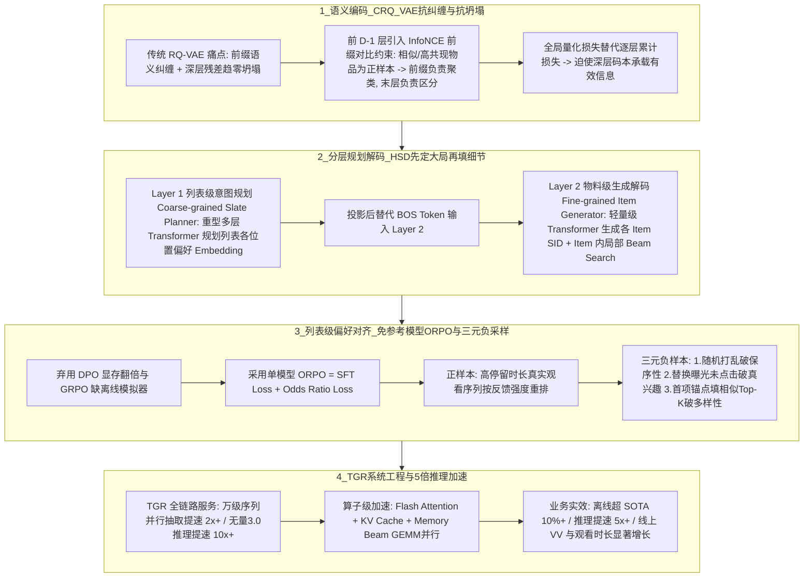

# HiGR列表生成推荐

## 1. TL;DR

本文介绍了腾讯 TRS 团队在论文 *HiGR: Efficient Generative Slate Recommendation via Hierarchical Planning and Multi-Objective Preference Alignment* 中首创的基于 **“编码 — 规划 — 生成 — 对齐”** 的端到端列表级生成式推荐框架 **HiGR**。针对传统“召回 $\to$ 粗排 $\to$ 精排 $\to$ 重排”级联架构目标割裂（Pointwise vs Listwise）、误差累积与 GPU 算力利用率极低（MFU $< 1\%$ vs LLM $70\%$），以及常规生成式推荐（Next Token Prediction）逐 Token 解码延迟高、缺乏整列全局规划的痛点，HiGR 提出了三项核心算法创新与一整套系统加速方案：
1. **语义编码（CRQ-VAE）**：引入前 $D-1$ 层 **前缀对比学习（InfoNCE Loss）** 与 **全局量化损失**，解决传统 RQ-VAE 的“前缀 ID 语义纠缠”与“深层残差坍塌”，实现“前缀聚类定意图，后缀区分定物品”。
2. **分层规划解码（HSD，Hierarchical Slate Decoding）**：将平铺式逐 Token 解码解耦为 **Layer 1 列表级意图规划（Coarse-grained Slate Planner，重型 Transformer 生成列表各位置偏好 Embedding）** 与 **Layer 2 物料级生成解码（Fine-grained Item Generator，轻量级 Transformer 以偏好 Embedding 替代 BOS 并行解码各物品 SID，且仅在单物品内做局部 Beam Search）**。
3. **列表级多目标偏好对齐（Listwise ORPO）**：摒弃显存翻倍的 DPO 与无法离线实时交互采样的 GRPO，采用**免参考模型（Reference-free）的 ORPO 算法**，结合 **“保序性（Ranking Fidelity）、真兴趣（Genuine Interest）、列表多样性（Slate Diversity）”** 三元负样本构造直接对齐整列隐式反馈。
4. **工程加速与落地收益**：依托 TRS 的 **TGR 服务**与**无量 3.0 框架（提速 10 倍+）**，结合 **Flash Attention、KV Cache 与 Memory Beam（GEMM 并行化消除 Beam Width 复制开销）**，实现**离线推荐质量相对 SOTA 提升超 10%、推理速度提升 5 倍以上**，并在 PCG 真实内容推荐场景线上 A/B 实验中显著提升播放 VV、播放时长与消费深度。

## 2. 问题定义与背景

### 2.1 传统级联推荐架构的三大痛点
1. **目标不一致（Pointwise vs Listwise）**：召回、粗排、精排均在优化单点（Pointwise）点击/转化率，而用户真正感知并消费的是一整屏列表（Listwise）的整体体验，局部最优之和不等于整屏全局最优。
2. **级联误差累积**：上游漏斗的偏差逐层放大传递，导致末端重排模块只能在已经“偏航”的局促候选集中做有限微调。
3. **GPU 算力利用率（MFU）低下**：传统推荐模型的 GPU MFU 普遍**不足 1%**，而大语言模型（LLM）领域的 MFU 已可达 **70%**，存在巨大的算力红利鸿沟。

### 2.2 常规平铺式生成式推荐（NTP）的两大瓶颈
以 OneRec 等为代表的早期生成式推荐直接照搬 LLM 的平铺式 Next Token Prediction（NTP）：
- **自回归步数爆炸导致在线延迟不可接受**：若推荐列表含 $M=10$ 个物料、每个物料用 $N=4$ 位语义 ID（SID）表示，平铺式解码需串行自回归推理 $M \times N = 40$ 步；且难以显式区分“物品内部（intra-item）粗细粒度层级关系”与“物品之间（inter-item）边界关系”（例如 `<a_3><b_6><c_2>` 与 `<a_5><b_4><c_7>` 之间有明确物品边界）。
- **Token 级交叉熵与整列隐式反馈存在 Gap**：SFT 仅能拟合历史曝光分布，无法区分整列优劣（如信息茧房、标题党、好内容排在后面）。

## 3. 知识框架

## 4. 核心内容拆解

### 4.1 语义编码：CRQ-VAE（Contrastive Residual Quantized VAE）
1. **为什么传统 RQ-VAE 的 Semantic ID 不好用？**
   - **ID 纠缠**：标准 RQ-VAE 仅由重构误差驱动，导致前缀相同不一定类别相同、前缀不同反而高度相似，高层规划器无法把前缀当作可靠的意图锚点。
   - **残差坍塌**：随着量化层数加深，残差向量迅速趋近于零，深层码本退化为无效噪声。
2. **CRQ-VAE 的两项改造**：
   - **前缀对比约束（InfoNCE Loss）**：在前 $D-1$ 层引入对比学习，将语义相似或高共现率的物品作为正样本、Batch 内随机样本作为负样本，强制实现**“前 $D-1$ 层前缀负责聚类（定粗粒度意图），最后第 $D$ 层后缀负责区分（定细粒度具体物品）”**。
   - **全局量化损失**：直接针对量化器前后的编码向量与全局重构向量构造全局损失（替代传统逐层累加损失），迫使深层码本持续承载有效信息。

### 4.2 分层解码：HSD（Hierarchical Slate Decoding）
HSD 将原本耗时的 $M \times N$ 步重型平铺解码拆解为两层异构网络：
- **Layer 1：Coarse-grained Slate Planner（粗粒度列表意图规划器）**：采用**较重的多层 Transformer**，仅在物品粒度（$M$ 步）上根据用户历史交互规划整屏列表的意图蓝图，输出每个列表位置的用户偏好 Embedding 序列。
- **Layer 2：Fine-grained Item Generator（细粒度物料生成解码器）**：将 Layer 1 输出的每个位置偏好 Embedding 经投影后**直接替换常规的 `BOS` Token**，作为**轻量级 Transformer** 的起始输入，并行引导生成该位置物品的具体 $N$ 位 SID 序列。
- **双重收益**：
  1. **建模能力跃升**：待解码的某个 SID Token 既能看到当前物品内已生成的前缀 SID，又能通过 Layer 1 感知列表中已生成的完整前序物品表征，精准捕获 intra-item 与 inter-item 双重关系。
  2. **推理复杂度骤降**：重型 Transformer 仅运行在短的物品级序列上，SID 展开交由轻量级网络完成；同时 **Beam Search 仅在单个 Item 内部累积 Logits 概率**（而非跨整列累积），大幅削减搜索开销。

### 4.3 列表级多目标偏好对齐：为什么选 ORPO 而非 DPO / GRPO？
1. **DPO 与 GRPO 在工业推荐中的落地阻碍**：
   - **DPO 的显存与吞吐瓶颈**：DPO 必须常驻一个冻结的参考模型（Reference Model）同步前向推理，导致**显存占用翻倍、训练吞吐减半**，无法满足小时级流式更新的工业推荐诉求。
   - **GRPO 的离线交互与生成耗时瓶颈**：GRPO 需对同一 Prompt 采样 $G$ 组完整列表并依赖实时环境反馈打分；但离线推荐缺乏高保真用户模拟器，且 Token-by-Token 生成 $G$ 组列表会导致训练耗时爆炸。
2. **ORPO + 三元目标样本构造**：
   - **单模型 ORPO**：将 SFT 损失与 Odds Ratio（赔率比）损失合一，无需参考模型，单向传播训练速度与普通 SFT 几乎持平。
   - **正样本与三类针对性负样本构造**：
     - **正样本**：用户真实观看且高停留时长的序列，按正反馈强度重排。
     - **负样本 1 — 保序性（Ranking Fidelity）**：将正样本随机打乱顺序，逼迫模型学会“把好内容排在列表最前面”。
     - **负样本 2 — 真兴趣（Genuine Interest）**：将部分位置替换为用户曝光未点击或产生负反馈的物品，学会剔除“标题党”与无效曝光。
     - **负样本 3 — 列表多样性（Slate Diversity）**：以正样本首个物品为锚点，后续位置全部填充与锚点最相似的 Top-$K$ 物品，专门惩罚“同质化信息茧房”。

### 4.4 Scaling Law 验证与 TGR 推理加速工程
- **Scaling Law 幂律扩展性**：实验证实 HiGR 的收敛 Loss 随参数量增加呈显著幂律下降，`NDCG@5` 随参数量呈稳定对数线性增长，无边际递减瓶颈。
- **TGR 一体化服务与 5 倍+ 推理加速**：
  1. **服务底座**：支持万量级序列特征并行抽取（提速 **2 倍以上**），基于**无量 3.0 框架**实现模型推理比原生框架加速 **10 倍以上**。
  2. **三大算子级加速**：（a）**Flash Attention** 分块计算减少 HBM 与 SRAM 间 IO，加速效果最显著；（b）**KV Cache** 缓存历史状态（因推荐序列短于 LLM，加速幅度次于 Flash Attention）；（c）**Memory Beam** 利用 GPU GEMM 矩阵并行能力重构 Beam Search，避免大 Beam Width 下将输入序列复制多份带来的冗余计算，综合将端到端推理速度提升 **5 倍以上**。

## 5. 数据速查表

| 指标 | 原文数值 | 语境 / 条件 |
| :--- | :--- | :--- |
| **离线推荐质量提升** | 相对 SOTA 提升 **> 10%** | PCG 实际内容推荐场景离线评估（`NDCG@5` 呈对数线性 Scaling Law） |
| **端到端推理速度提升** | 提升 **5 倍以上** | 综合 HSD 分层解码、Flash Attention、KV Cache 与 Memory Beam 优化 |
| **传统推荐 vs LLM 的 GPU MFU** | 传统推荐 **< 1%** vs LLM 可达 **70%** | 揭示端到端生成式推荐可挖掘的巨大 GPU 算力红利 |
| **平铺式解码步数示例** | **10 个物料 $\times$ 4 Token/物料 = 40 步** | 说明传统 NTP 逐 Token 自回归无法满足在线推荐毫秒级延迟要求 |
| **TGR 万级序列特征并行抽取加速** | 提速 **2 倍以上** | TRS 的 TGR 在线服务并行化特征抽取能力 |
| **无量 3.0 框架模型推理加速** | 相比原生框架加速 **10 倍以上** | TGR 服务底层集成的高性能推理引擎收益 |

## 6. 踩坑与教训 / 可迁移的设计原则

| 错误做法 | 失败表现或原因 | 原文应对（可迁移的设计原则） |
| :--- | :--- | :--- |
| **直接用标准重构损失训练 RQ-VAE 生成物品 Semantic ID** | 出现严重的前缀语义纠缠（同前缀不同类）和深层残差归零坍塌，导致上层生成模型无法通过前缀规划粗粒度意图 | **前缀 InfoNCE 对比学习 + 全局量化约束原则（CRQ-VAE）**：在前 $D-1$ 层施加对比损失强制前缀聚类，配合全局量化损失激活深层码本 |
| **将整个推荐列表的所有 SID Token 平铺展平，用一个重型 Transformer 逐 Token 自回归解码** | 10 个物品 $\times$ 4 Token 需串行跑 40 次重型网络，且跨整列做全局 Beam Search 耗时爆炸，难以捕获物品边界 | **重规划 + 轻生成分层解码原则（HSD）**：用重型 Transformer 仅做物品级意图规划（$M$ 步），用规划向量替代 BOS 驱动轻量级 Transformer 并行解码物品内 SID，且仅在单物品内做局部 Beam Search |
| **在工业级小时级更新的生成式推荐中直接照搬 DPO 或 GRPO 做偏好对齐** | DPO 需常驻冻结参考模型导致显存翻倍、吞吐减半；GRPO 需采样 $G$ 组列表且离线缺乏实时用户模拟器打分 | **免参考模型 ORPO + 业务规则构造结构化负样本原则**：用单模型 ORPO 保持 SFT 级训练速度，并通过“打乱保序、混入未点击、同质化填充”三类负样本同时对齐准确性与多样性 |
| **在大 Beam Width 下直接按常规方式将输入序列复制 Beam Width 份送入 GPU** | 造成巨大的显存带宽浪费与重复计算，使 Beam Search 成为线上最大延迟瓶颈 | **Memory Beam（GEMM 融合并行）原则**：利用 GPU 矩阵乘并行特性重构 Beam Search 状态扩展，消除序列显式复制开销 |

## 7. 记忆锚点

- **HiGR 四字闭环**：“**编码（CRQ-VAE 前缀对比防纠缠） $\to$ 规划（Layer 1 重网络定整列蓝图） $\to$ 生成（Layer 2 轻网络填物品 SID） $\to$ 对齐（免参考 ORPO 三元负采样）。**”
- **三元负样本口诀**：“**乱序训保序（Ranking Fidelity），未点训真爱（Genuine Interest），锚点克隆破茧房（Slate Diversity）。**”

## 8. 复习卡片

为什么传统“召回-粗排-精排-重排”级联推荐架构需要向“列表级端到端生成式推荐”演进？::因为传统级联架构存在三大痛点：1. 目标不一致（上游各层优化 Pointwise 单点准确率，而用户消费的是 Listwise 整屏体验）；2. 级联误差层层累积；3. GPU 算力利用率（MFU）普遍低于 1%（而 LLM 可达 70%），无法吃透 GPU 算力红利。
HiGR 提出的 CRQ-VAE 相比传统 RQ-VAE 解决了哪两个核心痛点，具体是如何实现的？::解决了“前缀语义 ID 纠缠”和“深层残差坍塌”两大痛点；具体做法是：1. 在前 D-1 层引入 InfoNCE 对比学习损失（相似或高共现物品为正样本），实现“前缀聚类定意图、末层后缀区分定具体物品”；2. 用全局量化损失替代逐层累计损失，迫使深层码本承载有效信息。
HiGR 的分层解码（HSD）是如何将列表生成过程解耦以大幅降低在线推理延迟的？::将其解耦为两层：Layer 1（Coarse-grained Slate Planner）使用较重的多层 Transformer 在物品粒度规划整列偏好 Embedding；Layer 2（Fine-grained Item Generator）将每个物品的偏好 Embedding 替代 BOS token，用轻量级 Transformer 解码具体的 SID 序列，且 Beam Search 仅在单个物品内部累积概率而非跨整列累积。
为什么 HiGR 在列表级偏好对齐阶段放弃了主流的 DPO 和 GRPO，而选择了 ORPO？::因为 DPO 必须常驻冻结的参考模型，导致显存占用翻倍、训练吞吐减半，难以适应推荐系统高频更新；GRPO 需要对同一请求采样 G 组完整列表并依赖实时环境反馈，在缺乏高保真离线用户模拟器时无法落地且生成耗时过长；而 ORPO 将 SFT 与 Odds Ratio 损失结合，无需参考模型，单模型训练速度与 SFT 持平。
HiGR 在 ORPO 对齐中是如何构造“三元目标”正负样本对来同时优化准确性、排序与多样性的？::以用户高停留时长的真实观看序列按反馈强度重排作为正样本，并构造三类负样本：1. 保序性（Ranking Fidelity）：随机打乱正样本顺序；2. 真兴趣（Genuine Interest）：替换为曝光未点击或负反馈物品；3. 列表多样性（Slate Diversity）：以正样本首个物品为锚点，后续全部填充与锚点最相似的 Top-K 物品以惩罚信息茧房。
在工程落地上，HiGR 结合了哪些算子与系统优化实现了 5 倍以上的推理加速？::依托 TGR 服务与无量 3.0 框架（比原生框架快 10 倍+、万级序列并行抽取快 2 倍+），在算子层结合了 Flash Attention（减少 HBM/SRAM IO，加速最明显）、KV Cache 以及优化 Beam Search 避免序列复制开销的 Memory Beam（利用 GPU GEMM 并行）。

## 9. 知识关联

- **本库通用主题**：[Agent数据分析](../../20_topics/Agent%E6%95%B0%E6%8D%AE%E5%88%86%E6%9E%90.md) · [Agent评测与反馈](../../20_topics/Agent%E8%AF%84%E6%B5%8B%E4%B8%8E%E5%8F%8D%E9%A6%88.md) · [AI研发协同](../../20_topics/AI%E7%A0%94%E5%8F%91%E5%8D%8F%E5%90%8C.md) · [模型与开发工具发布](../../20_topics/%E6%A8%A1%E5%9E%8B%E4%B8%8E%E5%BC%80%E5%8F%91%E5%B7%A5%E5%85%B7%E5%8F%91%E5%B8%83.md) · [推荐系统与多模态评测](../../20_topics/%E6%8E%A8%E8%8D%90%E7%B3%BB%E7%BB%9F%E4%B8%8E%E5%A4%9A%E6%A8%A1%E6%80%81%E8%AF%84%E6%B5%8B.md)
- **候选双链**：[[X平台推荐算法]] · [[RQ-VAE与语义ID量化]] · [[ORPO与DPO偏好对齐对比]] · [[FlashAttention与算子优化]]

## 10. 原文参考资料

- 原文标题：《推理速度提升 5 倍+：腾讯 TRS 团队首创列表级生成式推荐 HiGR》（作者：李裕东、庞雲升、刘子健，发布于 2026-02-06）
- 核心论文：*HiGR: Efficient Generative Slate Recommendation via Hierarchical Planning and Multi-Objective Preference Alignment*

> [!note]- 校对报告
> - **页码溯源汇总**：
>   - `p.1–3`：导语与核心收益（离线相对 SOTA 提升 >10%、推理速度提升 5 倍+、线上 A/B 观看时长与消费深度增长）、传统级联架构三大痛点（目标不一致、误差累积、GPU MFU <1% vs LLM 70%）、NTP 生成式推荐两大挑战（10 物料 $\times$ 4 Token = 40 步延迟、缺乏全局规划）。
>   - `p.4–5`：HiGR 四阶段总览与 2.1 节 CRQ-VAE 详解（前 $D-1$ 层 InfoNCE 前缀对比约束 + 全局量化损失，解决 ID 纠缠与残差坍塌）。
>   - `p.5–6`：2.2 节 HSD 分层解码详解（Layer 1 重型 Transformer Coarse-grained Slate Planner 规划偏好 Embedding 替代 BOS $\to$ Layer 2 轻量级 Transformer Fine-grained Item Generator 生成 SID + 单 Item 内局部 Beam Search）。
>   - `p.6–8`：2.3 节列表级 ORPO 对齐（对比 DPO 显存翻倍/吞吐减半与 GRPO 缺离线用户模拟器/生成耗时爆炸，设计保序性、真兴趣、列表多样性三元负样本）及第 3 节 PCG 离线、线上 A/B 与 Scaling Law 实验。
>   - `p.9–10`：第 4 节 TGR 服务架构（万级序列并行抽取提速 2x+、无量 3.0 推理提速 10x+）、Flash Attention / KV Cache / Memory Beam 算子加速及全链路托管/模块化组件两种接入方式。
> - **核验结论**：全文所有机制名称、公式逻辑与性能指标均与原文逐页核对一致。
