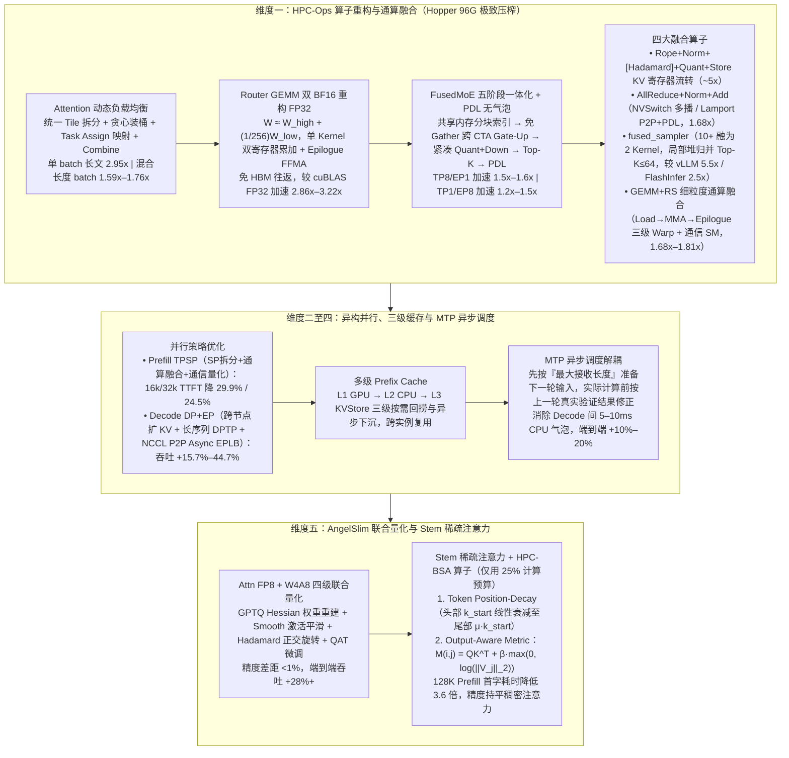

# 腾讯混元 AI Infra 如何优化 Hy3 Preview：一次大模型推理性能提升的技术拆解

> **原文信息**：作者 `混元 AI Infra 推理团队`，发布于 2026-06-26 02:36（广东），公众号「腾讯技术工程」原创。

---

## 1. TL;DR

1. **极限硬件约束与全栈优化背景** —— 混元 `Hy3 preview` 采用 **GQA + MoE** 混合架构、原生支持 **256K** 超长上下文；面对主部署卡 **NVIDIA Hopper（96G）** 相比 Blackwell 算力低、显存紧、无超节点互联的劣势，团队在严苛 SLO（**TPOP $\le$ 50ms、TTFT $\le$ 4s**，5000 条真实长文数据集平均输入 68k/最大 192k，W8A8C8 精度）下，从**算子优化与融合、并行策略、多级缓存、MTP 与异步调度、量化与稀疏**五大维度完成全栈突破，核心算子已开源至 **HPC-Ops** 与 **AngelSlim**。
2. **HPC-Ops 算子深度重构与通算融合** —— ① **动态 Tile 贪心装桶 Attention** 根治长短请求混杂长尾延迟（单 batch 长文最高加速 **2.95x**，混合 batch **1.59x–1.76x**）；② **Router GEMM 双 BF16 重构 FP32**（$W \approx W_{\text{high}} + \frac{1}{256}W_{\text{low}}$，单 Kernel 双累加器免 HBM 往返，较 cuBLAS FP32 加速 **2.86x–3.22x**）；③ **FusedMoE 五阶段 PDL 无气泡流水线**（取消 Warp Specialization 改跨 CTA 硬件调度，加速 **1.2x–1.6x**）；④ **五合一 `Rope+Norm+[Hadamard]+Quant+Store KV`**（加速约 **5x**）、**`AllReduce+Norm+Add`**（NVSwitch 多播/Lamport P2P，加速 **1.68x**）、**`fused_sampler`**（10+ Kernel 融为 2 个，较 vLLM/FlashInfer 提升 **5.5x / 2.5x**）及 **GEMM+RS 三级 Warp 细粒度通算融合**（加速 **1.68x–1.81x**）。
3. **Prefill TPSP 与 Decode DP+EP 异构并行** —— Prefill 阶段针对纯 TP8 的冗余计算、通信过重与 MoE 窄 shape 退化，采用 **TPSP（SP 拆分 + 通算融合 + 通信量化 + 并行调整）** 使 16k/32k TTFT 降低 **29.9% / 24.5%**；Decode 阶段采用跨节点 **Attention DP（长序列 DPTP 混合）+ MoE EP** 腾出显存给 KV Cache，并首创 **Async EPLB（NCCL P2P 异步专家负载均衡）** 将每步单层权重重排隐藏在前向计算后，端到端吞吐提升 **15.7%–44.7%**。
4. **三级前缀缓存 + MTP 解耦异步调度** —— 构建 **`GPU (L1) → CPU (L2) → KVStore (L3)`** 多级 Prefix Cache 解决单卡显存淘汰与跨实例失效问题；针对多层 MTP 动态接收长度导致 CPU 阻塞等待 GPU 验证结果，提出**「先按最大接收长度组装下一轮输入，实际计算前再用上一轮真实验证结果修正」**的解耦机制，消除 Decode 间 **5–10ms CPU 气泡**，端到端性能提升 **10%–20%**。
5. **AngelSlim 无损量化与 Stem 稀疏注意力** —— 通过 **GPTQ 权重重建 + 激活 Smooth + Hadamard 在线正交旋转 + QAT 轻量化微调**实现 `Attn FP8 + W4A8` 精度差距 **< 1%**、端到端吞吐提升 **28%+**；提出 **Stem 稀疏注意力**（结合 **Token Position-Decay 位置线性衰减预算** 与 **Output-Aware Metric 输出感知度量 $M(i,j) = QK^T + \beta \cdot \max(0, \log(\|V_j\|_2))$** 配合 `HPC-BSA` 算子），仅用 **25% 计算预算**即在 128K 上下文下将 Prefill 首字耗时降低 **3.6 倍**且精度无损。

---

## 2. 问题定义与背景

### 2.1 为什么要写这篇？

大模型向千亿参数（GQA + MoE）与 256K 超长上下文演进后，Agent 与 Coding 场景呈现出「超长输入（最大 192k、平均 68k）、高频多轮前缀复用（理论缓存命中率 80%）」的鲜明特征。与此同时，主力部署硬件 **NVIDIA Hopper（96G）** 相比新一代 Blackwell 存在算力偏低、显存受限、缺乏超节点高速互联等客观短板。为了在 **TPOP $\le$ 50ms、TTFT $\le$ 4s** 的严格服务等级目标（SLO）下实现极致性价比，混元 AI Infra 推理团队联合腾讯网络平台部，对算子内核、通信原语、并行拓扑、KV 缓存架构、MTP 调度器及低比特稀疏算法进行了全栈手术刀式重构。

---

## 3. 知识框架

---

## 4. 核心内容拆解

### 4.1 维度一：HPC-Ops 核心算子优化与深度融合

1. **Attention 动态调度负载均衡（根治长短混杂长尾延迟）**：
   - **痛点**：线上 batch 内长短请求混杂，传统静态 `split-kv` 无法兼顾长序列并行度与短序列开销。
   - **方案**：所有请求按统一 **Tile 粒度**拆分 → 依据全局 Tile 总量通过**贪心装桶算法**均分各 CTA 任务 → 每次推理前由 `Task Assign` 模块生成专属任务映射表 → 各层 Attention Kernel 精准领任务，最后由 `Combine Kernel` 合并结果。
   - **收益**：单 batch 长文本最高加速 **2.95x**，混合长度 batch 加速 **1.59x–1.76x**。
2. **Router GEMM：双 BF16 重构 FP32 计算**：
   - **痛点**：MoE 路由等数值敏感模块若降级权重会损精度，若将 BF16 激活升频至 FP32/TF32 则引入逐元素转换开销且受限于低带宽 CUDA Core。
   - **方案**：① 离线将 FP32 权重拆为高位与低位残差两组 BF16 张量：**$W \approx W_{\text{high}} + \text{scale} \times W_{\text{low}}$**（其中 $\text{scale} = 1/256$，对齐 BF16 的 8 位尾数）；② 推理时激活全程保持 BF16，在 **BF16 Tensor Core** 上执行两次 GEMM；③ 融合进单一 Kernel（输入仅搬运一次，双寄存器累加器缓存中间结果，Epilogue 阶段经一次 **FFMA** 修正写出显存，全程无 HBM 往返）。
   - **收益**：在 $N=192, K=4096, M=2\sim 4096$ 范围内，相比 cuBLAS FP32 加速 **2.86x–3.22x**。
3. **FusedMoE：五阶段全流水线重构 + PDL 无气泡串联**：
   - **五步整合**：① 共享内存分块统计预留连续显存区间 → ② **Gate-Up GEMM** 通过路由索引直读原始输入省去显式 Gather，且**取消 Warp Specialization**，改由同一 Warp Group 完成搬运与计算（从 CTA 内软件流水升级为**跨 CTA 硬件调度**，提升 SM 驻留密度）→ ③ 激活量化 + Down GEMM 紧凑顺序访存 → ④ 末端 Top-K 加权聚合无额外 HBM 往返 → ⑤ 全流程通过 **PDL（Programmatic Dependent Launch）** 构建无气泡链路。
   - **收益**：相比 vLLM CUTLASS、vLLM Triton、SGLang，`TP=8/EP=1` 加速 **1.5x–1.6x**，`TP=1/EP=8` 加速 **1.2x–1.5x**。
4. **四项算子融合突破**：
   - **`Fused Rope+Norm+[Hadamard]+Quant+Store KV`**：将 QKV Projection 后的 5 个小算子融为单一微流水线 Kernel，寄存器暂存中间结果并在写 KV Cache 前完成在线量化，加速约 **5x**。
   - **`Fused AllReduce+Norm+Add`**（联合腾讯网络平台部）：封装 NVLink 原生一体化操作 `RMSNorm(AllReduce(x) + residual, weight)`（Two-shot 策略）——高吞吐版依托 **NVSwitch 多播**适配 Prefill，低延迟版基于 **Lamport P2P + PDL 双 Kernel 重叠**适配 Decode；在 8–32k tokens 场景下较 NCCL 与 FlashInfer 最高加速 **1.68x**。
   - **采样融合算子 `fused_sampler`**：将重复惩罚、温度缩放、Top-K/Top-P、Softmax 等 10 余个零碎 Kernel 融为 **2 个核心 CUDA Kernel**——全词表 GPU 读取压至 **1 次**、重复惩罚掩码在 GPU 内闭环（零 CPU-GPU 拷贝）、当 **$\text{Max Top-K} \le 64$** 时采用**局部堆归并**替代全局扫描、合并 Top-K 与 Softmax 的 `max/sum`；相比 vLLM 与 FlashInfer 分别提升约 **5.5x** 和 **2.5x**。
   - **`Gemm+Comm` 细粒度通算融合**：针对 Prefill TPSP 场景，将 SM 显式划分为**计算 SM**与**通信 SM**，并特化出 **`Load Warp → MMA Warp（写回 SMEM 即进下一轮）→ Epilogue Warp（异步取 SMEM 量化写 HBM 并触发通信信号量）` 三级流水**，实现 Tile 级 GEMM 与 ReduceScatter 重叠，在 $M=8\text{k}\sim 64\text{k}$ 下覆盖率达 **76.5%–84.8%**，端到端较串行加速 **1.68x–1.81x**。

---

### 4.2 维度二至四：异构并行策略、三级前缀缓存与 MTP 异步调度

1. **Prefill 并行策略：TPSP（解决纯 TP8 三重代价）**：
   - 纯 TP8 存在 token-wise 算子重复计算、8 卡 AllReduce 通信过重、MoE Grouped GEMM 沿 hidden 维切至极窄 shape 三大弊病；
   - 通过 **SP 拆分 + 通算融合 + 通信量化 + 并行模式调整**，将 Prefill 16k TTFT 从 `764ms` 压至 **`536ms`（-29.9%）**，32k TTFT 从 `1885ms` 压至 **`1424ms`（-24.5%）**。
2. **Decode 并行策略：Attention DP + MoE EP + Async EPLB**：
   - 针对单机权重占显存近半挤压 KV Cache 及小 Batch 下 MoE Memory-bound 痛点，采用跨节点 **Attention DP（长序列采用 DPTP 混合策略均衡负载）+ MoE EP** 分布式存权重、聚合大 Batch 进入 Compute-bound 区间；
   - **异步专家负载均衡（Async EPLB）**：利用 **NCCL P2P** 异步执行权重重排，将每步仅一层权重的通信逻辑隐藏于前向计算之后，与 Decode 计算完全重叠，端到端吞吐提升 **15.7%–44.7%**。
3. **`GPU (L1) → CPU (L2) → KVStore (L3)` 三级前缀缓存**：
   - 请求按 `L1 → L2 → L3` 顺序查询可复用前缀，命中后按需加载回 GPU 跳过 Prefill；新生成的完整 Block 异步下沉至 L2/L3，彻底解决单卡显存容量受限、长文加速淘汰与跨实例扩缩容失效问题。
4. **MTP（Multi-Token Prediction）动态长度解耦异步调度**：
   - **痛点**：多层 MTP 接收长度动态变化，传统做法需等 GPU Forward 验证结束后同步拷回 CPU 才能准备下一轮输入，而 MTP 层计算极快无法掩盖 CPU 耗时。
   - **方案**：**解除 CPU 对真实接收长度的同步依赖**——数据准备阶段一律按**「最大接收长度」**更新状态并提前一轮组装 Launch 下一轮输入；在下一轮实际 GPU 计算前，再用上一轮真实验证结果动态修正位置编码与 KV 映射，成功减少 Decode 间 **5–10ms CPU 气泡**，端到端性能提升 **10%–20%**。

---

### 4.3 维度五：AngelSlim 联合量化与 Stem 稀疏注意力

1. **AngelSlim 四级联合量化（`Attn FP8 + W4A8` 无损压缩）**：
   - ① **GPTQ 逐层权重重建**（基于 Hessian 逆补偿 INT4 误差）+ ② **激活平滑 Smooth**（逐通道平滑因子收窄离群值范围）+ ③ **Hadamard 在线旋转变换**（Attention 专用，对 Q/K 量化前施加正交旋转打散离群值，融合进 Kernel 零额外开销）+ ④ **QAT 轻量化微调**（仅更新 `scale/zero-point` 等量化参数）。
   - **收益**：多领域评测集与 BF16 基线差距 **< 1%**（精度无损），端到端吞吐提升 **28%+**。
2. **Stem 稀疏注意力 + HPC-BSA 算子（128K Prefill 提速 3.6 倍）**：
   - **核心目标**：结合 `HPC-BSA (Block Sparse Attention)` 算子，仅使用 **25% 计算预算**达到稠密注意力精度。
   - **技术一：Token Position-Decay（位置衰减策略）** —— 洞察到因果架构中序列头部 Token 参与所有后续聚合（误差会逐层递归放大），而尾部 Token 仅影响局部；因此将每个 Query 位置的 Top-k 预算从头部的 $k_{\text{start}}$ **线性衰减**到尾部的 $k_{\text{end}} = \mu \cdot k_{\text{start}}$，在不增加总预算下保护头部递归依赖链。
   - **技术二：Output-Aware Metric（输出感知度量，OAM）** —— 洞察到高注意力分数（$QK^T$）但 Value 向量模长接近零的 Token 对实际输出几乎无贡献；提出度量公式：
     $$M(i,j) = QK^T + \beta \cdot \max\left(0, \log(\|V_j\|_2)\right)$$
     将 Value 模长对数作为信号强度引入，且对数变换可直接复用标准 Top-k 内核无额外计算开销。
   - **收益**：在 LongBench v2、CL-bench、SWA 等数据集精度持平稠密注意力，**128K 上下文首字耗时（TTFT）降低 3.6 倍**。

---

## 5. 数据速查表

| 指标 | 原文数值 | 语境 / 条件 |
| :--- | :--- | :--- |
| Hy3 preview 架构与上下文规格 | **GQA + MoE 混合架构，原生支持 256K 上下文** | 面向 Agent、Coding 等长文高频多轮场景 |
| 评测基准数据集与硬件约束 | **5000 条真实数据（输入最大 192k/均 68k，输出最大 64k/均 0.9k，缓存理论命中 80%）** | 部署于 **Hopper 架构-96G**，精度 **W8A8C8**，限制 **TPOP $\le$ 50ms、TTFT $\le$ 4s** |
| 动态 Tile Attention 算子加速比 | **单 batch 长文最高 2.95x / 混合长度 batch 1.59x–1.76x** | 统一 Tile 粒度拆分 + 贪心装桶 + `Task Assign` 映射 |
| Router GEMM 双 BF16 重构加速比 | **2.86x–3.22x（对比 cuBLAS FP32）** | $N=192, K=4096, M=2\sim 4096$，拆分比例 $\text{scale}=1/256$ |
| FusedMoE 五阶段重构加速比 | **TP8/EP1 加速 1.5x–1.6x / TP1/EP8 加速 1.2x–1.5x** | 对比 vLLM CUTLASS、vLLM Triton、SGLang |
| `Fused Rope+Norm+[Hadamard]+Quant+Store KV` | **加速约 5x** | 5 个小算子融为单一寄存器级流转微流水线 Kernel |
| `Fused AllReduce+Norm+Add` 加速比 | **最高加速 1.68x（8–32k tokens）** | 对比 NCCL 与 FlashInfer 同类路径（NVSwitch 多播 / Lamport P2P） |
| `fused_sampler` 采样融合加速比 | **对比 vLLM 提升约 5.5x / 对比 FlashInfer 提升约 2.5x** | 10+ Kernel 融为 2 个，全词表读 1 次，$\text{Max Top-K} \le 64$ 局部堆归并 |
| `Gemm+Comm` 细粒度通算融合加速比 | **端到端加速 1.68x–1.81x（重叠覆盖率 76.5%–84.8%）** | $(M, N, K)$ 从 $(8\text{k}, 4096, 1024)$ 到 $(64\text{k}, 4096, 1024)$，Load/MMA/Epilogue 三级 Warp |
| Prefill TPSP 并行 TTFT 降幅 | **16k 从 764ms 降至 536ms (-29.9%) / 32k 从 1885ms 降至 1424ms (-24.5%)** | 单机 8 卡 SP 拆分 + 通算融合 + 通信量化 |
| Decode DP+EP 混合并行吞吐提升 | **端到端吞吐提升 15.7%–44.7%** | 跨节点 Attention DP（长序列 DPTP）+ MoE EP + Async EPLB |
| MTP 解耦异步调度性能收益 | **减少 Decode 间 5–10ms CPU 气泡，端到端提升 10%–20%** | 按最大接收长度预组装下一轮输入，实际计算前修正 |
| AngelSlim `Attn FP8 + W4A8` 收益 | **精度差距 < 1%，端到端吞吐提升 28%+** | GPTQ + Smooth + Hadamard 在线旋转 + QAT 微调 |
| Stem 稀疏注意力计算预算与收益 | **仅用 25% 计算预算，128K 下 Prefill 延迟降低 3.6 倍** | Position-Decay + OAM 度量配合 HPC-BSA 算子 |

---

## 6. 踩坑与教训 / 可迁移的设计原则

| 错误做法 | 失败表现或原因 | 原文应对 |
| :--- | :--- | :--- |
| 在混合长短请求的线上推理中使用静态固定的 `split-kv` 策略 | 长序列并行度不足产生严重长尾延迟，或短序列拆分过碎引入额外合并开销 | 采用**统一 Tile 粒度拆分 + 贪心装桶算法 + `Task Assign` 动态映射表**，从源头均衡各 CTA 负载（长文提速 2.95x） |
| 在 MoE 路由中直接将 FP32 权重降为 BF16，或将 BF16 激活升频至 FP32 在 CUDA Core 计算 | 降权严重损精度；升激活则增加逐元素转换开销且 CUDA Core 算力带宽利用率极低 | 离线按 $\text{scale}=1/256$ 将 FP32 权重拆为**高低位双 BF16 张量**，单 Kernel 双累加器在 Tensor Core 计算后于 Epilogue 经一次 FFMA 修正（提速 2.86x–3.22x） |
| 在 Prefill 阶段对 MoE 模型无脑使用纯 TP8 并行 | Token-wise 算子 8 卡重复计算、AllReduce 通信过重，且 MoE Grouped GEMM 被切至极窄 shape 算力退化 | 切换为 **TPSP 策略**（SP 序列拆分 + Load/MMA/Epilogue 三级 Warp 细粒度通算融合 + 通信量化），16k TTFT 直降 29.9% |
| 在多层 MTP 投机解码中等待 GPU 验证出真实接收长度后再同步回 CPU 准备下一轮输入 | MTP 层计算极快，CPU 准备耗时无法被掩盖，导致每步 Decode 间出现 5–10ms 同步气泡 | **解除同步依赖**：CPU 阶段一律按「最大接收长度」提前一轮组装 Launch，在下一轮 GPU 实际计算前再用上一轮真实验证结果修正关键值 |
| 稀疏注意力仅依据注意力分数 $QK^T$ 对所有位置分配相同预算进行 Top-k 剪枝 | 忽略了头部 Token 误差会逐层递归放大的特性，且保留了高注意力分数但 Value 模长趋近于 0 的无效 Token | 提出 **Stem 算法**：用 **Position-Decay** 将预算向头部倾斜（$k_{\text{start}} \to \mu k_{\text{start}}$），并用 **OAM 公式**引入 $\log(\|V_j\|_2)$ 衡量真实信息贡献 |

---

## 7. 记忆锚点

1. **两大开源武器库**：**HPC-Ops**（算子与通算融合库）+ **AngelSlim**（四级联合量化与 Stem 稀疏注意力框架）。
2. **两个核心数学公式**：
   - **双 BF16 重构 FP32 路由**：$$W \approx W_{\text{high}} + \frac{1}{256} W_{\text{low}}$$（对齐 BF16 的 8 位尾数，3 倍加速）；
   - **Stem 输出感知度量（OAM）**：$$M(i,j) = QK^T + \beta \cdot \max\left(0, \log(\|V_j\|_2)\right)$$（25% 预算换 128K 首字提速 3.6 倍）。
3. **五维提速成绩单**：Attention **2.95x** | Rope+Norm+Quant 写 KV **5x** | Sampler **5.5x** | Prefill TPSP **-29.9% TTFT** | Decode DP+EP **+44.7% 吞吐** | W4A8 **+28% 吞吐** | 128K Stem **3.6x 首字提速**。

---

## 8. 复习卡片

1. 混元 `Hy3 preview` 在 Hopper-96G 卡上面临怎样的硬件与业务挑战，团队制定的线上评测 SLO 标准是什么？::`Hy3 preview` 采用 GQA + MoE 架构并支持 256K 超长上下文，但 Hopper 卡相比 Blackwell 算力低、显存紧且缺乏超节点互联；在 5000 条真实数据（平均输入 68k/最大 192k，理论缓存命中 80%，W8A8C8 精度）下，必须同时满足 TPOP $\le$ 50ms 和 TTFT $\le$ 4s 的严苛 SLO。
2. HPC-Ops 中的「Router GEMM 双 BF16 重构 FP32」是如何兼顾 MoE 路由精度与 Tensor Core 高性能的？::离线阶段将 FP32 权重拆分为高位 BF16 与低位残差 BF16（$W \approx W_{\text{high}} + \frac{1}{256}W_{\text{low}}$，对齐 8 位尾数）；推理时激活全程保持 BF16 在 Tensor Core 上跑两次 GEMM，融合在单一 Kernel 内用双寄存器累加器缓存中间结果，在 Epilogue 阶段经一次 FFMA 修正写出，全程无 HBM 往返，比 cuBLAS FP32 加速 2.86x–3.22x。
3. 在 Prefill 和 Decode 两个阶段，混元团队分别采用了什么并行策略来突破纯 TP8 和单机显存瓶颈？::Prefill 阶段弃用纯 TP8（避免冗余计算、重通信和窄 shape），改用 TPSP（SP 拆分 + Load/MMA/Epilogue 三级 Warp 细粒度通算融合 + 通信量化），使 16k TTFT 降低 29.9%；Decode 阶段采用跨节点 Attention DP（长序列 DPTP 混合）+ MoE EP 腾出显存给 KV Cache 并聚合大 Batch，配合基于 NCCL P2P 的异步专家负载均衡（Async EPLB）将单层权重重排与计算重叠，端到端吞吐提升 15.7%–44.7%。
4. 为什么多层 MTP（Multi-Token Prediction）会打破传统异步调度的掩盖机制，混元是如何消除这 5–10ms CPU 气泡的？::因为多层 MTP 的接收长度动态变化，传统做法必须等 GPU Forward 验证结束后同步回 CPU 才能准备下一轮输入，而 MTP 计算太快无法掩盖 CPU 耗时；混元通过「先按最大接收长度提前一轮组装 Launch 下一轮输入，在下一轮 GPU 实际计算前再用上一轮真实验证结果修正位置编码与 KV 映射」，解除了 CPU 对真实接收长度的同步依赖，端到端提升 10%–20%。
5. AngelSlim 框架是如何实现 `Attn FP8 + W4A8` 量化精度无损（差距 `< 1%`）且端到端吞吐提升 28%+ 的？::通过四级联合优化：① GPTQ 基于 Hessian 逆逐层重建权重补偿 INT4 误差；② 激活平滑（Smooth）收窄通道离群值范围；③ 对 Attention 的 Q/K 施加 Hadamard 在线正交旋转均匀打散离群值（融合进 Kernel 零额外开销）；④ QAT 轻量化微调仅更新 `scale/zero-point` 等量化参数。
6. Stem 稀疏注意力算法的核心设计是什么，为什么能仅用 25% 计算预算在 128K 上下文下将 Prefill 延迟降低 3.6 倍？::结合 `HPC-BSA` 算子与两大创新：① Token Position-Decay（因头部 Token 参与所有后续聚合并递归放大误差，将 Top-k 预算从头部 $k_{\text{start}}$ 线性衰减至尾部 $\mu \cdot k_{\text{start}}$）；② Output-Aware Metric（OAM，提出 $M(i,j) = QK^T + \beta \cdot \max(0, \log(\|V_j\|_2))$，将 Value 向量模长作为真实信息贡献引入，避免保留高注意力但零模长的无效 Token）。

---

## 9. 知识关联

- **已有主题**：[大模型推理与算子优化](../../20_topics/%E5%A4%A7%E6%A8%A1%E5%9E%8B%E6%8E%A8%E7%90%86%E4%B8%8E%E7%AE%97%E5%AD%90%E4%BC%98%E5%8C%96.md) · [Agent成本与上下文预算](../../20_topics/Agent%E6%88%90%E6%9C%AC%E4%B8%8E%E4%B8%8A%E4%B8%8B%E6%96%87%E9%A2%84%E7%AE%97.md) · [模型与开发工具发布](../../20_topics/%E6%A8%A1%E5%9E%8B%E4%B8%8E%E5%BC%80%E5%8F%91%E5%B7%A5%E5%85%B7%E5%8F%91%E5%B8%83.md)
- **候选新主题**：[[HPC-Ops算子库]] · [[Stem稀疏注意力]] · [[MTP投机解码与异步调度]]

---

## 10. 原文参考资料

1. **腾讯混元开源基础设施项目**：**HPC-Ops**（混元高性能推理算子库）与 **AngelSlim**（混元大模型量化与稀疏压缩框架）。
2. **外部对比基准与数据集**：vLLM（CUTLASS / Triton / Sampler）、SGLang、FlashInfer、cuBLAS、NCCL；稀疏注意力评测集 LongBench v2、CL-bench、SWA。

> [!note]- 校对报告
> - **校对状态**：已根据 `MD.md` 全文（共 13 页 PDF 转写文本）逐一核对。
> - **核心数据与事实页码溯源**：
>   - `Hy3 preview`（GQA + MoE、256K 上下文）、Hopper-96G 部署约束、5000 条真实数据（输入最大 192k/均 68k、输出最大 64k/均 0.9k、缓存理论命中 80%、50ms TPOP、4s TTFT、W8A8C8）：见 PDF 第 1 页。
>   - HPC-Ops 算子优化：Attention 动态 Tile 贪心装桶（单 batch 长文 2.95x、混合长度 1.59x–1.76x）、Router GEMM 双 BF16 重构 FP32（$\text{scale}=1/256$、FFMA、$N=192, K=4096, M=2\sim 4096$ 加速 2.86x–3.22x）、FusedMoE 五阶段重构与 PDL 无气泡（取消 Warp Specialization 改跨 CTA 调度，TP8/EP1 1.5x–1.6x，TP1/EP8 1.2x–1.5x）：见 PDF 第 2–4 页。
>   - 算子融合：`Fused Rope+Norm+[Hadamard]+Quant+Store KV`（约 5x）、`Fused AllReduce+Norm+Add`（NVSwitch 多播 / Lamport P2P + PDL，8–32k 最高 1.68x）、`fused_sampler`（10+ 融为 2 Kernel，全词表读 1 次，$\text{Max Top-K}\le 64$ 局部堆归并，较 vLLM/FlashInfer 提升 5.5x/2.5x）、`Gemm+Comm`（Load/MMA/Epilogue 三级 Warp + 通信 SM，8k–64k 矩阵耗时表与 1.68x–1.81x 加速）：见 PDF 第 4–6 页。
>   - 并行策略：Prefill TPSP（16k TTFT 764ms→536ms 降 29.9%，32k TTFT 1885ms→1424ms 降 24.5%）、Decode DP+EP（长序列 DPTP 混合 + NCCL P2P Async EPLB，吞吐提升 15.7%–44.7%）：见 PDF 第 6–8 页。
>   - `GPU → CPU → KVStore` 三级 Prefix Cache、MTP 解耦异步调度（按最大接收长度预组装，减少 5–10ms CPU 气泡，端到端提升 10%–20%）：见 PDF 第 8–9 页。
>   - AngelSlim `Attn FP8 + W4A8` 四级联合量化（GPTQ + Smooth + Hadamard 在线旋转 + QAT，精度差距 `<1%`、吞吐 +28%+）、Stem 稀疏注意力 + HPC-BSA（25% 计算预算、Position-Decay 线性衰减 $k_{\text{end}}=\mu \cdot k_{\text{start}}$、OAM 公式 $M(i,j)=QK^T + \beta \cdot \max(0, \log(\|V_j\|_2))$、128K 首字耗时降低 3.6 倍）及后续 C4/W4 规划：见 PDF 第 9–12 页。
