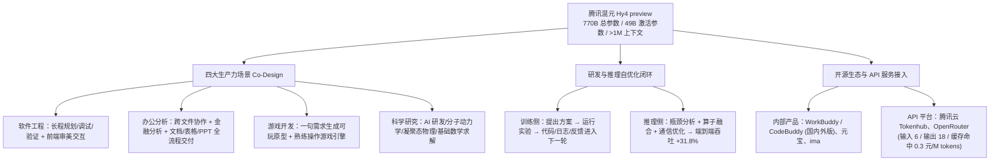

# 腾讯混元 Hy4 preview 发布，稳居开源模型第一梯队

## 1. TL;DR

本文是腾讯混元于 2026 年 8 月 28 日发布并开源新一代大语言模型 **Hy4 preview** 的官方发布说明。文章披露该模型采用 **总参数 770B、激活参数 49B** 的架构，上下文长度突破 **1M**，定位为“为生产力而生”的模型（通过与软件工程、游戏、金融、安全等领域专家共建高质量数据，并与 `CodeBuddy / WorkBuddy` 深度协同 Co-Design）。在腾讯内部组织的 **163 名专家、203 个工程任务盲测**中，Hy4 preview 取得 `2.99/4` 均分，略高于所列对照模型 `Kimi K3`（`2.94/4.00`）与 `GLM 5.3`（`2.92/4.00`）。此外，发布方称模型首次参与自身研发全链路的**递归自我改进闭环**，并通过自主分析推理瓶颈与算子融合/通信优化将端到端吞吐提升 **31.8%**，同时公布了极具性价比的 API 定价（输入 6 元、输出 18 元、缓存命中 0.3 元 / 百万 tokens）。

## 2. 核心概念

### 模型定位与关键机制说明（按发布方陈述）

- **Hy4 preview**：腾讯混元发布并开源的 MoE 架构大语言模型预览版（总参数 `770B`、激活参数 `49B`、上下文 `> 1M`），践行“preview 先行、正式版跟进、平均每两个月迭代一次大版本”的研发节奏。
- **产品协同设计（Co-Design）**：模型研发与 `CodeBuddy / WorkBuddy` 等生产力工具深度协同，将软件工程、办公金融分析、游戏原型生成、科学研究等真实场景反馈引入预训练与后训练迭代。
- **初步递归自我改进闭环（Recursive Self-Improvement Loop）**：发布方称 Hy4 preview 首次参与自身训练方法、数据策略、评估体系和底层算子的自动优化——由模型提出方案、运行实验，并将实验产生的代码、日志和反馈送入下一轮探索。

### 证据边界对照：发布方陈述 vs. 工程评估需补充核实的维度

| 评估维度 | 原文披露的事实与数据 | 原文未说明 / 评估时需注意的边界 |
|---|---|---|
| **内部工程盲测** | `163` 名腾讯内部专家、`203` 个工程任务盲测：Hy4 preview `2.99/4` vs Kimi K3 `2.94/4.00` vs GLM 5.3 `2.92/4.00` | 属于公司内部任务盲测；原文未披露任务分布细节、评分者间一致性（IAA）、对照模型具体版本配置及统计置信区间 |
| **递归自我改进与推理加速** | 参与训练/数据/评估/算子优化；围绕算子融合与通信优化开展多轮迭代，端到端吞吐相较基线提升 `31.8%` | 原文未给出吞吐对比的具体硬件型号、基线推理引擎版本、Batch Size 及长短上下文具体延迟分布 |
| **服务接入与定价活动** | 输入 `6` 元、输出 `18` 元、缓存命中 `0.3` 元 / 百万 tokens；`WorkBuddy / CodeBuddy` 开展 `2 周` 限时免费 | 价格、开放渠道与促销活动具有严格时效性，仅代表 2026-08-28 发布时点政策 |

## 3. 知识框架

## 4. 关键要点与机制详解

### 4.1 模型规格、内部盲测与四大生产力场景优化

**核心主张：Hy4 preview 通过扩展参数规模（770B/49B）与超长上下文（>1M），并结合领域专家共建数据与工具端 Co-Design，将优化重心聚焦于高复杂度生产力交付。**

- **遇到什么问题**：通用基准高分未必能转化为长程软件开发、跨文件办公交付或复杂科研模拟中的真实可用性。
- **采用什么机制**：
  1. **架构与数据扩展**：将总参数扩展至 `770B`（激活参数 `49B`），上下文窗口突破 `1M`，并与软件工程、游戏、金融、安全等领域的腾讯内部专家共建高质量领域数据。
  2. **四大核心生产力场景针对性强化**：
     - **软件工程**：强化长程开发任务的理解、规划、调试与验证能力，并提升前端开发的视觉审美与交互质量。
     - **办公与金融分析**：优化复杂办公环境理解、金融分析与跨文件协作，打通从信息处理到文档、表格与演示文稿（PPT）交付的完整链路。
     - **游戏开发**：增强“一句需求直接生成可玩原型”的能力，支持熟练使用游戏引擎并通过多轮交互完善复杂游戏项目。
     - **科学研究**：提升 AI 研发、分子动力学模拟、凝聚态物理与基础数学等复杂科研问题的理解、推理与求解能力。
- **原文提供的验证结果**：在腾讯内部组织的 `163` 名内部专家、`203` 个工程任务盲测中，Hy4 preview 取得均分 `2.99/4`，略高于 `Kimi K3`（`2.94/4.00`）和 `GLM 5.3`（`2.92/4.00`）。

### 4.2 递归自我改进闭环与推理基础设施自主优化

**核心主张：大模型不再只是被训练的对象，而是开始参与自身训练策略、评估体系、算子融合与通信优化的实验迭代闭环。**

- **采用什么机制**：
  1. **研发全链路参与（初步递归自我改进）**：Hy4 preview 首次参与自身训练方法、数据策略、评估体系和底层算子的自动优化。具体闭环为：**模型提出优化方案 → 运行实验 → 收集实验产生的代码、日志和反馈 → 进入下一轮探索迭代**。
  2. **推理系统自主瓶颈分析与多轮优化**：模型自主分析推理系统瓶颈，围绕**算子融合（Operator Fusion）**与**通信优化**等方向开展多轮迭代。
- **原文提供的验证结果**：端到端推理吞吐相较基线提升 **`31.8%`**，且发布方称在不同上下文长度和并发度下均取得稳定收益。
- **代价或边界**：作为简短的官方发布说明，原文未披露模型自主生成算子或实验方案的人工审核比例、失败回滚机制及具体硬件基线，阅读时应将其作为发布方披露的工程进展而非可复现的完整技术报告。

### 4.3 服务渠道、API 定价结构与迭代节奏

- **开放与产品接入渠道**：
  - 模型权重已开源；
  - 腾讯内部产品同步首发：`WorkBuddy / CodeBuddy`（国内版及国际版）、元宝、ima（其中 `WorkBuddy / CodeBuddy` 在发布时同步开展为期 `2 周` 的限时免费活动以收集反馈）；
  - 外部 API 平台：腾讯云 `Tokenhub`、`OpenRouter`。
- **API 定价结构与缓存价差**：
  - 输入价格：`6 元 / 百万 tokens`
  - 输出价格：`18 元 / 百万 tokens`
  - 缓存命中价格：`0.3 元 / 百万 tokens`（注：输入未命中与缓存命中存在 **20 倍** 价差，体现了长上下文 Agent 场景下 Prefix Cache 命中的关键经济价值 `[推断：由 6 / 0.3 = 20 直接算出]`）。
- **版本发布节奏**：自当年 2 月重建基础设施以来，混元保持**平均每两个月迭代一次大版本**，采用“preview 先行、正式版跟进”策略引入真实世界反馈。

## 5. 数据速查表

| 指标 | 原文数值 | 语境 / 条件 |
|---|---|---|
| 模型总参数量与激活参数量 | 总参数 `770B`，激活参数 `49B` | 腾讯混元 Hy4 preview（2026-08-28 发布并开源） |
| 上下文窗口长度 | 突破 `1M` tokens | 官方发布规格说明 |
| 内部盲测规模与均分 | `163` 名内部专家、`203` 个工程任务；Hy4 preview `2.99/4` vs Kimi K3 `2.94/4.00` vs GLM 5.3 `2.92/4.00` | 腾讯内部工程任务盲测（4 分制） |
| 推理端到端吞吐提升 | 相较基线提升 `31.8%` | 模型参与自主分析推理瓶颈并开展算子融合、通信优化等多轮迭代后的报告值 |
| API 定价（人民币） | 输入 `6 元` / 百万 tokens；输出 `18 元` / 百万 tokens；缓存命中 `0.3 元` / 百万 tokens | 2026-08-28 发布时点公布的 API 价格 |
| 限时免费活动与大版本迭代周期 | `WorkBuddy / CodeBuddy` 限时免费 `2 周`；大版本平均每 `2 个月` 迭代一次 | 自当年 2 月重建基础设施以来的迭代节奏 |

## 6. 踩坑与教训 / 可迁移的设计原则

### 阅读与选型防坑指南

1. **避免把发布简报中的内部盲测直接等同于全场景通用领先**：
   - **原因**：`2.99` vs `2.94` vs `2.92`（满分 4 分）的分差在 `0.05～0.07` 之间，且任务集来自腾讯内部 203 个工程任务并与 `WorkBuddy / CodeBuddy` 做了深度 Co-Design；迁移到自有业务前仍需在自有评测集上做针对性回归。
2. **利用 20 倍缓存价差设计 Agent 上下文前缀**：
   - **可迁移原则** `[推断：结合原文 6 元/M 输入与 0.3 元/M 缓存命中价格及 >1M 上下文规格推导]`：在使用 Hy4 preview 等高缓存折扣的大模型构建长程 Agent 时，保持 System Prompt、工具定义与历史只读前缀稳定以触发缓存命中（`0.3 元/M` vs `6 元/M`），是压低百万级上下文成本的核心工程手段。

## 7. 记忆锚点

1. **规格与成绩锚点**：「Hy4 preview：770B 总参激活 49B，上下文破 1M；163 专家 203 任务盲测 2.99/4；自优化算子通信让吞吐涨 31.8%，API 定价 6 / 18 / 缓存 0.3 元每百万 Token。」

## 8. 复习卡片

腾讯混元 Hy4 preview 的总参数量、激活参数量和上下文窗口长度分别是多少？::总参数量为 `770B`，激活参数量为 `49B`，上下文长度突破 `1M` tokens。
在腾讯内部组织的工程任务盲测中，测试规模和 Hy4 preview、Kimi K3、GLM 5.3 的得分分别是多少？::由 `163` 名内部专家在 `203` 个工程任务上进行盲测（满分 4 分）：Hy4 preview 均分为 `2.99/4`，Kimi K3 为 `2.94/4.00`，GLM 5.3 为 `2.92/4.00`。
原文所说的 Hy4 preview“初步递归自我改进闭环”是如何运转的？::模型首次参与自身训练方法、数据策略、评估体系和底层算子的自动优化，通过“提出方案 → 运行实验 → 将产生的代码、日志和反馈送入下一轮探索”形成迭代闭环。
Hy4 preview 在推理基础设施优化上采取了什么手段，报告了多少吞吐提升？::模型通过自主分析推理系统瓶颈，围绕算子融合与通信优化等方向开展多轮优化，端到端吞吐相较基线提升 `31.8%`。
Hy4 preview 发布时公布的 API 定价（输入、输出、缓存命中）分别是多少？::输入 `6 元 / 百万 tokens`，输出 `18 元 / 百万 tokens`，缓存命中 `0.3 元 / 百万 tokens`。

## 9. 知识关联

### 本库主题入口与已有关联笔记

- [模型与开发工具发布](../../20_topics/%E6%A8%A1%E5%9E%8B%E4%B8%8E%E5%BC%80%E5%8F%91%E5%B7%A5%E5%85%B7%E5%8F%91%E5%B8%83.md)：混元 Hy4 preview 规格、生产力 Co-Design 与 API 定价发布。
- [Agent评测与反馈](../../20_topics/Agent%E8%AF%84%E6%B5%8B%E4%B8%8E%E5%8F%8D%E9%A6%88.md)：163 名专家、203 个工程任务的内部盲测与 preview 快速反馈迭代机制。

### 候选双链（供 Obsidian 知识库导航）

- **腾讯研发工具与上下文工程**：[[WorkBuddy从入门到精通]]、[[WorkBuddy使用技巧]]、[[上下文工程]]、[[大模型推理转型]]

## 10. 原文参考资料

- **本目录归档文件**：[RAW.pdf](RAW.pdf)｜[MD.md](MD.md)
- **原文提及的产品与服务平台**：WorkBuddy / CodeBuddy（国内版及国际版）、腾讯元宝、ima、腾讯云 Tokenhub、OpenRouter

> [!note]- 校对报告
> - **覆盖度核验**：已完整通读 `MD.md`（共 5 页，p.1–3 为正文与视频/图表占位，p.4 为公众号尾页与留言入口，p.5 为空白页）并核对 `META.json` 记录。完整覆盖模型参数规格、内部专家盲测、四大生产力场景（软件工程、办公金融、游戏开发、科学研究）、递归自我改进闭环、推理吞吐提升、开源与产品/API 接入渠道、定价及两周限时免费活动、两月一次大版本迭代节奏。
> - **关键数据逐项核对**：
>   1. **模型规格与盲测**（p.1）：总参数 `770B`、激活参数 `49B`、上下文长度突破 `1M`；`163` 名内部专家、`203` 个工程任务盲测均分：Hy4 preview `2.99/4`，GLM 5.3 `2.92/4.00`，Kimi K3 `2.94/4.00`。
>   2. **系统优化与商业化参数**（p.3）：端到端吞吐相较基线提升 `31.8%`；API 定价为输入 `6` 元/百万 tokens、输出 `18` 元/百万 tokens、缓存命中 `0.3` 元/百万 tokens；`WorkBuddy/CodeBuddy` 限时免费 `2 周`；自 `2 月` 重建基础设施以来平均每 `2 个月` 迭代一次大版本。
> - **事实边界与局限说明**：所有榜单分数、吞吐提升、价格及限时活动均明确限定为 2026-08-28 发布时点的官方说明，未作外部扩写或将其当作永久状态；20 倍缓存价差已标明 `[推断]` 及算式依据。
> - **格式自检**：全文仅 1 个 H1 标题；正文、表格、Mermaid 图与复习卡片均无页码/章节出处标注；复习卡片共 5 条，严格采用单行 `问题::答案` 格式。
