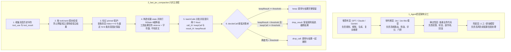

# 一万字 Jev 工程实践长文：把 Agent 的“判断题”从大模型里拆出来

## 1. TL;DR

本文围绕 TypeSafe AI 发布的“System One Model”——**Jev**，结合社区代表项目 `fast-jev-compaction` 的源码拆解与作者本地可运行 Demo，提出了一项核心 Agent 工程洞察：**Agent 中大量高频模型调用并非为了生成自然语言答案，而是替代码做一次封闭空间内的判断**。Jev 刻意放弃自由文本生成，仅提供 `Choice`（单选）、`Score`（打分）、`Noul`（$0\sim 1$ 概率判断）三类原语，适合作为 Agent 的“反射神经（快判断层）”与慢思考大模型、确定性代码、人工兜底分层协作。在 Coding Agent 上下文压缩场景中，传统 LLM 摘要虽能省 Token，却会把文件路径、超时阈值、错误行号与鉴权约束概括成模糊大意（破坏可复核性）；`fast-jev-compaction` 则保持用户与助手文本原样不动，将 `tool_use` 与 `tool_result` 配对后构造脱敏短状态（`fitState` 8 级降级），对每个非固定（non-pinned）工具调用并发询问 `keepCall` 与 `keepResult` 两个 `Noul` 判断题，映射为 `keep`、`drop_result`、`drop_call` 三种精确动作（Demo 实测将字符数从 $10029$ 压至 $852$，压缩率 $91.5\%$ 且完整保留核心测试失败日志與鉴权相关代码）。作者同时警示：Jev 的“不幻觉”仅指**类型安全（不输出 Schema 之外的值）而非语义绝对正确**，其概率输出在生产落地前必须经过 Shadow Mode 业务样本校准，且绝不能单独决定 L3 不可逆操作。

## 2. 核心概念

- **Jev（System One Model / 快判断层）**：TypeSafe AI 发布的非生成式判别决策模型；它放弃自由文本生成，仅在封闭输出空间内返回类型化的概率决策（`Choice` / `Score` / `Noul`），在 Agent 架构中充当“反射神经”而非“大脑”。
- **三大决策原语（`Choice` / `Score` / `Noul`）**：
  - **`Choice`（单选题）**：输出候选选项、每个选项的概率及 `confidence`，适用于工具路由、动作选择与分类。
  - **`Score`（打分题）**：输出连续分数、概率分布及 `confidence`，适用于风险评分、质量评分与相关性评分。
  - **`Noul`（判断题）**：输出 $0\sim 1$ 的成立概率（如 `{"answers": {"result_t3": {"noul": 0.87}}}`），适用于判断“是否保留、是否危险、是否达成目标”。
- **保留决策压缩（`fast-jev-compaction`）vs 摘要式压缩（Summary）**：传统 Summary 让通用大模型把旧历史改写成一段短总结，极易丢失精确的文件路径、栈行号、超时毫秒数和业务约束；`fast-jev-compaction` 则不改写任何用户或助手文本，仅对历史中的工具调用对（`tool_use` + `tool_result`）做“原样保留（`keep`）、保留调用但截断结果（`drop_result`）、连同调用一起删除（`drop_call`）”的三选一裁剪。
- **类型安全（Type Safety）vs 语义正确（Semantic Correctness）**：针对宣传中“Jev 不会幻觉”的澄清——Jev 只是受封闭 Schema 约束不会编造出预设选项之外的非法动作名（类型安全），但它依然可能选错选项或给错概率（语义错误）。

## 3. 知识框架

以下流程图按正文整理，展示 Agent 四层架构分工以及 `fast-jev-compaction` 从收集配对、状态预算降级、双 `Noul` 提问到三动作执行的完整链路：



## 4. 关键要点与机制详解

### 4.1 为什么 Agent 需要把“快判断层”从生成式大模型里拆出来

**核心主张**：Coding Agent 在多轮修 Bug 循环中真正撑爆上下文的是长工具返回结果；若用通用大模型生成摘要来压缩，会遭遇“生成成本与判断需求错配、摘要改写破坏精确事实可复核性、口头置信度无法进代码分支”三层断裂。

- **Coding Agent 上下文各类内容的膨胀与压缩风险对比**

| 内容类型 | 是否经常很长 | 是否必须全文保留 | 摘要或误删的典型风险 |
|---|---|---|---|
| **用户需求** | 否 | **是** | 删改会丢失原始需求与硬约束（如“不要破坏鉴权”） |
| **助手回复** | 中 | **通常要保留** | 删改会丢失已承诺的计划与当前执行思路 |
| **`read_file` 结果** | 是 | 看情况 | 文件全文可能已过期，或需要时可重新读取 |
| **`search_content` 结果** | 是 | 看情况 | 许多匹配项只是中间探索痕迹 |
| **`execute_command` 日志** | 是 | 看情况 | **失败栈与断言极其重要**，成功日志通常无用 |
| **`list_dir` 结果** | 是 | 通常不需要全文 | 完整目录树极占空间且随时可重跑 |

- **传统 Summary 改写事实的反例**
  - 原始测试失败日志：
    ```text
    FAIL order-export.test.ts
    Error: Timeout of 5000ms exceeded
      at exportOrders (/repo/src/services/orderExport.ts:42:19)
    Expected authorization header to be preserved.
    ```
  - 若被通用大模型摘要为一句“*之前订单导出测试失败了*”，虽然大意没错，但后续定位必需的四个精确事实全部丢失：① 哪个测试文件失败（`order-export.test.ts`）；② 超时阈值是多少（`5000ms`）；③ 具体源码行号定位（`/repo/src/services/orderExport.ts:42:19`）；④ 涉及鉴权请求头约束（`authorization header`）。
- **通用大模型做内部小判断的三层断裂**
  1. **生成成本与判断需求不匹配**：系统只想要一个 $0\sim 1$ 的保留概率或枚举项，通用 LLM 却要读完整上下文、逐 token 生成一段自然语言解释再让代码解析。
  2. **摘要破坏可复核性**：代码修复下一步需要基于精确路径、错误码和栈信息执行动作，而非“理解大意”。
  3. **置信度未进入代码分支**：通用 LLM 说“我有 80% 把握”只是文本自我描述；Jev 则直接返回数值概率，供代码按区间分流（如 $\ge 0.8$ 自动执行、$0.5\sim 0.8$ 保守截断或保留摘要、$<0.5$ 删除或转人工）。

### 4.2 `fast-jev-compaction` 与 Demo 源码六步机制拆解

**核心主张**：`fast-jev-compaction` 不做文本总结，而是通过“对象层绑定配对 → 状态层脱敏降级 → 判断层双 `Noul` 拆分 → 执行层三动作回退”把上下文压缩转化为高精度、可测试的工具历史清理。

- **主流程入口（`src/compact.js`）**
  - 以下保留原文主流程代码片段（原文末尾含排版截断，保持原样不补全）：
    ```javascript
    // 原文片段（src/compact.js 第 28-49 行，部分长行末尾在原 PDF 中截断）
    export async function compact(messages, asker, options = {}) {
      const config = resolveOptions(options);
      const startedAt = Date.now();
      const calls = collectToolCalls(messages, config.preserveRecentMessages);
      const candidates = calls.filter(call => !call.pinned);
      const charsBefore = messages.reduce((sum, message) => sum + messageChars(message), 
      const answers = new Map();
      let fitted = { state: null, tokens: 0, stage: 'skipped' };
      let requests = 0;
      if (candidates.length > 0) {
        fitted = fitState(messages, calls, config);
        const batches = batchCalls(candidates, fitted.tokens, config);
        const batchAnswers = await Promise.all(batches.map(batch => askBatch(asker, fitte
    ```
- **步骤 1 & 2：`tool_use` 与 `tool_result` 强制配对及 `pinned` 保护（`src/state.js`）**
  - 消息历史中，assistant 发起的 `tool_use`（含 `id: "toolu_003"`）与 user 返回的 `tool_result`（含 `toolUseId: "toolu_003"`）分处不同消息。必须先按 `toolUseId` 绑定为统一对象（含内部短 ID `t1/t2`、`tool`、`input`、`callIndex`、`resultIndex`、`resultChars`、`isError`、`pinned`），否则单独删掉一方会导致上下文残留孤立调用或孤立结果而引发接口报错。
  - 🔥 **`pinned` 工程保护**：`isPinned = index => index === 0 || index >= total - preserveRecentMessages`（默认 `preserveRecentMessages = 6`），强制固定保留首条消息（原始任务目标）与最近 $N$ 条消息，防止刚发生的上下文被过早裁掉。
- **步骤 3：轻量 `state` 构造——不把完整工具结果发给 Jev**
  - 压缩器不需要重读几千行的文件全文或日志全文，只需把每个工具结果替换为一句话元信息：
    ```text
    ok, 4213 chars (omitted)
    error, 830 chars (omitted)
    ```
  - 进入 `state` 的工具对象仅包含 `{ id: call.id, tool: call.tool, input: truncate(safeJson(call.input), inputChars), result: call.resultNote }`。
- **步骤 4：`fitState` 预算超限时的 8 级优雅降级链（`src/state.js`）**
  - 当 `state` 超过 `maxStateTokens`（默认 $25000$，测试中压至 $600$ 可触发降级）时，不粗暴删消息，而是遵循“先削弱细节再删内容、先处理旧消息再处理近期消息”的 8 级降级顺序：

| 降级阶段（`stateStage`） | 具体降级动作 | 信息损失程度 |
|---|---|---|
| 1. `full` | 工具输入最多保留 $1000$ 字符 | 低 |
| 2. `inputs<=200` | 工具输入截断至 $200$ 字符 | 低 |
| 3. `inputs<=60` | 工具输入截断至 $60$ 字符 | 中 |
| 4. `texts abridged` | 长文本消息仅保留头尾 | 中 |
| 5. `old messages collapsed` | 旧纯文本消息折叠为省略说明 | 高 |
| 6. `old calls compacted` | 旧工具调用压成单行摘要 | 高 |
| 7. `old messages left out` | 删除旧的纯文本消息（若线上常落入此级，说明 `state` 预算过紧需调策略） | 很高 |
| 8. `old calls merged` | 合并连续的旧工具调用 | 很高 |

- **步骤 5 & 6：遵循“一问一判断”拆出两个 `Noul`，映射三种动作（`src/jev.js` & `src/compact.js`）**
  - Jev 的核心使用纪律是**一个问题只做一个判断**。把“这个工具调用和结果是否重要、要不要截断”拆成两个独立的 `Noul` 问题：
    - `call_tX`（`keepCall`）：知道曾发起过该工具调用及其输入参数，对后续任务是否仍有帮助？
    - `result_tX`（`keepResult`）：该工具返回的完整结果正文，是否仍需保留在上下文中？
  - 决策树（`decideCall`）根据阈值 `keepThreshold` 映射出三种确定性动作：
    1. **`keep`（`keepResult >= threshold` 或 `pinned`）**：调用与完整结果全部原样保留。
    2. **`drop_result`（`keepResult < threshold` 且 `keepCall >= threshold`）**：保留工具调用记录，但将冗长结果截断为简短说明（证明查过该路径，但省去大段输出）。
    3. **`drop_call`（两者均 `< threshold`）**：将工具调用与返回结果一起从上下文中删除。
- **分批请求（`batchCalls`）、失败回退与 `asker` 接口抽象**
  - 当待判断工具调用过多时，按 `budget = maxRequestTokens - stateTokens - REQUEST_OVERHEAD_TOKENS` 拆批，每批携带相同 `state` 并通过 `Promise.all` 并发请求（取舍：重复发 `state` 增加少许成本，但实现简单且保证所有判断基于同一全局上下文）。
  - 通过 `asker` 接口抽象底层实现：配置了 `TYPESAFE_API_KEY` 时走真实 HTTP Jev（`createHttpAsker`），无 Key 时走本地启发式 Mock（`createHeuristicAsker`），且针对请求失败、格式异常、压缩收益不足、低置信度均设有保守回退策略（回退至内置 summary 或保留原 transcript）。

### 4.3 本地 Demo 实测结果：订单导出超时修复会话

**核心主张**：在包含 4 次工具调用的真实修 Bug 会话样本中，双 `Noul` 决策树能够精准区分“可重跑目录树、含鉴权约束的核心源码、含超时与请求头断言的失败日志、无关遗留代码”，实现 $91.5\%$ 的无损事实压缩。

- **样本会话（`src/sampleTranscript.js`）4 个工具调用的测试输出对照**
  - 执行 `cd jev-compaction-demo && npm test && npm start`（`tests 11, pass 11, fail 0`），输出结果如下：

| 内部 ID / 原始 ID | 工具名称 | 原始调用内容与结果特征 | `keepCall` | `keepResult` | 最终动作（`action`） | 工程合理性解释 |
|---|---|---|---:|---:|---|---|
| `t1` (`toolu_001`) | `list_dir` | 返回很长的项目目录树 | $0.54$ | $0.00$ | **`drop_result`** | 知道做过目录浏览有用，但长目录树随时可重跑，仅留调用并截断头部 |
| `t2` (`toolu_002`) | `read_file` | 读取 `orderExport.ts`，内含 `getAuthToken` | $0.59$ | $0.69$ | **`keep`** | 直接关联用户“不要破坏鉴权”的硬约束，完整保留 |
| `t3` (`toolu_003`) | `execute_command` | `npm test -- order-export` 失败，含 `5000ms` 超时与 `authorization header` 报错 | $0.75$ | $1.00$ | **`keep`** | 核心排障证据，一行都不能改写或丢弃，完整保留 |
| `t4` (`toolu_004`) | `read_file` | 读取无关旧文件 `legacy/reportPrinter.ts` | $0.47$ | $0.00$ | **`drop_call`** | 与当前订单导出超时任务完全无关的探索噪音，连同调用一起删除 |

### 4.4 选型矩阵与生产落地安全边界（L1 / L2 / L3）

**核心主张**：Jev 与 LLM Structured Output、Tool Calling、传统分类器并非互斥替代关系，只有在“高频调用、输出空间封闭固定、无需自然语言解释、错误可兜底”的内部节点上才应选型 Jev，且必须用业务校准与风险分级管住概率阈值。

- **四类方案横向选型对比**

| 方案类型 | 核心优势 | 核心局限 | 适用位置与调用频次特征 |
|---|---|---|---|
| **LLM + JSON Schema** | 表达能力强，能同时输出复杂推理理由 | 仍逐 token 自回归生成，延迟与成本高 | 低频（如每小时几十次）、需解释原因的复杂判断 |
| **Tool Calling** | 与外部工具生态直接集成 | 决策仍绑定在重量级生成模型主循环中 | Agent 主流程动作编排 |
| **传统分类器** | 极便宜、可纯本地部署 | 标签固定不灵活，跨场景语义泛化弱 | 标签长期稳定、拥有大量标注样本的分类 |
| **Jev（快判断层）** | 输出空间封闭、直接返回可用概率、适合高频并发 | 不能生成文本，跨文件多步复杂推理弱 | **高频（如每天几十万次）、输出可提前枚举、错误可兜底的局部判断** |

- **上线四步校准法与动作风险三级管控（L1 / L2 / L3）**
  - 鉴于目前公开资料中 Jev 的 RLCD 训练细节与第三方概率校准数据尚不充分，工程上**严禁直接把 `0.8` 或 `0.9` 当作免检上线规则**，必须执行四步上线法：① 先跑 Shadow Mode → ② 用自身业务样本统计各概率区间的真实正确率 → ③ 标定自动执行阈值 → ④ 高风险场景保守处理。
  - **动作风险分级表**：
    - **L1（只读动作）**：搜索、读取、分类、重排 $\to$ **可按阈值自动执行**。
    - **L2（可逆动作）**：截断上下文、创建临时记录 $\to$ **低置信度时保守保留**。
    - **L3（不可逆动作）**：删除生产数据、扣款、关闭权限 $\to$ **绝不让 Jev 单独决定**（必须走确定性代码校验或人工审批）。

## 5. 数据速查表

| 指标 / 参数 | 原文数值 | 语境 / 条件 |
|---|---|---|
| Jev 核心决策原语数量 | $3$ 种（`Choice` / `Score` / `Noul`） | 分别对应单选题、连续打分题、$0\sim 1$ 概率判断题 |
| 原文示例概率分流区间 | $\ge 0.8$ 自动执行；$0.5\sim 0.8$ 保守处理；$<0.5$ 删除或回退 | 需经自有业务数据 Shadow Mode 校准后使用，非通用免检标准 |
| `preserveRecentMessages` 默认值 | $6$ 条消息（另加首条消息 `index === 0`） | `collectToolCalls` 与 `fitState` 中的 `pinned` 固定保护窗口 |
| `maxStateTokens` 默认值与降级测试值 | 默认 $25000$ tokens；测试压至 $600$ tokens | 完整小样本 `stateTokens: 669`（`stage: full, requests: 1`），压至 $600$ 时触发 8 级降级链 |
| `fitState` 工具输入字符截断梯度 | `full` $\le 1000$ 字符 $\to$ `inputs<=200` $\to$ `inputs<=60` | 8 级降级链前 3 级的参数截断阈值 |
| Demo 单元测试结果 | `tests 11, pass 11, fail 0` | `jev-compaction-demo` 本地测试通过数 |
| Demo 会话上下文压缩率 | 字符数从 $10029$ 降至 $852$（减少 $9177$ 字符，压缩率 $0.915$ / 减少 $91.5\%$） | 4 个工具调用压后保留 2 个完整（`t2`, `t3`）、1 个截断结果（`t1`）、删除 1 个无关调用（`t4`） |

## 6. 踩坑与教训 / 可迁移的设计原则

### 常见踩坑与应对

| 错误做法 | 失败表现或原因 | 原文应对策略 |
|---|---|---|
| **用通用 LLM Summary 概括 Coding Agent 的工具报错日志** | 模型把精确文件路径、行号、超时毫秒数（`5000ms`）与鉴权头（`authorization header`）改写成“之前测试失败了”，导致后续修复失去依据 | 放弃改写式摘要，改用保留决策（`keep` / `drop_result` / `drop_call`），对关键报错与核心代码原样保留 |
| **未将 `tool_use` 与 `tool_result` 配对就单独删除其中一方** | 消息列表中残留没有返回的孤立 `tool_use` 或找不到调用源的孤立 `tool_result`，破坏对话协议合法性 | 先按 `toolUseId` 将调用与结果绑定为统一对象，裁剪时成对保留、成对删除，或保留调用仅截断结果正文 |
| **把完整几千字符的文件内容和日志原文塞进 Jev 的 `state`** | Jev 自身请求 Token 暴涨甚至超出预算，且压缩器本不需要重读全部源码细节 | 在 `state` 中将工具结果脱敏为 `ok/error, N chars (omitted)`，只传工具名、截断后的输入参数与结果状态 |
| **在一个 Jev 问题里混合询问多个判断意图** | 问“是否重要且是否需要截断”会导致概率含义模糊，无法映射为清晰动作 | 严守“一问一判断”原则：拆成 `keepCall`（调用本身是否重要）和 `keepResult`（结果全文是否保留）两个独立 `Noul` 问题 |
| **迷信“Jev 不会幻觉、概率已校准”，直接用于高风险不可逆动作** | Jev 的不幻觉仅指不输出 Schema 之外的字符串（类型安全），仍会选错；公开 RLCD 校准数据尚不充分 | 先跑 Shadow Mode 统计真实业务准确率再定阈值；L3 不可逆操作（删数据、扣款、关权限）严禁由 Jev 单独决定 |

### 可迁移的设计原则

- **“生成负责表达，判断负责分流，代码负责执行”的三层解耦原则**：审视现有 Agent 链路中所有调用大模型的地方，凡是输出空间固定可枚举、调用高频、不需要自然语言解释、且选错可兜底的节点（如上下文剪枝、工具路由、搜索相关性过滤、代码审查风险初筛），均可从重型生成链路中拆出，沉淀为轻量级类型化概率判断接口。
- **“模型可以替换，决策协议要稳定”的适配器隔离模式**：在工程落地时将判断端抽象为统一的 `asker` 接口（输入结构化 `state` + `questions`，返回各 ID 对应的概率值），使主流程与底层究竟调官方 Jev API、开源小模型复刻版（如 SemIf / kev / laya）还是本地启发式规则完全解耦。

## 7. 记忆锚点

- **原文定位锚点**：“Jev 最适合的位置，不是 Agent 的大脑，而是 Agent 的反射神经；生成负责表达，判断负责分流，代码负责执行。”
- **压缩核心口诀（原文金句 + 助记改写）**：“上下文压缩最怕的不是删掉废话，而是把关键事实改写成一句‘差不多’——配对绑调用，状态省原文，双问拆三招，模型可替换，协议要稳定。”

## 8. 复习卡片

Jev（System One Model）与传统聊天大模型的核心区别是什么，它提供哪三种原语？::传统大模型擅长逐 token 生成自然语言文本，而 Jev 刻意放弃自由文本生成，只在封闭输出空间内返回供代码直接分支消费的类型化概率决策；其三种原语为 `Choice`（单选题）、`Score`（连续打分题）和 `Noul`（$0\sim 1$ 概率判断题）。
为什么在 Coding Agent 中用传统大模型做摘要（Summary）压缩历史会有很高风险？::因为 Coding Agent 排障依赖精确的文件路径、栈行号、超时阈值（如 `5000ms`）和业务约束（如 `authorization header`），摘要会把这些精确证据改写成模糊的“测试失败了”，破坏可复核性并导致后续修复动作走偏。
`fast-jev-compaction` 在压缩上下文时严守哪两条文本保护底线，为什么？::严守“用户文本不改写、助手文本不改写”，只裁剪工具调用（`tool_use`）和工具结果（`tool_result`）；因为用户文本含原始需求与硬约束，助手文本含已承诺计划，而工具结果占空间最大、最易过期且多数可重读或重跑。
为什么 `fast-jev-compaction` 必须先将 `tool_use` 与 `tool_result` 按 `toolUseId` 配对，并设置 `pinned` 标记？::配对是为了防止单独删掉调用或结果后在上下文中留下孤立节点破坏消息协议；`pinned` 则是固定保护首条消息（`index === 0`）和最近 $N$（默认 6）条消息不参与删除，避免刚发生的活跃上下文被过早裁掉。
构造发给 Jev 的 `state` 时如何避免把冗长工具结果原文传过去，预算超限时 `fitState` 按什么原则降级？::在 `state` 中不传工具结果全文，只传工具名、截断后的 `input` 以及形如 `ok/error, N chars (omitted)` 的短说明；预算超限时按 8 级链路（`full` → `inputs<=200` → `inputs<=60` → `texts abridged` → `old messages collapsed` → `old calls compacted` → `old messages left out` → `old calls merged`）遵循“先削弱细节再删内容、先砍旧消息再动新消息”逐级降级。
`fast-jev-compaction` 如何用两个 `Noul` 判断题拆解出三种具体的压缩动作？::遵循“一问一判断”原则，对每组工具调用分别问 `keepCall`（调用本身及输入是否仍有帮助）和 `keepResult`（结果全文是否仍需保留）：若 `keepResult >= threshold` 则执行 `keep`（完整保留）；若 `keepResult < threshold` 但 `keepCall >= threshold` 则执行 `drop_result`（保留调用痕迹、截断结果）；若两者均低则执行 `drop_call`（调用与结果一起删除）。
如何正确理解 Jev 宣传中的“不会幻觉”与“概率可信”，上线前必须做哪些工程保护？::“不会幻觉”仅指类型安全（不会输出预设 Schema 之外的动作名），不代表语义不会选错；而公开概率校准证据尚不充分，上线前必须先跑 Shadow Mode 用自有样本统计各概率段真实准确率再定阈值，且对 L3 不可逆操作（删数据、扣款、关权限）严禁让 Jev 单独决定。
什么时候适合选用 Jev，什么时候更适合用通用 LLM + JSON Schema 或传统分类器？::当任务高频调用（如日均几十万次）、输出选项可提前枚举、无需自然语言解释且错误可兜底时适合 Jev；低频且需解释复杂理由或跨文件多步推理时适合通用 LLM；标签长期稳定且有大量标注数据时适合传统分类器。

## 9. 知识关联

- **上下文预算与压缩**：[[Agent成本与上下文预算]]（[Agent成本与上下文预算](../../20_topics/Agent成本与上下文预算.md)）、[[Agent长期记忆]]（[Agent长期记忆](../../20_topics/Agent长期记忆.md)）
- **控制流与运行时协同**：[[Harness与模型协同]]（[Harness与模型协同](../../20_topics/Harness与模型协同.md)）、[[Agent工程循环]]（[Agent工程循环](../../20_topics/Agent工程循环.md)）、[[Agent评测与反馈]]（[Agent评测与反馈](../../20_topics/Agent评测与反馈.md)）、[[模型与开发工具发布]]（[模型与开发工具发布](../../20_topics/模型与开发工具发布.md)）
- **本篇原始与转写材料**：[补采完整 PDF](RAW_补采001.pdf) · [补采逐页转写](MD_补采001.md) · [早期采集 PDF](RAW.pdf) · [早期转写](MD.md) · [提炼 Prompt 合集](PROMPT.md)

## 10. 原文参考资料

原文提及的模型、社区开源项目与本地 Demo 文件路径如下（仅作原文线索保存，未联网访问或运行文中命令）：

- **核心模型与参考项目**：TypeSafe AI `Jev`（System One Model）、`fast-jev-compaction`（Claude Code 插件 / npm 库）
- **社区代表性项目**：`browser-use/jev-ultrafast`（浏览器自动化）、`vercel/eve`（Agent 框架评估与路由）、`jev-review`（代码审查是非判断与风险评分）、`SemIf` / `kev` / `laya`（开源小模型复刻 Jev-like 接口）、`pg-jev`（SQL 语义判断扩展）、`Doom` / `Mario` / `Snake` 游戏仿真 Demo
- **作者本地 Demo 文件定位**：`src/compact.js`、`src/state.js`、`src/jev.js`、`src/sampleTranscript.js`（其中的判断指令已按本库规范摘录于同目录 [PROMPT.md](PROMPT.md) 中）

> [!note]- 校对报告
> **覆盖度**：基于 `MD_补采001.md` 与 `META.json` 完整覆盖补采版 PDF 第 1–21 页全部技术正文（导语与问题引出 p.1；一、Jev 是什么、三种原语与 Agent 四层分工 p.2–4；二、为什么 Agent 需要快判断层、工具结果风险表与传统 Summary 三层断裂 p.4–7；三、`fast-jev-compaction` 核心策略与三层设计 p.7–9；四、Demo 六步实现拆解：配对、`state` 构造、`fitState` 8 级降级、双 `Noul` 决策树、分批与失败回退 p.9–17；五、订单导出超时 Demo 实测结果 p.17–18；六、选型对比、两大宣传误读澄清与 L1/L2/L3 风险分级 p.18–20；七、社区七大方向与工程模式总结 p.20–21；八、结语 p.21）。第 21 页底部直播预告、第 22–23 页视频宣传与读者留言及第 24 页空白页已核对排除。
>
> **一致性抽查**：
>
> | 核对项 | 笔记值 | 原文值与位置 | 结果 |
> |---|---|---|---|
> | Jev 三种原语 | `Choice`、`Score`、`Noul`（示例 `result_t3: 0.87`，阈值 `0.5`） | p.2–3 | 一致 |
> | 测试失败日志关键细节 | `order-export.test.ts`、`5000ms`、`/repo/src/services/orderExport.ts:42:19`、`authorization header` | p.5–6 | 一致 |
> | `fitState` 默认参数与测试值 | `maxStateTokens=25000`（压至 `600` 触发降级），`preserveRecentMessages=6`；`stateTokens: 669` | p.11、p.13–14 | 一致 |
> | Demo 4 个工具调用概率 | `t1`: 0.54/0.00 (`drop_result`)；`t2`: 0.59/0.69 (`keep`)；`t3`: 0.75/1.00 (`keep`)；`t4`: 0.47/0.00 (`drop_call`) | p.18 | 一致 |
> | Demo 压缩前后字符与压缩率 | $10029 \to 852$（减少 $9177$，压缩率 $0.915$ / 减少 $91.5\%$），`tests 11, pass 11, fail 0` | p.18 | 一致 |
>
> **推断与异常**：未引入超出原文的技术推断。原文 p.10、p.11、p.13、p.15、p.16 代码块中存在个别超长代码行在 PDF 排版右侧被截断（如 `fitte`、`preserveRe`），笔记引用代码时明确标注为“原文片段、保持原样不猜测补全”。
>
> **日期与格式**：发布日期依据 PDF 第 1 页页眉 `Sep 21, 2026, 2:23 AM`，frontmatter `date` 记为 `2026-09-21`；全文保持唯一 H1，正文、表格、图注与复习卡片均已去除页码与章节出处标注；复习卡片共 8 条，均为单行 `问题::答案` 格式；Mermaid 图表与文内命令（`npm test` 等）均未实际执行。
