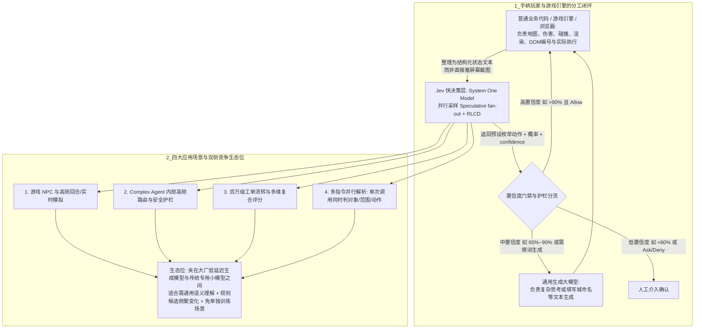

# 聊聊最近爆火的 Jev 模型，到底是个啥？

## 1. TL;DR

本文结合 TypeSafe AI（创始人 Diogo Almeida）推出的 **Jev（System One Models）** 官方资料、作者使用 Codebuddy 搭建的网页勇者小游戏实测，以及 Browser Use、DOOM 等社区案例，剖析了一个核心 Agent 架构问题：**现有 Agent 动辄让通用自回归大模型反复决定下一步，其中大量高频、输出空间有限的“选择与判断”并不需要完整的文本生成与长链推理**。Jev 本质上是面向决策与分类的模型，提供 `Choice`、`Score`、`Noul` 三种原语，采用面向决策的架构、并行采样（Speculative fan-out）与 RLCD 训练方法，官方口径延迟约 $70\sim 500\text{ ms}$、输入价格 $\$0.042/\text{百万 tokens}$ 且输出免费（每次 $1000\text{ tokens}$ 算，百万次请求仅约 $42$ 美元）。在分工上，“Jev 是拿手柄的玩家（看结构化状态描述选动作），普通代码是游戏本身（管地图、伤害、碰撞、物理渲染）”。作者总结出游戏高频决策、Agent 内部路由与护栏、百万级工单分类过滤、多指令并行解析四大核心场景，同时提醒：`confidence` 是答案概率分布算出的统计量而非“本局必胜率”或“本次必定正确率”，上线自动执行前必须用自有业务数据做概率校准，且 Jev 面临大模型厂商低延迟结构化输出与传统专用小模型的双向挤压，最佳生态位在于“需要通用语义理解、规则与候选频繁变化、又不值得单独训模型”的中间地带。

## 2. 核心概念

- **Jev（System One Models）**：TypeSafe AI 历时两年研发的决策/分类模型，通过面向决策的架构、并行采样与 RLCD 训练方法，接收当前结构化状态与问题，直接返回程序可用的选项、等级评分或概率，不生成自由文本。
- **三种接口原语对比**：

| 接口类型 | 典型提问方式 | 返回结果结构 | 关键区别与注意点 |
|---|---|---|---|
| **`Choice`（选择）** | “玩家这句话在叫谁？” / “现在应该按哪个键？” | 选中的一个选项 + 各选项概率 + `confidence` | 仅在提前定义好的候选标签（如上/下/左/右/攻击/喝药）中选择，杜绝标签外幻觉 |
| **`Score`（评分）** | “这段内容的风险处于哪个等级？” | 按定义等级的评分 + 概率分布 + `confidence` | 可在 HR 简历筛选或合规审计中对多维度按自定义等级（如 $1\sim 5$ 分）并发概率打分 |
| **`Noul`（是非判断）** | “这条请求需要转人工吗？” | “是”的概率（取值 $0\sim 1$） | **不单独返回 `confidence` 字段** |

- **动作概率 vs 置信度（`confidence`）vs 任务胜率**：在作者的勇者游戏 Demo 中，第一步选“攻击”的概率约为 $95\%$，界面显示的 `confidence` 约为 $93\%$——`confidence` 是从答案概率分布计算出来的统计量，代表模型对本次选项分布的确定程度（识别模型是否在两个选项间犹豫），既不等于“这次一定有 $93\%$ 概率选对”，更不等于“这局游戏有 $93\%$ 概率通关”。
- **置信度门禁（Confidence-Gated Fallback）与安全护栏（Guardrails）**：利用校准后的置信度将 Agent 请求分流（如 $>90\%$ 自动执行代码、$60\%\sim 90\%$ 升级调用通用大模型思考、$<60\%$ 转人工介入），或对每次工具调用实时输出 `Allow`（允许）、`Deny`（拒绝）、`Ask`（二次确认）。

## 3. 知识框架

以下流程图按正文整理，展示 Jev 与业务代码、通用生成大模型在交互循环中的职责边界，以及四大核心应用场景与商业生态位：

## 4. 关键要点与机制详解

### 4.1 从网页小游戏与社区 Demo 看 Jev 的真实职责边界

**核心主张**：“Jev 是拿手柄的玩家，普通代码是游戏本身”——Jev 既不负责画面渲染与物理碰撞，也不直接看屏幕像素截图，而是接收代码整理好的结构化状态文本，在预设动作集中做高频快选。

- **作者自研 Codebuddy 勇者游戏 Demo 实测剖析**
  - **状态输入与动作空间**：每一步将“当前有多少血、怪物和金币在哪里、出口在哪里，目标是拿到金币并活着出去，现在应该按哪个键”整理为结构化状态发给 Jev；可选动作提前限定为“上、下、左、右、攻击、喝药”。
  - **单局完整轨迹**：Jev 先攻击挡路怪物 $\to$ 往右移动 $\to$ 拿到金币 $\to$ 走到出口，全程共 **6 次真实 API 调用**。第一步“攻击”概率约 $95\%$、置信度约 $93\%$（视频中每步多停留几秒仅用于演示展示“看到了什么、选了哪个动作、执行后发生了什么”，并非模型真实响应耗时）。
  - **低血量测试的客观边界**：在一次角色仅剩 $20$ 点血的测试中，Jev 第一手仍选“攻击”，怪物反击后角色剩 $5$ 点血。作者强调：该动作是否最优取决于后续局面，不能仅凭“没喝药”就判定模型错，更不能为了演示好看把结果改成预设答案；同时因尚未完成同地图、同规则下与 GPT 的有效双模型实测，本文不作胜负与性能优劣结论。
- **Browser Use 航班查询与社区典型 Demo 对照**
  - 在 `Browser Use / jev-ultrafast` 航班查询演示中，网页先被整理成带编号的元素，**由 Jev 连续快速决定“操作什么、点击哪个编号元素”，仅在需要填写城市名称时才调用生成模型产生文字**。一次查询耗时 **$7.073$ 秒**，包含 **17 次 Jev 请求**与 **2 次文字生成调用**（不含初始打开网页与最终独立结果校验，且未完成购票，不能外推为“所有浏览器任务都能 7 秒完成”）。这直观验证了：在交互式任务中，“选下一步”的频次远高于“写一段话”。

| 社区 Demo | 核心交互机制与看点 | 关键工程边界说明 |
|---|---|---|
| **Browser Use 航班查询** | 页面元素编号后由 Jev 选目标动作（17 次），生成模型仅填城市名（2 次），记录耗时 $7.073$ 秒 | 不含首尾网页加载与独立校验时间，仅代表单次具体查询记录 |
| **DOOM 游戏驱动** | 根据游戏结构化状态连续选动作，官方称约每秒 10 次请求、约 $7$ 美元/小时 | **输入是结构化状态而非直接看画面**；每秒 10 次决策不等于接管每一帧的物理、碰撞与渲染 |
| **Mario / 跑酷模拟** | 将游戏状态或传感器数据高频喂给 Jev，返回预设导航或按键操作 | 渲染、动画与物理控制仍完全由游戏引擎代码承担 |
| **Wikipedia 链接接龙** | 每一步从当前页面已有链接列表中挑选下一跳，逐步走向目标词条 | 属于典型的封闭候选集语义导航 |
| **智能家居多指令解析** | 一句话输入后同时判断“操作对象、操作范围、动作类型”，再配合代码与生成模型执行 | 利用并行评分在一次 API 调用中并发完成多个判断 |

### 4.2 相比自回归通用大模型的三大收益与四大落地场景

**核心主张**：自回归大模型早已支持 Structured Outputs 约束枚举字段，因此 Jev 的核心差异不在“能不能只输出一个词”，而在于**高频调用下的成本延迟账本、单次请求并行多判断（消除串行等待）、以及暴露犹豫程度供代码分流**。

- **相比自回归大模型的三项核心收益**
  1. **高频线上调用的极致性价比与低延迟**：官方公布响应延迟约为 **$70\sim 500\text{ ms}$**，输入价格为 **$0.042\text{ 美元}/\text{百万 tokens}$**，**输出免费**（厂商口径，实际受网络、输入长度与负载影响）。按每次总输入 $1000\text{ tokens}$ 粗算，**一百万次请求的模型费用仅约 $42$ 美元**（其他服务与回退成本另算）。
  2. **利用并行采样（Speculative fan-out）消除不必要的串行排队**：面对同一份输入（如一条用户反馈或一句智能家居指令“把客厅灯调暗”），无需排队问三次，可在一次 API 调用中同时并发判断“业务类别/操作对象、紧急程度/操作范围、信息是否齐全/动作类型”，再由代码组合结果。
  3. **让程序识别“犹豫”并做置信度分流**：同样选 A，“明显偏向 A”与“A、B 概率接近”在代码中可走完全不同的分支（补信息、升档调大模型或转人工）。
- **四大核心工程应用场景汇总**
  1. **游戏 NPC 与高频回合/实时决策（Game AI & Simulation）**：如《DOOM》《Mario》《星际争霸》小范围战斗、无人机避障、跑酷导航，由引擎把血量、敌我距离转为结构化文本，Jev 毫秒级挑选预设动作。
  2. **Complex Agent 内部的高频路由与工具调度（Agent Routing & Guardrails）**：
     - *动态工具选择*：只在有效 API 列表里二选一或多选一，消除传统 LLM 编造不存在 API 名称的幻觉。
     - *置信度门禁*：例如置信度 $>90\%$ 直接自动执行代码，$60\%\sim 90\%$ 切换调用通用大模型深度思考，$<60\%$ 转人工介入。
     - *安全护栏*：对每个工具调用实时输出 `Allow`、`Deny` 或 `Ask`。
  3. **高吞吐量文本分类、工单流转与数据过滤（Triage, Classification & Filtering）**：日处理百万级邮件/工单自动分流（几百毫秒内判负责团队与紧急度）、HR 简历或合规审计多维复合评分（按 $1\sim 5$ 分并发打分）、浏览器自动化选元素。
  4. **多指令并行解析（Command Parsing）**：利用 Speculative fan-out 在单次请求中同时解析意图、对象、范围与动作。

### 4.3 前景研判与双侧竞争格局：Jev 的护城河在哪里？

**核心主张**：把局部判断从重型生成模型拆出来不仅能替换存量调用，还会激活过去“因太贵太慢而不敢做”的新判断需求；但 Jev 夹在大模型厂商与传统专用小模型之间，胜负手在于切换恢复的工程配套与低迁移成本。

- **三个前瞻判断与系统设计难点**
  1. **需求增量来自“以前算不过账的判断”**：当单次判断延迟降至百毫秒、百万次成本降至几十美元时，许多过去因成本高而省略的实时校验、细粒度护栏和步进筛选都变得划算。
  2. **替代比例取决于边缘条件治理**：理想架构是“复杂规划靠强模型，运行中局部判断交轻模型，遇新情况或高风险再升级”，但如果**切换时机、上下文传递、计划失效恢复**没设计好，省下的推理时间会被重试与恢复彻底抵消（且实时语音场景若全双工音频模型已能原生处理打断与接话，则未必值得额外增加一次远程 Jev 调用）。
  3. **双侧竞争挤压下的夹缝定位**：

| 竞争方 / 方案 | 核心优势与挤压方式 | Jev 相比之下的差异化生态位 |
|---|---|---|
| **通用大模型厂商（左挤压）** | 持续推进 Structured Outputs、低延迟小模型与蒸馏，且具备一站式平台黏性（开发者不愿多接一家供应商） | 在超高频、纯判别且需单次并发多判断（Speculative fan-out）的细分场景提供更极致的延迟与免费输出定价 |
| **传统分类器与专用小模型（右挤压）** | 若任务长期稳定、标签固定、标注数据充足，自训专用小模型或写规则更便宜且可纯本地部署 | **任务需要通用语义理解、规则与候选标签频繁变化、开发者又不愿为每个小判断单独收集数据训练模型** |

## 5. 数据速查表

| 指标 | 原文数值 | 语境 / 条件 |
|---|---|---|
| TypeSafe AI 研发周期 | 约 $2$ 年 | 9 月份推出 System One Models（Jev） |
| 作者勇者游戏 Demo 单局调用数 | $6$ 次真实 API 调用 | 第一步选“攻击”概率约 $95\%$，界面 `confidence` 约 $93\%$ |
| 作者低血量测试数值 | 角色剩 $20$ 点血时首手选攻击，怪物反击后剩 $5$ 点血 | 用于说明模型有自身取舍，演示不应篡改结果 |
| Browser Use 航班查询耗时与调用配比 | 耗时 $7.073$ 秒（含 $17$ 次 Jev 请求 + $2$ 次文字生成调用） | 不含初始打开网页和最后独立结果校验时间，未实际购票 |
| DOOM 官方演示调用频次与成本 | 约每秒 $10$ 次请求，约 $7$ 美元/小时 | 输入为结构化游戏状态文本，非直接读画面像素 |
| Jev 官方延迟与定价口径 | 响应延迟约 $70\sim 500\text{ ms}$；输入 $\$0.042/\text{百万 tokens}$，输出免费 | 厂商公布口径；按每次输入 $1000\text{ tokens}$ 粗算，一百万次请求模型费约 $42$ 美元 |
| 置信度门禁示例阈值区间 | $>90\%$ 自动执行；$60\%\sim 90\%$ 切通用大模型思考；$<60\%$ 转人工 | 文中 Agent 路由与护栏场景的分流示例，实际使用需按自有数据校准 |

## 6. 踩坑与教训 / 可迁移的设计原则

### 常见踩坑与应对

| 错误做法 | 失败表现或原因 | 原文应对策略 |
|---|---|---|
| **把 `confidence`（如 $93\%$）当成“这次必对”或“整局必胜概率”，直接写死 `0.9` 自动上线** | `confidence` 只是当前选项概率分布算出的统计量，未经业务数据验证前不能代表真实准确率 | 上线前必须拿自己的业务样本做概率校准（检验模型给出的概率与实际正确率是否相符），再制定自动执行阈值 |
| **以为游戏 Demo“每秒 10 次决策”等于模型接管了整个游戏引擎** | 混淆决策层与执行层，误以为模型在直接处理画面渲染、物理碰撞或截图像素 | 明确“Jev 是拿手柄的玩家，普通代码是游戏本身”，由代码将状态整理为结构化文本喂给 Jev，引擎负责物理与渲染 |
| **把“通用大模型总要写一大段话”当成选型 Jev 的唯一理由** | 忽略了现代通用大模型已支持 Structured Outputs 约束字段和枚举值，在低频场景盲目多引入一家供应商 | 从调用频率与总账本评估：偶发工单直接用通用大模型即可；日均百万级调用或需单次并发多判断时再引入 Jev |
| **只算快模型省下的单次推理时间，忽略大小模型切换与计划失效开销** | 当轻模型判断失误、上下文传递断裂或计划失效时，多次重试与状态恢复耗费的时间反而超过直接用强模型 | 在系统设计阶段重点打磨快慢模型的切换时机、上下文传递协议、阈值监控与失败回退机制 |

### 可迁移的设计原则

- **利用并行评分（Speculative fan-out）将串行判断拍平为单次请求**：当多个判断问题（如“属于哪个部门”“紧急度几级”“信息是否完整”，或智能家居中的“对象、范围、动作”）只依赖同一份输入文本而互不依赖前序输出时，不要排队串行调用三次，而应在一次调用中并发评估所有维度，再由确定性代码组合结果。
- **高频选动作与低频写文字彻底解耦**：在浏览器自动化等长链路交互中，把页面元素编号后交由快判断模型连续执行“点哪个”（如 17 次快判断），仅在遇到输入框需生成文本时才唤醒生成式大模型（如 2 次文字生成），大幅压缩端到端交互延迟。

## 7. 记忆锚点

- **原文核心比喻锚点**：“Jev 是拿手柄的玩家，普通代码是游戏本身——它看到的是状态描述，不是屏幕截图。”
- **选型与安全口诀（助记改写）**：“高频选标签，并发省串行；置信非胜率，校准再放行；左防大厂包圆，右比专用小模，专攻规则常变的语义快判断。”

## 8. 复习卡片

Jev 模型的三种核心接口类型（`Choice`、`Score`、`Noul`）在返回值结构上有什么区别？::`Choice`（单选题）返回选中的一个选项、各选项概率及 `confidence`；`Score`（评分题）返回按定义等级的评分、概率分布及 `confidence`；而 `Noul`（是非判断题）仅返回“是”的概率（$0\sim 1$），不单独返回 `confidence`。
如何理解“Jev 是拿手柄的玩家，普通代码是游戏本身”这一分工？::在游戏或自动化任务中，地图、伤害、碰撞、画面渲染与动作执行全部由普通代码（游戏引擎）负责；代码将当前局面整理为结构化文本和数据（而非屏幕截图）发给 Jev，Jev 仅负责在预设的候选按键中返回下一步按哪个键。
在作者的勇者游戏 Demo 中，第一步“攻击”概率 95% 与界面 `confidence` 93% 分别代表什么，为什么不能看到 0.9 就直接定自动执行规则？::95% 是该动作选项的预测概率，93% `confidence` 是从答案概率分布算出的统计量（反映模型是否犹豫），两者都不代表这局游戏能赢的概率或本次必定正确的概率；必须先用自有业务样本做概率校准，确认模型概率与真实准确率匹配后才能设定自动执行阈值。
Browser Use 航班查询 Demo（17 次 Jev 请求 + 2 次文字生成，耗时 7.073 秒）体现了怎样的模型协同思路？::将高频的“选择下一步”与低频的“生成文本”解耦：页面元素编号后，由 Jev 连续快速决定点击哪个目标元素（17 次），只有在需要填写城市名称等文本内容时才调用生成式大模型（2 次）。
既然现在的自回归通用大模型已支持 Structured Outputs 约束枚举输出，Jev 相比之下还有哪三项潜在优势？::一是更适合高频线上场景（官方口径延迟 $70\sim 500\text{ ms}$，输入 $\$0.042/\text{百万 tokens}$ 且输出免费）；二是支持并行评分（Speculative fan-out），对同一输入可单次并发完成对象、范围、动作等多个判断而无需串行排队；三是直接暴露概率分布与 `confidence` 供代码识别犹豫并分流。
在 Complex Agent 内部，Jev 可以承担哪三类具体的路由与治理工作？::一是动态工具选择（只在给定有效 API 列表中挑选，杜绝编造不存在的 API 名称）；二是置信度门禁（如 $>90\%$ 自动执行、$60\%\sim 90\%$ 切通用大模型思考、$<60\%$ 转人工）；三是安全护栏（对每次工具调用实时判定 `Allow`、`Deny` 或 `Ask`）。
把 Agent 运行中的局部判断交给轻量级快模型、复杂规划留给强模型时，系统设计最大的难点在哪里？::难点在于快慢模型的切换时机、上下文传递以及计划失效时的恢复等边缘条件；如果这些衔接没处理好，轻模型省下的单次推理时间很容易被重试和恢复开销抵消。
面对通用大模型厂商和传统专用分类器的双向挤压，Jev 最有吸引力的市场定位在哪里？::位于两者之间的夹缝市场：任务既需要通用语义理解（规则难以穷举），候选标签与业务规则又频繁变化、开发者不愿意或来不及为每个小判断单独收集标注数据去训练专用小模型。

## 9. 知识关联

- **模型发布与快判断层**：[[模型与开发工具发布]]（[模型与开发工具发布](../../20_topics/模型与开发工具发布.md)）、[[Harness与模型协同]]（[Harness与模型协同](../../20_topics/Harness与模型协同.md)）
- **工程循环、成本与安全**：[[Agent工程循环]]（[Agent工程循环](../../20_topics/Agent工程循环.md)）、[[Agent成本与上下文预算]]（[Agent成本与上下文预算](../../20_topics/Agent成本与上下文预算.md)）、[[Agent安全与权限]]（[Agent安全与权限](../../20_topics/Agent安全与权限.md)）、[[Agent评测与反馈]]（[Agent评测与反馈](../../20_topics/Agent评测与反馈.md)）
- **本篇原始与转写材料**：[补采完整 PDF](RAW_补采001.pdf) · [补采逐页转写](MD_补采001.md) · [早期采集 PDF](RAW.pdf) · [早期转写](MD.md) · [提炼 Prompt 合集](PROMPT.md)

## 10. 原文参考资料

原文提及的官方说明、社区项目与技术链接如下（仅作原文线索保留，未外部联网访问核验）：

- **官方与文档线索**：TypeSafe AI `Jev`（System One Models，创始人 Diogo Almeida，RLCD 训练与 Speculative fan-out 并行采样说明）、OpenAI `Structured Outputs` 文档
- **社区演示与仓库**：`Browser Use / jev-ultrafast`（航班查询浏览器自动化演示与测试记录）、DOOM / Mario 社区演示、Wikipedia 链接接龙官方演示、智能家居多指令解析演示、社区基于 Jev 实现对话的仓库 `https://github.com/kyle-pena-nlp/jevchat/`
- **文中游戏提示词摘录**：已按本库规范单独保存在同目录 [PROMPT.md](PROMPT.md) 中

> [!note]- 校对报告
> **覆盖度**：基于 `MD_补采001.md` 与 `META.json` 完整覆盖补采版 PDF 第 1–7 页全部技术正文（导语与一、Jev 是什么、三种接口类型与作者 Codebuddy 游戏 Demo 实测 p.1–3；二、Browser Use 航班查询与 DOOM/Mario/Wikipedia/智能家居社区 Demo p.3–4；三、相比自回归大模型的三项优势与四大应用场景 p.4–6；四、未来前景三点判断与双侧竞争分析 p.6–7）。第 8–10 页为读者留言区（含评论区 AI 助手总结回复），第 11 页为空白页，均已核对排除，未将读者评论混入作者正文结论。
>
> **一致性抽查**：
>
> | 核对项 | 笔记值 | 原文值与位置 | 结果 |
> |---|---|---|---|
> | 勇者游戏 Demo 调用与概率 | 6 次真实 API 调用；首步攻击概率约 $95\%$，置信度约 $93\%$；低血量 $20\to 5$ 点血 | p.2 | 一致 |
> | Browser Use 航班查询记录 | $7.073$ 秒，17 次 Jev 请求 + 2 次文字生成调用 | p.3 | 一致 |
> | DOOM 演示频次与成本 | 约每秒 10 次请求、约 $7$ 美元/小时 | p.4 | 一致 |
> | 官方延迟与价格口径 | $70\sim 500\text{ ms}$；输入 $\$0.042/\text{百万 tokens}$，输出免费；每次 $1000\text{ tokens}$ 算百万次约 $42$ 美元 | p.4 | 一致 |
> | 置信度门禁示例阈值 | $>90\%$ 自动执行，$60\%\sim 90\%$ 切通用大模型，$<60\%$ 转人工 | p.5 | 一致 |
>
> **推断与异常**：未引入超出原文的技术推断。严格保留原文关于“游戏 Demo 尚未完成与 GPT 的有效双模型对比实测”“航班查询 $7.073$ 秒不含首尾打开网页与校验时间”“延迟与价格为厂商口径”等边界说明（p.2–4）。
>
> **日期与格式**：发布日期依据 PDF 第 1 页页眉 `2026年9月20日 19:23`，frontmatter `date` 记为 `2026-09-20`；全文保持唯一 H1，正文、表格、图注与复习卡片均不含页码与章节标注；复习卡片共 8 条，均为单行 `问题::答案` 格式；Mermaid 图表未实际渲染。
