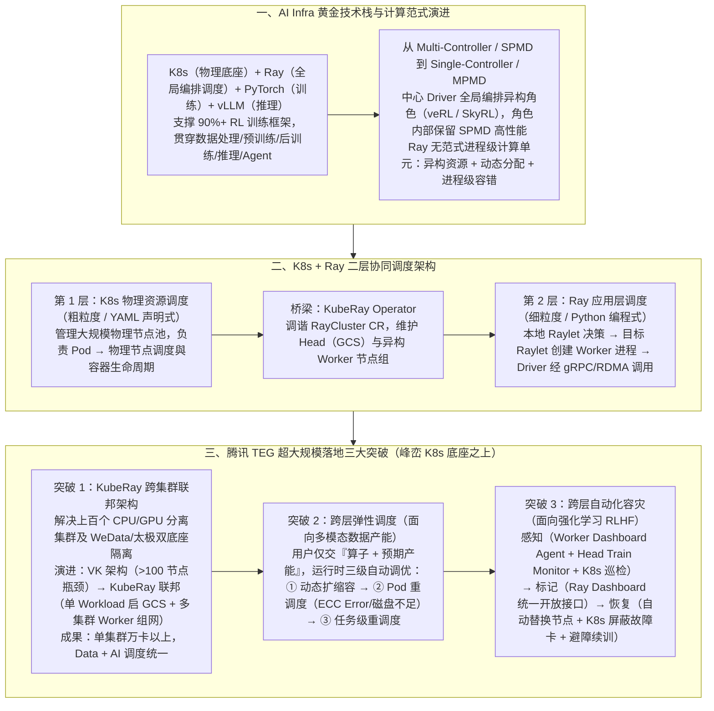

# 腾讯Ray团队实践：K8s + Ray如何支撑超大规模AI Workload

> **原文信息**：作者 `charliecli`（腾讯 TEG 数据计算平台部 Ray 团队），发布于 2026-07-13 02:36（广东），公众号「腾讯技术工程」原创（基于 QCon 全球软件开发大会 2026 北京站分享整理）。

---

## 1. TL;DR

1. **大模型时代黄金技术栈** —— **K8s + Ray + PyTorch + vLLM** 已成为贯穿大模型全生命周期（多模态数据处理、预训练、后训练/RLHF、在线推理、Agent）的黄金组合；其中 Ray、PyTorch、vLLM 均隶属 PyTorch 基金会（Ray 于 2025 年正式加入），目前业界 **90% 以上**的 RL 训练框架构建于该组合之上。
2. **为什么 AI Workload 必须选 Ray？** —— 传统预训练采用的 **Multi-Controller / SPMD** 范式及 Spark（BSP）、Flink（Dataflow）均与固定计算范式深度耦合，无法应对多模态数据处理与 RLHF「训推分离」中的复杂需求；Ray 以**无范式的进程级计算单元**为核心，原生支持 **Single-Controller / MPMD** 编排、进程级异构资源调度、动态分配与进程级高容错。
3. **K8s + Ray 二层协同调度分工** —— K8s 作为底层物理资源底座，通过 YAML 声明式 API 负责「Pod → 物理节点」的粗粒度资源供给与容器生命周期管理；Ray 作为上层应用调度引擎，通过 Python 编程式接口（`@ray.remote`）与 KubeRay Operator 负责「Worker 进程 → Ray Node (Pod)」的轻量细粒度二层调度。
4. **突破百集群隔离：KubeRay 跨集群联邦演进** —— 针对腾讯内部上百个 K8s 物理集群「CPU 与 GPU 集群分离」及「WeData 与太极两套独立 K8s 底座」的痛点，团队摒弃了三层调度与 Standalone 方案，经历了从 **Virtual Kubelet（VK，超 100 节点时因依赖倒置与链路冗长遭遇瓶颈）** 到 **KubeRay 联邦架构（多集群并发部署 Workload、单 GCS 统管全局 Worker）** 的演进，实现单集群**万卡以上**规模及 Data + AI 调度统一。
5. **跨层弹性调度与跨层自动化容灾** —— 在多模态数据处理中，用户只需提交「算子 + 预期产能」，系统通过**动态扩缩容、Pod 重调度、任务重调度**三级闭环自动调优；在强化学习场景中，打通 Ray Worker（`Dashboard Agent`）、Head（`Train Monitor`）与 K8s 算力层巡检，经 `Ray Dashboard` 统一标记故障节点，实现故障卡自动屏蔽、节点替换与避障续训。

---

## 2. 核心问题与文章定位

### 2.1 为什么要写这篇？

随着大模型从预训练走向多模态数据处理与后训练（RLHF / Agentic RL），传统单一计算范式的调度系统遭遇严重瓶颈：
- **多模态数据处理 Pipeline**：串联了 CPU 密集型算子（抽帧、格式转换）与 GPU 密集型算子（OCR、语音识别、LLM 推理），链路长、易发生 OOM / GPU Error / Spot 回收，急需异构混部、动态并发调节与进程级容错。
- **强化学习（RLHF）训推分离**：一次 PPO Training Step 涉及 Actor（训推分离）、Reference、Reward、Critic 等多异构角色，各角色运行时完全不同（推理用 vLLM/SGLang，训练用 FSDP/Megatron），且数据流转是复杂的多播（multicast）而非简单线性 DAG，传统预训练的 SPMD 范式因同构强同步 Barrier 无法胜任。
- **超大规模企业级落地鸿沟**：开源社区版 KubeRay 仅支持在**单一 K8s 物理集群**内调度 `RayCluster`，而在腾讯 TEG 内部，峰峦 K8s 架构下存在**上百个物理集群**，CPU 与 GPU 算力物理分离，且 WeData 数据平台与太极 AI 平台各自维护独立 K8s 底座。本文系统拆解了腾讯 Ray 团队如何通过 **K8s + Ray 跨层协同设计（Co-design）** 攻克上述难题。

---

## 3. 知识框架

---

## 4. 核心内容拆解

### 4.1 为什么大模型时代选择 Ray？四大调度诉求与引擎对比

1. **AI Workload 的四大核心调度诉求**：
   - **异构资源**：将 CPU 与 GPU 异构算子/角色高效匹配到对应异构节点。
   - **动态分配**：根据实时负载动态增减算子/角色实例并发度（如在训练循环中 `rollout_worker_group.append(RolloutWorker.remote())`），打破局部吞吐瓶颈。
   - **高容错**：容错粒度下探到进程级（`@ray.remote(max_restarts=-1)` 配合 `was_current_actor_reconstructed` 自定义状态恢复 `_recover_state()`），单点故障不拖垮全局。
   - **原生支持 Single-Controller（MPMD）**：通过 `ray.init()` 声明中心 Driver，以 `ObjectRef` 异步传递返回值，灵活编排 RLHF 中 Actor、Reference、Reward、Critic 间的多播（multicast）复杂流转（代表框架如 **veRL**、**SkyRL**）。
2. **四大分布式计算引擎调度能力对比（Spark vs Flink vs PyTorch vs Ray）**：
   - **计算范式**：Spark 绑定 BSP 批处理，Flink 绑定流式 Dataflow，PyTorch 绑定 SPMD；唯独 **Ray 无范式（通用分布式）**，基于进程级计算单元可自由构建任意范式。
   - **异构资源**：Spark 粗粒度（Stage 内同构），Flink 粗粒度（Slot 切分），PyTorch 不支持；**Ray 细粒度（进程级）**。
   - **动态分配**：Spark 粗粒度（AQE，Stage 间生效），Flink 支持，PyTorch 不支持（静态通信组）；**Ray 细粒度（进程级）**。
   - **容错粒度**：Spark 粗粒度（RDD Lineage 重算），Flink 粗粒度（Checkpoint 回滚），PyTorch 粗粒度（整组重启）；**Ray 细粒度（进程级）**。
   - **Single-Controller**：Spark、Flink、Ray 支持，PyTorch 不支持。
3. **Ray 内部调度流程与策略**：
   - **架构组件**：Head 节点运行 **GCS（Global Control Store）** 负责集群元数据与节点状态同步；每个 Worker 节点运行 **Raylet** 负责调度决策与本地进程管理。
   - **4 步调度链路**：① Driver 请求发至本地 Raylet 做调度决策选定目标节点 → ② 转发至目标节点 Raylet → ③ 目标 Raylet 检查本地资源并拉起 Worker 进程运行角色实例 → ④ Driver 通过 **gRPC 或 RDMA** 直接调用远程实例方法。
   - **内置调度策略**：Round-Robin、按堆叠水位调度、Node/Label 亲和性调度、Gang Scheduling、Data Locality 调度。

---

### 4.2 K8s + Ray 二层协同调度机制

1. **为什么要引入 K8s？**
   - K8s 提供大规模物理资源池统一管理、容器化部署、服务发现、存储编排及成熟的监控/运维/权限生态，是 Ray 规模化生产落地的基座。
2. **K8s 与 Ray 的精准职责分工**：
   - **定位与对象**：K8s 负责物理资源调度与管理（管理大规模物理节点，将 **Pod 调度到物理节点**，管理容器/Pod 生命周期，经 API Server / Scheduler / Kubelet 多组件状态持久化，提供面向运维的 **YAML 声明式 API**）；Ray 负责应用层调度与编排（管理 Ray Cluster 内资源，将 **Worker 进程调度到 Ray Node 即 Pod**，提供面向研发的 **Python 编程式 API**，二层调度更轻量且贴合任务语义）。
   - **协同链路**：`K8s → KubeRay Operator（调谐 RayCluster CR）→ Ray Scheduler`，实现自底向上、由粗到细的资源分配。

---

### 4.3 腾讯 TEG 超大规模落地实践：三大核心攻坚

#### （1）攻坚一：突破百集群与 CPU/GPU 分离——KubeRay 跨集群联邦架构
- **腾讯内部峰峦 K8s 架构的三大痛点**：
  1. K8s 物理集群不直接向上暴露，由联邦层统一管理；
  2. 生产环境有**上百个 K8s 物理集群**，且按 **CPU 算力与 GPU 算力物理分离**；
  3. **WeData 数据平台**与**太极 AI 平台**分别维护两套独立的 K8s 基础设施，而社区版 KubeRay 仅支持在单一 K8s 集群内部署 `RayCluster`。
- **三种技术选型评估**：
  - *方案 1（二层变三层调度）*：各集群预申请常驻 Pod，之上再建自定义调度器——演变为「K8s + 中间层 + Ray」三层调度，复杂度与调优难度剧增（放弃）。
  - *方案 2（平台层 Standalone 组网）*：平台直接调多集群 Deployment 拉起 Ray 进程并以 Standalone 组网——放弃了 KubeRay 原生能力，需重复造轮子（放弃）。
  - *方案 3（KubeRay 联邦扩展）*：保留并扩展原生 KubeRay 支持跨集群联邦（**最终选用**）。
- **两阶段演进之路**：
  - **阶段一：Virtual Kubelet（VK）架构**：在 CPU 集群保留完整 KubeRay，通过 VK 将太极集群的 GPU 资源抽象为虚拟节点（链路：`KubeRay → VK → ModelService 创建太极服务 → 拉起 GPU Pod`）。**瓶颈**：架构依赖倒置（底层 VK 反向依赖上层太极服务）、调用链路冗长，当 `RayCluster` 节点数**超过 100** 时太极链路承压严重。
  - **阶段二：KubeRay 联邦架构**：在多个 K8s 物理集群中并发部署 KubeRay Workload，通过配置约束**仅由其中一个 Workload 启动 GCS**，其余集群 Workload 的节点全部作为 Worker 节点组加入同一 Ray 集群，并打通联邦级 Autoscaling。
  - **落地成效**：实现 CPU 与 GPU 跨集群统一入口组网，**单集群规模达万卡以上**，且打通 WeData 与太极底层链路，达成 **Data + AI 调度统一**。

#### （2）攻坚二：跨层弹性调度——面向多模态数据处理的「按产能调度」
- **业务痛点**：业务方难以根据产能要求准确预估 CPU/GPU 规格比例，且运行前无法预知动态瓶颈（如**华南 CPU 与华北 GPU 跨地域协同导致 IO 带宽瓶颈**，或 GPU 节点上 CPU 预处理不足导致 GPU 空转）。
- **解决方案**：业务方只需提交**「算子 + 预期产能」**，智能调度器生成初始配置下发 K8s 联邦拉起集群，运行时通过 Ray 与 K8s 跨层协同执行**三级自动调优**：
  1. **一级（动态扩缩容）**：根据 Ray 集群水位与任务负载实时调整异构 Ray 节点（Pod）数量，消除资源空转或数据堆积；
  2. **二级（Pod 重调度）**：对出现隐患（如 **GPU ECC Error、磁盘空间不足**）的 Ray 节点触发单点重调度；
  3. **三级（任务重调度）**：若前两级调整仍无法达到预期产能（如跨地域 IO 瓶颈），则对整个任务触发重调度，由 K8s 层重新做智能资源池决策后继续执行。

#### （3）攻坚三：跨层自动化容灾——面向强化学习（RLHF）的闭环自愈
- **业务痛点**：RL 框架层与 K8s 算力层缺乏故障协同——① K8s 屏蔽故障卡后 RL 框架无法及时感知，需等任务失败人工介入；② RL 任务因故障卡失败后无法通知 K8s 屏蔽，导致重启后**再次命中同一张故障卡**反复失败。
- **三步闭环容灾方案**：
  1. **全方位故障感知**：Ray Worker 节点内由 `Dashboard Agent` 周期性检测磁盘、GPU 健康度等指标；Head 节点内由 `Train Monitor` 基于训练日志感知异常；K8s 算力层定期巡检发现故障卡。
  2. **统一故障标记**：任一组件发现故障后，统一调用 `Ray Dashboard` 开放接口标记故障节点。
  3. **故障节点替换与避障续训**：训练触发重启时，自动替换所有被标记的故障节点，联动 K8s 层完成故障卡屏蔽，新任务拉起时自动避开已知故障节点，实现「自动感知—自动隔离—自动恢复」。

---

## 5. 数据速查表

| 指标 | 原文数值 | 语境 / 条件 |
| :--- | :--- | :--- |
| 构建于黄金组合上的 RL 框架占比 | **90% 以上** | 业界采用 `K8s + Ray + PyTorch + vLLM` 构建的强化学习训练框架比例 |
| Ray 加入 PyTorch 基金会时间 | **2025 年** | 在 2025 年 PyTorch 大会上正式作为托管项目加入 PyTorch 基金会 |
| vLLM 过去一年开源活跃度 | **超过 8000 个 Commit** | 2021–2025 年开源生态活跃度统计中 vLLM 近一年的提交量 |
| 蚂蚁集团早期应用 Ray 时间 | **2017–2018 年** | 蚂蚁在非 AI 场景（图计算与隐私计算）中落地 Ray 的时间 |
| 腾讯生产环境 K8s 物理集群数 | **上百个** | 峰峦 K8s 云原生架构下按 CPU 与 GPU 算力维度分离的物理集群规模 |
| VK 架构遭遇性能瓶颈的节点阈值 | **RayCluster 节点数超过 100** | 阶段一 Virtual Kubelet 因每建一个 GPU Pod 需调一次太极服务导致的瓶颈点 |
| KubeRay 联邦架构单集群规模 | **万卡以上** | 阶段二多集群并发部署 Workload、单 GCS 组网后支撑的单集群算力规模 |
| 代码示例中 `RolloutWorker` 资源配置 | **`num_cpus=2, num_gpus=1, max_restarts=-1`** | 模拟 RLHF 训推分离时单个 Rollout 实例的异构资源声明与无限次自动重启配置 |
| 代码示例中 `Trainer` 资源配置 | **`num_gpus=2`** | 模拟 RLHF 训练端每个 Trainer 实例分配的 GPU 数量 |

---

## 6. 踩坑与教训 / 可迁移的设计原则

| 错误做法 | 失败表现或原因 | 原文应对 |
| :--- | :--- | :--- |
| 在后训练（RLHF）中直接沿用预训练阶段的 Multi-Controller / SPMD 范式 | SPMD 要求同构进程与同步 Barrier，难以表达训推分离多异构角色，单点故障会导致整个通信组崩溃，且缺乏全局多播编排中心 | 转向 **Single-Controller / MPMD** 范式（如 veRL、SkyRL）：引入中心 Driver 全局编排异构角色，角色间松耦合独立容错，角色内部仍保留 SPMD 获取局部高性能 |
| 在多 K8s 集群之上预申请大量常驻 Pod，再自建一层调度器管理 RayCluster | 使系统从「K8s + Ray」两层调度退化为「K8s + 中间层 + Ray」三层调度，系统复杂度与调优难度急剧上升 | 坚持二层协同调度，在原生 KubeRay Operator 基础上扩展跨集群联邦能力，复用开源生态 |
| 用 Virtual Kubelet（VK）在底层反向调用上层平台服务（ModelService）来跨集群创建 GPU Pod | 架构依赖倒置、调用链路冗长，当 `RayCluster` 节点数超过 100 时上层太极服务链路不堪重负 | 演进为 **KubeRay 联邦架构**：在多个 K8s 物理集群并发部署 KubeRay Workload，仅由一个 Workload 启动 GCS，其余作为 Worker 节点组直连加入同一集群 |
| 让多模态数据处理业务方在运行前手动拍脑袋评估 CPU/GPU 规格与数量 | 无法预知华南 CPU 与华北 GPU 跨地域协同的 IO 带宽瓶颈或预处理瓶颈，导致资源空转或产能不达标 | 推出**跨层弹性调度**：用户只提交「算子 + 预期产能」，运行时由 Ray 与 K8s 联动执行「动态扩缩容 → Pod 重调度 → 任务级重调度」三级自动调优 |
| RL 训练框架与底层 K8s 算力层各自独立处理 GPU 故障，互不通知 | K8s 屏蔽故障卡后 RL 任务迟迟不感知；RL 任务因故障卡报错重启后，又被 K8s 调度回同一张故障卡反复失败 | 建立**跨层自动化容灾闭环**：融合 Worker `Dashboard Agent`、Head `Train Monitor` 与 K8s 巡检，通过 `Ray Dashboard` 统一标记故障节点，重启时自动替换节点并在 K8s 层屏蔽故障卡 |

---

## 7. 记忆锚点

1. **大模型 Infra 黄金四件套**：「**K8s（物理资源底座）+ Ray（全局进程级编排）+ PyTorch（训练引擎）+ vLLM（推理后端）**」，支撑 **90%+** RL 训练框架。
2. **范式切换口诀**：「预训练用 **SPMD（Multi-Controller）** 求同构吞吐，后训练/RLHF 用 **MPMD（Single-Controller + 局部 SPMD）** 求异构协同与独立容错」。
3. **腾讯落地「三跨」突破**：
   - **跨集群联邦**：破除 VK 百节点瓶颈，单 GCS 统管多集群 Workload，撑起**万卡集群**与 **Data + AI 统一**；
   - **跨层弹性（三级调优）**：交「算子 + 产能」→ **扩缩容 → Pod 重调度 → 任务重调度**；
   - **跨层容灾（三步自愈）**：**三端感知（Worker/Head/K8s）→ Dashboard 统一标记 → 节点替换 + K8s 屏蔽故障卡续训**。

---

## 8. 复习卡片

1. 为什么业界 90% 以上的强化学习（RLHF）训练框架都选择构建在「K8s + Ray + PyTorch + vLLM」组合之上，且从 SPMD 转向 Single-Controller / MPMD 范式？::因为 RLHF 普遍采用「训推分离」且包含 Actor、Reference、Reward、Critic 等多异构角色（推理用 vLLM、训练用 PyTorch，数据流为复杂多播），传统预训练的 SPMD 范式要求同构进程与同步 Barrier，灵活性差且单点故障会拖垮整组；基于 Ray 的 Single-Controller（中心 Driver）可全局编排松耦合异构角色并实现角色级独立容错，而角色内部仍可保留 SPMD 高性能。
2. 对比 Spark、Flink 和 PyTorch，Ray 作为分布式计算引擎的核心差异是什么？::Spark（BSP）、Flink（流式 Dataflow）和 PyTorch（SPMD）均与固定计算范式深度耦合，在异构资源、动态分配和容错上粒度较粗；而 Ray 是「无范式」的通用分布式引擎，以「进程级计算单元」为调度核心，在进程粒度上同时提供异构资源调度、动态分配、高容错与 Single-Controller 编排。
3. 在「K8s + Ray」二层协同调度范式中，K8s 和 Ray 各自的职责边界与 API 形态是什么？::K8s 负责底层物理资源调度与管理（面向运维提供 YAML 声明式 API，将 Pod 调度到物理节点并管理容器生命周期）；Ray 在其之上负责应用层二层调度与编排（面向研发提供 Python 编程式 API，通过 KubeRay 调谐集群后，由 Raylet 将 Worker 进程轻量级调度到 Pod 上）。
4. 腾讯在解决跨 K8s 物理集群（CPU 与 GPU 集群分离）部署 `RayCluster` 时，为什么从 Virtual Kubelet（VK）架构演进到了 KubeRay 联邦架构？::第一代 VK 架构通过 `KubeRay → VK → ModelService → 太极服务` 拉起 GPU Pod，存在底层反向依赖上层服务的「架构依赖倒置」且调用链路冗长，当节点数超过 100 时太极链路承压严重；第二代 KubeRay 联邦架构在多个 K8s 集群并发部署 Workload，约束仅一个 Workload 启动 GCS、其余作为 Worker 节点组加入同一集群，支撑了万卡以上规模并实现 WeData 与太极的 Data + AI 调度统一。
5. 腾讯面向多模态数据处理设计的「跨层弹性调度」是如何让业务方免于预估资源规格的？::业务方只需提交「算子 + 预期产能」，智能调度器生成初始配置下发后，系统在运行时通过 Ray 与 K8s 协同执行三级自动调优：① 动态扩缩容调整异构 Pod 数量；② 对出现 GPU ECC Error 或磁盘不足隐患的节点触发 Pod 重调度；③ 若仍未达产能（如华南 CPU 与华北 GPU 跨地域 IO 瓶颈），触发任务级重调度由 K8s 重新决策资源池。
6. 腾讯面向强化学习（RLHF）设计的「跨层自动化容灾」是如何解决「K8s 屏蔽故障卡后 RL 不感知」和「重启后再次命中同一故障卡」两大痛点的？::通过三步闭环：① 全方位感知（Worker 内 `Dashboard Agent` 测硬件指标、Head 内 `Train Monitor` 查训练日志、K8s 层定期巡检）；② 统一标记（通过 `Ray Dashboard` 开放接口统一标记故障节点）；③ 自动替换与避障续训（任务重启时自动替换被标记节点并联动 K8s 屏蔽故障卡，新任务自动避开已知故障节点）。

---

## 9. 知识关联

- **已有主题**：[分布式计算与数据管道](../../20_topics/%E5%88%86%E5%B8%83%E5%BC%8F%E8%AE%A1%E7%AE%97%E4%B8%8E%E6%95%B0%E6%8D%AE%E7%AE%A1%E9%81%93.md) · [异常监控与稳定性](../../20_topics/%E5%BC%82%E5%B8%B8%E7%9B%91%E6%8E%A7%E4%B8%8E%E7%A8%B3%E5%AE%9A%E6%80%A7.md)
- **候选新主题**：[[AI基础设施与算力调度]] · [[强化学习RLHF工程]] · [[云原生联邦集群]]

---

## 10. 原文参考资料

1. **[1] Open Source LLM Development Landscape**：蚂蚁开源技术委员会绘制的 AI Infra 开源生态全景图。
2. **[2] Ray Summit 2025 Keynote: AI OSS Stack Panel with vLLM + PyTorch + Kubernetes**：四个核心项目技术负责人在 Ray Summit 2025 上的深度对谈。
3. **[3] verl (Volcano Engine Reinforcement Learning for LLMs)**：采用 Single-Controller / MPMD 范式的代表性大模型强化学习框架。
4. **[4] SkyRL: A Modular Full-stack RL Library for LLMs**：采用 Single-Controller 范式的模块化全栈大模型强化学习库。
5. **[5] Ray Official Docs & QCon Beijing 2026 分享**：Ray 官方文档及腾讯 Ray 团队在 QCon 全球软件开发大会（2026 北京站，演讲编号 7002）的架构分享。

> [!note]- 校对报告
> - **校对状态**：已根据 `MD.md` 全文（共 16 页 PDF 转写文本）逐一核对。
> - **核心数据与事实页码溯源**：
>   - `K8s + Ray + PyTorch + vLLM` 黄金组合、Ray 于 2025 年加入 PyTorch 基金会、90% 以上 RL 训练框架构建于此组合之上、vLLM 过去一年超 8000 个 Commit、蚂蚁 2017–2018 年应用于图计算与隐私计算：见 PDF 第 1–3 页。
>   - 多模态数据处理三大挑战（异构调度、动态分配、高容错）与 RLHF PPO 训推分离多异构角色协同、Multi-Controller / SPMD 局限与 Single-Controller / MPMD（veRL、SkyRL）演进、AI Workload 四大调度需求：见 PDF 第 3–5 页。
>   - Ray 核心 API 代码示例（`RolloutWorker` `num_cpus=2, num_gpus=1, max_restarts=-1`、`was_current_actor_reconstructed`、`Trainer` `num_gpus=2`）、Spark / Flink / PyTorch / Ray 调度能力对比表、Ray 架构（Head GCS + Worker Raylet + gRPC/RDMA + 5 种内置调度策略）：见 PDF 第 5–7 页。
>   - K8s 与 Ray 职责分工对比表与 `K8s → KubeRay → Ray Scheduler` 二层协同调度链路：见 PDF 第 8–9 页。
>   - 腾讯 TEG 峰峦 K8s 云原生架构特点（上百个物理集群、CPU 与 GPU 算力分离、WeData 与太极两套独立 K8s 基础设施）、跨集群三种方案评估、VK 架构（超 100 节点瓶颈）向 KubeRay 联邦架构（单 GCS + 多集群 Worker、万卡以上规模、Data + AI 调度统一）演进：见 PDF 第 9–12 页。
>   - 跨层弹性调度（华南 CPU 与华北 GPU 跨地域 IO 瓶颈案例、提交「算子 + 预期产能」、动态扩缩容/Pod 重调度/任务重调度三级自动调优）：见 PDF 第 12–13 页。
>   - 跨层自动化容灾（RL 框架与 K8s 故障协同两大痛点、`Dashboard Agent` + `Train Monitor` + K8s 巡检、`Ray Dashboard` 统一标记、节点替换与 K8s 故障卡屏蔽续训）及未来三大展望：见 PDF 第 13–15 页。
