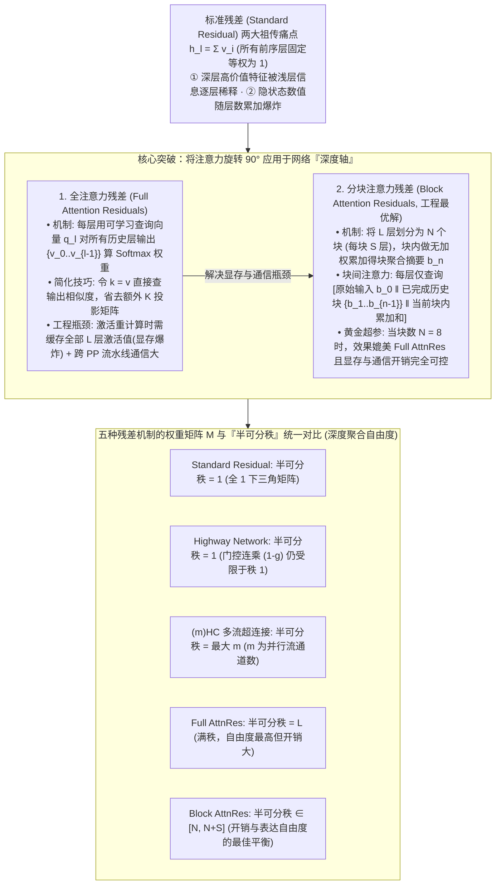

# “将注意力旋转 90°”：深入浅出解读 Kimi 最新出圈成果

## 1. TL;DR

1. **打破 Transformer 残差“等权求和”祖传缺陷的破圈之作**：Kimi 团队发表论文 **《Attention Residuals》**（共同一作包含 17 岁高中生陈广宇，获 Elon Musk、Jerry Tworek、Andrej Karpathy 高度赞誉），针对标准残差连接 $h_l = \sum_{i=0}^{l-1} v_i$ 将所有历史层输出按固定权重 `1` 等权相加导致的 **“深层高价值信息被逐层稀释”** 与 **“隐状态数值随层数爆炸”** 两大顽疾，提出将 **注意力机制旋转 90° 应用在网络的深度轴（Depth Axis）上**。
2. **从 Full Attention Residuals 到工程最优解 Block Attention Residuals（$N=8$）**：**全注意力残差（Full AttnRes）** 让每一层通过可学习查询向量 $q_l$ 对所有历史层输出计算 Softmax 权重（设 $k=v$ 免去额外维护 Key 矩阵），但面临必须保存全部历史层激活值（破坏激活重计算）与跨流水线通信两大瓶颈；为此提出 **分块注意力残差（Block AttnRes）**，将全网分为 **$N=8$ 个块**，块内做普通累加聚合得到块摘要 $b_n$，块间仅对“原始输入 $b_0$ + 已完成历史块聚合结果 + 当前块内累加和”做注意力加权，以极小显存/通信开销达到媲美 Full AttnRes 的效果。
3. **五种残差机制的“半可分秩（Semiseparable Rank）”统一数学框架**：通过层间贡献权重矩阵 $M$ 的半可分秩（代表深度轴信息聚合的自由度）对主流残差做统一抽象——**Standard Residual 为 `1`**、**Highway 为 `1`**、**(m)HC 为 `最大 m`（并行流数）**、**Full AttnRes 为 `L`（满秩，层数）**，而 **Block AttnRes 达到 `[N, N+S]`（块数 ~ 块数+块内层数）**，成为兼顾高自由度表达与硬件效率的黄金平衡点。

## 2. 问题定义与背景

### 2.1 Transformer 的“祖传问题”：为什么标准残差在超深网络中成了瓶颈？
自 ResNet 与原始 Transformer 以来，主流 LLM 沿用标准残差连接 $h_{l} = h_{l-1} + f_{l-1}(h_{l-1})$。将其逐层展开（令 $h_1 = v_0$ 为初始 Embedding，$v_i = f_i(h_i)$ 为第 $i$ 层变换输出）：
$$h_l = v_0 + v_1 + v_2 + \dots + v_{l-1} = \sum_{i=0}^{l-1} 1 \cdot v_i$$
这带来了两个严重限制模型复杂推理上限的结构性问题：
1. **高价值深层贡献被逐层稀释（Information Dilution）**：就像学完小学（6 册）、中学（3 册）、高中（3 册）、高等数学（2 册）共 14 册书后去解现实难题，标准残差相当于从每册书中抽取等量知识点混在一起——高等数学（深层抽象特征）明明最关键，但在总和中的占比却被前序大量浅层特征严重稀释。
2. **隐状态数值随深度无界膨胀（Hidden State Explosion）**：数十上百层特征无缩放直接累加，导致深层激活值方差持续膨胀。

## 3. 知识框架

## 4. 核心内容拆解

### 4.1 全注意力残差（Full AttnRes）与分块注意力残差（Block AttnRes）

1. **Full Attention Residuals：按需加权历史每一层**
   - 不再将前序层简单相加，而是让第 $l$ 层的输入隐状态 $h_l$ 成为前序所有层输出 $\{v_0, v_1, \dots, v_{l-1}\}$ 的动态加权和：
     $$h_l = \sum_{i=0}^{l-1} \alpha_{l, i} v_i, \quad \alpha_{l, :} = \text{Softmax}\left(\frac{q_l \cdot V_{0:l-1}^T}{\sqrt{d}}\right)$$
   - **极简参数设计**：其中 $q_l$ 是第 $l$ 层专属的可学习查询向量，且直接令 **$k_i = v_i$**（直接查询历史层输出向量本身的相似度，避免额外维护一组 Key 投影参数）。
   - **为什么 Full AttnRes 难以直接用于万卡大模型训练？**
     - **显存墙**：现代大模型训练依赖“激活值重计算（Activation Checkpointing）”来省显存；标准残差只需保留最近两层激活，而 Full AttnRes 要求第 $L$ 层同时访问前 $L-1$ 层的所有输出，显存开销呈 $O(L)$ 倍增。
     - **流水线并行（PP）通信墙**：当模型切分到多张 GPU 卡上做 Pipeline Parallelism 时，跨设备传递所有中间层的原始激活值会打爆通信带宽。
2. **Block Attention Residuals：14 册数学书按“小学/中学/高中/高数”分块做摘要**
   - 将总共 $L$ 层的网络均匀划分为 **$N$ 个块（Block，每块含 $S$ 层）**。
   - **块内无加权累加**：在第 $n$ 个块内部，各层的变换输出按标准残差方式累加；当该块所有层计算完毕后，其总和即作为该块的 **聚合表示 $b_n$**。
   - **块间 + 当前块内局部累加注意力**：对于块内第 $j$ 层，其注意力查询的候选集 $V$ 仅包含三项：
     1. **原始 Embedding 输入 $b_0$（即 $h_1$）**；
     2. **此前所有已完成块的聚合表示 $\{b_1, b_2, \dots, b_{n-1}\}$**；
     3. **当前第 $n$ 块截止到上一层的局部累加和**（块内第 1 层除外，它只查前两项）。
   - **实验最优超参**：论文证明当总块数设为 **$N = 8$** 时，Block AttnRes 即可取得与 Full AttnRes 几乎一致的模型效果，同时将显存缓存与跨卡通信压降至原来的 $\frac{1}{S}$。

### 4.2 五种残差机制的“半可分秩（Semiseparable Rank）”统一矩阵分析

若将任意残差机制统一写为矩阵形式 $H = M \cdot V$（其中 $M$ 为 $L \times L$ 的下三角层间贡献权重矩阵），矩阵 $M$ 的 **半可分秩（Semiseparable Rank）** 直接刻画了模型在“深度轴”上聚合历史信息的自由度上限：

| 残差机制名称 | 深度轴信息传递方式 | 权重矩阵 $M$ 的半可分秩 | 表达能力与工程开销综合评价 |
| :--- | :--- | :---: | :--- |
| **1. Standard Residual** | 前序所有层权重固定为 `1` | **`1`** | 极简零开销，但深层特征被严重稀释，表达自由度最低 |
| **2. Highway Network** | 引入门控 $g_l$，历史系数呈 $\prod (1-g_k)$ 连乘 | **`1`** | 虽有门控调节，但连乘结构使矩阵半可分秩依然被锁死为 `1`，提升有限 |
| **3. (m)HC（超连接）** | 将单流扩展为 $m$ 条并行流 + $m \times m$ 转移矩阵 | **`最大 m`** | 自由度提升至通道数 $m$，但需维护更多超参数与通道升降维计算开销 |
| **4. Full AttnRes** | 每层对前序所有层独立计算 Softmax 注意力权重 | **`L`（满秩）** | 深度轴自由度达到理论极限 $L$，但激活显存与跨卡通信开销过大 |
| **5. Block AttnRes** | $N$ 个分块聚合摘要 + 块内局部累加注意力 | **`[N, N+S]`** | 自由度介于“块数 $N$”与“块数+块内层数 $N+S$”之间，**效果与开销的最佳平衡** |

## 5. 数据速查表

| 指标 | 原文数值 | 语境 / 条件 |
| :--- | :--- | :--- |
| **注意力旋转角度隐喻** | `旋转 90°`（从序列长度轴转向网络深度轴） | Kimi 论文《Attention Residuals》（`arXiv:2603.15031`）核心概念 |
| **共同一作亮点** | `17 岁` 中国高中生陈广宇 | 获 Elon Musk、Jerry Tworek、Andrej Karpathy 公开赞誉 |
| **数学学习路径类比样本** | 共 `14 册`（小学 `6` + 中学 `3` + 高中 `3` + 高数 `2`） | 类比 14 层网络分为 4 个阶段块（Block）做摘要加权 |
| **Block AttnRes 推荐分块数 $N$** | `N = 8` | 在控制显存与流水线通信开销的同时，达到与 Full AttnRes 几乎相同的效果 |
| **五种残差机制的半可分秩对比** | Standard `1`、Highway `1`、(m)HC `最大 m`、Full `L`、Block `[N, N+S]` | $L$ 为总层数，$m$ 为并行流数，$N$ 为块数，$S$ 为每块层数 |

## 6. 踩坑与教训 / 可迁移的设计原则

| 错误做法 | 失败表现或原因 | 原文应对（可迁移的设计原则） |
| :--- | :--- | :--- |
| **在深层 Transformer 中沿用全 1 等权累加的标准残差，或以为加个单流 Highway 门控就能增加自由度** | 标准残差导致深层关键语义被前序几十层浅层特征稀释；而 Highway 的连乘耦合使权重矩阵半可分秩依然只有 `1` | **引入深度轴注意力机制（Attention Residuals）**：让每一层通过可学习查询向量动态分配前序层的贡献权重，通过 Softmax 归一化同时解决贡献稀释与隐状态爆炸 |
| **在深度轴注意力中照搬序列注意力的独立 $Q, K, V$ 三个大型投影矩阵** | 额外引入大量参数与矩阵乘开销 | **极简 $k = v$ 对称简化**：直接用各层输出隐状态本身同时充当 Key 与 Value，每层仅需增加一个极轻量的可学习查询向量 $q_l$ |
| **直接在大规模分布式训练中暴力开启逐层全注意力残差（Full AttnRes）** | 破坏激活值重计算（需在显存驻留全部 $L$ 层历史激活）并导致跨 Pipeline Stage 通信爆炸 | **分块聚合折中（Block AttnRes，$N=8$）**：块内沿用加法聚合为单一块摘要 $b_n$，块间仅对 $N$ 个块摘要与当前块累加和做注意力，将半可分秩保持在 `[N, N+S]` 高位的同时大幅削减显存占用 |

## 7. 记忆锚点

- **“把 Attention 旋转 90°：从横向 Token 之间看关联，变成纵向 Layer 之间看贡献”**：用一句神来之笔打破统治深度学习十年的 ResNet 等权残差范式。
- **“14 本数学书解难题：Standard 是每本撕一页混着看（秩=1），Full 是 14 本逐本按需翻（秩=L 但书包太重），Block 是按小/初/高/大学做成 N=8 份错题本摘要再精查（秩∈[N, N+S]）”**：三秒钟讲透五种残差机制的数学本质与工程取舍。

## 8. 复习卡片

1. 标准残差连接（Standard Residual）在深层大模型中存在哪两个核心问题？Kimi 的《Attention Residuals》提出了什么核心解决思路？::两个核心问题是：① 随着网络加深，每一层输出等权（权重均为 1）相加导致深层高价值层的贡献被逐层稀释；② 隐状态数值随层数累加容易发生爆炸。核心解决思路是“将注意力机制旋转 90° 应用在网络的深度轴上”，通过 Softmax 注意力动态计算历史各层对当前层的贡献权重。
2. 在 Full Attention Residuals 的公式设计中，是如何简化 Key 和 Value 的？为什么它在工程大规模训练中难以直接落地？::简化技巧是令 `k = v`（直接用历史层的输出特征本身作为 Key 和 Value 来查询相似度，仅需为每层维护一个可学习查询向量 $q_l$）；难以直接落地是因为在激活值重计算（Activation Checkpointing）和流水线并行中，它要求保留并跨卡传输所有前序层的原始激活值，导致显存开销和通信开销剧增。
3. Block Attention Residuals（分块注意力残差）是如何解决 Full AttnRes 的显存与通信难题的？论文推荐的分块超参数 $N$ 是多少？::它将模型划分为 $N$ 个块（每块 $S$ 层），在块内对各层变换做普通无加权累加，块完成时得到一个聚合摘要向量 $b_n$；块内每一层计算输入时，只对“原始输入 $b_0$ + 已完成历史块的聚合结果 $\{b_1 \dots b_{n-1}\}$ + 当前块内截止目前的累加和”做注意力加权；当设置超参数 **$N = 8$** 时，能以可控开销达到与 Full AttnRes 几乎相同的效果。
4. 什么是残差权重矩阵 $M$ 的“半可分秩（Semiseparable Rank）”？Standard Residual、Highway、(m)HC、Full AttnRes 和 Block AttnRes 的半可分秩分别是多少？::半可分秩衡量了模型在深度轴上信息聚合模式的“自由度”（秩越高，层间权重分配越灵活）；五者的半可分秩依次为：Standard Residual 为 `1`，Highway 为 `1`，(m)HC（多流超连接）为 `最大 m`（$m$ 为并行流数），Full AttnRes 为 `L`（满秩，$L$ 为总层数），Block AttnRes 为 `[N, N+S]`（介于块数与块数+块内层数之间）。
5. 在 Block Attention Residuals 中，块内的“第一层”与“非第一层（第二层及之后）”在执行深度注意力查询时的候选集有什么区别？::块内的第一层尚未产生当前块内的局部累加和，因此只查询“原始输入 $b_0$”拼接“每一个已完成历史块的聚合结果”；而从块内第二层开始，除了上述两项外，还会额外拼接（cat）当前块内截止上一层的“局部累加和”一起参与注意力查询。

## 9. 知识关联

- **本仓库主题索引**：[模型架构与训练](../../20_topics/%E6%A8%A1%E5%9E%8B%E6%9E%B6%E6%9E%84%E4%B8%8E%E8%AE%AD%E7%BB%83.md)
- **候选双链概念**：[[Attention-Residuals注意力残差]] · [[Block-AttnRes分块注意力残差]] · [[半可分秩Semiseparable-Rank]] · [[mHC多流残差对比]] · [[深度轴特征聚合]]

## 10. 原文参考资料

1. Kimi Team (Moonshot AI) et al. (2026.03), *Attention Residuals*, arXiv: [https://arxiv.org/pdf/2603.15031](https://arxiv.org/pdf/2603.15031)（共同一作含陈广宇）。

> [!note]- 校对报告
> - **校对状态**：已按原文逐页核对通过（共 10 页 PDF）。
> - **核心数据与页码溯源**：
>   - 论文标题《ATTENTION RESIDUALS》、马斯克（*"Impressive work from Kimi"*）、Jerry Tworek（“深度学习 2.0 时代即将到来”）、Andrej Karpathy 评价、17 岁高中生共同一作陈广宇：见 `p.1–2`。
>   - 标准残差两大问题（贡献逐层稀释 + 隐状态值爆炸）、14 册数学书（小学 6 + 中学 3 + 高中 3 + 高数 2）类比、Full Attention Residuals 公式（$k=v$ 简化）：见 `p.2–4`。
>   - Block Attention Residuals 原理（块内累加得聚合结果 $b_n$、块间查询原始输入 $b_0$ + 历史块聚合结果 + 当前块内累加和）、超参数块数 `$N = 8$`：见 `p.4–5`。
>   - 五种残差机制（Standard Residual、Highway、(m)HC、Full AttnRes、Block AttnRes）4×4 权重矩阵 $M$ 推导与半可分秩对比表（`1`、`1`、`最大 m`、`L`、`[N, N+S]`）及论文链接 `https://arxiv.org/pdf/2603.15031`：见 `p.5–8`。
