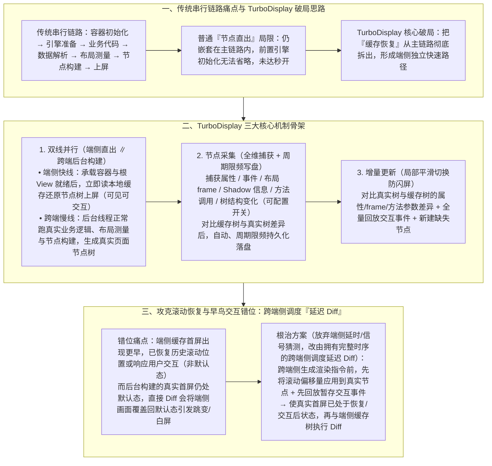

# 跨端页面秒开，腾讯开源框架 Kuikly 是怎么做到的?

> **原文信息**：发布于 2026-06-10 02:37（广东），公众号「腾讯技术工程」原创。

---

## 1. TL;DR

1. **核心突破：跨端页面二次打开「秒开」，耗时优化 60%–80%+** —— 腾讯基于 Kotlin Multiplatform（KMP）构建的全平台开源框架 **Kuikly**（覆盖 Android、iOS、HarmonyOS、H5、微信小程序、Mac 六大平台）推出自研首屏加速方案 **TurboDisplay**，通过**渲染节点缓存、主线程端侧直出、双线程并行渲染与跨端侧延迟 Diff**，在 **QQ 游戏、输入法、腾讯地图**等线上业务（无网络纯本地逻辑耗时口径下）取得 **60%–80% 以上（65%–80%）** 的首屏耗时优化。
2. **为什么传统「节点直出」不够用？** —— 页面打开需串行经历「容器初始化 → 运行时与渲染引擎准备 → 业务代码执行 → 数据请求解析 → 布局测量 → 节点构建与上屏」；普通「节点直出」虽跳过了业务代码与布局测量，但仍嵌套在原链路中，**无法省去前置的引擎初始化等待**；TurboDisplay 的核心是将**缓存恢复从主链路中彻底拆出**，成为一条在端侧容器就绪后立即上屏的独立快速路径。
3. **三大核心机制骨架（双线并行 + 节点采集 + 增量更新）** ——
   - **双线并行**：端侧容器与根 View 构建完成后，主线程直接读取本地缓存转为节点树并生成渲染指令秒级上屏；同时跨端侧在后台线程按正常流程跑真实业务逻辑、布局测量与节点构建，生成真实页面节点树。
   - **节点采集**：完整记录端侧节点树上的属性、事件、布局 `frame`、`Shadow` 信息、方法调用及结构变化，对比差异更新缓存树并**自动、周期限频地写盘**。
   - **增量更新**：真实首屏节点树构建完成后，对比与缓存节点树的属性/`frame`/方法参数差异，全量回放交互事件并新建缺失节点，实现无闪屏、无抖动的局部增量切换。
4. **攻克状态错位与白屏跳变：由跨端侧调度的「延迟 Diff」** —— 端侧缓存直出比后台真实首屏出现得更早，若期间页面已恢复到历史滚动位置或用户已发生交互，后台构建的「默认位置真实页面」直接 Diff 会把端侧已恢复/交互的内容粗暴覆盖回默认态（导致跳变或落入屏幕外白屏）；团队在经历端侧延时与本地信号两次失败后，改为**由拥有完整时序信息的跨端侧调度「延迟 Diff」**：跨端侧在生成渲染指令前，先将滚动偏移量应用到真实节点上并回放暂存交互事件，使两端处于同一基准后再执行 Diff。
5. **一行代码极简接入与首次打开演进规划** —— 业务零侵入，Native 容器（如 `KuiklyRenderViewController.m`）仅需实现开关接口 **`turboDisplayKey` 返回 `pageName`** 即可开启；针对**首次打开**场景，团队正推进「编译期静态分析提取首屏逻辑 + 运行时微指令引擎快速展示 + 平滑衔接原链路」方案。

---

## 2. 问题定义与背景

### 2.1 为什么要跳出「代码执行更快」去重构渲染调度链路？

尽管 Kuikly 凭借 Kotlin/Native 编译产物与原生渲染管线已经具备原生级执行性能，但在页面打开的串行长链路（`容器初始化 → 运行时与渲染引擎准备 → 业务代码执行 → 数据请求与解析 → 布局测量 → 节点构建 → 最终上屏`）中，单纯优化代码执行速度已逼近物理极限。
而传统首屏加速手段（如截屏快照不可交互、纯数据预取仍需等引擎初始化与重排布局、普通节点直出仍受制于前置引擎准备）均无法实现真正的**「打开即可见、可交互」**，且理想方案必须同时满足**业务无侵入（能规模化铺开）、渲染及时（展示最新内容）、结果严格正确（生产可信）**三大标准。

---

## 3. 知识框架



---

## 4. 核心内容拆解

### 4.1 三大核心机制：双线并行、节点采集与增量更新

1. **双线并行（端侧直出快线 $\parallel$ 跨端后台慢线）**：
   - **端侧直出快线**：当 Native 端侧承载容器及根 View 构建完成后，无需等待跨端引擎初始化和业务代码执行，主线程直接读取本地磁盘缓存转换为节点树，立即产生渲染指令让首屏在端侧上屏（此时已具备真实节点结构，可见且可交互）。
   - **跨端后台慢线**：原有的执行链路完全保持不变——经端侧线程调度后，跨端侧在后台按正常流程执行本轮真实页面的业务逻辑、布局测量与节点构建，批量生成端侧真实页面节点树，等待与已上屏的缓存节点树比对。
2. **节点采集（6 类全维信息 + 周期限频写盘）**：
   - 存储的并非静态图片，而是端侧节点树上节点的完整低阶渲染内容，包含 6 类核心信息：**每个节点的属性、事件、布局 `frame`、`Shadow` 信息、节点上的方法调用、以及节点树结构的变化**（业务可自定义是否开启捕捉树结构差异；若关闭，则始终缓存真实首屏对应节点及其最新内容）。
   - 采集时系统对比缓存首屏与真实页面节点树的差异，更新至缓存节点树后，**自动、周期限频地写盘**，避免高频 I/O 损耗。
3. **增量更新（局部 Diff 防闪屏抖动）**：
   - 当真实首屏节点树构建完毕后，并非推倒重建整个屏幕，而是通过跨端侧调度主线程，对比真实树与缓存树在**属性、布局 `frame`、调用方法参数**上的差异，全量回放首屏期间记录的交互事件，并仅新建此前不存在的节点，实现静默平滑过渡。

---

### 4.2 核心踩坑与攻坚：为什么必须由跨端侧调度「延迟 Diff」？

1. **为什么原有的 Diff 增量更新会导致「跳变回默认位置」甚至「白屏」？**
   - 根源在于**「缓存首屏比真实业务首屏出现得更早」**。
   - 当端侧缓存首屏直出后，列表页可能已经恢复到了上一次访问的滚动位置，或者用户已经在首屏上发生了点击/滑动交互（即**端侧已处于非默认状态**）；
   - 然而，跨端侧在后台构建出的真实页面仍处于**初始默认位置**，尚未感知到端侧的滚动或交互变化。如果真实页面一到达端侧就立即执行 Diff，对比的就是「端侧已恢复/交互后的状态」与「真实页面默认状态」，Diff 算法会将这些正常偏移当作差异全量覆盖回默认状态，导致页面瞬间跳回顶部或内容落入屏幕外变成白屏。
2. **两次失败尝试与最终根治方案（延迟 Diff）**：
   - **两次失败尝试的共性根因**：团队先后尝试在端侧通过「固定延时」或「本地信号」控制 Diff 时机，均告失败——因为**端侧根本无法预知跨端侧的真实页面何时构建完成**。
   - **最终解法：由跨端侧调度「延迟 Diff」**：
     - 既然端侧无法判断，就把调度权交给拥有完整时序信息的**跨端侧**；
     - 将 Diff 执行时机从「真实页面到达端侧即执行」延后为**「恢复内容在跨端侧生效后再执行」**：跨端侧在构建好真实节点树、生成渲染指令前，**先执行恢复逻辑**——① 将滚动偏移量直接应用到真实页面节点上；② 先回放缓存首屏期间暂存的交互事件让跨端侧完成响应；
     - 这样交付给端侧的真实首屏本身就已经处于恢复/交互后的状态，两端对比基准完全对齐，非默认内容不再被误判为差异项，彻底根除了跳变与白屏。

---

### 4.3 实验室与线上实测数据、一行代码接入及首次打开规划

1. **实验室与线上真机验证**：
   - **实验室设备对比**：在 **iPhone 13 Pro Max**（高端机型）与 **iPhone 7 Plus**（老旧机型）上针对页面二次打开进行测试（测试 GIF 第 1 帧做延迟 `100ms` 处理以便观察），均实现首帧即现。
   - **线上业务实测（纯本地逻辑耗时口径）**：在代码与数据均已本地缓存、启动过程无网络耗时的严格对比口径下，已在 **QQ 游戏、输入法、腾讯地图**等业务上线，取得 **60%–80% 以上（正文中亦表述为 65%–80%）** 的首屏耗时优化。
2. **极简业务接入（仅需实现 1 个开关接口）**：
   - 在 Native 端侧页面容器（如 `KuiklyRenderViewController.m`）中仅需几行代码实现 `turboDisplayKey`：
     ```objc
     - (NSString *)turboDisplayKey {
         return pageName;
     }
     ```
3. **下一阶段：攻克「首次打开」场景的三步规划**：
   - 当前 TurboDisplay 聚焦于二次打开；针对无本地节点缓存的**首次打开**场景，团队正研发：**① 编译期对首屏逻辑进行静态分析与提取 → ② 运行时通过微指令引擎快速展示首屏 → ③ 再与原产物执行链路平滑衔接**。

---

## 5. 数据速查表

| 指标 | 原文数值 | 语境 / 条件 |
| :--- | :--- | :--- |
| Kuikly 跨端框架覆盖平台数 | **6 大平台** | Android、iOS、HarmonyOS、H5、微信小程序、Mac（基于 KMP） |
| TurboDisplay 线上首屏耗时优化幅度 | **60%–80% 以上（65%–80%）** | 在 QQ 游戏、输入法、腾讯地图等业务二次打开场景（纯本地逻辑耗时口径） |
| 实验室真机验证对比机型 | **iPhone 13 Pro Max & iPhone 7 Plus** | 二次打开测试（GIF 第 1 帧做 `100ms` 延迟处理观察首帧即现） |
| 节点采集持久化的核心信息维度 | **6 类信息** | 属性、事件、布局 `frame`、`Shadow` 信息、节点方法调用、节点树结构变化 |
| 业务接入所需实现的核心接口数 | **1 个开关接口（`turboDisplayKey`）** | 在 `KuiklyRenderViewController.m` 中返回 `pageName` 即可开启 |

---

## 6. 踩坑与教训 / 可迁移的设计原则

| 错误做法 | 失败表现或原因 | 原文应对 |
| :--- | :--- | :--- |
| 仅靠优化业务代码执行速度，或把「渲染节点缓存恢复」依然放在跨端引擎初始化之后的主链路里 | 页面打开串行链路过长，前置容器与跨端引擎初始化耗时无法被跳过，无法实现真正的「打开即秒开」 | 将**缓存恢复从主链路彻底拆出**，采用**双线并行**：端侧容器就绪即在主线程直出缓存节点树，跨端侧在后台并行跑真实业务构建 |
| 每次节点变化都立即同步写磁盘更新首屏缓存 | 高频磁盘 I/O 阻塞线程，反噬页面流畅度 | 节点采集对比差异更新至内存缓存节点树后，采用**自动、周期限频**策略写盘 |
| 后台真实首屏构建完到达端侧后，立即与端侧已展示的缓存首屏做全量覆盖或直接 Diff | 端侧缓存首屏出现更早，可能已恢复滚动位置或响应了用户点击；后台真实首屏仍处默认态，直接 Diff 会把端侧画面覆盖回默认位置导致跳变或白屏 | 实行由跨端侧调度的**「延迟 Diff」**：跨端侧在生成渲染指令前，先对真实节点应用滚动偏移量并回放暂存交互事件，对齐基准后再下发端侧做局部增量 Diff |
| 试图在端侧通过「固定延时」或「本地信号」猜测后台真实页面何时构建完成以控制恢复时机 | 端侧缺乏跨端引擎内部进度视野，无论延时还是本地信号都无法在复杂机型上找到稳定时机（两次尝试均失败） | 遵循**「谁拥有完整时序信息，谁负责调度」**原则，将恢复与 Diff 的调度权上收至跨端侧 |

---

## 7. 记忆锚点

1. **三大核心机制骨架**：「**双线并行**（端侧容器就绪即直出缓存树 $\parallel$ 跨端后台跑真实逻辑）+ **节点采集**（6 类全维信息周期限频写盘）+ **增量更新**（局部 Diff + 事件回放平滑切换）」。
2. **延迟 Diff 破局口诀**：「缓存首屏出得早，滚动交互已发生；跨端后台默认态，直接 Diff 必跳屏；**先在跨端对齐偏移与事件回放，再下发端侧做延迟 Diff**。」

---

## 8. 复习卡片

1. 为什么 Kuikly 已经有了 Kotlin/Native 原生级执行性能，在首屏打开上还需要推出 TurboDisplay，传统的「节点直出」有什么局限？::因为页面打开需串行经历「容器初始化→引擎准备→业务代码→数据解析→布局测量→节点构建→上屏」，仅优化代码执行速度已逼近上限；传统「节点直出」仍嵌套在主链路中，无法省去前置的引擎初始化耗时。TurboDisplay 将缓存恢复从主链路彻底拆出为独立快速路径，在 QQ 游戏、输入法、腾讯地图等二次打开场景下降低了 60%–80% 以上的纯本地逻辑耗时。
2. TurboDisplay 的「双线并行」「节点采集」和「增量更新」三大核心机制是如何协同工作的？::① 双线并行：端侧容器与根 View 就绪后立即读本地缓存还原节点树上屏，同时跨端侧在后台线程正常跑真实业务逻辑构建真实节点树；② 节点采集：捕获节点的属性、事件、布局 `frame`、`Shadow` 信息、方法调用及树结构变化，对比差异后自动周期限频写盘；③ 增量更新：对比真实树与缓存树的差异、全量回放交互事件并新建缺失节点，实现无闪屏平滑切换。
3. 在 TurboDisplay 中，为什么直接执行 Diff 增量更新会导致「页面跳变回默认位置」甚至「白屏」？::因为端侧缓存首屏比后台真实首屏出现得更早，在此期间端侧可能已经恢复到了历史滚动位置或响应了用户交互（处于非默认状态），而跨端侧在后台构建出的真实页面仍处于默认初始状态；直接 Diff 会将端侧已恢复或交互后的状态当成差异覆盖回默认状态，从而引发位置跳变或内容落入屏幕外白屏。
4. 团队是如何通过「由跨端侧调度延迟 Diff」彻底解决滚动恢复与交互覆盖问题的？::在端侧尝试延时和本地信号均告失败后（端侧无法预知跨端侧何时构建完成），团队改由拥有完整时序信息的跨端侧负责调度：跨端侧在构建好真实节点树、生成渲染指令前，先将滚动偏移量应用到真实节点上，并先回放缓存首屏期间暂存的交互事件；使交付给端侧的真实首屏本身已处于恢复后的状态，两端基准一致后再执行 Diff。
5. 业务方接入 TurboDisplay 需要多大改动，团队针对「首次打开」场景有什么演进规划？::接入极其轻量无侵入，Native 端侧容器（如 `KuiklyRenderViewController.m`）只需实现开关接口 `turboDisplayKey` 并返回 `pageName` 即可开启；针对无本地缓存的「首次打开」场景，团队正研发「编译期静态分析提取首屏逻辑 + 运行时微指令引擎快速展示首屏 + 与原链路平滑衔接」方案。

---

## 9. 知识关联

- **已有主题**：[Harness与模型协同](../../20_topics/Harness%E4%B8%8E%E6%A8%A1%E5%9E%8B%E5%8D%8F%E5%90%8C.md) · [异常监控与稳定性](../../20_topics/%E5%BC%82%E5%B8%B8%E7%9B%91%E6%8E%A7%E4%B8%8E%E7%A8%B3%E5%AE%9A%E6%80%A7.md) · [模型与开发工具发布](../../20_topics/%E6%A8%A1%E5%9E%8B%E4%B8%8E%E5%BC%80%E5%8F%91%E5%B7%A5%E5%85%B7%E5%8F%91%E5%B8%83.md) · [跨端开发与性能](../../20_topics/%E8%B7%A8%E7%AB%AF%E5%BC%80%E5%8F%91%E4%B8%8E%E6%80%A7%E8%83%BD.md)
- **候选新主题**：[[TurboDisplay首屏秒开]] · [[跨端双线程并行渲染]] · [[状态恢复与延迟Diff]]

---

## 10. 原文参考资料

1. **Kuikly 开源项目与腾讯端服务联盟（TDS）**：基于 Kotlin Multiplatform（KMP）的全平台高性能跨端开发框架，隶属腾讯端服务联盟（`tds.qq.com`）。

> [!note]- 校对报告
> - **校对状态**：已根据 `MD.md` 全文（共 10 页 PDF 转写文本）逐一核对。
> - **核心数据与事实页码溯源**：
>   - Kuikly 基于 KMP 覆盖 6 大平台、TurboDisplay 通过节点缓存/主线程端侧直出/双线程并行渲染在 QQ 游戏、输入法、腾讯地图等线上业务取得 60%–80% 以上耗时优化：见 PDF 第 1 页。
>   - 页面打开串行 7 步链路、理想首屏方案三要素（业务无侵入、渲染及时、正确）、普通节点直出无法省去前置引擎初始化局限、把缓存恢复从主链路拆出：见 PDF 第 2–3 页。
>   - 三项核心机制：5.1.1 双线并行、5.1.2 节点采集（属性、事件、布局 `frame`、`Shadow` 信息、方法调用、节点树结构变化，周期限频写盘）、5.1.3 增量更新：见 PDF 第 4–5 页。
>   - 状态恢复与事件保序痛点（缓存首屏更早出现导致端侧已恢复/交互状态被真实页面默认状态覆盖跳变或白屏）、端侧两次失败尝试根因、由跨端侧调度的「延迟 Diff」（生成渲染指令前先应用滚动偏移量并回放暂存交互事件）：见 PDF 第 5–6 页。
>   - 实验室 iPhone 13 Pro Max 与 iPhone 7 Plus 对比（第 1 帧延迟 100ms）、线上 QQ 游戏/输入法/腾讯地图 65%–80% 优化（无网络纯本地逻辑耗时）、`KuiklyRenderViewController.m` 实现 `turboDisplayKey` 返回 `pageName`、以及首次打开场景三步规划（编译期静态分析提取 + 运行时微指令引擎 + 平滑衔接）：见 PDF 第 6–8 页。
