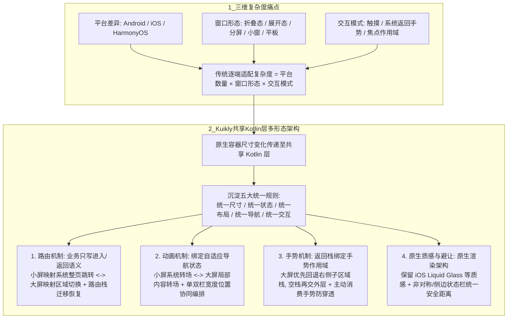

# iPhone Duo 来了，腾讯 Kuikly 助 App 从容适配

## 1. TL;DR

随着苹果发布折叠屏设备 `iPhone Duo`，移动终端的大屏与可变窗口适配从部分 Android / HarmonyOS 机型演变为覆盖 iOS、Android、HarmonyOS 的全行业共性需求，同时 AI 复合任务界面（同屏承载上下文、工具调用、生成结果与人工确认）也进一步推高了移动生产力对显示空间的要求。本文指出，多端折叠屏适配的真实复杂度并非加几条宽度判断，而是 `适配复杂度 = 平台数量 × 窗口形态 × 交互模式` 的乘积爆炸。腾讯开源跨端框架 **Kuikly**（基于 Kotlin Multiplatform，覆盖六大平台、支撑日活超 5 亿）通过将各端原生容器的尺寸变化统一传递至共享 Kotlin 层，把“单点页面复用”升级为**“五大统一体验规则 + 多形态能力复用”**：在路由层将业务“进入/返回”语义自适应映射为小屏整页跳转（Activity / ViewController）或大屏分栏区域切换，并处理折叠/展开时的路由栈迁移与状态恢复；在动画层协同系统级整页转场与区域内局部转场；在手势层将返回栈与手势作用域绑定（大屏优先回退右侧子区域栈、空栈再交外层，并阻断手势穿透）；在平台适应层依托原生渲染保留 `iOS Liquid Glass` 等系统原生质感，并将 `iPhone Duo` 非对称侧边状态栏及各厂挖孔/灵动岛统一抽象为响应式安全距离。

## 2. 核心概念

- **多端多形态适配复杂度公式**：`适配复杂度 = 平台数量 × 窗口形态 × 交互模式`——第一层是 Android / iOS / HarmonyOS 等平台差异，第二层是折叠态、展开态、分屏、小窗等窗口形态差异，第三层是触摸、系统返回手势等交互方式差异；若逐端独立开发，任一业务调整都会触发三维组合级重复实现与测试。
- **五大统一体验规则（共享 Kotlin 层沉淀）**：
  - **统一尺寸模型**：各端使用相同的容器尺寸与布局断点语义。
  - **统一状态模型**：选中项、输入内容与页面层级独立于具体平台容器。
  - **统一布局策略**：单栏、双栏、多栏遵循同一套响应式切换规则。
  - **统一导航语义**：业务代码只表达“进入、返回、选择”，由当前窗口形态决定执行整页跳转还是局部区域切换。
  - **统一交互原则**：动画节奏、返回优先级与手势作用域在共享层协同编排。
- **自适应导航状态与局部区域路由**：针对小屏借助系统容器（Android `Activity`、iOS `ViewController`）整页跳转、而大屏列表与详情并存需在指定区域内切换内容的矛盾，在组件内部建立由响应式数据驱动的统一导航状态，接管内容层级、生命周期与折叠/展开切换时的状态恢复。
- **动态安全距离抽象（Safe Area Abstraction）**：将 `iPhone Duo` 的非对称与侧边集成状态栏，以及其他厂商的刘海、挖孔、类灵动岛、圆角和系统栏高度等物理限制，统一抽象为随尺寸变化同步更新的安全距离接口，实现一次布局多端避让。

## 3. 知识框架

以下流程图按正文整理，展示折叠屏多端适配的三维复杂度痛点、Kuikly 共享 Kotlin 层五统一规则，以及路由、动画、手势、原生平台适应四大核心机制的协同链路：

## 4. 关键要点与机制详解

### 4.1 为什么折叠屏适配不只是“加几条宽度断点”

**核心主张**：折叠屏与 AI 复合任务界面（同时展示上下文、工具调用、生成结果和人工确认）要求 App 能在小屏便携态与大屏展开态间连续切换且任务不中断，这会直接牵动布局、路由、状态、动画与手势整条链路。

- **存量 App 面临的三重工程痛点**
  1. **改造工作量大**：首页、主 Tab、频道页等核心入口需重新组织导航结构、内容分区与信息密度，存量页面需全面梳理布局断点与测试矩阵。
  2. **交互链路断层**：从小屏单栏展开为大屏双栏/多栏后，原有的整页路由、选中状态恢复、转场动画、系统返回手势全部失效或错位。
  3. **多端维护成本成倍放大**：若在 Android、iOS、HarmonyOS 各技术栈分别写一套分栏、状态恢复与返回策略，随着平板、桌面窗口、AI 超级终端加入，多套相似但无法共享的代码会让对齐与演进成本失控。

### 4.2 Kuikly 四大核心适配机制拆解：路由、动画、手势与原生避让

**核心主张**：Kuikly 不把折叠屏当作一个新增平台单独打补丁，而是由原生容器将窗口尺寸变化实时传入共享 Kotlin 层，通过统一响应式状态同时驱动布局、路由、动画、手势与安全区域避让。

| 核心模块 | 小屏（折叠态）与大屏（展开/分屏态）的核心矛盾 | Kuikly 共享层的具体解决机制 | 解决的失败表现或风险 |
|---|---|---|---|
| **1. 路由（整页跳转 vs 区域切换）** | 小屏依赖 Android `Activity` / iOS `ViewController` 做整页跳转；大屏列表与详情并存，“打开新页面”变成右侧局部区域内容切换，系统级路由不再适用，且折叠/展开瞬间需迁移路由栈 | 在自适应页面或组件内建立**由响应式数据驱动的统一导航状态**：业务层仍只调用“进入详情”“返回上一级”，组件根据当前窗口形态自动映射为小屏整页跳转或大屏区域切换，并统一接管层级、生命周期、区域间解耦传参与折叠/展开时的选中态恢复 | 消除大小屏两套业务导航代码，防止屏幕展开或折叠时当前浏览的详情页丢失、回退错乱 |
| **2. 动画（系统转场 vs 局部转场）** | 小屏直接复用系统整页转场动画；大屏内容切换发生在页面局部区域内，系统转场不再适用 | 将动画与自适应导航状态绑定：小屏保持符合各平台习惯的进退场动画，大屏在目标区域内执行局部内容转场；从单栏切双栏时**同步编排列表宽度、详情位置和导航元素** | 避免同一导航操作在大小屏下节奏割裂，消除折叠/展开切换时的画面闪烁或瞬间生硬跳变 |
| **3. 手势（系统返回 vs 区域栈优先级）** | 小屏每页由独立系统容器承载，系统侧滑返回直接关闭当前页；大屏右侧区域可能叠了多层内容，一次返回手势不知该关整个页面还是只退右侧区域上一级 | 将**返回栈与手势作用域关联**：① 小屏二级页响应系统返回并支持自定义策略；② **大屏优先回退当前区域的内部层级，待区域栈清空后再交由外层页面处理**；③ 各层级内容区域主动消费对应手势 | 防止在大屏右侧看深层详情时一次侧滑直接退出整个主页面，同时阻断点击、拖动和滚动穿透到底层页面 |
| **4. 平台适应（跨端统一 vs 原生质感与异形屏避让）** | 若跨端框架只取各系统最小公分母，会丧失新系统辨识度；同时 `iPhone Duo` 采用非对称与侧边集成状态栏，各安卓/鸿蒙厂商挖孔、灵动岛、圆角各异 | 依托**原生渲染架构**将平台差异收敛在框架内部：共享布局与交互逻辑的同时，自然融入 `iOS Liquid Glass` 等原生视觉特性；将各端状态栏、导航栏、刘海、挖孔、圆角及 `iPhone Duo` 非对称侧边栏统一抽象为**响应式安全距离**，随尺寸变化实时更新 | 兼顾“一次开发多端复用”与“各平台原生视觉质感”，无需在业务层针对每款折叠屏异形状态栏写硬编码偏移 |

## 5. 数据速查表

| 指标 / 维度 | 原文描述与数值 | 语境 / 条件 |
|---|---|---|
| Kuikly 覆盖平台数量与范围 | $6$ 大平台（Android、iOS、HarmonyOS、H5、微信小程序、Mac） | 基于 Kotlin Multiplatform（KMP）的腾讯开源高性能跨端框架 |
| Kuikly 支撑业务规模 | 日活用户超 $5$ 亿 | 原文披露的腾讯内部及生态业务支撑体量 |
| 多端多形态适配复杂度关系式 | $\text{适配复杂度} = \text{平台数量} \times \text{窗口形态} \times \text{交互模式}$ | 用于刻画传统逐端适配下的开发与验证组合膨胀 |
| 共享层沉淀的统一规则数 | $5$ 项（统一尺寸模型、统一状态模型、统一布局策略、统一导航语义、统一交互原则） | 沉淀于共享 Kotlin 层的核心体验规则 |
| 折叠屏示例所在的开源分支 | `https://github.com/Tencent-TDS/KuiklyUI/tree/feat/kuikly_fold` | 文中自适应屏幕设置页与多形态 App 适配 Sample code 分支 |

## 6. 踩坑与教训 / 可迁移的设计原则

### 常见踩坑与应对

| 错误做法 | 失败表现或原因 | 原文应对策略 |
|---|---|---|
| **把折叠屏适配等同于“监听窗口宽度加几条 UI 布局判断”** | 页面虽然勉强画成了双栏，但折叠/展开切换时选中态丢失、系统返回手势直接退穿主页、局部切换无动画跳变 | 将尺寸感知、共享状态、布局策略、自适应导航路由栈、局部转场动画与手势作用域作为完整链路统一建模 |
| **在大屏分栏模式下继续强行依赖系统级路由容器（Activity / ViewController）** | 系统路由面向整页跳转设计，无法原生表达“左侧列表常驻、右侧区域多层局部压栈”及折叠时的栈合并 | 在自适应组件内部构建由响应式数据驱动的统一导航状态，让业务层只表达“进入/返回”，由组件按窗口形态映射承载方式 |
| **在 Android、iOS、HarmonyOS 各端分别维护一套分栏与返回恢复逻辑** | 平台、窗口形态（折叠/展开/分屏/小窗/平板）与交互每增加一项，测试与对齐成本按乘法爆炸 | 将窗口尺寸变化统一传入共享 Kotlin 层，只定义一套响应式适配与路由规则，多端共享复用 |

### 可迁移的设计原则

- **业务导航意图与物理承载容器解耦**：在需要同时兼容手机单栏、折叠屏/平板分栏及桌面多窗口的应用架构中，业务代码绝不应直接调用 `startActivity` 或 `pushViewController`，而应只声明“打开某详情并传递参数 / 返回上一级”的抽象意图，交由自适应导航容器根据实时窗口断点决定是压入系统全屏栈还是替换局部详情面板。
- **栈深优先的区域返回与手势拦截原则**：当单屏内存在主次多个可交互层级（如左主右详、画中画或抽屉叠层）时，全局返回手势应遵循“局部子区域栈非空则优先退子栈，子栈清空才退外层容器”的顺序，且上层局部区域必须主动消费触摸、滚动与拖拽事件以防穿透到底层列表。

## 7. 记忆锚点

- **原文复杂度与价值锚点**：“适配复杂度 = 平台数量 × 窗口形态 × 交互模式；折叠的是屏幕，不打折的是体验。”
- **四维适配机制口诀（助记改写）**：“路由解耦整页与分栏，动画兼顾全局与局部，手势先退子栈防穿透，异形状态栏归安全距。”

## 8. 复习卡片

为什么说多端 App 的折叠屏适配是一项跨越三个维度的系统工程，而不是简单加几条布局断点？::因为其适配复杂度等于“平台数量 × 窗口形态 × 交互模式”；单栏变多栏不仅改变绘制布局，还会牵动路由跳转方式、折叠/展开时的状态恢复、局部转场动画以及返回手势优先级，若在各平台分别实现会导致开发与验证成本成倍膨胀。
Kuikly 在共享 Kotlin 层沉淀了哪五项统一的折叠屏体验规则？::沉淀了统一尺寸模型（相同容器尺寸与断点语义）、统一状态模型（选中项与层级不依赖平台容器）、统一布局策略（单栏/双栏/多栏同一切换规则）、统一导航语义（业务只表达进入/返回/选择）和统一交互原则（动画节奏、返回优先级与手势作用域协同）。
在小屏切大屏（单栏变双栏）时，为什么不能继续完全依赖 Android Activity 或 iOS ViewController 等系统路由，Kuikly 如何解决？::因为小屏是整页跳转，而大屏是列表与详情并存、在指定局部区域内切换内容，且折叠与展开切换时需迁移路由栈并恢复选中状态；Kuikly 在自适应组件内建立由响应式数据驱动的统一导航状态，将业务统一的“进入/返回”操作自动映射为小屏整页跳转或大屏区域切换。
大屏分栏模式下，Kuikly 如何处理系统返回手势的优先级与手势穿透问题？::通过将返回栈与手势作用域绑定：小屏二级页直接响应系统返回；大屏则优先回退当前右侧区域的内部层级，待该区域栈清空后再交由外层页面处理；同时不同层级的内容区域主动消费对应手势，防止点击、拖动和滚动穿透到底层页面。
面对 `iPhone Duo` 的非对称与侧边集成状态栏以及各厂商不同的挖孔/灵动岛设计，Kuikly 如何在跨端复用与原生体验间取得平衡？::依托原生渲染架构将平台差异收敛在框架内部，一方面允许同一套折叠屏页面自然融入 `iOS Liquid Glass` 等平台原生视觉特性，另一方面将各端状态栏、导航栏、刘海、挖孔、圆角统一抽象为随尺寸变化同步更新的安全距离，使开发者一次布局即可在各端正确避让。

## 9. 知识关联

- **跨端架构与渲染性能**：[[跨端开发与性能]]（[跨端开发与性能](../../20_topics/跨端开发与性能.md)）
- **AI 终端与开发工具演进**：[[桌面Agent与工作流]]（[桌面Agent与工作流](../../20_topics/桌面Agent与工作流.md)）、[[模型与开发工具发布]]（[模型与开发工具发布](../../20_topics/模型与开发工具发布.md)）
- **本篇原始与转写材料**：[原始 PDF](RAW.pdf) · [逐页转写文本](MD.md)

## 10. 原文参考资料

原文提供的开源仓库与示例代码链接如下（仅作原文线索保存，未外部联网访问核验）：

- **自适应屏幕设置页与多形态 App 适配 Sample Code**：`https://github.com/Tencent-TDS/KuiklyUI/tree/feat/kuikly_fold`
- **项目与联盟入口**：Kuikly GitHub 仓库与官方文档、腾讯端服务联盟（`tds.qq.com`）

> [!note]- 校对报告
> **覆盖度**：基于 `MD.md` 与 `META.json` 完整覆盖 PDF 第 1–12 页全部技术正文（前言：苹果秋季发布会发布折叠形态、AI 复合任务界面趋势与 Kuikly 简介 p.1；一、折叠屏适配潮与三大真实痛点 p.3–4；二、适配复杂度三维公式、从逐端适配到多端复用、五大统一体验规则与多形态能力复用路线 p.5–6；三、Kuikly 适配实践：3.1 路由统一整页跳转与区域切换 p.6–8，3.2 动画从系统转场扩展到局部转场 p.8–9，3.3 手势统一返回策略及事件处理 p.10–11，3.4 平台适应 iOS Liquid Glass 与 iPhone Duo 非对称状态栏安全距离抽象及 Sample code 链接 p.11–12；四、总结与展望 p.12）。第 2 页为纯界面截图页（文本层为空），第 12 页底部与第 13 页为开源引导与留言区，第 14 页为空白页，均已核对。
>
> **一致性抽查**：
>
> | 核对项 | 笔记值 | 原文值与位置 | 结果 |
> |---|---|---|---|
> | Kuikly 覆盖平台与日活 | Android、iOS、HarmonyOS、H5、微信小程序、Mac 六大平台；日活超 5 亿 | p.1 | 一致 |
> | 适配复杂度公式 | 适配复杂度 = 平台数量 × 窗口形态 × 交互模式 | p.5 | 一致 |
> | 五大统一体验规则 | 统一尺寸模型、统一状态模型、统一布局策略、统一导航语义、统一交互原则 | p.5 | 一致 |
> | iOS 视觉特性与新机状态栏特征 | `iOS Liquid Glass`；`iPhone Duo` 状态栏采用非对称与侧边集成设计 | p.11 | 一致 |
> | Sample Code 分支路径 | `https://github.com/Tencent-TDS/KuiklyUI/tree/feat/kuikly_fold` | p.12 | 一致 |
>
> **推断与异常**：未引入超出原文的技术推断。PDF 第 2 页文本层为空（界面展示图），第 3、4、6、8、9、11 页含演示图与图注，核心机制均已在正文中完整阐述。
>
> **日期与格式**：发布日期依据 PDF 第 1 页页眉 `2026年9月9日 21:03`，frontmatter `date` 记为 `2026-09-09`；全文保持唯一 H1，正文、表格、图注与复习卡片均不含页码与章节标注；复习卡片共 5 条，均为单行 `问题::答案` 格式；Mermaid 图表未实际渲染。
