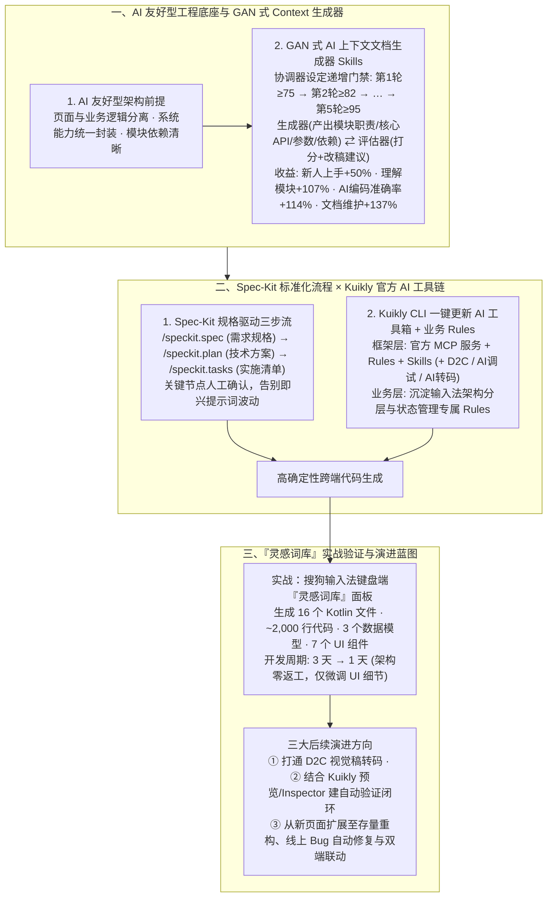

# 腾讯广泛使用的跨端开发框架——Kuikly在搜狗输入法中的AI Coding实践

## 1. TL;DR

1. **业务底座与存量工程痛点**：**Kuikly** 是腾讯基于 Kotlin 打造的跨端开发框架（覆盖 Android、iOS、鸿蒙、Web、小程序、Mac），已服务 QQ、腾讯新闻、QQ 音乐、搜狗输入法、QQ 浏览器等 **20+ 业务、1,000+ 页面、日活超 5 亿**；在迈向 L3 级 AI Coding 时，面临“存量封装 API 幻觉与重复造轮子”和“模糊需求导致返工”两大瓶颈。
2. **GAN 式多轮对抗生成精准 AI Context 文档**：与其钻研花哨提示词，不如先治理工程与上下文质量；团队构建了借鉴 **GAN（生成对抗网络）** 思想的“AI 上下文文档生成器 Skills”，由协调器设定逐轮递增的质量门槛（**第 1 轮 `≥ 75` → 第 2 轮 `≥ 82` → … → 第 5 轮 `≥ 95`**），驱动生成器与评估器多轮打磨模块文档，使 **新人上手提速 50%、理解模块提速 107%、AI 编码准确率提升 114%、文档维护效率提升 137%**。
3. **Spec-Kit 标准化流程 + Kuikly 官方开箱即用 AI 工具链**：引入 **Spec-Kit**（`/speckit.spec → /speckit.plan → /speckit.tasks`）将即兴提示词开发转化为规格驱动执行；配合 Kuikly 官方 CLI 一键同步的 **MCP 服务、Rules、Skills**（及规划中的 AI 调试、D2C 视觉转码、AI 转码）与输入法业务级 Rules，彻底消除框架层 API 幻觉。
4. **“灵感词库”新页面实战（3 天工作量 1 天交付）**：在涵盖动态多列布局、暗黑模式、网络/路由/KV 存储/埋点的搜狗输入法键盘端“灵感词库”面板开发中，AI 自动生成 **16 个 Kotlin 源文件、约 2,000 行代码（3 个数据模型 + 7 个 UI 组件）**，将传统 **3 天** 的方案与编码时间压缩至 **1 天**，且代码 Review 阶段零架构返工。

## 2. 问题定义与背景

### 2.1 为什么在 Demo 里很顺的 Vibe Coding，进了大型跨端存量工程就翻车？
搜狗输入法团队自 2025 年下半年起在横跨 Android、iOS、鸿蒙、H5 的 Kuikly 跨端工程中落地 AI 编程，发现直接用 Vibe Coding 开发完整生产页面时存在三大鸿沟：
- **存量工程理解偏差与重复造轮子**：输入法工程常年积累了大量内部基础组件与系统能力封装（对老员工是“默认常识”），但把庞杂源码一股脑塞进大上下文窗口后，AI 无法自行分辨主次，频繁出现 API 调用幻觉或无视既有封装重复造轮子。
- **需求缺乏结构化输入**：口语化模糊需求交给 AI 后，隐藏的交互状态与边界由模型随意脑补，经历多轮修改才发现方向偏离。
- **工程自身架构质量决定 AI 上限**：如果工程本身页面与业务逻辑耦合、模块依赖混乱，AI 读取上下文后会将混乱放大为成倍的幻觉与错误。

## 3. 知识框架

## 4. 核心内容拆解

### 4.1 构建精准 AI Context：基于 GAN 对抗思想的模块文档生成器

1. **为什么“大上下文窗口一把梭”行不通？**
   - 盲目将全仓代码塞给模型不仅浪费海量 Token，更会让无关代码稀释注意力，导致模型漏掉已封装好的基础服务。
2. **生成器 vs 评估器：五轮递增门禁对抗打磨**：
   - 团队开发了专门的 **AI 上下文文档生成器 Skills**，提取各模块的 **模块职责、核心 API、参数含义、模块依赖关系**。
   - **GAN 式对抗迭代机制**：不信任单次生成，由协调器（Coordinator）设定逐轮爬升的硬性评分门槛——**第 1 轮 `≥ 75 分` → 第 2 轮 `≥ 82 分` → … → 第 5 轮 `≥ 95 分`**；每轮由生成器产出结构化文档，评估器严格打分并指出遗漏或与源码不符之处，往复修订直至达标。
   - **四维量化收益**：文档与源码 100% 一致、覆盖全部公开 API、示例代码可直接复制运行；**新人上手项目提速 `50%`、理解模块功能提速 `107%`、AI 编码准确率提升 `114%`、文档更新维护效率提升 `137%`**。

### 4.2 流程标准化（Spec-Kit）与 Kuikly 开箱即用 AI 工具链

1. **用 `Spec-Kit` 终结“提示词即兴发挥”**：
   - 针对客户端新页面“边界清晰、目标明确、适合独立交付”的特点，采用 **Spec-Kit** 将 PRD、设计稿与交互稿转化为三阶段结构化工程文档：`/speckit.spec` → `/speckit.plan` → `/speckit.tasks`，人工仅在关键节点确认，确保协作过程可复刻、经验可沉淀。
2. **框架侧与业务侧的双层赋能**：
   - **Kuikly 官方工具链（CLI 一键更新）**：Kuikly 官方维护了开箱即用的 `KuiklyAI 编程指南`，涵盖 **MCP 服务、Rules、Skills** 以及针对特定场景的 **AI 调试、D2C（设计稿转代码）与 AI 转码** 工具；业务团队只需通过 CLI 一键更新即可同步最新框架规则，无需操心模型对 Kuikly 组件与 API 的理解。
   - **输入法业务侧专属 Rules**：叠加团队过往沉淀的架构分层与代码规范 Rules，在细粒度上约束状态管理与跨端调用。

### 4.3 实战检验（搜狗输入法“灵感词库”）与边界反思

1. **“灵感词库”新功能面板开发实录**：
   - **复杂度**：涉及动态多列布局适配、卡片列表、词义浮层、骨架屏、错误/空态、暗黑模式切换，并需对接网络请求、路由跳转、输入法客户端交互、KV 存储、埋点上报，且需为二期演进预留扩展性。
   - **交付成果**：走完 Spec-Kit 三阶段后，AI 直接生成 **16 个 Kotlin 源文件、约 2,000 行代码（含 3 个数据模型、7 个 UI 组件）**；将传统模式下需 **3 天** 的技术方案与纯编码时间压缩至 **1 天**，且架构分层与状态管理完全合规（Code Review 零架构返工，人工仅需微调 UI 细节）。
2. **诚实的边界认知与未来三步规划**：
   - **当前边界**：该流程在边界清晰的**新模块、新页面**上完成度极高；但在**存量代码修改与跨模块深度重构**场景下稳定性仍不够理想。
   - **未来三方向**：① **打通 D2C 工具链**（接入 Kuikly 视觉稿转码工具，减少 UI 细节人工微调）；② **构建“生成 → 预览 → 验证 → 修正”自动化验证闭环**（结合 Kuikly 预览器与 Inspector 自动校验 UI 渲染与布局一致性）；③ **向存量深水区扩展**（覆盖线上 Bug 自动定位修复与跨端/原生端联动）。

## 5. 数据速查表

| 指标 | 原文数值 | 语境 / 条件 |
| :--- | :--- | :--- |
| **Kuikly 框架集团内落地规模** | `20+` 业务、`1,000+` 页面、日活用户超 `5 亿` | 支持 Kotlin 开发 Android/iOS/鸿蒙/Web/小程序/Mac，服务 QQ/搜狗输入法等 |
| **GAN 式文档生成器递增质量门禁** | 第 1 轮 `≥ 75` → 第 2 轮 `≥ 82` → … → 第 5 轮 `≥ 95` | 生成器与评估器多轮对抗打磨模块 Context 文档的评分阈值 |
| **AI Context 文档系统四项提效指标** | 新人上手 `+50%`、理解模块 `+107%`、AI 编码准确率 `+114%`、文档维护效率 `+137%` | 改造后模块文档准确性与源码完全一致、覆盖全部公开 API |
| **“灵感词库”生成代码规模** | `16 个` Kotlin 源文件、约 `2,000 行` 代码、`3 个` 数据模型、`7 个` UI 组件 | 覆盖卡片列表、动态多列布局、词义浮层、骨架屏、空态、暗黑模式 |
| **新页面主体开发耗时对比** | 从传统 `3 天` 缩短至 `1 天`（提速 `3 倍`） | 结合 Spec-Kit 与 Kuikly Rules/Skills/MCP，Code Review 零架构返工 |

## 6. 踩坑与教训 / 可迁移的设计原则

| 错误做法 | 失败表现或原因 | 原文应对（可迁移的设计原则） |
| :--- | :--- | :--- |
| **工程代码本身耦合混乱，却一味怪模型不行或沉迷钻研花哨提示词技巧** | AI 读取混乱的存量代码后将其放大为成倍的 API 幻觉与自相矛盾的实现 | **先做“AI 友好型工程治理”**：确保页面与业务逻辑分离、系统能力统一封装、模块依赖清晰，再引入 AI 协作 |
| **把整个存量项目源码一股脑塞进大上下文窗口，指望 AI 自己找出可复用组件** | 无关代码淹没核心接口，模型找不到内部已封装的基础服务而频繁重复造轮子且烧光 Token | **用 GAN 式对抗生成高密度模块 Context 文档**：通过 5 轮递增门禁（`75→82→...→95`）提炼职责、核心 API 与依赖，编码准确率翻倍（`+114%`） |
| **依赖个人即兴写 Prompt 的 Vibe Coding 模式开发完整业务页面** | 需求细节靠模型瞎猜，产出质量随个人提示词功力剧烈波动，且经验无法在团队内复刻沉淀 | **引入 `Spec-Kit`（`spec → plan → tasks`）+ 框架官方 CLI 工具箱**：先将 PRD 与设计稿转化为结构化规格并在关键节点确认，再用 CLI 一键同步框架 MCP/Rules/Skills |

## 7. 记忆锚点

- **“与其卷提示词，不如先做 AI 友好型工程 + GAN 式文档（75→82→95 五轮打磨，编码准确率 +114%）”**：存量大型工程破除“重复造轮子与 API 幻觉”的治本之道。
- **“Spec-Kit 管流程（spec→plan→tasks），Kuikly CLI 管框架知识，1 天干完 3 天活（16 个 Kotlin 文件 2000 行零架构返工）”**：跨端新页面工业化交付的标准样板。

## 8. 复习卡片

1. 腾讯跨端框架 Kuikly 支持哪些平台，目前的业务落地规模如何？在引入 AI Coding 初期遇到了哪两个核心问题？::支持使用 Kotlin 开发 Android、iOS、鸿蒙、Web、小程序、Mac 六端应用，已服务 QQ、搜狗输入法等 `20+` 业务、`1,000+` 页面、日活超 `5 亿`；初期遇到了“存量工程理解有幻觉（乱调不存在的 API 或重复造轮子）”与“需求缺乏结构化输入（Vibe Coding 返工成本高）”两个核心问题。
2. 搜狗输入法团队是如何构建“AI 上下文文档生成器”的，取得了哪些量化提效成果？::借鉴 GAN（生成对抗网络）思想，由协调器设定逐轮递增的质量评分门槛（第 1 轮 `≥ 75` → 第 2 轮 `≥ 82` → … → 第 5 轮 `≥ 95`），让生成器与评估器多轮对抗修订模块职责、核心 API、参数含义与依赖关系；使新人上手提速 `50%`、理解模块提速 `107%`、AI 编码准确率提升 `114%`、文档维护效率提升 `137%`。
3. 团队是如何结合 Spec-Kit 与 Kuikly 官方 AI 工具链来实现标准化开发的？::使用 Spec-Kit 的 `/speckit.spec → /speckit.plan → /speckit.tasks` 三阶段将 PRD 和设计稿转化为结构化工程文档；同时通过 Kuikly CLI 一键配置并同步官方维护的 MCP 服务、Rules 与 Skills，再叠加输入法业务自身的架构 Rules，消除框架层幻觉。
4. 在“灵感词库”功能面板实战中，AI 交付的代码规模与提效表现如何？当前这套方案的能力边界在哪里？::AI 生成了 `16 个` Kotlin 源文件、约 `2,000 行` 代码（含 `3 个` 数据模型、`7 个` UI 组件），将传统需 `3 天` 的开发时间缩短至 `1 天` 且架构 Review 零返工；当前边界是该方案在边界清晰的“新模块、新页面”上效果极佳，但在“存量代码修改和跨模块深度重构”上稳定性仍待提升。
5. 面向完整的 L3 全流程工程化，团队规划了哪三个后续演进方向？::① 打通 D2C（设计稿转代码）工具链以减少 UI 细节人工修正成本；② 结合 Kuikly 预览器与 Inspector 构建“生成 → 预览 → 验证 → 修正”的自动化 UI 验证闭环；③ 沉淀更多 Skills 将能力延伸至需求自动拆分、线上 Bug 自动修复与跨端/端侧联动。

## 9. 知识关联

- **本仓库主题索引**：[AI研发协同](../../20_topics/AI%E7%A0%94%E5%8F%91%E5%8D%8F%E5%90%8C.md) · [Agent评测与反馈](../../20_topics/Agent%E8%AF%84%E6%B5%8B%E4%B8%8E%E5%8F%8D%E9%A6%88.md) · [Harness与模型协同](../../20_topics/Harness%E4%B8%8E%E6%A8%A1%E5%9E%8B%E5%8D%8F%E5%90%8C.md) · [跨端开发与性能](../../20_topics/%E8%B7%A8%E7%AB%AF%E5%BC%80%E5%8F%91%E4%B8%8E%E6%80%A7%E8%83%BD.md)
- **候选双链概念**：[[Kuikly跨端框架]] · [[GAN式文档生成对抗]] · [[Spec-Kit规格驱动开发]] · [[D2C设计稿转代码]] · [[AI友好型工程改造]]

## 10. 原文参考资料

1. 腾讯开源跨端开发框架：`Kuikly` 及官方 `KuiklyAI 编程指南`（含 MCP、Rules、Skills、Inspector 与 D2C 工具链）。
2. 规范驱动开发工具：`Spec-Kit`（`/speckit.spec`、`/speckit.plan`、`/speckit.tasks`）。

> [!note]- 校对报告
> - **校对状态**：已按原文逐页核对通过（共 12 页 PDF）。
> - **核心数据与页码溯源**：
>   - Kuikly 支持 Kotlin 开发 Android/iOS/鸿蒙/Web/小程序/MAC、覆盖 `20+` 业务、总页面数 `1000+`、日活超 `5 亿` 及存量工程两大痛点：见 `p.1–2`。
>   - AI 友好型工程、GAN 式 AI 上下文文档生成器（第 1 轮 `≥75` → 第 2 轮 `≥82` → … → 第 5 轮 `≥95`）及四项效率提升指标（新人上手 `+50%`、理解模块 `+107%`、AI 编码准确率 `+114%`、文档更新维护效率 `+137%`）：见 `p.2–5`。
>   - Spec-Kit 三阶段（`/speckit.spec → /speckit.plan → /speckit.tasks`）、Kuikly 官方 MCP/Rules/Skills/D2C/AI 转码与 CLI 一键更新：见 `p.6–8`。
>   - 搜狗输入法“灵感词库”实战数据（`16 个` Kotlin 源文件、`~2000 行` 代码、`3 个` 数据模型、`7 个` UI 组件，开发时间从 `3 天` 缩短至 `1 天`）及三大未来展望方向：见 `p.8–10`。
