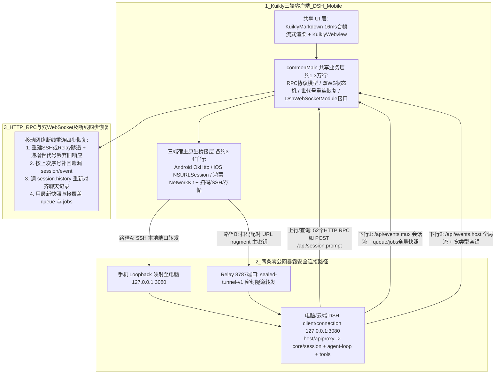

# 我用腾讯 Kuikly，把 DeepSeek Harness 装进了口袋

## 1. TL;DR

DeepSeek Harness（DSH）执行长程任务常需数分钟甚至更久，期间一旦停下等待人工命令审批、补充信息或确认方向，人若离开电脑任务就会卡死。作者并非要把完整 IDE 搬到手机上写代码，而是用腾讯开源跨端框架 **Kuikly** 构建了一码三端（Android、iOS、鸿蒙）的原生远程控制面板 **DSH Mobile**，在通勤或开会碎片时间接住“看进度、批权限、回追问”的高频轻交互。在架构上，App 不额外加业务中间层，而是直接对接 DSH 官方本机 `127.0.0.1:3080` 的 **Host 协议**（以 `dsh-v0.1.1-rc.2` 为例含 52 个 HTTP RPC 方法，配合会话级 `/api/events.mux` 与全局级 `/api/events.host` 两条只下行 WebSocket 事件流）；通过 **SSH 本地端口转发** 或自研 **`dsh-scan-remote` 扫码插件 + `sealed-tunnel-v1` 密封 Relay 隧道**（主密钥置于 URL fragment 不发往 Relay）实现零公网暴露的安全穿透；并在约 1.3 万行共享 `commonMain` Kotlin 代码中统一实现 $16\text{ ms}$ 合帧流式 Markdown 渲染、带世代号（Generation ID）的四步断线补齐状态机与三端原生模块下沉桥接，还可将 DSH 部署至腾讯云轻量应用服务器彻底摆脱个人电脑开机依赖。

## 2. 核心概念

- **DSH Mobile（口袋里的决策节点入口）**：基于 Kuikly 开发的一码三端原生客户端；Agent 循环、工具执行和插件仍运行在电脑或云端宿主机上，手机端仅负责长连接维持、流式状态渲染以及“命令审批（Allow/Deny）、回答追问、查看后台 Jobs 与 Goal 进度”等短平快决策。
- **DSH Host 协议三层暴露结构**：DSH 基于 `Cordis` 插件化运行时构建，与远程控制直接相关的三层为：① `core/session`、`agent-loop`、`tools`（负责会话、Agent 循环、工具执行并产生事件）；② `host/apiproxy`（将内部能力整理成 RPC 方法表与两条下行事件流）；③ `client/connection`（挂载至本机 `127.0.0.1:3080`，对外暴露 HTTP `/api/...` 及 WebSocket `/api/events.mux`、`/api/events.host`）。
- **双通道下行 WebSocket（`mux` vs `host`）**：
  - **`/api/events.mux`（会话流）**：推送当前会话内部事件，含模型流式输出、工具调用、审批卡、提问卡、消息队列（`session/queue`）和后台任务（`session/jobs`）。
  - **`/api/events.host`（宿主全局流）**：推送电脑侧全局变化，含会话增删、运行状态、工作区变更和 Host 级错误。
- **连接世代号（Generation ID）与“恢复观察而非重跑任务”**：每次重连分配递增世代号，连接断开后旧连接迟到的 RPC 响应直接丢弃；若断线期间电脑端 Agent 仍在运行，App 重连后只重新订阅该轮任务并按四步法补齐事件与快照，绝不把用户的 Prompt 重新发送一遍。
- **`dsh-scan-remote` 与 `sealed-tunnel-v1` 密封隧道**：为免去手机手动填 SSH 密钥的繁琐，由电脑端 Host 插件与手机 App 双方主动连接同一个 Relay，利用置于二维码 URL `#fragment` 中的主密钥（HTTP 请求不会将 fragment 发给服务器）建立端到端密封隧道，使 `127.0.0.1:3080` 始终无需暴露到局域网或公网。

## 3. 知识框架

以下架构与状态恢复图按正文整理，展示 DSH Mobile 三端跨端分层、双通道安全穿透协议以及移动网络断线后的四步恢复闭环：



## 4. 关键要点与机制详解

### 4.1 为什么不用纯 WebView，而选 Kuikly 原生跨端 + AI 辅助开发

**核心主张**：移动远程控制不仅要高频流式渲染未闭合 Markdown，还必须处理锁屏、切后台、网络切换后的 WebSocket 重连补齐以及 SSH 隧道、扫码等系统级能力，因此采用“共享层写状态机 + 原生桥接下沉系统能力”的 Kuikly 原生方案远比套壳 WebView 可靠。

- **组件市场加速：流式 `KuiklyMarkdown` 与 `KuiklyWebview` 的关键工程处理**
  - 引入依赖版本：
    ```kotlin
    implementation("com.tencent.kuiklybase:KuiklyMarkdown:1.0.6-2.1.21")
    implementation("com.tencent.kuiklybase:KuiklyWebview:1.0.1-2.0.21")
    ```
  - **流式 Markdown 渲染的三个核心细节**：AI 回复是持续变化的 chunk 流，基于 `intellij-markdown` 的 `KuiklyMarkdown` 输出 Block 列表并提供流式状态，作者在此之上做了三项针对性优化：
    1. **增量稳定局部刷新**：已结束的 Block 保持不动（避免长回答前半部分反复重建），仅尾部 Block 继续跟随输出更新。
    2. **未闭合代码块容错**：当流式输出中的代码块暂时还未收到结束反引号时，**在解析副本里自动补上闭合标记**，保证流式过程中代码高亮与排版不崩。
    3. 🔥 **$16\text{ ms}$ 合帧节流**：页面更新按 $16\text{ ms}$ 合帧，避免模型每吐出一个微小 chunk 就触发一次 UI 重绘。
- **`commonMain` 原生桥接下沉与代码量分布**
  - 在 `commonMain` 定义统一的 `DshWebSocketModule`、SSH 隧道、扫码配对等接口，将连接、发消息、收消息、断开等业务语义固定在约 **1.3 万行**共享 Kotlin 代码中；Android（`OkHttp`）、iOS（`NSURLSession`）、鸿蒙（`NetworkKit`）各用 **三四千行** 宿主代码接入各自系统实现。后续 DSH 每新增一个 RPC 或修改事件结构，只需改一次共享层即可三端同步生效。
- **使用 `KuiklyUI-AI` 规则驱动 AI Coding**
  - 项目接入 `KuiklyUI-AI`（提供 Kuikly DSL / Compose DSL 开发规则及组件、Module 扩展、网络、响应式状态、协程、多端资源等 Skills），喂给 CodeBuddy、Cursor、Claude Code 使用，使 Agent 生成协议模型、状态机和重复页面时无需盲猜框架 API，人类开发者主要聚焦交互检查、平台差异与真机表现。

### 4.2 直连 Host 协议：52 个 HTTP RPC、双 WebSocket 流与四步断线恢复

**核心主张**：App 直接复用官方 Web 前端的 Host 协议（无需自建转译服务），但针对移动端必现的断网切后台场景，必须区分“增量事件”与“全量快照”，并严格执行带世代号的四步重连恢复协议。

- **HTTP RPC 与双 WebSocket 通道的职责边界**

| 通信通道 | 路径 / 规模（`dsh-v0.1.1-rc.2`） | 承载内容与关键特殊字段处理纪律 |
|---|---|---|
| **HTTP RPC（请求/响应）** | `POST /api/...`（`rpc-map.ts` 登记共 **52 个方法**，如发消息为 `POST /api/session.prompt`） | 承接发消息（支持图片内容数组）、拉取会话列表、历史记录（`session.history`）、工作区、模型、Goal 与设置；入参与返回值直接对齐 TypeScript 函数签名 |
| **会话事件流（只下行 WS）** | `/api/events.mux` | 承载当前会话的模型流式输出、工具调用、审批、提问、队列与后台任务。<br/>🔥 **全量快照覆盖纪律**：`session/queue` 和 `session/jobs` 推送的是**完整快照**而非增量事件，且不进会话日志，App 收到新快照或重连后必须**直接覆盖本地状态**。<br/>🔥 **宽类型降级纪律**：`session/projection.value` 在 carrier 层为宽类型，必须保留未知字段并在解析失败时局部降级，严禁让整条事件流中断 |
| **宿主全局流（只下行 WS）** | `/api/events.host` | 承载会话增删、运行状态、工作区变更、Host 级错误及插件转发事件。<br/>🔥 **宽类型降级纪律**：`host/remote-event.args` 同样为宽类型，需做容错解析防断流 |

- **移动网络断线后的四步恢复顺序（核心状态机）**
  - 锁屏、切后台、进电梯/隧道、Wi-Fi 切蜂窝都会断开连接。重连后共享层状态机严格按以下 **4 步顺序** 恢复：
    1. **重建底层通道**：重新建立 SSH 端口转发或 Relay 密封隧道，并递增**连接世代号**（丢弃旧连接上迟到的残余 RPC 响应，严禁写脏新会话状态）。
    2. **按序号补增量事件**：使用断线前最后收到的事件序号，补回遗漏的 `session/event`。
    3. **全量对齐历史**：调用一次 `session.history`，重新对齐聊天记录。
    4. **快照覆盖队列与任务**：使用最新快照直接覆盖 `session/queue` 与 `session/jobs`。
  - **关键语义区别**：若断线期间电脑上的 Agent 仍在跑，重连后是**重新订阅这一轮正在运行的任务（恢复观察与控制）**，绝不能把用户的 Prompt 再发送一次触发重复执行。

### 4.3 零公网暴露的两种远程连接方式与四步实操部署

**核心主张**：监听在 `127.0.0.1:3080` 的 DSH 拥有极高的本机工具操作权限，绝不能直接裸露到公网或局域网；通过 SSH 本地端口转发或 URL Fragment 主密钥密封的 `dsh-scan-remote` 扫码隧道，可在保持 `127.0.0.1` 仅本机监听的前提下安全遥控。

- **两种远程连接方式对比**

| 连接方式 | 适用人群与前置条件 | 流量路径与安全机制 |
|---|---|---|
| **方式一：SSH 本地端口转发** | 已配置好电脑 SSH 主机与密钥的开发者 | 在手机端建立本地端口转发，将 App 侧的一个 loopback 端口映射到电脑的 `127.0.0.1:3080`；认证发生在 SSH 层，电脑端 DSH 看到的仍是本机回环请求 |
| **方式二：扫码配对（`dsh-scan-remote` + Relay）** | 不想在手机上手动输入 IP、端口和密钥的常规移动场景 | 电脑端安装 `dsh-scan-remote` 插件，Host 插件从本机访问 `127.0.0.1:3080` 并主动连 Relay；手机扫 Settings -> Remote Access 二维码后也主动连同一 Relay，双方通过 `sealed-tunnel-v1` 转发流量。<br/>🔥 **安全核心**：二维码中的主密钥放在 **URL fragment（`#...`）** 中，标准 HTTP 请求不会把 fragment 发送给 Relay；隧道数据端到端密封，Relay 无法窥探内容也无需直连电脑 3080 端口 |

- **本地扫码连接四步启动规程与命令速查**
  1. 🔥 **前置网络准备**：让手机和电脑连接同一个可信 Wi-Fi 或热点（也可将 DSH 部署在腾讯云轻量应用服务器上实现 24 小时脱机运行）。
  2. **终端 1：克隆并启动本地 Relay（监听 `8787` 端口）**
     ```bash
     # 终端 1，启动本地 Relay
     git clone https://github.com/yukiykchen/dsh-scan-remote.git
     cd dsh-scan-remote/relay
     cp .env.example .env
     npm ci
     npm run build
     HOST=0.0.0.0 PORT=8787 npm start
     ```
     *安全约束*：`HOST=0.0.0.0` 会向本机所有网络接口开放 `8787` 端口，仅限在可信网络中使用，并需确认系统防火墙放行 `8787`。
  3. **终端 2：安装扫码插件并启动 DSH Web**
     ```bash
     # 终端 2，安装插件并启动 DSH
     npx @deepseek-ai/dsh plugin --profile web add \
       "github:yukiykchen/dsh-scan-remote#v0.0.1"
     export PUBLIC_RELAY_URL=http://192.168.1.10:8787
     npx @deepseek-ai/dsh web
     ```
     *关键约束*：`PUBLIC_RELAY_URL` 必须替换成电脑当前的真实局域网 IP（会写进二维码供手机访问；若电脑切换了 Wi-Fi 或热点导致 IP 变化，必须更新该变量、重启 DSH 并重扫新二维码）。
  4. **手机安装 DSH Mobile 并扫码**：Android 直接下载 Release APK；iOS 用 Xcode 打开 `iosApp/iosApp.xcworkspace` 配签名安装真机；鸿蒙用 DevEco Studio 打开 `ohosApp` 构建；最后打开 DSH `Settings -> Remote Access` 扫码完成配对。
- **二次开发扩展的四个代码入口**
  - **新增 Host RPC 方法**：修改 `DshHostProtocol.kt` 并复用现有 RPC 通道（不涉及新系统能力时三端无需改原生代码）。
  - **新增原生系统能力**：先在 `commonMain` 定义 Module，再补三端实现（Android 从 `KuiklyRenderActivity` 导出，iOS 放在 `KuiklyExpand/Modules`，鸿蒙放在 `kuikly/modules`）。
  - **新增页面**：创建带 `@Page` 注解的页面类，由 KSP 自动生成路由。
  - **转发 DSH 内部新事件**：编写 DSH 插件监听目标事件并通过 `host/remote-event` 转发（需加入 Host 允许转发白名单，且 App 端对宽类型参数做容错）。

## 5. 数据速查表

| 指标 / 组件参数 | 原文数值 / 版本号 | 语境 / 条件 |
|---|---|---|
| 接入的 Kuikly 组件版本 | `KuiklyMarkdown:1.0.6-2.1.21`；`KuiklyWebview:1.0.1-2.0.21` | Gradle 依赖声明 |
| 流式 Markdown 页面刷新节流间隔 | $16\text{ ms}$ 合帧 | 避免每收到一个微小 chunk 就刷新一次 UI |
| 代码行数分布（共享层 vs 三端宿主） | `commonMain` 共享 Kotlin 代码约 $1.3$ 万行；Android、iOS、鸿蒙宿主各约 $3000\sim 4000$ 行 | 三端共享协议、状态机与 UI，宿主仅接系统能力与工程配置 |
| DSH 基准版本与 HTTP RPC 方法数 | `dsh-v0.1.1-rc.2`；共登记 $52$ 个 RPC 方法 | 定义于 `rpc-map.ts`（DSH 处于 developer preview，建议锁定验证过的 tag） |
| DSH 默认本机监听地址与 Relay 默认端口 | DSH：`127.0.0.1:3080`；本地 Relay：`0.0.0.0:8787` | 3080 端口严禁直接暴露公网；Relay 通过 `sealed-tunnel-v1` 转发 |
| 扫码插件版本标识 | `github:yukiykchen/dsh-scan-remote#v0.0.1` | 通过 `npx @deepseek-ai/dsh plugin --profile web add` 安装 |

## 6. 踩坑与教训 / 可迁移的设计原则

### 常见踩坑与应对

| 错误做法 | 失败表现或原因 | 原文应对策略 |
|---|---|---|
| **为了远程访问直接把 DSH 的 `3080` 端口暴露到公网或局域网** | 能连上 3080 端口的客户端可通过 Agent 与工具获得极高本机权限，带来严重安全风险 | 保持 `127.0.0.1:3080` 默认仅本机回环监听，通过 SSH 端口转发或 `sealed-tunnel-v1` 密封 Relay 隧道（主密钥置于 URL `#fragment`）接入 |
| **流式 Markdown 每收到一个 chunk 就全量重解析重建整页 UI** | 长回答生成到后半段时主线程严重卡顿，且未闭合代码块导致语法树与排版错乱 | 已结束 Block 保持不动、仅刷新尾部；对未闭合代码块在解析副本中自动补齐闭合标记；按 $16\text{ ms}$ 合帧刷新 |
| **把 `session/queue` 和 `session/jobs` 当成增量事件处理，或对宽类型事件强校验固定 Data Class** | 队列与后台任务状态重复累加或重连后无法靠事件回放恢复；某个插件自定义字段变化直接把整条 WebSocket 事件流搞崩 | 收到 `queue` 与 `jobs` 快照时直接全量覆盖本地状态；对 `projection.value` 和 `remote-event.args` 保留未知字段并在解析失败时局部降级 |
| **断线重连后不加区分地重发用户 Prompt，或不校验旧连接残留响应** | 电脑端其实还在跑上一轮任务，重发 Prompt 导致任务重复执行；旧连接的延迟响应覆盖了新连接状态 | 引入递增连接世代号丢弃旧连接迟到响应；重连严格走“建隧道 → 按序号补 `session/event` → 调 `session.history` → 快照覆盖 `queue/jobs`”，只恢复观察控制而不重发 Prompt |
| **扫码配对超时或电脑换 Wi-Fi/热点后无法连接** | 手机连不上 `http://电脑局域网地址:8787/health`，或二维码里写的还是旧局域网 IP | 排查三件事：① 手机能否访问 `:8787/health`；② `PUBLIC_RELAY_URL` 是否为电脑当前 IP（换网络后需更新并重启 DSH 重扫码）；③ 防火墙是否放行 8787 端口 |

### 可迁移的设计原则

- **把移动端定位为“异步长任务的决策节点入口”而非“袖珍 IDE”**：与 Cursor iOS、ChatGPT Codex 移动续接、Claude Code Remote Control 同理，当编码执行交给电脑或云端 Agent 后，移动端的黄金职责是处理“流式进度查看、高危命令 Allow/Deny 审批、追问补充”等碎片化阻塞点。
- **URL Fragment 密钥传递 + 双端主动出站密封隧道模式**：在内网穿透或跨设备配对设计中，将一次性或主配对密钥放在二维码 URL 的 `#fragment` 段（利用浏览器/HTTP 协议不向服务端发送 fragment 的特性），让宿主机插件与手机客户端双向主动出站连接中继 Relay 并建立端到端加密隧道，既免去了公网 IP 与端口映射，又实现了对中继服务器的零信任隔离。

## 7. 记忆锚点

- **原文产品定位与重连原则锚点**：“我想解决的不是‘在手机上写代码’，而是让手机接住这些短而频繁的交互——重连是恢复观察和控制，不是重新执行任务。”
- **核心架构口诀（助记改写）**：“一码三端共享万行，流式合帧十六毫秒；单路 RPC 双路事件，SSH 扫码密匙藏井号；断线四步带世代号，只补观察不重发。”

## 8. 复习卡片

为什么作者开发 DSH Mobile 时不直接用省事的 WebView 套壳，而选择用 Kuikly 构建原生跨端客户端？::因为远程控制 Agent 不仅要流式渲染动态 Markdown，还必须维持两条 WebSocket 长连接，处理手机锁屏、切后台、Wi-Fi 与蜂窝网络切换后的重连补事件，以及扫码配对、SSH 本地端口转发和本地缓存等强依赖平台原生的能力。
`KuiklyMarkdown` 在处理大模型流式输出时采用了哪三项关键优化来保证流畅度与排版稳定？::一是已结束的 Block 保持不动、仅更新尾部内容，避免长文前半部分反复重建；二是当代码块暂未闭合时，在解析副本中自动补上闭合标记；三是页面更新按 $16\text{ ms}$ 合帧，避免每来一个小 chunk 就刷新一次。
DSH 的两条下行 WebSocket（`/api/events.mux` 与 `/api/events.host`）各自负责什么，处理 `queue/jobs` 与宽类型字段时有什么纪律？::`mux` 负责当前会话内的模型输出、工具调用、审批、提问、队列和后台任务，`host` 负责会话增删、工作区变更等电脑全局状态；`session/queue` 与 `session/jobs` 推送的是完整快照而非增量事件，收到后需直接覆盖本地状态；而 `projection.value` 与 `remote-event.args` 属宽类型，必须保留未知字段并在解析失败时局部降级以防整条流中断。
移动网络断线重连后，DSH Mobile 的状态机按哪四步顺序恢复状态，“连接世代号”起什么作用？::四步顺序为：① 重建 SSH 或 Relay 隧道 → ② 用上次收到的序号补回遗漏的 `session/event` → ③ 请求 `session.history` 重新对齐聊天记录 → ④ 用最新快照覆盖 `queue` 和 `jobs`；每次连接携带递增世代号，用于丢弃旧连接中迟到的 RPC 响应，且重连只重新订阅运行中任务而不重发用户 Prompt。
为什么 DSH 默认只监听 `127.0.0.1:3080` 不能直接开到公网，`dsh-scan-remote` 扫码模式如何在不暴露端口的前提下保证安全？::因为能访问 3080 端口的客户端可通过 Agent 和工具获得极高的电脑本机操作权限；扫码模式下电脑端插件从本机访问 3080 并与手机 App 双方主动出站连接 Relay，且二维码中的主密钥放在 URL fragment（`#` 后）中不会随 HTTP 请求发给 Relay，流量经 `sealed-tunnel-v1` 端到端密封转发。
本地启动 `dsh-scan-remote` 扫码后如果手机端一直连接超时，应该依次排查哪三件事？::一是检查手机浏览器能否访问 `http://电脑局域网地址:8787/health`；二是确认环境变量 `PUBLIC_RELAY_URL` 是否仍是电脑当前的真实局域网 IP（切换 Wi-Fi 或热点后需更新该地址、重启 DSH 并重新扫码）；三是检查 Relay 是否监听了 `0.0.0.0:8787` 且系统防火墙已放行 8787 端口。

## 9. 知识关联

- **跨端框架与终端工程**：[[跨端开发与性能]]（[跨端开发与性能](../../20_topics/跨端开发与性能.md)）、[[桌面Agent与工作流]]（[桌面Agent与工作流](../../20_topics/桌面Agent与工作流.md)）
- **Harness 运行时与状态恢复**：[[Harness与模型协同]]（[Harness与模型协同](../../20_topics/Harness与模型协同.md)）、[[Agent任务恢复]]（[Agent任务恢复](../../20_topics/Agent任务恢复.md)）、[[Agent安全与权限]]（[Agent安全与权限](../../20_topics/Agent安全与权限.md)）
- **本篇原始与转写材料**：[原始 PDF](RAW.pdf) · [逐页转写文本](MD.md)

## 10. 原文参考资料

原文提及的开源代码仓库、插件与基准版本如下（仅作原文线索保存，未联网访问或执行文中安装命令）：

- **作者开源仓库与插件**：DSH Mobile 客户端仓库（`deepseek-harness-mobile`）、扫码远程配对插件与 Relay 仓库（`https://github.com/yukiykchen/dsh-scan-remote.git`，插件安装标识 `github:yukiykchen/dsh-scan-remote#v0.0.1`）
- **DeepSeek Harness 基准版本**：`dsh-v0.1.1-rc.2`（处于 developer preview，含 `rpc-map.ts` 52 个方法定义与下行事件定义，底层基于 `Cordis` 运行时）
- **Kuikly 生态与同类产品对照**：`Kuikly` 框架与组件仓库、`KuiklyUI-AI` 开发规则与 Skills、腾讯云轻量应用服务器，以及横向提及的 Cursor iOS Remote Control、ChatGPT Codex 移动续接、Claude Code Remote Control

> [!note]- 校对报告
> **覆盖度**：基于 `MD.md` 与 `META.json` 完整覆盖 PDF 第 1–9 页全部技术正文（痛点引出与 DSH Mobile 定位 p.1；为什么使用 Kuikly、`KuiklyUI-AI`、组件市场 `KuiklyMarkdown`/`KuiklyWebview` 与 $16\text{ ms}$ 合帧及原生桥接代码行数 p.2–4；直连 Host 协议三层结构、`dsh-v0.1.1-rc.2` 52 个 HTTP RPC、双 WebSocket 流与四步断线恢复状态机 p.4–5；SSH 隧道与 `dsh-scan-remote` 扫码 `sealed-tunnel-v1` 两种连接方式及手机作为决策节点入口 p.5–7；快速跑起来四步命令、超时排查三项与腾讯云轻量服务器部署 p.7–9；二次开发四个扩展入口与相关仓库版本说明 p.9）。第 9 页底部至第 11 页为 Kuikly 开源宣传与公众号留言区，已核对排除。
>
> **一致性抽查**：
>
> | 核对项 | 笔记值 | 原文值与位置 | 结果 |
> |---|---|---|---|
> | 组件依赖版本号 | `KuiklyMarkdown:1.0.6-2.1.21`、`KuiklyWebview:1.0.1-2.0.21` | p.2 | 一致 |
> | 流式合帧间隔与代码行数 | $16\text{ ms}$ 合帧；`commonMain` 约 1.3 万行，三端宿主各三四千行 | p.3 | 一致 |
> | DSH 版本、端口与 RPC 数量 | `dsh-v0.1.1-rc.2`、`127.0.0.1:3080`、52 个 RPC 方法 | p.4–5、p.9 | 一致 |
> | 扫码插件与 Relay 端口 | `github:yukiykchen/dsh-scan-remote#v0.0.1`、`sealed-tunnel-v1`、端口 `8787` | p.6–7 | 一致 |
> | 断线恢复四步顺序 | 重建隧道 → 补 `session/event` → 调 `session.history` → 快照覆盖 `queue` 和 `jobs` | p.5 | 一致 |
>
> **推断与异常**：未引入超出原文的技术推断。严格保留原文关于“`dsh-v0.1.1-rc.2` 处于 developer preview，52 个方法数仅对应文中版本，实际开发应锁定已验证 tag”及“局域网 `HOST=0.0.0.0` 开放 8787 端口仅限可信网络使用”的边界说明（p.4、p.7、p.9）。
>
> **日期与格式**：发布日期依据 PDF 第 1 页页眉 `Sep 8, 2026, 2:57 AM`，frontmatter `date` 记为 `2026-09-08`；全文保持唯一 H1，正文、表格、图注与复习卡片均不含页码与章节标注；复习卡片共 6 条，均为单行 `问题::答案` 格式；Mermaid 图表与文内终端命令均未实际执行。
