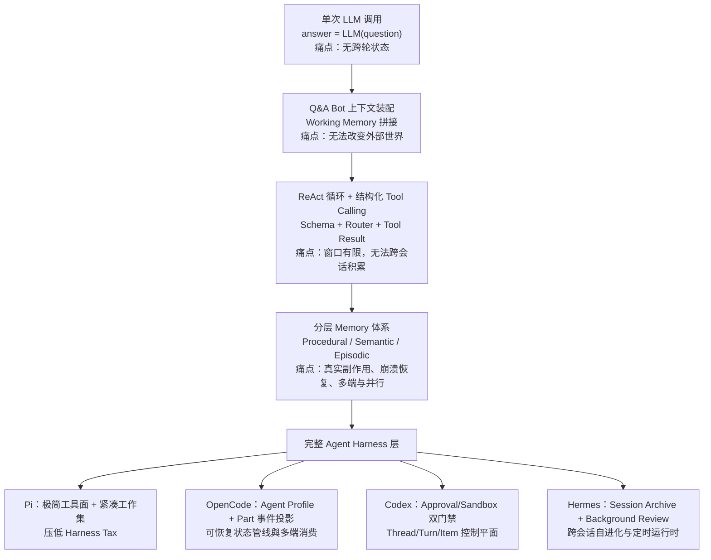
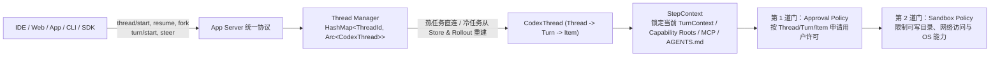

# 从一次 LLM 调用到完整 Harness，Agent 到底经历了什么？

## 1. TL;DR

今天的 Agent 系统之所以长成一套管理子进程、长期记忆、工具驱动、权限隔离与崩溃恢复的“小型操作系统”，并非预先宏大设计，而是模型每次撞上单次调用边界后工程系统逐层补齐的结果。单次 LLM 调用无状态催生了上下文装配（Working Memory），无法改变外部世界催生了结构化 Tool Calling，单步行动无法闭环催生了 ReAct 循环，上下文窗口有限催生了分层长期记忆，而真实副作用、长周期任务与多端接入最终凝结为独立的 **Agent Harness** 层。文章横向拆解了 **Pi**（极简上下文与低 Harness Tax）、**OpenCode**（Message/Part 事件流与 Profile 多身份）、**Codex**（Approval/Sandbox 双层门禁与 Thread/Turn/Item 生命周期）和 **Hermes**（跨会话经验沉淀与 Background Review 自进化）四套代表性架构：模型负责决定下一步做什么，Harness 决定这一步在什么上下文、权限、生命周期与持久化规则下发生。

## 2. 核心概念

### 术语定义与演进边界

- **Working Memory（工作记忆）**：当前这一轮推理真正提交给模型的全部上下文（如 `system_prompt`、`recent_chat_history`、`user_prompt` 及工具返回），随每轮请求由运行时动态构造与裁剪，不等同于持久化存储。
- **Long-term Memory（长期记忆）**：保存在模型外部、可跨会话持久化与按需检索的知识空间。原文按功能将其划分为三类：
  - **程序记忆（Procedural Memory）**：技能、习惯、操作流程与用户约定，典型载体为规则文件或 `SKILL.md`。
  - **语义记忆（Semantic Memory）**：稳定事实、概念、偏好与项目知识，常通过摘要、全文索引或向量检索注入上下文。
  - **情景记忆（Episodic Memory）**：某次具体任务发生了什么、采取了哪些动作、结果如何，通常来自会话日志与事件轨迹。
- **Agent Harness（智能体运行时外骨骼/底座）**：包裹在 Agent Loop 外围的工程运行时层，负责装配资源、管理会话、约束工具权限、持久化事件、暴露多客户端 API 并在多个子 Agent 间调度任务。

### 易混概念对比：Agent Loop vs. Agent Harness

| 对比维度 | Agent Loop（执行循环） | Agent Harness（运行时工程层） |
|---|---|---|
| **核心职责** | 驱动“模型 → 动作 → 环境 → 观察 → 模型”的持续决策闭环 | 决定每一步在什么上下文、权限边界、生命周期和持久化规则下发生 |
| **状态范围** | 单次运行内存中的上下文追加与停止条件判定 | 跨崩溃会话恢复、SQLite/Rollout 持久化投影、分支 Fork 与压缩（Compaction） |
| **安全与副作用** | 仅负责发起工具调用并接收返回值 | 通过 Approval Policy 与 Sandbox Policy 实施模型无法自行跨越的强隔离 |
| **多端与并发** | 绑定单一调用流或终端进程 | 通过 App Server / Session Events 支撑 TUI、IDE、Web、SDK 共享状态及子 Agent 隔离调度 |

## 3. 知识框架



## 4. 关键要点与机制详解

### 4.1 从无状态函数到受控动作协议：LLM → Q&A Bot → ReAct → Tool Calling

**核心主张：Agent 的第一个分水岭不是模型“想得更久”，而是模型外围的程序接管了上下文构造、循环驱动与结构化动作协议。**

- **遇到什么问题**：
  1. 最朴素的 LLM 接口只是 `answer = LLM(question)`，参数里只有训练期的世界知识，不会天然记住上一轮对话，也不知道自己输出的命令是否执行。
  2. 早期 ReAct 常让模型输出类似 `Search[Wikipedia]` 的自由文本再由正则解析，但文本格式易漂移、参数易缺失，模型还会把解释文字混入命令。
- **采用什么机制**：
  1. **上下文装配层（Context Assembly）**：Q&A Bot 在每次请求前把 `system_prompt`、`recent_chat_history` 和 `user_prompt` 重新拼成 `working_context`。模型看见的一切都是运行时系统为它构造出来的。
  2. **外部 `while` 循环驱动 ReAct**：程序持续执行 `response = model(context)` → 判断 `has_action` → `environment.execute(response.action)` → `context.append(action, observation)`，把单次回答变成闭环运行时。
  3. **结构化 Tool Calling 三件套**：
     - **Tool Schema**：描述工具名称、用途、参数类型与约束，界定动作空间。
     - **Tool Router**：根据名称定位实现、校验参数，将模型意图翻译为确定性程序调用。
     - **Tool Result Message**：携带调用 ID、状态与返回值回流上下文，确保观察结果精确对齐原始动作。
- **为什么有效**：将脆弱的文本约定升级为可验证、可路由、可审计的动作协议，后续文件工具、终端、浏览器、数据库与 MCP 都在扩展这一协议。
- **代价或边界**：上下文随循环轮次线性膨胀；且随着模型产生真实文件修改、命令执行和网络访问，单靠循环无法保证安全、恢复与多端同步。

```python
# 原文最小 Agent Runtime 闭环示意
while not finished:
    response = model(context)
    if response.has_action:
        observation = environment.execute(response.action)
        context.append(response.action, observation)
    else:
        return response.answer
```

### 4.2 记忆分层与六个工程边界：为什么会分化出独立 Harness 层

**核心主张：记忆系统的难点不在存储介质，而在写入、合并、防冲突与读取门控；当真实工作引入六大工程挑战时，Agent Loop 外围必须演化出独立的 Harness。**

- **遇到什么问题**：
  - 在记忆侧，把所有历史塞进窗口会挤压当前任务，而外部长期记忆面临“什么值得保存、何时合并重复事实、如何处理冲突记忆、检索多少条不淹没上下文、错误记忆如何纠正”五重难题。
  - 在运行侧，真实软件工程场景同时撞上六个工程问题：
    1. **会话能否恢复**：崩溃或退出后从一致状态续跑。
    2. **副作用是否安全**：命令、写文件、网络访问不能依赖模型“自觉”。
    3. **上下文如何压缩**：长任务保留关键事实并释放窗口。
    4. **客户端如何连接**：TUI、IDE、桌面端、Web 与 SDK 需观察同一运行状态。
    5. **扩展如何装配**：工具、MCP、Skills、Hooks 和配置需确定性发现与加载。
    6. **任务如何并行**：子 Agent 需具备隔离的上下文、权限、历史与生命周期。
- **采用什么机制**：将记忆拆分为 Working Memory 与三类 Long-term Memory（Procedural / Semantic / Episodic），并在 Agent Loop 外封装统一的 **Agent Harness** 承担资源装配、会话管理、工具约束、事件持久化与多 Agent 调度。

### 4.3 四种代表性 Harness 架构路线对比与机制深潜

| 维度 | Pi | OpenCode | Codex | Hermes |
|---|---|---|---|---|
| **核心优化目标** | 最小化 Harness 开销（Harness Tax），用更少上下文与轮次完成任务 | 结构化全过程记录、多角色 Profile 切换与多端状态共享 | 不可靠模型在真实计算机上的安全执行与长周期任务控制 | 跨会话经验提炼、技能沉淀与长期自进化 |
| **上下文与状态机制** | `Resource Loader` 显式装配规则与技能；`Session Manager` 用活动分支与 Compaction 保持紧凑工作集 | 回复拆为 `Message` + 多类型 `Part`；`Session Events` 经 `Projector` 写入 SQLite；隐藏 `Compaction Agent` 汇总旧历史 | `StepContext` 锁定单步环境快照；`Rollout` / `Thread Store` 存恢复轨迹，SQLite 供状态查询；独立后台管线更新 `~/.codex/memories/` | 前台 `Agent Loop` 解题；`Session Archive` 存原始经历；`Memory` 与 `Skills` 分存事实与流程；`Background Review` 筛选高价值经验 |
| **工具与权限边界** | 默认仅暴露 `read`、`write`、`edit`、`bash` 四工具；**不内置**文件/进程/网络/凭证权限隔离 | `Agent.Info`（Profile）统一绑定模型、Mode、Permission 与最大步数（如 `Explore` 仅开放只读搜索） | **Approval Policy**（动作级审批，绑定 Thread/Turn/Item）+ **Sandbox Policy**（目录、网络、OS 能力硬限制）双层门禁 | `Agentic Tools`（Terminal/Browser/MCP/Skill 管理）+ `Cronjob` 时间触发常驻运行时 |
| **并发与多 Agent 机制** | 侧重单主循环极简执行 | `Build`/`Plan` 为 primary 主 Agent，`General`/`Explore` 为 subagent（经 Task Tool 调度），`Compaction`/`Title`/`Summary` 为隐藏后台 Agent | 子 Agent 即 `Thread Manager` 派生的独立子 `Thread`（先物化刷新父 `Rollout`，再从稳定快照 `fork`） | 支持任务分派与后台周期性回顾 |
| **工程代价与局限** | 极简默认继承宿主用户权限，高风险环境必须外接容器或外部沙箱 | 需维护配置合并、权限组合、事件顺序与 SQLite 投影；后台 Compaction/Title/Summary 产生额外模型调用 | 基础设施厚重，短平快任务测评中耗时与新 Token 开销处于最重一档 | 依赖持续的记忆写入、冲突修正与回顾治理，否则易积累噪声 |

#### （1）Pi：用极简暴露面与紧凑工作集压低 Harness Tax

- **遇到什么问题**：繁杂的默认工具描述、全量规则自动注入和冗长历史会让模型反复阅读无关内容，拖慢轮次并拉高成本。
- **采用什么机制**：
  1. **最小默认工具集**：默认只暴露 `read`、`write`、`edit`、`bash` 四个工具。
  2. **显式 `Resource Loader`**：`SYSTEM.md`、`AGENTS.md`、Skills 与 Prompt Templates 不会由模型自己去磁盘“感知”，而是由 `Resource Loader` 在启动时显式发现、解析并装配为当前 Session 的系统上下文。
  3. **分支与压缩投影**：`Session Manager` 利用活动分支和 Compaction 将完整会话投影为紧凑的 Working Memory。
- **为什么有效**：每轮请求携带的上下文比同类重型框架少约三倍，历史噪声和工具 Schema 更少，模型用更少 Token 和更少循环抵达结果（Composio 30 任务测试中完成率 66.7%、中位成本仅 $0.012；Databricks 基准中多段位于 Pareto 前沿）。
- **代价或边界**：Pi 不内置文件系统、进程、网络或凭证访问限制，默认继承启动用户权限；进入高风险环境必须外接容器或沙箱。

#### （2）OpenCode：Message/Part 事件化投影与 Agent Profile 多身份装载

- **遇到什么问题**：若把模型回复存成一整块纯文本或依赖终端字符重放，退出界面即丢失执行现场，且前台编码、只读探索与后台摘要难以共用同一执行循环。
- **采用什么机制**：
  1. **细粒度 `Part` 轨迹结构**：一次 `Assistant Message` 下挂载 `Reasoning`、`Text`、`Tool`、`Step Start`、`Step Finish`、`Patch`、`Compaction` 等独立 `Part`；更新触发 `Session Events`，由 `Projector` 分别投影写入 SQLite。
  2. **`Agent.Info`（Agent Profile）身份容器**：将名称、描述、Prompt、模型、Mode、Permission、生成参数与最大步数封装进同一配置对象。`Build` 与 `Plan` 以 `primary` 模式承担主任务（靠权限边界区分读写）；`General` 与 `Explore` 以 `subagent` 模式被 Task Tool 调度（`Explore` 仅开放搜索、读取与受限命令）；`Compaction`、`Title`、`Summary` 则作为隐藏后台 Agent 自动维护上下文压缩、标题生成与变更汇总。
  3. **可重建上下文管线**：长会话逼近上限时，隐藏的 `Compaction Agent` 汇总早期历史、裁剪旧工具输出，并在 Token 预算内保留近期 turns 组装下一轮 Working Memory。
- **代价或边界**：单次回复背后需维护配置合并、权限组合、事件顺序和数据库投影，隐藏后台 Agent 也会引入额外的模型调用开销。

#### （3）Codex：Approval + Sandbox 双层安全门禁与 Thread/Turn/Item 控制平面



- **遇到什么问题**：Coding Agent 的失误会造成文件覆盖、危险命令或越界访问，不能只靠 Prompt 提醒模型小心；且当入口扩展到 IDE、Web、App、SDK 时，任务不能再依附于单个终端进程。
- **采用什么机制**：
  1. **Approval + Sandbox 双层边界**：用户点击“允许”不等于交出整台电脑。`Approval Policy` 决定某个动作是否获准（请求精确绑定到具体 `Thread`、`Turn` 和 `Item`）；`Sandbox Policy` 在操作系统层持续限制允许写入的目录、网络访问和系统资源，单次批准不会取消沙箱剩余限制。
  2. **Thread / Turn / Item 三层状态树与 `Thread Manager`**：
     - `Thread` 承载长周期多轮任务，`Turn` 表示用户推动任务向前走的一次过程，`Item` 将用户输入、Agent Message、Reasoning、命令执行、文件修改、工具调用和审批拆成可观察单元（支持 `Start`、`Resume`、`Fork`、`Interrupt` 与运行中 `Steer`）。
     - `Thread Manager` 维护内存 `HashMap<ThreadId, Arc<CodexThread>>`：启动时等待首个 `SessionConfigured` 事件后注册实例；`Resume` 命中活跃实例时直接复用以防同一历史启动两套 Loop，仅冷 Thread 才从 `Thread Store` 或 `Rollout` 重建；`Fork` 派生子 Agent（如界面中并行运行的 `Newton`、`Franklin`、`Dirac`、`Peirce` 四个子 Thread）时，先要求父 Thread 物化并刷新未落盘的 `Rollout`，再从稳定快照切出独立子 Thread。
  3. **`StepContext` 单步自洽快照**：每次模型采样捕获当前 `TurnContext`、选中环境、`Capability Roots`、`MCP Binding`、`Tool Router` 与 `AGENTS.md`，即便后台配置中途变更，已开始的当前步仍面对自洽环境。
  4. **任务恢复与长期学习双管线分离**：`Rollout` 与 `Thread Store` 负责单次任务恢复；开启 Memory 后，独立后台管线读取历史 `Rollout` 提取稳定事实与经验，交由专门整合 Agent 更新 `~/.codex/memories/`。
- **代价或边界**：架构厚重，在 OpenBench 42 个共同完成任务测评中，Codex 通过率 73.8%（31/42），但中位耗时 94.6 秒、每成功任务平均消耗 117,107 个新 Token，均为测试组中最重一档。

#### （4）Hermes：跨会话经验沉淀与时间触发的常驻运行时

- **遇到什么问题**：单次任务做完即忘，第二次遇到同类任务仍要重走弯路；若无甄别地塞入历史记录，又会导致噪声堆积或旧知识未及时被新修正覆盖。
- **采用什么机制**：
  1. **四层经验分工**：前台 `Agent Loop` 解决当前任务，`Session Archive` 留存原始经历，`Memory` 存稳定事实，`Skills` 存可复用流程，再由后台 `Background Review` 判断哪些经验值得写入或覆盖旧知。
  2. **`Persistent Runtime`（持久在线运行时）**：结合 `Agentic Tools`（Terminal、Browser、MCP、任务分派、Skill 管理）与 `Cronjob` 定时触发，使 Agent 从“打开终端才存在的进程”变为由时间而非仅由即时用户输入触发的长期个人运行时。
- **为什么有效**：在 PAST-Bench（26 个场景、204 个跨会话 Episode，对照开启/关闭持久化）中，固定 `MiniMax-M2.7` 模型后，Hermes 在 Memory、Procedural Reuse、Information Gathering、Update 四类能力上全部取得正向增益（总体增益 `+0.13`），且日志审计“写入 → 检索 → 正确应用”闭环的机制证据分达 `0.64`（高于同获 `+0.13` 增益但机制分仅 `0.57` 的 `nanobot`）。
- **代价或边界**：效果高度依赖 `Background Review` 对“何种经历值得写入、如何修正旧记忆”的持续治理质量。

## 5. 数据速查表

| 指标 | 原文数值 | 语境 / 条件 |
|---|---|---|
| Pi 通过率与中位任务成本 | 通过率 `66.7%`，中位成本 `$0.012` | Composio 测评：将 `DeepSeek V4 Flash` 放入 Pi、Prime、Deep Agents、Hermes 跑同一批 `30` 个 Agentic Tasks |
| Pi + Opus 4.8 (`xhigh`) 通过率 | 接近 `90%` | Databricks 内部基准：基于真实工程师 PR 构造，覆盖 Python/Go/TS/Scala 数百万行代码库 |
| Pi 单轮上下文与同模型成本差 | 每轮送入上下文约少 `3 倍`，单任务成本相差 `2 倍以上` | Databricks 运行轨迹追踪：同模型、同推理强度切换到 Pi 后质量基本不变但工作集更紧、轮次更少 |
| Codex 任务完成率（OpenBench） | `73.8%`（完成 `31 / 42` 个任务） | 2026 年 7 月 OpenBench 测评：同一 `gpt-5.6-sol` 放入 7 套 Coding Agent Harness，取各组均完整跑过的 42 个任务 |
| Codex 中位耗时与平均新 Token 消耗 | 中位耗时 `94.6 秒`，平均 `117,107` 个新 Token / 成功任务 | OpenBench 42 任务共同子集，属于 7 套被测 Harness 中开销最重的一档 |
| PAST-Bench 评测规模 | `26` 个场景、`204` 个跨会话 Episode | 2026 年 8 月跨会话基准：早期 Episode 注入偏好/流程/修正，清空上下文后测试四项跨会话能力，并与关闭持久化对比 |
| Hermes 跨会话总体增益与机制证据分 | 总体增益 `+0.13`，机制证据分 `0.64`（对比 `nanobot` 机制分 `0.57`） | 固定 `MiniMax-M2.7` 模型；机制证据分通过检查日志中 Memory 写入、Skill 创建、Session Search 与后续读取核算出 |

## 6. 踩坑与教训 / 可迁移的设计原则

### 踩坑与教训（错误做法 → 失败表现或原因 → 原文应对）

1. **用正则表达式直接解析自由文本动作**：
   - **错误做法**：让模型在文本中输出 `Search[Wikipedia]` 等约定字符串并用正则提取。
   - **失败表现或原因**：格式易漂移、参数易缺失，模型常把解释文字混进命令导致解析崩溃。
   - **原文应对**：改用结构化 Tool Calling（`Tool Schema` 注册约束 + `Tool Router` 校验路由 + 带调用 ID 的 `Tool Result Message` 回流）。
2. **把“用户点击允许（Approval）”等同于放弃后续执行限制**：
   - **错误做法**：单次动作获批后直接在宿主权限下裸跑命令，或仅靠 Prompt 叮嘱模型“操作要小心”。
   - **失败表现或原因**：Coding Agent 一旦判断失误，极易覆盖关键文件、执行破坏性命令或越过工作区边界访问敏感资源。
   - **原文应对**：像 Codex 一样实施 `Approval Policy` 与 `Sandbox Policy` 双层分离——即便用户批准某次命令，沙箱仍强制约束可写目录、网络访问与操作系统能力。
3. **Resume 或 Fork 任务时直接复制聊天文本或重复启动循环**：
   - **错误做法**：对仍在运行中的任务收到 `Resume` 时直接新建一套 Agent Loop，或在父任务未落盘时直接拷贝内存文本做子 Agent 分叉。
   - **失败表现或原因**：同一份历史并发跑两套循环会造成状态踩踏；未物化快照直接 Fork 会导致父子状态不一致。
   - **原文应对**：通过 `Thread Manager` 维护活跃任务哈希表（热任务直接返回现有实例，冷任务才从 `Rollout`/`Thread Store` 重建），且 Fork 前强制父 Thread 物化刷新未落盘的 `Rollout`。

### 可迁移的设计原则

- **上下文最小化即成本控制（来自 Pi）**：非必要的工具 Schema、全量规则和历史分支不要默认塞入每轮请求；用显式 `Resource Loader` 和活动分支投影保持最小工作集，可直接成倍降低 Token 消耗与循环轮次（条件：若精简掉内置权限模块，生产部署时必须由外部容器/沙箱补齐安全边界）。
- **状态事件化先于多客户端支持（来自 OpenCode）**：先将模型推理、工具启停、补丁修改和上下文压缩拆分为结构化事件并投影落盘（如 SQLite），TUI、IDE、Web 和 SDK 才能自然退化为同一服务端 Session 的轻量事件消费者。
- **任务恢复管线与长期经验学习管线解耦（来自 Codex & Hermes）**：现场恢复需要精确重放（`Rollout` / `Session Archive`），而跨会话复用需要提炼与去噪（后台整合 Agent / `Background Review` 写入 `Memory` 与 `Skills`），二者不可混用同一套存储与写入逻辑。

## 7. 记忆锚点

1. **原文金句锚点**：「Agent 决定下一步做什么；Harness 决定这一步在什么上下文、权限、生命周期与持久化规则下发生。」
2. **演化阶梯口诀（助记改写）**：「记不住拼 Context，碰不到接 Tool，一步做不完跑 Loop，装不下拆 Memory，动真格上 Harness（Pi 省上下文、OpenCode 存事件、Codex 双门禁管 Thread、Hermes 跨会话做复盘）。」

## 8. 复习卡片

为什么单次 LLM 调用演进到 Q&A Bot 时必须引入上下文装配层？::因为 LLM 本身是无状态函数，训练参数只包含世界知识而不保存跨轮用户档案；运行时必须在每次请求前重新拼接系统指令、近期对话历史与当前输入（即构造 Working Memory），模型才能表现出多轮记忆。
ReAct 执行循环与结构化 Tool Calling 各自解决了什么边界问题？::ReAct 用模型外围的 `while` 循环打通了“模型 → 动作 → 环境 → 观察 → 模型”的多步闭环；结构化 Tool Calling 则用 Tool Schema、Tool Router 和带调用 ID 的 Tool Result Message 替代脆弱的正则文本解析，使动作可验证、可路由、可审计。
原文将 Agent 的外部长期记忆（Long-term Memory）划分为哪三类？::划分为程序记忆（Procedural，存技能与操作流程，如 `SKILL.md`）、语义记忆（Semantic，存稳定事实、概念与偏好）和情景记忆（Episodic，存具体任务经历与事件轨迹）。
Pi 为什么能在保持任务完成率的同时把每轮上下文减少约三倍、单任务成本压低两倍以上？::因为 Pi 默认只暴露 `read`、`write`、`edit`、`bash` 四个工具，由 `Resource Loader` 显式按需装配规则与技能，并用 `Session Manager` 对活动分支与压缩结果做紧凑投影；代价是它不内置文件、进程或网络权限隔离，高风险场景需外接沙箱。
OpenCode 的 Agent Profile（`Agent.Info`）如何用同一个执行循环支撑前台主任务、子 Agent 与后台维护？::Profile 将 Prompt、模型、Mode、Permission、生成参数与最大步数封装在同一配置对象中：`Build`/`Plan` 作为 primary 主 Agent，`General`/`Explore` 作为受限 subagent（如 `Explore` 仅开放只读搜索），而 `Compaction`、`Title`、`Summary` 作为隐藏后台 Agent 自动执行压缩与汇总。
在 Codex 中，为什么用户点击“允许（Approval）”之后还需要 Sandbox Policy？::因为 Approval Policy 只决定某次具体动作是否获准执行，而 Sandbox Policy 在操作系统层面持续约束可写目录、网络访问与系统资源；两层分离可防止模型因判断失误在获批后越界破坏系统。
Codex 的 `Thread Manager` 在处理 `Resume` 和 `Fork` 时如何保证状态一致性？::维护 `HashMap<ThreadId, Arc<CodexThread>>` 活跃表：`Resume` 命中运行中任务时直接复用现有实例，仅冷任务才从 `Thread Store` 或 `Rollout` 重建；`Fork` 派生子 Thread 前会先要求父 Thread 物化并刷新尚未落盘的 `Rollout`，再从稳定快照切出独立实例。
Hermes 在 PAST-Bench 跨会话测试中是如何实现经验复用的？::它将原始经历存入 `Session Archive`，把稳定事实与可复用流程分别写入 `Memory` 和 `Skills`，并由后台 `Background Review` 筛选值得保留或修正的经验，从而在清空上下文的后续会话中完成“写入 → 检索 → 正确应用”闭环。

## 9. 知识关联

### 本库主题入口与已有关联笔记

- [Harness与模型协同](../../20_topics/Harness%E4%B8%8E%E6%A8%A1%E5%9E%8B%E5%8D%8F%E5%90%8C.md)：Harness 的上下文装配、权限边界、事件化与执行控制平面。
- [Agent长期记忆](../../20_topics/Agent%E9%95%BF%E6%9C%9F%E8%AE%B0%E5%BF%86.md)：Working Memory 与 Procedural / Semantic / Episodic 长期记忆的分层治理。
- [Agent任务恢复](../../20_topics/Agent%E4%BB%BB%E5%8A%A1%E6%81%A2%E5%A4%8D.md)：OpenCode SQLite 事件投影、Codex Thread/Turn/Item 生命周期与快照 Fork。

### 候选双链（供 Obsidian 知识库导航）

- **运行时与架构演进**：[[Agent Harness]]、[[ReAct 循环]]、[[Function Calling 与 MCP]]、[[上下文工程 Context Engineering]]
- **开源系统对照**：[[Pi Agent]]、[[OpenCode]]、[[Codex CLI 与 App Server]]、[[Hermes Agent]]
- **安全与记忆机制**：[[Approval 与 Sandbox 双层隔离]]、[[Compaction 上下文压缩]]、[[PAST-Bench 跨会话评测]]

## 10. 原文参考资料

- **本目录归档文件**：[RAW_补采001.pdf](RAW_补采001.pdf)｜[MD_补采001.md](MD_补采001.md)｜[RAW.pdf](RAW.pdf)｜[MD.md](MD.md)
- **原文提及的论文、基准与开源项目**：
  - 论文与基础范式：*GPT-3*（2020）、*RAG*（2020）、*ReAct*（2022 公开 / ICLR 2023 发表）、*LLaMA*（2023-02）、*OpenAI Function Calling*（2023-06）、*MemGPT*（2023）、*Anthropic MCP*（2024-11）
  - 评测基准：Composio 30 Agentic Tasks 对比测评、Databricks 内部百万行代码库 PR 基准、OpenBench（2026-07，42 任务共同子集，`gpt-5.6-sol`）、PAST-Bench（2026-08，26 场景 / 204 跨会话 Episode）
  - 开源与工程系统：Pi Agent、OpenCode、Codex CLI / Cloud Codex、Hermes Agent、Claude Code

> [!note]- 校对报告
> - **覆盖度核验**：已完整通读并核对 `MD_补采001.md`（共 16 页，p.1–14 为技术正文，p.15 为公众号尾页与留言入口，p.16 为空白尾页）及 `META.json` 既有 PDF 页图核验记录。完整覆盖 LLM 单次调用、Q&A Bot 上下文装配、ReAct 循环、结构化 Tool Calling、三类长期记忆、Harness 六大动因，以及 Pi、OpenCode、Codex、Hermes 四套系统的机制与量化数据。
> - **关键数据与事实逐项核对**：
>   1. **Pi 测评数据**（p.6–8）：Composio 在 `DeepSeek V4 Flash` 上跑同一批 `30` 个任务，Pi 通过率 `66.7%`、中位任务成本 `$0.012`；Databricks 基准中 `Opus 4.8` 搭配 Pi `xhigh` 接近 `90%`，`GLM 5.2` 进入最高梯队，同模型同推理强度下成本相差 `2 倍以上`，每轮送入上下文约少 `3 倍`；默认仅暴露 `read`、`write`、`edit`、`bash` 四工具。
>   2. **OpenCode 结构与角色**（p.8–9）：`Assistant Message` 下含 `Reasoning`、`Text`、`Tool`、`Step Start`、`Step Finish`、`Patch`、`Compaction` 等 `Part`；`Agent.Info` 区分 `primary`（`Build`/`Plan`）、`subagent`（`General`/`Explore`）与隐藏 Agent（`Compaction`/`Title`/`Summary`）。
>   3. **Codex 测评与内部机制**（p.10–13）：OpenBench（2026-07）固定 `gpt-5.6-sol` 在 7 套 Harness 共同完成的 `42` 个任务上，Codex 完成 `31` 个（通过率 `73.8%`）、中位耗时 `94.6 秒`、每成功任务平均消耗 `117,107` 个新 Token；`Thread Manager` 使用 `HashMap<ThreadId, Arc<CodexThread>>`，等待首个 `SessionConfigured` 事件后注册，支持 `thread/start`、`thread/resume`、`thread/fork`、`turn/start`、`turn/steer`，界面示例派生 `Newton`、`Franklin`、`Dirac`、`Peirce` 4 个子 Thread；长期记忆更新路径为 `~/.codex/memories/`。
>   4. **Hermes 与 PAST-Bench**（p.13–14）：2026 年 8 月 PAST-Bench 含 `26` 个场景、`204` 个跨会话 Episode，测试 `Memory`、`Procedural Reuse`、`Information Gathering`、`Update`；固定 `MiniMax-M2.7` 后 Hermes 总体增益 `+0.13`、机制证据分 `0.64`（对比 `nanobot` 总体增益 `+0.13`、机制分 `0.57`）。
> - **事实边界与局限说明**：文中引用的 Composio、Databricks、OpenBench、PAST-Bench 数据均保留原文实验条件说明（如任务数有限、非通用排行榜），未外推为普适排名；未执行文中代码片段。
> - **格式自检**：全文仅 1 个 H1 标题；正文、表格、Mermaid 图与复习卡片均无页码/章节出处标注；复习卡片共 8 条，严格采用单行 `问题::答案` 格式。
