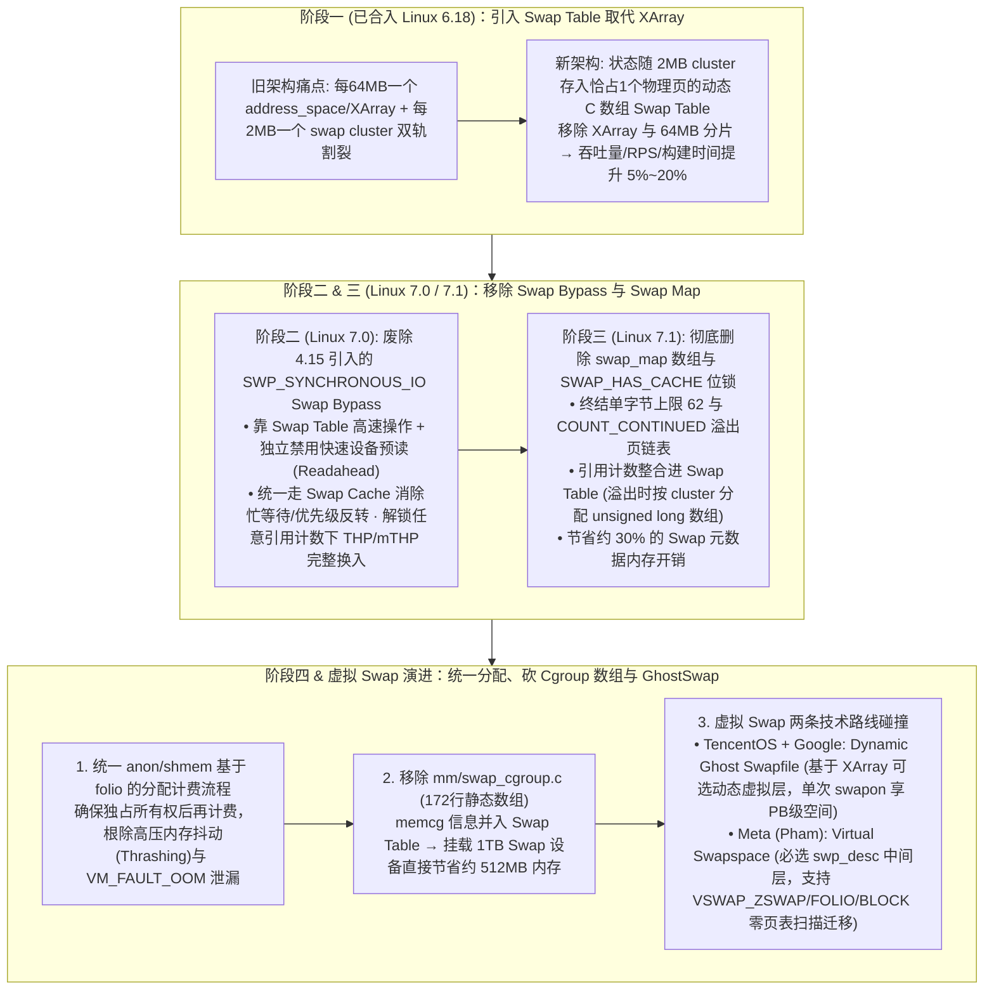

# 这大概是我读过最硬核的一次 Linux 内核重构文章了

## 1. TL;DR

1. **历时 18 个月、获 LWN 连续三篇专文盛赞的 Linux Swap 现代化工程**：由腾讯服务器操作系统 **TencentOS** 内核工程师 **Kairui Song**（联合 Google 的 Chris Li 等）主导，自 2025 年 LSF/MM/BPF 峰会提出以来分四阶段推进，被 Linux 内核文档核心维护者 Jonathan Corbet 在 LWN.net 以罕见的“Modernizing swapping”三部曲深度报道。
2. **阶段一（已合入 Linux 6.18）：引入 `swap table` 取代 `XArray`，性能提升 5%~20%**：废除沿用多年的每 `64MB` 切分一个 `address_space / XArray` 的双层割裂设计，将槽位状态、folio 指针与 Shadow 影子信息统一整合进随 `swap cluster`（通常 `2MB`）动态分配、恰占一个物理页的紧凑 C 数组 **`swap table`** 中，彻底消除 `XArray` 查找开销与锁争抢。
3. **阶段二 & 三（面向 Linux 7.0 / 7.1）：移除 Swap Bypass 与 `swap_map`，元数据内存省约 30%**：在 `7.0` 中移除自 Linux 4.15 引入的 `SWP_SYNCHRONOUS_IO` Swap cache bypass 捷径（消除竞态且让高阶大页 `THP/mTHP` 在任意引用计数下均可完整换入）；在 `7.1` 中废除每槽位 1 字节（上限仅 `62`、溢出需链表挂载额外页）的 `swap_map` 及 `SWAP_HAS_CACHE` 位锁，将引用计数并入 `swap table`，**节省约 30% 的 Swap 元数据内存开销**。
4. **阶段四与前沿演进：砍掉 `swap_cgroup`（1TB Swap 省 512MB 内存）与虚拟 Swap 双路线碰撞**：统一 `anon/shmem` 基于 folio 的换出分配路径（根除内存抖动与 `VM_FAULT_OOM` 泄漏），移除 `mm/swap_cgroup.c`（`172 行`代码，挂载 **1TB Swap 设备立省约 512MB 内存**），并推出单次 `swapon /dev/ghostswap` 即享 **PB 级** 动态虚拟空间的 **Dynamic Ghost Swapfile**（与 Meta 的 `swp_desc` 强制中间层方案同台演进，彻底解放 `zswap` 对物理后备块设备的强绑定）。

## 2. 问题定义与背景

### 2.1 为什么 Linux 6.18 之前的 Swap 子系统成了历史包袱重灾区？
在虚拟内存管理中，文件页（Page Cache）以磁盘文件本身为后备存储，而存放进程堆、栈的**匿名页（Anonymous Pages）**必须依靠 Swap 子系统换出。数十年修补使旧版 Swap 累積了四大结构性顽疾：
1. **两套聚簇机制并存与 `XArray` 锁开销**：旧内核为复用 Page Cache 代码，维护了 `swapper_spaces`（按 **64MB** 切分多个 `address_space` 与 `XArray` 树），同时又按 **2MB** 划分 `swap_cluster_info` 供每 CPU 本地分配——两套机制割裂，且每次槽位状态读写都要走相对昂贵的 `XArray` 树查找。
2. **`swap_map` 字节数组与 `SWAP_HAS_CACHE` 位锁泥潭**：`swap_map` 用 1 个字节记录槽位引用计数，扣除 `SWAP_HAS_CACHE (0x40)`、`SWAP_MAP_BAD (0x3f)`、`SWAP_MAP_MAX (0x3e)` 与 `COUNT_CONTINUED (0x80)` 等特殊标志位后，**单字节最大只能表示 62 个引用计数**；多进程共享匿名页一旦超过 62 就必须分配新物理页并通过 LRU 链表串接溢出页；更糟的是 `SWAP_HAS_CACHE` 被兼作位锁（Bit Lock），导致内核充斥着延迟重试循环与竞态 Workaround。
3. **Linux 4.15 `Swap Bypass` 带来的同步分裂**：为加速 ZRAM 等高速同步设备（`SWP_SYNCHRONOUS_IO`），Linux 4.15 引入了在引用计数为 1 时绕过 Swap Cache 直接同步换入的 Bypass 路径，不仅引发大量并发 Bug，还导致高阶大页（`THP/mTHP`）只能在引用计数为 1 时才能完整换入。
4. **静态 `swap_cgroup` 内存浪费与物理槽位焊死页表（阻碍 `zswap` 与设备卸载）**：`mm/swap_cgroup.c` 静态预分配数组在挂载 1TB Swap 时白白吃掉 512MB RAM；且匿名页换出后其物理 Swap 设备索引与偏移被直接写死进进程页表项（PTE），导致 `swapoff` 必须全表扫描所有进程页表，且 `zswap`（内存压缩缓存）即使不落盘也必须在物理磁盘上1:1预分配槽位。

## 3. 知识框架

## 4. 核心内容拆解

### 4.1 第一阶段（Linux 6.18）：用紧凑 `Swap Table` 终结 `XArray` 时代

1. **核心洞察**：既然内核在处理任何 `swap entry` 时都已经知道它属于哪个 **2MB 的 `swap cluster`**，为何还要去查一个按 64MB 分片的外部 `XArray` 树？
2. **`Swap Table` 的精巧设计**：
   - 将每个槽位的三种状态（① 空 `NULL`；② 驻留 RAM 的 `folio` 指针；③ 已换出释放后的工作集 Shadow 影子信息）直接存放在挂靠于 `swap cluster` 下的平面 C 数组（`swap table`）中。
   - **按需动态分配与页对齐**：每个 `swap table` 数组在多数架构上被设计为**恰好占用 1 个物理页**，且唯有当某个 Cluster 真正被使用时才动态分配。
   - **实测收益**：两套聚簇机制合二为一，彻底淘汰 `swapper_spaces` 中的 `XArray`，使基准测试与实际工作负载的**吞吐量、RPS 或内核构建时间提升高达 5%~20%**。

### 4.2 第二、三阶段（Linux 7.0 / 7.1）：拔除 `Swap Bypass` 与 `swap_map`

1. **为什么 Linux 7.0 敢于删掉曾经提升 ZRAM 性能的 `Swap Bypass`？**
   - 2018 年（Linux 4.15）之所以加 Bypass，是因为当年基于 `XArray` 的 Swap Cache 操作太慢，且默认预读（Readahead）拖累了 ZRAM。
   - 如今第一阶段的 `Swap Table` 已让 Swap Cache 操作极快，Kairui 进一步将预读控制解耦并对高速同步设备默认禁用预读——此时绕过 Swap Cache 已无性能收益。删除 Bypass 后，所有换入统一走 Swap Cache 同步原语（高速设备换入完成后立即将 folio 移出释放内存），不仅消灭了忙等待与优先级反转，还带来意外惊喜：**高阶大页（`THP/mTHP`）不再受限于“引用计数必须为 1”，在任意引用计数下都能完整换入！**
2. **Linux 7.1 彻底移除 `swap_map`（节省约 30% 元数据内存）**：
   - 依靠 `cluster lock + folio lock` 接管并发控制，换出侧在分配槽位同时立即将 folio 塞入 Swap Cache，换入侧在移出 Swap Cache 时立即回收引用计数为 0 的槽位——彻底拔除了臭名昭著的 `SWAP_HAS_CACHE (0x40)` 位锁与延迟重试循环。
   - 将引用计数直接编码进 `Swap Table` 条目（若遇极端大量共享内存导致引用计数溢出，则按 Cluster 分配独立的 `unsigned long` 数组，告别繁琐的 `0x3e / 0x80` 单字节溢出页链表），**一举削减约 30% 的 Swap 元数据内存占用**。

### 4.3 第四阶段与虚拟 Swap 架构之争：从 `512MB/TB` 内存节省到 `GhostSwap`

1. **统一 `anon / shmem` 分配路径与移除 `swap_cgroup`**：
   - 将原先各自为政的匿名页（anon）与共享内存（shmem）换出路径统一为以 `folio` 为中心的规范流程（先在 Swap Cache 层确保对 Slot 的独占所有权，再执行 memcg 计费），彻底根除高压下因竞态引发的内存抖动（Thrashing）与偶发 `VM_FAULT_OOM` 泄漏。
   - 完整删除 `mm/swap_cgroup.c`（共 **172 行** 代码），将 Cgroup 归属信息直接并入 `Swap Table`——**在挂载 1TB Swap 设备的服务器上，直接节省约 512MB 物理内存**。
2. **虚拟 Swap 空间（Virtual Swap）的两种社区方案对标**：
   - **传统物理 Swap Entry 的两大死穴**：① 页表项（PTE）直接存物理设备号+偏移，卸载设备时必须扫描全系统进程页表；② `zswap`（内存压缩池）拦截换出页存入 RAM 时，仍被迫在底层物理磁盘上 1:1 预分配槽位（无磁盘不能用 `zswap`，且可压缩容量被磁盘大小卡死）。

| 对比维度 | Meta 方案（Nhat Pham：`Virtual Swapspace`） | TencentOS + Google 方案（Kairui Song & Chris Li：`Dynamic Ghost Swapfile`） |
| :--- | :--- | :--- |
| **架构定位** | 引入单一且**强制必选**的虚拟中间层（`swp_desc` 结构体） | 基于 `Swap Table` 的**可选、按需动态**虚拟层 |
| **核心数据结构** | 每个虚拟槽位对应 `swp_desc`（追踪 `VSWAP_ZSWAP` / `VSWAP_FOLIO` / 物理块设备槽位，迁移只需改两个字段） | 利用 `XArray` 构建动态生长的虚拟 Swap 文件，单次 `swapon /dev/ghostswap` 即提供近乎 **PB 级** 虚拟空间 |
| **开销与兼容性** | 彻底解耦页表与物理存储，但强制中间层带来额外静态内存开销 | 对不使用虚拟特性的传统用户**零性能与内存损耗**，渐进式演进更平滑 |

## 5. 数据速查表

| 指标 | 原文数值 | 语境 / 条件 |
| :--- | :--- | :--- |
| **重构工程持续周期与 LWN 报道规格** | 历时 `18 个月`；LWN 连续发表 `3 篇` 深度专文 | Jonathan Corbet 撰写的 *"Modernizing swapping"* 系列 |
| **旧版 `swapper_spaces` 与 Cluster 粒度** | 每 `64 MB` 一个 `address_space/XArray`；每个 Cluster 为 `2 MB` | Linux 6.18 之前两套独立聚簇机制的分片大小 |
| **阶段一（Linux 6.18 `Swap Table`）性能收益** | 吞吐量、RPS 或构建时间提升高达 `约 5%~20%` | 消除 `XArray` 查找并在更小粒度上减少锁争抢 |
| **旧版 `swap_map` 单字节引用计数上限** | 最大仅支持 `62`（`0x3e` 为 `SWAP_MAP_MAX`） | 占用 `0x40`（`SWAP_HAS_CACHE`）、`0x3f`（`BAD`）、`0x80`（溢出链表标志） |
| **阶段三（面向 Linux 7.1）元数据节省比例** | 节省 `约 30%` 的 Swap 元数据内存开销 | 移除 `swap_map` 并将引用计数整合进 `Swap Table` |
| **阶段四移除 `mm/swap_cgroup.c` 收益** | 删除 `172 行` 代码；每挂载 `1 TB` Swap 设备节省 `约 512 MB` 内存 | 将静态 `swap_cgroup` 数组整合进动态 `Swap Table` |
| **`Dynamic Ghost Swapfile` 容量上限** | 单次 `swapon /dev/ghostswap` 可获近乎 `PB 级` 虚拟空间 | TencentOS 与 Google 协作提出的动态虚拟 Swap 方案 |

## 6. 踩坑与教训 / 可迁移的设计原则

| 错误做法 | 失败表现或原因 | 原文应对（可迁移的设计原则） |
| :--- | :--- | :--- |
| **为了避开慢速核心路径（如旧版 XArray Swap Cache），在旁边硬加一条特殊条件 Bypass 捷径（Linux 4.15）** | 虽然短期缓解了 ZRAM 延迟，但双路径同步导致数年间并发竞态 Bug 不断，且限制了 THP 大页在引用计数 `>1` 时的完整换入 | **治本优于绕路（先提速主干再砍掉 Bypass）**：用物理页对齐的平面数组 `Swap Table` 将主干提速 `5%~20%`，独立关掉快速设备预读，然后在 Linux 7.0 彻底删除 Bypass |
| **在 1 字节的引用计数器里塞入兼作位锁的标志位（`SWAP_HAS_CACHE`）并用链表拼凑溢出页** | 位锁引发忙等待、延迟重试循环与优先级反转，且高并发共享内存频繁触发跨页链表分配 | **数据与同步解耦 + 以 Folio/Cache 为中心重构生命周期**：用 `cluster lock + folio lock` 接管同步，分配槽位即入 Cache、出 Cache 即回收 0 引用槽位，彻底消灭中間态位锁 |
| **在系统挂载 Swap 时一次性静态预分配覆盖全盘容量的元数据大数组（如 `swap_cgroup`）** | 哪怕实际只用了几 MB Swap，挂载 1TB 设备也会在启动瞬间白白吃掉 512MB 宝贵物理内存 | **跟随 2MB Cluster 惰性动态分配（On-demand Allocation）**：将引用计数与 memcg 信息统合进仅在 Cluster 激活时才分配 1 个物理页的 `Swap Table`，削减 30% 元数据并省下 512MB/TB |

## 7. 记忆锚点

- **“6.18 换表提速 20%，7.0 砍 Bypass 救大页，7.1 删 Map 省三成，阶段四砍 Cgroup 每 TB 省半 G”**：腾讯 Kairui Song 历时 18 个月为 Linux 内核动的一场教科书级“大外科手术”，每一步都在用更干净的统一数据结构（`Swap Table`）消灭历史补丁摞补丁的债。
- **“治本（优化 Swap Table 主路径）之后，曾经用来加速 ZRAM 的 Swap Bypass 捷径就成了可以安全切除的盲肠”**：系统重构中最具启发性的演进哲学。

## 8. 复习卡片

1. 在 Linux 6.18 之前，Swap 子系统的元数据管理存在什么割裂问题？第一阶段引入的 `Swap Table` 是如何解决并带来 5%~20% 性能提升的？::旧版同时维护了两套聚簇机制：按 `64MB` 切分的 `address_space / XArray`（管理 Swap Cache）与按 `2MB` 切分的 `swap cluster`；第一阶段将槽位的所有状态（空、RAM 中的 folio 指针、Shadow 影子信息）随 `2MB` 的 `swap cluster` 存入恰好占 1 个物理页、按需动态分配的平面 C 数组 `Swap Table` 中，彻底消除了 `XArray` 树查找与锁竞争。
2. 旧版内核中的 `swap_map` 数组为什么最大只能直接表示 62 的引用计数？`SWAP_HAS_CACHE` 位标志带来了什么麻烦？::因为 `swap_map` 每个槽位仅占 1 个字节（unsigned char），且预留了 `0x40`（`SWAP_HAS_CACHE`）、`0x3f`（`SWAP_MAP_BAD`）、`0x3e`（`SWAP_MAP_MAX`）和 `0x80`（`COUNT_CONTINUED`），故超过 `62` 就必须分配新物理页并通过链表串接；`SWAP_HAS_CACHE` 既用于标记“已分配槽位但尚无页表项引用”的中间态，又被兼作位锁（Bit Lock），引发了大量延迟重试循环与竞态问题。
3. 为什么 Linux 4.15 引入了 `SWP_SYNCHRONOUS_IO` 的 Swap Bypass 特性，而在 Linux 7.0 中 Kairui Song 又将其彻底移除？移除后对大页（THP/mTHP）有什么好处？::4.15 引入 Bypass 是因为当时针对 ZRAM 等高速设备，走旧版 XArray Swap Cache 和默认预读（Readahead）开销过大；如今 `Swap Table` 已大幅降低了 Swap Cache 操作开销，且高速设备的预读已被独立禁用，Bypass 失去了存在价值；移除后不仅消除了竞态与忙等待，还使高阶 folio（`THP/mTHP`）不再受限于“引用计数为 1”，在任意引用计数下均可完整换入。
4. 在 Swap 重构的第三和第四阶段，移除 `swap_map` 和 `mm/swap_cgroup.c` 分别带来了多大的内存节省？::移除 `swap_map` 并将引用计数并入 `Swap Table` 节省了约 `30%` 的 Swap 元数据内存开销；移除 `mm/swap_cgroup.c`（共 `172 行`代码）并将 memcg 信息并入 `Swap Table`，在挂载 `1TB` Swap 设备时可直接节省约 `512MB` 的物理内存。
5. 传统物理 `swap entry` 对 `zswap` 和设备卸载有什么限制？Meta 的 `Virtual Swapspace` 与 TencentOS 的 `Dynamic Ghost Swapfile` 在解决思路上有什么异同？::传统 `swap entry` 将物理设备号与偏移直接写入进程页表，导致卸载设备需全表扫描页表，且 `zswap` 必须在物理磁盘上 1:1 预分配槽位；Meta 方案引入强制必选的 `swp_desc` 虚拟中间层（迁移只需改两个字段，但有额外内存开销），而 TencentOS 联合 Google 提出的 `Dynamic Ghost Swapfile` 基于 `Swap Table` 与 `XArray` 提供可选的动态虚拟层（单次 `swapon /dev/ghostswap` 可获近乎 `PB 级` 空间，且对普通用户零开销）。

## 9. 知识关联

- **本仓库主题索引**：[操作系统与内存管理](../../20_topics/%E6%93%8D%E4%BD%9C%E7%B3%BB%E7%BB%9F%E4%B8%8E%E5%86%85%E5%AD%98%E7%AE%A1%E7%90%86.md)
- **候选双链概念**：[[Linux-Swap-Table重构]] · [[Folio与Swap-Cache同步]] · [[Dynamic-Ghost-Swapfile]] · [[zswap虚拟交换空间]] · [[XArray与内核锁优化]]

## 10. 原文参考资料

1. Jonathan Corbet (LWN.net), *"Modernizing swapping"* 系列三篇深度报道（解析 Kairui Song 与 Chris Li 在 Linux 6.18 ~ 7.1 中的 Swap 现代化补丁集）。
2. 2025 Linux Storage, Filesystem, Memory-Management, and BPF Summit (LSF/MM/BPF) 议题报告。

> [!note]- 校对报告
> - **校对状态**：已按原文逐页核对通过（共 13 页 PDF）。
> - **核心数据与页码溯源**：
>   - TencentOS 内核工程师 Kairui Song、2025 LSF/MM/BPF 峰会、历时 `18 个月`、Linux `6.18` 引入 `swap table` 带来 `5%~20%` 性能提升、面向 Linux `7.1` 移除 `swap map` 节省约 `30%` 元数据内存、Jonathan Corbet LWN 三篇系列文章：见 `p.1`。
>   - 匿名页换出、`swapper_spaces` 与 `XArray`、每 `64MB` 分片、每 `2MB` `swap_cluster_info`、阶段一 `swap table` 动态分配恰占 1 个物理页并统一两套聚簇机制：见 `p.2–4`。
>   - `swap_map` 1 字节数组、`SWAP_HAS_CACHE (0x40)` 位锁、`SWAP_MAP_BAD (0x3f)`、`SWAP_MAP_MAX (0x3e)` 最大支持 `62` 引用计数、`COUNT_CONTINUED (0x80)` 溢出页链表：见 `p.4–5`。
>   - Linux 4.15 Minchan Kim 引入 `SWP_SYNCHRONOUS_IO` Swap bypass vs Linux `7.0` 完全移除 bypass 并解锁任意引用计数下 `THP/mTHP` 高阶 folio 完整换入：见 `p.5–6`。
>   - 阶段三按 cluster 分配 `unsigned long` 溢出数组、阶段四统一 `anon/shmem` folio 分配路径（消除 thrashing 与 `VM_FAULT_OOM` 泄漏）、移除 `mm/swap_cgroup.c`（`172 行` 代码，挂载 `1TB` swap 节省约 `512MB` 内存）、`Dynamic Ghost Swapfile`（`swapon /dev/ghostswap` 近乎 `PB 级` 空间）及对比 Meta Nhat Pham `swp_desc`（`VSWAP_ZSWAP / VSWAP_FOLIO`）：见 `p.7–11`。
