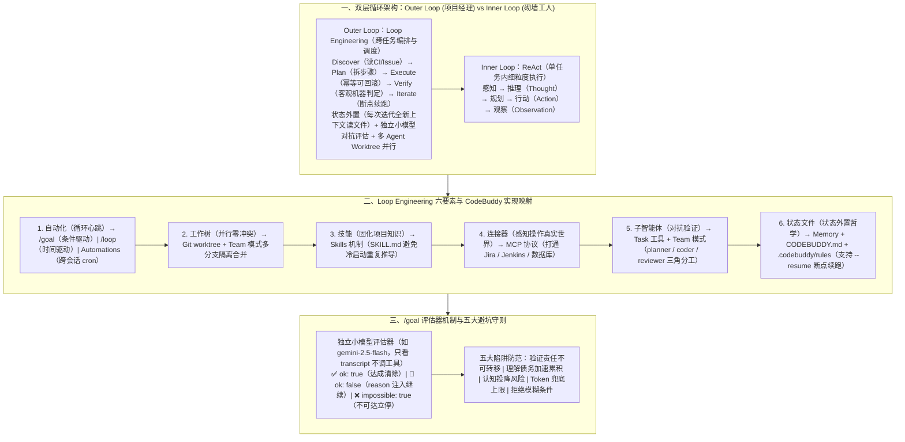

# Loop Engineering 实践指南：在 CodeBuddy 中构建自主循环系统

> **原文信息**：作者 `eliqiao`，发布于 2026-06-22 02:22（广东），公众号「腾讯技术工程」原创。

---

## 1. TL;DR

1. **核心理念与范式定位** —— **Loop Engineering**（由 Google 工程师 Addy Osmani 提出）旨在围绕大模型构建自主循环运行系统，让开发者从循环内部「一问一答」的操作者升级为循环之上的**监督者与目标设定者**（定义「做什么」和「何时算完成」，AI 自主决定「怎么做」）；它与 **ReAct**（Yao et al., 2022）不是替代关系而是 **Outer Loop（项目经理：跨任务编排/状态外置/对抗验证）包裹 Inner Loop（砌墙工人：单任务内思考-行动-观察）** 的双层嵌套演进。
2. **补齐 ReAct 四大局限的六要素架构** —— 遵循 **`Discover → Plan → Execute → Verify → Iterate`** 五阶段闭环，通过六大要素补齐 ReAct 短板：① **自动化（循环心跳）**；② **工作树（`git worktree` 并行零冲突隔离）**；③ **技能（`SKILL.md` 固化项目知识防冷启动）**；④ **连接器（MCP 打通 Jira/Jenkins 等真实工具链）**；⑤ **子智能体（拆写与审形成对抗验证）**；⑥ **状态文件（状态外置哲学：每轮迭代从全新上下文窗口启动，从 `Memory / CODEBUDDY.md / Rules` 读取进度，彻底根治长窗口遗忘与漂移）**。
3. **CodeBuddy 三大循环驱动机制** ——
   - **`/goal`（条件驱动的持续工作，心跳）**：设置不超 **4000 字符**的可验证条件（含可度量终态、可证明方式、不可破坏约束及 `or stop after N turns` 兜底上限），每轮结束后由**独立小模型评估器（如 `gemini-2.5-flash`，只看 transcript 不调工具）**输出三态裁定（`ok: true` / `ok: false` 注入 `reason` / `ok: false, impossible: true`）。
   - **`/loop`（时间驱动的会话级循环，时钟）**：最小间隔 **1 分钟**、单会话上限 **50 个任务**、**3 天**自动过期、仅在会话空闲时触发且需手动取消。
   - **`Automations`（跨会话持久化定时任务）**：支持 `Recurring`（按 cron 规则如 `FREQ=HOURLY;INTERVAL=1`）与 `Once` 单次触发。
4. **六大工程实战模板** —— 涵盖 `/goal` 旧认证模块迁移（`auth/legacy` 零残留 + 30 轮上限）、`/loop 2m` 监控并自动修复分支 CI、Team 模式 `planner / coder / reviewer` 三角对抗验证、`skills/project-conventions` 固化架构约定、MCP 串联 Jira 与 Jenkins 跑通 Bug 闭环、以及 `.codebuddy/rules`（硬约束如单 PR $\le 300$ 行）+ `Memory`（跨会话记住 `step 3 → step 4` 断点）。
5. **警惕三大人类认知陷阱** —— 无人值守的循环也是无人值守地犯错，必须防范**验证责任转移**（Loop 绝不代替人工 Code Review）、**理解债务加速累积**（代码库真实状态与开发者理解鸿沟扩大）以及**认知投降风险**（停止独立判断盲目接受 AI 变更）。

---

## 2. 问题定义与背景

### 2.1 为什么要从 ReAct 走向 Loop Engineering？

在传统「一问一答」式 AI 辅助开发中，**人成了循环的瓶颈**。而单纯依靠 2022 年提出的 **ReAct（Reasoning + Acting）** 范式跑长程任务时，会撞上四大结构性局限：
1. **上下文窗口有限，长任务必然遗忘**：在同一窗口内跨越几十步操作后，早期信息被压缩或遗忘；
2. **自我检查存在确认偏误**：同一个模型既写代码又查代码，天然觉得「我写的当然没问题」；
3. **没有跨任务的进度跟踪**：中途崩溃只能从头再来；
4. **缺少并行编排能力**：单 Agent 串行执行，无法同时推进多子任务。

**Loop Engineering（AI 编程第三次革命）** 在 `Prompt Engineering（怎么问）→ ReAct（怎么做，Inner Loop）` 之上增加了 **`怎么管（Outer Loop）`**：将模型作为执行者、Loop 作为控制中枢、规则框架作为边界约束（类比传统工程学 **PDCA 循环**），使开发者角色从「提示词工程师」升级为「AI 系统架构师」。

---

## 3. 知识框架

---

## 4. 核心内容拆解

### 4.1 ReAct 与 Loop Engineering 的深度对比（8 维对照）

| 维度 | ReAct（Inner Loop · 工人砌墙） | Loop Engineering（Outer Loop · 项目经理盖楼） |
| :--- | :--- | :--- |
| **关注层次** | 单次任务的执行过程 | 跨任务的编排与调度 |
| **循环粒度** | 细粒度（单步工具调用） | 粗粒度（整个任务周期） |
| **状态管理** | 依赖上下文窗口内记忆（长任务必遗忘） | **状态外置到文件/数据库，每次迭代全新上下文** |
| **停止条件** | 模型自己判断「做完了」 | **独立评估器**验证可度量条件是否满足 |
| **验证机制** | 自我检查（同一模型，易产生确认偏误） | **对抗验证**（不同模型 / 独立评估器 / 角色分离） |
| **错误恢复** | 在同一上下文内重试 | **断点续跑**（`--resume`），可跨会话恢复 |
| **并行能力** | 单 Agent 串行 | **多 Agent 并行 + `git worktree` 工作树隔离** |
| **运行周期** | 单次对话 | 可持续数小时甚至数天 |

---

### 4.2 CodeBuddy 中的三大循环驱动原语

#### （1）`/goal` —— 条件驱动的持续工作（Loop 的心跳）
- **核心机制**：用户设定一个可验证的完成条件（硬性限制**不超过 4000 字符**），支持交互式或非交互式 headless 运行（`codebuddy -p "/goal ..."`），未完成任务可通过 `--resume` 断点恢复。
- **写好 `/goal` 条件的四大要素（以 `auth/legacy` 模块迁移为例）**：
  1. **可度量的终态**：`all tests in test/auth pass`（拒绝「代码质量提升」等主观描述）；
  2. **可证明方式**：`` `npm run build` exits 0 `` 或 `` `git status` is clean ``；
  3. **不可破坏的约束**：`no file in auth/legacy is imported anywhere` / `no other test file is modified`；
  4. **兜底上限（防无限烧 Token）**：`or stop after 20 turns`（或 `30 turns`）。
- **独立小模型对抗评估机制**：
  - 每轮结束后，由独立的小模型评估器（如 **`gemini-2.5-flash`**，速度快、成本低，**只看 transcript 不调用任何工具**，与执行主模型分离形成天然对抗验证）输出三态结果：
    - `✅ ok: true`：条件全部满足，清除 goal，UI 显示 `✔ Goal achieved`；
    - `🔄 ok: false`：条件未满足，将未达标 `reason` 注入 history，继续下一轮；
    - `❌ ok: false, impossible: true`：判定目标不可达，立即清除 goal 终止循环。

#### （2）`/loop` —— 时间驱动的会话级循环（Loop 的时钟）
- **适用场景**：持续监控与巡检（如 `/loop 2m 检查当前分支的 CI 状态，如果失败了查看日志并尝试修复`、`/loop 30m 帮我运行一次单元测试`、`/loop 1h 看一下有没有新的 PR 需要我审查`）。
- **五大运行特性**：① **最小间隔 1 分钟**；② **每会话上限 50 个任务**；③ **3 天后自动过期清除**；④ **会话级生命周期**（退出会话后消失，且不会自动停止，CI 通过后需手动发指令取消）；⑤ **仅在会话空闲时触发**。

#### （3）`Automations` —— 跨会话的持久化定时任务
- **适用场景**：不随会话退出而消失的长期监控（如每日构建检查、每周代码审查汇总），支持 **`Recurring`**（按 cron 规则重复，如 `FREQ=HOURLY;INTERVAL=1`）和 **`Once`**（指定时间点一次性触发）。

---

### 4.3 状态外置、对抗验证与五大常见陷阱

1. **状态外置哲学（`.codebuddy/rules` + `Memory` + `CODEBUDDY.md`）**：
   - **`.codebuddy/rules`**：存放每次启动必读的硬性约束（如「数据库查询必须用参数绑定」「修改 API 必须同步更新 OpenAPI 文档」「每个 PR 不超过 **300 行**变更」）。
   - **`Memory`**：记录跨会话偏好与进度断点（如「偏好 `pytest` 而非 `unittest`」「Python 3.11 类型注解完整」「上次重构到 `step 3`，下次从 `step 4` 开始」），使每次迭代都能从干净的全新上下文窗口启动。
2. **Team 模式三角分工对抗验证**：
   - 针对复杂重构创建 Team，生成 **`planner`**（分析代码库制定方案）、**`coder`**（执行修改）、**`reviewer`**（独立审查结果），其中 `planner` 与 `reviewer` 使用不同模型或指令视角，破除单 Agent 自我检查盲区。
3. **必须规避的五大工程与认知陷阱**：
   - **陷阱 1（验证责任不可转移）**：「无人值守的循环也是无人值守地犯错」，关键变更仍需人工审查，Loop 绝不代替人工 Code Review。
   - **陷阱 2（理解债务加速累积）**：代码库真实状态与开发者头脑理解之间的鸿沟会随自主循环加速扩大，必须定期 Review AI 变更。
   - **陷阱 3（认知投降风险）**：开发者极易停止独立判断、系统给什么就接受什么，必须把 AI 当协作者而非权威，质疑每个变更。
   - **陷阱 4（Token 成本失控）**：必须强制加 `stop after N turns` 并使用小模型评估器。
   - **陷阱 5（条件模糊导致无效循环）**：条件必须写成「AI 自己的输出能证明」的客观形式。

---

## 5. 数据速查表

| 指标 | 原文数值 | 语境 / 条件 |
| :--- | :--- | :--- |
| Loop Engineering 核心阶段数 | **5 阶段闭环** | `Discover → Plan → Execute → Verify → Iterate` |
| Loop Engineering 构建体系要素数 | **6 大要素** | 自动化、工作树、技能（`SKILL.md`）、连接器（MCP）、子智能体、状态文件 |
| `/goal` 条件文本长度硬上限 | **不超过 4000 字符** | CodeBuddy 中 `/goal` 命令的条件字符数限制 |
| `/goal` 兜底轮次示例值 | **`stop after 20 turns` / `30 turns`** | 防止条件无法满足时无限循环消耗 Token |
| `/goal` 独立评估器示例模型與状态数 | **`gemini-2.5-flash` / 3 态结果** | 只看 transcript 不调工具，输出 `ok: true` / `ok: false` / `impossible: true` |
| `/loop` 最小触发间隔 | **1 分钟** | 示例包括 `/loop 2m`、`/loop 3m`、`/loop 30m`、`/loop 1h` |
| `/loop` 单会话任务数上限与过期时间 | **每会话上限 50 个任务 / 3 天后自动清除** | 会话级生命周期，退出后消失，仅在会话空闲时触发 |
| `.codebuddy/rules` 单 PR 变更行数示例 | **不超过 300 行变更** | 实践 6 中定义的硬性代码提交约束示例 |

---

## 6. 踩坑与教训 / 可迁移的设计原则

| 错误做法 | 失败表现或原因 | 原文应对 |
| :--- | :--- | :--- |
| 仅靠单窗口 ReAct 跑数十步的跨模块长任务，把所有进度留在对话历史里 | 上下文窗口迅速膨胀触发有损压缩，模型遗忘早期约束，且中途崩溃只能从头再来 | 践行**状态外置哲学**：用 `Memory`、`CODEBUDDY.md`、`.codebuddy/rules` 将进度与约束落盘，每轮迭代从全新上下文窗口启动并支持 `--resume` |
| 让同一个模型在单次循环里既写代码又自己判断「测试过了、任务完成了」 | 产生严重的确认偏误（「我写的代码当然没问题」），出现假完成或带着隐蔽缺陷过关 | 引入**双层对抗验证**：`/goal` 用独立小模型（如 `gemini-2.5-flash`）只读 transcript 判分；Team 模式拆分为 `planner / coder / reviewer` 三角分工 |
| 将 `/goal` 的完成条件写成「提升代码质量」「优化模块结构」等主观描述，且不设轮次上限 | 评估器无法客观判定，导致 AI 在原地反复尝试直至烧光 Token | 严格遵循 `/goal`  checklist：**可度量终态 + 明确验证命令（如 `exits 0`）+ 不可破坏约束 + `or stop after N turns` 兜底上限** |
| 开启 `/loop` 定时监控修复 CI 后放任不管 | `/loop` 是时间驱动机制，即使 CI 已经修复通过也不会自动停止，会在空闲时持续触发直到 3 天过期 | 在确认 CI 通过后，必须显式发送指令手动取消对应的 `/loop` 定时任务 |
| 放任自主循环长期无人值守运行，开发者不看 diff 直接合并 | 引发**理解债务加速累积**（开发者不再懂自己的代码库）与**认知投降风险**（盲目信任 AI 权威） | 坚守「验证责任不可转移」底线，定期人工 Review AI 变更，把 AI 当协作者而非免检权威 |

---

## 7. 记忆锚点

1. **双层循环金句**：「**ReAct 是砌墙工人（Inner Loop，管单步怎么做），Loop Engineering 是项目经理（Outer Loop，管跨任务做什么、谁来做、何时停、怎么续）**。」
2. **CodeBuddy 六件套比喻**：
   - **`/goal` 是心跳**（条件驱动，独立小模型 `gemini-2.5-flash` 三态判分，上限 4000 字符）；
   - **`/loop` 是时钟**（时间驱动，最小 1 分钟、上限 50 个、3 天过期）；
   - **`Skills` 是知识**（固化规范防冷启动）；
   - **`MCP` 是触手**（连 Jira / Jenkins）；
   - **`Team 模式` 是分身**（`planner / coder / reviewer` 对抗验证 + `git worktree` 隔离）；
   - **`Rules + Memory` 是记忆**（状态外置，每轮全新上下文启动）。

---

## 8. 复习卡片

1. 什么是 Loop Engineering，它与 Yao et al. (2022) 提出的 ReAct 范式是什么关系？::Loop Engineering（由 Addy Osmani 提出）是围绕大模型构建自主循环运行系统，让人从循环内的操作者转变为循环上的监督者与目标设定者；ReAct 是单任务内「思考→行动→观察」的 Inner Loop（如砌墙工人），而 Loop Engineering 是包裹在 ReAct 之上的 Outer Loop（如项目经理），遵循 `Discover → Plan → Execute → Verify → Iterate` 负责跨任务编排、状态外置与对抗验证。
2. ReAct 在处理长链路复杂任务时有哪四大局限，Loop Engineering 分别如何补位？::① 上下文窗口有限导致长任务遗忘 → 用「状态外置」补位（每轮从全新上下文启动并读持久化文件）；② 自我检查存在确认偏误盲区 → 用「对抗验证」补位（不同模型/角色分离评估）；③ 无跨任务进度跟踪 → 用「断点续跑（`--resume`）」补位；④ 单 Agent 串行缺少编排 → 用「多 Agent 并行 + `git worktree` 隔离」补位。
3. 在 CodeBuddy 中编写 `/goal` 条件时必须包含哪四个关键要素，它的评估机制是如何工作的？::四个要素是：① 可度量的终态（如测试通过）；② 可证明方式（如 `` `npm run build` exits 0 ``）；③ 不可破坏的约束（如不修改其他测试文件）；④ 兜底轮次上限（`or stop after N turns`，且总条件不超 4000 字符）。每轮结束后由独立小模型评估器（如 `gemini-2.5-flash`，只看 transcript 不调工具）输出 `ok: true`、`ok: false`（注入 reason 继续）或 `impossible: true` 三态结果。
4. CodeBuddy 中的 `/goal`、`/loop` 和 `Automations` 三种循环机制在触发方式、生命周期和适用场景上有何区别？::`/goal` 在上一轮结束后立即触发下一轮，由评估器确认条件满足时停止，适合迁移/重构等有明确终态的工作；`/loop` 按时间间隔触发（最小 1 分钟、每会话上限 50 个、3 天自动过期、仅空闲时触发且需手动取消），属会话级生命周期，适合 CI 巡检；`Automations` 按 cron 规则或指定时间点触发，跨会话持久化保存，适合长期定期监控。
5. 实施 Loop Engineering 时必须警惕哪三大人类认知与工程风险？::① 验证责任不可转移（「无人值守的循环也是无人值守地犯错」，Loop 不能代替人工 Code Review）；② 理解债务加速累积（代码库真实状态与开发者认知的鸿沟随循环加速扩大，需定期 Review）；③ 认知投降风险（开发者停止独立判断盲目接受系统输出，必须坚持质疑每个变更）。

---

## 9. 知识关联

- **已有主题**：[Agent工程循环](../../20_topics/Agent%E5%B7%A5%E7%A8%8B%E5%BE%AA%E7%8E%AF.md) · [Agent任务恢复](../../20_topics/Agent%E4%BB%BB%E5%8A%A1%E6%81%A2%E5%A4%8D.md) · [Agent长期记忆](../../20_topics/Agent%E9%95%BF%E6%9C%9F%E8%AE%B0%E5%BF%86.md) · [Harness与模型协同](../../20_topics/Harness%E4%B8%8E%E6%A8%A1%E5%9E%8B%E5%8D%8F%E5%90%8C.md) · [Agent评测与反馈](../../20_topics/Agent%E8%AF%84%E6%B5%8B%E4%B8%8E%E5%8F%8D%E9%A6%88.md)
- **候选新主题**：[[Inner与Outer双层循环]] · [[状态外置哲学]] · [[理解债务与认知投降]]

---

## 10. 原文参考资料

1. **核心理论出处**：Google 工程师 **Addy Osmani** 提出的 `Loop Engineering` 范式；**Yao et al. (2022)** 提出的 `ReAct (Reasoning + Acting)` 范式；传统工程学 `PDCA (Plan-Do-Check-Act)` 循环。
2. **CodeBuddy 工具链与评估模型**：CodeBuddy（`/goal`、`/loop`、`Automations`、`Team 模式`、`Skills`、`MCP`、`.codebuddy/rules`、`Memory`）及评估器示例模型 `gemini-2.5-flash`。

> [!note]- 校对报告
> - **校对状态**：已根据 `MD.md` 全文（共 12 页 PDF 转写文本）逐一核对。
> - **核心数据与事实页码溯源**：
>   - Addy Osmani 提出 Loop Engineering、PDCA 类比（模型是执行者、Loop 是控制中枢、规则框架是边界约束）、Yao et al. (2022) ReAct、Inner Loop vs Outer Loop 图解与 8 维对比表、工人砌墙 vs 项目经理盖楼类比、ReAct 四大局限与补位：见 PDF 第 1–4 页。
>   - `Discover → Plan → Execute → Verify → Iterate` 五阶段表、双层循环模型、六要素构建体系表、状态外置哲学：见 PDF 第 4–5 页。
>   - CodeBuddy 三大机制：`/goal`（语法、三大条件要素、独立小模型评估器 `gemini-2.5-flash` 只看 transcript 不调工具、三态结果）、`/loop`（最小间隔 1 分钟、每会话上限 50 个任务、3 天自动过期、会话级生命周期、空闲触发）、`Automations`（`Recurring` `FREQ=HOURLY;INTERVAL=1` 与 `Once`）：见 PDF 第 5–7 页。
>   - 六要素在 CodeBuddy 中的映射表与 6 个实践案例（`auth/legacy` 模块迁移 `stop after 30 turns`、`/loop 2m` CI 监控、Team 模式 `planner/coder/reviewer`、`project-conventions` Skill、Jira/Jenkins MCP、`.codebuddy/rules` 单 PR 不超 300 行 + `Memory` 记录 `step 3 → step 4`）：见 PDF 第 7–10 页。
>   - `/goal` 5 条 checklist（含不超过 4000 字符硬限制）、五大常见陷阱表（验证责任不可转移、理解债务加速累积、认知投降风险、Token 成本约束、条件模糊）与六件套比喻总结：见 PDF 第 10–11 页。
