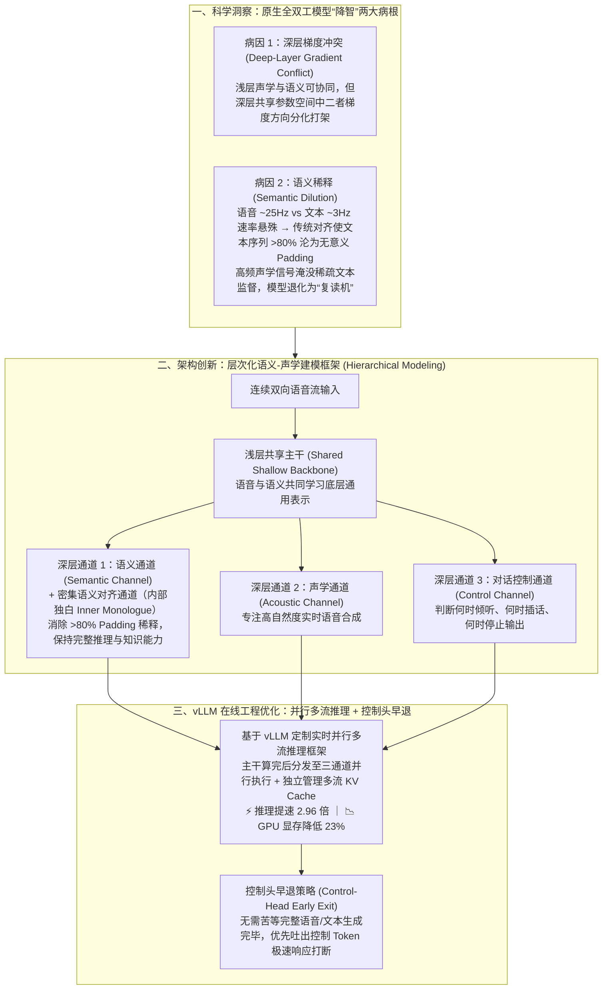

# 腾讯 PCG 联合深圳河套学院：在全双工语音大模型领域取得重要突破，获 ACL 2026 杰出论文奖

## 1. TL;DR — 核心结论速览

1. **斩获 ACL 2026 杰出论文奖（获奖率仅 `0.15%`）**：腾讯 PCG 技术线-AI 创新应用中心联合深圳河套学院（张民教授、户保田教授团队）与香港中文大学（深圳）（李海洲教授团队）研发的原生端到端全双工语音大模型 **`Lychee-FD`**，从 ACL 2026 逾 **`12,148` 篇**投稿中脱颖而出，成为全场仅有的 **`18` 篇杰出论文（Outstanding Paper）**之一。
2. **首次从优化机理上揪出原生全双工语音模型“降智”的两大病根**：
   - **病因一：深层梯度冲突（Deep-Layer Gradient Conflict）**——浅层网络中语音与文本目标尚能协同，但进入深层参数空间后，声学建模与语义推理的优化方向开始分化对抗（如同让人同时背诵诗词和解数学题）。
   - **病因二：语义稀释（Semantic Dilution）**——语音信号频率（约 **`25Hz`**）远高于文本语义频率（约 **`3Hz`**），传统对齐方式需插入海量填充符，导致文本序列中 **`80%` 以上都是无意义的 `padding` token**，稀疏的语义监督被高频声学信号彻底淹没。
3. **架构破局——“浅层共享主干 + 深层三通道解耦 + 密集语义对齐（内部独白）”**：`Lychee-FD` 在浅层共享主干共同理解输入，在深层拆分为 **语义通道、声学通道、对话控制通道** 各司其职，并引入 **密集语义对齐通道（Inner Monologue 内部独白）** 维持连续清晰的语义线索；在 `Spoken QA` 上平均提升 **`7.4%`**，在 `FullDuplexBench 1.5` 上平均提升 **`28.5%`**。
4. **推理工程破局——基于 `vLLM` 定制实时并行多流推理框架与“控制头早退”**：共享主干计算后将中间表示分发至多通道并行执行并独立管理多流 KV Cache，相比基础框架实现 **`2.96 倍` 推理加速**、**GPU 显存占用降低 `23%`**；同时通过 **控制头早退策略（Control-Head Early Exit）** 让打断/停说控制 Token 抢先输出，打通毫秒级打断响应快车道。

---

## 2. 背景与问题：为什么过去的语音 AI 总像“对讲机”？

### 2.1 “级联拼凑式全双工” vs “原生端到端全双工”

| 方案范式 | 架构实现方式 | 核心痛点与天花板 |
| :--- | :--- | :--- |
| **传统轮次式语音交互** | `ASR（听完转文字）→ LLM（思考生成）→ TTS（合成播报）` | 呆板的“一问一答、听完再说”，无法处理日常对话中的抢话、附和与情绪停顿 |
| **系统级级联全双工** | 在传统链路外挂独立的 VAD 打断检测、状态判断与流程调度模块 | 听、想、说、控节奏被拆散在四个割裂模块中，不仅跨模块延迟高、轮次切换生硬，且外挂状态机无法真正理解语义语境 |
| **`Lychee-FD` 原生端到端全双工** | 将**持续倾听、语义理解、语音生成、对话节奏控制**统一内化进单个大模型架构内部 | 具备三大原生类人交互模式：**① 听说并行**（如争吵抢话）、**② 边听边应**（倾听烦恼时实时附和并整理信息）、**③ 边说边判**（哄睡讲故事时确认用户睡着后自主静音关闭） |

---

## 3. 知识框架 — `Lychee-FD` 病因诊断、层次化解耦架构与 vLLM 多流推理图

---

## 4. 核心技术突破拆解

### 4.1 科学洞察：为什么端到端语音大模型一做全双工就“变笨”？

过去学术界与工业界普遍困惑：为什么把聪明的大语言模型改成端到端全双工语音模型后，它的逻辑推理和知识问答能力就会断崖式下跌（即“降智”）？`Lychee-FD` 首次从训练优化动力学给出了定量解释：
1. **空间维度的“深层梯度冲突”**：
   - 通过细粒度追踪各层梯度动态发现：在 Transformer 的**浅层网络**，声学特征提取与文本语义理解具有共性，梯度方向基本兼容；
   - 但越往**深层网络**走，负责发音细节的声学目标与负责抽象逻辑的语义目标开始剧烈分化甚至反向拉扯。强行让两者共享同一套深层权重，就像逼同一个大脑区域同时背诵诗词和推导微积分，必然两败俱伤。
2. **时间维度的“语义稀释（`25Hz` vs `3Hz`）”**：
   - 语音编码 Token 的帧率约为 **`25Hz`**（每秒约 25 个声学单元），而人类说话对应的文本语义 Token 速率仅约 **`3Hz`**（每秒约 3 个词/字）。
   - 为了在时间轴上把声学流与文本流一帧一帧对齐，传统方案必须在文本流里塞入海量的空白填充符（`padding`），导致**文本序列中超过 `80%` 都是毫无信息量的 `padding` token**！
   - 在梯度反传时，稀疏的 `~3Hz` 文本语义信号被高频的 `~25Hz` 声学信号与满屏 `padding` 彻底冲淡，模型逐渐沦为“只会模仿腔调、忘了逻辑内容”的空壳。

---

### 4.2 架构创新：层次化解耦与“内部独白（Inner Monologue）”

针对上述两大病根，`Lychee-FD` 提出了**层次化语义-声学建模框架（Hierarchical Acoustic-Semantic Modeling）**：
1. **浅层合、深层分（Modality Separation）**：
   - **浅层共享主干**：保留共享 Transformer 层，让模型统一吸收音频与语义上下文；
   - **深层三通道解耦**：在深层将网络拆分为 **语义通道（保智商）**、**声学通道（保音质）** 与 **对话控制通道（保节奏）**，从物理结构上消除深层梯度打架。
2. **密集语义对齐通道（内部独白 Semantic Coherence）**：
   - 为攻克 `>80%` Padding 带来的语义稀释，引入专门的**密集语义对齐通道**——让模型在实时向外输出高频语音流的同时，在内部维护一条紧凑、无冗余填充、连续不断的**“内部独白（Inner Monologue）”语义线索**，从而牢牢锁住长程对话的逻辑一致性。
3. **基准评测表现**：
   - 在考察语音知识问答的 **`Spoken QA`** 任务上平均提升 **`7.4%`**；
   - 在权威全双工评测基准 **`FullDuplexBench 1.5`** 上平均提升高达 **`28.5%`**；
   - 在 **3 个全双工语音交互基准的 10 个细分指标**上全面达到当前业界领先（SOTA）水平。

---

### 4.3 推理基建创新：基于 `vLLM` 的并行多流框架与控制头早退

由于模型深层拆成了语义、声学、控制多个分支通道，若按传统单流自回归方式串行推理，延迟将无法满足实时通话要求。团队在 **vLLM** 底座上完成了两项关键改造：
1. **实时并行多流推理框架（`2.96x` 提速 / `-23%` 显存）**：
   - 当输入流经浅层共享主干完成计算后，推理引擎立即将中间隐状态（Hidden States）分发至深层的语义、声学、控制通道**并行执行计算**，并在底层为不同通道**独立管理多流 KV Cache**。
   - 实测相比基础推理框架实现了 **`2.96 倍` 的吞吐/延迟提速**，同时将 **GPU 显存占用降低了 `23%`**。
2. **控制头早退策略（Control-Head Early Exit）**：
   - 在真实对话中，“用户突然插话，AI 需要立刻闭嘴转入倾听”这一动作只依赖**对话控制信号**，根本不需要等当前步的完整语音波形和文本全部解码完。
   - 系统设计了**控制头早退机制**——让控制通道的 Token 在每个时间步抢先产出并直接触发状态切换，为打断响应开辟了一条零等待的“硬件级快车道”。

---

## 5. 数据速查表

| 指标 | 原文数值 | 语境 / 条件 |
| :--- | :--- | :--- |
| **ACL 2026 投稿总数与主会录用率** | **共收到投稿 `12,148`（逾 1.2 万）篇 / 主会录用率约 `19%`** | 第 64 届国际计算语言学协会年会（CCF-A / CORE-A 顶会） |
| **ACL 2026 杰出论文奖数量与获奖率** | **全场仅 `18` 篇 / 获奖率仅 `0.15%`** | `Lychee-FD` 论文斩获大会最高荣誉之一 |
| **语音与文本频率差及 Padding 占比** | **语音约 `25Hz` vs 文本约 `3Hz` $\to$ 文本序列 `> 80%` 为无意义 Padding** | 揭示传统全双工模型发生“语义稀释”导致降智的定量根因 |
| **`Spoken QA` 语音问答基准提升幅度** | **平均提升 `+7.4%`** | 验证模型在全双工交互下有效保持了语义理解与知识推理能力 |
| **`FullDuplexBench 1.5` 全双工基准提升** | **平均提升 `+28.5%`** | 在 3 个全双工语音交互基准的 **10 个指标**上达到领先水平 |
| **定制 vLLM 并行多流推理框架收益** | **推理提速 `2.96 倍` / GPU 显存占用降低 `23%`** | 浅层主干共享 + 深层三通道并行执行 + 多流 KV Cache 独立管理 |

---

## 6. 踩坑与教训 / 可迁移的设计原则

1. **在传统语音链路外层硬套 VAD 打断检测与调度状态机（系统级全双工） → 听、想、说、控节奏被割裂在不同模块，轮次切换生硬且无法根据语义语境判断“用户是在思考停顿还是说完了” → 走向端到端原生全双工，将对话控制作为与语义、声学并列的原生模型通道**
   - **可迁移原则**：实时多模态交互中的“节奏控制（Turn-taking / Barge-in）”高度依赖上下文语义（例如哄睡场景识别呼吸/沉默），不应外包给无语义感知的纯声学阈值检测器。
2. **让快慢悬殊的异构模态（`25Hz` 声学 vs `3Hz` 文本）在全部网络层共享参数并靠 `Padding` 硬对齐 → 深层梯度互相拉扯打架，且文本流 `>80%` 被 Padding 稀释导致严重降智 → 采用“浅层共享主干 + 深层按模态/职责分流通道 + 内部独白密集语义对齐”**
   - **可迁移原则**：在任何**多模态、多频率联合生成模型**（如语音+文本、视频帧+动作指令）中，当不同模态的帧率相差数倍且抽象层级不同时，应遵循**“浅层融合感知、深层解耦生成、慢模态维护密集内部独白流（Dense Inner Stream）”**的架构范式。
3. **多分支解耦模型直接扔进单流推理框架跑 + 等所有分支算完才响应控制动作 → 显存冗余且打断延迟高 → 在 vLLM 中实现“主干共享 + 多流并行 KV Cache 分管（提速 `2.96x`、省显存 `23%`）”并引入“控制头早退（Early Exit）”**
   - **可迁移原则**：模型架构的“分叉结构（Branching）”必须与推理引擎的 **KV Cache 树状/多流复用** 协同设计；且对延迟极度敏感的**控制信号（Stop / Interrupt）应设置浅层/前置早退出口**。

---

## 7. 记忆锚点 — 一句话 / 一张图记住全文

- **一句话锚点**：**ACL 2026 杰出论文（`0.15%` 获奖率）`Lychee-FD` 揪出了全双工语音模型降智的两大真凶——“深层声学与语义梯度打架”和“`25Hz` 语音对 `3Hz` 文本造成的 `>80%` Padding 语义稀释”，并用“浅层共享 + 深层三通道解耦 + 内部独白密集对齐”配合 `vLLM` 多流并行推理（提速 `2.96x`、省显存 `23%`、控制头早退）实现了既聪明又能秒级自然打断的原生全双工语音交互。**
- **核心因果链公式**：
  $$\left.\begin{array}{l}\text{深层梯度冲突}\\\text{25Hz vs 3Hz (}>80\%\text{ Padding 稀释)}\end{array}\right\} \xrightarrow{\text{层次化解耦 + 内部独白}} \text{SpokenQA }+7.4\% \;/\; \text{FullDuplexBench }+28.5\% \xrightarrow{\text{vLLM 多流 + 早退}} 2.96\times\text{ 提速} \;/\; -23\%\text{ 显存}$$

---

## 8. 复习卡片（Spaced Repetition）

1. 原生端到端全双工语音大模型长期难以兼顾“交互自然度”与“语义聪明度（降智）”的两大根本原因是什么？::① **深层梯度冲突**：浅层网络中语音与文本目标尚能协同，但进入深层共享参数空间后，声学建模与语义推理的优化方向开始分化对抗；② **语义稀释**：语音信号频率（约 `25Hz`）远高于文本语义频率（约 `3Hz`），传统对齐需填充大量空白符，导致文本序列中 `80%` 以上都是无意义的 `padding` token，稀疏语义监督被高频声学信号淹没。
2. `Lychee-FD` 提出的“层次化语义-声学建模框架”是如何解决深层梯度冲突与语义稀释的？::采用“浅层合、深层分”设计：在浅层保留共享主干共同理解输入；在深层将网络拆分为**语义通道、声学通道、对话控制通道**三个专门通道各司其职；同时引入**密集语义对齐通道（内部独白 Inner Monologue）**，让模型在生成高频语音的同时维持清晰连续的内部语义线索。
3. 相比在传统语音链路外挂打断检测模块的“系统级全双工”，`Lychee-FD` 展示了哪三种典型的原生全双工交互模式？::① **听说并行**（如双方同时说话/争吵时的双向同步感知与回应）；② **边听边应**（单向倾听用户倾诉烦恼的同时给出实时附和反馈并整理信息）；③ **边说边判**（如讲故事哄睡时边说边感知用户状态，确认用户睡着后自主停止并关闭）。
4. 为了让多通道架构在生产环境中实时运行，团队对 `vLLM` 推理底座做了哪两项关键改造？取得了什么量化收益？::① 开发**实时并行多流推理框架**：在共享主干计算完成后将中间表示分发至语义、声学、控制通道并行执行，并分别管理多流 KV Cache，实现 **`2.96 倍` 提速**并**降低 `23%` GPU 显存占用**；② 提出**控制头早退策略（Control-Head Early Exit）**：无需等待完整语音和文本生成结束，让控制 Token 更早产出，为打断响应提供快速通道。
5. `Lychee-FD` 在核心评测基准上的提升幅度以及在 ACL 2026 上的获奖含金量如何？::在 `Spoken QA` 上平均提升 `7.4%`，在 `FullDuplexBench 1.5` 上平均提升 `28.5%`（在 3 个基准的 10 个指标上达 SOTA）。在 ACL 2026 共 `12,148` 篇投稿中（主会录用率约 `19%`），斩获全场仅 `18` 篇的大会杰出论文奖（Outstanding Paper，获奖率仅 `0.15%`）。

---

## 9. 知识关联

- **对应知识库主题笔记**：[模型架构与训练](../../20_topics/%E6%A8%A1%E5%9E%8B%E6%9E%B6%E6%9E%84%E4%B8%8E%E8%AE%AD%E7%BB%83.md) · [模型与开发工具发布](../../20_topics/%E6%A8%A1%E5%9E%8B%E4%B8%8E%E5%BC%80%E5%8F%91%E5%B7%A5%E5%85%B7%E5%8F%91%E5%B8%83.md)
- **同批相关文章双链**：
  - [[AI_大模型输出确定性]]（同为深入底层算子与 vLLM 推理引擎的 AI Infra 优化实践）
  - [[AI_腾讯具身模型与Tairos]]（可对比具身智能体 `Apexio` 中多频率异步感知控制与本文语音模型 `25Hz` 声学 / `3Hz` 语义 / 控制头早退的异构频率协同设计）
  - [[AI_Hy4 preview 发布说明]]（可对比腾讯多模态与基座大模型矩阵的演进）

---

## 10. 原文参考资料

- **原文标题**：《腾讯 PCG 联合深圳河套学院：在全双工语音大模型领域取得重要突破，获 ACL 2026 杰出论文奖》
- **联合研发团队**：腾讯 PCG 技术线-AI 创新应用中心、深圳河套学院 AI 训练平台张民教授与户保田教授立知大模型团队、香港中文大学（深圳）李海洲教授团队
- **发布时间**：2026-07-16
- **获奖论文信息**：
  - **论文题目**：*Hierarchical Acoustic-Semantic Modeling: Modality Separation and Semantic Coherence for Full-Duplex SLMs*（ACL 2026 Outstanding Paper Award）
  - **论文链接**：`https://www.researchgate.net/publication/408700315_Hierarchical_Acoustic-Semantic_Modeling_Modality_Separation_and_Semantic_Coherence_for_Full-Duplex_SLMs`

> [!note]- 校对报告
> - **原文页数核对**：全文共 10 页（第 9–10 页为公众号尾页与留言栏），核心内容位于 p.1–8。
> - **关键事实与页码映射**：
>   - ACL 2026（第 64 届，CCF-A / CORE-A）投稿逾 1.2 万篇（p.8 给出了精确数字 `12,148` 篇，主会录用率约 `19%`），杰出论文（Outstanding Paper）仅 `18` 篇（获奖率 `0.15%`）；联合团队信息与 ResearchGate 论文链接（p.1–2, p.8）。
>   - 传统轮次式交互、GPT-Live 趋势、系统级全双工（外挂打断检测与状态调度模块）的弊端，以及 `Lychee-FD` 原生端到端全双工路线（p.2）。
>   - 三段视频 Demo 展示的三种典型模式（听说并行、边听边应、边说边判如哄睡确认睡着后自我关闭）与 QQ 测试 bot（尔尔）（p.3–5）。
>   - 原生全双工降智的两大根本病因：① 深层梯度冲突（浅层协同、深层分化对抗）；② 语义稀释（语音约 `25Hz` vs 文本约 `3Hz`，传统对齐导致文本序列 `80%` 以上为无意义 `padding`）（p.6–7）。
>   - 层次化语义-声学建模框架：浅层共享主干 + 深层拆分为语义、声学、对话控制通道 + 密集语义对齐通道（内部独白）；在 `Spoken QA` 平均提升 `7.4%`、`FullDuplexBench 1.5` 平均提升 `28.5%`、3 个基准 10 个指标领先（p.7–8）。
>   - 基于 `vLLM` 的实时并行多流推理框架（主干后分发多通道并行执行 + 分别管理多流 KV cache，提速 `2.96 倍`、显存占用降低 `23%`）与控制头早退策略（p.8）。
> - **纠偏与自检说明**：正文、表格、Mermaid 图及复习卡片已严格剔除所有页码标注（`p.X` / `第X页`），所有论文指标、频率数值与加速比均 100% 忠实于原文。
