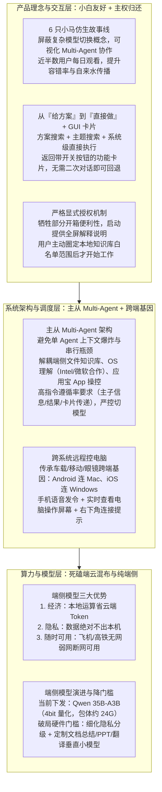

# 上线后差点‘挤爆’服务器，Marvis凭什么让用户追着6只小马‘上班’？

> **原文信息**：受访者 `Eva`（Marvis 产品负责人）、`Nexthy`（Marvis 技术负责人），发布于 2026-07-15 04:11（广东），公众号「腾讯技术工程」原创。

---

## 1. TL;DR

1. **「6 只小马」仿生叙事实现 Agent 平权** —— Marvis 于 5 月 20 日 23:58 上线，发布仅 7–8 小时资源告急、5 月 22 日上午服务器差点被挤爆，近半数用户每天进来看 6 只小马干活；团队通过「牛马办公室」拟人化故事线屏蔽复杂的模型切换概念，将抽象的 Multi-Agent 协作转化为小白可感知的视觉陪伴，显著提升了用户宽容度与自发传播率。
2. **「死磕」端云混布与真·本地模式** —— 区别于纯卷云端大模型的路线，Marvis 押注端云混布与纯端侧执行（当前端侧下发 4bit 量化的 **Qwen 35B-A3B**，包体约 **24G**），具备**经济（省云端 API Token）+ 隐私（数据不出本机）+ 随时可用（飞机/高铁完全断网可用）**三大核心优势；后续通过训练文档总结、PPT 生成、翻译等垂直小模型来降低老电脑硬件门槛。
3. **起步即采用主从 Multi-Agent 架构** —— 因底层整合了端侧文件知识库、Intel/微软操作系统级理解以及应用宝操作 App 的运行能力，若塞进单 Agent 会导致上下文爆炸、任务只能串行且调度混乱；故从零采用主从 Multi-Agent 架构，并严格把控模型指令遵循率（未达标前不轻易开放自由切模型）。
4. **从「告诉你怎么做」到「直接替你做了」+ GUI 卡片安全感** —— 突破纯对话给方案的局限，直接执行系统级设置修改、修电脑、清理 C 盘等动作；并在执行后输出带开关按钮的 **GUI 功能卡片**（如夜间模式/专注模式开关），让用户无需二次对话即可随时手动关停， coupled with **全屏显式白名单授权**，在不可控的 AI 面前把主权交还用户。
5. **跨系统「手机远程控电脑」重构入口形态** —— 依托应用宝团队车载、移动、眼镜端的跨端基因，实现 Android 连 Mac、iOS 连 Windows 的交叉系统连接；用户在高铁、酒店或会场可用手机语音发令并实时查看电脑操作屏幕（右下角带连接提示），将手机变成随时接管家里电脑的第二入口。

---

## 2. 核心问题与文章定位

### 2.1 为什么要写这篇？

市面上大多数 AI 工具仍停留在「云端聊天给方案」或面向极客开发者的命令行形态（如 Codex、Claude Code），普通小白用户在面对系统设置、文件整理或跨设备办公时依然存在极高的操作门槛与隐私顾虑。本文通过对话腾讯应用宝团队孵化的桌面 Agent 产品 **Marvis** 的产品负责人 Eva 与技术负责人 Nexthy，复盘其从 520 上线爆火背后的 10 个核心产品与架构决策：如何在生产力工具中融合情感化设计、端云混布算力博弈、主从多智能体架构、用户主权安全边界以及跨系统远程操控。

---

## 3. 知识框架

---

## 4. 核心内容拆解

### 4.1 情感化外壳与生产力内核：为什么在工具里养「6 只小马」？

1. **意外爆火的时间线与传播效应**：
   - **5 月 20 日 23:58** 正式上线（兑现对内测媒体与用户的 520 承诺，卡在午夜 12 点前发布）；发布仅 **7–8 小时**服务器资源即告急，**5 月 22 日上午**用户量激增差点挤爆服务器，团队紧急协调扩容。
   - 社交平台上用户用手机拍摄电脑里小马干活的视频，单条获赞评上百乃至过万，形成纯自来水传播；近半数用户每天进入产品看 6 只小马干活，甚至主动提需求希望小马在办公室聊八卦、换皮肤、打游戏看直播。
2. **「牛马办公室」背后的产品克制**：
   - **服务于「开箱即用、小白友好、Agent 平权」**：初期刻意拿掉复杂的模型切换等技术概念，用仿生故事线让用户直观理解原本枯燥复杂的 Multi-Agent 协作。
   - **故事线与硬核能力解耦**：团队在前期与公众和媒体的正式沟通中从头到尾未提过「牛马办公室」，而是聚焦设备要求与跨端能力；拟人化设计是拉近距离、提高用户对新产品 Bug 宽容度的情感桥梁。

---

### 4.2 算力路线博弈：为什么在大厂卷云端时「死磕」端云混布？

1. **面向未来的三大端侧核心优势（Nexthy 总结）**：
   - **经济（省 Token）**：直接利用用户电脑本地算力运算，省去高昂的云端大模型 API 调用成本。
   - **隐私（数据不出门）**：针对本地敏感文件处理，完全依靠本机端侧模型干活，数据绝对不出用户本机。
   - **随时可用（无网/弱网/断网）**：在长途飞机或高铁等完全断网环境下依然能用本地模型处理工作，实现「真·本地模式」。
2. **硬件门槛阵痛与垂直小模型破局方案**：
   - **当前配置与痛点**：为保证实际输出效果，当前端侧下发的是 **Qwen 35B-A3B** 模型，经 **4bit 量化**后最终包体约 **24G**，对用户设备的显存、内存和存储有一定门槛，引发部分「吃内存、老电脑跑不动」的反馈。
   - **双轨降门槛方案**：
     1. 跟随端侧基座模型自身的体积缩小与能力演进；
     2. **细化场景隐私切分 + 垂直小模型定制**：查公开信息或改系统设置对隐私要求不高，但处理本地文件强涉隐私；团队正深度合作训练专门针对**文档总结、PPT 生成、翻译**等高频文件场景的多个垂直小 size 模型，在保留效果的同时大幅降低电脑硬件要求。

---

### 4.3 架构抉择：为什么起步就选主从 Multi-Agent 而非单 Agent？

1. **底层能力异构性决定架构形态**：
   - 市面上多数新 Agent 产品初期采用「单一主 Agent + 一个模型不断塞 Skill」，虽然简单快迭代，但 Marvis 是从系统底层能力往上构建的，横跨三大异构领域：**端侧文件知识库**、**与 Intel 及微软合作的系统级 OS 理解能力**、以及**应用宝自身操作 App 的运行能力**。
   - 若将所有领域能力全部塞进单个模型，会导致**上下文爆炸**、**任务只能串行无法并行**、**调度极度复杂**，因此从起步阶段就确立了**主从式 Multi-Agent 架构**。
2. **Multi-Agent 的代价与模型准入控制**：
   - 主从架构对模型的**指令遵循率**要求极高，涉及主子 Agent 之间的信息传递、结果传递与 UI 卡片传递。
   - 由于大模型迭代节奏与 Agent 场景深度耦合，团队**没有轻易放开自由切换模型**，必须先在内部实测市面模型在 Marvis 场景下的效果与质量达标后，才会向用户开放切换选项。

---

### 4.4 交互范式与安全边界：执行力、GUI 卡片与显式白名单授权

1. **从「给方案」到「直接做」**：
   - 传统 AI 面对电脑问题只给文字方案，用户仍需自己翻几层菜单甚至改注册表；Marvis 将「方案搜索 + 主题搜索 + 系统级执行」打通，速度和准确性不逊于 Codex、Claude Code。
   - **真实出圈玩法**：外接显示器画面翻转 180 度一句话修复；电脑卡顿时自动扫描发现「一共 4 个内存卡槽、2 个是空的」，直接建议加内存条并推荐电商平台最高性价比型号；按特定排版格式自动生成文档写小说、选股、做电商等。
2. **GUI 与 ROI 结合给足可控安全感**：
   - 市面同类产品调完夜间模式或专注模式只回一句文字「好，我完成了」；Marvis 会直接弹出**带开关按钮的 GUI 功能卡片**，用户过一会儿想关掉时直接在卡片上点击按钮即可，无需二次跟 AI 对话。
3. **宁可牺牲便利性也要严守「全屏显式授权」**：
   - 原本本地知识库等功能完全在端侧计算，技术上可以直接静默帮用户干完；但测试发现用户在不知情时会产生「怎么没给你授权就处理完了」的恐慌。
   - 团队最终选择牺牲部分「小白免打扰」便利性，改为首次启动提供**全屏解释说明与授权设置**，用户必须自己圈定**白名单范围**并主动点击确认授权后才开始工作，不授权则不启用该部分能力。

---

### 4.5 跨端协同：为什么「手机远程控电脑」不只是个桌面助手？

1. **应用宝团队的跨端技术基因**：
   - 团队此前做过车载、移动端与智能眼镜端，天然具备跨端连接与生态合作基础。
   - Marvis 移动端支持**跨操作系统交叉连接**：**Android 手机可连 Mac 电脑，iOS 手机也可连 Windows 电脑**。
2. **随时接管电脑的随身入口**：
   - 当用户人在高铁、酒店或会议现场，关键文件全在家里电脑上，或担心给电脑发复杂指令后 AI「乱搞」时，可以用手机连上家里电脑，**一边在手机上实时观看电脑操作屏幕，一边语音发指令指挥**，同时电脑桌面右下角常驻「正在连接」提示以便安全管理，真正让手机变成用户的「第二台电脑」。

---

## 5. 数据速查表

| 指标 | 原文数值 | 语境 / 条件 |
| :--- | :--- | :--- |
| Marvis 正式上线时间 | **5 月 20 日 23:58** | 为兑现对内测媒体与用户的 520 承诺，卡在午夜 12 点前发布 |
| 上线后资源告急时间 | **发布后 7–8 小时 / 5 月 22 日上午** | 用户量激增差点挤爆服务器，官方紧急协调扩容 |
| 每日看小马干活的用户占比 | **近半数用户** | 因拟人化情感连接每天进入产品看 6 只小马「上班」的用户比例 |
| 社媒自来水单条互动量 | **点赞评论上百，甚至过万** | 用户拿手机录屏电脑里小马干活发到社交平台的真实自然热度 |
| 当前端侧下发基座模型 | **Qwen 35B-A3B（4bit 量化）** | 为保障端侧实际执行效果所选用的本地大模型规格 |
| 端侧模型量化后包体大小 | **约 24G** | Qwen 35B-A3B 经 4bit 量化后的本地安装包体积 |
| 硬件诊断真实案例参数 | **4 个卡槽、2 个为空（外加 180 度翻转修复）** | Marvis 扫描卡顿电脑识别内存插槽余量并推荐高性价比内存条 |

---

## 6. 踩坑与教训 / 可迁移的设计原则

| 错误做法 | 失败表现或原因 | 原文应对 |
| :--- | :--- | :--- |
| 将文件知识库、OS 系统控制、App 运行操控等异构能力全部塞进单一主 Agent | 导致上下文迅速爆炸，任务只能串行无法并行，调度极其混乱 | 起步即采用**主从式 Multi-Agent 架构**按领域解耦，并针对主子 Agent 间的信息/结果/卡片传递严控模型指令遵循率 |
| 过早向普通用户开放复杂的「自由切换大模型」选项 | 小白用户面对模型参数无所适从，且未适配模型会导致主子 Agent 卡片与结果传递失败 | 初期隐藏模型切换概念，用「6 只小马」仿生故事线实现 Agent 平权；仅在内部实测模型质量达标后才逐步开放切换 |
| 认为端侧计算数据不出本机，就在后台静默扫描并帮用户处理完本地文件 | 用户在不知情下会产生强烈的越权恐慌（「怎么没给你授权就给我处理完了」） | 宁可牺牲开箱便利性，在初始阶段提供**全屏解释说明与授权设置**，强制要求用户自己圈定**白名单范围**并主动确认后才工作 |
| 执行完系统设置修改（如夜间模式/专注模式）后仅返回纯文字「已完成」 | 面对具有不确定性的 AI，用户后续想撤销或关闭时还需二次发消息对话，缺乏掌控感 | 将 **GUI 与 ROI 结合**，在对话流中直接输出带交互开关按钮的**功能卡片**，用户点击卡片开关即可随时一键恢复 |
| 用单一的大尺寸端侧模型（如 24G 包体）硬扛所有本地任务 | 对老旧电脑的显存、内存与存储门槛过高，导致「吃内存、跑不动」吐槽 | 按隐私敏感度切分场景（查信息/改设置 vs 强隐私文件处理），针对文档总结、PPT 生成、翻译等高频场景专门训练**多个垂直小尺寸模型** |
| 向未接触过执行型 Agent 的小白或长辈宣讲「操作系统层级」「端侧模型」等概念 | 概念过于抽象，用户仍将其当成普通聊天问答工具，完全 get 不到核心价值 | 必须用具象的、能直接感知的场景替代技术术语（如对父母说「找孙子照片、修电脑、下真 QQ」，对年轻人说「出差用手机让家里电脑找文件、理桌面」） |

---

## 7. 记忆锚点

1. **端侧模型三字诀**：「**经济（省云端 Token）+ 隐私（数据不出门）+ 随时可用（飞机高铁断网能干活）**」。
2. **产品安全感双保险**：「**事前全屏白名单显式授权**（把主权还给用户）+ **事后带开关按钮的 GUI 功能卡片**（不用二次对话随时一键关停）」。
3. **24G 到垂直小模型的演进路径**：当前 **Qwen 35B-A3B（4bit 量化，24G 包体）** 保下限效果 → 未来按隐私切分 **文档总结 / PPT 生成 / 翻译** 垂直小模型降硬件门槛。

---

## 8. 复习卡片

1. Marvis 为什么在生产力工具里设计「6 只小马（牛马办公室）」的拟人化形象，这与它的实际技术能力有什么关系？::目的是践行「开箱即用、小白友好和 Agent 平权」理念，隐去复杂的模型切换概念，用仿生故事线让用户直观理解复杂的 Multi-Agent 协作并建立情感连接（提升对 Bug 的宽容度与自发分享率）；但故事线与底层硬核能力解耦，对外技术沟通聚焦设备要求与跨端能力。
2. 相比大厂普遍卷云端大模型，Marvis「死磕」端云混布与纯端侧路线有哪些核心优势？::具备「经济 + 隐私 + 随时可用」三大优势：一是利用本地算力省去云端 API Token 成本；二是敏感文件纯本地处理，数据绝对不出本机；三是支持无网、弱网、断网环境（如长途飞机或高铁上）正常执行任务。
3. Marvis 当前下发的端侧模型是什么规格，团队计划如何解决老电脑「吃内存、跑不动」的硬件门槛问题？::当前下发的是经 4bit 量化的 Qwen 35B-A3B 模型，包体约 24G；后续一方面伴随端侧基座模型自身小型化演进，另一方面按隐私要求细分场景，针对强隐私高频文件任务（文档总结、PPT 生成、翻译等）专门训练多个垂直小尺寸大模型。
4. 为什么 Marvis 从一开始就选择主从 Multi-Agent 架构而不是单智能体演进，这带来了什么约束？::因为其底层整合了端侧文件知识库、Intel/微软 OS 系统级理解、应用宝操作 App 三大异构领域能力，塞进单模型会导致上下文爆炸、任务只能串行且调度复杂；主从架构对主子 Agent 间信息、结果和卡片传递的指令遵循率要求极高，因此未测试达标前不轻易开放自由切模型。
5. Marvis 在交互层是如何通过「GUI 卡片」和「授权机制」消除用户对 AI 失控的担忧的？::在执行系统修改（如夜间模式/专注模式）后不只回文字，而是弹出带开关按钮的 GUI 功能卡片供用户随时一键关闭（无需二次对话）；在本地知识库等功能上牺牲部分便利性，启动时弹出全屏说明，强制用户自己圈定白名单范围并主动点击确认后才开始工作。
6. Marvis 的「手机远程控电脑」跨端功能支持哪些系统交叉连接，解决了什么核心痛点？::支持跨操作系统交叉连接（Android 手机连 Mac、iOS 手机连 Windows）；让用户在高铁、酒店或会场能用手机语音发令并实时查看家里电脑的操作屏幕（电脑右下角有连接提示），既防止复杂指令失控，又把手机变成随时接管电脑的第二入口。

---

## 9. 知识关联

- **已有主题**：[桌面Agent与工作流](../../20_topics/%E6%A1%8C%E9%9D%A2Agent%E4%B8%8E%E5%B7%A5%E4%BD%9C%E6%B5%81.md) · [AI研发协同](../../20_topics/AI%E7%A0%94%E5%8F%91%E5%8D%8F%E5%90%8C.md) · [Agent工程循环](../../20_topics/Agent%E5%B7%A5%E7%A8%8B%E5%BE%AA%E7%8E%AF.md) · [异常监控与稳定性](../../20_topics/%E5%BC%82%E5%B8%B8%E7%9B%91%E6%8E%A7%E4%B8%8E%E7%A8%B3%E5%AE%9A%E6%80%A7.md) · [自我认识](../../20_topics/%E8%87%AA%E6%88%91%E8%AE%A4%E8%AF%86.md)
- **候选新主题**：[[端云混布架构]] · [[Agent安全与权限]] · [[跨端远程协同]]

---

## 10. 原文参考资料

1. **Qwen 35B-A3B（4bit 量化版）**：Marvis 当前在端侧下发运行的本地大模型基座（包体约 24G）。
2. **Codex / Anthropic Claude Code**：文中作为海外具备强执行力的工具参照，对比说明 Marvis 在方案搜索+主题搜索+系统级直接执行及 GUI 卡片结合上的差异化体验。
3. **腾讯应用宝跨端生态 & Intel / 微软 OS 合作**：Marvis 底层操作 App 运行能力、跨系统连接（Android-Mac / iOS-Windows）及操作系统级理解能力的底层支撑。

> [!note]- 校对报告
> - **校对状态**：已根据 `MD.md` 全文（共 8 页 PDF 转写文本）逐一核对。
> - **核心数据与事实页码溯源**：
>   - 近半数用户每天看 6 只小马干活、受访者 Eva（产品负责人）与 Nexthy（技术负责人）、5 月 20 日 23:58 上线、5 月 22 日上午用户激增紧急扩容、三大产品金句：见 PDF 第 1 页。
>   - Q1–Q2（发布 7–8 小时资源不够、社媒录屏点赞评论上百至过万、开箱即用/小白友好/Agent 平权理念、前期对外沟通未提「牛马办公室」）：见 PDF 第 2 页。
>   - Q3–Q4（端侧模型「经济 + 隐私 + 随时可用」三大优势、飞机高铁断网可用；端侧文件知识库 + Intel/微软 OS 理解 + 应用宝操作 App 决定采用主从 Multi-Agent 架构、主子信息/结果/卡片传递高指令遵循率要求）：见 PDF 第 3 页。
>   - Q5–Q6（从「告诉你怎么做」到「直接把它做了」、GUI 功能卡片内置开关按钮；端侧下发 Qwen 35B-A3B 4bit 量化包体约 24G、针对文档总结/PPT 生成/翻译训练垂直小 size 模型）：见 PDF 第 4 页。
>   - Q7–Q8（全屏解释说明与用户主动圈定白名单范围授权；应用宝车载/移动/眼镜跨端基因、Android 连 Mac / iOS 连 Windows、手机实时看操作屏幕 + 右下角正在连接提示）：见 PDF 第 5 页。
>   - Q9–Q10（520 23:58 上线渊源、写小说/Mac 外接显示器翻转 180 度修复/扫描 4 个内存卡槽 2 个为空并推荐高性价比内存条/选股/电商等玩法；面向父母与年轻人的场景化定义）：见 PDF 第 6–7 页。
