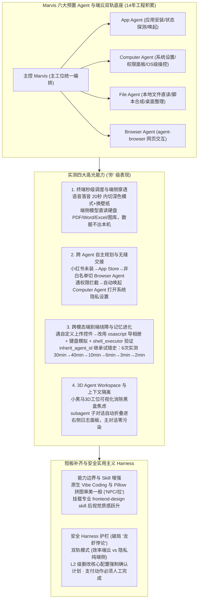

# Marvis 实测：6 个 AI “牛马”扎根桌面之后

## 1. TL;DR

1. **端侧秒级穿透与多 Agent 自主接力**：腾讯应用宝团队基于 **14 年** PC 与移动端底层生态积累推出的桌面原生智能体 **Marvis**（预置 **6 个** 专职 Agent），可在语音落音 **20 秒内** 完成系统深色模式切换与壁纸更换，并支持本地模型直读硬盘文档/图库（数据不出本机）；在无预设 Skill 的开放任务中，能自主完成 `App Agent`（查应用/调网页端 `agent-browser`）与 `Computer Agent`（自动打开系统隐私权限设置）的跨层无缝交接。
2. **跨模态端到端执行与交互记忆加速（30 分钟 → 2 分钟）**：面对“制作并发布 5 张小红书图文”且遭遇自定义上传组件拦截时，Marvis 自主绕道通过 `osascript` 导入 Mac 系统相册 + 键盘模拟输入 + `shell_executor` 逐项验证跑通闭环；依靠单会话内 `inherit_agent_id` 继承完整试错历史（及跨会话 `memory_ids` 传递关键中间结果），连续 6 次实测耗时从 **30min → 40min → 10min → 6min → 3min → 2min** 指数级收敛。
3. **3D 办公室状态透明化与子对话隔离**：独创纯白 3D 办公室交互界面（`Agent Workspace`），以小黑马工位动态直观映射各 Agent 运行与空闲状态，并将各 `subagent` 内部执行过程自动折叠收进右侧独立日志面板，既消除多 Agent 协作的“黑盒焦虑”，又防止子任务过程污染主对话上下文。
4. **能力短板、Skill 补齐与“安全实用主义”Harness**：实测显示其原生 Vibe Coding（如“粤游”旅游网站）与无 Skill 图像合成（基于 Pillow 参数拼图，缺乏视觉审美奖励函数）表现中规中矩，但挂载专业 `frontend-design skill` 后粗野主义落地页与海报质感显著跃升；相比开源极客路线 OpenClaw（GitHub **25 万 Star**、周访客 **200 万**）暴露的“龙虾悖论”，Marvis 以 **双轨隐私模式 + L2 级破坏性操作强制确认 + 支付动作人工接管** 构建了适合普通用户的安全 Harness。

## 2. 问题定义与背景

### 2.1 桌面 Agent 赛道的“龙虾悖论”与信任鸿沟
2026 年初桌面 Agent 赛道全面爆发，以 OpenClaw 为代表的开源极客方案创下 **GitHub 25 万 Star、一周 200 万访客** 的热度，但也尖锐暴露出 **“龙虾悖论”**：用户让 Agent 做的事情越多、授予的系统底层权限越大，面临的数据泄露与误操作安全风险就越高。同时，多 Agent 协同普遍存在两大体验痛点：
- **黑盒焦虑與上下文爆炸**：普通用户看不见后台哪个子 Agent 在干活、为什么卡住、是否越权操作；且多个子 Agent 的冗长工具调用日志一旦全部涌入主聊天窗口，回溯成本呈指数级上升。
- **跨应用交互壁垒与重复踩坑耗时**：真实桌面任务横跨语义理解、文件合成、原生 App 与浏览器 DOM 操作，遇到非标自定义控件极易卡死；若每次任务都从零试错，单次执行动辄耗时半小时以上。

### 2.2 Marvis 的破局定位：安全实用主义的操作系统级执行系统
腾讯应用宝团队于 **2026 年 5 月 20 日** 正式上线 **Marvis**，放弃极客向的繁琐插件配置，选择 **“安全实用主义”** 路线：出厂预置 **6 个专职 Agent** 零配置上手，采用 **效率模式（端云协同）+ 隐私模式（纯端侧本地模型索引，数据不出本机）** 双轨并行，并以 **L2 级安全兜底** 与 **3D 可视化工作空间** 将 AI 助手从“聊天工具”真正转化为普通人敢放心使用的“桌面执行系统”。

## 3. 知识框架

## 4. 核心内容拆解

### 4.1 端侧秒级穿透与多 Agent 自主协同链路

1. **20 秒语音闭环与端侧资源直读**：
   - 面对“开启深色模式并将桌面壁纸换成暗色系”的语音指令，Marvis 通过 **本地语义理解 + 端侧 Agent 调度**，在 **20 秒以内** 直接完成系统状态切换与壁纸替换，无冗长弹窗等待。
   - **端侧隐私穿透**：依靠本地端侧模型直接按文件类型与名称为本地硬盘的 PDF、Word、Excel 与系统相册建立目录索引，整个识别过程**数据完全不出本机**；同时可自主探测本地应用安装状态与版本，决定直接唤起还是跳转 App Store 下载。
2. **无预设流程下的跨 Agent 动态交接（以“扒取小红书林宥嘉高赞歌单”为例）**：
   - 在未提供任何预设 Skill 与路径提示的开放测试中，Marvis 自主推演出完整异常处理链：
     1. 探测本地未安装小红书 → 切换至 App Store 搜索并获取应用 ID 准备安装；
     2. `App Agent` 发现小红书客户端不在自动化白名单内 → **自主降级切换至 `Browser Agent`**，调用 `agent-browser skill` 打开网页版小红书；
     3. 执行中遭遇系统权限拦截 → 判断属于操作系统层职责，**无缝转交 `Computer Agent`** 自动打开 macOS“系统设置 → 隐私与安全性”弹出授权面板；权限开启后立即自动填充搜索词完成抓取。

### 4.2 跨模态端到端绕障与双层记忆进化机制

1. **非标 UI 控件的创造性绕障**：
   - 在“生成 5 张林宥嘉图文并直接发布小红书”的跨模态任务中，`File Agent` 自动安装依赖库、下载素材并编写脚本在几分钟内合成图片。
   - 面对小红书自定义上传组件无法被标准浏览器自动化工具直接点击的死胡同，Marvis 放弃硬磕 DOM 控件，自主切换为 **系统级绕障方案**：通过 `osascript` 将生成的图片导入 Mac 系统相册 → 标题、正文与标签全部采用键盘模拟输入 → 调用 `shell_executor` 逐项验证状态后确认发布，首次全链路耗时约 **30 分钟** 跑通闭环。
2. **从 30 分钟到 2 分钟：两级记忆机制解析**：
   - 在同一会话内连续复现并沉淀为 Skill 的 **6 次实测** 中，执行耗时依次为：**30min → 40min（遇新问题翻车）→ 10min → 6min → 3min → 2min**，耗时缩短 **93.3%**。
   - **会话内完整继承（`inherit_agent_id`）**：同一对话内新建的子任务通过 `inherit_agent_id` 完整继承此前 `subagent` 的全部对话历史（包含每一次失败尝试、报错信息与人工纠正姿势），因此踩过的坑绝不重踩。
   - **跨会话关键结果传递（`memory_ids`）**：目前 `subagent` 的完整交互过程记忆仅在单次会话内生效（新开对话即清空），但针对固定工作流（如“搜索 → 总结 → 写文档”），可通过 `memory_ids` 跨会话持久化并传递关键中间结果。

### 4.3 3D Agent Workspace 与子对话上下文隔离

1. **3D 办公室可视化（消除多 Agent 黑盒焦虑）**：
   - 将 6 个预置 Agent 具象化为纯白 3D 空间里的“小黑马”：主控 `Marvis` 坐主工位盯屏幕、`App Agent` 在跑步机上奔跑、`File Agent` 蹲马桶处理文件、`Computer Agent` 戴绿松石围巾打游戏；空闲时工位空置或互相递“到你了”气泡。
   - **工程价值**：让普通用户一眼看清哪个 Agent 正在执行、哪个处于空闲、是否卡死或越权，随时可以介入接管。
2. **子对话折叠与上下文防膨胀**：
   - 每个 `subagent` 的子对话独立维护自身状态，互不污染；内部繁琐的工具调用过程在主对话流中自动折叠，统一收进右侧独立日志面板，做到 **“过程不消失，但不挡路”**，有效规避多 Agent 协作时的上下文膨胀与回溯灾难。

### 4.4 实测全维度评级：长板、短板与安全 Harness

| 测评模块 | 作者实测评级 | 核心表现与技术归因 |
| :--- | :--- | :--- |
| **1. 终端调度与端侧穿透** | **夯（极强）** | 语音落音 `20 秒` 内完成深色模式与壁纸切换；端侧模型直读本地文档/图库，数据不出本机 |
| **2. 自主规划与多 Agent 协同** | **夯（极强）** | 无预设路径下自主完成 `App Agent → Browser Agent → Computer Agent` 跨层排障交接 |
| **3. 跨模态端到端执行与学习** | **顶级** | 用 `osascript + 键盘模拟 + shell_executor` 绕过自定义上传组件；6 次迭代从 `30min` 降至 `2min` |
| **4. Agent Workspace 交互** | **夯爆了（最佳）** | 3D 小黑马办公室实时映射运行/空闲状态；`subagent` 独立状态 + 右侧日志折叠防上下文膨胀 |
| **5. Vibe Coding（网页开发）** | **NPC（中规中矩）** | 多轮 Plan 产出功能完整的“粤游”广东旅游网站（首页/景点/费用/找搭子），但偏模板化（团队正研发专门 Coding Agent） |
| **6. 视觉设计审美（无 Skill vs 有 Skill）** | **拉 ➡ NPC（挂载 Skill 后大幅提升）** | 无 Skill 时靠 `File Agent` 写 Pillow 脚本拼图，目标函数仅求“完成”无审美 Reward；挂载 `frontend-design skill` 后生成粗野主义咖啡落地页与海报，质感跃升 |
| **7. 桌面文件批量整理** | **人上人（优秀）** | 端侧终端操作去重与分类归档极快且准确；但在多目标复合指令下偶有遗漏“按日期重命名”步骤 |
| **8. 手机端远程连接** | **还要等等** | 微信 Bot 已支持异步指令收发（只传结果不推流画面）；Android 远控已跑通，iOS 端远控即将上线 |

- **破局“龙虾悖论”的安全 Harness 体系**：
  1. **出厂预置 + 零配置底座**：依托腾讯应用宝团队 **14 年** PC/移动端底层生态积累，预置 6 个 Agent 开箱即用；
  2. **效率与隐私双轨并行**：日常任务端云协同提速，敏感资料端侧模型本地处理；
  3. **L2 级安全兜底**：涉及文件删除、批量修改、核心系统配置调整时，必须先输出执行计划并弹出 **权限确认卡片** 强制人工确认；涉及支付等高敏动作必须由用户本人完成。

## 5. 数据速查表

| 指标 | 原文数值 | 语境 / 条件 |
| :--- | :--- | :--- |
| **Marvis 出厂预置专职 Agent 数量** | `6 个` | 含主控 Marvis、App Agent、Computer Agent、File Agent、Browser Agent 等 |
| **端侧语音系统控制响应时间** | `< 20 秒` | 从语音落音到完成 macOS 深色模式切换与暗色壁纸更换的端到端耗时 |
| **跨模态小红书图文发布首次耗时** | 约 `30 分钟` | 生成 5 张图文并通过 `osascript` 导入相册 + 键盘模拟 + `shell_executor` 绕障发布 |
| **6 次连续迭代耗时收敛曲线** | `30min → 40min → 10min → 6min → 3min → 2min` | 同一会话内通过 `inherit_agent_id` 继承踩坑历史并沉淀为 Skill 后的提速表现（缩短 `93.3%`） |
| **OpenClaw 开源社区热度对比数据** | GitHub `25 万` 星标，一周 `200 万` 访客 | 2026 年初桌面 Agent 极客路线代表作，伴生出权限越大风险越高的“龙虾悖论” |
| **应用宝团队底层工程积累年限** | `14 年` | 腾讯应用宝团队在 PC 与移动端底层生态的技术沉淀周期 |
| **Marvis 正式上线与高频迭代节奏** | `2026 年 5 月 20 日` 上线，`4 天` 内多次后台热更 | 上线首周连周末凌晨都在自动更新修复 Bug 与优化 Skill 调用逻辑 |
| **安全兜底等级** | `L2 级` 安全兜底 | 删改与核心配置变更强制先给计划并人工确认，支付动作必须用户本人完成 |

## 6. 踩坑与教训 / 可迁移的设计原则

| 错误做法 | 失败表现或原因 | 原文应对（可迁移的设计原则） |
| :--- | :--- | :--- |
| **直接用 Prompt 让桌面 Agent 优先调原生桌面 App 执行第三方平台操作** | 第三方客户端（如小红书 Mac 版）往往不在自动化白名单内，且含大量自定义非标上传控件导致自动化卡死 | **Prompt 显式引导 `browser use` + 系统脚本绕障**：优先指示调用网页版 `agent-browser skill`；遇非标上传组件时改用 `osascript` 导入系统相册 + 键盘模拟输入 |
| **所有子 Agent 共享单一扁平上下文并把执行过程全量打印到主窗口** | 多 Agent 协同的日志迅速撑爆上下文窗口，回溯成本指数级上升，且用户陷入“不知道谁在干嘛”的黑盒焦虑 | **3D 工位状态可视化 + 子对话独立状态与右侧日志折叠**：用可视化空间展示谁在干活/谁在空闲，各 `subagent` 独立维护状态并将过程收进右侧面板 |
| **每次新任务都清空子 Agent 的试错过程从头探索** | 每次遇到相同的权限拦截或控件失效都要重新试错 30 分钟，无法形成经验复利 | **分层记忆传递机制（`inherit_agent_id` + `memory_ids`）**：单会话内通过 `inherit_agent_id` 完整继承尝试、失败与纠正历史并沉淀为 Skill（6 次迭代压至 2 分钟）；跨会话用 `memory_ids` 传递关键中间产物 |
| **不挂专业 Skill 直接让通用文件 Agent 用 Python Pillow 脚本生成海报** | `File Agent` 的奖励函数只有“完成任务”而无审美指标，LLM 虽懂文字层面的配色概念但落到像素拼图极为简陋 | **在特定领域挂载垂直专业 Skill（如 `frontend-design skill`）**：通过封装了粗野主义排版、撞色与现代 CSS 规范的专业 Skill 弥补通用基模的视觉决策短板 |
| **像极客开源项目一样默认放开全部系统权限任由 Agent 狂奔** | 触发“龙虾悖论”，普通用户一旦遭遇误删文件或隐私上传即彻底丧失信任 | **安全实用主义 Harness（双轨隐私 + L2 强制确认卡片）**：敏感文件索引走纯端侧模型不出本机，删改配置先出计划强制人工点确认，支付等高危操作物理隔离由人完成 |

## 7. 记忆锚点

- **“30 分钟到 2 分钟的记忆复利”**：`30min → 40min → 10min → 6min → 3min → 2min`，靠的不是硬编码，而是 `inherit_agent_id` 记住了每一次翻车的姿势（如放弃死磕上传控件、改走 `osascript` 导相册 + 键盘模拟）。
- **“小黑马 3D 办公室：过程不消失，但不挡路”**：主工位、跑步机、咖啡角把多 Agent 协作从“黑盒转圈”变成“一眼看穿谁在摸鱼谁在干活”，配合右侧折叠日志面板，完美兼顾状态透明与主上下文干净。
- **“用安全实用主义解开龙虾悖论”**：面对 OpenClaw 25 万 Star 背后的越权风险，Marvis 用 **6 个预置 Agent 零配置 + 端云/纯端侧双轨隐私 + L2 破坏性操作确认卡片**，给 AI 套上让普通人敢放心用的缰绳（Harness）。

## 8. 复习卡片

1. Marvis 在处理本地硬盘文档（PDF/Word/Excel）和系统图库时，是如何兼顾穿透能力与数据隐私安全的？::采用“效率模式（端云协同）”与“隐私模式（纯端侧）”双轨并行机制；在识别和检索本地资料时，仅使用端侧本地模型按文件类型和名称建立本地目录索引，整个识别过程数据完全不出本机。
2. 在未给预设流程的“扒取小红书歌单”实测中，Marvis 的多个子 Agent 是如何自主协同处理未安装应用、白名单限制和系统权限拦截的？::`App Agent` 先查安装状态并唤起 App Store 安装，发现小红书不在自动化白名单后自主切换 `Browser Agent` 调用 `agent-browser skill` 打开网页版；遇到系统权限拦截时，自动转交负责系统层的 `Computer Agent` 打开 macOS 隐私与安全性设置面板供用户授权。
3. 面对小红书自定义上传组件无法被标准浏览器工具点击的问题，Marvis 采取了什么绕障方案完成图文发布？::放弃直接自动化操控上传控件，改用 `osascript` 脚本将 `File Agent` 生成的图片导入 Mac 系统相册，标题、正文与标签全部采用键盘模拟输入，并通过 `shell_executor` 逐项验证后确认发布。
4. 为什么 Marvis 连续 6 次发布小红书的耗时能从 30 分钟一路降到 2 分钟？它的会话内与跨会话记忆机制分别是什么？::在单次会话内，新建子任务通过 `inherit_agent_id` 完整继承此前 `subagent` 的所有尝试、失败与人工纠正历史并可沉淀为 Skill，不再重复踩坑；在跨会话场景下，完整交互历史会清空，但可通过 `memory_ids` 将固定工作流的关键中间结果传递下去。
5. Marvis 的 3D 办公室（`Agent Workspace`）和子对话日志设计解决了多 Agent 协同中的哪两个核心痛点？::3D 办公室将 6 个 Agent 的工作与空闲状态实时可视化，解决了多 Agent 协同的“黑盒焦虑与越权担忧”；每个 `subagent` 独立维护状态并将内部执行过程自动折叠收进右侧日志面板，解决了多 Agent 协作导致的主对话上下文膨胀与回溯困难。
6. 为什么 Marvis 在无 Skill 状态下生成的海报审美较差，该如何正确弥补这一短板？::无 Skill 时 `File Agent` 仅用 Python Pillow 脚本做参数化拼图，其目标函数只关注“完成任务”而缺乏设计决策层与像素级审美奖励；正确方式是在技能广场调用垂直领域的专业 Skill（如 `frontend-design skill`），即可生成具有粗野主义排版美感的落地页与高质量海报。
7. 什么是桌面 Agent 赛道的“龙虾悖论”，Marvis 是如何通过 Harness 设计来破解这一悖论的？::“龙虾悖论”指开源极客向 Agent（如 OpenClaw）赋予的能力和权限越大，用户面临的安全与隐私风险就越高；Marvis 采用“安全实用主义”Harness：出厂预置 6 个受控 Agent、敏感数据纯端侧处理不出本机、删除/修改/核心配置变更触发 L2 级执行计划强制确认卡片、支付动作必须由用户本人完成。

## 9. 知识关联

- **本仓库主题索引**：[Harness与模型协同](../../20_topics/Harness%E4%B8%8E%E6%A8%A1%E5%9E%8B%E5%8D%8F%E5%90%8C.md) · [Agent长期记忆](../../20_topics/Agent%E9%95%BF%E6%9C%9F%E8%AE%B0%E5%BF%86.md) · [Agent任务恢复](../../20_topics/Agent%E4%BB%BB%E5%8A%A1%E6%81%A2%E5%A4%8D.md) · [桌面Agent与工作流](../../20_topics/%E6%A1%8C%E9%9D%A2Agent%E4%B8%8E%E5%B7%A5%E4%BD%9C%E6%B5%81.md)
- **候选双链概念**：[[龙虾悖论]] · [[inherit_agent_id会话内记忆继承]] · [[Agent-Workspace状态可视化]] · [[L2级安全兜底]] · [[端云双轨隐私模式]]

## 10. 原文参考资料

1. 腾讯应用宝团队，*Marvis 桌面原生 AI 助手（macOS / Windows / Android 远控）*（2026 年 5 月 20 日正式上线）。
2. OpenClaw 开源桌面 Agent 项目（文内第 3 节与第 10 节作为自主规划路线与“龙虾悖论”对照基准，GitHub 25 万 Star、周访客 200 万）。
3. Marvis 技能广场内置技能：`agent-browser skill`、`frontend-design skill`（文内实测用于网页端自动化与粗野主义前端/海报视觉生成）。

> [!note]- 校对报告
> - **校对状态**：已按原文逐页核对通过（共 18 页 PDF，其中 p.11–12 文本层为空白/截图页）。
> - **核心数据与页码溯源**：
>   - 6 个预置 AI Agent、语音唤起 `20 秒` 内完成深色模式与壁纸切换、端侧模型直读硬盘 PDF/Word/Excel/图库且数据不出本机：见 `p.1–2`。
>   - 小红书林宥嘉歌单开放任务（`App Agent` 查安装 → App Store → 非白名单切 `Browser Agent` 调 `agent-browser skill` → 遇权限问题转交 `Computer Agent` 打开系统隐私设置）：见 `p.3–4`。
>   - 5 张林宥嘉图文生成与发布（`File Agent` 合成图片 → 遇自定义上传组件改用 `osascript` 导入 Mac 相册 + 键盘模拟输入 + `shell_executor` 验证，首次耗时约 `30 分钟`；6 次连续迭代耗时 `30min → 40min → 10min → 6min → 3min → 2min`；底层记忆机制 `inherit_agent_id` 会话内继承与 `memory_ids` 跨会话传递中间结果）：见 `p.4–6`。
>   - 3D 办公室 `Agent Workspace`（主工位、跑步机、马桶、打王者荣耀、空闲接咖啡/递气泡）及 `subagent` 子对话独立状态与右侧日志面板折叠：见 `p.6–8`。
>   - Vibe Coding 实测（“粤游”广东旅游网站，团队计划研发专门 coding agent）、无 Skill Pillow 拼图审美短板 vs 挂载 `frontend-design skill` 生成粗野主义咖啡落地页与海报：见 `p.8–14`。
>   - 桌面整理实测（去重、分类准确，多目标下偶漏重命名）与手机端连接现状（微信 Bot 异步通道、Android 已跑通、iOS 端敬请期待）：见 `p.14–16`。
>   - OpenClaw（GitHub `25 万` 星标、一周 `200 万` 访客、“龙虾悖论”）对比、腾讯应用宝团队 `14 年` 积累、效率/隐私双轨并行、`L2 级` 安全兜底及 `5 月 20 日` 上线后 `4 天` 后台自动更新迭代：见 `p.16–17`。
