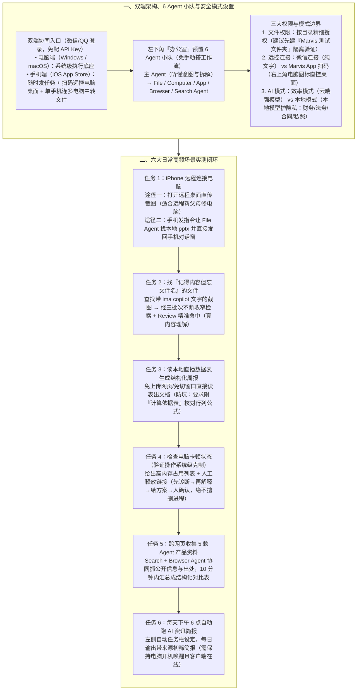

# 从0到1带你速通Marvis马维斯

> **原文信息**：作者 `蟹钳`，发布于 2026-06-24 05:20（广东），公众号「腾讯技术工程」原创。

---

## 1. TL;DR

1. **产品核心定位：面向普通人的系统级 AI 管家** —— Marvis 不是把聊天框套个壳，而是把聊天窗口推进到电脑操作系统层（以前是「人操作电脑再问 AI」，现在是「把目标告诉 AI 让它去操作电脑」）；近期 **iOS 端（App Store）上线**后，配合微信/QQ 零门槛登录（免配 API Key 与环境），形成了「**电脑端执行 + 手机端远程查看/接管/做多电脑文件中转站**」的随身电子牛马形态。
2. **预置 6 Agent 协作小队与两大 AI 模式** —— 点击左下角「办公室」可见 **1 个主 Agent（理解意图与拆解）+ 5 个专职子 Agent（`File Agent`、`Computer Agent`、`App Agent`、`Browser Agent`、`Search Agent`）** 开箱即用，无需用户手动搭建工作流；提供**效率模式**（连云端大模型，适合日常高效办公）与**本地模式**（连本地部署模型，适合财务/法务/人事/合同/私密照片等高敏场景）。
3. **安全授权最佳实践** —— 文件权限支持按目录精细授权或取消（作者建议先建独立的「`Marvis 测试文件夹`」验证安全性与准确度，切勿一上来开放全盘权限）；连接手机支持**微信连接（仅限文字交互）**与**手机端 Marvis App 扫码连接（点击右上角电脑图标即可直接远程操控电脑桌面，强烈推荐）**。
4. **六大真实任务实测通关** —— ① **iPhone 远程控电脑**：支持直接远控桌面传截图，或发自然语言让 `File Agent` 找本地 `.pptx` 并直接发回手机对话窗口（且单部手机可连多台电脑做文件中转站）；② **模糊记忆找文件**：在杂乱截图文件夹中找含 `ima copilot` 文字的宣传图，Agent 通过**三批次不断收窄的递进式检索与 Review**（基于 OCR 与视觉内容理解而非单纯文件名匹配）精准命中；③ **读本地表生成结构化周报**：直接读本地直播数据表生成汇报文档（建议要求附「计算依据表」防幻觉）；④ **检查电脑卡顿状态**：列出高内存占用应用并提供人工释放操作链接（遵循**「先诊断、再解释、给方案、最后由人确认」**的安全边界，绝不擅自杀进程删文件）；⑤ **跨网页收集资料**：联动 `Search Agent` 与 `Browser Agent` 抓取 5 款 Agent 产品公开信息并带出处汇总成表；⑥ **每天下午 6 点自动任务**：定时收集 AI 资讯生成带来源初筛简报（注意电脑关机、休眠或退出客户端时不执行）。

---

## 2. 问题定义与背景

### 2.1 为什么要写这篇？

市面上大量 Agent 产品虽然技术酷炫，但往往面向极客与程序员（需配命令行终端、API Key、手搭复杂工作流），导致普通非技术用户的第一反应是「东西确实厉害，但我用不上」。
本文在 **Marvis iOS 端正式上线**的时间节点，以普通打工人、运营、学生和长辈都会遇到的 **6 个高频日常痛点**为主线，手把手演示从双端安装、目录级安全授权、效率/本地双模式切换，到跨端取文件、图片内容检索、周报生成、系统诊断、竞品调研与定时简报的完整闭环，回答「系统级 Agent 如何真正走进普通人日常生活」。

---

## 3. 知识框架

---

## 4. 核心内容拆解

### 4.1 架构与界面认知：6 Agent 协作小队 + 四大功能栏

1. **免搭工作流的「6 Agent 办公室」**：
   - 传统 Agent 工具要求用户先学搭工作流，而 Marvis 左下角点开「办公室」直接预置了一支默认能干活的 AI 小队（没干活时小马在摸鱼，干活时自动分工）：
     - **主 Agent**：负责听懂自然语言目标并自动拆解派活；
     - **`File Agent`**：负责本地文件查找、阅读与生成；
     - **`Computer Agent`**：负责操作系统状态检查与设置；
     - **`App Agent`**：负责调用本地应用程序；
     - **`Browser Agent`**：负责打开并操作网页；
     - **`Search Agent`**：负责全网信息搜索。
2. **侧边栏核心模块**：
   - **本地知识库**：集中索引已授权目录下的文档、图片及下载的应用；
   - **技能广场**：提供受欢迎的成功使用经验与主流 Skill 库；
   - **自动任务**：配置每日定时自动执行的例行任务（**硬性前提**：电脑关机、休眠或退出客户端时对应任务不会执行）。

---

### 4.2 权限控制与双模式切换：安全感与隐私边界

1. **文件权限（「测试文件夹」渐进授权法）**：
   - 在「设置 → 授权管理」中可按特定文件夹精细授予或取消读取权限；
   - **实操建议**：切勿一上来就给整台电脑的磁盘权限，先新建一个 **`Marvis 测试文件夹`** 放入当前任务材料试跑——一来保证安全，二来能直观检验它是否找对东西。
2. **手机连接的两种方式对比**：
   - **方式一（微信连接）**：仅支持纯文字交互；
   - **方式二（手机端 Marvis App 扫码连接，推荐）**：连接后点击手机端右上角「电脑图标」，即可直接看到并远程操纵电脑桌面。
3. **效率模式 vs 本地模式**：
   - **效率模式**：连接云端大模型，能力更强，适合日常非敏感高效办公；
   - **本地模式**：连接本地部署模型（有一定电脑硬件门槛），数据不出本机，专门面向包含**财务、法务、人事、合同、论文初稿、访谈材料、未发布设计方案、私密照片**等高敏感信息的用户。

---

### 4.3 六大实测任务与避坑指南

1. **任务 1：iPhone 远程控电脑與跨设备取文件**
   - **场景**：人已出门在外，急需把家里/办公室电脑里的文件或截图发给同事，或远程帮家里老人解决电脑小故障。
   - **双路径验证**：① 直接在手机端打开远程桌面点选截图发送到手机；② 在手机对话框发指令「帮我找到电脑里的一个名为短视频剪辑入门教程的 pptx 文件，找到后把文件发到手机端对话里」，主 Agent 自动派给 `File Agent` 秒级找回并推送至手机供下载。
   - **多机流转价值**：单部手机可同时绑定连接多台电脑，使手机端成为**多台电脑间的文件中转站**。
2. **任务 2：找一个「记得内容但忘了文件名」的文件（OCR + 视觉语义检索）**
   - **场景**：面对满是「新建文档 1 / 最终版 / 真的最终版」的杂乱屏幕截图文件夹，输入指令寻找「图片上有 `ima copilot` 文字的宣传封面」。
   - **三批次递进检索机制**：Agent 并非按文件名关键词死板匹配，而是执行了**总计三批次不断收窄的检索**——先划定三份模糊候选目标，再进一步视觉 Review 核对图片内文字，最终将正确图片发回。
3. **任务 3：直接读取本地表格生成结构化周报（附防幻觉技巧）**
   - **场景**：无需上传网页或复制粘贴，直接让 `File Agent` 读取本地直播数据表生成周会结构化汇报文档。
   - **核心避坑建议**：AI 极易把「看起来合理的话」写得很顺，涉及数据分析时必须人工复核是否有读错列、算错数或漏掉异常值；**强烈建议在 Prompt 中要求它在报告末尾附一张「计算依据表」（列明每个结论来自哪一列、哪几行、怎么算的）**。
4. **任务 4：检查电脑卡顿状态（检验操作系统级 Agent 的安全克制）**
   - **场景**：输入「最近电脑有点卡，帮我检查一下可能原因」。
   - **克制表现**：给出高内存占用应用的详细列表，并提供进行对应内存释放的**人工操作链接**。系统级 Agent 最重要的不是「能不能删」，而是**「先诊断 → 再解释 → 给方案 → 最后让人确认哪些执行哪些不执行」**，绝不因一句「帮我清理电脑」就擅自杀进程或删文件。
5. **任务 5：跨网页收集资料（`Search Agent` + `Browser Agent` 协同）**
   - **场景**：要求在公开网页收集 **Marvis、WorkBuddy、Qoder CN、AutoClaw、DuMate** 五款产品的 iOS/移动端信息，按「产品名称、开发者/公司、定位、核心功能、是否支持移动端、适合人群、公开来源」7 个字段整理成表，且严禁编造无来源信息。
   - **效果与底线**：把原本需开十几个网页复制粘贴半小时的工作压缩到 **10 分钟以内**；但对外发布前仍需人工核查版本、价格与上线状态等快变信息（「AI 帮你收集，但不能替你负责」）。
6. **任务 6：设置每天下午 6 点自动跑的定时任务**
   - **场景**：在左侧任务栏设置每天 **18:00** 自动执行「AI 资讯收集任务」，每日稳定输出带来源的初筛简报（哪怕只采用其中 **20%** 也大幅节省盯信息精力）。

---

## 5. 数据速查表

| 指标 | 原文数值 | 语境 / 条件 |
| :--- | :--- | :--- |
| 本文实测的核心任务数 | **6 个任务** | 手机远控、模糊找文件、直播数据出周报、检查电脑卡顿、跨网页收集资料、定时任务 |
| 办公室预置协作 Agent 数量 | **6 个角色（1 主 + 5 专职）** | 主 Agent + `File / Computer / App / Browser / Search Agent` |
| 手机连接电脑支持的方式 | **2 种（微信文字连接 / Marvis App 扫码远控桌面）** | 单部手机支持同时连接**多台电脑**充当文件中转站 |
| AI 运行模式数量 | **2 种（效率模式 / 本地模式）** | 云端大模型高效办公 vs 本地部署模型高敏隐私保护 |
| 任务 2 模糊找图收窄检索批次 | **总计 3 批次不断收窄检索** | 先划定 3 份模糊目标再进一步 Review 定位含 `ima copilot` 文字的截图 |
| 任务 5 跨网页调研对比的产品数 | **5 款产品（7 个表格字段）** | Marvis、WorkBuddy、Qoder CN、AutoClaw、DuMate（耗时压缩至 **10 分钟以内**） |
| 任务 6 定时资讯收集触发时间与采纳率参考 | **每天下午 6 点（18:00），哪怕仅采用 20% 即省时** | 需保持电脑未关机、未休眠且未退出客户端 |
| 最适合使用 Marvis 的目标人群分类 | **4 类人群** | 文件多且管理乱的人、日常办公任务多的人、常需远程处理电脑事务的人、不想折腾复杂工作流的人 |

---

## 6. 踩坑与教训 / 可迁移的设计原则

| 错误做法 | 失败表现或原因 | 原文应对 |
| :--- | :--- | :--- |
| 刚装好系统级 Agent 就直接授予整台电脑全盘文件夹的读写权限 | 缺乏安全感，且一旦检索范围过大难以判断 Agent 究竟有没有找对目标文件 | 先新建一个独立的 **`Marvis 测试文件夹`** 放入单次任务所需材料试跑，在「设置 → 授权管理」中按目录精细授权 |
| 让 AI 读取本地 Excel 表格生成数据分析周报后直接拿去汇报 | AI 容易把错误数据编造得通顺合理，可能存在读错列、算错数或遗漏异常值 | 在指令中要求 AI **在报告末尾附一张「计算依据表」**（明确每个结论源自哪一列、哪几行及计算公式），便于人工快速复核 |
| 期望系统级 Agent 在收到「帮我清理电脑/解决卡顿」时直接静默杀进程、删文件 | 直接静默执行高危系统操作极易误删关键资料或中断未保存工作 | 坚持**「先诊断、再解释、给方案、最后让人确认」**的四步受控原则，输出高内存占用列表与人工释放操作链接 |
| 将包含财务、法务、人事、合同或私密照片的高敏感文件直接走云端模式处理 | 敏感商业与个人数据出本机存在隐私合规风险 | 切换至 **本地模式**（连接本地部署模型）处理高敏感材料，日常非敏感办公再切回效率模式 |
| 设定好每日定时任务后将电脑关机、合盖休眠或退出客户端 | 本地客户端与执行环境离线，导致定时任务到了下午 6 点无法触发 | 明确告知用户边界：定时任务依赖本地宿主机在线，需保持电脑开机唤醒且客户端处于运行状态 |

---

## 7. 记忆锚点

1. **核心范式转换**：「以前是**你操作电脑，再问 AI**；现在是**你把目标告诉 AI，让它去操作电脑**。」
2. **「1+5」小马编制与「6」大实测**：
   - **1+5 编制**：主 Agent + `File / Computer / App / Browser / Search Agent`；
   - **6 大场景**：iPhone 远控传 `.pptx`（多机中转站）→ 3 批次收窄找 `ima copilot` 截图 → 直播表出周报（必附**计算依据表**）→ 查电脑卡顿（先诊断给链接、人确认）→ 10 分钟抓 5 款产品对比表 → 18:00 定时跑 AI 资讯简报。

---

## 8. 复习卡片

1. Marvis 与传统网页/对话框 AI 助手的核心区别是什么，近期 iOS 端上线带来了什么新变化？::传统 AI 需要人工手动上传材料、指明路径再复制结果，而 Marvis 推进到了操作系统层，变成「你把目标告诉 AI，让它去操作电脑」；iOS 端上线后，它从电脑内的工具变成随身携带的入口，支持在手机上发任务、扫码远程操控电脑桌面，还能用一部手机连接多台电脑充当文件中转站。
2. Marvis 左下角「办公室」里预置了哪 6 个 Agent 角色，为什么这种设计对普通用户更友好？::包含主 Agent（负责听懂意图与拆解任务）以及 `File Agent`（文件）、`Computer Agent`（系统）、`App Agent`（应用）、`Browser Agent`（网页）、`Search Agent`（搜索）；用户无需像极客一样先学习搭建复杂工作流，装上就能直接用自然语言调动整支小队协同干活。
3. 在配置 Marvis 的「文件权限」「手机连接」和「AI 模式」时，作者给出了哪些实用建议？::① 文件权限切勿一上来开放全盘，建议先建一个「`Marvis 测试文件夹`」按需授权验证；② 手机连接优先用 Marvis App 扫码（右上角点电脑图标可直控桌面），而非仅支持文字交互的微信连接；③ 日常办公用云端「效率模式」，处理财务、法务、人事、合同、私密照片等高敏材料时切换为数据不出本机的「本地模式」。
4. 在「找记不清名字的图片」和「检查电脑卡顿」两个实测中，Marvis 分别展现了怎样的技术与安全细节？::找含 `ima copilot` 文字的截图时，Agent 执行了三批次不断收窄的递进式检索（先划定 3 个模糊目标再深入 Review 内容），体现了真正的视觉与 OCR 内容理解；检查电脑卡顿时，列出高内存占用列表并提供人工操作释放链接，严格遵循「先诊断、再解释、给方案、最后由人确认」的安全克制原则。
5. 使用 Marvis 执行「读取本地表格写周报」「跨网页收集产品资料」和「定时任务」时，分别需要注意什么底线或限制？::① 写数据分析周报时，务必让它在文末附一张「计算依据表」（注明结论来自哪列、哪几行、怎么算的）以防读错列或算错数；② 跨网页收集对外发布资料时，必须人工核查版本、价格等快变信息的公开来源；③ 定时任务在电脑关机、休眠或退出客户端时不会执行。

---

## 9. 知识关联

- **已有主题**：[模型与开发工具发布](../../20_topics/%E6%A8%A1%E5%9E%8B%E4%B8%8E%E5%BC%80%E5%8F%91%E5%B7%A5%E5%85%B7%E5%8F%91%E5%B8%83.md) · [AI研发协同](../../20_topics/AI%E7%A0%94%E5%8F%91%E5%8D%8F%E5%90%8C.md) · [检索与文档解析](../../20_topics/%E6%A3%80%E7%B4%A2%E4%B8%8E%E6%96%87%E6%A1%A3%E8%A7%A3%E6%9E%90.md) · [桌面Agent与工作流](../../20_topics/%E6%A1%8C%E9%9D%A2Agent%E4%B8%8E%E5%B7%A5%E4%BD%9C%E6%B5%81.md)
- **候选新主题**：[[系统级AI管家]] · [[跨端远程桌面接管]] · [[数据分析计算依据表校验]]

---

## 10. 原文参考资料

1. **Marvis（马维斯）客户端与移动端**：支持 Windows、macOS 桌面端及 iOS 移动端（App Store 搜索 `Marvis`），支持微信/QQ 登录。
2. **任务 5 横向收集的 5 款国内 Agent 产品**：Marvis、WorkBuddy、Qoder CN、AutoClaw、DuMate。

> [!note]- 校对报告
> - **校对状态**：已根据 `MD.md` 全文（共 23 页 PDF 转写文本，其中第 12 页为空白页）逐一核对。
> - **核心数据与事实页码溯源**：
>   - iOS 端上线背景、「把目标告诉 AI 让它去操作电脑」、6 个实测任务总览表：见 PDF 第 1–2 页。
>   - 电脑端（Windows/macOS，微信/QQ 登录免配 API Key）与手机端（App Store 搜索 Marvis）安装、左下角办公室 6 个 Agent 角色（主 Agent + `File / Computer / App / Browser / Search Agent`）、本地知识库/技能广场/自动任务（电脑关机、休眠或退出客户端不执行）：见 PDF 第 3–7 页。
>   - 权限与模式设置：授权管理按文件夹授权（建议新建 `Marvis 测试文件夹`）、微信文字连接 vs 手机 App 扫码连接远控桌面、效率模式 vs 本地模式（适用财务/法务/人事/合同/私密照片等高敏场景）：见 PDF 第 7–10 页。
>   - 任务 1（iPhone 远程桌面传截图 + 手机发指令找 `短视频剪辑入门教程.pptx` 发回手机对话窗 + 单手机连多台电脑做文件中转站）：见 PDF 第 10–14 页。
>   - 任务 2（屏幕截图文件夹找带 `ima copilot` 文字图片，三批次不断收窄检索 + Review）：见 PDF 第 14–15 页。
>   - 任务 3（读直播数据表生成结构化周报，建议末尾附「计算依据表」核对行列与算法）：见 PDF 第 15–16 页。
>   - 任务 4（检查电脑卡顿原因，返回高内存占用列表与人工释放链接，「先诊断、再解释、给方案、最后让人确认」）：见 PDF 第 16–17 页。
>   - 任务 5（`Search Agent` + `Browser Agent` 收集 Marvis / WorkBuddy / Qoder CN / AutoClaw / DuMate 五款产品 7 个字段汇总成表，压缩至 10 分钟内）与任务 6（每天下午 6 点自动收集 AI 资讯简报，采用 20% 即省时）及适合的 4 类人群总结：见 PDF 第 17–21 页。
