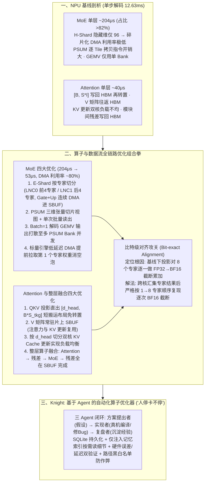

# 斩获冠军！清华x腾讯混元登顶MLSys2026 MoE模型推理优化竞赛

## 1. TL;DR

1. **端到端推理提速 4.1 倍登顶 MLSys 2026**：清华大学存储实验室（舒继武教授、陆游游副教授团队）与腾讯混元 AI Infra 团队在 MLSys 2026 MoE 推理优化挑战赛（`aws-neuron/nki-moe`）中击败 Stanford、MIT、UC Berkeley、CMU 等强队夺冠，将官方指定异构 NPU 上的端到端推理时间从 **14.91s 降至 3.56s（提速约 4.1 倍）**，完整单步解码从 **12.63ms 降至 5.45ms**，单层 MoE 延迟从 **204μs 压降至 53μs**，权重加载期间 DMA 引擎利用率提升至 **约 80%**。
2. **MoE 与 Attention 访存布局全链路重构**：针对原始单步解码占比超 **82%** 的 MoE 瓶颈（约 `0.2ms`），改用 **E-Shard 按专家切分双核任务**（LNC0/LNC1 各算 4 个专家，消除 H-Shard 下隐藏维度仅 `96` 的碎片化 DMA）、**PSUM 三维张量批量读出**、**Batch=1 解码 GEMV 多 Bank 打散并发** 与 **标量引擎 DMA 冷启动预取**；针对 Attention（约 `40μs`），直出 `[d_head, B * S_tkg]` 省去转置、让 $V$ 常驻片上 `SBUF`、按 `d_head` 切分 KV 更新，并将 **Attention → 残差 → MoE → 残差** 融合为单一算子。
3. **跨核重排复现 FP32→BF16 逐专家截断，实现苛刻“比特级对齐”**：赛事要求输出与基线严格 **Bitwise 比特级对齐**。团队耗时一周定位到 E-Shard 与基线 H-Shard 的浮点舍入差异源于下投影阶段——基线对 8 个专家逐个执行“FP32 累加后立即截断为 BF16”（共截断 8 次），遂通过核间通信汇集专家结果并严格按基线逐专家顺序复现 `FP32 → BF16` 累加截断，兼顾极致性能与零比特误差。
4. **自研 Agent 算子优化器 Knight 实现“人停卡不停”**：构建由 **方案提出者 + 实现者 + 复盘者** 组成的三 Agent 算子优化循环，利用 SQLite 持久化经验并按需注入索引防止上下文膨胀，结合真实硬件正确性/Profile 延迟双重验证与文件白名单/黑名单防 Reward Hacking，实现白夜接力自动寻优。

## 2. 问题定义与背景

### 2.1 异构 NPU 上 MoE 解码推理的两大核心瓶颈
在 MLSys 2026 专项挑战赛（基于 AWS Neuron NKI 编程接口的异构 NPU 平台）中，参赛队伍需为指定 MoE 模型编写自定义底层算子，在 `Batch Size = 1` 的自回归解码场景下最小化端到端延迟。团队初期性能剖析揭示了两大瓶颈：
- **MoE 模块占单步生成延迟的 82% 以上（单层约 `204μs` / `0.2ms`）**：基线采用张量并行（H-Shard）沿隐藏维度切分双计算核心（LNC0 / LNC1），导致每个核心分得的隐藏维度仅 **96**，小块离散 DMA 启动开销远超并行收益，DMA 带宽利用率极低，计算单元长期空转等待权重从 HBM 搬入片上缓存 `SBUF`。
- **Attention 模块频繁跨 HBM 往返与布局转置（单层约 `40μs`）**：QKV 投影先输出通用 `[B, S * I]` 布局写回 HBM，再切分、转置、重读入片上计算；且 Value 矩阵 $V$ 与模块间残差加法反复读写 HBM，双核更新 KV Cache 时存在严重负载不均。

### 2.2 极端约束：性能飙升的同时必须“比特级对齐（Bit-exact）”
不同于常规工程允许 `1e-3` 级浮点近似误差，本次竞赛要求优化后算子的输出结果必须与基线 **比特级完全一致（Bitwise Identical）**。任何因并行切分方式改变（如从隐藏维切分改为按专家切分）引发的浮点数累加顺序变化，都会因 IEEE 754 舍入误差累积导致评测判负。

## 3. 知识框架

## 4. 核心内容拆解

### 4.1 MoE 模块四大底层优化（单层延迟 `204μs → 53μs`）

1. **从 H-Shard 转向 E-Shard（按专家切分双核任务）**：
   - 基线沿隐藏维度切分导致单核维度仅 `96`，DMA 严重碎片化。团队改为在两个计算核心（LNC）间按专家并行切分：**`LNC0` 独立处理前 4 个专家，`LNC1` 独立处理后 4 个专家**。
   - **收益**：大幅减少跨核同步，且每个专家的 `Gate` 和 `Up` 权重矩阵可通过**单次连续大块 DMA** 同时搬入片上缓冲区 `SBUF`，将权重加载期间的 DMA 引擎利用率拉升至 **约 80%**。
2. **PSUM 三维张量组织与批量读出（减少指令发射开销）**：
   - 原始路径为矩阵核心私有寄存器（`PSUM`）的每个 Tile 单独发起一次拷贝指令，Tile 越多启动开销越大。
   - 团队将多个 `PSUM` 存储区组织为一个连续的三维张量，计算时通过切片视图（Slice View）累加，计算完成后通过**单次批量拷贝指令**将多个存储区一并搬出。
3. **针对 `Batch = 1` 解码专门设计多 Bank 并发 GEMV 路径**：
   - 解码阶段矩阵乘退化为矩阵向量乘（`GEMV`），基线单次计算仅占用 1 个 `PSUM Bank`（受限于单写约束，片上并发算力闲置）。团队在批量读出基础上，将 `GEMV` 输出打散到**多个 `PSUM Bank` 中并发执行**，跑满片上计算并行度。
4. **标量引擎（Scalar Engine）DMA 预取首个专家消除冷启动空泡**：
   - 针对首个专家权重加载时的初始 DMA 启动等待，利用 NPU **标量引擎派发 DMA 指令延迟更低** 的微架构特性，提前启动第 1 个专家权重的搬运，随后平滑切换回常规高吞吐 DMA 流水线。

### 4.2 Attention 访存重构与整层算子大融合

1. **QKV 投影直出目标布局**：摒弃基线“先生成 `[B, S * I]` → 写回 HBM → 切分转置 → 读回 HBM”的迂回路径，在 QKV 投影阶段直接写入适配后续计算的 **`[d_head, B * S_tkg]` 短搬运布局**，使 $Q$ 和 $K$ 无需转置直通 RoPE 与 Attention，$V$ 仅在片上 `PSUM` 内部做一次转置。
2. **$V$ 矩阵常驻片上 `SBUF`**：QKV 投影生成的 $V$ 矩阵全程保留在片上 `SBUF`，直接供给 `Score * V` 计算与 KV Cache 更新复用（若位置编码已在 `SBUF` 中，Mask 生成也直接片上复用），彻底省去一次完整的 HBM 往返。
3. **按 `d_head` 维度切分双核 KV Cache 更新**：解决原始实现双核负载失衡导致的跨核等待，让每个 LNC 各自负责一半头维度分片的写入。
4. **整层超级算子融合（Full-Layer Fusion）**：将单层 Transformer 的 **`Attention → 残差加法 → MoE → 残差加法`** 融合成同一个 NKI 算子，所有模块边界的中间激活值与残差相加全部在片上 `SBUF` 原地完成，实现层内零 HBM 中转写回。

### 4.3 攻克“比特级对齐”：复现逐专家 `FP32 → BF16` 截断链路

1. **误差根因定位（耗时近 1 周）**：
   - 数学上等价的 E-Shard 之所以与基线 H-Shard 存在末位比特差异，核心出在 **MoE 下投影（Down Projection）后的专家累加阶段**：
   - **基线行为**：依次遍历第 1 到第 8 个专家，每算出一个专家的 `FP32` 输出，就立即与当前累加值相加并**截断（Cast）为 `BF16`**——即经历了 **8 次“加一次、截断一次”** 的级联舍入误差。
   - **朴素 E-Shard 行为**：LNC0 与 LNC1 各自用高精度 `FP32` 累加完 4 个专家后，最后相加转一次 `BF16`（仅截断 1 次），虽然数值精度更高，却违反了竞赛“与基线比特级一致”的硬性判据。
2. **精准复现解法**：在 E-Shard 双核计算完成后，先通过高速核间通信汇集各专家输出，随后**严格按照基线从第 1 到第 8 个专家的顺序依次执行 `FP32 → BF16` 累加与截断**，并对 RMSNorm、路由门控、激活函数的中间类型转换逐项对齐，实现 100% 比特级吻合。

### 4.4 Knight：三角色协同的 Agent 推理算子优化器

为在紧张赛程中实现“人停卡不停（夜间 Agent 自动搜优、白天人工复盘引导）”，联合团队研发了 **Knight** 算子优化系统：
1. **三 Agent 闭环架构**：
   - **方案提出者（Proposer）**：检索历史尝试与已验证经验，提出算子优化假设（含修改计划、验证方式、潜在风险与预期收益）；
   - **实现者（Implementer）**：落地 NKI 代码修改，在真实 NPU 硬件上自动循环执行编译、运行与 Bug 修复；
   - **复盘者（Reviewer）**：在每轮成功或失败后汇总方案、迭代日志、Profile 输出、代码 Diff 与加速比，提炼有效经验写入记忆库。
2. **SQLite 渐进式记忆与防 Reward Hacking 护栏**：
   - **轻量索引 + 按需加载**：用 SQLite 持久化尝试记录、经验记录、执行记录与任务记录；每轮仅向 Prompt 注入紧凑的**记忆索引**，详细日志按需读取，每轮结束后刷新上下文。
   - **硬件双重验证与路径黑白名单**：每次修改必须同时通过 **正确性验证**（绝对误差/相对误差/比特对齐）与 **Profile 性能解析**；对失败日志做四分类归因（编译失败、测试崩溃、远程环境异常、指标缺失）；内置 **路径范围检查器（黑白名单）** 严禁 Agent 篡改评测脚本或绕过验证逻辑。

## 5. 数据速查表

| 指标 | 原文数值 | 语境 / 条件 |
| :--- | :--- | :--- |
| **端到端解码推理总耗时** | 从 `14.91s` 降至 `3.56s`（提速约 `4.1 倍`） | MLSys 2026 MoE 推理优化竞赛指定模型与官方异构 NPU 实测结果 |
| **完整单步 Decode 前向计算延迟** | 从 `12.63 ms` 降至 `5.45 ms` | 提速约 `2.32 倍`（`Batch Size = 1` 解码场景） |
| **单层 Fused MoE 算子延迟** | 从约 `204 μs`（`~0.2 ms`）降至约 `53 μs` | 提速约 `3.85 倍`；原始实现中 MoE 占单步生成延迟的 `82% 以上` |
| **MoE 权重加载期间 DMA 引擎利用率** | 从较低水平提升至 `约 80%` | 采用 E-Shard 连续 DMA + 标量引擎首专家预取后的硬件带宽利用率 |
| **基线 Attention 单层耗时** | 约 `40 μs` | 优化前含频繁 QKV 转置与 $V$ 矩阵 HBM 往返的基准耗时 |
| **基线 H-Shard 单核隐藏维度与专家数** | 单核隐藏维度仅 `96`；共 `8 个` 专家（LNC0/LNC1 各分 `4 个`） | 解释为何 H-Shard 下小块 DMA 启动开销超过并行收益 |
| **比特级对齐调试定位周期** | 近 `1 周` 时间 | 定位并复现第 `1` 至第 `8` 个专家逐次 `FP32 → BF16` 累加截断行为 |

## 6. 踩坑与教训 / 可迁移的设计原则

| 错误做法 | 失败表现或原因 | 原文应对（可迁移的设计原则） |
| :--- | :--- | :--- |
| **在隐藏维度很小时（如切分后仅 `96`）盲目沿用张量并行（H-Shard）切分 MoE** | 权重在 HBM 中被切碎，高频小块 DMA 的启动开销淹没双核并行收益，且跨核同步频繁 | **改用 E-Shard 按专家维度切分双核任务**：LNC0 与 LNC1 各独立负责 4 个专家的完整计算，使 `Gate` 与 `Up` 权重能通过单次连续大块 DMA 搬入片上 `SBUF` |
| **为每个片上矩阵寄存器（PSUM）Tile 单独发射拷贝指令，且在 `Batch=1` 时只用单个 PSUM Bank** | 指令发射开销随 Tile 数量线性膨胀，且 `GEMV` 受单写限制导致片上绝大部分算力闲置 | **PSUM 三维张量批量读出 + GEMV 多 Bank 打散并发**：用切片视图做乘累加后单次批量拷出，并将 `GEMV` 输出分散到多个 Bank 并行写出 |
| **用常规高吞吐 DMA 引擎直接启动第一个专家的权重加载** | 高吞吐 DMA 引擎初始指令派发延迟高，导致流水线开头出现明显的计算等待空泡 | **异构 DMA 引擎混合流水（标量引擎冷启动预取）**：利用标量引擎低派发延迟特性提前拉取第 1 个专家权重，后续专家再切换至高吞吐 DMA 路径 |
| **认为数学公式等价的高精度累加（如先 FP32 累加 4 专家再转 BF16）一定能通过严格回归测试** | 浮点加法不满足结合律，与基线“每加 1 个专家就截断 1 次 BF16”的舍入路径不同，导致比特级对齐失败 | **在高性能分片架构上精确模拟基线的数值截断拓扑**：跨核收集结果后，严格按照基线从专家 1 到专家 8 的顺序逐次执行 `FP32 → BF16` 截断累加 |
| **让算子优化 Agent 无限制读写工作区文件，或把所有历史编译日志全量塞入上下文** | Agent 容易通过修改评测脚本虚报高分（Reward Hacking），且长日志迅速撑爆上下文导致推理退化 | **路径黑白名单隔离 + SQLite 记忆索引渐进加载**：锁死评测脚本只读权限，强制硬件误差与性能双验证；SQLite 存全量记录，Prompt 仅注入紧凑索引 |

## 7. 记忆锚点

- **“14.91s → 3.56s（4.1x）、204μs → 53μs（DMA 80%）”**：夺冠的核心战果——抓住占单步解码 `82%+` 的 MoE 访存瓶颈，把碎片化 H-Shard 换成连续大块 DMA 的 E-Shard。
- **“算得快靠片上驻留（SBUF/PSUM），对得齐靠逐专家 BF16 截断复现”**：一边用 `[d_head, B*S_tkg]` 直出、$V$ 常驻片上与 `Attention→MoE` 整层融合消灭 HBM 往返；一边为满足 Bit-exact 苛刻要求，硬核复现基线 8 次逐专家 `FP32→BF16` 截断顺序。
- **“白天专家定方向，晚上 Knight 三 Agent 跑真机”**：Proposer + Implementer + Reviewer 配合 SQLite 索引记忆与防作弊沙箱，树立了“人类专家先验 + Agent 自动化搜索”的算子工程新范式。

## 8. 复习卡片

1. 在 MLSys 2026 MoE 推理优化竞赛中，清华与腾讯混元联合团队取得了怎样的端到端与核心算子加速成绩？::端到端推理时间从 `14.91s` 降至 `3.56s`（提速约 `4.1 倍`），完整单步解码延迟从 `12.63ms` 降至 `5.45ms`，单层 MoE 延迟从约 `204μs` 降至约 `53μs`，MoE 权重加载期间的 DMA 引擎利用率提升至约 `80%`。
2. 为什么基线在双核 NPU 上对 MoE 采用按隐藏维度切分（H-Shard）效率低下，团队改用的 E-Shard 策略有什么优势？::基线 H-Shard 切分后每个计算核心（LNC）分得的隐藏维度只有 `96`，导致小块离散 DMA 启动开销超过并行收益；改用 E-Shard 按专家切分（LNC0 处理前 4 个专家、LNC1 处理后 4 个专家）后，不仅减少了跨核同步，还能用一次连续大块 DMA 将 Gate 和 Up 矩阵同时搬入片上 `SBUF`。
3. 针对 MoE 算子在 NPU 片上寄存器（PSUM）拷贝开销大、Batch=1 解码并发不足和首个专家加载空泡问题，团队分别采取了哪三项优化？::① 将多个 PSUM 组织为连续三维张量并通过切片视图累加，最后用一次批量拷贝合并读出；② 设计专门 GEMV 路径，将输出打散到多个 PSUM Bank 中并发执行以突破单写限制；③ 利用指令派发延迟更低的标量引擎 DMA 提前处理第 1 个专家权重，再切换到高吞吐 DMA 路径。
4. 团队对 Attention 模块和单层 Transformer 边界做了哪些数据流优化以减少 HBM 往返？::① QKV 投影直接生成 `[d_head, B * S_tkg]` 短搬运布局，省去切分转置与 HBM 中转；② 让 $V$ 矩阵常驻片上 `SBUF` 供注意力计算与 KV Cache 更新直接复用；③ 按 `d_head` 维度切分双核 KV Cache 更新以均衡负载；④ 将 `Attention → 残差加法 → MoE → 残差加法` 融合为单个算子，残差与中间激活全部在片上 `SBUF` 完成。
5. 为什么 E-Shard 优化后最初无法通过竞赛的“比特级对齐”要求，团队是如何解决这一浮点精度难题的？::因为基线在下投影阶段对 8 个专家的 `FP32` 输出采用“逐个累加并每次截断为 `BF16`（共截断 8 次）”的顺序，而 E-Shard 双核各自用 `FP32` 累加 4 个专家后再合并转 `BF16`（仅截断 1 次）改变了舍入误差；团队通过核间通信汇集各专家输出后，严格按照基线从第 1 到第 8 个专家的顺序依次执行 `FP32 → BF16` 累加截断，实现了比特级完全对齐。
6. 团队自研的 Agent 算子优化器 Knight 由哪三个角色组成，是如何管理长周期记忆并防止 Reward Hacking 的？::由方案提出者（提假设与计划）、实现者（真机编译运行与修 Bug）和复盘者（总结日志与指标沉淀经验）三个 Agent 组成；使用 SQLite 持久化全量记录并在每轮 Prompt 中仅注入轻量记忆索引（细节按需读取）；通过真机正确性+性能双重验证及文件修改路径黑白名单防止智能体篡改评测脚本。

## 9. 知识关联

- **本仓库主题索引**：[模型与开发工具发布](../../20_topics/%E6%A8%A1%E5%9E%8B%E4%B8%8E%E5%BC%80%E5%8F%91%E5%B7%A5%E5%85%B7%E5%8F%91%E5%B8%83.md) · [AI研发协同](../../20_topics/AI%E7%A0%94%E5%8F%91%E5%8D%8F%E5%90%8C.md) · [Agent评测与反馈](../../20_topics/Agent%E8%AF%84%E6%B5%8B%E4%B8%8E%E5%8F%8D%E9%A6%88.md) · [大模型推理与算子优化](../../20_topics/%E5%A4%A7%E6%A8%A1%E5%9E%8B%E6%8E%A8%E7%90%86%E4%B8%8E%E7%AE%97%E5%AD%90%E4%BC%98%E5%8C%96.md)
- **候选双链概念**：[[MoE算子优化]] · [[E-Shard专家并行]] · [[比特级对齐]] · [[Knight算子优化Agent]] · [[片上SBUF融合]]

## 10. 原文参考资料

1. MLSys 2026 MoE 推理优化挑战赛官方仓库：[https://github.com/aws-neuron/nki-moe](https://github.com/aws-neuron/nki-moe)
2. MLSys 2026 大会官网：[https://mlsys.org/](https://mlsys.org/)
3. 联合参赛与指导团队：清华大学存储实验室（高世伟、范如文、任庭旭、罗以彬；指导教师：舒继武教授、陆游游副教授）与腾讯混元 AI Infra 团队（指导专家：reed）。

> [!note]- 校对报告
> - **校对状态**：已按原文逐页核对通过（共 9 页 PDF，其中 p.9 为空白尾页）。
> - **核心数据与页码溯源**：
>   - 赛事背景（MLSys 2026、Stanford/MIT/UC Berkeley/CMU/UCLA/Cornell 参赛）、参赛队员与指导老师名单、端到端推理提速 `4.1 倍`：见 `p.1–2`。
>   - 性能瓶颈剖析（MoE 单层约 `0.2 ms`，占单步生成延迟 `82% 以上`；Attention 单层约 `40 us`）与 MoE 四大优化（E-Shard 替代单核隐藏维度仅 `96` 的 H-Shard、LNC0/LNC1 各处理 4 个专家、PSUM 三维张量批量读出、Batch=1 GEMV 多 PSUM Bank 并发、标量引擎 DMA 预取首个专家）：见 `p.2–4`。
>   - Attention 四大优化（QKV 直出 `[d_head, B * S_tkg]`、$V$ 常驻片上 `SBUF`、按 `d_head` 切分双核 KV 更新、`Attention → 残差 → MoE → 残差` 整层算子融合）：见 `p.4`。
>   - 比特级对齐（近 `1 周` 调试定位下投影阶段 8 个专家逐个 `FP32 → BF16` 截断累加 vs E-Shard 4 专家 FP32 累加后单次截断，跨核汇集复现基线顺序）：见 `p.4–5`。
>   - Knight Agent 算子优化器（方案提出者、实现者、复盘者三 Agent，SQLite 记忆索引、四类失败日志归因、路径黑白名单防 Reward Hacking）与表 1 性能对比（端到端 `14.91s → 3.56s`、单步解码 `12.63 ms → 5.45 ms`、单层 MoE `204 us → 53 us`、DMA 利用率提升至 `约 80%`）：见 `p.5–7`。
