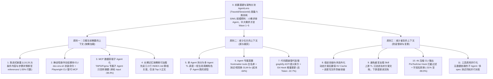

# 靠这10个优化点，我们把 Multi-Agent 工作流成本降了50%以上

## 1. TL;DR

本文复盘了腾讯内部基于 CodeBuddy 的 `tech-leader` 多 Agent 协同开发工作流（`1 个 TL 主调度 + 5 个 Wave / 6 类子 Agent`，跑完一个中等需求需经历 `5～6 个 Wave`、`20+ 次`子 Agent 调用与数百轮工具调用）的 Token 成本治理实践。团队首先通过内网 **AgentLens**（按 `TraceId` / `SessionId`）拆解出六类消耗来源，发现系统提示词/MCP Schema、工具返回大 Payload 与滚雪球式的历史消息是吞金大户；随后确立**先做 S/M/L 规模预判（小需求走单 Agent，中大需求才拆分）**的前置架构原则，并围绕**“① 让 AI 只看到当前需要的上下文、② 减少无关的上下文、③ 减少重复的上下文”**三大原则落地了 **11 项具体优化手段**（标题称“10 个优化点”，正文表格与分项汇总实际列出 11 项）。实测主 Agent 端到端 Token 从 `708,783`（17 轮）降至 `315,266`（9 轮，降幅 **`-55.5%`**、轮次 **`-47%`**），代入各 Wave 消耗分布反推全流程预估降本 **`50%～65%`**。

## 2. 核心概念

### 六类 Token 消耗来源解剖（按成本特征排序）

| 消耗来源 | 包含内容 | 计费与膨胀特征（为什么贵？） |
|---|---|---|
| **① 系统提示词** | 系统固定提示词、Skill 描述、MCP 工具 Schema | **每轮必带，随 Agent/MCP 数量倍增**：一个含 `40` 个工具的 MCP Server 每轮固定增加约 `10～15 KB` Schema 开销 |
| **② 工具返回信息** | MCP 返回的工具列表、TAPD 需求 JSON、Figma 设计稿节点树、截图 base64 | **体积不可控且长期滞留**：一旦塞进主 Agent 上下文，后续几十轮工具调用都要跟着重复计费 |
| **③ 读取的文件信息** | AI 读取的代码文件、知识库文档内容 | **盲搜式探索叠加**：传统关键词盲搜往往需 `3～5 轮` 才能定位，每轮匹配行与整段文件不断累积 |
| **④ 长期记忆** | AI 加载的历史经验、技术方案沉淀文档 | **全量常驻浪费**：一旦整篇读入往往常驻至会话结束，即使只用到其中一两条经验 |
| **⑤ 历史消息** | 多轮会话累积的对话与动作历史 | **真正的最大头**：`append-only` 滚雪球式增长，越往后的轮次单轮计费越贵 |
| **⑥ 用户提示词** | 用户输入的一句话或需求描述 | **最便宜的一项**：仅在输入当轮新增一次，体量最小 |

### 核心概念辨析：为什么“拆多 Agent”本身不直接省钱，却是降本的前提？

- **单拆分的直接账面代价**：若 6 个 Agent 并行跑，相当于同时有 6 份系统提示词在计费；因此**小需求（S 模式）绝不能无脑拆多 Agent**，必须先由 TL 做 `S / M / L` 规模预判。
- **拆分对中大型需求（M/L 模式）的两大结构性价值**：
  1. **切断滚雪球效应**：每个子 Agent（`backend-dev` / `frontend-dev` / `test-runner` / `visual-reviewer` / `code-reviewer`）生命周期短、跑完即销毁，避免把所有领域的规范与过程历史堆在同一条超长会话里。
  2. **打开差异化配置空间**：只有拆开后，才能为不同角色单独配置**工具白名单**、**模型分层（如用便宜的 `GLM-5v` 跑测试/视觉修复循环）**以及**专属子 Agent 隔离重型 MCP Payload**。

## 3. 知识框架



## 4. 关键要点与机制详解

### 4.1 原则一：让 AI 只看到当前需要的上下文（4 项优化）

**核心主张：不是所有规范、工具和原始数据都需要常驻主上下文；通过资源层外置、CLI 批处理、短命子 Agent 摘要过滤与 `INDEX.md` 二级检索，将按需加载落到实处。**

1. **渐进式披露（Skill L1/L2/L3 三层拆分）**：
   - **问题**：`SKILL.md` 正文里混入了大量条件性内容（如自动化测试 Skill 中仅在 Phase A 用一次的 40 行 TS spec 模板、仅在有 DB 依赖时才用的 38 行 DB 规则）和全量分支步骤（如 `tech-leader` Skill 中 S/M 模式与 Wave 1–5 的所有派发 Prompt）。
   - **机制**：遵循 Anthropic Agent Skill 渐进式披露规范（即使装 20 个 Skill，初始目录层加载仅 `1000～2000 token`，比单体提示词省约 `90%`），将条件性内容与各阶段详细执行内容全部拆到 `references/` 资源层，`SKILL.md` 正文只保留骨架（职责、规模预判表、分流规则、进度与容错），走到哪一步再按需 `read_file` 对应资源。改造后自动化测试 Skill 正文从 `198 行` 降至 `128 行`（**`-35%`**）。
2. **确定性操作交给脚本执行（`dev-env.sh` + Playwright CLI 替代 MCP）**：
   - **问题**：① 后端 Agent 手拼 `mysql -u root -p`、找启动命令、绕过编译，反复试错烧 Token；② 自动化测试用 **Playwright MCP** 实时控浏览器，每点一个按钮就是 1 次 MCP 调用 + 1 次 LLM 推理（10 步操作即 10 轮对话），且每次 MCP 调用背着 `10～15 KB` Schema，失败后无法直接重跑、单浏览器实例无法并行。
   - **机制**：① 将数据库迁移、编译、启动、健康检查封装进固定脚本 `dev-env.sh`，AI 只传参数不拼命令；② **能用 CLI 就不用 MCP**：将 Playwright MCP 换为 **Playwright CLI**——让大模型只负责把自然语言用例翻译为可复用的 Playwright `spec` 代码文件，再调用 Playwright CLI 多 worker 批量并行执行。
3. **MCP 数据获取子 Agent 化（隔离巨型原始 Payload）**：
   - **问题**：TL 主 Agent 生命周期贯穿全程（10+ 轮）；若由 TL 自己调用 TAPD MCP 和 Figma MCP，动辄几千字的需求 JSON、上万行的设计稿节点树 JSON 与截图会永久卡在 TL 的上下文里，后续几十轮反复计费。
   - **机制**：新建短生命周期的 `tapd-req-analyzer` 和 `figma-design-analyzer` 专属子 Agent，在子会话内吞吐原始 Payload 并提炼成结构化摘要返回给 TL，子 Agent 随即销毁。实测单轮 input token 从 `1,030,000` 降至 `634,905`（**`-38.4%`**），且彻底消除了后续轮次的滚雪球计费。
4. **长期记忆按需索引加载（`INDEX.md` 二级检索）**：
   - **问题**：`context-keeper` 知识沉淀 Skill 原先扫描 `team/project` 下所有历史文档，命中关键词就整篇 `read_file` 常驻。
   - **机制**：引入几十行到一两百行的轻量目录索引 `INDEX.md`（含标题 + 标签 + 摘要表格）——① 先 `read_file INDEX.md` → ② 按关键词匹配标题/标签/摘要并结合类别权重算相关度 → ③ **仅对高于阈值的 Top 3 条目 `read_file` 正文**（仅当 `INDEX.md` 不存在时才回退全文 `search_content`）。

### 4.2 原则二：减少无关的上下文（3 项优化）

**核心主张：消除跨领域历史混杂、无关 MCP Schema 暴露与多轮盲搜带来的噪声。**

5. **单 Agent 拆分为多 Agent（配合 S/M/L 规模预判）**：
   - 引入专职调度的 `TL`，将编码、质量审查、测试、视觉验证分发给按角色划分的子 Agent（Wave 1 前后端并行 → Wave 2 质量审查 → Wave 3 测试生成与执行 → Wave 4 视觉验证 → Wave 5 Agent 评测），跑完即毁。
6. **Agent 专属配置（工具白名单 + 模型分层路由）**：
   - **问题**：CodeBuddy 自带的 `TeamCreate` 自动派生子 Agent 时会默认挂载所有已注册 MCP Server 的 Schema；且所有角色默认用昂贵的主力模型。
   - **机制**：① 改为每个角色创建独立自定义 Agent 定义文件，在 YAML frontmatter 的 `tools` 字段显式指定工具白名单（如 `backend-dev` 不声明 `mcpServers`，Figma/TAPD/iWiki 等 MCP 完全不可见）；同时将大段稳定角色指令迁入子 Agent 系统提示词以利缓存，使 TL 的派发提示词从 `10～15 行` 精简至 `2 行` 动态内容。② **模型分层**：将规则性强、推理要求低但修复循环轮次最多的自动化测试与视觉还原对比 Agent 切换为智谱多模态模型 **`GLM-5v`**（单价约为 Claude Sonnet 的 `36%`），使测试/视觉 Agent 成本直接降低 **`64%`**。

```yaml
---
name: backend-dev
tools: list_dir, search_file, search_content, read_file, replace_in_file, write_to_file
# 不声明 mcpServers 字段 → Figma/TAPD/iWiki 等 MCP Schema 全部不暴露
---
```

7. **代码图谱（`graphify`）替代关键词盲搜**：
   - **问题**：传统 `search_content` 搜 `"UserService"` 返回 20 个文件匹配行，需 3–5 轮盲搜与多次整文件读取才能定位。
   - **机制**：使用基于 AST 与语义依赖关系的开源工具 **`graphify`**（`uv tool install graphifyy`，初始化生成 `graphify/` 目录后只需提交 4 个核心文件，并通过 `graphify hook install` 绑定 Git `post-commit + post-checkout` 自动增量更新）。Agent 搜索代码前先查图谱锁定文件范围再 `read_file`，减少探索轮次。同任务实测总 Token 从 `875,352` 降至 `676,987`（**`-22.7%`**，节省约 `19.8 万` token，其中输入 token `-22.8%`）。

### 4.3 原则三：减少重复的上下文（4 项优化）

**核心主张：保护 Prefix KV Cache 稳定前缀（读取价仅约正常价的 10%）、上游一次收集下游文档复用、拦截压缩嘈杂 CLI 输出、并将无数据依赖的调用合并同轮并行。**

8. **稳定前缀设计（动态内容后置 + 进度状态外化到文件）**：
   - **问题**：① 派发子 Agent 的提示词中稳定指令与动态技术方案交错排列，破坏 Prefix KV Cache；② 主 Agent 每次阶段切换都在对话里输出完整进度看板，堆积在历史里导致无法压缩且破坏前缀。
   - **机制**：① 将动态技术方案文档统一后置；② **进度状态外化到磁盘文件**——主 Agent 每次唤醒先 `read_file` 进度文件，对话内阶段切换仅输出单行状态（如 `✅ Wave 1 完成 → Wave 2 🔄 已启动`），兼顾缓存命中与中断现场恢复。
9. **避免重复加载 Skill（上游收集一次，文档传递下游）**：
   - **问题**：TL 主 Agent 在方案设计阶段已调用 `context-keeper` 加载过历史经验并写入技术方案文档，但下游前端 Agent 又重复触发 `use_skill` 将 200 行 `SKILL.md` 再加载一遍。
   - **机制**：砍掉下游子 Agent 的重复 Skill 调用，统一直接读取上游产出的技术方案文档获取结论。
10. **`rtk` 压缩 CLI 输出（拦截过滤命令行噪音）**：
    - **问题**：`git status`、`npm test`、`docker ps` 等原始输出夹带大量噪音，在测试修复循环中反复进入上下文。
    - **机制**：接入开源 CLI 代理 **`rtk`**（在 `~/.codebuddy/settings.json` 全局配置一次，所有子 Agent 自动生效）。针对 CodeBuddy 不被官方 `--agent` 直接支持的问题，改用 CodeBuddy 的 **`PreToolUse Hook`** 拦截，并编写转换脚本将 `rtk` 输出的 **`updatedInput` 字段映射为 CodeBuddy 要求的 `modifiedInput` 字段**（防静默失效）。实测按命令类型可复现压缩 **`31%～98.9%`**（如纯 `git status` 为 `-31%`，`ps aux` 达 `-98.9%`）。
11. **工具调用并行化（消灭“沉默的串行”）**：
    - **问题**：两次互不依赖的调用（如先调 TAPD 摘要等结果、再调 Figma 摘要；或逐条串行跑 Playwright spec）若分多轮串行发起，每多一轮就要把前面所有历史重新打包计费一次。
    - **机制**：凡是后一次调用不需要前一次输出作为输入的无依赖操作，一律在同一轮消息内并行发起（如 `Task` 工具同轮传入 `tapd-req-analyzer` 与 `figma-design-analyzer` 两个 `subagent_name`；Playwright CLI 单次调用传入多个 spec 文件由多 worker 并行跑）。

## 5. 数据速查表

| 指标 | 原文数值 | 语境 / 条件 |
|---|---|---|
| 中等需求工作流规模 | `1 个 TL + 6 个子 Agent`，跨 `5～6 个 Wave`、`20+ 次`子 Agent 调用、数百轮工具调用 | CodeBuddy 内网 `tech-leader` 工作流 |
| MCP Server Schema 常驻开销 | 每个 `40` 工具的 MCP Server 每轮增加约 `10～15 KB` | 未做工具白名单裁剪前的每轮固定 input 开销 |
| 渐进式披露初始加载与测试 Skill 瘦身 | 安装 `20` 个 Skill 初始仅 `1000～2000 token`（省约 `90%`）；自动化测试 Skill 正文从 `198 行` 降至 `128 行`（`-35%`） | 将 40 行 TS 模板与 38 行 DB 规则移至 `references/` |
| MCP 数据获取子 Agent 化收益 | 单轮会话 input token 从 `1,030,000` 降至 `634,905`（**`-38.4%`**） | 将 TAPD 与 Figma 原始获取剥离至专属子 Agent 只回传摘要 |
| 测试/视觉子 Agent 模型分层收益 | 角色模型成本 **`-64%`** | 从 Claude Sonnet 切换为智谱 `GLM-5v`（单价约 Sonnet 的 `36%`） |
| 代码图谱 `graphify` 同任务实测对比 | 总 Token：`875,352 → 676,987`（**`-22.7%`**）；输入 Token：`868,544 → 670,281`（**`-22.8%`**）；输出 Token：`6,808 → 6,706`（`-1.5%`）；缓存命中率：`94.4% → 91.0%`（`-3.4pp`） | 同一编码任务开启/关闭 `graphify` 实测（缓存命中 Token 从 `820,175` 降至 `609,903`，未命中从 `48,369` 升至 `60,378`） |
| Prompt Cache 缓存读取价格比例 | 约正常价格的 `10%` | 前缀完全一致时复用 KV Cache 的计费比例 |
| `rtk` 命令行输出压缩幅度 | 官方标称 `-60%～90%`；实测 `ps aux` 为 **`-98.9%`**，纯 `git status` 为 **`-31%`** | 纯文本过滤，通过 `rtk gain` 或命令行直接对比 100% 可复现 |
| 主 Agent 端到端实测与全流程反推降幅 | 主 Agent：`708,783`（`17 轮`）→ `315,266`（`9 轮`），Token **`-55.5%`**、轮次 **`-47%`**；全流程预估降本 **`50%～65%`** | 全流程 `50%～65%` 为基于实测 Wave 消耗分布代入各分项降幅区间的反推估算值（严格端到端 A/B 待补齐） |

## 6. 踩坑与教训 / 可迁移的设计原则

### 踩坑与教训（错误做法 → 失败表现或原因 → 原文应对）

1. **接入 `rtk` 时字段名不匹配导致 Hook 静默失效**：
   - **错误做法**：在 CodeBuddy 的 `PreToolUse Hook` 中直接原样返回 `rtk` 的 JSON 输出。
   - **失败表现或原因**：`rtk` 输出的重写字段名为 `updatedInput`，而 CodeBuddy Hook 协议要求的是 `modifiedInput`；字段名不一致不会报错，但会导致压缩彻底静默失效。
   - **原文应对**：在 Hook 中增加几行字段名转换脚本，将 `updatedInput` 映射为 `modifiedInput`。
2. **用“跑两遍完整 Agent 工作流（开/关 `rtk`）”来评测纯文本压缩工具的效果**：
   - **错误做法**：拿同一个需求分别在开启和关闭 `rtk` 下跑完整的多 Agent 流程对比总 Token。
   - **失败表现或原因**：大模型自身的探索轮次、是否踩坑重试存在巨大随机波动，路径噪声远大于 `rtk` 自身的压缩收益，导致评测结论失真。
   - **原文应对**：由于 `rtk` 是与模型决策无关的确定性文本过滤，直接用 `rtk gain` 或对相同命令输出做离线对比（100% 可复现），并区分不同命令的真实降幅（如 `ps aux -98.9%` vs `git status -31%`）。
3. **不分需求大小一律启动 6 个子 Agent 的 Multi-Agent 编排**：
   - **错误做法**：连改几行代码的小需求也走完整的 TL + 6 子 Agent 流程，或用默认的 `TeamCreate` 把所有 MCP Schema 挂给每个子 Agent。
   - **失败表现或原因**：6 份系统提示词与几十个无关 MCP Schema 并行计费，底座固定开销远超任务本身。
   - **原文应对**：先做 `S / M / L` 规模预判（S 级小需求单 Agent 直出），并为每个子 Agent 编写独立定义文件，用 `tools` 白名单剥离无关 MCP。

### 可迁移的设计原则（四步落地优先级路线）

1. **第一优先级（架构前提）**：建立 `S / M / L` 规模预判分流与角色子 Agent 拆分。
2. **第二优先级（一个下午见效）**：接入 Token 度量（如 AgentLens）+ 重排 `SKILL.md` 保证稳定前缀 + 全局配置 `rtk` 压缩 CLI 输出。
3. **第三优先级（逐步推进）**：将条件内容与步骤详情移出 `SKILL.md` 至 `references/`、主 Agent 进度状态外化到文件、排查无数据依赖的串行调用改为同轮并行。
4. **第四优先级（中长期系统梳理）**：引入 `graphify` 代码图谱、用 CLI 脚本（如 `dev-env.sh`、Playwright CLI）替代高频确定性 MCP、配置子 Agent 工具白名单与模型分层（如 `GLM-5v`）、将 TAPD/Figma 原始获取子 Agent 化、建立 `INDEX.md` 长期记忆二级索引。

## 7. 记忆锚点

1. **三原则四句话锚点**：「只看当前需要（渐进披露、CLI 替 MCP、子 Agent 吞 Payload、INDEX 索引）、减少无关（按规模拆 Agent、白名单 + 模型分层、代码图谱）、减少重复（稳定前缀 + 状态外化、不重复加载 Skill、rtk 压 CLI、无依赖同轮并行）——最省钱的调用是不调用，最贵的冗余是每个 Agent 各自重新发现同一份信息。」

## 8. 复习卡片

在 Multi-Agent 工作流的六类 Token 消耗来源中，为什么“工具返回信息”和“历史消息”会成为成本失控的主因？::因为历史消息是 `append-only` 滚雪球式增长，越往后的轮次计费越贵；而一旦在长生命周期的主 Agent 中直接调用 TAPD 或 Figma MCP，动辄数千字的需求 JSON 或上万行的设计稿节点树会一直滞留在上下文里，在后续几十轮调用中被反复打包计费。
为什么说“把单 Agent 拆分为多 Agent”本身并不直接靠减少提示词省钱，必须配合什么前置动作？::因为 6 个子 Agent 并行意味着同时为 6 份系统提示词付费；拆分的真正价值是靠短生命周期子 Agent 跑完即销毁来切断历史滚雪球，并为工具白名单裁剪、模型分层和 Payload 隔离打开空间，因此前置动作必须先做 `S/M/L` 规模预判，小需求直接走单 Agent。
在自动化测试场景中，为什么作者要用 Playwright CLI 替代 Playwright MCP？::因为 Playwright MCP 每点击一个按钮都需要一次完整的 LLM 推理且携带 `10～15 KB` Schema，测试失败后无法直接重跑、单浏览器实例也无法并行；改为讓 LLM 一次性将自然语言用例翻译为可复用的 Playwright `spec` 文件，再由 Playwright CLI 多 worker 批量并行执行，大幅降低了推理轮次与耗时。
如何通过“MCP 数据获取子 Agent 化”和“长期记忆 `INDEX.md` 索引化”压缩主 Agent 的上下文？::① 为 TAPD 和 Figma 建立专属短生命周期子 Agent，由其消化庞大的原始 JSON 并只向主 Agent 返回结构化摘要（实测单轮 input token 降低 `38.4%`）；② 在读取历史沉淀文档前先读几十行的 `INDEX.md` 计算相关度，只对命中 Top 3 的文档读取正文。
`graphify` 代码图谱是如何减少编码阶段 Token 消耗的？实测效果如何？::它利用 AST 和语义依赖关系为仓库建立索引（配合 Git `post-commit` / `post-checkout` Hook 自动增量更新），让 Agent 先查图谱锁定文件范围再读取文件，取代了需要 3–5 轮的关键词盲搜；同任务实测总 Token 下降 `22.7%`（从 87.5 万降至 67.7 万）。
在保护 Prefix KV Cache（缓存读取价约为正常价 10%）方面，作者对主 Agent 做了哪两项改造？::① 将派发子 Agent 提示词中的动态内容（技术方案文档）统一后置，保持前缀稳定；② 将主 Agent 每阶段切换时输出的完整进度看板外化到磁盘文件中，每次唤醒通过 `read_file` 读取状态，会话内只输出单行阶段状态。
在 CodeBuddy 中接入 `rtk` 压缩命令行输出时，作者踩了哪两个工程与评测方法论的坑？::① 工程坑：CodeBuddy 的 `PreToolUse Hook` 要求返回字段名为 `modifiedInput`，而 `rtk` 输出为 `updatedInput`，不写转换脚本会导致静默失效；② 评测坑：不能用“跑两遍完整工作流”来测 `rtk`（模型探索路径随机波动大于压缩收益），应直接用 `rtk gain` 或离线命令行对比，且不同命令降幅差异极大（如 `ps aux -98.9%` vs `git status -31%`）。

## 9. 知识关联

### 本库主题入口与已有关联笔记

- [Agent成本与上下文预算](../../20_topics/Agent%E6%88%90%E6%9C%AC%E4%B8%8E%E4%B8%8A%E4%B8%8B%E6%96%87%E9%A2%84%E7%AE%97.md)：六类 Token 消耗拆解、三原则十一项降本手段与 Prefix KV Cache 优化。
- [Harness与模型协同](../../20_topics/Harness%E4%B8%8E%E6%A8%A1%E5%9E%8B%E5%8D%8F%E5%90%8C.md)：CLI 脚本与 MCP 的职责边界、子 Agent 工具白名单与模型分层路由。

### 候选双链（供 Obsidian 知识库导航）

- **本库成本与上下文系列**：[[上下文工程]]、[[Token 刺客案例]]、[[精打细算虾养成指南]]、[[DeepSeek Harness观测]]、[[WorkBuddy使用技巧]]
- **关联工具与规范**：[[Anthropic Agent Skill 渐进式披露]]、[[graphify 代码图谱]]、[[rtk CLI Proxy]]、[[Playwright CLI]]

## 10. 原文参考资料

- **本目录归档文件**：[RAW.pdf](RAW.pdf)｜[MD.md](MD.md)
- **原文列出的参考资料与开源仓库**：
  - *How we built our multi-agent research system* | Anthropic Engineering Blog
  - *Improving token efficiency in GitHub Agentic Workflows* | GitHub Blog
  - 《Agent Skill 规范、构建与设计模式》 | 阿里技术
  - `rtk-ai/rtk`：CLI proxy that reduces LLM token consumption by 60-90% | GitHub
  - `Graphify-Labs/graphify`：`https://github.com/Graphify-Labs/graphify`

> [!note]- 校对报告
> - **覆盖度核验**：已完整通读 `MD.md`（共 15 页，p.1–14 为技术正文与参考资料，p.15 为公众号尾页与留言入口）并核对 `META.json` 记录。完整覆盖业务背景（TL + Wave 1–5 架构）、六类消耗来源、AgentLens 度量、三原则与 S/M/L 规模预判、全部 11 个具体优化点（注：文章标题写“10个优化点”，但 p.4 关键技术选型表与 p.13 分项收益汇总表均实际列出 11 项：4+3+4=11，笔记已完整收录并说明）、核心指标与分项收益表、四步落地优先级路线。
> - **关键数据逐项核对**：
>   1. **架构与基础开销**（p.1–2, p.5）：`1 个 TL + 6 个子 Agent`，`5-6 个 Wave`、`20+ 次`子 Agent 调用；40 工具 MCP Server 每轮增加约 `10-15KB` Schema；20 个 Skill 渐进披露初始加载仅 `1000-2000 token`（减少约 `90%`）；自动化测试 Skill 正文从 `198 行` 降至 `128 行`（`-35%`，外移 40 行 TS 模板与 38 行 DB 规则）。
>   2. **实测对比数据**（p.7, p.9–10, p.12–13）：TAPD/Figma 子 Agent 化使单轮 input token 从 `1,030,000` 降至 `634,905`（`-38.4%`）；`GLM-5v` 成本约为 Sonnet 的 `36%`，使测试/视觉 Agent 成本 `-64%`；代码图谱 `graphify` 实测总 token 从 `875,352` 降至 `676,987`（`-22.7%`），输入 token 从 `868,544` 降至 `670,281`（`-22.8%`），缓存命中从 `820,175` 降至 `609,903`（`-25.6%`），未命中从 `48,369` 升至 `60,378`（`+24.8%`），输出 token 从 `6,808` 降至 `6,706`（`-1.5%`），缓存命中率从 `94.4%` 降至 `91.0%`（`-3.4pp`）；Prompt Cache 读取价约正常价格的 `10%`；`rtk` 实测 `ps aux -98.9%`、纯 `git status -31%`；主 Agent 端到端 token 从 `708,783`（`17 轮`）降至 `315,266`（`9 轮`），降幅 `-55.5%`、轮次 `-47%`；全流程反推降本 `50%~65%`。
> - **事实边界与局限说明**：原文第 13–14 页明确说明全流程 `50%～65%` 降幅是基于实测 Wave 消耗分布代入各分项降幅区间的反推值，严格的端到端成对 A/B 复核仍在后续计划中；笔记已准确标注该口径边界。
> - **格式自检**：全文仅 1 个 H1 标题；正文、表格、Mermaid 图与复习卡片均无页码/章节出处标注；复习卡片共 7 条，严格采用单行 `问题::答案` 格式。
