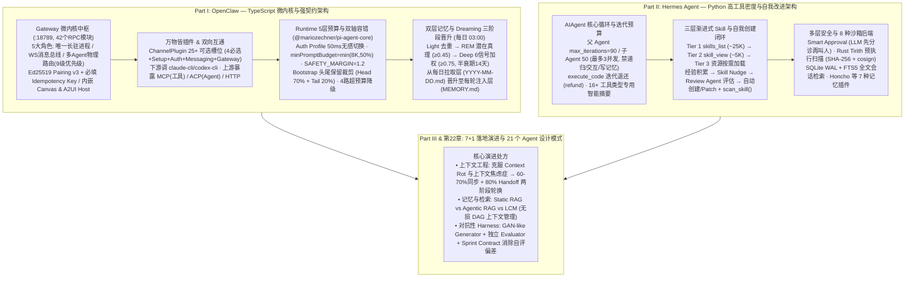

# OpenClaw 与 Hermes：源码里的 AI Agent 架构知识大复盘

## 1. TL;DR

1. **两大开源 Agent 架构哲学的正面交锋**：基于 `OpenClaw v2026.5.6`（TypeScript ESM）与 Nous Research `Hermes Agent v0.13`（Python）的源码级拆解，OpenClaw 走 **“微内核 + 强契约插件化（边界 vs 实现分离）”** 路线（单主机唯一 `:18789` Gateway 统管 42 个 RPC 模块与 **25+ 槽位** `ChannelPlugin` 契约，适合多通道/多 Agent 物理隔离与平台化演进）；Hermes 走 **“一体化单体 + 高工具密度与自我改进”** 路线（围绕 `AIAgent` 核心类、全局 `ToolRegistry`、三层渐进式 Skill 加载与 **技能自创建改进闭环**，适合个人开发者重度 Dogfood）。
2. **上下文预算五层防御与双向后端互通**：OpenClaw 构建了 **“4 种预算 × 4 路超预算决策 × 单工具双层硬限 × Bootstrap 头尾保留裁剪（保 Head `70%` + 保 Tail `20%`，砍中间 `10%`）× 截断告警自感知”** 的 5 层预算体系（设 `minPromptBudget = min(8K, 50% context)` 与 `SAFETY_MARGIN = 1.2`），并通过 **Auth Profile 双轴容错** 在 `50ms` 内切换限流凭证；同时既能将 `claude-cli / codex-cli` 作为下游 LLM Backend，又能通过 **MCP Server（工具粒度）**、**ACP Server（Agent 粒度）** 与 **HTTP API** 反向充当 IDE 的上游 Backend。
3. **记忆沉淀双范式：Dreaming 三阶段加权晋升 vs FTS5 + 技能自创建**：OpenClaw 区分每日拉取式召回层（`memory/YYYY-MM-DD.md`）与每轮注入的静态层（`MEMORY.md`），通过每日 `03:00` 触发的 **Dreaming 三阶段（Light 浅睡去重 → REM 提取潜在真理［阈值 `≥ 0.45`］→ Deep 六信号加权晋升［阈值 `≥ 0.75`，半衰期 `14 天`］）** 自动固化长期记忆；Hermes 则采用 **SQLite WAL + FTS5 全文检索会话历史** 搭配 **Honcho 辩证用户建模等 7 种插件提供者**，并首创 **经验积累 → Skill Nudge → Review Agent 评估 → 自动创建/Patch 技能** 的自我演进闭环。
4. **安全纵深与下一代 Harness 演进方向（7+1 落地难题）**：OpenClaw 采用 **5 层纵深防御**（Loopback 默认隔离、Ed25519 Pairing v3、混淆命令检测与插件静态扫描），Hermes 采用 **Smart Approval 三态（LLM 先分诊再叫人）+ Rust 编写的 Tirith 预执行扫描 + 8 种沙箱后端**；面向未来，作者结合 Anthropic **“上下文焦虑症 / 自我评估偏差”** 与 Google **《Agentic Design Patterns》21 个模式**，提出 **60–70% 记忆同步 + 80% 优雅 Handoff 两阶段 Session 轮换**、**GAN-like 生成-对抗独立 Evaluator** 与 **LCM（无损上下文 DAG 压缩）** 等演进蓝图。

## 2. 问题定义与背景

### 2.1 从开发 `openclaw-qqbot` 插件看开源 Agent 的“看山三境”
作者在 2026 年 2 月至 3 月 31 日开发并将 `openclaw-qqbot` 正式合入 OpenClaw 主仓的过程中，顺着源码摸清了个人助理级 AI Agent 从惊艳到祛魅再到理解工程取舍的真实困境：
- **OpenClaw 的真实痛点**：① **费 Token**（Bootstrap 工作区文件每轮 Push 数万 Token）；② **长对话断片**（Compaction 默认有损压缩，且后台 Dreaming 默认关闭）；③ **复杂多步任务交付度低**（长周期任务中常丢失关键约束，即 Anthropic 指出的“上下文焦虑症”与“自我评估偏差”）。
- **Hermes 的真实痛点**：① **多用户串扰风险**（即使 v0.13 引入多 Profile，同一 Profile 内 `USER.md` 仍共享，单 Agent 多平台共用易串扰）；② **核心仍是巨型单体**（`run_agent.py` 中的 `AIAgent` 类汇聚一切逻辑，多人协作易冲突）；③ **全量存储膨胀**（SQLite FTS5 会话库在达到 `384MB+ / 68K+` 消息时检索变慢，且缺乏全自动记忆晋升）。

### 2.2 两大框架的核心定位分野
| 对比维度 | OpenClaw (`v2026.5.6`, TypeScript ESM) | Hermes Agent (`v0.13`, Nous Research, Python) |
| :--- | :--- | :--- |
| **核心哲学** | **微内核 + 万物皆插件（边界与实现分离）** | **一体化丰满单体 + 工具高密度与自我改进** |
| **核心枢纽** | 单主机唯一长驻 `Gateway`（默认 `127.0.0.1:18789`） | 单体 `AIAgent` 类 + 全局单例 `ToolRegistry` |
| **隔离粒度** | `SessionKey`（`agent:{agentId}:{scope}`）+ 多 Agent 物理隔离工作区 | 单队列执行 + `delegate_task` 线程池子 Agent（默认最大并发 `3`） |
| **王牌特性** | 25+ 槽位 Channel 契约、5 层上下文预算、Dreaming 6 信号晋升、双向 MCP/ACP | 16+ 工具智能摘要、Tier 1~3 渐进式 Skill + 技能自创建、Smart Approval + 8 种沙箱 |

## 3. 知识框架

## 4. 核心内容拆解

### 4.1 OpenClaw 核心架构：Gateway 微内核、多 Agent 路由与 25+ 槽位插件契约

1. **Gateway（`:18789`）的五大操作系统级角色**：
   -源码由 `server-methods.ts`（`39 个` 直接注册）+ `server-aux-handlers.ts`（`3 个` 懒加载）共 **42 个 RPC Handler 模块** 构成，承担五大角色：
     1. **唯一长驻进程（Single Source of Truth）**：避免多进程并发持有引发 WhatsApp 二次扫码或 Telegram Session 冲突；
     2. **统一 WebSocket 消息总线**：区分外部主动连入的操作端 **Client**（TUI / Mobile App / Web，走 WebSocket + Ed25519 签名认证）与进程内加载的通道插件 **Channel**（函数调用），二者通过 `SessionKey` 交汇；
     3. **多 Agent 物理路由边界（9 级匹配优先级）**：按 `binding.peer`（精确用户）→ `peer.parent`（线程父级）→ `peer.wildcard` → `guild+roles` → `guild` → `team` → `account` → `channel` → `default` 逐级匹配，将不同渠道/用户分发至拥有独立工作区（`SOUL.md / USER.md / MEMORY.md`）的 Agent，彻底解决单 Agent 多用户记忆串扰；
     4. **认证与信任根**：Loopback 自动信任，跨机强制 TLS SHA-256 指纹 Pinning + **Pairing v3 协议**（校验 `platform + deviceFamily`），且所有改变状态的写操作强制要求 **`idempotency key`（幂等键）**；
     5. **嵌入式 HTTP Host**：同端口提供 `/__openclaw__/canvas/`（Agent 动态生成可交互 HTML/JS 界面）与 `/__openclaw__/a2ui/`。
2. **多 Agent 间通信的 4 种协作模式**：
   - 区分向常驻独立 Agent 发消息的 `sessions_send`（受 `maxPingPongTurns = 5` 防死循环限制）与创建临时子会话干完即走的 `sessions_spawn`；支持通过 Prompt 编排 **Supervisor（中央统筹）**、**Router（分诊台）**、**Pipeline（串行传递）** 与 **Parallel（并行汇总）** 四种模式。
3. **ChannelPlugin 的 25+ 槽位完整契约与精细化热重载**：
   - 包含 **必选 4 项**（`id, meta, capabilities, config`）、**Setup 三件套**、**Auth + Security 7 项**、**Messaging 7 项**（含 per-channel 流式协议 `streaming`）、**协作能力 7 项**、**Gateway + 运维 6 项**（含 `reload.configPrefixes` 仅重启配置变更的单个 Channel）以及 **反向工具 `agentTools`**（Channel 向 LLM 暴露专属工具）；出站管道按通道限制智能分块（如 QQ Bot `5,000 字符`、Telegram `4,000 字符`），媒体文件默认限制 `5MB`（`MEDIA_MAX_BYTES`，RPC 层 `20MB` 提前拦截）。

### 4.2 OpenClaw 执行引擎：双轴容错、双向 Backend 与五层预算防御

1. **Auth Profile 双轴容错（凭证失败与业务失败分治）**：
   - 当调用 LLM 遇到 `429 rate_limit` 时，Hermes 会在同一 Key 上盲目重试直至超时；而 OpenClaw 的 `Auth Controller` 识别为凭证类错误后，将当前 Profile A 标记冷却 `30s`，并在 **50ms 内无感切换至 Profile B**（支持通过 `external-cli-sync.ts` 自动同步本地 `claude-cli / codex` 已登录 OAuth 凭证）。
2. **双向 Backend 架构**：
   - **向下把 CLI 当 Backend**：通过子进程调用 `claude-cli` 或 `codex exec`，并在进程内拉起临时 `OpenClaw MCP Server` 让外部 CLI 反向回调 OpenClaw 的通道与工具；
   - **向上做别人的 Backend**：提供 `openclaw mcp serve`（暴露工具粒度给 Claude Code）、`openclaw acp`（暴露完整 Agent 粒度给 Zed / Copilot CLI）与 Gateway HTTP API。
3. **Runtime 预算的 5 层防御体系**：
   - **Reserve 让步与安全裕度**：设 `SAFETY_MARGIN = 1.2`（为 Token 估算留出 `20%` 缓冲），并强制保障 `minPromptBudget = min(8K, 50% context)`（即使配置 `reserveTokens = 100K` 而窗口仅 `20K`，也会将 Reserve 截断为 `12K` 以保住 `8K` Prompt 空间）。
   - **4 路超预算自适应决策**：装得下走 `fits` → 无工具结果走 `compact_only` → 工具输出充足（`≥ overflow × 1.5 + 512 tokens`）走更廉价的 `truncate_tool_results_only` → 否则走 `compact_then_truncate` 双管齐下。
   - **Bootstrap 工作区文件“保头保尾砍中间”裁剪**：单文件（如 `AGENTS.md` 默认上限 `20,000 字符`）超预算时，**保留头部 `70%`（使命宣言与全局原则）+ 保留尾部 `20%`（最新约定与近期更新），砍掉中间 `10%` 历史细节**，并向 Prompt 注入 `[Bootstrap truncation warning]` 让 Agent 自感知；创建 Subagent 时仅保留 `SOUL / USER / IDENTITY / AGENTS / TOOLS` 以维持人格连续性，剥离 `HEARTBEAT / BOOTSTRAP / MEMORY` 状态包袱。

### 4.3 长期记忆对决：OpenClaw Dreaming 三阶段晋升 vs Hermes FTS5 + 技能自创建

1. **OpenClaw 双层记忆与 Dreaming 睡眠整合（每日 `03:00` Cron）**：
   - **拉取层（Pull）vs 推送层（Push）**：每日记忆 `memory/YYYY-MM-DD.md` 属于按需检索的召回层（由 `memory-core` SQLite/QMD Sidecar 或 `memory-lancedb` 支撑）；全局 `MEMORY.md` 属于每轮自动注入上下文的静态层。
   - **Dreaming 三阶段漏斗**：
     - **Light Sleep（浅睡）**：读取近期短期召回、每日记忆与脱敏会话，去重整理候选物料（不写 `MEMORY.md`）；
     - **REM Sleep（快速眼动）**：提取反复出现的主题与候选“潜在真理”，计算四维置信度（`0.45 × Relevance + 0.25 × Frequency + 0.20 × Consolidation + 0.10 × Conceptual`），按宽松阈值 **`≥ 0.45`** 与相似度 `0.88` 去重保留 Top 3；
     - **Deep Sleep（深睡晋升）**：执行 **6 信号加权评分**（`0.30 × relevance + 0.24 × frequency + 0.15 × diversity + 0.15 × recency［半衰期 14 天］+ 0.10 × consolidation + 0.06 × conceptual + Light boost[≤0.06] + REM boost[≤0.09]`），必须同时通过 **总分 `≥ 0.75`** 等三重门禁才正式写入 `MEMORY.md`。
2. **Hermes Agent 的迭代预算、三层渐进式 Skill 与自我改进闭环**：
   - **线程安全迭代预算（`IterationBudget`）**：父 Agent 默认 `max_iterations = 90`，`delegate_task` 子 Agent 默认 `max_iterations = 50`（默认最大并行子 Agent 数为 `3`，且通过 `DELEGATE_BLOCKED_TOOLS` 严禁子 Agent 调用 `delegate_task` 递归委托、`clarify` 用户交互与 `memory` 写记忆）；执行 `execute_code` 沙箱脚本的轮次会通过 `refund()` 退还配额，且内置 `_summarize_tool_result()` 为 **16+ 种工具** 生成专用结构化摘要。
   - **Tier 1~3 渐进式 Skill 披露與自创建**：面对 `247 个` 技能（含 `100+` 内置技能），Tier 1 `skills_list` 仅返回分类与元数据（约 `25K tokens` / 200 技能）→ Tier 2 `skill_view(name)` 加载完整 `SKILL.md`（约 `5K tokens`）→ Tier 3 按需加载 `templates/ / references/ / assets/`（单文件上限 `1 MiB`，总内容上限 `100,000 字符 / ~36K tokens`，名称限 `64 字符`）。当任务完成后触发 **Skill Nudge**，由 Review Agent 评估经验价值，自动创建或 Patch 更新技能并经 `scan_skill()` 安全扫描落盘。

### 4.4 安全模型对比与第 22 章“7+1 落地难题”演进处方

1. **安全与沙箱机制对比**：
   - **Hermes 多层防御**：① 危险命令正则拦截（涵盖 `chmod 777`、`mkfs/dd`、无 `WHERE` 的 `DROP/DELETE`、`curl|sh` 等）；② **Smart Approval 三态**：先用轻量 LLM 评估命令风险，安全则自动放行、高危才弹窗叫人；③ **Tirith 预执行扫描**：用 Rust 编写的外部扫描器（经 `SHA-256` 与 `cosign` 供应链签名验证，退出码 `0=allow, 1=block, 2=warn`）；④ **8 种沙箱后端**（覆盖 Local、Docker、Modal、Daytona、E2B、Singularity、SSH 等从本地到云端环境）。
2. **第 22 章：面向生产级 Harness 的核心演进洞察**：
   - **上下文焦虑症与两阶段 Session 轮换（§22.3）**：结合 Chroma Research 关于 `Context Rot`（上下文每增长 `10 倍`，单 Token 获得的注意力权重按比例稀释）与 Anthropic “上下文焦虑症（感知窗口将满时提前草率收工）”，提出 **两阶段预防性轮换**：在窗口使用率达 **`60%–70%` 时触发异步记忆同步**（将关键状态写入外部存储），达 **`80%` 时触发优雅 Handoff 切换全新 Session**（预留 `10%–20%` 间隙防止同步与切换竞态）。
   - **检索范式演进（§21.8 & §22.2）**：对比 **Static RAG**（单次检索）、**Agentic RAG**（多次检索+反思循环）与 **LCM（Lossless Context Management，无损上下文管理）**——LCM 通过构建分层有向无环图（DAG）摘要索引并保留原始消息指针，实现“宏观摘要常驻 + 按需无损下钻原话”。
   - **克服自我评估偏差的对抗性架构（§22.6 & §22.7）**：针对模型对自身低质产出盲目自信的 **Self-evaluation Bias**，引入 Anthropic **GAN-like 生成-对抗架构**：由 Generator 与独立的 **Evaluator Agent** 在编码前先签署明确的验收契约（**Sprint Contract**），再由 Evaluator 通过动态测试（如 Playwright 实测）对抗验收，不通过则触发 Context Reset 循环修复；同时遵循“模型越强（如 Opus 4.6 vs Sonnet 4.5），重型人工脚手架越应适度退场”的动态平衡法则。

## 5. 数据速查表

| 指标 | 原文数值 | 语境 / 条件 |
| :--- | :--- | :--- |
| **OpenClaw Gateway 默认端口与 RPC 模块数** | `:18789`；共 `42 个` RPC 模块（`39` 直接注册 + `3` 懒加载） | 单主机唯一长驻控制平面，同时挂载 WebSocket 与 `/__openclaw__/canvas/` HTTP Host |
| **多 Agent 路由匹配优先级与互调轮次上限** | `9 级` 路由匹配优先级；`maxPingPongTurns = 5` | 从 `binding.peer` 精确用户到 `default` 兜底；限制 `sessions_send` 最多来回 5 轮防死锁 |
| **ChannelPlugin 契约槽位数** | `25+ 个` 可选适配器槽位（含 `4 个` 必选槽位） | Telegram/Discord 实现 `30+` 个，简单 Webhook 仅需实现 `4 必选 + 5 可选` |
| **凭证限流切换耗时与冷却时间** | Profile 标记冷却 `30s`，`50ms 内` 切换至备用 Profile | OpenClaw Auth Controller 遇到 `429 rate_limit` 时的无感故障转移表现 |
| **Context 预算安全裕度与最小 Prompt 保底** | `SAFETY_MARGIN = 1.2`（`20%` 缓冲）；`minPromptBudget = min(8K, 50% context)` | 防止 Token 估算误差及用户错误配置过大的 `reserveTokens` 挤占全部输入空间 |
| **工具结果优先截断阈值公式** | 可裁量工具输出 `≥ overflow × 1.5 + 512 tokens` | 满足该条件时走廉价的 `truncate_tool_results_only`，否则触发历史 Compaction |
| **Bootstrap 文件头尾保留裁剪比例** | 保 Head `70%` + 保 Tail `20%`，砍 Middle `10%` | 单文件（如 `AGENTS.md` `25,000 → 20,000 字符`）超限时的保头尾截断策略 |
| **Skills 注入预算上限（OpenClaw）** | `maxSkillsInPrompt = 150`，`maxSkillsPromptChars = 30,000` | 超出预算时从“名称+描述+路径”全格式自动降级为“仅名称+路径”紧凑格式 |
| **出站消息分块与媒体文件大小限制** | QQ Bot `5,000 字符`、Telegram `4,000 字符`；媒体上限 `5MB`（RPC 解析 `20MB`） | `MEDIA_MAX_BYTES = 5MB`（大文件分片上传独立插件可达 `100MB`） |
| **Dreaming 定时触发与 REM / Deep 评分阈值** | 每日 `03:00` 触发；REM 阈值 `≥ 0.45`（去重 `0.88`），Deep 阈值 `≥ 0.75` | Deep 阶段采用 6 信号加权（Relevance `0.30`、Frequency `0.24`、Recency 半衰期 `14 天` 等） |
| **Hermes 父子 Agent 迭代预算与并发上限** | 父 Agent `90 轮`，子 Agent `50 轮`，默认最大并行子 Agent `3 个` | `execute_code` 轮次可通过 `refund()` 退还；内置 `16+ 种` 工具智能摘要 |
| **Hermes FTS5 膨胀拐点与 Skill 规格上限** | 社区报告 `384MB+ / 68K+` 消息时变慢；Skill 最大 `100,000 字符`（`~36K tokens`），支撑文件 `1 MiB` | Tier 1 200 个技能元数据约 `25K tokens`，Tier 2 单技能 `~5K tokens`；支持 `8 种` 沙箱后端 |
| **两阶段预防性 Session 轮换水位线** | `60%–70%` 触发异步记忆同步，`80%` 触发优雅 Handoff | 预留 `10%–20%` 水位间隙防止状态同步未完成即发生 Session 切换竞态 |

## 6. 踩坑与教训 / 可迁移的设计原则

| 错误做法 | 失败表现或原因 | 原文应对（可迁移的设计原则） |
| :--- | :--- | :--- |
| **在多进程中分别实例化 IM 通道连接，或让多个用户共享同一个 Agent 的 `USER.md / MEMORY.md`** | 引发 WhatsApp 二次扫码掉线、Telegram Session 冲突，且不同用户的偏好与隐私在共享记忆中严重串扰 | **单主机唯一 Gateway 持有通道连接 + 多 Agent 物理路由隔离**：由唯一长驻 Gateway 独占连接，按 `SessionKey` 与 `agents.bindings` 将不同用户/群组路由至独立 Workspace |
| **把凭证限流（`429`）与业务/上下文错误混为一谈，在同一个 API Key 上死磕重试** | 单账号限流时连试三次直接超时报错，导致用户会话中断 | **Auth Profile 双轴容错（凭证与模型分治）**：识别凭证类错误后立即将当前 Profile 放入 `30s` 冷却队列，并在 `50ms` 内轮询切换至下一可用凭证（含本地 CLI 同步凭证） |
| **对超长 Bootstrap 工作区文档直接做简单前缀截断或后缀截断** | 前缀截断丢掉最新约定，后缀截断丢掉开篇核心使命宣言，且模型不知道自己拿到了残缺指令 | **“保头 70% + 保尾 20% + 砍中间 10%” + 截断自感知告警**：保留文档首尾高价值区间，并向上下文注入 `[Bootstrap truncation warning]` 列出被裁剪比例 |
| **将每日零散对话记忆全量无差别塞入每轮 System Prompt** | 迅速撑爆上下文窗口，且过期噪声干扰当前任务决策 | **Pull/Push 双层记忆分离 + Dreaming 三阶段加权晋升**：每日记忆（`YYYY-MM-DD.md`）仅做按需检索（Pull），唯有一周内高频复现、经 Deep 阶段 6 信号加权得分 `≥ 0.75` 的高价值结论才晋升入每轮注入的 `MEMORY.md`（Push） |
| **等到上下文窗口彻底 Overflow（100%）时才被动触发有损 Compaction** | 模型在 80%~100% 区间已陷入“上下文焦虑症”，出现注意力崩溃与提前草率收工，且被动压缩易丢失关键决策 | **两阶段预防性 Session 轮换 + LCM 无损 DAG 索引**：在 `60%–70%` 水位异步同步记忆，在 `80%` 水位主动 Handoff 到干净的新 Session，或用 DAG 摘要保留原始消息下钻指针 |
| **让执行编码的同一个 Agent 自己评估任务是否达标（Self-Evaluation）** | 触发“自我评估偏差”，模型对存在明显缺陷或缺乏产品感的产出盲目打高分并提前宣告完成 | **GAN-like 生成-对抗架构 + Sprint Contract**：编码前由 Generator 与独立 Evaluator 签署验收契约，完成后由 Evaluator 用动态测试工具独立打分并驱动多轮 Context Reset 修复 |

## 7. 记忆锚点

- **“微内核契约派（OpenClaw）vs 单体自进化派（Hermes）”**：OpenClaw 把核心缩成几千行的 `Gateway + Runtime` 调度核，靠 `25+ 槽位 Channel` 与 `ContextEngine` 接口实现多人多端零串扰演进；Hermes 把 `100+ 技能`、`8 种沙箱` 与 `Skill Nudge → Review Agent 自创建闭环` 塞进一体化引擎，让 Agent 越用越顺手。
- **“保头 70%、保尾 20%、60-70% 同步、80% 换仓”**：上下文工程的四组黄金数字——静态大文档裁剪保首尾砍中间，动态长会话在焦虑症发作前分两阶段平滑换仓。
- **“浅睡去重、REM 寻真（0.45）、深睡六信号晋升（0.75）”**：OpenClaw 模仿人类睡眠的 Dreaming 机制，用半衰期 `14 天` 的六维加权公式把泥沙俱下的日常对话提炼成 `MEMORY.md` 里的真金。

## 8. 复习卡片

1. OpenClaw 与 Hermes Agent 在顶层架构哲学、多用户隔离和扩展机制上有什么核心差异？::OpenClaw 采用“微内核 + 强契约插件化（边界与实现分离）”，通过单主机唯一 Gateway 与 9 级路由绑定实现多 Agent 工作区物理隔离，靠 npm 插件与 25+ 槽位契约扩展；Hermes 采用“一体化丰满单体 + 高工具密度”，围绕 `AIAgent` 类与全局 `ToolRegistry` 自注册构建，核心亮点是三层渐进式 Skill 与技能自创建闭环，但同 Profile 下共享 `USER.md` 存在多用户串扰风险。
2. OpenClaw 中 `Client` 与 `Channel` 的区别是什么，它们如何通过 `SessionKey` 协同工作？::`Client` 是 Gateway 外部通过 WebSocket 主动连入的操作端（如 TUI、Mobile App、Web UI，走 Ed25519 认证），代表“谁在操作 Agent”；`Channel` 是 Gateway 进程内加载的 IM 平台插件（如 QQ Bot、飞书、Telegram），代表“通过哪条线路收发消息”；二者通过格式为 `agent:{agentId}:{scope}` 的 `SessionKey` 绑定同一会话状态。
3. OpenClaw 的 Runtime 预算五层防御体系包含哪些核心设计？当 Bootstrap 文件超限时如何裁剪？::包含 4 种预算类型（强制保底 `minPromptBudget = min(8K, 50% context)` 与 `SAFETY_MARGIN = 1.2`）、4 路超预算自适应决策（优先截断廉价工具输出 `≥ overflow × 1.5 + 512`）、单工具双层硬限、Bootstrap 双层字符预算与截断告警自感知；Bootstrap 单文件超限时采用“保留头部 `70%` + 保留尾部 `20%`、砍掉中间 `10%`”的头尾保留策略。
4. OpenClaw 的 Dreaming 后台记忆整合机制分为哪三个阶段，REM 阶段与 Deep 阶段的评分公式和阈值有什么区别？::分为 Light Sleep（浅睡去重整理候选）、REM Sleep（提取潜在真理）和 Deep Sleep（深睡晋升写入 `MEMORY.md`）；REM 阶段只关注内在质量（相关性 `0.45`、频率 `0.25`、整合度 `0.20`、概念密度 `0.10`），阈值为宽松的 `≥ 0.45`；Deep 阶段在此基础上引入查询多样性（`0.15`）和时间衰减新鲜度（`0.15`，半衰期 14 天）共 6 个信号加权，必须达到严格阈值 `≥ 0.75` 等三重门禁才可晋升。
5. Hermes Agent 是如何实现“技能自创建与自我改进闭环”的？在子 Agent 委派（`delegate_task`）时做了哪些安全限制？::当任务积累经验后触发技能 Nudge，由 Review Agent 评估并自动创建或 Patch 更新 `SKILL.md`，经 `scan_skill()` 静态安全扫描后存入 `~/.hermes/skills/` 供后续任务复用；在 `delegate_task` 中，默认限制最大并行子 Agent 数为 `3`、最大迭代 `50 轮`，并通过 `DELEGATE_BLOCKED_TOOLS` 禁止子 Agent 递归委派、向用户发起交互提问或修改全局记忆。
6. OpenClaw 是如何实现与外部 CLI / IDE 的“双向 Backend”互通的？::正向（把外部 CLI 当 Backend）：通过子进程调用已登录 OAuth 的 `claude-cli` 或 `codex-cli` 进行推理，同时拉起内置 MCP Server 供其回调 OpenClaw 工具；反向（自己做别人的 Backend）：通过 `openclaw mcp serve` 暴露工具粒度给 Claude Code，通过 `openclaw acp` 暴露整个 Agent 粒度给 Zed 等 IDE，或通过 Gateway HTTP API 供外部脚本调用。
7. 什么是长周期任务中的“上下文焦虑症”与“自我评估偏差”，第 22 章分别给出了什么工程化解决方案？::“上下文焦虑症”指模型感知上下文接近极限时出现注意力崩溃并试图提前草率收工，解法是实施“两阶段预防性 Session 轮换”（`60%–70%` 使用率异步同步记忆，`80%` 触发优雅 Handoff 切换新会话）及 LCM 无损 DAG 压缩；“自我评估偏差”指模型盲目高估自身低质产出，解法是引入 GAN-like 对抗架构，让 Generator 与独立的 Evaluator Agent 事先签署 `Sprint Contract` 并通过动态测试对抗验收。

## 9. 知识关联

- **本仓库主题索引**：[Agent成本与上下文预算](../../20_topics/Agent%E6%88%90%E6%9C%AC%E4%B8%8E%E4%B8%8A%E4%B8%8B%E6%96%87%E9%A2%84%E7%AE%97.md) · [Agent长期记忆](../../20_topics/Agent%E9%95%BF%E6%9C%9F%E8%AE%B0%E5%BF%86.md) · [Agent工程循环](../../20_topics/Agent%E5%B7%A5%E7%A8%8B%E5%BE%AA%E7%8E%AF.md) · [Agent评测与反馈](../../20_topics/Agent%E8%AF%84%E6%B5%8B%E4%B8%8E%E5%8F%8D%E9%A6%88.md) · [Harness与模型协同](../../20_topics/Harness%E4%B8%8E%E6%A8%A1%E5%9E%8B%E5%8D%8F%E5%90%8C.md) · [异常监控与稳定性](../../20_topics/%E5%BC%82%E5%B8%B8%E7%9B%91%E6%8E%A7%E4%B8%8E%E7%A8%B3%E5%AE%9A%E6%80%A7.md)
- **候选双链概念**：[[OpenClaw微内核架构]] · [[Dreaming三阶段记忆晋升]] · [[两阶段Session轮换]] · [[GAN-like对抗性评估]] · [[无损上下文管理LCM]]

## 10. 原文参考资料

1. OpenClaw 开源仓库（分析版本 `v2026.5.6`）：[https://github.com/openclaw/openclaw](https://github.com/openclaw/openclaw) 及底层循环库 `@mariozechner/pi-agent-core`。
2. Nous Research, *Hermes Agent* 开源仓库（分析版本 `v0.13`）：[https://github.com/NousResearch/hermes-agent](https://github.com/NousResearch/hermes-agent)
3. Anthropic Engineering, *Effective Context Engineering for AI Agents* & *Harness Design for Long-Running Coding Agents*（文内 §22.3、§22.6、§22.7 引用其上下文焦虑症、上下文重置、自我评估偏差与 GAN-like Sprint Contract 架构）。
4. Google (2026), *《Agentic Design Patterns》（中文版）*（文内总结的 21 个生产级 Agent 设计模式坐标系）。
5. Chroma Research, *Context Rot: How Increasing Input Tokens Impacts LLM Performance*；Mem0 Engineering (2026), *State of AI Agent Memory 2026*。

> [!note]- 校对报告
> - **校对状态**：已按原文逐章核对通过（共 115 页 PDF，其中 p.59–63 为空白/截图占位页）。
> - **核心数据与页码溯源**：
>   - `openclaw-qqbot` 开发时间线（2 月上旬至 3 月 31 日合入主仓）、看山三境、OpenClaw 四大核心设计与 Hermes 三大核心启示、基线版本 `OpenClaw v2026.5.6` 与 `Hermes v0.13`：见 `p.1–3`。
>   - Gateway `:18789`、Client vs Channel 正交概念、`42 个` RPC 模块（`39 + 3`）、Gateway 五大角色、Pairing v3 与必填 `idempotency key`、`/__openclaw__/canvas/`：见 `p.5–9`。
>   - `SessionKey` 格式、`9 级` 多 Agent 路由匹配优先级、`sessions_send`（`maxPingPongTurns = 5`）vs `sessions_spawn` 及 4 种协作模式：见 `p.9–12`。
>   - `ChannelPlugin` `25+` 可选槽位契约、精细化热重载、与 Hermes Channel 对比表、插件静态安全扫描：见 `p.13–18`。
>   - `@mariozechner/pi-agent-core`、三条入站路径、Auth Profile 双轴容错（`429` 冷却 `30s`、`50ms` 内切换 Profile B）、双向 Backend（`claude-cli / codex-cli` vs MCP Server / ACP Server / HTTP API）：见 `p.19–34`。
>   - `ContextEngine` 接口、Runtime 预算 5 层防御（`minPromptBudget = min(8K, 50% context)`、`SAFETY_MARGIN = 1.2`、工具输出截断阈值 `≥ overflow × 1.5 + 512`、Bootstrap 保 Head `70%` + 保 Tail `20%` 砍中间、Subagent 保留/剥离文件表）：见 `p.35–45`。
>   - 记忆引擎（`memory-core` SQLite/QMD、`memory-lancedb`）、Dreaming 每日 `03:00` 三阶段（Light / REM `≥ 0.45` 去重 `0.88` / Deep 6 信号加权 `0.30 relevance + 0.24 frequency + 0.15 diversity + 0.15 recency[半衰期14天] + 0.10 consolidation + 0.06 conceptual`，阈值 `≥ 0.75`）、Pull vs Push 双层流转：见 `p.46–52`。
>   - 审批与混淆命令检测、Skills 预算（`maxSkillsInPrompt=150, maxSkillsPromptChars=30000`）、出站分块（QQ Bot `5000` / Telegram `4000`）与媒体 `5MB`（RPC `20MB`）限制、QQ Bot 插件与飞书 CLI 对标：见 `p.53–67`。
>   - Part II Hermes Agent：`AIAgent` 主循环、`IterationBudget`（父 `90` / 子 `50`、`refund()`、并发子 Agent `3`、`DELEGATE_BLOCKED_TOOLS`）、`16+` 种工具智能摘要、Honcho 等 7 种记忆插件、SQLite WAL + FTS5（`384MB+ / 68K+` 膨胀）、Tier 1~3 渐进式 Skill（`247` 个技能，Tier 1 `~25K` / Tier 2 `~5K`、单技能上限 `100,000 字符 / ~36K tokens`、支撑文件 `1 MiB`）、技能自创建闭环、Smart Approval、Rust `Tirith` 扫描器与 `8 种` 沙箱后端：见 `p.68–94`。
>   - Part III 全景对比表（`p.95–100`，含 Static RAG / Agentic RAG / LCM 对比）与第 22 章 7+1 落地演进（Context Rot `10 倍` 稀释、两阶段 Session 轮换 `60–70%` 同步 + `80%` Handoff、GAN-like 对抗评估 + Sprint Contract、Google《Agentic Design Patterns》21 个模式）：见 `p.95–114`。
