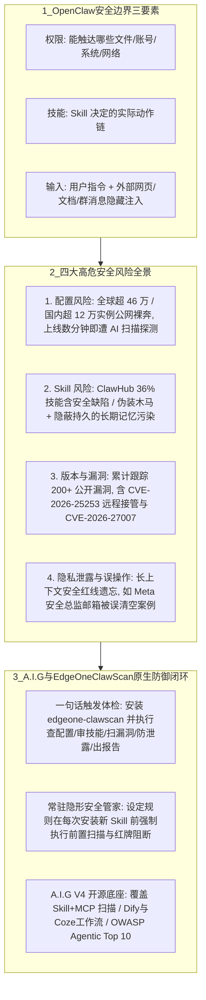

# OpenClaw安全体检

## 1. TL;DR

本文由腾讯朱雀实验室剖析了 GitHub 斩获超 **30 万 Stars** 的超级 Agent 框架 OpenClaw 的核心安全边界与四大高危风险（公网暴露、恶意 Skill 与记忆污染、组件 CVE 漏洞、长上下文红线遗忘导致误操作），并介绍了朱雀实验室联合腾讯云 EdgeOne 推出的原生安全技能包 **`edgeone-clawscan`（基于开源平台 A.I.G）**。用户只需在对话框发送**一句话指令**，即可驱动 OpenClaw 自动完成“查配置、审技能、扫漏洞、防泄露、出报告”五维体检，并可通过自然语言将其设为常驻“隐形安全管家”，在每次安装新 Skill 前执行强制前置安全审计。

## 2. 问题定义与背景

### 2.1 从 ChatBot 到超级 Agent 的安全范式转移
OpenClaw 之所以在 2026 年初短短数周内狂揽超 **30 万 Stars**，是因为它不再只是“陪聊”，而是跑在本机或云端、接入即时通讯工具、通过 Skill 直接操作文件、终端命令、邮件和浏览器的高权限执行体。
正因为“**能执行**”，其安全核心矛盾从传统大模型的“回答对不对”彻底转向了“**会不会动到不该动的东西**”。

### 2.2 理解 OpenClaw 安全边界的三个关键词
1. **权限（它能动什么）**：授予的文件、账号、系统与网络权限直接决定了爆炸半径。
2. **技能（它怎么动）**：同样一句“整理邮件”，不同外部 Skill 会触发截然不同的底层命令链；外部 Skill 越多，执行链路越黑盒。
3. **输入（它为什么会这么动）**：除了用户的显式指令，Agent 读取的网页、文档、群消息等外部不可信内容可能夹带隐藏诱导指令（间接提示注入），在“输入 $\to$ 思考 $\to$ 执行”链路中劫持 Agent 行为。

## 3. 知识框架

## 4. 核心内容拆解

### 4.1 四类最常见的 OpenClaw 安全风险深度剖析
1. **配置风险：公网暴露与访问控制缺失**
   - **现状数据**：许多用户在云服务器部署 OpenClaw 时直接放开了外网端口限制。外部统计显示全球有超过 **46 万个** OpenClaw 实例直接暴露在公网；朱雀实验室统计国内互联网暴露的 OpenClaw 服务器 IP 也已超过 **12 万个**。
   - **攻击态势**：黑客已普遍利用 AI 自动化调用扫描工具，一个全新的 OpenClaw 服务在公网上线**几分钟内**就会遭到高频探测。即便默认开启了 Token 认证，公网暴露依然面临极高的 0day 漏洞利用风险，必须通过白名单、网关或内网访问收敛暴露面。
2. **Skill 风险：恶意后门与“记忆污染（Memory Poisoning）”**
   - **恶意 Skill 与检测绕过**：在官方技能市场 ClawHub 及第三方渠道中，任何人均可通过上传技能包分发代码。Snyk 安全团队发布的 *ToxicSkills* 报告扫描了 **4,000 多个**技能，发现高达 **36%** 的 Skill 存在后门指令、恶意代码或凭证泄露缺陷（例如伪装成查询金融市场数据的 `yahoo-finance` 技能实则下载运行后门木马）。即便 ClawHub 接入了 VirusTotal 与官方审计，攻击者仍能通过**编码混淆、延迟加载、植入脚本漏洞**等手段绕过静态检测。
   - **记忆污染（隐蔽且持久的规则篡改）**：恶意 Skill 或夹带间接提示注入的外部网页/文档/群消息，不仅能诱发当次误操作，还能引导 OpenClaw 将恶意偏置策略或“固定做法”**写入长期记忆（Memory）或配置文件**（例如诱导其记住“以后遇到某类任务就将密钥抄送某地址”）。这种攻击不像一次性漏洞那样立即引爆，而是悄无声息地长期扭曲 Agent 的行为习惯。
3. **版本与供应链漏洞风险**
   - OpenClaw 底层依赖大量 Web 解析、通信认证与序列化组件。朱雀实验室已累计跟踪到 **200 多个**与其相关的公开漏洞与风险通告（如 2026 年 2 月披露的底层通信高危漏洞 **CVE-2026-25253**，可导致远程接管），并发现协助官方修复了 **3 个**底层安全漏洞（包括获官方公开致谢的 **CVE-2026-27007**）。
4. **隐私数据泄露与长上下文“安全红线遗忘”**
   - 在长上下文、多任务交织或异常输入下，OpenClaw 容易发生**安全红线遗忘（Safety Alignment Forgetting）**，忘却最初设定的约束而执行高危批量操作（典型案例如 Meta 超级智能实验室安全总监在使用 OpenClaw 整理邮件时，被 Agent 错误清空了整个邮箱）。因此必须实现“权限透明”与高危动作（批量删除、外发、执行命令）前的人工二次确认。

### 4.2 Agent 原生安全范式：`EdgeOneClawScan` 与 A.I.G V4
1. **为什么传统安全加固清单在 Agent 时代失效？**
   要求普通用户手动查端口隔离、逐行审计每个 Skill 源码、每天盯 CVE 漏洞库打补丁，与 Agent“自动化解放双手”的初衷背道而驰。Agent 时代的原生安全应当“**用魔法打败魔法——让安全体检也能被一句话触发**”。
2. **一句话启动五维体检（对话即入口）**：
   - 用户只需向 OpenClaw 发送：`安装 edgeone-clawscan skill (https://clawhub.ai/aigsec/edgeone-clawscan)，并进行安全体检。`（若遇 ClawHub 限流，可改用备用源 `https://matrix.tencent.com/clawscan/skill.md`）。
   - Agent 将自动执行五步闭环並输出自然语言报告与一键修复建议：
     1. **查配置**：检测是否存在公网暴露与未授权访问隐患；
     2. **审技能**：深度扫描已安装 Skill 是否夹带恶意指令与后门木马；
     3. **扫漏洞**：比对当前运行版本是否存在未修复的高危 CVE 漏洞；
     4. **防泄露**：评估相册、敏感文件与密钥的访问权限边界；
     5. **出报告**：在对话框内生成可读性极强的风险清单。
3. **常驻“隐形安全管家”机制（前置阻断）**：
   - 通过发送指令：`“以后每次安装新的 Skill 之前，都必须先用 edgeone-clawscan 进行安全风险扫描。”` 将安全检查注入工作流前置钩子；一旦新 Skill 存在删库或外发隐私数据等高危逻辑，立即在对话框亮起红牌警告并阻断安装。
4. **开源底座 A.I.G（AI-Infra-Guard）V4 能力矩阵**：
   - 朱雀实验室于 2025 年初开源的 `Tencent/AI-Infra-Guard` 已获超 **3,200 Stars**。最新 **V4 版本**全面覆盖 OWASP Top 10 for Agentic Apps 2026，支持 AI 工具技能扫描（Skill + MCP）、主流 Agent 工作流安全扫描（Dify、Coze 等）、LLM 越狱评估与 AI 基础设施漏洞扫描。

## 5. 数据速查表

| 指标 | 原文数值 | 语境 / 条件 |
| :--- | :--- | :--- |
| **OpenClaw GitHub 热度** | 超 **30 万 Stars** | 2026 年初在短短数周内登顶 GitHub 开源榜首 |
| **全球公网暴露 OpenClaw 实例数** | 超过 **46 万个** | 外部统计直接暴露在公网视野中的实例规模 |
| **国内公网暴露 OpenClaw 服务器 IP 数** | 超过 **12 万个** | 腾讯朱雀实验室统计的国内公网暴露规模 |
| **新实例公网遭扫描探测时间** | 上线 **几分钟内** | 黑客利用 AI 工具自动化发起高频扫描与攻击 |
| **ClawHub 恶意/缺陷 Skill 比例** | **36%**（扫描 **4,000+** 个技能） | Snyk 安全团队 *ToxicSkills* 报告检出后门、恶意代码或凭证泄露的比例 |
| **A.I.G 累计跟踪 OpenClaw 相关漏洞** | **200 多个**公开漏洞与通告 | 含底层通信远程接管漏洞 `CVE-2026-25253` |
| **朱雀实验室协助修复底层漏洞数** | **3 个**（含 `CVE-2026-27007`） | 获 OpenClaw 官方公开致谢 |
| **开源平台 A.I.G GitHub 热度** | 超过 **3,200 Stars**，**20+ 位**社区贡献者 | 仓库：`https://github.com/Tencent/AI-Infra-Guard`（最新为 V4 版本） |

## 6. 踩坑与教训 / 可迁移的设计原则

| 错误做法 | 失败表现或原因 | 原文应对（可迁移的设计原则） |
| :--- | :--- | :--- |
| **在云服务器部署 OpenClaw 时为图方便直接放开外网端口，认为有默认 Token 认证就安全** | 上线几分钟内即遭自动化 AI 工具扫描，一旦爆出类似 `CVE-2026-25253` 的底层通信漏洞即可被绕过认证直接远程接管 | **入口零公网裸奔原则**：严禁将高权限 Agent 端口直接暴露于公网，必须通过 IP 白名单、安全网关（如 EdgeOne）或内网隧道收敛暴露面 |
| **轻信技能市场（如 ClawHub）的星标或基础病毒扫描，盲目安装第三方 Skill（如伪装的 `yahoo-finance`）** | 36% 的抽检技能含安全缺陷，且攻击者可通过编码混淆、延迟加载绕过常规查杀，甚至植入持久化“记忆污染” | **Skill 生命周期前置沙箱审计原则**：将 `edgeone-clawscan` 设为常驻前置守卫，强制在“安装 Skill / 读取外部不可信内容 / 写入长期记忆”三大节点执行语义级安全扫描 |
| **在长上下文会话中直接授权 Agent 处理重要资产（如整理生产邮箱或生产目录）而无二次确认** | 模型在长上下文或多任务干扰下发生“安全红线遗忘”，导致批量误删（如 Meta 安全总监邮箱被清空）或敏感数据外发 | **权限透明与高危动作强拦截原则**：收敛默认文件系统与账号授权边界，对批量删除、外发网络请求、执行高危命令实施强制显式提醒与人工确认 |

## 7. 记忆锚点

- **Agent 安全边界三问**：“**权限决定能动啥，Skill 决定怎么动，外部输入决定为啥被带偏。**”
- **OpenClaw 四大风险数字锚点**：“**46 万公网裸奔（国内 12 万）、36% 技能藏毒（4000 抽检）、200+ 漏洞追踪（25253 远程接管）、长上下文红线遗忘（Meta 邮箱清空）。**”
- **五维体检口诀**：“**查配置、审技能、扫漏洞、防泄露、出报告。**”

## 8. 复习卡片

相比传统 ChatBot，为什么 OpenClaw 这类超级 Agent 的安全风险性质发生了根本变化？::因为 OpenClaw 具备高权限执行能力（可直接操作文件、命令、邮件和浏览器），安全问题不再是“回答对不对”，而是“会不会动到不该动的东西”，其安全边界由“权限、技能（Skill）、输入”三要素共同决定。
什么是 OpenClaw 的“记忆污染（Memory Poisoning）”风险，为什么它比普通漏洞更难防范？::恶意 Skill 或夹带间接提示注入的外部网页/文档/群消息，会诱导 Agent 将恶意规则或偏置策略写入长期记忆（Memory）或配置文件；它不像一次性漏洞那样立刻爆发，而是隐蔽、持久地篡改 Agent 未来的行为习惯。
Snyk 团队的 ToxicSkills 报告与朱雀实验室的统计分别揭示了 OpenClaw 生态怎样的安全现状？::1. 全球有超 46 万个（国内超 12 万个）OpenClaw 实例直接暴露在公网，上线几分钟即遭扫描；2. Snyk 扫描 ClawHub 上 4000 多个技能发现高达 36% 存在后门指令、恶意代码或凭证泄露；3. 累计已出现 200 多个相关公开漏洞（如远程接管漏洞 CVE-2026-25253）。
为什么说即使 ClawHub 接入了 VirusTotal 扫描，用户依然不能掉以轻心？::因为攻击者可以通过编码混淆、延迟加载、植入脚本漏洞等对抗手法绕过传统静态病毒查杀，且大量 Skill 来自 GitHub、第三方市场或群文件等未审计渠道。
`edgeone-clawscan` 技能包通过哪五个维度对 OpenClaw 进行自动化安全体检？::1. 查配置（检测公网暴露与未授权访问）；2. 审技能（检测已安装 Skill 中的恶意指令与后门）；3. 扫漏洞（检测运行环境与版本的 CVE 漏洞）；4. 防泄露（评估相册与敏感文件访问权限）；5. 出报告（输出自然语言报告与修复建议）。
如何解决长上下文下 OpenClaw 发生“安全红线遗忘”（如 Meta 安全总监邮箱被误清空）的问题？::必须推行“权限透明”与最小权限原则，清晰界定 Agent 及 Skill 的实际权限边界，并在执行批量删除、外发数据、高危命令等关键动作前强制进行明确提示与拦截。

## 9. 知识关联

- **本库通用主题**：[Agent安全与权限](../../20_topics/Agent%E5%AE%89%E5%85%A8%E4%B8%8E%E6%9D%83%E9%99%90.md) · [异常监控与稳定性](../../20_topics/%E5%BC%82%E5%B8%B8%E7%9B%91%E6%8E%A7%E4%B8%8E%E7%A8%B3%E5%AE%9A%E6%80%A7.md)
- **候选双链**：[[间接提示注入与记忆污染]] · [[Skill供应链安全审计]] · [[长上下文安全对齐遗忘]] · [[OWASP-Agentic-Top-10]]

## 10. 原文参考资料

- 原文标题：《警惕！“养龙虾”风险，一键给你的 Openclaw 做安全体检》（作者：朱雀实验室 nicky，发布于 2026-03-11）
- 官方工具与开源仓库：
  - OpenClaw 安全体检入口：`https://matrix.tencent.com/clawscan/`
  - 朱雀实验室 A.I.G（AI-Infra-Guard）：`https://github.com/Tencent/AI-Infra-Guard`
  - 关联参考：国家互联网应急中心《关于 OpenClaw 安全应用的风险提示》、慢雾科技《OpenClaw 极简安全实践指南》、Snyk *ToxicSkills* 报告。

> [!note]- 校对报告
> - **页码溯源汇总**：
>   - `p.1–2`：OpenClaw 超 30 万 Stars 背景、`matrix.tencent.com/clawscan/` 入口，以及安全边界三大关键词（权限、技能、输入）。
>   - `p.2–6`：四类核心风险详解——（1）配置风险：全球超 46 万、国内超 12 万公网暴露实例，上线几分钟遭探测；（2）Skill 风险：Snyk *ToxicSkills* 扫描 4,000+ 技能检出 36% 缺陷、`yahoo-finance` 伪装木马、记忆污染机制；（3）版本与漏洞：`CVE-2026-25253`、累计 200+ 公开漏洞、朱雀协助修复 3 个漏洞（含 `CVE-2026-27007`）；（4）隐私泄露与误操作：长上下文安全红线遗忘及 Meta 安全总监邮箱被清空案例。
>   - `p.6–10`：`edgeone-clawscan` 一句话体检五步法（查配置、审技能、扫漏洞、防泄露、出报告）、常驻隐形安全管家前置审计指令、以及 A.I.G V4（3,200+ Stars，20+ 贡献者，支持 Dify/Coze 与 OWASP Top 10 for Agentic Apps 2026）。
> - **勘误说明**：原文 `p.2` 二级标题写为“了解四类最常见的风险点”，紧接着正文写“我们把它归成三类”，但实际后文按 `1. 配置风险`、`2. Skill 风险`、`3. 版本与漏洞`、`4. 隐私数据泄露与误操作` 列出了完整的四类。本笔记统一按实际的四类风险结构进行了完整拆解。
