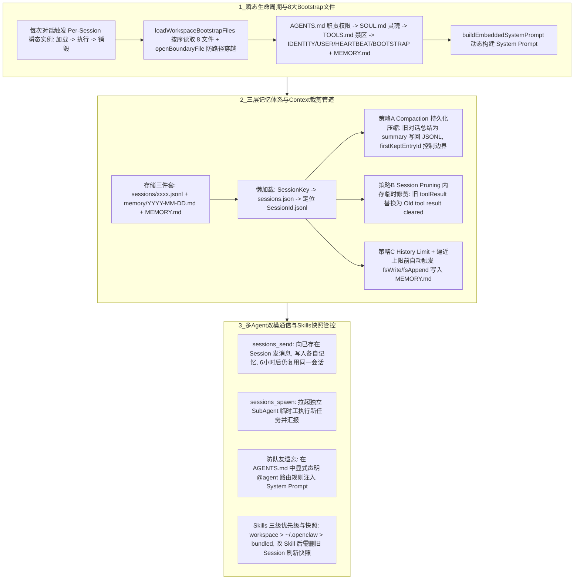

# OpenClaw架构与多Agent

## 1. TL;DR

本文从源码与实战角度深度拆解了 OpenClaw 的核心架构、三层记忆机制、多 Agent 通信协议与精细化治理实践。核心结论是：
1. **架构本质与瞬态生命周期**：OpenClaw 的最大价值在于建立了个人 Agent 的行业架构共识；其 Agent 并非后台常驻进程，而是基于 `@mariozechner/pi-coding-agent` 的 **per-session 瞬态实例**——每次对话都执行完整的“加载 8 大 Bootstrap 文件（`AGENTS.md` 优先级最高） $\to$ 动态生成 System Prompt $\to$ 执行 $\to$ 销毁”循环。
2. **三层记忆与上下文裁剪机制**：会话层按需懒加载 `.jsonl`，并在送入 LLM 前执行持久化的 **Compaction（旧消息总结写回 JSONL，由 `firstKeptEntryId` 控制）**、内存级临时的 **Session Pruning（将旧 `toolResult` 替换为 `"[Old tool result cleared]"`）** 以及可选的 `History Limit`；接近 Context 上限时自动触发 `fsWrite/fsAppend` 将关键记忆沉淀至 `MEMORY.md`。
3. **多 Agent 专事专做与双模通信**：单 Agent 易受历史异构记忆干扰（如聊过 C++ 后在 Flutter 问答中误给 C++ 示例），且网关每 **60 秒**执行一次 `refreshGatewayHealthSanpshot` 会快速耗尽多 Agent 的 IM 额度；多 Agent 间通过 **`sessions_send`（复用已有 Session 双向沟通、写入各自记忆，间隔 6 小时仍复用原会话）** 与 **`sessions_spawn`（独立环境拉起 SubAgent 临时工执行任务并汇报）** 协同，并需在 `AGENTS.md` 中固化团队花名册以防短期记忆压缩后“遗忘队友”。
4. **Skills 快照与配置版本治理**：Skills 按 `workspace-xxx/skills/`（最高） $\to$ `~/.openclaw/skills/`（中等） $\to$ `bundled skills`（最低）三级优先级仅向 System Prompt 注入 `<available_skills>` 摘要列表；由于 Session 启动时会固化 Skills 快照，修改 Skills 后必须**删除旧 Session** 才能生效。

## 2. 问题定义与背景

### 2.1 OpenClaw 与传统工具（如 Claude Happy）的本质区别
OpenClaw 的代码框架难度并不高（作者类比为“AI Coding 诞生前带初级推荐算法的前后端通信 App”），其真正壁垒在于：
1. **推广了统一的 Agent 架构共识**：在 OpenClaw 之前，每位开发者自建 L1~L5 Agent 架构，交流时需花费大量时间对齐 Session、Memory 与 Skills 机制；OpenClaw 统一了底座标准，使社区能直接聚焦于保活、替换 RAG 算法库、多 Agent 编排与 Good Case 落地。
2. **天然支持多 Agent 专事专做**：受限于 Transformer 上下文窗口，单 Agent 塞入过多身份设定与 Skills 会迅速蚕食 Context 并导致跨领域记忆串扰。
3. **做与 AI 能力正交的事**：模型智商随底层 LLM 升级而自动演进，而沉淀在本地的个人长期交互记忆与定制化 Agent 工作流，才是与模型能力正交的核心私有资产。

### 2.2 硬件选型与 IM 通道踩坑前置认知
- **云机 vs 自部署（Mac Mini 选型）**：OpenClaw 生态对 Mac 天然友好；若仅调用云端 API，性价比最高的 **Mac Mini M1（1TB 约 3K 元）** 即可胜任；若需本地跑 ComfyUI 文生图/文生视频模型（单模型动辄 30GB+）或 `qwen3-tts`，建议 **24GB 内存 + 256GB/512GB 以上磁盘（Mac Mini M4 512GB 约 7K 元）**。
- **IM 通道的“60 秒健康快照”额度陷阱**：OpenClaw 网关内置定时器 `setInterval(() => refreshGatewayHealthSanpshot({probe: true}))` 默认每 **60 秒** ping 一次 IM 接口。单 Agent 尚可承受，一旦部署 **10 个 Agent**，受限额度的 IM 通道会迅速耗尽配额，因此多 Agent 必须选择无调用额度限制的 IM 工具。
- **严禁直接让裸 Claude Code 修改配置**：Claude Code 对 OpenClaw 配置规范理解存在偏差，直接改配置极易导致 `"it works, but it also broke"`；必须先将 OpenClaw 源码下载到本地喂给 CC 学习后，再用其辅助 Debug。

## 3. 知识框架

## 4. 核心内容拆解

### 4.1 Agent 核心配置项（8 大文件）与瞬态启动流程
1. **Workspace 8 大核心配置文件（文件顺序即优先级）**：
   在源码 `src/agents/workspace.ts:498-555` 的 `loadWorkspaceBootstrapFiles` 中，系统通过 `readWorkspaceFileWithGuards`（调用 `openBoundaryFile` 校验 `inode/dev/size/mtime` 防止路径穿越）按固定顺序加载：
   - `AGENTS.md`（⭐⭐⭐ 最核心文件）：声明 Agent 职责、启动与 Memory 管理流程、多 Agent 协作通讯录及工具权限；
   - `SOUL.md`：个性化人设提示词，注入 System Prompt；
   - `TOOLS.md`：工具白名单/黑名单，划定安全边界；
   - `IDENTITY.md`：身份标识（`name/avatar`），用于通道展示；
   - `USER.md`：用户偏好与上下文先验；
   - `HEARTBEAT.md`：定时任务配置（可选）；
   - `BOOTSTRAP.md`：首次 onboarding 引导（一次性消费）；
   - 动态检测 `MEMORY.md / memory.md`：用户长期记忆文档（RAG 源）。
2. **Per-Session 瞬态启动四步循环**：
   源码 `src/agents/pi-embedded-runner/run/attempt.ts:1-116`（底层基于 `@mariozechner/pi-coding-agent`）表明 Agent **不是常驻进程**，每次对话均按四步实时构建：
   `resolveBootstrapContextForRun`（加载 Bootstrap 上下文） $\to$ `prepareSessionManagerForRun`（创建 SessionManager） $\to$ `buildEmbeddedSystemPrompt`（实时读取 Workspace 文件动态生成 System Prompt，确保修改配置立即生效） $\to$ `createAgentSession`（挂载模型、System Prompt、SessionManager 与 `createOpenClawCodingTools`）。

### 4.2 记忆力机制与 Session 三级裁剪策略
1. **三类记忆载体**：
   - `.openclaw/agents/<agent>/sessions/xxxx.jsonl`：原始会话日志，首行为 `Session Header`（含 `type: "session"`, `version: 3`, `id`, `cwd`, `timestamp`, 以及 fork 时的 `parentSession`）。
   - `.openclaw/workspace-<agent>/memory/YYYY-MM-DD.md`：按天归档的日常记忆日志。
   - `.openclaw/workspace-<agent>/MEMORY.md`：经 LLM 提炼后的高价值长期记忆（在 Session 逼近 Context 上限、执行 Compaction 压缩前，系统自动提示 Agent 调用 `fsWrite/fsAppend` 更新该文件）。
2. **Session 送入 LLM 前的三道过滤/裁剪防线**：
   - **A. Compaction（持久化压缩）**：当历史对话过长时，将早期的 `[user1, assistant1, ...]` 总结为一段 `compaction_summary`，并通过 `firstKeptEntryId` 控制保留最近条目（如保留 `user80 ~ assistant100`），**直接写回 `.jsonl` 文件持久化**，后续对话直接复用压缩后历史。
   - **B. Session Pruning（临时内存修剪）**：在发送给 LLM 前，将历史消息中体积庞大的旧工具返回结果（如 `toolResult1(10KB)`）在**内存层面临时替换**为字符串 `"[Old tool result cleared]"`，仅保留最新 `toolResult`，**不修改磁盘 `.jsonl` 原文件**。
   - **C. History Limit（历史条数限制，可选）**：通过 `getHistoryLimitFromSessionKey(sessionKey)` 限制单次送入模型的最大消息条数。

### 4.3 多 Agent 架构设计：`sessions_send` vs `sessions_spawn`
1. **为什么要拆分多 Agent？**
   单 Agent 会发生严重的跨任务记忆污染——作者实测在用 `RAG tutor Agent` 学习 Flutter 期间，仅因中途聊过一次 C++，后续多轮对话中请求提供 Demo 示例时，Agent 受残留 C++ 记忆干扰反复给出 C++ 代码而非 Flutter 代码。
2. **两种跨 Agent 通信原语的本质差异与配置**：
   - **`sessions_send`（对等同事沟通，写入各自记忆）**：向目标 Agent **已存在的 Session** 发送消息（即使间隔 **6 小时**以上，依然复用原来的 `agent:<name>:internal:main` 会话，绝不新建 Session）。适合“继续讨论刚才那篇文章”等有明确上下文延续的协作。需在 `openclaw.json` 中配置 `tools.agentToAgent: { enabled: true, allow: [...] }`，且**极易漏配的必选项是 `tools.sessions: { visibility: "all" }`**。
   - **`sessions_spawn`（雇佣 SubAgent 临时工，独立环境交付）**：在独立无干扰环境中拉起子 Agent 执行新任务并返回结果（如 CEO 下令“让 iostutor 30 分钟内写一个 Swift 网络请求封装类”）。需在主 Agent 配置下声明 `subagents: { allowAgents: ["iostutor"] }`。
3. **扁平化组织原则与“队友遗忘”修复**：
   - 遵循扁平化原则：核心业务 Agent 之间建议双向互通 `sessions_send` 并互设为 `allowAgents`（互为 SubAgent）；而纯工具型 Agent（如专职 Markdown 排版 Agent）仅需作为单向 SubAgent 被调用，无需留存复杂上下文。
   - **解决 AgentToAgent 短期记忆遗忘**：若仅在聊天中用自然语言教过一次“用 `sessions_send` 找 ceo”，几天后随着 Session 压缩，Agent 就会彻底忘记队友的存在。必须在 `workspace/agent_xx/AGENTS.md` 中显式写入团队路由表（如 `iOS 问题 -> @iostutor，使用 callAgent("iostutor")`），随 System Prompt 永久驻留。

### 4.4 Skills 精细化管控与 Git 版本管理
1. **Skills 三级优先级与 `requires` 过滤**：
   - System Prompt **只注入 `<available_skills>` 摘要列表**（含 `name`、`description`、`location`），Agent 需调用 `read` 工具按需读取完整 `SKILL.md`。
   - 加载优先级从高到低依次为：`1. workspace-xxx/skills/`（Agent 专属） $>$ `2. ~/.openclaw/skills/`（全局共享） $>$ `3. bundled skills`（npm 包内置）。加载前会自动校验 `metadata.openclaw.requires.bins/env/config`（如 `weather` 技能要求系统存在 `curl` 二进制），不满足则自动跳过。
   - **延迟加载陷阱（Skills 快照）**：OpenClaw 在 Session 启动时生成 Skills 快照并在整个会话期复用；修改 Skills 后仅执行 `openclaw gateway restart` 对旧会话无效，**必须删除对应旧 Session** 重新发起对话才能加载新 Skills。
2. **配置版本控制（Git DIY 两原则）**：
   - **记忆切割**：将包含私人对话的 `sessions/`、`memory/YYYY-MM-DD.md`、`MEMORY.md` 加入 `.gitignore` 严禁上云；
   - **密钥动态注入**：`openclaw.json` 混杂了核心配置与 API 密钥，必须将密钥剥离并通过环境变量/动态注入管理，仅对核心 Config 做 Git 版本控制。

## 5. 数据速查表

| 指标 / 配置项 | 原文数值 / 路径 | 语境 / 条件 |
| :--- | :--- | :--- |
| **单 Agent vs 多 Agent 部署耗时** | 单 Agent **半小时** / 多 Agent **2–3 天** | 多 Agent 含任务分配、Skills 调试、身份定制、定时任务与本地模型部署 |
| **Mac Mini 自部署硬件推荐** | M1 1TB（约 **3K 元**）/ M4 512G（约 **7K 元**） | 跑本地文生图/视频模型建议 **24GB 内存 + 256GB 起步磁盘**（单模型 30GB+） |
| **网关健康快照轮询间隔** | **60 秒/次** | `refreshGatewayHealthSanpshot({probe:true})`，部署 10 个 Agent 会迅速耗尽限额 IM |
| **Bootstrap 核心配置文件数** | **8 个**（按固定顺序加载） | `AGENTS.md`, `SOUL.md`, `TOOLS.md`, `IDENTITY.md`, `USER.md`, `HEARTBEAT.md`, `BOOTSTRAP.md` + `MEMORY.md` |
| **跨 Agent 会话复用测试间隔** | **6 小时后**仍复用原 Session | `sessions_send` 不新建 Session，始终复用 `agent:xxx:internal:main` |
| **Skills 加载三级优先级** | `workspace-xxx/skills/` $>$ `~/.openclaw/skills/` $>$ `bundled` | 专属技能优先级高于全局共享与内置技能 |
| **5 个推荐实战 Skills** | `find-skills`, `summarize`, `self-improving-agent`, `brave-search`, `frontend-design` | 通过 `clawhub install <skill-slug>` 安装 |
| **7 个个人 Jarvis 落地场景** | `Daily_paper` (配 `jina.ai`), `Summary`, `deepResearch`, `RAG tutor`, `ComfyUI`, `qwen3-tts`, `家庭助理` | 覆盖论文抓取、研究、垂直私教、本地多模态生成与家庭定时提醒 |

## 6. 踩坑与教训 / 可迁移的设计原则

| 错误做法 | 失败表现或原因 | 原文应对（可迁移的设计原则） |
| :--- | :--- | :--- |
| **直接让未读过源码的 Claude Code 自动修改 OpenClaw 配置文件** | CC 对 OpenClaw 配置结构理解有偏差，极易改出 `"it works, but it also broke"` 的隐蔽故障，导致工程后续无法维护 | **先喂源码再 Debug 原则**：必须先将 OpenClaw 源码下载到本地让 CC 学习，仅用 CC 辅助 Debug，日常配置优先使用 OpenClaw 官方 CLI 指令 |
| **配置 `sessions_send` 时只开了 `agentToAgent.enabled` 和 `allow` 列表** | Agent 之间依然无法看到彼此会话或写入消息 | **会话可见性显式声明原则**：配置 `agentToAgent` 时必须在 `tools.sessions` 中同步加上极易漏配的 `"visibility": "all"` |
| **仅在聊天对话中口头告诉 Agent 其他队友的 `sessionKey` 与通信方式** | 几天后随着 Session 触发 Compaction 压缩，短期记忆被淘汰，Agent 彻底忘记如何呼叫队友 | **组织架构写入 `AGENTS.md` 固化原则**：将团队角色分工与 `@agent` 调用方式写入 `AGENTS.md`，使其随 System Prompt 在每次瞬态启动时强制注入 |
| **调整或新增 Skills 后只执行 `openclaw gateway restart` 就去原对话框测试** | OpenClaw 在 Session 创建时固化了 Skills 快照，重启网关不会刷新存量 Session 的快照，Agent 依然只认旧 Skills | **Session 快照清理原则**：修改 Skills 架构后，必须删除对应的旧 Session 文件以触发重新生成 `<available_skills>` 快照 |

## 7. 记忆锚点

- **OpenClaw 架构三句话**：“**八大文件定人格（`AGENTS.md` 居首），瞬态会话跑单轮（加载-执行-销毁），三刀裁剪护窗口（Compaction 写盘、Pruning 清 Tool、Memory 提炼）。**”
- **多 Agent 通信双雄**：“**`sessions_send` 找同事聊旧事（写记忆、6 小时不断线，莫忘 `visibility: all`），`sessions_spawn` 雇临时工干新活（SubAgent 独立沙箱）。**”

## 8. 复习卡片

OpenClaw 的 Agent 进程模型是后台常驻还是瞬态实例，其单次对话启动包含哪四个步骤？::Agent 不是常驻进程，而是 per-session 的瞬态实例（每次对话都是完整的加载-执行-销毁循环）；四步流程为：1. 加载 8 大 Bootstrap 文件上下文；2. 创建 SessionManager；3. 动态构建 System Prompt（实时读取 workspace 文件）；4. 创建 AgentSession 执行推理。
OpenClaw 的 Workspace 中有哪 8 个核心配置文件，哪个文件最为关键？::按加载优先级依次为：`AGENTS.md`（职责声明与工具权限，最核心）、`SOUL.md`（个性化人设）、`TOOLS.md`（工具黑白名单）、`IDENTITY.md`（名称头像）、`USER.md`（用户偏好）、`HEARTBEAT.md`（定时任务）、`BOOTSTRAP.md`（首次引导）以及动态检测的 `MEMORY.md`（长期记忆）。
OpenClaw 在将 `.jsonl` 会话历史发送给 LLM 之前，采用哪两种核心策略防止挤爆 Context 窗口？::1. Compaction（持久化压缩）：将早期对话总结为 `compaction_summary` 并通过 `firstKeptEntryId` 控制保留范围，直接写回 `.jsonl` 文件；2. Session Pruning（临时修剪）：仅在内存中将旧的庞大 `toolResult` 替换为 `"[Old tool result cleared]"`，不修改磁盘文件（此外在逼近上限前会先提示 Agent 将重要信息写入 `MEMORY.md`）。
为什么在部署 10 个以上的多 Agent 时，原本够用的 IM 平台调用额度会被迅速耗尽？::因为 OpenClaw 网关内置了 `refreshGatewayHealthSanpshot({probe:true})` 定时健康检查逻辑，每 60 秒就会对每个 Agent 绑定的 IM 通道 ping 一次。
OpenClaw 多 Agent 协同中的 `sessions_send` 与 `sessions_spawn` 有何本质区别？::`sessions_send` 是向已存在的 Session 发送消息（哪怕间隔 6 小时以上仍复用原会话），通信内容会写入各自的记忆，适合有上下文延续的同事协作（需配 `visibility: "all"`）；`sessions_spawn` 是在独立环境中拉起 SubAgent（临时工）完成一次性独立任务并汇报，不污染主会话记忆。
为什么修改了 OpenClaw 的 Skills 配置并重启 Gateway 后，Agent 依然看不到新加的 Skill？::因为 OpenClaw 在每个 Session 首次启动时会创建一份 Skills 快照并在整个 Session 生命周期内复用；必须删除对应的旧 Session 重新发起对话，才能加载最新的 Skills 列表。

## 9. 知识关联

- **本库通用主题**：[Agent长期记忆](../../20_topics/Agent%E9%95%BF%E6%9C%9F%E8%AE%B0%E5%BF%86.md) · [Agent任务恢复](../../20_topics/Agent%E4%BB%BB%E5%8A%A1%E6%81%A2%E5%A4%8D.md) · [Harness与模型协同](../../20_topics/Harness%E4%B8%8E%E6%A8%A1%E5%9E%8B%E5%8D%8F%E5%90%8C.md)
- **候选双链**：[[OpenClaw安全体检]] · [[QQ机器人接入OpenClaw]] · [[上下文压缩Compaction与Pruning]] · [[多Agent通信原语设计]]

## 10. 原文参考资料

- 原文标题：《玩转 OpenClaw，你需要了解的：核心架构、运作原理、Agent 部署步骤》（作者：冰以东，发布于 2026-03-09）
- 核心源码定位：`src/agents/workspace.ts:498-555`（`loadWorkspaceBootstrapFiles`）、`src/agents/pi-embedded-runner/run/attempt.ts:1-116`（`@mariozechner/pi-coding-agent` 会话启动流）。

> [!note]- 校对报告
> - **页码溯源汇总**：
>   - `p.1–5`：OpenClaw 与 Claude Happy 对比、推广架构共识与天然支持多 Agent、Mac Mini 硬件选型（M1 1TB 3K vs M4 512G 7K，24GB 内存跑本地模型）、IM 通道 60 秒 `refreshGatewayHealthSanpshot` 额度消耗陷阱、单 Agent 半小时 vs 多 Agent 2–3 天配置周期。
>   - `p.6–8`：不建议直接用 Claude Code 改配置（先喂源码再 Debug）、Workspace 8 大配置文件与 `loadWorkspaceBootstrapFiles` / `openBoundaryFile` 源码、Per-Session 瞬态实例四步启动源码。
>   - `p.8–12`：三类记忆文件（`xxxx.jsonl`、`YYYY-MM-DD.md`、`MEMORY.md`）、Session Header 结构、Compaction（持久化压缩）与 Session Pruning（内存级清除旧 `toolResult`）、单 Agent 跨领域记忆串扰案例（Flutter tutor 误给 C++ 示例）。
>   - `p.13–17`：`openclaw agents add`、`sessions_send`（含 `visibility: "all"` 与 6 小时复用原 Session）与 `sessions_spawn`（`subagents.allowAgents`）配置对比、通过在 `AGENTS.md` 写入路由解决短期记忆遗忘队友问题、多 Agent 扁平化三原则。
>   - `p.18–27`：Skills 三级优先级与 `requires.bins` 过滤、删除旧 Session 解决 Skills 快照延迟加载、ClawHub 5 个推荐 Skills、Git 版本控制（`.gitignore` 切割 memory 与动态注入密钥）、7 个 Good Case 与“优先使用 SOTA 模型、按月而非按年订阅”建议。
> - **核验结论**：全文源码路径、配置字段与实战结论均与原文逐页核对一致（注：PDF `p.25` 为原文档导出空白页，无缺失正文）。
