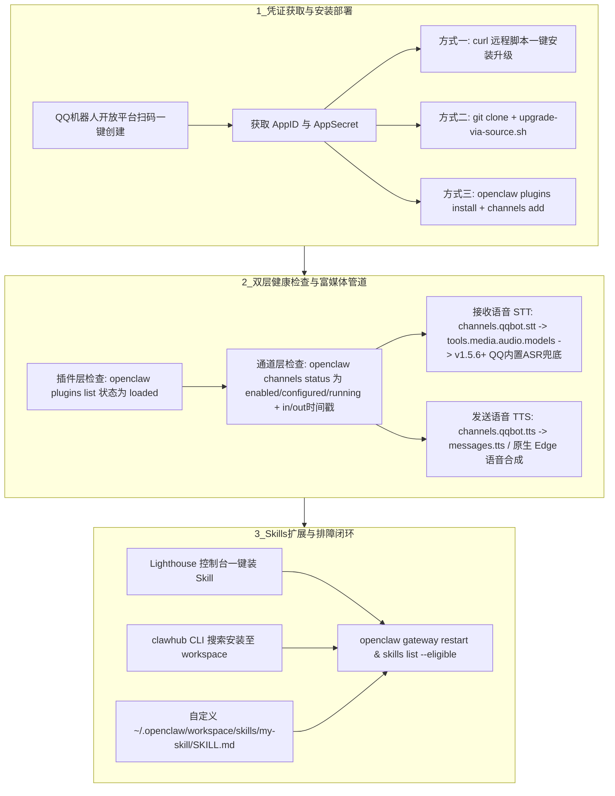

# QQ机器人接入OpenClaw

## 1. TL;DR

本文是腾讯 QQ 机器人团队发布的官方 `openclaw-qqbot` 插件接入与运维指南。核心内容包括：
1. **三步极速创建 QQBot**：通过 QQ 机器人开放平台专属通道扫码登录、一键创建机器人并获取 `AppID` 与 `AppSecret`（当前仅限创建人私聊，暂不支持拉入 QQ 群）。
2. **三种插件安装升级路径**：支持远程脚本一键安装升级（推荐）、GitHub 源码脚本安装升级、以及 `openclaw plugins`（npm 包）手动安装升级，并提供双层状态校验机制（插件 `loaded` 状态 + 通道 `enabled, configured, running` 与 `in/out` 时间戳检查）。
3. **富媒体双向通道与两级语音回退架构**：声明 QQBot 插件仅作为纯粹的**消息传输通道**，支持文本、Markdown、图片、语音、视频、文件双向收发；其中语音接收（STT）与发送（TTS）均采用“**插件专属配置优先 $\to$ 框架级配置回退**”的两级架构，且自 `1.5.6` 版本起支持在未配置 STT 或转写失败时自动回退至 **QQ 平台内置 ASR 文本**作为低置信度兜底，TTS 则原生支持免 Key 的 `Edge`（如 `zh-CN-XiaoxiaoNeural`）语音合成。
4. **Skills 生态扩展与高频排障**：详解了通过腾讯云 Lighthouse 面板、`clawhub` CLI 以及在 `~/.openclaw/workspace/skills/` 手动编写 `SKILL.md` 的三种技能接入方式及 10 类常见报错排查方案。

## 2. 问题定义与背景

### 2.1 核心诉求
OpenClaw 作为具备本地/云端命令执行、文件操作与插件扩展能力的个人 AI 助理（俗称“小龙虾”），需要一个高频、低门槛、支持富媒体交互的即时通讯（IM）入口。将国民级 IM 腾讯 QQ 与 OpenClaw 打通，可以让用户随时随地通过手机或 PC 端 QQ 唤醒并指挥个人 Agent。

### 2.2 架构边界声明（通道 vs 大脑）
在接入过程中，开发者最容易混淆“通信管道”与“模型/技能能力”的边界：
- **QQBot 插件（`@tencent-connect/openclaw-qqbot`）的职责**：仅作为**消息中转通道（Channel）**，负责在 QQ 服务器与 OpenClaw Gateway 之间双向透传文本、图片、语音、视频和文件。
- **OpenClaw 框架与 AI 模型的职责**：图像理解、画图生成、文档解析、代码执行等能力完全取决于 OpenClaw 内部配置的底层大模型与已安装的 Skills，而非插件本身。

## 3. 知识框架

## 4. 核心内容拆解

### 4.1 快速创建与三种插件安装方式对比
1. **三步注册 QQBot**：PC 访问 `https://q.qq.com/qqbot/openclaw/login.html` 扫码登录 $\to$ 点击创建机器人（QQ 立即收到成功通知） $\to$ 复制 `AppID` 与 `AppSecret`（注：该通道创建的 Bot 仅创建人私聊可用，暂不支持拉入 QQ 群；若误删可在 **7 天内**前往开放平台恢复）。
2. **三种原生安装与升级方式**：
   - **方式一：远程一键安装升级（推荐，最快）**：
     通过 `curl -fsSL .../scripts/... | bash -s -- --appid YOUR_APPID --secret YOUR_SECRET` 自动完成下载脚本、清理旧插件、安装新插件、配置通道及重启服务。后续升级无需再传凭证，默认升至 npm `latest` 版本，也可用 `--version <版本号>` 指定版本或 `--self-version` 对齐仓库 `package.json`。
   - **方式二：本地源码安装升级（适合审查脚本）**：
     克隆官方仓库 `https://github.com/tencent-connect/openclaw-qqbot.git` 后执行 `bash ./scripts/upgrade-via-source.sh --appid ... --secret ...`。脚本末尾交互式询问是否后台重启网关服务 `[Y/n]`，启动后自动执行 `openclaw logs --follow` 持续打印实时日志（确认正常后可按 `Ctrl+C` 退出前台日志流）。
   - **方式三：npm 手动分步安装升级（适合精细排障）**：
     先卸载历史遗留包（`openclaw plugins uninstall qqbot` 与 `openclaw-qqbot`），再执行 `openclaw plugins install @tencent-connect/openclaw-qqbot@latest`，随后绑定通道 `openclaw channels add --channel qqbot --token "AppID:AppSecret"` 并执行 `openclaw gateway restart`。日常升级只需 `openclaw plugins update openclaw-qqbot` 加重启网关。
3. **双层安装结果核验**：
   - **第一层（插件是否加载）**：`openclaw plugins list | grep openclaw-qqbot`，状态为 `loaded` 仅代表插件代码已加载，**不代表通道已连通**。
   - **第二层（通道是否连通）**：`openclaw channels status`，需确认显示为 `enabled, configured, running`，且 `in:Xm ago, out:Xm ago`（入站/出站消息时间戳）随实际收发持续更新。

### 4.2 富媒体交互与 STT/TTS 两级优先级设计
1. **语音接收（STT 语音转文字）**：
   - **两级查找优先级**：优先读取插件专属配置 `channels.qqbot.stt`，未配置时自动回退至框架级 `tools.media.audio.models[0]`（通过 `provider` 继承 `models.providers` 的 `baseUrl` 与 `apiKey`，兼容任意 OpenAI 格式 STT 接口）。
   - **平台级 ASR 兜底（v1.5.6+ 关键特性）**：自插件版本 `1.5.6` 起，当用户未配置 STT 模型或转写调用失败时，插件会自动提取 **QQ 机器人平台内置 ASR 文本**作为低置信度兜底结果传给大模型，实现“零 STT 配置即可发语音对话”。
2. **语音发送（TTS 文字转语音）**：
   - **两级查找优先级**：优先读取 `channels.qqbot.tts`（指定 `provider`、`model`、`voice`），未配置时回退至全局 `messages.tts`。
   - **免 Key 原生 Edge TTS 方案**：若无付费 TTS 模型，可直接在 `messages.tts` 中启用 OpenClaw 原生支持的 `edge` provider（配置 `auto: "inbound"`, `provider: "edge"`, `voice: "zh-CN-XiaoxiaoNeural"`, `lang: "zh-CN"`）。
3. **通道图片/文件收发自检法**：向机器人发送一张图片并要求其“原样发回给我”——若能正常发回，证明 QQBot 富媒体传输通道完好；若让其“画一张图”却发不出，则说明缺少生图 Skill 或生图模型 API Key。

### 4.3 Skills 安装管理与高频排障手册
1. **三种 Skills 安装途径**：
   - **腾讯云 Lighthouse 面板**：点击【获取更多 skills】跳转 ClawHub 官网，复制技能详情页 URL 末尾的 `<skill-slug>` 名称，在控制台一键安装。
   - **ClawHub CLI 手动安装**：`npm i -g clawhub` $\to$ `cd ~/.openclaw/workspace` $\to$ `clawhub search "关键词"` $\to$ `clawhub install <skill-slug>` $\to$ `openclaw skills check` $\to$ 在 `~/.openclaw/openclaw.json` 补充所需 API Key $\to$ `openclaw gateway restart` $\to$ `openclaw skills list --eligible` 验证可用性。
   - **手写自定义 Skill**：在 `~/.openclaw/workspace/skills/<skill-name>/SKILL.md` 下编写带 YAML frontmatter（`name`、`description`）与触发规则的 Markdown 文件，随后通过对话要求 Agent `"refresh skills"` 或重启 Gateway 即可生效。
2. **高频故障排查机制**：
   - **更换 AppID 后报错“我的灵魂不在线”**：因旧会话缓存冲突，需删除 `~/.openclaw/qqbot/sessions/session-default.json` 后重启网关，或升级至最新版插件。
   - **报错 `401 not authorized`**：混淆了通道凭证与模型凭证——这是大模型 API Key 配置错误，而非 QQBot 的 `AppSecret` 错误。

## 5. 数据速查表

| 指标 / 配置项 | 原文数值 / 命令 | 语境 / 条件 |
| :--- | :--- | :--- |
| **QQBot 开放平台快捷创建入口** | `https://q.qq.com/qqbot/openclaw/login.html` | 三步扫码创建，仅限创建人私聊，暂不支持拉入 QQ 群 |
| **官方插件 GitHub 仓库与 npm 包名** | `@tencent-connect/openclaw-qqbot` | 仓库地址：`https://github.com/tencent-connect/openclaw-qqbot` |
| **内置 ASR 兜底最低插件版本** | `1.5.6` | 当 STT 未配置或转写失败时，自动使用 QQ 平台内置 ASR 文本兜底 |
| **误删机器人可恢复时间窗口** | **7 天内** | 机器人提示已被注销时，可在 7 天内前往 QQ 开放平台恢复 |
| **STT 配置查找优先级** | `channels.qqbot.stt` $\to$ `tools.media.audio.models[0]` | 插件专属配置优先，框架级配置回退，最后回退至 QQ 平台内置 ASR |
| **TTS 配置查找优先级** | `channels.qqbot.tts` $\to$ `messages.tts` | 支持自定义模型或免 Key 的 `edge`（如 `zh-CN-XiaoxiaoNeural`） |
| **自定义 Skill 存放路径** | `~/.openclaw/workspace/skills/<skill-name>/SKILL.md` | 需包含 `name` 与 `description` 的 YAML Frontmatter |
| **更换 AppID 会话清理路径** | `~/.openclaw/qqbot/sessions/session-default.json` | 更换机器人 AppID 后提示“我的灵魂不在线”时需删除该缓存文件 |

## 6. 踩坑与教训 / 可迁移的设计原则

| 错误做法 | 失败表现或原因 | 原文应对（可迁移的设计原则） |
| :--- | :--- | :--- |
| **看到 `openclaw plugins list` 显示 `loaded` 就认为机器人已连上** | 插件代码加载成功不代表鉴权通过或长连接建立，用户发消息依然无响应或提示“我的灵魂不在线” | **加载态与连通态分离验证原则**：必须进一步执行 `openclaw channels status`，确认同时满足 `enabled, configured, running` 且 `in/out` 时间戳动态刷新 |
| **升级或切换官方插件时未卸载旧版 `qqbot` 非官方/旧名插件** | 新旧插件命名空间或通道注册冲突，导致网关启动异常或消息路由错乱 | **升级前幂等清理旧包原则**：手动安装前依次执行 `openclaw plugins uninstall qqbot` 与 `uninstall openclaw-qqbot`，或直接使用内置清理逻辑的官方一键脚本 |
| **更换新的 QQBot `AppID` 后仅修改配置并重启网关** | 本地残留旧 Bot 的默认会话状态文件，导致鉴权或会话路由失败，持续提示“我的灵魂不在线” | **凭证变更同步清理会话状态原则**：更换 `AppID` 时必须清理 `~/.openclaw/qqbot/sessions/session-default.json` 状态缓存或升级最新插件 |
| **机器人发不出图片时盲目重装 QQBot 通道插件** | 分不清是“传输管道故障”还是“Agent 缺少画图 Skill / 生图 API Key” | **回环测试（Loopback Test）隔离定位原则**：先发一张图片让机器人原样发回以验证通道收发能力；通道正常再去排查生图 Skill 与模型凭证 |

## 7. 记忆锚点

- **接入与验活口诀**：“**三步扫码拿密钥，一键脚本装插件；`plugins list` 看加载，`channels status` 验活线。**”
- **语音双向兜底链**：
  - **收语音（STT）**：插件专属 `qqbot.stt` $\to$ 框架全局 `audio.models` $\to$ **v1.5.6+ QQ 内置 ASR 文本兜底**。
  - **发语音（TTS）**：插件专属 `qqbot.tts` $\to$ 框架全局 `messages.tts`（零成本首选 **Edge 晓晓音色**）。

## 8. 复习卡片

OpenClaw 的 QQBot 插件（`@tencent-connect/openclaw-qqbot`）在架构中的核心职责边界是什么？::它仅作为纯粹的“消息传输通道”，负责在 QQ 与 OpenClaw 之间双向中转文本、图片、语音、视频和文件；图像理解、语音转录、画图等能力取决于所配置的 AI 模型与已安装的 Skills。
如何准确判断 OpenClaw 的 QQBot 通道已经真正连通而非仅仅加载了插件代码？::`openclaw plugins list` 状态为 `loaded` 仅代表插件已加载；必须执行 `openclaw channels status`，确认状态显示为 `enabled, configured, running` 且 `in/out` 消息时间戳正常更新。
`openclaw-qqbot` 插件在接收语音消息（STT）时采用怎样的优先级与兜底机制？::按 `channels.qqbot.stt`（插件专属） -> `tools.media.audio.models[0]`（框架级回退）两级查找；自 1.5.6 版本起，若未配置 STT 或转写失败，会自动使用 QQ 平台内置 ASR 文本作为低置信度兜底结果。
如果用户没有付费 TTS 语音合成模型，如何在 OpenClaw 中配置让 QQ 机器人回复语音消息？::可在 `messages.tts` 中启用 OpenClaw 原生支持的 `edge` provider（设置 `auto: "inbound"`, `provider: "edge"`, `voice: "zh-CN-XiaoxiaoNeural"`）。
当更换了新的 QQ 机器人 AppID 后，对话依然报错“我的灵魂不在线”，该如何解决？::删除旧的会话缓存文件 `~/.openclaw/qqbot/sessions/session-default.json` 并执行 `openclaw gateway restart`，或更新 QQBot 插件至最新版。
如何快速区分“QQ 机器人发不出图片”是通道插件故障还是模型/Skill 缺失问题？::向机器人发送一张图片并要求它原样发回（回环测试）：若能正常发回说明 QQBot 通道正常，问题出在未配置画图 Skill 或生图模型 API Key。

## 9. 知识关联

- **本库通用主题**：[模型与开发工具发布](../../20_topics/%E6%A8%A1%E5%9E%8B%E4%B8%8E%E5%BC%80%E5%8F%91%E5%B7%A5%E5%85%B7%E5%8F%91%E5%B8%83.md) · [Agent工程循环](../../20_topics/Agent%E5%B7%A5%E7%A8%8B%E5%BE%AA%E7%8E%AF.md) · [异常监控与稳定性](../../20_topics/%E5%BC%82%E5%B8%B8%E7%9B%91%E6%8E%A7%E4%B8%8E%E7%A8%B3%E5%AE%9A%E6%80%A7.md) · [桌面Agent与工作流](../../20_topics/%E6%A1%8C%E9%9D%A2Agent%E4%B8%8E%E5%B7%A5%E4%BD%9C%E6%B5%81.md)
- **候选双链**：[[OpenClaw网关与通道架构]] · [[Agent技能渐进式加载]] · [[多模态语音STT与TTS降级策略]]

## 10. 原文参考资料

- 原文标题：《重磅！腾讯 QQ 机器人接入 OpenClaw，官方“养虾”指南来了》（作者：腾讯QQ 机器人团队，发布于 2026-03-16）
- 官方开源仓库与管理入口：`https://github.com/tencent-connect/openclaw-qqbot`、`https://q.qq.com/qqbot/openclaw/login.html`

> [!note]- 校对报告
> - **页码溯源汇总**：
>   - `p.1–2`：三步快速注册 QQBot、仅限创建人私聊（暂不支持拉入 QQ 群）说明及官方插件仓库地址。
>   - `p.3–6`：三种插件安装与升级方式（远程一键脚本、本地源码脚本、npm 手动安装）及插件加载/通道连通双层检查命令。
>   - `p.6–8`：富媒体收发职责边界、STT 两级配置与 `1.5.6` 版本 QQ 平台内置 ASR 兜底、TTS 两级配置与原生 Edge 语音合成、图片回环测试法。
>   - `p.9–13`：Lighthouse 面板安装、`clawhub` CLI 10 步安装法及 `~/.openclaw/workspace/skills/my-demo-skill/SKILL.md` 自定义技能编写示例。
>   - `p.14–16`：10 项高频 FAQ（安全审查 `/new`、更换 AppID 删除 `session-default.json`、7 天内恢复注销机器人、`401` 鉴权报错区分等）。
> - **核验结论**：注意 PDF `p.3` 中远程一键安装 `curl` 命令右侧存在排版裁切，笔记遵循严禁捏造原则未补造被截断的具体 `.sh` 文件名，其余所有命令、路径与参数均与原文完全一致。
