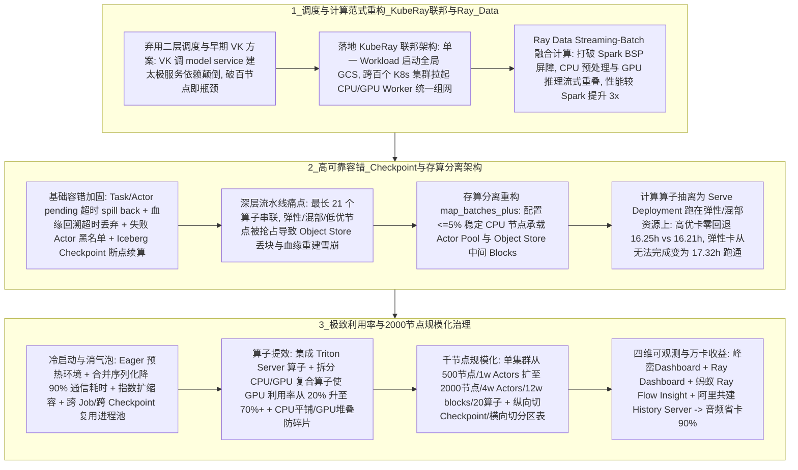

# Ray异构融合底座

## 1. TL;DR

本文详述了腾讯 TEG-Ray 团队基于异构融合计算底座 **Ray（KubeRay 联邦 + Ray Data）** 重构腾讯混元多模态数据管道并实现 **万卡规模生产化** 的架构演进与核心优化实践。核心结论是：
1. **认清 AI 数据管道的本质是“批量离线推理（Batch Inference）”**：上一代由 `Spark（读 Iceberg 元数据） + MessageQueue + Flink（串联逻辑） + 北极星远程打标服务（CPU/GPU 推理）` 拼凑而成的类 Lambda 架构存在严重的平台割裂、JVM 与 Python 生态鸿沟、缺乏反压与异构算力碎片化痛点。
2. **云原生 KubeRay 联邦与 Streaming-Batch 融合**：放弃架构依赖颠倒、百节点即遇瓶颈的早期 `Virtual Kubelet (VK)` 方案，自研 **KubeRay 多集群联邦架构**（单 Workload 启动全局 GCS，跨上百个 K8s 物理集群统一拉起 CPU/GPU Worker 组网，打通 WeData 与太极平台）；计算层采用 **Ray Data Streaming-Batch 流水线**（社区基准较 Spark 提速 **3 倍**），将 CPU 预处理与 GPU 推理彻底融合进单一任务。
3. **存算分离重构攻克“不稳定低优资源”容错难题**：在串联多达 **21 个算子** 的深层流水线中，混部/弹性/低优节点频繁被抢占回收会触发代价极高的 Object Store 血缘重建（Lineage Reconstruction）。团队仅用 **占比 $\le 5\%$ 的纯 CPU 稳定资源（20 个推理实例仅需配 1 core 稳定资源）** 承载所有 Stage 的 `Actor Pool` 与 `Object Store` 中间数据块，而将重算力的 CPU/GPU 推理算子抽离为 `Serve Deployment` 部署在海量不稳定资源上（用户仅需将 `map_batches` 改为 `map_batches_plus`），在高优卡上实现**性能零回退（16.25h vs 16.21h）**，在原本因频繁丢数据完全跑不通的弹性卡上 **17.32h 稳定跑完**。
4. **极致效能与万卡规模化收益**：通过合并序列化（批量通信耗时降 **90%**）、指数扩缩容、复合算子拆解（视频清晰度算子 GPU 利用率从 **20% 提至 70%+**）、Cgroup v1 隔离回移植与中心组件（GCS/Driver/Serve Controller 3000+ replicas）调优，将单集群准入规模在半年内从 `500 节点 / 1w Actors / 2w blocks / 5 算子` 提升 4 倍至 **`2,000 节点 / 4w Actors / 12w blocks / 20 算子`**；半年内完成 **10+ 条**混元管线重构，**为音频管线节省 90% GPU 卡、多模态理解管线提升 GPU 利用率 3 倍以上、文本管线推理成功率提升 40%、整体研发效率提升 1–3 倍**。

## 2. 问题定义与背景

### 2.1 AI 数据管道 vs 传统大数据 ETL 的本质差异
表面上看，混元大模型的数据清洗与打标管道与传统 ETL 相似（输入输出均对接 Iceberg 湖仓表）；但实质上，Iceberg 表仅存放索引元数据，真正的处理主体是存储在 COS 对象存储中的海量非结构化多模态数据（视频、音频、图文），绝大部分算力消耗在深度学习模型推理上——因此 **AI 数据管道的本质是“大规模批量离线推理（Batch Inference）”**。

### 2.2 上一代“Spark + MQ + Flink + 在线打标服务”架构的三大死穴
1. **平台层割裂**：跑通一条管线需横跨 5 个平台（US 平台建 Spark、消息平台建 MQ、Flink 平台建流任务、峰峦建 CPU 服务并注册北极星、太极平台建 GPU 推理服务），运维链路极重。
2. **引擎层孤岛与 JVM 壁垒**：Spark/Flink 基于 JVM 生态，与 PyTorch/HuggingFace 等 Python Native 生态存在高昂的跨语言序列化开销；且计算引擎通过 RPC 远程调用在线打标服务缺乏端到端反压（Backpressure）与细粒度（UDF 级）异构协同。
3. **算力层碎片化**：YARN、峰峦、TKE、太极各自管理不同池子，无法在运行时动态调配 CPU 与 GPU 配比。

## 3. 知识框架

## 4. 核心内容拆解

### 4.1 跨 K8s 集群调度选型与 KubeRay 联邦演进
面对内部上百个物理隔离的 CPU/GPU Kubernetes 集群，团队对比了三种方案：
- *方案 1（二层自定义调度）*：在各 K8s 集群常驻大批量 Pod 再套一层自定义调度器，变成三层调度，复杂度过高；
- *方案 2（平台层 Standalone 组网）*：放弃 KubeRay 原生的高可用、容灾与 Autoscaling 生态；
- *方案 3（扩展 KubeRay 支持集群联邦，最终入选）*：
  - **第一阶段踩坑（Virtual Kubelet, VK 架构）**：在 CPU 集群跑 KubeRay，通过 VK 将太极 GPU 集群抽象成虚拟 Kubelet，底层通过调 `model service` 创建太极服务来拉起 GPU Pod。这造成了**“底层组件依赖上层服务”的架构依赖颠倒**，每建一个 GPU Pod 都要建一个太极服务，当节点数**超过 100** 时太极链路即不堪重负。
  - **第二阶段终局（KubeRay 联邦架构）**：在多个物理 K8s 集群并发部署 KubeRay Workload，通过配置约束**仅单一主 Workload 启动全局控制存储 GCS（Global Control Store）**，其余集群的 Workload 均作为纯 Worker 节点组直接加入同一 Ray Cluster，实现了 WeData 数据平台与太极 AI 平台的 `Data + AI` 全局弹性调度统一。

### 4.2 容错机制与“存算分离（`map_batches_plus`）”架构重构
1. **Ray Core / Ray Data 容错加固与 Checkpoint**：
   - 为防极端死锁，新增 **Task/Actor 调度 Pending 超时 `spill back`**、**多维节点故障检测插件（磁盘/网卡/日志）**、**Object 血缘回溯超时丢弃**、**持续失败 Actor 自动拉黑（Blacklist）** 与 **用户算子执行 Timeout**；
   - 针对长周期任务写 Iceberg 只能在末尾统一 Commit 的风险，引入 **Checkpoint 机制**定期持久化中间状态，支持断点续算与提前抽样校验（至此可支撑 **10 万 CPU + 1,000 GPU** 规模）。
2. **向“存算分离”演进：驯服四大不稳定低优资源**：
   - **四大不稳定资源特征**：（1）**弹性 GPU 卡**（在线业务抢占时批量回收）；（2）**混部 GPU 卡**（与在线同机共享，算力显存受压制波动甚至卡死）；（3）**混部 CPU**（从 GPU 机挖掘，严格限制 Disk 与进程/线程数 `Pid`）；（4）**低优 CPU**（CPU 被严重压制且磁盘 I/O 极不稳定）。
   - **默认存算一体的崩溃根因**：Ray Data 默认将算子生成的中间数据 `Blocks` 缓存在计算节点本地 `Raylet` 的共享内存 `Object Store` 中。在串联多达 **21 个算子** 的深层管线中，一旦低优计算节点被抢占回收，内存 Blocks 丢失会触发级联的**血缘重建（Lineage Reconstruction）**，导致整个作业雪崩卡死。
   - **5% 稳定节点存算分离方案**：
     - 仅需配比 **$\le 5\%$ 的纯 CPU 稳定节点（实测每 20 个推理实例仅需配置 1 core 稳定资源）**，将 Dataset Pipeline 所有 Stages 的 `Actor Pool` 部署在稳定节点上，确保跨阶段传输的 `Blocks` 安全驻留在稳定节点的 `Object Store` 内存中；
     - 将消耗海量算力的 CPU/GPU 推理算子抽离为独立的 **`Serve Deployment` 服务**，交由 `Serve Controller` 调度在海量不稳定资源池上。
     - **零侵入与零性能回退**：用户仅需将代码中的 `map_batches` 改为 **`map_batches_plus`** 并通过环境变量切换模式；高优卡实测耗时 **16.25 小时 vs 原生 16.21 小时（性能零回退）**；而在弹性卡场景下，原生模式因频繁丢数据完全无法跑通，存算分离模式可在 **17.32 小时**稳健完成。

### 4.3 资源利用率压榨、千节点规模化与四维可观测体系
1. **五大维度压榨资源利用率**：
   - **冷启动加速**：Eager 化提前预热运行环境与 Actor Pool；通过**合并序列化数据将批量 Actor 初始化通信耗时降低 90%**；将社区默认每轮仅扩容 1 个 Actor 改造为**指数扩缩容**。
   - **消除计算气泡（Bubble）**：重构计入 Pending Actor 的激进 Autoscaling 算法；支持例行任务**跨 Job 复用常驻集群**以及单作业内**跨 Checkpoint 复用 Deployment（Actor Pool）**。
   - **长尾治理**：算子实例 Timeout + 基于运行时统计（**均值 + 标准差**）的 `issue detector` 自动检测重启慢实例。
   - **算子计算提效与防碎片**：封装 **Triton Server** 算子直接复用于离线链路；将受 CPU 切帧阻塞的“视频清晰度”等 CPU+GPU 复合算子拆分解耦，使 **GPU 利用率从 20% 飙升至 70% 以上**；针对 1 卡与 4 卡混合算子定制异构装箱策略（**CPU 平铺、GPU 堆叠**）消除资源碎片；并提供算子基线自动压测（自动寻优 `batch_size`）与 DAG 任务基线自动测算。
2. **千节点级规模化治理与“横纵双向切分”**：
   - 调优三大中心组件：**GCS**（容忍 pub/sub 丢包与 fetch RPC 超时）、**Driver**（重构 Event Loop 调度）、**Serve Controller**（治理高频 Metrics 内存暴涨，自定义路由解决 **3,000+ replicas** 负载不均）；
   - **稳定性加固**：Iceberg 按 `Row Group` 拆分、JSON 按行切分配合反压彻底治理 OOM；将社区高内核要求的 `cgroup v2` 隔离**向后移植支持 `cgroup v1`** 落地存量机器；按 Pod 与 Actor 多维切分独立临时数据目录并在退出时自动 GC 回收磁盘。
   - **准入标准跃升与超大规模切分**：单集群准入标准在半年内从 `500 节点 / 1w Actors / 2w blocks / 5 个算子` 跃升至 **`2,000 节点 / 4w Actors / 12w blocks / 20 个算子`**；超出单集群准入上限的任务采用**“横向切（按分区表拆给多个 Ray 集群并发）”**与**“纵向切（在集群内按 Checkpoint 分批切分降低单次时长）”**。
3. **四维可观测体系**：集成 **峰峦 Dashboard**（持久化日志 + 一键诊断）、增强版 **Ray Dashboard**（Grafana/多磁盘/Pid 透出）、引入蚂蚁开源的 **Ray Flow Insight**（逻辑/物理视图、分布式火焰图、分布式调用栈），并联合阿里云团队率先在腾讯内部落地社区期盼已久的 **Ray History Server**。

## 5. 数据速查表

| 指标 / 维度 | 原文数值 | 语境 / 条件 |
| :--- | :--- | :--- |
| **落地集群总规模与重构管线数** | **万卡规模**生产化 / 半年重构 **10+ 条**数据管线 | 成为腾讯混元多模态数据管道的统一异构底座 |
| **音频管线 GPU 节省比例** | 节省 **90%** 的 GPU 卡 | 混元音频数据管线重构后实测收益 |
| **多模态理解管线 GPU 利用率提升** | 提升 **3 倍以上** | 混元多模态理解数据管线重构后实测收益 |
| **文本管线推理成功率与整体研发效率** | 推理成功率提升 **40%** / 研发效率提升 **1–3 倍** | 混元文本管线与数据管道整体研发效能对比 |
| **存算分离稳定资源配比开销** | 占比 **$\le 5\%$**（**20 个**推理实例仅需 **1 core** 稳定 CPU） | 承载 Actor Pool 与 Object Store 中间数据块，避免最深 **21 个算子**血缘重建 |
| **存算分离 vs 原生模式任务耗时** | 高优卡：**16.25h vs 16.21h**（零回退）/ 弹性卡：**17.32h vs 无法完成** | 验证 `map_batches_plus` 在高优卡无损、在弹性抢占卡可稳定完赛 |
| **合并序列化与复合算子拆分收益** | 初始化批量通信时间降低 **90%** / GPU 利用率从 **20% $\to$ 70%+** | 视频清晰度算子拆解 CPU 切帧与 GPU 推理后的利用率跃升 |
| **单 Ray 集群规模准入标准跃升** | 从 `500节点/1w Actors/2w blocks/5算子` $\to$ **`2,000节点/4w Actors/12w blocks/20算子`** | 近半年通过对 GCS、Driver、Serve Controller (3000+ replicas) 优化达成 |

## 6. 踩坑与教训 / 可迁移的设计原则

| 错误做法 | 失败表现或原因 | 原文应对（可迁移的设计原则） |
| :--- | :--- | :--- |
| **通过 Virtual Kubelet (VK) 调用上层 `model service` 创建太极服务来拉起底层 Ray GPU Pod** | 造成“底层基础设施依赖上层业务服务”的架构依赖颠倒，每次建 Pod 都要建一套服务，集群超 100 节点即压垮太极控制面 | **KubeRay 原生联邦（单 GCS + 多集群 Worker 组）原则**：在各物理 K8s 集群直布 KubeRay Workload，仅主集群启 GCS，其余直接作为 Worker 加入，消除中间转换层 |
| **在易被抢占回收的弹性卡/混部低优节点上直接用默认“存算一体”模式跑 21 层深度的 Ray Data 流水线** | 节点一旦被回收，驻留在本地 Raylet Object Store 的中间 Blocks 丢失，触发跨 21 层算子的血缘回溯重建，引发级联阻塞与作业失败 | **5% 稳定节点存算分离（`map_batches_plus`）原则**：用不到 5% 的纯 CPU 稳定节点托管 Actor Pool 与 Object Store 缓存，将重计算算子作为无状态 `Serve Deployment` 扔上廉价弹性卡 |
| **将重度 CPU 预处理（如视频切帧）与 GPU 模型推理打包在同一个复合算子里跑在 GPU 节点上** | CPU 切帧把 CPU 核心彻底打满，而昂贵的 GPU 却在空等数据，实测 GPU 利用率仅有 20% | **CPU/GPU 复合算子物理解耦 + 异构装箱（CPU 平铺 / GPU 堆叠）原则**：将 CPU 切帧与 GPU 推理拆分为独立 Stage 流水线并发，将 GPU 利用率拉升至 70% 以上 |
| **盲目追求把无限增长的超大规模管线塞进单个巨型 Ray Cluster 中硬抗** | 中心组件（GCS、Driver、Serve Controller）存在元数据与调度物理上限，超载后极易触发全局 OOM 或 RPC 雪崩 | **明确单集群四维准入边界 + “横向切分区表 / 纵向切 Checkpoint”原则**：设定 `2000节点/4w Actors/12w blocks/20算子` 准入红线，超限任务横向拆多集群、超长任务纵向拆 Checkpoint |

## 7. 记忆锚点

- **AI 数据管道第一性原理**：“**湖仓表只是索引，多模态数据管道的本质是离线批量推理（Batch Inference）。**”
- **Ray 异构底座四大神技**：
  1. **组网统调度**：KubeRay 联邦（1 个全局 GCS 统管百个 K8s 集群）；
  2. **容错抗抢占**：`<5%` 稳定 CPU 存 Blocks + 弹性卡跑 `Serve Deployment`（`map_batches_plus` 护航 21 层算子零回退）；
  3. **提效消气泡**：合并序列化省 **90%** 时间 + 拆解视频切帧让 GPU 利用率从 **20% 飙至 70%+**；
  4. **万卡大生产**：单集群 **2000 节点 / 4w Actors**，音频省卡 **90%**、多模态利用率 **3 倍+**。

## 8. 复习卡片

为什么说大模型时代的多模态数据管道本质上是“批量推理（Batch Inference）”而非传统的 ETL，且传统 Spark+Flink 架构难以胜任？::因为 Iceberg 等湖仓表在其中仅充当元数据索引，真正的算力全部消耗在对 COS 中海量非结构化音视频/图文数据的深度学习模型推理上；传统 Spark/Flink 基于 JVM 生态（与 Python AI 生态跨语言序列化开销大）、采用粗粒度 Executor 资源管理，且通过远程 RPC 调在线打标服务缺乏反压与 CPU+GPU 细粒度流水线协同（Ray Data 的 Streaming-Batch 范式比 Spark 快 3 倍）。
在实现跨多个 Kubernetes 集群调度单个 RayCluster 时，为什么腾讯团队放弃了早期的 Virtual Kubelet（VK）方案而转向 KubeRay 联邦架构？::早期 VK 方案通过调用上层 `model service` 创建太极服务来拉起 GPU Pod，导致“底层组件依赖上层服务”的架构依赖颠倒，链路过重且超过 100 个节点就会压垮太极控制面；改用 KubeRay 联邦架构后，在各 K8s 集群并发部署 Workload，仅单一主 Workload 启动全局 GCS，其余作为 Worker 节点组直接加入，实现了轻量级全局弹性。
为什么默认的 Ray Data 在使用弹性 GPU 卡、混部卡等“不稳定低优资源”跑长流水线（如串联 21 个算子）时会频繁失败？团队是如何通过“存算分离”解决的？::默认 Ray Data 采用存算一体架构，中间数据 Blocks 缓存在计算节点本地的 Object Store 中，当低优节点被抢占回收时 Blocks 丢失，触发代价极高的深层血缘重建（Lineage Reconstruction）乃至级联卡死；团队通过配置占比不到 5% 的纯 CPU 稳定节点（20 个推理实例仅需 1 core）专门运行 Actor Pool 并存储中间 Blocks，将重计算的推理算子封装为 `Serve Deployment`（通过 `map_batches_plus` 无感切换）部署在海量不稳定资源上，实现了高优卡性能零回退（16.25h vs 16.21h）且弹性卡稳定完赛（17.32h）。
腾讯团队是如何将视频清晰度算子的 GPU 利用率从 20% 提升到 70% 以上的，又是如何解决多算子混部时的资源碎片问题的？::1. 复合算子拆分：视频清晰度算子原本是 CPU+GPU 复合算子，CPU 切帧把 CPU 打满导致 GPU 空转（仅 20%），通过将 CPU 预处理与 GPU 推理彻底解耦为独立算子，将 GPU 利用率提升至 70% 以上；2. 资源碎片优化：针对 1 卡与 4 卡混合算子，定制了“CPU 平铺、GPU 堆叠”的差异化调度策略。
经过半年优化，腾讯内部单个 Ray Data 集群的准入标准提升了多少？当业务规模超出单集群准入上限时如何扩展？::单集群准入标准从“500 节点 / 1w Actors / 2w blocks / 5 个算子”扩展了 4 倍至“2,000 节点 / 4w Actors / 12w blocks / 20 个算子”；当超出单集群上限时，采用“横向切（将数据切成多个分区表，由多个 Ray 集群并发推理）”与“纵向切（在集群内切分 Checkpoint 缩短单次计算时长）”两种方式扩展。
腾讯 TEG-Ray 团队建设的“四维可观测体系”包含哪四个组件，重构混元数据管道后取得了哪些核心量化收益？::可观测体系包含：1. 峰峦 Dashboard（持久化日志与一键诊断）；2. 内部增强版 Ray Dashboard；3. 引入蚂蚁开源的 Ray Flow Insight（分布式火焰图与调用栈）；4. 联合阿里云落地的 Ray History Server。重构 10+ 条管线实现万卡生产化后，帮助音频管线节省 90% GPU 卡、多模态理解管线 GPU 利用率提升 3 倍以上、文本管线推理成功率提升 40%、整体研发效率提升 1–3 倍。

## 9. 知识关联

- **本库通用主题**：[Agent工程循环](../../20_topics/Agent%E5%B7%A5%E7%A8%8B%E5%BE%AA%E7%8E%AF.md) · [具身智能数据闭环](../../20_topics/%E5%85%B7%E8%BA%AB%E6%99%BA%E8%83%BD%E6%95%B0%E6%8D%AE%E9%97%AD%E7%8E%AF.md) · [数据湖表与互操作](../../20_topics/%E6%95%B0%E6%8D%AE%E6%B9%96%E8%A1%A8%E4%B8%8E%E4%BA%92%E6%93%8D%E4%BD%9C.md) · [异常监控与稳定性](../../20_topics/%E5%BC%82%E5%B8%B8%E7%9B%91%E6%8E%A7%E4%B8%8E%E7%A8%B3%E5%AE%9A%E6%80%A7.md) · [AI研发协同](../../20_topics/AI%E7%A0%94%E5%8F%91%E5%8D%8F%E5%90%8C.md) · [分布式计算与数据管道](../../20_topics/%E5%88%86%E5%B8%83%E5%BC%8F%E8%AE%A1%E7%AE%97%E4%B8%8E%E6%95%B0%E6%8D%AE%E7%AE%A1%E9%81%93.md)
- **候选双链**：[[KubeRay多集群联邦调度]] · [[Apache-Iceberg湖仓数据管道]] · [[存算分离抗抢占容错架构]] · [[混部与弹性算力池化]]

## 10. 原文参考资料

- 原文标题：《Ray 异构融合底座重构数据管道：架构演进与万卡落地实践》（作者：gray，腾讯 TEG-Ray 团队，发布于 2026-01-07）
- 关联开源生态：KubeRay、Ray Data、Ant-Ray（`Ray Flow Insight`）、阿里云共建 `Ray History Server`。

> [!note]- 校对报告
> - **页码溯源汇总**：
>   - `p.1–4`：AI 数据管道本质是批量离线推理（Batch Inference）、传统大数据引擎三大挑战（细粒度算子调度、CPU+GPU 异构、Python Native 生态）及上一代 `Spark + MQ + Flink + 北极星打标服务` 在平台层、引擎层、算力层的痛点。
>   - `p.4–8`：跨多 K8s 集群调度三方案选型、VK 架构踩坑（调 `model service` 依赖颠倒，百节点即瓶颈）与 KubeRay 联邦架构（单 Workload 启动 GCS）、Ray Data Streaming-Batch 流水线（较 Spark 提速 3 倍）。
>   - `p.9–13`：容错增强（Task/Actor Pending 超时 `spill back`、血缘回溯超时、失败 Actor 黑名单、算子 Timeout）、Iceberg Checkpoint 机制（支撑 10w CPU + 1k GPU）、四类不稳定低优资源剖析、最深 21 个算子血缘重建痛点，以及 `<5%` 稳定节点（20 个推理实例配 1 core）+ `Serve Deployment` 存算分离架构（`map_batches_plus`，高优卡 16.25h vs 16.21h 零回退，弹性卡 17.32h 完赛）。
>   - `p.13–19`：资源利用率优化（Eager 预热、合并序列化降 90% 通信时间、指数扩缩容、跨 Job/跨 Checkpoint 复用、均值+标准差慢实例重启、集成 Triton Server、视频清晰度算子拆分使 GPU 利用率从 20% 提至 70%+、CPU 平铺/GPU 堆叠、算子/任务基线自动压测）、千节点规模化（单集群准入从 `500节点/1w Actors/2w blocks/5算子` 扩至 `2000节点/4w Actors/12w blocks/20算子`，GCS/Driver/Serve Controller 3000+ replicas 调优，Iceberg Row Group 切分防 OOM，`cgroup v1` 回移植，多维进程目录自动 GC，横向切分区表/纵向切 Checkpoint）、四维可观测性及万卡落地四大业务收益（音频省卡 90%、多模态 GPU 利用率 +3x、文本成功率 +40%、研发效率 +1~3x）。
> - **核验结论**：全文所有架构细节、参数配比与业务收益数字均与原文逐页核对一致。
