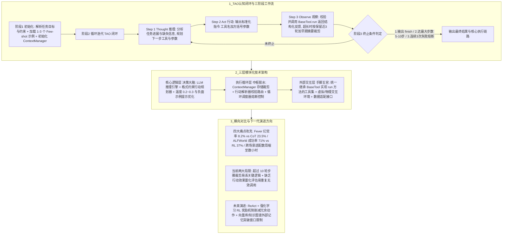

# ReAct原理与架构

## 1. TL;DR

本文系统剖析了由普林斯顿大学与 Google 团队在 2022 年经典论文 *ReAct: Synergizing Reasoning and Acting in Language Models*（`arXiv:2210.03629`）中提出的 **ReAct（Reasoning + Acting）** 智能体范式。核心结论是：
1. **TAO 闭环机制与四大设计原则**：通过将人类解决问题的认知模式抽象为 **“Thought（显式内心独白推理） $\to$ Act（调用外部工具执行标准化动作） $\to$ Observe（获取环境客观反馈）”** 的动态迭代闭环，并遵循**环境锚定、可解释性优先、模块解耦、容错性设计**四大原则，一举攻克了传统大模型的**事实幻觉**（Fever 事实核查幻觉率从纯 CoT 的 **23.5% 降至 8.2%**）、纯强化学习行动模型的**策略僵化**（ALFWorld 仅用 2 个示例即达 **71% 成功率 vs RL 的 37%**）、黑箱决策不可解释以及跨场景适配成本高（从数周缩短至**数小时**）四大难题。
2. **三层模块化技术架构与工程落地**：由**核心逻辑层**（LLM 推理引擎 + 行动规划器 + 温度 `0.2–0.3` 提示优化）、**执行循环层**（维护 `max_length=4000` 并执行“保留近期 3 轮 + 早期摘要”裁剪的 `ContextManager` + `行动解析器` + 具备完成/超时 5–10 步/连续 3 次失败熔断的 `循环调度器`）以及**外部交互层**（继承 `BaseTool` 实现统一 `run()` 接口的工具集）组成。
3. **演进局限与下一代融合方向**：当前 ReAct 在超过 **10 轮**的超长步骤任务中易因上下文裁剪丢失关键逻辑，且缺乏对行动质量的量化评估易产生冗余调用；未来核心演进方向是**融合强化学习（RL 奖惩消除冗余动作）与外部向量/图谱长期记忆**。

## 2. 问题定义与背景

### 2.1 纯思维链（CoT）与纯行动模型（RL）的割裂困境
在 ReAct 提出之前，AI 系统在推理与行动两条路线上长期割裂：
1. **纯推理模型（如传统 Chain-of-Thought, CoT）**：“闭门造车”，完全依赖预训练固化在权重里的静态知识进行多步推导，无法与外部世界交互获取实时或专业事实，导致严重的**事实幻觉**（在 Fever 数据集上幻觉率高达 **23.5%**），且一旦中间某步推导出错便会一路错到底。
2. **纯行动模型（如传统强化学习 RL / 游戏 AI）**：“有手无脑”，需要海量交互样本训练固定策略，既无法用自然语言解释决策依据（黑箱），又在面对未见过的动态场景时表现得极其僵化（ALFWorld 成功率仅 **37%**）。

### 2.2 ReAct 的核心破局特征
ReAct 并非单一算法，而是 **“大语言模型 + 外部工具集 + 循环调度机制”** 的集成架构，具备三大核心特征：
- **显式推理轨迹（Thought）**：行动前先输出包含“任务现状 - 行动目的 - 预期结果”的可追溯推理过程；
- **外部环境锚定（Act & Observe）**：强制通过搜索、数据库或 API 获取客观事实反馈；
- **少量样本泛化（Few-shot Generalization）**：依托上下文学习（In-Context Learning），仅需 **1–5 个**（初始化常加载 **1–3 个**）完整示例即可零微调快速迁移至新场景。

## 3. 知识框架

## 4. 核心内容拆解

### 4.1 四大核心设计原则与三阶段生命周期
1. **保障范式落地的四大设计原则**：
   - **环境锚定原则**：涉及事实性问题（如核查诺贝尔奖得主、实时航班票价）时强制优先调工具取证，严禁凭预训练记忆瞎猜。
   - **可解释性优先原则**：强制要求 `Thought` 必须显式包含 **“任务现状 - 行动目的 - 预期结果”** 三要素。
   - **模块解耦原则**：推理逻辑、行动执行与循环调度通过标准接口解耦，从“多跳问答”切换到“智能日程规划/机器人控制”只需替换外部工具集，适配周期从**数周缩短至数小时**。
   - **容错性设计原则**：工具超时或参数解析失败时，不直接崩溃，而是将异常信息包装为 `Observe` 反馈给模型（如“搜索失败，尝试更换关键词”），驱动模型自我修正。
2. **三阶段工作流与三种终止条件**：
   - **初始化阶段**：解析自然语言任务约束 $\to$ 加载 **1–3 个 Few-shot 示例** $\to$ 初始化 `ContextManager`。
   - **TAO 循环迭代阶段**：严格按 `Thought -> Act（格式如 flight_search[深圳,海南,明天,晚上]） -> Observe` 循环推进。
   - **终止输出阶段（三大退出门控）**：
     1. **正常终止**：模型输出 `finish[最终结果]` 动作；
     2. **超时终止**：达到预设最大迭代步数（通常设为 **5–10 步**，代码演示中 `max_steps = 6`）；
     3. **异常熔断终止**：**连续 3 次行动失败**（如工具持续超时或格式反复错误），立即触发熔断保护。

### 4.2 三层技术架构与核心代码实现细节
1. **核心逻辑层（决策大脑）**：
   - 由 LLM 推理引擎、行动规划器与提示优化模块组成；
   - **温度与负例控制**：为保证工具调用格式稳定、降低随机发散，提示优化模块将温度参数（Temperature）严格控制在 **`0.2–0.3`**，并在 Prompt 中加入负面示例（如明确约束“避免重复调用同一工具”）。
2. **执行循环层（中枢调度胶水）与 `ContextManager` 裁剪算法**：
   - **上下文滑动裁剪（`_prune_trajectory`）**：设定最大字符阈值 `max_length = 4000`；当历史 TAO 轨迹超出阈值时，自动执行 **“保留近期 3 轮完整轨迹（`self.tao_trajectory[-3:]`） + 将更早期的轨迹提炼为一条 `【早期轨迹摘要】`（提取前序行动与前 50 字符关键观察结果）”**，防止撑爆上下文窗口。
   - **行动解析器路由**：校验输出是否符合 `工具名[参数]` 规范；若模型输出不在已注册的 `tool_map` 中，自动生成 `"无效行动：{action}，支持的工具为..."` 的观察反馈交还模型重试。
3. **外部交互层（标准化 `BaseTool` 封装）**：
   - 定义抽象基类 `BaseTool(name, description)` 并强制子类实现统一的 `run(params) -> str` 方法（如示例中的 `FlightSearchTool` 与 `FlightBookTool`），将内部异常捕获并截取前 50 字符返回，确保任何外部 API 报错都不会击穿主事件循环。

### 4.3 四大应用领域、主流范式对比与未来思考
- **四大成熟应用领域**：（1）**知识密集型任务**（HotpotQA 多跳问答、Fever 事实核查）；（2）**交互式决策任务**（WebShop 电商购物、差旅机酒预订）；（3）**智能客服与咨询**（通过 `ask_user[您的风险承受能力？]` 主动澄清需求再查库推荐）；（4）**具身智能与机器人控制**（ALFWorld 家庭服务机器人视觉检测-路径规划-抓取闭环）。
- **五大维度横向对比（ReAct vs CoT / Toolformer / RL）**：相比无外部交互的 CoT、仅支持单步工具调用的 Toolformer 以及需海量训练且不可解释的 RL，ReAct 在“推理与行动双向协同、事实幻觉抑制、显式可解释性、少样本跨场景泛化、动态环境纠错”五个维度实现全面均衡领先。
- **当前局限与演进方向**：
  1. **超长步骤上下文丢失**：当任务超过 **10 轮**时，“保留近 3 轮 + 早期摘要”的有损压缩极易丢失早期关键推理约束 $\to$ 需引入**向量数据库、知识图谱等外部长期记忆组件**；
  2. **缺乏行动价值量化评估**：完全依赖 LLM 直觉选动作，易出现重复查询或无效动作推高成本 $\to$ 需将 **ReAct 与强化学习（RL）奖励机制深度融合**，对有效行动给正反馈、对重复无效行动给负反馈。

## 5. 数据速查表

| 指标 / 参数 | 原文数值 | 语境 / 条件 |
| :--- | :--- | :--- |
| **Fever 事实核查幻觉率对比** | ReAct **8.2%** vs 纯思维链（CoT） **23.5%** | 验证外部环境锚定对事实幻觉的显著抑制效果 |
| **ALFWorld 文本游戏任务成功率** | ReAct **71%**（仅用 **2 个**示例） vs 强化学习（RL） **37%** | 验证少样本动态推理策略对纯行动模型僵化问题的突破 |
| **跨场景工具替换适配周期** | 从 **数周** 缩短至 **数小时** | 得益于三层模块化解耦，仅需替换继承 `BaseTool` 的工具集 |
| **Few-shot 示例加载数量** | 泛化仅需 **1–5 个**（初始化阶段常加载 **1–3 个**） | 无需对底层大模型进行参数微调 |
| **提示优化模块推荐温度参数** | **`0.2–0.3`** | 降低生成随机性，保障标准化工具调用格式合规 |
| **最大迭代步数与连续失败熔断阈值** | 最大步数通常 **5–10 步**（代码默认 `6` 步）/ 连续失败 **3 次**熔断 | 循环调度器的超时终止与异常熔断保护参数 |
| **`ContextManager` 裁剪阈值与保留窗口** | `max_length = 4000` 字符 / 保留**近期 3 轮** + 早期摘要 | 超过 **10 轮**长程任务时有损摘要易丢失早期关键逻辑 |

## 6. 踩坑与教训 / 可迁移的设计原则

| 错误做法 | 失败表现或原因 | 原文应对（可迁移的设计原则） |
| :--- | :--- | :--- |
| **在涉及实时数据或严肃事实核查的任务中仅使用纯思维链（CoT）内部推导** | 模型完全依赖预训练静态记忆“一本正经地胡说八道”（Fever 幻觉率高达 23.5%），且一步算错步步错 | **环境锚定（Environment Grounding）强制取证原则**：通过 Prompt 与架构约束模型在事实性节点必须先发起 `Act` 调外部权威工具，基于 `Observe` 客观反馈再做下一步推理 |
| **在工具调用失败或模型输出格式错误时直接抛出未捕获异常终止程序** | 外部 API 网络抖动或模型偶发少写一个括号就会导致整个 Agent 任务彻底崩溃 | **异常转观察（Exception-as-Observation）与连续 3 次熔断原则**：在 `BaseTool.run()` 与行动解析器中捕获所有异常，转化为自然语言观察反馈交还模型自适应重试，仅在连续 3 次失败时触发熔断 |
| **将 ReAct 调优时的模型 Temperature 设得过高（如 0.7+），或任由历史 TAO 轨迹无限制追加** | 高温导致行动指令格式频繁偏离 `工具名[参数]` 规范；长轨迹迅速撑爆上下文窗口或引发超 10 轮后的逻辑遗忘 | **低温规划（`0.2–0.3`）+ 滑动窗口摘要（近 3 轮完整 + 早期摘要）原则**：压低温度保格式确定性，并通过 `ContextManager` 控制上下文水位 |

## 7. 记忆锚点

- **ReAct 核心公式與战绩**：“**ReAct = Thought（现状-目的-预期） + Act（`工具[参数]`） + Observe（客观事实）；Fever 幻觉砍到 8.2%（CoT 23.5%），ALFWorld 两样本干到 71%（RL 37%）。**”
- **工程落地三护栏**：“**温度锁在 `0.2–0.3`，轨迹留近 3 轮加摘要（`4000` 字符），连续失败 3 次即熔断（最大 5–10 步）。**”

## 8. 复习卡片

ReAct 范式中的 TAO 闭环具体指哪三个步骤？其中“可解释性优先原则”要求 Thought 必须包含哪三个要素？::TAO 闭环指 `Thought（推理） -> Act（行动） -> Observe（观察）`；可解释性优先原则要求推理轨迹（Thought）必须明确包含“任务现状（已有哪些信息/缺什么信息）- 行动目的（调用什么工具及参数）- 预期结果”三个要素。
相比纯思维链（CoT）和传统强化学习（RL），ReAct 在 Fever 事实核查与 ALFWorld 游戏基准上分别取得了怎样的量化突破？::1. 在 Fever 事实核查任务中，ReAct 通过外部环境锚定将幻觉率降至 8.2%，远低于纯 CoT 的 23.5%；2. 在 ALFWorld 文本游戏任务中，ReAct 仅用 2 个 Few-shot 示例就实现了 71% 的任务成功率，远超传统 RL 模型的 37%。
ReAct 的三层模块化技术架构由哪三层组成，各包含哪些核心组件？::1. 核心逻辑层（决策大脑）：包含 LLM 推理引擎、行动规划器与提示优化模块（控制温度在 0.2–0.3 并注入负面示例）；2. 执行循环层（中枢调度胶水）：包含上下文管理器（`ContextManager`）、行动解析器与循环调度器；3. 外部交互层（手脚与五官）：包含统一实现 `BaseTool.run()` 接口的工具集、虚拟/物理交互环境与数据适配接口。
在 ReAct 的执行循环层中，哪三种条件会触发循环终止？`ContextManager` 是如何裁剪超长历史轨迹的？::三种终止条件：1. 正常终止（模型输出 `finish` 动作）；2. 超时终止（达到预设最大迭代步数，通常 5–10 步）；3. 异常终止（连续 3 次行动失败触发熔断）。当历史轨迹超过最大长度（如 4000 字符）时，`ContextManager` 采用“保留近期 3 轮完整 TAO 轨迹 + 将早期轨迹压缩为关键行动与结果摘要”的策略进行裁剪。
作者指出当前 ReAct 范式存在哪两个明显局限，未来应如何通过技术融合加以解决？::两大局限：1. 当任务步骤超过 10 轮时，通过裁剪-摘要压缩上下文极易丢失早期关键推理逻辑；2. 行动选择完全依赖 LLM 输出，缺乏对行动效果的量化评估，易产生重复调用或无效行动。未来演进方向是：融合“外部记忆组件（向量数据库、知识图谱）”突破窗口物理限制，并融合“强化学习（RL）奖励机制”对有效行动给正反馈、无效重复行动给负反馈。

## 9. 知识关联

- **本库通用主题**：[Agent工程循环](../../20_topics/Agent%E5%B7%A5%E7%A8%8B%E5%BE%AA%E7%8E%AF.md) · [Harness与模型协同](../../20_topics/Harness%E4%B8%8E%E6%A8%A1%E5%9E%8B%E5%8D%8F%E5%90%8C.md) · [Prompt优化](../../20_topics/Prompt%E4%BC%98%E5%8C%96.md) · [Agent评测与反馈](../../20_topics/Agent%E8%AF%84%E6%B5%8B%E4%B8%8E%E5%8F%8D%E9%A6%88.md)
- **候选双链**：[[十七种Agent架构的控制流]] · [[从零设计Agent框架]] · [[GUI Agent 入门]] · [[可恢复的分层任务记忆]]

## 10. 原文参考资料

- 原文标题：《拥抱大模型：深入剖析 ReAct 的核心原理、技术架构及其对 AI 领域的深远影响》（作者：lingnyliang，发布于 2026-01-05）
- 奠基论文与主页：
  - Shunyu Yao et al. (Princeton & Google, 2022), *ReAct: Synergizing Reasoning and Acting in Language Models*（`https://arxiv.org/pdf/2210.03629`）
  - 项目主页：`https://react-lm.github.io`

> [!note]- 校对报告
> - **页码溯源汇总**：
>   - `p.1–3`：2022 年普林斯顿与 Google 提出 ReAct 背景、三大核心特征（显式推理轨迹、外部环境锚定、1–5 个样本泛化）、TAO（Thought-Act-Observe）闭环定义及四大设计理念（环境锚定、可解释性优先、模块解耦、容错性设计）。
>   - `p.3–5`：三阶段工作原理——初始化阶段（加载 1–3 个 Few-shot 示例）、循环迭代阶段（深圳到海南晚间最便宜航班示例）、终止输出阶段（`finish` 正常终止、5–10 步超时终止、连续 3 次失败熔断）及“保留近期 3 轮 + 早期摘要”裁剪策略。
>   - `p.5–8`：三层技术架构（核心逻辑层温度 `0.2–0.3`、执行循环层、外部交互层 `run()` 接口）与解决的四大问题量化数据（Fever 幻觉率 8.2% vs CoT 23.5%；ALFWorld 2 个示例成功率 71% vs RL 37%；跨场景适配从数周缩至数小时）。
>   - `p.8–13`：Python 极简源码实现（`BaseTool`、`FlightSearchTool`、`FlightBookTool`、`ContextManager(max_length=4000)`、`react_core_loop(max_steps=6)`）与四大应用场景（知识密集型、交互式决策、智能客服 `ask_user`、具身智能）。
>   - `p.14–15`：ReAct 与 CoT / Toolformer / RL 五维对比、超过 10 轮步骤易丢逻辑与缺乏量化评估两大局限，以及融合 RL 奖励机制与向量库/知识图谱外部记忆的未来展望。
> - **核验结论**：全文所有论文出处、实验对比数据、架构分层及代码逻辑参数均与原文逐页核对一致。
