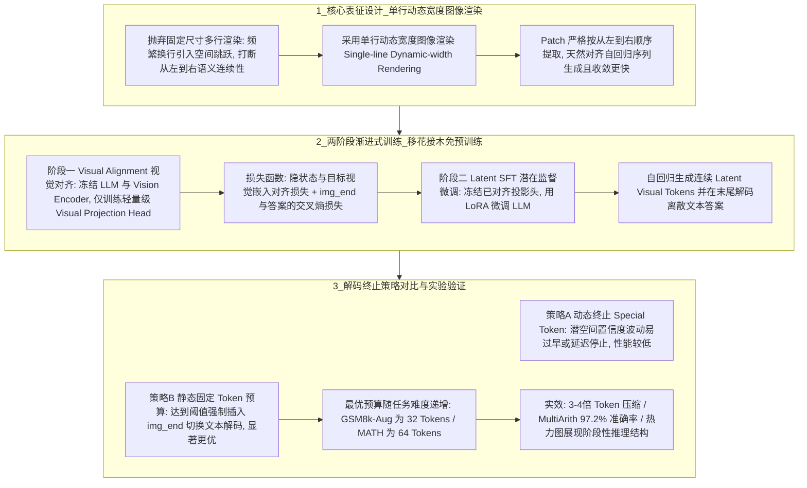

# RoT隐式推理框架

## 1. TL;DR

本文介绍了腾讯团队提出的全新隐空间思维链推理范式 **Render-of-Thought（RoT，将思维链“画”进隐空间，arXiv:2601.14750）**。针对显式 CoT（Chain-of-Thought）生成冗长文本导致高延迟与高 KV Cache 消耗，以及现有隐式 CoT（如 Coconut、CoLaR）无语义锚点易表征坍缩且完全黑盒不可解释的痛点，RoT **利用现有多模态大模型（VLM，如 Qwen-VL、LLaVA）中冻结的视觉编码器作为“语义锚点”，将文本推理步骤渲染为“单行动态宽度图像”的视觉嵌入**，并通过“**阶段一：视觉对齐（仅训轻量级视觉投影头） $\to$ 阶段二：潜在监督微调（冻结投影头，LoRA 微调 LLM 自回归生成连续潜在视觉 Token）**”两步移花接木，在无需昂贵预训练的前提下实现了 **3–4 倍的 Token 压缩率**与显著的推理加速，在 `MultiArith` 上取得 **97.2%** 准确率（`Qwen3-VL-4B`），并支持通过热力图（Heatmap）与相似度矩阵直观分析隐空间思考轨迹。

## 2. 问题定义与背景

### 2.1 显式 CoT 与传统隐式 CoT 的两难困境
1. **显式 CoT（Explicit CoT，“写出来太慢”）**：模型像学生做题写草稿一样逐词输出几百个中间文本 Token，不仅自回归解码延迟高，而且长序列显著挤占显存 KV Cache；启发式筛选 Token 或强化学习缩短路径仍受限于离散文本表征的低信息密度。
2. **传统隐式 CoT（Implicit CoT，如 Coconut、CoLaR，“黑盒且易坍缩”）**：直接让模型在连续隐状态向量中推理而不输出文本。由于缺乏外部语义锚点约束，模型从零在潜空间构建推理拓扑极不稳定，极易发生**表征坍缩（Representation Collapse）**，且中间过程彻底沦为不可解释的黑箱。

### 2.2 RoT 的第三条路：“把思考变成作画”
视觉模态天然具备远高于离散文本的信息密度。RoT 的核心洞察是：**直接借用成熟 VLM 中已预训练好的冻结视觉编码器（Vision Encoder）充当“结构化语义锚点”**——先把文本 CoT 渲染成单行图片提取出高密度视觉特征，再训练 LLM 在隐空间直接“画出（预测）”这串视觉特征向量，兼顾了**高压缩比（3–4 倍）、防坍缩稳定性与视觉热力图可分析性**。

## 3. 知识框架

## 4. 核心内容拆解

### 4.1 为什么必须用“单行动态宽度渲染”而非“固定尺寸多行渲染”？
- 在将文本思维链渲染为图像时，传统的**固定尺寸多行渲染**会导致文本在图像右边界频繁折行（Line Wrap）。在二维视觉空间中，换行引入了人为的“空间跳跃”，打断了思维链的时序连续性。
- RoT 创新性地采用**单行动态宽度图像渲染（Single-line Dynamic-width Image Rendering）**：根据文本长度动态延伸图像宽度，确保视觉编码器切分出的图像 Patch **严格按照从左到右的一维顺序提取**，完美契合自回归语言模型从左到右的序列生成特性，消融实验证实其比多行渲染收敛显著更快。

### 4.2 两阶段训练范式（缺一不可）
RoT 基于主流 VLM 架构（如 `Qwen3-VL`、`LLaVA-V1.6`），通过两阶段渐进式训练将离散文本推理平滑迁移至连续视觉潜空间：
1. **阶段一：视觉对齐（Visual Alignment）——建立潜空间坐标系**
   - **参数冻结与更新**：同时**冻结 LLM 主干与视觉编码器**，仅训练一个轻量级的**视觉投影头（Visual Projection Head）**。
   - **双重监督目标**：一方面最小化推理步生成的隐状态经投影后的向量与“渲染 CoT 图像”真实视觉嵌入（Target Vision Embedding）之间的对齐损失；另一方面同步建模 `<|img_end|>` 特殊终止标记与真实文本答案（Ground Truth Answer）的交叉熵损失，加权组合为阶段一总损失。
   - **消融重要性**：若跳过阶段一直接微调，模型在 `MATH` 数据集上的准确率会从 **33.2% 暴跌至 22.2%**，证明视觉对齐是防止潜空间表征坍缩的核心基石。
2. **阶段二：潜在监督微调（Latent Supervised Fine-Tuning, Latent SFT）——内化隐式作画**
   - **参数冻结与更新**：**冻结阶段一已训练好的视觉投影头**，通过 **LoRA** 轻量微调 LLM。
   - **推理行为转变**：模型不再输出离散文本思维链，而是自回归地生成一串连续的“潜在视觉 Token（Latent Visual Tokens）”来模拟视觉编码器的输出轨迹，最终平滑过渡并解码出正确的离散文本答案。

### 4.3 推理解码终止策略：动态终止 vs 固定预算静态终止
从连续潜在视觉空间切回离散文本答案空间需要明确的停止信号，团队对比了两种策略：
1. **基于 Special Token 的动态终止策略**：在每个时间步预测终止标记概率，取首次达到最大值的步长结束隐式思考。实测发现该策略**性能明显低于静态策略**（甚至尝试将 `EOS` 渲染至图像尾部训练仍难以稳定停止），原因在于连续潜空间缺少离散词表的强边界约束，隐状态对终止标记的置信度预测存在内在波动，易导致过早截断或无限拖延。
2. **固定 Token 预算的静态终止策略（当前最优）**：将潜在思维链长度限定为固定超参数，达到预算阈值时由系统**手动强制插入 `<|img_end|>`** 触发向文本答案解码的转换。实测发现不同难度数据集对应不同的最优预算：较简单的 `GSM8k-Aug` 最优预算为 **32 个 Token**，而更具挑战性的 `MATH` 数据集则需要 **64 个 Token** 才能达到峰值准确率。

### 4.4 实测收益与隐空间可分析性
- **3–4 倍压缩与速度倍增**：相比显式 CoT，RoT 实现了 **3–4 倍**的 Token 压缩率，在 `Qwen3-VL-4B` 等模型上的 `Pass@1/#L`（准确率与长度比）显著优于基线。
- **超越现有隐式推理 SOTA**：在 `MultiArith` 数据集上，基于 `Qwen3-VL-4B` 的 RoT 达到了 **97.2%** 的准确率，大幅领先 Coconut、CoLaR 等同规模隐式方案。
- **打破黑盒的可分析性**：由于隐状态被对齐到了结构化的视觉空间，研究者可直接绘制潜在 Token 的**热力图（Heatmap）与 Token 相似度矩阵**，清晰观测到隐式推理呈现出分阶段的块状结构化模式，证实模型是在执行严密的阶段性逻辑推演而非随机游走。

## 5. 数据速查表

| 指标 / 实验项 | 原文数值 | 语境 / 条件 |
| :--- | :--- | :--- |
| **Token 压缩率** | **3–4 倍** | 相比传统显式文本 CoT（Explicit CoT）的中间推理长度压缩比 |
| **MultiArith 数据集准确率** | **97.2%** | 基于 `Qwen3-VL-4B` 架构，显著优于 Coconut、CoLaR 等隐式推理基线 |
| **阶段一消融对比（MATH 准确率）** | **33.2% $\to$ 22.2%**（下降 **11.0 个百分点**） | 去除阶段一（Visual Alignment）后在 MATH 数据集上的准确率衰退幅度 |
| **GSM8k-Aug 最优静态 Token 预算** | **32 个** Latent Visual Tokens | 固定 Token 预算静态终止策略下的最佳超参 |
| **MATH 最优静态 Token 预算** | **64 个** Latent Visual Tokens | 因题目难度更高、推理链更长，所需最优潜在视觉 Token 数翻倍 |
| **验证基准与底座模型** | `GSM8k`, `MATH`, `SVAMP`, `MultiArith` | 基于 `Qwen3-VL`（如 4B）与 `LLaVA-V1.6` 架构验证 |

## 6. 踩坑与教训 / 可迁移的设计原则

| 错误做法 | 失败表现或原因 | 原文应对（可迁移的设计原则） |
| :--- | :--- | :--- |
| **在没有任何外部语义约束的情况下，直接训练 LLM 从零在潜空间做隐式推理（如早期隐式 CoT）** | 训练过程极度不稳定，极易发生“表征坍缩（Representation Collapse）”，且中间隐状态完全不可解释 | **跨模态冻结编码器作语义锚点原则**：借用预训练 VLM 中冻结的 Vision Encoder 提供高密度、结构化的目标特征空间，引导隐状态对齐 |
| **将文本思维链渲染为固定尺寸的二维多行图像用于序列对齐** | 文本在图像右边界频繁换行，在二维视觉特征中引入人为的“空间跳跃”，打断自回归从左到右的语义连续性，拖慢收敛 | **单行动态宽度渲染（Single-line Dynamic-width Rendering）原则**：按文本长度动态拉伸单行图像宽度，保证视觉 Patch 严格按从左到右线性提取 |
| **跳过阶段一（仅训投影头的视觉对齐），直接用 LoRA 微调 LLM 生成潜在视觉 Token** | 预训练 LLM 的文本隐空间与视觉特征空间未建立平滑映射，导致表征坍缩（MATH 准确率从 33.2% 跌至 22.2%） | **先对齐投影头、再冻结投影头微调主干的两阶段解耦原则**：阶段一冻结双主干仅训 Visual Projection Head 立规矩；阶段二冻结投影头用 LoRA 微调 LLM 学推理 |
| **在连续潜在视觉空间中完全依赖模型自回归预测 Special Token（或渲染末尾 EOS）来动态决定何时停止思考** | 连续潜空间对离散终止符的置信度预测存在内在不稳定性，导致过早截断或迟迟不停止，准确率显著劣化 | **难度分级的固定预算强制 `<|img_end|>` 截断原则**：在自适应潜空间停止信号成熟前，按任务复杂度分配静态 Token 预算（如简单任务 32、复杂数学 64）并手动注入 `<|img_end|>` |

## 7. 记忆锚点

- **RoT 核心创意一句话**：“**写字太慢（显式 CoT），默念太玄（传统隐式 CoT），不如把草稿画成单行长卷（借 VLM 视觉编码器当锚点，压缩 3–4 倍且热力图可见）。**”
- **两步移花接木口诀**：
  - **阶段一（视觉对齐）**：“**冻两端（LLM + Vision），训中间（Projection Head），防坍缩（不对齐 MATH 掉 11 分）。**”
  - **阶段二（潜在微调）**：“**冻投影，训 LoRA，攒够 32/64 步手动塞 `<|img_end|>` 解答案。**”

## 8. 复习卡片

RoT（Render-of-Thought）是如何同时克服“显式 CoT 推理慢/显存高”与“传统隐式 CoT 易坍缩/黑盒不可解释”两大痛点的？::RoT 利用多模态大模型（VLM）中冻结的视觉编码器作为“语义锚点”，将冗长的文本推理步骤渲染为高信息密度的单行图像视觉嵌入，并训练 LLM 在隐空间直接生成对齐该视觉嵌入的连续潜在视觉 Token；既实现了 3–4 倍的 Token 压缩与加速，又避免了从零学习的表征坍缩，还能通过热力图分析推理阶段。
为什么 RoT 在把文本思维链渲染成图片时，要采用“单行动态宽度图像渲染”而不是常规的“固定尺寸多行渲染”？::因为固定尺寸多行渲染会导致文本频繁换行，在视觉空间中引入不必要的“空间跳跃”并打断语义连续性；而单行动态宽度渲染使图像 Patch 严格按照从左到右顺序提取，天然契合自回归语言模型的序列生成特性且收敛更快。
RoT 的两阶段训练（阶段一：视觉对齐，阶段二：潜在监督微调）各自冻结和训练哪些模块？::1. 阶段一（Visual Alignment）：冻结 LLM 和视觉编码器，仅训练轻量级的“视觉投影头（Visual Projection Head）”，将 LLM 隐状态映射到渲染 CoT 图像的视觉特征空间（若去掉阶段一，MATH 准确率会从 33.2% 降至 22.2%）；2. 阶段二（Latent SFT）：冻结已对齐的视觉投影头，通过 LoRA 微调 LLM 使其自回归生成连续的潜在视觉 Token 并解码最终文本答案。
在 RoT 推理阶段，模型如何从连续的潜在视觉空间切换回离散的文本答案解码空间？为什么静态预算优于动态终止？::探索了“基于 Special Token 的动态终止”与“固定 Token 预算的静态终止（到达阈值手动添加 `<|img_end|>`）”两种策略；由于连续潜空间中自我调节停止机制存在内在不稳定性（难以稳定输出高置信度终止预测），固定 Token 预算策略性能显著更优（如 GSM8k-Aug 最优为 32 个 Token，更难的 MATH 最优为 64 个 Token）。
RoT 的隐空间推理过程为什么被称为“可分析的（Analyzable）”，当前还有什么局限待突破？::因为隐状态被对齐到了结构化的视觉空间，可以通过绘制热力图（Heatmap）和 Token 相似度矩阵观察到明显的阶段性推理块结构；但目前还不能直接看懂具体文字，团队计划未来训练专门的图像 Decoder 将生成的视觉潜变量逆向解码回图像或文本以彻底打破黑盒。

## 9. 知识关联

- **本库通用主题**：[模型与开发工具发布](../../20_topics/%E6%A8%A1%E5%9E%8B%E4%B8%8E%E5%BC%80%E5%8F%91%E5%B7%A5%E5%85%B7%E5%8F%91%E5%B8%83.md) · [Agent评测与反馈](../../20_topics/Agent%E8%AF%84%E6%B5%8B%E4%B8%8E%E5%8F%8D%E9%A6%88.md) · [Agent成本与上下文预算](../../20_topics/Agent%E6%88%90%E6%9C%AC%E4%B8%8E%E4%B8%8A%E4%B8%8B%E6%96%87%E9%A2%84%E7%AE%97.md) · [模型架构与训练](../../20_topics/%E6%A8%A1%E5%9E%8B%E6%9E%B6%E6%9E%84%E4%B8%8E%E8%AE%AD%E7%BB%83.md) · [大模型推理与算子优化](../../20_topics/%E5%A4%A7%E6%A8%A1%E5%9E%8B%E6%8E%A8%E7%90%86%E4%B8%8E%E7%AE%97%E5%AD%90%E4%BC%98%E5%8C%96.md)
- **候选双链**：[[隐式思维链Coconut与CoLaR]] · [[多模态视觉编码器对齐]] · [[KV-Cache与推理Token压缩]] · [[LoRA微调与投影头蒸馏]]

## 10. 原文参考资料

- 原文标题：《大模型思维链推理速度倍增！——RoT 新框架把思维链「画」进隐空间》（作者：ethanntang、wyattyfwang，发布于 2026-01-30）
- 官方开源资源与论文：
  - 论文地址：`https://arxiv.org/abs/2601.14750`
  - 项目主页：`https://tencentbac.github.io/RoT`
  - GitHub 仓库：`https://github.com/TencentBAC/RoT`
  - HuggingFace 模型集：`https://huggingface.co/collections/TencentBAC/rot`

> [!note]- 校对报告
> - **页码溯源汇总**：
>   - `p.1–2`：显式 CoT 与隐式 CoT（Coconut、CoLaR）痛点对比、RoT（Render-of-Thought）核心范式（冻结 VLM 视觉编码器作语义锚点、3–4 倍 Token 压缩率）及开源/论文链接。
>   - `p.3–4`：单行动态宽度图像渲染原理与两阶段训练（阶段一 Visual Alignment 冻结 LLM 与视觉编码器仅训视觉投影头 + `<|img_end|>` 与答案交叉熵；阶段二 Latent SFT 冻结投影头用 LoRA 微调 LLM 生成 Latent Visual Tokens）。
>   - `p.4–6`：动态终止 vs 固定 Token 预算静态终止策略（手动添加 `<|img_end|>`，GSM8k-Aug 最优 32 Tokens、MATH 最优 64 Tokens）、Qwen3-VL-4B 与 LLaVA-V1.6 实测（MultiArith 准确率 97.2%）、热力图与 Token 相似度矩阵可分析性。
>   - `p.7–8`：单行渲染 vs 多行渲染收敛对比、两阶段消融实验（去掉阶段一导致 MATH 准确率从 33.2% 降至 22.2%）及三大未来展望（自适应停止机制、训练图像 Decoder 逆向解析、跨语言与多模态泛化）。
> - **核验结论**：注：PDF `p.4–5` 中的数学公式符号在文本层提取中存在空白缺失，笔记已结合上下文文字定义完整还原其物理意义（对齐损失 + `<|img_end|>` 与答案交叉熵损失加权），其余所有实验数据与结论均与原文完全一致。
