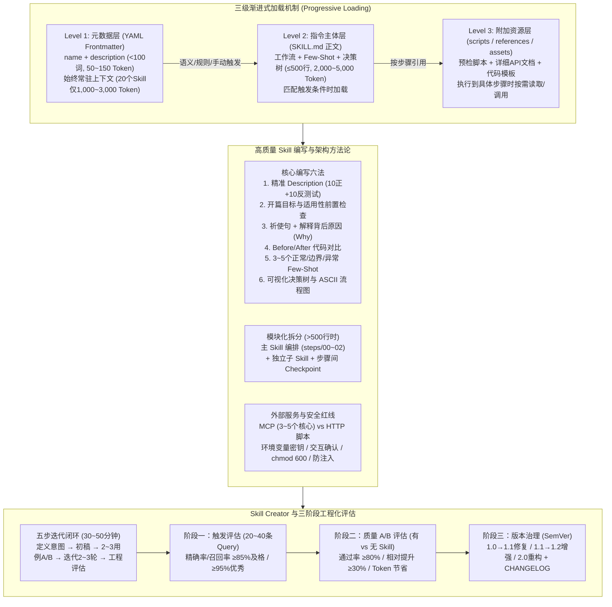

# 如何写好 Skill：一份终极实战经验手册

## 1. TL;DR

1. **Skill 本质与三级渐进式加载**：Skill 是将人类工程最佳实践固化为 **指令（Instructions）+ 上下文（Context）+ 工具（Tools）** 的按需加载能力包；通过 **第一级元数据**（`name + description`，`< 100 词`，约 `50~150 Token`/Skill，常驻上下文，20 个 Skill 仅占 `1,000~3,000 Token`）、**第二级指令主体**（`SKILL.md` 正文，`≤ 500 行`，约 `2,000~5,000 Token`，触发时加载）与 **第三级附加资源**（`scripts/ + references/ + assets/`，执行时按需读取）实现高精度与低 Token 开销的平衡。
2. **高命中率指令编写六大法则**：精心打磨 `description`（经 10 正例 + 10 反例共 20 条 Query 测试）、开篇声明目标与适用性前置检查（如 `grep` 检测依赖）、使用祈使句并解释规则背后的 **Why**（让模型在边缘场景自主泛化）、提供 `Before / After` 对比代码、设计 **3~5 个** 覆盖正常/边界/异常场景的 Few-Shot 示例、辅以可视化决策树与 ASCII 流程图。
3. **复杂 Skill 模块化与外部服务选型**：当 `SKILL.md` 超过 `500 行`、含多个独立子流程或更新频率分化时，应拆分为 **主 Skill 编排 + 独立子 Skill + 步骤间硬检查点**；接入外部能力时，跨 IDE 复用、需统一认证或已有成熟生态选 **MCP**（核心 MCP 控制在 `3~5 个` 以内），简单一次性 REST 调用或遗留系统选 **HTTP 脚本**（设 `timeout=10`）。
4. **安全底线与三阶段工程化评估**：严守密钥进环境变量、破坏性操作加交互确认、数据库备份与 `--defaults-file` 权限管控（`chmod 600`）、指令与数据分离防注入四条安全红线；通过 **触发评估**（目标精确率与召回率 `≥ 85%` 及格、`≥ 95%` 优秀）与 **质量 A/B 评估**（完成率 `≥ 80%`、相对无 Skill 提升 `≥ 30%`）建立发布门禁与语义化版本演进闭环。

## 2. 问题定义与背景

### 2.1 核心痛点：为什么AI写代码总是差一口气？
通用大语言模型具备广泛的编程知识，但在企业研发落地时面临三大结构性落差：
- **缺乏团队私有上下文**：模型不了解内部脚手架规范、私有 RPC/HTTP 库签名、数据库迁移安全红线与 Code Review 标准，每次对话都需要人工重复粘贴背景说明。
- **全量规则塞入上下文导致预算爆炸与注意力稀释**：若将所有规范都写进全局 `Rules`（如 `.cursorrules` 或 `CLAUDE.md`），每次对话无论是否相关都会全量加载，不仅浪费数万 Token，还会导致长上下文中指令遵循率显著下降。
- **指令模糊导致执行漂移与破坏性风险**：缺乏前置环境校验、步骤间检查点（Checkpoint）和量化评估基准，模型容易跳过关键步骤、硬编码配置或在长链路迁移中半途出错。

### 2.2 Rule 与 Skill 的定位边界
| 维度 | Rule（全局规则） | Skill（专业技能包） |
| :--- | :--- | :--- |
| **加载机制** | 每次会话**始终全量加载**（`rules/*.md`） | 基于 `description` 路由**按需渐进式加载**（`skills/*/SKILL.md`） |
| **适用内容** | 全局底线规范（代码风格、提交信息格式、安全红线） | 特定任务完整工作流（单元测试生成、框架迁移、数据库变更、专项 CR） |
| **资源形态** | 纯文本 Markdown 规则 | `SKILL.md` + 可执行脚本（`scripts/`）+ 参考文档（`references/`）+ 模板（`assets/`） |
| **Token 成本** | 随规则增多线性累加至所有对话 | 未触发时仅占 `50~150 Token` 元数据开销 |

## 3. 知识框架

## 4. 核心内容拆解

### 4.1 Skill 本质、目录结构与三级渐进式加载

1. **核心公式**：`Skill = Instructions（指令工作流）+ Context（领域知识与示例）+ Tools（可执行脚本与模板）`。
2. **三级渐进式加载（以 Anthropic Claude Code 为参考基准）**：
   - **第一级（元数据层）**：仅读取 `SKILL.md` 顶部的 YAML Frontmatter（`name` + `description`），严格控制在 `100 词` 以内（约 `50~150 Token`），始终常驻系统提示词；即使安装 20 个 Skill，总常驻开销也仅为 `1,000~3,000 Token`。
   - **第二级（指令主体层）**：当用户请求命中触发条件时，才将 `SKILL.md` 正文加载进上下文；建议正文控制在 `500 行` 以内（约 `2,000~5,000 Token`）。
   - **第三级（附加资源层）**：`scripts/`（校验与自动化脚本）、`references/`（长篇 API 手册与历史背景）、`assets/`（配置文件与代码模板）仅在执行到对应步骤时由 Agent 按需读取或调用脚本输出，不占用主文档上下文。
   - **Token 估算经验值**：英文约 `1 Token / 4 个字符`，中文约 `1 Token / 1.5~2 个汉字`（不同分词器存在 `±20%` 浮动）。
3. **三种触发模式与两级作用域**：
   - **触发模式**：**自动触发**（模型根据用户输入与 `description` 语义匹配）、**手动触发**（用户显式输入 `/skill xxx`）、**规则触发**（匹配特定文件后缀如 `.go` 或目录路径）。
   - **作用域优先级**：**项目级**（`.claude/skills/` 或 `.codebuddy/skills/`，随 Git 仓库共享，优先级更高）与 **用户级**（`~/.claude/skills/` 或 `~/.codebuddy/skills/`，个人跨项目通用）。

### 4.2 编写高质量 `SKILL.md` 的六大核心技巧

1. **技巧一：打磨高区分度的 `description`**
   - 必须同时写清 **“做什么（能力范围）”** 与 **“什么时候用（触发关键词与场景边界）”**，避免使用未展开的内部黑话缩写。
   - 编写后用 **20 个测试问题（10 个正例 + 10 个反例）** 验证触发边界，确保正例必中、反例不误触。
2. **技巧二：开篇明确目标与适用性前置检查（Pre-check）**
   - 在正文第一部分用 1~2 句话声明最终交付物，并提供具体的环境探测命令（例如在 HTTP 客户端迁移 Skill 中先执行 `grep "old-http-client" go.mod`，若返回为空则立即终止并告知无需迁移，避免空跑）。
3. **技巧三：使用祈使句并解释规则背后的“为什么（Why）”**
   - 相比单纯堆砌全大写的 `MUST / NEVER`，向模型解释原因能让其在未预见的边缘场景下做出正确推断：
     - **SQL 注入防护**：解释拼接字符串会被 `'; DROP TABLE users; --` 截断攻击，因此必须使用参数化查询 `?`。
     - **Go 版本特性选择**：解释 Go `< 1.18` 需使用 `interface{}`，而 Go `>= 1.18` 应优先使用泛型以获得编译期类型安全。
4. **技巧四：提供清晰的 `Before / After` 代码对比**
   - 根据改动复杂度选择三种呈现格式：**行内注释对比**（单行小改动）、**完整代码块对比**（函数级重构）、**`diff` 格式对比**（多处增删改动）。
5. **技巧五：精选 3~5 个高质量 Few-Shot 示例**
   - **数量黄金区间为 3~5 个**：少于 3 个难以覆盖边界，多于 5 个边际收益递减且浪费 Token。
   - **覆盖维度与排序**：必须覆盖 **正常输入、边界输入、异常输入**，并按 **最常见场景优先** 排列（例如 Java Code Review Skill 中依次展示 `🔴 Critical` SQL 注入、`🟡 Major` `Optional` 链式调用 NPE 风险、`🟢 Minor` 命名规范问题）。
6. **技巧六：善用可视化决策树与 ASCII 流程图**
   - 对多分支逻辑（如五种包导入方式：直接导入、别名导入、点导入、接口解耦、反射调用）使用 Markdown 表格或树形分支图；对多阶段线性流程绘制带步骤编号与产物说明的 ASCII 框图。

### 4.3 复杂 Skill 的模块化架构与进阶技巧

1. **何时需要模块化拆分**：
   - `SKILL.md` 正文超过 `500 行`；
   - 包含多个可独立执行的子工作流（如环境配置、依赖升级、API 替换）；
   - 不同部分的维护团队或更新频率显著不同。
2. **主从编排与步骤间检查点（Checkpoint）**：
   - 拆分为 **主 Skill**（如 `project-migration/SKILL.md` + `steps/00-environment-setup.md`、`01-dependency-update.md`、`02-api-migration.md`）与 **独立子 Skill**（如 `project-migration-sub-env-setup`）。
   - **每一步结尾必须设置可执行的验证检查点**：例如在旧客户端替换步骤末尾强制执行 `grep -rn "old-http-client" . --include="*.go" | wc -l`，唯有输出为 `0` 且 `go build ./...` 通过后才允许进入下一步。
3. **进阶编写技巧**：
   - **复杂逻辑下沉至脚本**：将繁琐的环境校验封装进 `scripts/pre-check.sh`（开启 `set -euo pipefail`，自动校验 Go `>= 1.21`、Git 工作区干净度等），Skill 仅需调用脚本并读取退出码。
   - **提供多方案选择**：针对不同代码形态给出适配方案（如 **方案 A** 集中式封装直接替换、**方案 B** 散落调用逐点替换、**方案 C** 适配器模式渐进迁移）。
   - **高亮易错陷阱**：明确指出不能误改字符串常量与注释、保留中文引号 `“”` 与句号 `。`、注意结构体与类型变更（如 `oldhttp.Options → uhttp.Config`、`Timeout int → time.Duration`、`error → *ErrorResponse`）。

### 4.4 外部服务集成：MCP vs HTTP 脚本选型

| 对比维度 | MCP（Model Context Protocol） | HTTP 脚本（Python / Shell） |
| :--- | :--- | :--- |
| **通信协议** | `JSON-RPC 2.0 over stdio / SSE` | 标准 `REST / GraphQL` HTTP 请求 |
| **认证管理** | 宿主 IDE 统一配置管理凭据，多 Skill 共享 | 需在每个脚本中自行读取环境变量处理认证 |
| **生态与复用** | 跨客户端（Claude Code / CodeBuddy / Cursor）即插即用 | 绑定特定脚本环境，跨团队复用需拷贝代码 |
| **上下文开销** | 每个激活的 MCP Server 都会向模型注入工具 Schema | 仅在 Skill 触发并执行到对应步骤时调用，零常驻开销 |
| **适用场景** | 已有成熟官方 MCP（如 `@anthropic-ai/mcp-playwright`、`@modelcontextprotocol/server-github`）、高频跨 Skill 复用、需要长连接会话状态 | 简单一次性接口调用、内部遗留系统无 MCP 封装、批量数据导入脚本（必设 `timeout=10`） |

- **混合编排模式**：在数据迁移场景中，可用 **MCP** 查询源数据库结构与抽样数据 → **Skill** 在上下文中完成字段映射与转换逻辑生成 → **HTTP 脚本** 执行大批量分批写入。
- **核心防坑原则**：同时开启的常驻核心 MCP Server 应严格控制在 **3~5 个** 以内，避免工具列表膨胀挤占上下文窗口。

### 4.5 四大安全底线

1. **严禁硬编码敏感凭据**：API Key、Token 必须通过环境变量（如 `$API_KEY`）传入，配置文件模板加入 `.gitignore`。
2. **破坏性操作强制交互确认**：涉及 `rm -rf`、清理目录或覆盖生产配置时，脚本必须包含显式确认逻辑（如 `read -p "确认删除？(y/N)" confirm`）。
3. **数据库操作双重保护**：
   - 严禁在命令行参数中直接拼接 `-p$DB_PASS`（会泄露到 `ps` 进程列表与 Shell History）；
   - 必须生成权限为 `chmod 600 ~/.my_skill.cnf` 的临时凭据文件，通过 `--defaults-file=~/.my_skill.cnf` 调用 `mysqldump` 先完成全量备份，再执行迁移，并在 `trap` 或结尾执行 `rm -f ~/.my_skill.cnf` 彻底清理。
4. **防范提示词注入（Prompt Injection）与路径穿越**：读取外部不可信文件或用户上传内容时，严格区分“系统指令”与“待处理数据”；文件路径校验禁止包含 `..`，并对允许操作的文件扩展名实施白名单过滤。

### 4.6 Skill Creator 与三阶段工程化评估体系

1. **五步快速开发流（总耗时约 30~50 分钟）**：
   - 使用官方 `skill-creator`（可通过 `npx openskills install anthropics/skills` 或 IDE 插件市场安装）辅助生成骨架：
   - **Step 1 明确意图（5 分钟）** → **Step 2 生成初稿（10 分钟）** → **Step 3 小样本 A/B 测试（2~3 个代表性用例，10 分钟）** → **Step 4 针对性迭代 2~3 轮（10~15 分钟）** → **Step 5 工程化评估与发布（10 分钟）**。
2. **三阶段工程化评估（`evaluation/` 目录）**：
   - **第一阶段：触发评估（`trigger-cases.md`）**：构建 `20~40 条` 混合查询集（含明确正例、近似反例、边缘模糊表述）。实战案例中 30 条测试集（15 正、12 反、3 边界）实测 **精确率（Precision）93.3%**（14/15，仅 1 条误触发）、**召回率（Recall）93.3%**（14/15，仅 1 条漏触发）。
   - **第二阶段：质量 A/B 评估（`quality-cases.md`）**：对比同一任务在 **有 Skill vs 无 Skill** 下的产出质量与 Token 消耗。实战案例中 5 个测试场景下，有 Skill 组平均通过率达 **88.0%**（无 Skill 组仅 **52.0%**），且平均单次消耗从 `2,100 Token` 降至 `1,200 Token`（节省约 **42.9%**）。
   - **第三阶段：跨平台排查与语义化版本管理（SemVer）**：
     - **6 步排障法**：超过 **70%** 的 Skill 失效问题出在 **Step 1（目录路径/YAML 格式错误）** 或 **Step 2（`description` 触发词不匹配）**；跨平台脚本需注意 macOS BSD 工具链差异（用 `sed -E` 替代 GNU 专属的 `sed -r`，macOS 原生 `sort` 不支持 `-V` 版本号排序需改用 `gsort -V` 或自定义解析）。
     - **版本号演进**：`1.0 → 1.1`（修补规则漏洞或小幅调整）、`1.1 → 1.2`（新增子场景或脚本能力）、`1.x → 2.0`（工作流重构或破坏性变更），每次提交 PR 须附带评估报告与 `CHANGELOG.md`。

## 5. 数据速查表

| 指标 | 原文数值 | 语境 / 条件 |
| :--- | :--- | :--- |
| **Level 1 元数据体积上限** | `< 100 词`（约 `50~150 Token` / Skill） | `SKILL.md` 顶部 YAML `name + description`，始终常驻上下文 |
| **20 个 Skill 常驻总开销** | `1,000~3,000 Token` | 按需加载机制下 20 个已安装 Skill 的第一级元数据总计占用 |
| **Level 2 指令正文体积上限** | `≤ 500 行`（约 `2,000~5,000 Token`） | 触发后加载的 `SKILL.md` 正文推荐上限，超出应做模块化拆分 |
| **中英文 Token 换算经验值** | 英文 `~4 字符/Token`，中文 `~1.5~2 汉字/Token` | 不同模型 Tokenizer 之间存在 `±20%` 偏差 |
| **Description 快速自测集规模** | `20 个` 查询（`10 正例 + 10 反例`） | 编写 `description` 后的基础边界自测样本数 |
| **Few-Shot 示例黄金数量** | `3~5 个` | 覆盖正常、边界、异常输入，按常见程度降序排列 |
| **常驻核心 MCP Server 推荐数** | `3~5 个` | 避免过多 MCP 工具 Schema 挤占上下文窗口 |
| **HTTP 脚本默认超时设置** | `timeout=10`（10 秒） | 防止外部接口挂起阻塞 Agent 执行循环 |
| **Skill Creator 五步开发耗时** | `30~50 分钟` | 从定义意图、初稿、A/B 测试、2~3 轮迭代到工程评估的完整周期 |
| **工程化触发评估测试集规模** | `20~40 条` 混合 Query | 含正例、反例、边界用例；示例实测 30 条（15 正 / 12 反 / 3 边界） |
| **触发评估示例实测表现** | 精确率 `93.3%`（14/15），召回率 `93.3%`（14/15） | 30 条测试集中仅 1 条误触发、1 条漏触发 |
| **质量 A/B 评估示例实测表现** | 通过率 `88.0%` vs `52.0%`；Token `1,200` vs `2,100` | 有 Skill 组 vs 无 Skill 组（5 个测试场景均值，Token 节省 `42.9%`） |
| **触发精确率 / 召回率门禁标准** | 及格 `≥ 85%`，优秀 `≥ 95%` | 工程化评估矩阵中的触发质量准入线（Anthropic 通用基准为准确率 `>90%`、误触发率 `<5%`） |
| **任务质量通过率与相对提升门禁** | 通过率 `≥ 80%`（优秀 `≥ 90%`），相对提升 `≥ 30%`（优秀 `≥ 50%`） | 有 Skill 相比无 Skill 基线的质量准入线与 Token 节省目标（`30%+`） |
| **常见故障集中度** | `70% 以上` 集中在路径/YAML 或 Description | 6 步排障法中前两步（文件位置/Frontmatter 语法与触发词匹配）拦截绝大多数问题 |

## 6. 踩坑与教训 / 可迁移的设计原则

| 错误做法 | 失败表现或原因 | 原文应对（可迁移的设计原则） |
| :--- | :--- | :--- |
| **反模式 1：大杂烩式巨型 Skill（Kitchen-Sink）** | 将代码生成、CR、部署、监控塞进单个超 `1,000 行` 的 `SKILL.md`，每次触发烧掉上万 Token 且指令互相干扰 | **单一职责与 500 行拆分线**：超过 `500 行` 或包含独立子流程时，拆分为主 Skill 编排 + 独立子 Skill + `references/` 按需文档 |
| **反模式 2：Description 堆砌内部缩写黑话** | 仅写“用于处理 TCC 与 QCMS 迁移”，用户用自然语言提问“如何迁移配置中心”时完全无法触发 | **面向用户真实提问词编写 Description**：同时包含内部术语全称、缩写与高频业务动词，并用 10 正例 + 10 反例验证 |
| **反模式 3：只有抽象规则没有代码示例** | 仅写“请遵循团队错误处理规范”，模型只能按通用习惯自由发挥，产出格式五花八门 | **Before/After + 3~5 个 Few-Shot 示例**：用正反对比代码块和覆盖正常/边界/异常的真实代码片段锁定输出形态 |
| **反模式 4：多步骤长链路缺少中间检查点** | 第 1 步依赖替换遗漏了文件，模型直接盲目执行第 2、3 步，最终编译报出数百个级联错误难以定位 | **步骤间强制硬检查点（Checkpoint）**：每步末尾绑定可量化验证命令（如 `grep ... \| wc -l` 必须为 `0`），不达标严禁推进 |
| **反模式 5：硬编码魔法数字与平台专属命令** | 直接写死 `timeout = 30s`，或在脚本中使用 GNU 专属 `sed -r`、`sort -V`，在 macOS 开发机上直接报错退出 | **给出计算公式与跨平台兼容命令**：超时按 `P99 * 2`（范围 `5s~60s`）动态设定；正则用兼容性更好的 `sed -E`，排序注意 BSD/GNU 差异 |
| **反模式 6：把 `SKILL.md` 写成 300 行历史背景 Wiki** | 大篇幅讲述旧框架演进史，挤占核心操作指令注意力 | **指令与背景分离**：正文直奔目标与操作步骤，将长篇背景知识与完整 API 字典下沉到 `references/` 目录按需读取 |
| **在命令行直接传 `-p$DB_PASS` 执行数据库变更** | 密码明文暴露在系统进程列表（`ps aux`）与 Shell 历史记录中，且无备份直接变更风险极高 | **600 权限凭据文件 + 先备份后变更**：写入 `chmod 600 ~/.my_skill.cnf`，用 `--defaults-file` 先执行 `mysqldump` 备份，结束后 `rm -f` 销毁 |

## 7. 记忆锚点

- **“100 词 / 500 行 / 按需加载三级火箭”**：Level 1 元数据 `< 100 词`（`50~150 Token` 常驻）→ Level 2 `SKILL.md` 正文 `≤ 500 行`（`2,000~5,000 Token` 触发加载）→ Level 3 `scripts/references/assets`（执行到步骤时按需读取），彻底解决全局 Rule 的上下文膨胀。
- **“好 Skill 六件套：10 正 10 反测描述、前置 Pre-check、祈使句讲清 Why、Before/After 贴对比、3~5 个 Few-Shot、决策树加 Checkpoint”**：把自然语言文档变成可自检、可泛化、防跳步的工程程序。
- **“85/95 触发线、80/90 质量线”**：工程化上线前先过触发测试集（Precision/Recall `≥ 85%` 及格、`≥ 95%` 优秀）与有/无 Skill 的 A/B 质量评估（通过率 `≥ 80%`、相对提升 `≥ 30%`），告别“凭感觉改提示词”。

## 8. 复习卡片

1. Skill 的三级渐进式加载机制分别包含什么内容，各自的体积与 Token 预算控制标准是多少？::第一级为 YAML 元数据（`name + description`），控制在 `< 100 词`（约 `50~150 Token`/Skill，常驻上下文）；第二级为 `SKILL.md` 指令正文，控制在 `≤ 500 行`（约 `2,000~5,000 Token`，触发时加载）；第三级为 `scripts/`、`references/`、`assets/` 附加资源，仅在执行到具体步骤时按需读取或调用。
2. 全局 Rule（如 `rules/*.md`）与 Skill（`skills/*/SKILL.md`）在加载时机与适用场景上有什么本质区别？::Rule 在每次会话中始终全量加载，适合存放代码风格、提交格式、安全红线等全局底线规范；Skill 基于 `description` 路由按需加载，适合封装单元测试生成、框架迁移、专项 Code Review 等包含完整工作流、脚本与参考文档的特定任务。
3. 编写 `SKILL.md` 时，为什么强调除了使用祈使句还要解释规则背后的原因（Why）？::单纯堆砌 `MUST / NEVER` 只能应对字面匹配的场景，而解释背后的工程原因（如解释字符串拼接会导致 SQL 注入截断、或 Go 1.18+ 泛型相比 `interface{}` 的编译期安全优势）能让模型在面对未预见的边缘场景时自主做出符合工程意图的泛化判断。
4. 在 `SKILL.md` 中设计 Few-Shot 示例时，最佳数量区间、覆盖维度与排列顺序分别是什么？::最佳数量为 `3~5 个`（少于 3 个难覆盖边界，多于 5 个浪费 Token）；必须同时覆盖正常输入、边界输入和异常输入三类场景；排列时按最常见场景优先降序排列。
5. 什么情况下应该对单个 Skill 进行模块化拆分，拆分后的标准架构是什么？::当 `SKILL.md` 正文超过 `500 行`、包含多个可独立执行的子流程或各部分更新频率不同时应拆分；标准架构为“主 Skill 编排工作流（配合 `steps/` 分步文件）+ 可独立调用的子 Skill + 每个步骤末尾强制执行的量化检查点（Checkpoint）”。
6. 在 Skill 中集成外部服务时，应该如何选择 MCP 与 HTTP 脚本？常驻 MCP 的数量上限建议是多少？::若已有成熟官方实现、需跨多个 Skill/IDE 复用或需统一管理认证状态，优先选 MCP（常驻核心 MCP 严格控制在 `3~5 个` 以内以防工具 Schema 撑爆上下文）；若是简单一次性 REST 调用、内部遗留接口或大批量导入脚本，优先选设置 `timeout=10` 的 HTTP 脚本。
7. 在编写涉及数据库迁移的 Skill 脚本时，如何安全地处理数据库密码与变更风险？::严禁在命令行参数中直接传入 `-p$DB_PASS`；必须创建权限为 `chmod 600 ~/.my_skill.cnf` 的临时凭据文件，通过 `--defaults-file=~/.my_skill.cnf` 先调用 `mysqldump` 备份数据，再执行变更，并在脚本结束时执行 `rm -f` 删除凭据文件。
8. Skill 工程化评估分为哪两个核心评测阶段，各自的及格与优秀量化指标是多少？::分为触发评估（`20~40 条` 正反混合 Query）与质量 A/B 评估（有 Skill vs 无 Skill 对比）；触发评估要求精确率与召回率达到 `≥ 85%` 及格、`≥ 95%` 优秀；质量评估要求任务通过率达到 `≥ 80%` 及格（`≥ 90%` 优秀），且相对无 Skill 基线提升 `≥ 30%`（优秀 `≥ 50%`）。

## 9. 知识关联

- **本仓库主题索引**：[Skill设计与治理](../../20_topics/Skill%E8%AE%BE%E8%AE%A1%E4%B8%8E%E6%B2%BB%E7%90%86.md)
- **候选双链概念**：[[三级渐进式加载]] · [[Skill工程化评估]] · [[MCP与HTTP脚本选型]] · [[Few-Shot示例设计]] · [[Prompt注入防御]]

## 10. 原文参考资料

1. Anthropic, *Claude Code Skills & Progressive Disclosure Documentation*（文内作为三级渐进式加载与 `skill-creator` 工具的核心参考基准）。
2. OpenSkills CLI & Anthropic Skills Repository：`npx openskills install anthropics/skills`（文内引用用于安装官方 `skill-creator` 等标准技能包）。
3. Model Context Protocol (MCP) 官方生态包：`@anthropic-ai/mcp-playwright`、`@modelcontextprotocol/server-github`（文内第 6 章外部服务集成选型示例引用）。

> [!note]- 校对报告
> - **校对状态**：已按原文逐章核对通过（共 44 页 PDF）。
> - **核心数据与页码溯源**：
>   - Skill 公式、三级渐进式加载（Level 1 `<100 词` / `50~150 Token`、20 个 Skill `1,000~3,000 Token`；Level 2 `≤500 行` / `2,000~5,000 Token`；Level 3 `scripts/ + references/ + assets/`）、Token 换算（英文 `~4 字符/Token`，中文 `~1.5~2 汉字/Token`，`±20%`）及三种触发模式：见 `p.1–3`。
>   - 目录结构、YAML Frontmatter、用户级 vs 项目级路径、Rule vs Skill 对比及 5 分钟快速上手 `go-test-gen` 示例：见 `p.3–7`。
>   - 六大核心编写技巧（10 正 + 10 反共 20 条 Query 测 `description`、`grep "old-http-client" go.mod` 前置检查、祈使句 + Why 解释、三种 `Before/After` 格式、`3~5 个` Few-Shot 示例及 Java CR 红黄绿分级示例、可视化决策树与 ASCII 流程图）：见 `p.7–14`。
>   - 模块化拆分条件（`>500 行`）、主从 Skill 架构与步骤间 `grep ... | wc -l` 检查点：见 `p.14–16`。
>   - 进阶技巧（`scripts/pre-check.sh`、方案 A/B/C、中文标点与 `oldhttp.Options → uhttp.Config` 等类型变更防坑）：见 `p.16–20`。
>   - MCP vs HTTP 脚本 6 维对比表、决策树、混合模式及 `3~5 个` 核心 MCP 数量限制、`timeout=10`：见 `p.20–23`。
>   - 四大安全底线（环境变量、删除确认、`chmod 600 ~/.my_skill.cnf` + `--defaults-file` + `mysqldump` 备份、防 Prompt 注入与 `..` 路径穿越）：见 `p.23–26`。
>   - Skill Creator 五步闭环（`30~50 分钟`）、三阶段工程化评估（30 条触发测试集实测 Precision `93.3%` [14/15]、Recall `93.3%` [14/15]；5 场景质量 A/B 实测 `88.0% vs 52.0%`、`1,200 vs 2,100 Token`；门禁指标 `≥85%/≥95%`、`≥80%/≥90%`、`≥30%/≥50%` 及通用基准 `>90%`、`<5%`、`30%+`）：见 `p.26–34`。
>   - 6 步排障法（`70%+` 集中在路径/YAML 或 Description、`sed -E` vs `sed -r`、`gsort -V`）、SemVer 版本演进与六大反模式（Kitchen-Sink `>1000 行`、内部缩写、`P99 * 2` 超时公式等）：见 `p.35–43`。
