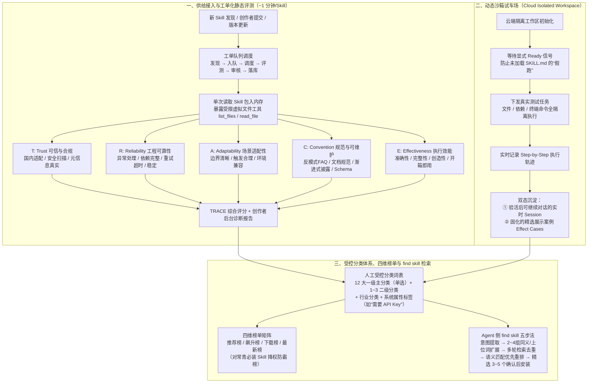
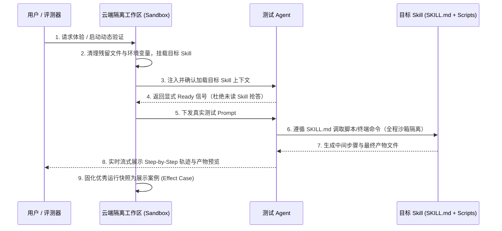

# 10万+ Skill 背后：腾讯 SkillHub 如何帮用户找到真正好用的那 20%

## 1. TL;DR — 核心结论速览

1. **Skill 平台的核心矛盾是“供给爆发与消费反馈滞后”**：SkillHub 在 3 个月内从约 `5 万` 增长到 `10万+` Skill、月下载突破 `1000 万次`。与小红书/知乎（点开几秒即知好坏）或 App Store/淘宝（强交易闭环）不同，Skill 的消费链路极长——用户浏览描述、复制命令或装进 Agent 后，只有真正跑完一次完整任务才能验证好坏，平台若只做“货架”很快就会退化为失控仓库。
2. **静态评测构建 TRACE 五维模型与 5 路并行流水线**：围绕 **T**rust（可信与合规/国内适配）、**R**eliability（工程可靠性/异常处理/依赖完整）、**A**daptability（场景适配/边界清晰/环境兼容）、**C**onvention（规范与可维护/渐进式披露/反模式说明）、**E**ffectiveness（执行效能/开箱即用）5 个维度 20 项细分指标对每个 Skill 打分；底层采用**单次加载进内存 + 5 路评估流水线并行审阅 + 受限虚拟文件系统（仅暴露当前 Skill 包的 `list_files` / `read_file`）**，将常规 Skill 评测耗时从约 **10 分钟压缩至 1 分钟左右**。
3. **动态验证打造云端隔离“封闭试车场”**：为解决静态看源码无法发现的“假装用了 Skill（Agent 凭名字常识作答而未加载 `SKILL.md`）”、“外部 API/脚本断链”、“会话污染与假可恢复”问题，SkillHub 在云端隔离工作区中强制等待显式 `ready` 信号后再下发任务，真实隔离文件/依赖/终端执行并在复用前彻底清理，同时将实时可继续的 Session 与精选固化的**展示案例（Effect Cases / 产物快照）**解耦沉淀。
4. **分发层靠“4 类榜单 + 12 大主分类受控词表 + `find skill` Agent 检索策略”解决发现难题**：人工维护 **12 个一级主分类**（单选 1 个主分类 + 1～3 个二级分类 + 行业分类 + 如“需要 API Key”的系统标签），拒绝失控的 AI 自由打标；推出面向 Agent 的 `find skill` 检索技能，通过**意图提取 → 2～4 组同义/上位词扩展 → 多轮组合查询与 `slug` 去重 → 语义匹配度优先于下载热度的两级重排 → 精选 3～5 个候选先确认后安装**，上线 3 天无推广即冲上飙升榜第一、一周安装破 `8000` 次。

---

## 2. 背景与核心问题

### 2.1 SkillHub 的演进与规模跃迁

| 时间节点 | 关键事件与阶段特征 | 规模与生态挑战 |
| :--- | :--- | :--- |
| **2026 年 1 月** | OpenClaw 刚火，腾讯轻量云团队在云端跑通完整链路并做本土化适配 | 发现光有模型与框架不够，真正决定上限的是可复用的 Skill |
| **2026 年 3 月初** | 深圳腾讯大厦北广场线下公开免费安装 OpenClaw 活动，服务近千名各年龄段用户 | 一线观察到大量非程序员真实痛点：“装好后到底装哪个 Skill？” |
| **2026 年 3 月** | **腾讯 SkillHub** 正式立项上线，定位更符合中国用户习惯的 Skill 社区 | 早期约 `5 万` 个 Skill，重点在汇聚供给与降低安装门槛 |
| **2026 年 6–8 月（上线约 3 个月后）** | 社区进入深水区：供给总量突破 `10万+`、月下载量超过 `1000 万次` | 同名同质化泛滥（如“文档处理”、“翻译”、“小红书”各有几十上百个），约 80% 存在描述粗糙、缺依赖、边界不清等问题 |

### 2.2 为什么传统内容/应用平台的分发逻辑在 Skill 场景失灵？

- **内容消费平台（小红书、知乎）**：用户点开几秒钟即可完成消费闭环，停留时长、点赞、收藏能实时反映内容质量。
- **应用/电商平台（App Store、淘宝）**：虽然反馈链条长，但拥有强交易、付费与长周期留存闭环。
- **Skill 平台的独特断点**：
  1. **下载安装 $\neq$ 真正跑通**：用户看到页面描述觉得不错，复制命令或在 Agent 中安装，平台只能观测到“浏览、点击、下载、安装”，却无法直接获知后续在用户本地 Agent 环境中是否真正执行成功。
  2. **冷启动马太效应与劣币驱逐良币**：如果只按下载量或收藏量排序，老牌热词 Skill 会长期霸榜，而新上架但工程质量极高的垂直 Skill 永无出头之日；更糟糕的是，标题党 Skill 靠高频词骗取下载后，用户在本地频频报错却无处反馈。

因此，SkillHub 必须围绕四个核心问题重构治理体系：
1. **静态评估**：什么才算一个“好 Skill”？能否建立可量化、可解释的评估标准？
2. **动态验证**：光看 `SKILL.md` 和代码不够，如何让用户亲眼看到 Skill 在真实任务中的运行过程与产物？
3. **分类与榜单**：10 万+ 供给下，如何设计不失控的分类标签与不被热词绑架的榜单？
4. **Agent 侧检索（`find skill`）**：当用户直接在对话里让 Agent 找技能时，如何跨越“人话意图”与“开发者命名”的鸿沟？

---

## 3. 知识框架 — SkillHub 全链路质量治理与发现架构

---

## 4. 核心技术模块拆解

### 4.1 静态评测：TRACE 五维质量评估体系与高并发评测基建

#### （1）TRACE 五维 20 项细分指标设计
Skill 既不是纯文本 Prompt，也不是传统编译型软件包，而是**给 Agent 看的规范说明（`SKILL.md`）+ 工具脚本/模板资源 + 外部环境契约**的复合体。SkillHub 将好 Skill 的标准拆解为 **TRACE** 五个维度：

| 维度 | 核心考察点 | 4 项具体评估子项 | 针对中国开发者的特殊考量 |
| :--- | :--- | :--- | :--- |
| **T — Trust（可信与合规）** | 能不能放心装？在国内能不能跑通？ | ① **国内合规与本土适配** ② 安全性扫描（无恶意窃取/危险命令） ③ 伦理与合规性 ④ 元信息真实性（无夸大虚假宣传） | 许多海外直接搬运的 Skill 硬编码依赖 Google Search、Gmail、Twitter 或境外受限 API，国内用户装完必挂；**国内网络与生态适配**被列为一级硬指标 |
| **R — Reliability（工程可靠性）** | 遇到异常会不会直接崩？依赖是否齐全？ | ① 异常处理与降级引导 ② 依赖项声明完整性 ③ 重试与超时控制机制 ④ 跨轮次运行稳定性 | 重点拦截“脚本引用了未声明的 Python/Node 包”或“外部接口超时导致整个 Agent 卡死”的半成品 |
| **C — Convention（规范与可维护性）** | 结构是否符合 Agent 认知习惯？是否省 Token？ | ① 反模式（Anti-patterns）与 FAQ 说明 ② 文档结构与可读性 ③ **渐进式披露（Progressive Disclosure）** ④ 命名与 Schema 规范 | 优秀 Skill 不会把几万字参考资料全塞进主 `SKILL.md` 撑爆上下文，而是主文件只写核心路由与工作流，按需引导 Agent 读取子文件 |
| **A — Adaptability（场景适配性）** | 什么时候该触发？什么时候不该触发？ | ① 能力边界定义清晰度 ② 触发方式与条件合理性 ③ 参数与上下文兼容性 ④ 跨运行环境兼容性 | 防止 Description 写得过于宽泛“包治百病”，导致 Agent 在无关任务中误触发或与其它 Skill 冲突 |
| **E — Effectiveness（执行效能）** | 最终干活质量如何？能否开箱即用？ | ① 输出结果准确性 ② 任务完成完整性 ③ 解决方案创造性与深度 ④ **开箱即用程度（Out-of-the-box Readiness）** | 评估 Skill 是否提供了清晰的输入输出模板、默认配置与自检步骤，减少用户上手折腾成本 |

#### （2）从 10 分钟到 1 分钟：静态评测基建的工程优化
要在 **10万+ 存量**加上每日持续新增/更新的规模下跑通深度评测，不能靠串行大模型调用：
1. **单次内存加载 + 5 路并行评估流水线**：系统先将目标 Skill 包的所有文件一次性加载进内存，随后同时启动 **5 条并行评估流水线**（分别对应 T、R、A、C、E 五个维度的专项评审专家 Prompt），共享同一份内存上下文，避免重复下载解压与串行等待。
2. **受限虚拟文件读取工具（Bounded File Tools）**：评测 Agent 不直接操作宿主机磁盘，而是通过受限的 `list_files` 和 `read_file` 工具按需查看内存中的 Skill 目录结构、源码脚本和附属模板，严格限制只能访问当前被测 Skill 包内部文件。
3. **全流程工单化与创作者赋能**：建立 `发现 — 入队 — 调度 — 评测 — 审核 — 落库` 的状态机工单体系；评测结果不仅转化为前台星级与分数，还会在**创作者后台**生成详细的分项诊断报告，明确指出该 Skill 在哪个维度失分、如何修改才能提分，形成“评测促治理”的正向飞轮。

---

### 4.2 动态验证：打造云端隔离的“封闭试车场”

静态评分高的 Skill（文档规范、目录整齐），真正跑起来仍可能因为接口变更或隐式依赖而失败。SkillHub 为此构建了在线动态体验与验证环境，并在工程上踩过了四个极具代表性的深坑：

1. **防“假跑（Fake Run）”机制——强等显式 `ready` 信号**：
   - **踩坑现象**：早期只要容器启动就立刻把用户的测试问题发给 Agent，结果大模型经常**根本没去读取 `SKILL.md`**，仅凭请求里提到的 Skill 名字和自身预训练常识“硬编”出一个看似合理的回答，用户以为测了 Skill，其实测的是裸模型。
   - **工程解法**：重构启动握手协议——工作区必须先完成 Skill 挂载与环境注入，并等待 Agent 侧返回明确的 `ready` 就绪信号后，才允许下发第一条测试指令，确保每次运行都真实走过 Skill 链路。
2. **多租户隔离与复用前彻底清理**：
   - 将每个试用会话的文件读写、依赖安装、命令行执行严格限制在独立云端工作区内；工作区回收复用前执行彻底清理，防止上一个测试留下的临时文件或脏环境变量污染下一次评测。
3. **杜绝“假可恢复（Fake Resumable）”状态**：
   - 只有当后台校验确认底层工作区实例仍然存活、挂载文件完好且执行权限有效时，前端才向用户展示“可继续对话”状态；若底层容器已回收，则诚实降级为只读历史记录，避免用户点击继续后直接报错。
4. **实时会话（Live Session）与展示案例（Effect Cases）解耦**：
   - 实时试用成本高且受外部接口波动影响；平台将真实跑通的高质量会话轨迹与最终生成物（如网页、图表、研究报告、文档快照）抽离固化为**精选展示案例（Effect Cases）**。新用户无需等待漫长的容器冷启动和模型推理，点进详情页即可在数秒内直观预览该 Skill 的真实输入、分步调用过程与最终产物。

---

### 4.3 分类体系与多维榜单：克制比炫技更重要

面对 10 万+ Skill，为什么不用大模型自动给每个 Skill 生成几十个自由标签？
- **反面教训（失控的 AI 自由打标）**：团队调研海外同类站点发现，放任 AI 自由生成 Tag 会导致近义词爆炸（如 `frontend`、`front-end`、`web-ui`、`react-ui` 并存）、颗粒度极不统一，最终分类导航栏形同虚设。
- **SkillHub 的受控词表设计（Controlled Vocabulary）**：
  1. **人工定义 12 个一级主分类**：覆盖开发工具、办公效率、数据分析、内容创作、设计创意、学术研究等核心高频场景。
  2. **严格的挂载基数约束**：每个 Skill **只能单选 `1` 个一级主分类** + **匹配 `1～3` 个二级分类**，辅以独立的**行业分类**维度。
  3. **强实用导向的系统标签**：重点标注影响用户决策的硬约束（例如显式打上 **“需要 API Key”** 标签，让不想折腾外部密钥的用户一眼筛掉）。
- **四维榜单矩阵与防霸榜机制**：
  - **推荐榜**：综合 TRACE 静态质量分与长期使用稳定性，帮用户找“闭眼装不踩雷”的精品。
  - **飙升榜**：捕捉近期下载/安装增速最快的新锐 Skill。
  - **下载榜**：反映长周期历史累计热度。
  - **最新榜**：经过基础质量过滤的新上架 Skill 曝光池（过滤垃圾灌水）。
  - **常青 Skill 降权策略**：像基础搜索、通用文件处理这类“装机必备”的常青 Skill 会天然吸走海量下载，若不加干预会永久焊死在推荐榜和飙升榜前排；SkillHub 专门对这类常青头部 Skill 在推荐榜与飙升榜中做**动态降权**，把黄金曝光位留给真正解决垂直痛点的新晋优质 Skill。

---

### 4.4 `find skill`：专门给 Agent 用的五步技能检索流

很多时候用户并不是在网页逛 SkillHub，而是直接在对话里对 Agent 说：*“帮我找个能自动写周报发给老板的 Skill”*。海外官方的 `skills.sh` 往往只做简单的英文关键词字面匹配，遇到中文口语化长句或跨语言命名时命中率极低。SkillHub 为此专门研发并上架了 **`find skill`** 技能：

1. **第一步：意图拆解与中英双语锚点提取**
   - 从用户的口语化需求中剥离出核心任务动作、所属领域以及中英文核心词（而不只是把整句话原样丢进搜索框）。
2. **第二步：扩展 `2～4` 组同义词与上位词（Query Expansion）**
   - 例如用户说“帮我自动写周报发给老板”，Agent 会将其归入“办公效率”大类，并自动发散出 `周报`、`工作汇报`、`日报`、`weekly report` 等 2～4 组中英检索词，弥补“用户搜的是痛点场景、开发者起名用的是技术实现”的语义鸿沟。
3. **第三步：多轮组合调用列表接口并按 `slug` 去重**
   - 结合分类过滤（Category）、标签过滤（Tag）与多组关键词分别调用检索接口，将多路召回结果按唯一标识 `slug` 合并去重，兼顾召回率与精确度。
4. **第四步：语义与中文适配优先的两级重排（Two-Tier Re-ranking）**
   - **第一优先级**：比对 Skill 名称、**中文描述完整度**与当前用户具体任务的真实契合度；
   - **第二优先级**：仅在任务契合度相当的同一梯队内，才参考下载量与安装热度排序——彻底避免“高下载量的通用大路货挤掉真正精准匹配的小众垂类神器”。
5. **第五步：克制呈现 `3～5` 个候选并遵循“先确认、后安装”**
   - 绝不向用户倾倒几十条原始列表，也绝不未经同意私自往用户环境里乱装一堆 Skill；而是精选 **3～5 个**最匹配候选，附带一句清晰的“推荐理由与适用边界”，由用户拍板后再执行安装。
   - **实战成效**：`find skill` 上架后**未做任何流量推广**，仅凭自然口碑在 **3 天内冲上飙升榜第 1 名**，**一周内安装量突破 8000 次**。

---

## 5. 数据速查表

| 指标 | 原文数值 | 语境 / 条件 |
| :--- | :--- | :--- |
| **SkillHub 平台最早立项/活动时间** | **2026 年 3 月**（1 月跑通 OpenClaw 云端适配，3 月初深圳腾讯大厦北广场线下安装活动服务近千人） | 腾讯轻量云团队发起建设 |
| **Skill 数量增长规模** | **约 `5 万` → `10万+`** | 上线后约 **3 个月**内的供给增长规模 |
| **平台月下载量** | **超过 `1000 万次`** | 截至发文时（2026 年 8 月）SkillHub 月度下载规模 |
| **二八定律目标筛选比例** | **真正好用的约 `20%`** | 10 万+ 存量中帮你筛出高质量、开箱即用的头部 20% |
| **TRACE 静态评估维度与子项** | **`5` 大维度 / `20` 个细分评估项** | Trust (4) + Reliability (4) + Adaptability (4) + Convention (4) + Effectiveness (4) |
| **静态评测并行度与耗时压缩** | **5 路并行，耗时从 `~10 分钟` 降至 `~1 分钟`** | 单次内存加载 Skill 包 + 5 条评估流水线并行运行 |
| **受控分类体系配额** | **`12` 个一级主分类；单 Skill 选 `1` 个主分类 + `1～3` 个二级分类** | 外加行业分类与系统标签（如“需要 API Key”） |
| **核心榜单数量** | **`4` 个榜单** | 推荐榜、飙升榜、下载榜、最新榜 |
| **`find skill` 检索词扩展组数** | **`2～4` 组同义词/上位词** | 跨越用户口语描述与开发者命名之间的鸿沟 |
| **`find skill` 最终呈现候选数** | **`3～5` 个候选 Skill** | 附上匹配理由，等待用户确认后再安装 |
| **`find skill` 自然增长表现** | **上线 `3 天` 登顶飙升榜第 1，`1 周` 安装量超 `8000` 次** | 在没有任何官方流量推广的条件下自然爆发 |

---

## 6. 踩坑与教训 / 可迁移的设计原则

1. **只统计下载/安装量来排名的“货架思维” → 导致老词热词霸榜、标题党横行，新上架优质垂类 Skill 无法出头 → 建立“TRACE 静态评测 + 动态沙箱验证 + 常青 Skill 降权”的复合分发体系**
   - **可迁移原则**：当平台消费反馈存在严重滞后（下载 $\neq$ 好用）时，平台必须在供给上架侧前置充当“质检员”，用先验的工程质量分（TRACE）与沙箱实测产物替代滞后的粗粒度点击率。
2. **动态试用容器启动即下发用户任务 → 大模型未加载 `SKILL.md` 就凭名字和预训练常识“抢答”，测成了裸模型（假跑） → 强制引入显式 `ready` 握手信号，确认 Skill 挂载注入就绪后再发任务**
   - **可迁移原则**：在评测任何挂载了外部工具、知识库或 Skill 的 Agent 时，必须把“上下文/工具注入确认（Ready Gate）”与“业务指令下发”在协议层严格串行隔离，并在轨迹中校验是否真正触发了目标资源读取。
3. **直接把实时沙箱会话当作详情页预览方案 → 冷启动慢、算力成本高、且容器回收后出现“假可恢复”报错 → 严格验活才显示可继续对话，并将优质运行轨迹固化为静态可交互的展示案例（Effect Cases）**
   - **可迁移原则**：将高频浏览的“读流量（看效果）”与低频重度的“写流量（跑沙箱）”彻底解耦——用 1% 的真实沙箱运行沉淀出确定性的产物快照（Artifact Snapshot），服务 99% 用户的秒级预览决策。
4. **放任大模型对海量资产做自由 Tag 生成 → 标签词表无限膨胀、同义词碎片化，导航筛选彻底失效 → 坚持人工定义 12 个一级主分类 + 严格限制挂载数量（1 主 + 1～3 次）的受控词表**
   - **可迁移原则**：AI 擅长把非结构化对象“归入已知分类槽位（Classification）”，但极不擅长在无约束下自发维持全局分类学的一致性（Taxonomy Governance）；顶层骨架必须由人克制定义。
5. **用原样字符串匹配直接搜 Skill 库 → 用户搜的是“痛点目标（写周报）”，开发者写的是“技术名称”，导致召回为空或被高下载通用词霸占 → 用 `find skill` 执行“意图提取 → 2～4 组中英同义/上位词扩展 → 语义优先于热度的两级重排”**
   - **可迁移原则**：面向 Agent 的工具/技能发现（Tool/Skill Retrieval）必须先在客户端做 Query Rewrite（桥接用户意图语言与开发者实现语言），并在重排阶段坚持“任务契合度一票否决热度”。

---

## 7. 记忆锚点 — 一句话 / 一张图记住全文

- **一句话锚点**：**好 Skill 平台不是“按下载量排名的网盘”，而是用 `TRACE 五维并行体检（10m→1m）` 筛底座、用 `Ready 握手隔离试车场 + 产物快照` 验真章、再用 `12 类受控词表 + find skill 语义优先检索` 把真正好用的 20% 送到用户手里的质检与导购中心。**
- **浓缩记忆图**：
  $$\text{10万+ Skill 洪流} \xrightarrow[\text{5路并行 / 1分钟}]{\text{TRACE 静态体检}} \xrightarrow[\text{防假跑 / 沉淀 Effect Cases}]{\text{Ready 握手隔离试车场}} \xrightarrow[\text{12主分类 + find skill 五步法}]{\text{四维榜单 & 语义重排}} \text{直达好用的 20\%}$$

---

## 8. 复习卡片（Spaced Repetition）

1. 为什么传统内容平台（小红书/知乎）或应用商店的分发逻辑直接套用在 Skill 平台上会失灵？::因为 Skill 的消费反馈严重滞后——用户浏览描述并下载安装并不等于真正用起来，只有装进 Agent 跑完一次完整任务才能验证好坏；若只靠下载/收藏排序，会导致热词老 Skill 霸榜且无法识别跑不通的残次品。
2. SkillHub 提出的 TRACE 静态质量评估模型分别代表哪五个维度？::T（Trust，可信与合规，含国内网络与生态适配）、R（Reliability，工程可靠性）、A（Adaptability，场景适配性）、C（Convention，规范与可维护性，含渐进式披露）、E（Effectiveness，执行效能与开箱即用）。
3. SkillHub 是如何将单个 Skill 的 TRACE 静态评测耗时从约 10 分钟压缩到 1 分钟左右的？::先将整个 Skill 包一次性读取加载进内存，通过受限的虚拟文件工具（仅允许针对该包调用 `list_files` 和 `read_file`）供 5 条并行运行的维度评估流水线同时审阅。
4. 在 SkillHub 动态沙箱试车场中，为什么要强制等待显式的 `ready` 信号后才下发测试任务？::为了防止“假跑（Fake Run）”——早期容器一启动就发任务，Agent 往往还没加载 `SKILL.md` 就仅凭请求中的 Skill 名称和自身预训练常识抢答，导致测的是裸模型而非 Skill 本身。
5. 面对 10万+ Skill 的分类标签治理，SkillHub 为什么拒绝让 AI 自由打标，而是采用怎样的受控方案？::AI 自由打标会导致同义词爆炸与颗粒度失控；SkillHub 人工定义了 12 个一级主分类，强制每个 Skill 单选 1 个一级主分类 + 1～3 个二级分类，并配合行业分类和“需要 API Key”等强决策系统标签。
6. SkillHub 的 `find skill` 在对多路召回结果做重排（Re-ranking）时遵循怎样的优先级原则？::采用两级重排：第一优先级看 Skill 名称、中文描述完整度与用户具体任务的语义契合度；只有在任务契合度处于同一梯队时，第二优先级才参考下载量与安装热度，防止高下载通用 Skill 挤掉精准匹配的垂类 Skill。
7. `find skill` 检索技能包含哪五个标准步骤？::① 提取核心意图、领域与中英文关键词 → ② 扩展 2～4 组同义词与上位词 → ③ 结合分类/标签多轮调用列表接口并按 `slug` 去重 → ④ 按“任务契合度优先、下载热度次之”两级重排 → ⑤ 精选 3～5 个候选附带理由呈现，经用户确认后再安装。

---

## 9. 知识关联

- **对应知识库主题笔记**：[Skill设计与治理](../../20_topics/Skill%E8%AE%BE%E8%AE%A1%E4%B8%8E%E6%B2%BB%E7%90%86.md)
- **同批相关文章双链**：
  - [[AI_WorkBuddy从入门到精通]]（可对比 WorkBuddy 中 Skills 的四级加载优先级与按需激活机制）
  - [[AI_Agent自进化飞轮]]（可对比 Agent 评测体系中端到端效果与轨迹过程评估的设计思路）
  - [[AI_Agent团队知识底座]]（可对比渐进式披露 `SKILL.md` 与受控目录索引在团队知识底座中的同构设计）

---

## 10. 原文参考资料

- **原文标题**：《10万+ Skill 背后：腾讯 SkillHub 如何帮用户找到真正好用的那 20%》
- **作者与团队**：赵秀雯（腾讯轻量云团队）
- **发布时间**：2026-08-10
- **核心提及项目与工具**：
  - **腾讯 SkillHub**（腾讯轻量云团队打造的中文友好 Skill 社区与分发治理平台）
  - **OpenClaw**（开源 Agent 框架，SkillHub 早期生态起点）
  - **`find skill`**（SkillHub 官方推出的面向 Agent 的智能技能检索与推荐 Skill）
  - **海外对标参考**：`skills.sh`

> [!note]- 校对报告
> - **原文页数核对**：全文共 14 页（第 13 页为公众号底部栏，第 14 页为空白页），核心正文分布于 p.1–12。
> - **关键事实与页码映射**：
>   - 2026 年 1 月跑通 OpenClaw 云端适配、3 月初深圳腾讯大厦北广场线下免费安装活动服务近千人、3 月上线 SkillHub、3 个月内从约 5 万涨到 10万+ Skill、月下载超 1000 万次（p.1–2）。
>   - 与小红书/知乎、App Store/淘宝的消费反馈滞后对比及四大核心治理问题（p.2–3）。
>   - TRACE 五维 20 项静态评估标准（Trust 国内合规与适配/安全/伦理/元信息、Reliability 异常/依赖/重试超时/稳定、Adaptability 边界/触发/参数/环境、Convention 反模式FAQ/文档/渐进式披露/命名Schema、Effectiveness 准确/完整/创造性/开箱即用）（p.3–5）。
>   - 静态评测工程优化：一次性读入内存 + 受限 `list_files`/`read_file` + 5 路评估流水线并行将耗时从约 10 分钟压至 1 分钟左右 + `发现—入队—调度—评测—审核—落库` 工单化与创作者后台诊断报告（p.5–6）。
>   - 动态验证“封闭试车场”：等待显式 `ready` 信号防假跑、沙箱隔离与复用清理、验活防“假可恢复”、实时会话与展示案例（Effect Cases）解耦（p.6–8）。
>   - 四大榜单（推荐榜、飙升榜、下载榜、最新榜）与常青必装 Skill 降权策略；人工定义 12 个一级主分类（1 主 + 1～3 二级 + 行业分类 + “需要 API Key”系统标签）拒绝失控 AI 自由打标（p.8–10）。
>   - `find skill` 五步检索法（意图提取 → 2～4 组同义/上位词扩展如“周报/工作汇报/日报/weekly report” → 多轮查询按 `slug` 去重 → 语义与中文描述优先于热度的两级重排 → 精选 3～5 个确认后安装）及无推广 3 天登顶飙升榜第一、一周安装破 8000 次（p.10–12）。
> - **纠偏与自检说明**：正文、表格、Mermaid 图及复习卡片已严格剔除所有页码引用（`p.X` / `第X页`），所有数值与机制均 100% 忠实于原文。
