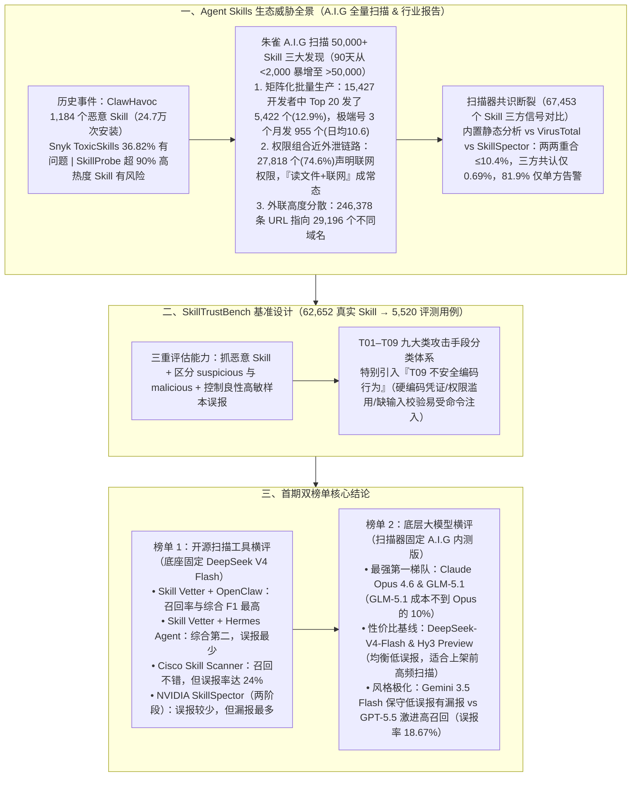

# 谁是 Agent 最强守门员？首个 Agent 技能安全评测基准 SkillTrustBench 正式发布

> **原文信息**：作者 `香港中文大学（深圳）吴保元教授课题组 & 腾讯朱雀实验室`，发布于 2026-06-16 02:33（广东），公众号「腾讯技术工程」。

---

## 1. TL;DR

1. **Agent Skills 供应链风险爆发与扫描器共识缺失** —— 2026 年 1 月底 `ClawHavoc` 事件中 **1,184 个恶意 Skill** 上架 ClawHub（涉 **24.7 万次**安装），Snyk 报告 **36.82%** 存在安全问题，SkillProbe 发现超 **90%** 高热度 Skill 仍有风险；2026 年 4 月腾讯朱雀实验室用开源红队平台 **A.I.G** 全量扫描近 **5 万个** Skill 发现：Top 20 发布者占总量 **12.9%**（极端账号日均发 **10.6 个**）、**74.6%（27,818 个）** 声明联网权限、外联指向 **29,196 个域名（246,378 条 URL）**；更严峻的是，OpenClaw 发布的 **67,453 个** Skill 信号对比显示，内置静态分析、VirusTotal 与 NVIDIA SkillSpector 三者同时发现的恶意样本仅占 **0.69%**（两两重合最多 **10.4%**，**81.9%** 仅被单一方案发现）。
2. **SkillTrustBench 双重评测基准构建** —— 联合团队从主流技能市场的 **62,652 个真实 Skill** 中清洗、去噪、平衡采样与攻击注入，提炼出 **5,520 个评测用例**，覆盖按攻击手段划分的 **T01–T09 九大类威胁**；同时评测「能否抓住恶意 Skill、能否区分 `suspicious` 与 `malicious`、能否控制对良性高敏操作（如管理 Skill 调 shell、安装脚本 `curl | bash`）的误报」。
3. **首创「T09 不安全编码行为」揭示非恶意不可信隐患** —— 突破非黑即白的恶意检测，专门引入 **`T09 不安全编码行为`**：大量正常开发者编写的 Skill 虽主观无恶意，却广泛存在**硬编码凭证、敏感权限过度声明、缺乏输入校验易受命令注入**等脆弱性，极易被提示词注入或间接指令劫持转化为供应链二次攻击跳板。
4. **开源扫描工具横评（基于 DeepSeek V4 Flash 底座）** —— **`Skill Vetter + OpenClaw`** 召回率与综合 F1 最高；**`Skill Vetter + Hermes Agent`** 综合第二且**误报最少**；**`Cisco Skill Scanner`** 召回率不错但**误报率高达 24%**；**`NVIDIA SkillSpector`**（AST/污点追踪/YARA + LLM 两阶段）误报较少但**漏报最多**。
5. **底层大模型安全推理横评（基于 A.I.G 内测版扫描器）** —— **第一梯队（最强能力）**：**Claude Opus 4.6** 与 **GLM-5.1** 综合分最高，其中 **GLM-5.1 的评测 Token 成本不到 Claude Opus 4.6 的 10%**；**高性价比之选**：**DeepSeek-V4-Flash** 与 **Hy3 Preview** 整体均衡、误报控制好，适合市场上架前高频扫描；**风格分化**：**Gemini 3.5 Flash** 精确率高、极低误报但偏保守有漏报，**GPT-5.5** 召回率高但误报率达 **18.67%**（宁可错杀不可放过）。

---

## 2. 问题定义与背景

### 2.1 为什么 Agent Skills 成了最危险的新型供应链入口？

Agent Skills 同时跨越**自然语言文档（`SKILL.md`）、可执行脚本代码、外部依赖、系统权限与运行时上下文**：它既能在文档里直接对 Agent 下达隐蔽指令，又能通过执行本地脚本、安装外部依赖或篡改会话记忆实施攻击。
- **攻防升级（2026 年 6 月 Trail of Bits 绕过测试）**：攻击者已不再把恶意指令直白写在 `SKILL.md` 里，而是利用**输入截断、文件类型盲区、源码与分发产物不一致、字节码隐藏、企业合规话术与社会工程解释**说服 LLM 扫描器放行。
- **行业痛点**：高召回方案频发误报导致「安全告警疲劳」（最终被用户忽略），低误报方案面对对抗样本频频漏报，且切换底层 LLM 时研判偏好剧烈漂移。因此亟需一套既能度量**外部扫描方案效能**、又能评估 **Skill 自身安全可信度**的客观标尺。

---

## 3. 知识框架

---

## 4. 核心内容拆解

### 4.1 真实生态威胁透视：从 ClawHavoc 到 5 万个 Skill 全量扫描

1. **四大行业安全事件与研究基准线**：
   - **2026 年 1 月底 `ClawHavoc` 事件**：**1,184 个**恶意 Skill 被上架到 ClawHub 市场，累计涉及 **24.7 万次**安装。
   - **Snyk `ToxicSkills` 报告**：市场中 **36.82%** 的 Skill 至少存在一个安全问题。
   - **论文 `SkillProbe`**：高下载量不等于安全，ClawHub 中**超过 90%** 的高热度 Skill 仍存在风险。
   - **2026 年 5 月底 `ClawHub Security Signals` 数据集（67,453 个公开 Skill）**：对比 ClawHub 内置静态分析、VirusTotal 与 NVIDIA SkillSpector 三类信号，发现**任意两类阳性重合度最多仅 10.4%，三类同时发现的恶意 Skill 仅占 0.69%，高达 81.9% 的被标记样本仅被单一方案发现**。
2. **腾讯朱雀实验室 A.I.G 全量扫描五大核心数据（2026 年 4 月）**：
   - ClawHub 在 **90 天内**从不足 **2,000 个**激增至**超 50,000 个** Skill；
   - **规模化账号矩阵**：5 万个 Skill 来自 **15,427 名**开发者，但 **Top 20 发布者合计发布了 5,422 个（占总量 12.9%）**；最极端账号 **3 个月发布 955 个 Skill（日均 10.6 个）**；
   - **高危权限常态化**：**27,818 个 Skill（占比 74.6%）**声明了网络请求权限，「读文件 + 联网」组合使数据外传极易隐匿在正常流量中；
   - **外联通道高度分散**：全量提取出 **246,378 条 URL**，指向 **29,196 个不同域名**。

---

### 4.2 SkillTrustBench 的样本设计哲学与 T01–T09 威胁体系

1. **为什么不能只放「显而易见的恶意样本」？**
   - 如果评测集全是直白的危险命令，会把扫描器诱导成「看到敏感 API 就告警」的简陋规则系统；而在真实场景中，系统管理 Skill 需要调 `shell`、文档处理 Skill 需用临时共享库、官方安装脚本常含 `curl | bash`、开发工具 Skill 需拉取依赖或访问外部 API。
   - 因此，SkillTrustBench 从 **62,652 个真实 Skill** 中构建 **5,520 个评测用例**，同时考核：**抓恶意（malicious）**、**分可疑（suspicious vs malicious）**、**控良性高敏误报**。
2. **T01–T09 威胁分类与「T09 不安全编码行为」的独特价值**：
   - 采用按**攻击手段**而非仅按攻击后果划分的 `T01–T09` 体系；
   - 专门设立 **`T09 不安全编码行为`**：覆盖由正常工程师开发、主观无恶意，但包含**硬编码凭证、敏感权限过度声明、缺乏输入校验（易受命令注入）**等缺陷的「非恶意但不可信」Skill，防止其成为被黑客通过间接提示词注入劫持的供应链暗门。

---

### 4.3 首期双榜单深度解读：开源扫描器 vs 大模型底座

#### （1）开源扫描方案横评（统一采用 `DeepSeek V4 Flash` 为底座）
对比三款主流开源方案——**Skill Vetter**（当前下载量最高的安全审计 Skill，支持 OpenClaw / Hermes Agent 安装前对话检查）、**Cisco Skill Scanner**（静态规则 + LLM 语义 + 行为数据流）、**NVIDIA SkillSpector**（第一阶段 AST/依赖校验/污点追踪/YARA 初筛 + 第二阶段 LLM 语义过滤误报）：
- **`Skill Vetter + OpenClaw`**：召回率与综合分值（F1）**最高**；
- **`Skill Vetter + Hermes Agent`**：综合排名**第二**，且**误报最少**；
- **`Cisco Skill Scanner`**：召回率不错，但**误报率高达 24%**（易引发告警疲劳）；
- **`NVIDIA SkillSpector`**：误报较少，但**漏报最多**。

#### （2）底层推理大模型横评（统一固定 `A.I.G` 最新内测版为扫描器）
- **能力最强第一梯队：`Claude Opus 4.6` 与 `GLM-5.1`**
  - 在风险推断、指令关联分析和意图识别上均衡性最佳，综合分最高；
  - **关键成本差异**：**`GLM-5.1` 的评测 Token 成本不到 `Claude Opus 4.6` 的 10%**，极具大规模部署优势。
- **高性价比基线之选：`DeepSeek-V4-Flash` 与 `Hy3 Preview`**
  - 整体表现均衡、误报控制良好，极其适合在 **Skill 市场上架前高频扫描**等高吞吐场景落地。
- **风格极化模型对比**：
  - **`Gemini 3.5 Flash`**：精确率高、误报率极低，但在复杂对抗样本召回上偏保守（存在部分漏报）；
  - **`GPT-5.5`**：召回率高，但**误报率高达 18.67%**，属于「宁可误报、也不漏过」的激进研判风格。

---

## 5. 数据速查表

| 指标 | 原文数值 | 语境 / 条件 |
| :--- | :--- | :--- |
| SkillTrustBench 样本提炼规模 | **从 62,652 个真实 Skill 提炼出 5,520 个评测用例** | 覆盖 **T01–T09 九大类**常见安全威胁（含 `T09 不安全编码行为`） |
| 2026.01 底 `ClawHavoc` 恶意事件规模 | **1,184 个恶意 Skill / 涉及 24.7 万次安装** | 上架至 ClawHub 技能市场的真实供应链攻击事件 |
| Snyk `ToxicSkills` 与 `SkillProbe` 风险占比 | **36.82% 至少含 1 个安全问题 / 超 90% 高热度 Skill 存在风险** | 外部研究机构对 ClawHub 技能生态的审计结论 |
| ClawHub 90 天技能增长规模 | **从不足 2,000 个增长到超 50,000 个** | 2026 年 4 月腾讯朱雀实验室使用 A.I.G 全量扫描时的生态规模 |
| 开发者集中度与极端账号发包频率 | **15,427 名开发者中 Top 20 发了 5,422 个（12.9%）；极端账号 3 个月发 955 个（日均 10.6 个）** | 揭示恶意 Skill 具备矩阵化批量生产、投放与伪装特征 |
| 联网权限占比与外联 URL/域名规模 | **74.6%（27,818 个）声明联网权限；共发现 246,378 条 URL 指向 29,196 个域名** | 朱雀实验室对近 5 万个 Skill 的权限与外联扫描统计 |
| `ClawHub Security Signals` 三方扫描重合度 | **样本 67,453 个：两两重合最高 10.4%，三方同时发现仅 0.69%，81.9% 仅被单一方案发现** | 对比内置静态分析、VirusTotal 与 NVIDIA SkillSpector |
| `Cisco Skill Scanner` 误报率 | **24%** | 在 DeepSeek V4 Flash 底座横评中的误报率表现 |
| `GLM-5.1` 相对 `Claude Opus 4.6` 的成本比 | **不到 Claude Opus 4.6 的 10%** | 两者同处综合分第一梯队，但 GLM-5.1 具备超低 Token 成本优势 |
| `GPT-5.5` 在底座评测中的误报率 | **18.67%** | 偏向「宁可误报、也不漏过」的高召回激进风格 |

---

## 6. 踩坑与教训 / 可迁移的设计原则

| 错误做法 | 失败表现或原因 | 原文应对 |
| :--- | :--- | :--- |
| 迷信「高下载量/高热度 Skill 就是安全的」，或仅靠单一扫描器（如静态规则或 VirusTotal）守门 | 超 90% 高热度 Skill 仍有风险；且三大扫描方案同时命中的恶意样本仅 0.69%，且易被输入截断、文件盲区、合规话术绕过 | 引入多维度结合的扫描体系，并用覆盖 9 大攻击手段与对抗绕过样本的 **SkillTrustBench（5,520 用例）** 定量校准扫描器 |
| 安全评测集只放入显而易见的恶意命令样本，且只看召回率指标 | 诱导扫描器把所有 `shell` 调用或 `curl \| bash` 正常安装脚本一刀切标为恶意（如某扫描器误报率达 24%），引发严重告警疲劳被用户直接关停 | 在评测集中混入**良性高敏正常样本**，同时考核「抓恶意、分 suspicious/malicious、控正常样本误报」三大能力（「能放过正常样本才是进生产的前提」） |
| 安全审计只查「主观恶意攻击」，放过正常开发者写出的脆弱代码 | 主观无害但含有**硬编码凭证、权限滥用、未校验输入**的 Skill，极易被黑客通过间接提示词注入劫持，沦为供应链二次攻击入口 | 在威胁分类中专门增设 **`T09 不安全编码行为`**，将「安全可信度（脆弱性）」与「恶意性」纳入同等审计视野 |
| 在高并发的技能市场上架前审计中无脑全量调用最昂贵的闭源旗舰模型 | 虽然 Claude Opus 4.6 效果好，但全量扫描数万个 Skill 的 Token 成本极高 | 分层选型：高敏深度研判可用同属第一梯队但**成本不到 Opus 10% 的 `GLM-5.1`**，市场上架前高频初筛采用高性价比的 **`DeepSeek-V4-Flash` 或 `Hy3 Preview`** |

---

## 7. 记忆锚点

1. **三组触目惊心的生态数字**：
   - **`1,184` 与 `24.7 万`**：ClawHavoc 恶意 Skill 数量与安装量；
   - **`74.6%` 与 `29,196`**：近 5 万个 Skill 中声明联网权限的比例与外联独立域名数；
   - **`0.69%` 与 `81.9%`**：67,453 个 Skill 中三方扫描器同时命中的比例（仅 0.69%）与仅被单一扫描器发现的比例（81.9%）。
2. **首期双榜单冠军与优选**：
   - **扫描器横评**：综合 F1 第一 **`Skill Vetter + OpenClaw`**，误报最低 **`Skill Vetter + Hermes Agent`**（Cisco 误报 **24%**，SkillSpector 漏报最多）；
   - **模型底座横评**：最强第一梯队 **`Claude Opus 4.6` & `GLM-5.1`（成本 `<10%`）**，高性价比基线 **`DeepSeek-V4-Flash` & `Hy3 Preview`**（`GPT-5.5` 误报 **18.67%**）。

---

## 8. 复习卡片

1. 腾讯朱雀实验室使用 A.I.G 对 ClawHub 近 5 万个 Skill 进行全量扫描后，发现了哪三大供应链风险特征？::① 规模化、矩阵化批量生产迹象（15,427 名开发者中 Top 20 发布了 12.9% 即 5,422 个 Skill，极端账号 3 个月发 955 个、日均 10.6 个）；② 权限组合天然接近数据外泄链路（74.6% 即 27,818 个声明了联网权限，「读文件+联网」成常态）；③ 外联通道高度分散（共发现 246,378 条 URL，指向 29,196 个不同域名）。
2. 为什么说现有开源 Skill 安全扫描方案之间严重缺乏共识，攻击者又是如何绕过早期扫描机制的？::OpenClaw 发布的 67,453 个 Skill 信号对比显示，内置静态分析、VirusTotal 和 NVIDIA SkillSpector 任意两类阳性重合度最高仅 10.4%，三方同时发现的仅占 0.69%，81.9% 只被单一方案发现；同时攻击者已转向利用输入截断、文件类型盲区、源码与分发产物不一致、字节码隐藏以及企业合规社会工程话术来绕过扫描。
3. SkillTrustBench 的样本规模是多少，为什么它在威胁分类中专门引入了「T09 不安全编码行为」？::从 62,652 个真实 Skill 中提炼出 5,520 个评测用例，涵盖 T01–T09 九大类威胁；引入 `T09 不安全编码行为` 是因为大量正常开发者编写的 Skill 虽主观无恶意，却广泛存在硬编码凭证、敏感权限过度声明、缺乏输入校验易受命令注入等脆弱性，极易被间接提示词注入劫持为供应链二次攻击跳板。
4. 在 SkillTrustBench 首期开源扫描工具横评（基于 DeepSeek V4 Flash 底座）中，各主流工具的表现有何差异？::`Skill Vetter + OpenClaw` 的召回率与综合 F1 最高；`Skill Vetter + Hermes Agent` 综合排名第二且误报最少；`Cisco Skill Scanner` 召回率不错但误报率高达 24%（易引发告警疲劳）；采用 AST/污点追踪/YARA + LLM 两阶段架构的 `NVIDIA SkillSpector` 误报较少但漏报最多。
5. 在底层大模型安全推理评测（基于 A.I.G 内测版扫描器）中，哪些模型处于第一梯队、哪些适合高性价比高频扫描，各模型呈现出怎样的研判风格？::`Claude Opus 4.6` 与 `GLM-5.1` 综合分最高处于第一梯队，且 `GLM-5.1` 的 Token 成本不到 Opus 的 10%；`DeepSeek-V4-Flash` 与 `Hy3 Preview` 表现均衡、误报控制好，适合作为技能市场上架前高频扫描的高性价比基线；风格上 `Gemini 3.5 Flash` 保守低误报但有漏报，而 `GPT-5.5` 激进高召回但误报率达 18.67%。

---

## 9. 知识关联

- **已有主题**：[Agent评测与反馈](../../20_topics/Agent%E8%AF%84%E6%B5%8B%E4%B8%8E%E5%8F%8D%E9%A6%88.md) · [异常监控与稳定性](../../20_topics/%E5%BC%82%E5%B8%B8%E7%9B%91%E6%8E%A7%E4%B8%8E%E7%A8%B3%E5%AE%9A%E6%80%A7.md) · [Agent工程循环](../../20_topics/Agent%E5%B7%A5%E7%A8%8B%E5%BE%AA%E7%8E%AF.md) · [Agent安全与权限](../../20_topics/Agent%E5%AE%89%E5%85%A8%E4%B8%8E%E6%9D%83%E9%99%90.md) · [Skill设计与治理](../../20_topics/Skill%E8%AE%BE%E8%AE%A1%E4%B8%8E%E6%B2%BB%E7%90%86.md)
- **候选新主题**：[[SkillTrustBench安全基准]] · [[Agent技能供应链安全]] · [[T09不安全编码脆弱性]]

---

## 10. 原文参考资料

1. **SkillTrustBench 官方资源**：
   - 项目官网：`https://matrix.tencent.com/skilltrustbench`
   - Hugging Face Dataset：`https://huggingface.co/datasets/cuhk-zhuque/SkillTrustBench`
   - Hugging Face Leaderboard：`https://huggingface.co/spaces/cuhk-zhuque/SkillTrustBench-Leaderboard`
   - 腾讯朱雀实验室开源红队平台 **A.I.G (AI-Infra-Guard)**：`https://github.com/Tencent/AI-Infra-Guard`
2. **评测工具与外部安全研究报告**：
   - **Skill Vetter**：`https://clawhub.ai/spclaudehome/skill-vetter`
   - **Cisco Skill Scanner**：`https://github.com/cisco-ai-defense/skill-scanner`
   - **NVIDIA SkillSpector**：`https://github.com/NVIDIA/skillspector`
   - **Snyk**：*ToxicSkills: Agent Skills supply chain compromise study*（`https://snyk.io/blog/toxicskills-malicious-ai-agent-skills-clawhub/`）
   - **SkillProbe**：*Security Auditing for Emerging Agent Skill Marketplaces via Multi-Agent Collaboration*（`https://arxiv.org/abs/2603.21019`）
   - **Trail of Bits**：*The sorry state of skill distribution*（`https://blog.trailofbits.com/2026/06/03/the-sorry-state-of-skill-distribution/`）
   - **ClawHub Security Signals**：*When VirusTotal, Static Analysis, and SkillSpector Disagree*（`https://huggingface.co/papers/2606.01494`）

> [!note]- 校对报告
> - **校对状态**：已根据 `MD.md` 全文（共 9 页 PDF 转写文本）逐一核对。
> - **核心数据与事实页码溯源**：
>   - 香港中文大学（深圳）吴保元教授课题组与腾讯朱雀实验室联合发布、62,652 个真实 Skill 提炼 5,520 个评测用例、九大类安全威胁、首期三大关键结论与官网/HuggingFace 链接：见 PDF 第 1–2 页。
>   - 2026 年 1 月底 `ClawHavoc` 事件（1,184 个恶意 Skill、24.7 万次安装）、Snyk `ToxicSkills`（36.82%）、`SkillProbe`（超 90% 高热度 Skill 有风险）、2026 年 4 月 A.I.G 扫描（90 天从 `<2,000` 增至 `>50,000`、15,427 名开发者中 Top 20 发了 5,422 个占 12.9%、极端账号 3 个月发 955 个日均 10.6 个、27,818 个占 74.6% 声明联网权限、246,378 条 URL 指向 29,196 个域名）：见 PDF 第 2–3 页。
>   - 2026 年 6 月 Trail of Bits 绕过测试、2026 年 5 月底 OpenClaw `ClawHub Security Signals`（67,453 个公开 Skill，两两重合最高 10.4%、三方同时发现仅 0.69%、81.9% 仅被单一方案发现）：见 PDF 第 3 页。
>   - 样本设计三重评估能力、T01–T09 体系及专门引入 `T09 不安全编码行为`（硬编码凭证、敏感权限过度声明、缺输入校验）：见 PDF 第 4–5 页。
>   - 开源扫描方案横评（Skill Vetter + OpenClaw 综合 F1 第一、Skill Vetter + Hermes Agent 第二且误报最少、Cisco Skill Scanner 误报率 24%、NVIDIA SkillSpector 漏报最多）及大模型底座横评（Claude Opus 4.6 与 GLM-5.1 第一梯队且 GLM-5.1 成本不到 Opus 的 10%、DeepSeek-V4-Flash 与 Hy3 Preview 性价比之选、Gemini 3.5 Flash 保守低误报、GPT-5.5 误报率 18.67%）：见 PDF 第 5–6 页。
