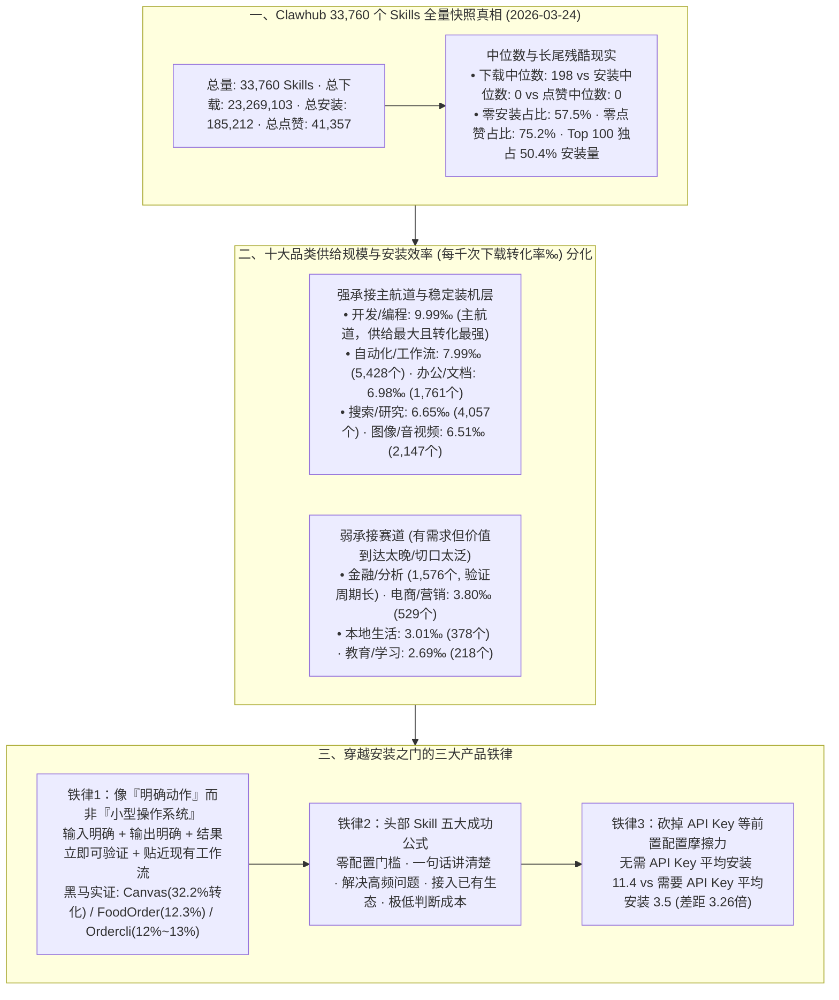

# 3.3万个Skills，为什么大多数都死在“安装”这一步？

## 1. TL;DR

1. **戳破 Skill 市场虚假繁荣的中位数真相**：通过对 2026 年 3 月 24 日 **Clawhub 公开数据快照（共 33,760 个 Skills）** 的全量统计，虽然总下载量高达 **2,326.9 万次**，但总安装量仅 **18.5 万次**、总点赞 **4.1 万次**——**下载中位数为 198，而安装中位数为 0、点赞中位数为 0**；高达 **57.5% 的 Skill 从未被安装**，**75.2% 从未被点赞**，而 **Top 100 头部 Skill 拿走了 50.4% 的总安装量**。
2. **先成立的是“工作流缩短”，而非宏大概念（开发/编程安装效率 9.99‰ 领跑）**：按供给与每千次下载转化率（安装效率）交叉分析，**开发/编程（9.99‰）** 供给最大且转化最强，**自动化/工作流（7.99‰）、办公/文档（6.98‰）、搜索/研究（6.65‰）、图像/音视频（6.51‰）** 构成稳定装机层；而 **电商/营销（3.80‰）、本地生活（3.01‰）、教育/学习（2.69‰）** 及金融/分析则因“切口不够锋利、价值到达太晚”沦为安装承接弱档。
3. **高转化黑马与头部 Skill 的五大共性**：以 `Summarize`、`Github`、`AgentBrowser` 等 Top Skill 以及转化率高达 **32.2% 的 `Canvas`**、`12%~13%` 的 `Ordercli / Blucli / Eightctl / FoodOrder` 等垂直黑马为例，真正跑出来的 Skill 绝非“像小型操作系统一样大而全”，而是具备 **① 零配置门槛、② 一句话讲清、③ 解决高频问题、④ 接入已有生态、⑤ 越像一个明确动作越容易被安装**。
4. **配置成本直接杀死转化（免 API Key 安装量高出 3.26 倍）**：实证数据表明，**无需 API Key 的 Skill 平均安装数为 `11.4`，而需要配置 API Key 的 Skill 平均安装数骤降至 `3.5`**——证明用户在安装瞬间做的不是深度技术比较，而是判断“能不能立刻装、立刻用”。

## 2. 问题定义与背景

### 2.1 供给井喷背后的漏斗断裂：为什么有 2,326 万次下载，却只有 18.5 万次安装？
随着 OpenClaw 生态爆发，Clawhub 社区的 Skill 数量迅速突破 **3.3 万个**。然而团队对 `2026-03-24` 全量快照数据的拆解揭示了一个残酷的漏斗断层：
- **曝光/下载与真实装机严重脱节**：用户在浏览或拉取仓库（产生下载计数）后，绝大多数并未将其真正配置安装进自己的常驻桌面 Agent 中。
- **核心命题**：这个市场早已不缺供给，缺的是“能够穿过安装这道门、留在桌面上成为默认入口”的有效供给。

## 3. 知识框架

## 4. 核心内容拆解

### 4.1 宏观分布与品类安装效率：为什么“开发/编程”没卷死反而最能打？

1. **极度陡峭的幂律分布**：
   - 在 `33,760` 个样本中，**57.5% 的 Skill 安装量为 0**，**75.2% 点赞数为 0**，而排名前 **100（占比不到 `0.3%`）的头部 Skill 攫取了全平台 50.4% 的安装量**。
2. **供给规模 Top 10 品类与“安装效率（每千次下载对应安装数）”对标**：

| 品类名称 | 供给数量（个） | 安装效率（‰ / %口径） | 市场定位与转化诊断 |
| :--- | :--- | :--- | :--- |
| **开发 / 编程** | Top 1（近万级） | **9.99** | **核心主航道**——并非“供给多卷死了”，而是供给大、刚需高频、转化也最强 |
| **自动化 / 工作流** | `5,428` | **7.99** | **稳定装机层**——直接缩短既有重复操作链路 |
| **搜索 / 研究** | `4,057` | **6.65** | **稳定装机层**——抓取、摘要、文献整理 |
| **图像 / 音视频** | `2,147` | **6.51** | **稳定装机层**——转写、格式处理、明确输入输出 |
| **办公 / 文档** | `1,761` | **6.98** | **稳定装机层**——PDF、表格、邮件、日历、导出同步 |
| **系统 / 安全** | `1,704` | 中档 | 偏底层运维与体检工具 |
| **金融 / 分析** | `1,576` | 偏弱 | **价值到达太晚**——结果验证周期长，形态不够短链直接 |
| **电商 / 营销** | `529` | **3.80** | **安装承接弱**——停留在“会写文案、会给策略”泛能力描述，切口不锋利 |
| **本地生活** | `378` | **3.01** | **安装承接弱**——离桌面原生高频动作较远 |
| **教育 / 学习** | `218` | **2.69** | **安装承接最弱** |

### 4.2 什么样的 Skill 能活下来：四大成立特征、五大头部公式与黑马启示

1. **真正成立的 Skill 具备四个共同特征（贴近现有流程，不逼用户学新范式）**：
   - **① 输入明确**（用户一眼知道该喂什么） + **② 输出明确**（知道会拿到什么） + **③ 结果可验证**（当场能看出对不对） + **④ 离现有流程近**（如 GitHub、SQL、浏览器、CLI、PDF、邮件、日历，只是把旧动作更快做完）。
2. **Top 头部 Skill（`Summarize`、`Github`、`AgentBrowser`、`Weather`、`Gog`）的五条成功公式**：
   - **🔑 零配置门槛**（装完即用） + **💬 一句话讲清楚**（不用看长文档） + **🔥 解决高频问题**（反复依赖） + **🔗 接入已有生态**（借力用户已有的 GitHub/浏览器/文档） = **极低的判断成本**。
3. **高转化黑马的启示：越像“一个明确动作”，越容易被安装**
   - 样本中转化率惊人的黑马——如 **`Canvas`（转化率高达 `32.2%`）**、**`FoodOrder`（`12.3%`）**、**`Ordercli / Blucli / Eightctl`（`12%~13%`）**——它们的共同点绝不是大而全的“小型操作系统”，而是**场景极窄、动作极其具体、价值立即可感知**。
4. **配置摩擦力的致命杀伤：API Key 对比实证**
   - 统计显示：**不需要 API Key 的 Skill 平均安装数为 `11.4`，而需要用户前置申请并填写 API Key 的 Skill 平均安装数仅为 `3.5`（相差 `3.26 倍`）**。去哪找 Key、配账号、填参数的摩擦力直接把绝大多数用户挡在了门外。

## 5. 数据速查表

| 指标 | 原文数值 | 语境 / 条件 |
| :--- | :--- | :--- |
| **Clawhub 快照采集日期与样本总量** | `2026 年 3 月 24 日`；共 `33,760 个` Skills | 公开数据快照全量统计分析 |
| **全平台总下载 / 总安装 / 总点赞** | 下载 `23,269,103`、安装 `185,212`、点赞 `41,357` | 整体下载到安装转化率约为 `0.80%` |
| **下载 / 安装 / 点赞中位数** | 下载中位数 `198`｜安装中位数 `0`｜点赞中位数 `0` | 揭示绝大多数 Skill 有曝光下载但无实际留存装机 |
| **零安装占比 / 零点赞占比 / Top100 集中度** | 零安装 `57.5%`、零点赞 `75.2%`、Top 100 安装占比 `50.4%` | 超过一半从未被安装，前 100 名吃掉全市场一半以上安装量 |
| **主要品类供给量分布** | 自动化 `5,428`、搜索 `4,057`、音视频 `2,147`、办公 `1,761`、安全 `1,704`、金融 `1,576`、电商 `529`、本地 `378`、教育 `218` | 开发/编程位列第一大品类 |
| **各品类安装效率对比** | 开发/编程 `9.99`、自动化 `7.99`、办公 `6.98`、搜索 `6.65`、音视频 `6.51` vs 电商 `3.80`、本地 `3.01`、教育 `2.69` | 衡量每单位下载转化为实际安装的承接效率 |
| **高转化垂直黑马转化率** | `Canvas` `32.2%`、`FoodOrder` `12.3%`、`Ordercli/Blucli/Eightctl` `12%~13%` | 场景窄、动作明确、价值立即可感知的垂直代表 |
| **是否需要 API Key 的平均安装数对比** | 无需 API Key 平均 `11.4` vs 需要 API Key 平均 `3.5` | 配置门槛造成超过 `3.2 倍` 的结构性转化流失 |

## 6. 踩坑与教训 / 可迁移的设计原则

| 错误做法 | 失败表现或原因 | 原文应对（可迁移的设计原则） |
| :--- | :--- | :--- |
| **把 Skill 做成功能包罗万象的“小型操作系统”，或取一个不知所云的抽象名字** | 用户点进来不知道从哪开始用、判断成本极高，直接沦为 `57.5%` 零安装分母中的一员 | **切口锋利化（像一个明确动作）+ 一句话讲清价值**：遵循“输入明确、输出明确、结果当场可验证、贴近现有工具链”四原则（如 `Canvas` 达 `32.2%` 转化） |
| **在电商/营销或金融/分析类 Skill 中堆砌“会写文案、会做分析、会给策略”等泛能力描述** | 价值到达太晚、验证周期过长，用户下载看一眼简介就走，不愿将其设为桌面常驻入口 | **将泛领域拆解为短链路高频动作**：不讲宏大策略，聚焦于单次调用即可交付确定性产物（如一键抓取竞品评论表、一键导出特定财报指标） |
| **在 Skill 安装或首次运行前强制要求用户自己去申请第三方 API Key 并手填繁琐配置文件** | 平均安装数直接从 `11.4` 暴跌至 `3.5`，70% 以上的潜在用户在找 Key 填参途中流失 | **极致践行“零配置门槛（Zero-Config）”**：优先复用宿主环境已有凭证（如已登录的浏览器、GitHub CLI 或内置默认免费通道），让用户先跑通看到结果再谈进阶配置 |

## 7. 记忆锚点

- **“3.3 万个 Skill：下载中位数 198，安装中位数 0，57.5% 零安装，Top 100 吃掉 50.4%”**：一组刺破 Skill 生态泡沫的硬核基线数据。
- **“免 Key 平均装 11.4 个 vs 要 Key 平均装 3.5 个；别做小型操作系统，要做像 Canvas（32.2%）一样的明确短动作”**：把 Skill 当成消费级产品来做漏斗优化的两条黄金铁律——**缩短流程、缩短判断、缩短价值到达时间**。

## 8. 复习卡片

1. 根据 2026 年 3 月 24 日 Clawhub 对 33,760 个 Skills 的统计快照，全平台的下载、安装、点赞中位数以及零安装、Top 100 集中度分别是多少？::下载中位数为 `198`，但安装中位数为 `0`、点赞中位数为 `0`；高达 `57.5%` 的 Skill 从未被安装（零安装），`75.2%` 从未被点赞，而排名前 `100` 的头部 Skill 占据了全平台 `50.4%` 的安装量。
2. 在 Clawhub 的品类分布中，哪些品类构成了高安装效率的“主航道”与“稳定装机层”，哪些品类安装承接最弱？::“开发/编程”以 `9.99` 的安装效率成为供给最大且转化最强的主航道；“自动化/工作流（`7.99`）”、“办公/文档（`6.98`）”、“搜索/研究（`6.65`）”和“图像/音视频（`6.51`）”构成了稳定装机层；而“电商/营销（`3.80`）”、“本地生活（`3.01`）”和“教育/学习（`2.69`）”安装承接最弱。
3. 为什么“电商/营销”和“金融/分析”这两类明明有真实需求的赛道，在 Skill 市场上的安装转化率却偏低？::核心原因是“切口不够锋利”与“价值到达太晚”：电商/营销类 Skill 往往停留在“会写文案、会提建议”的泛能力描述上，缺乏明确的短链路动作；金融/分析类 Skill 的结果验证周期过长、形态不够短链直接，导致用户只看不装。
4. 头部 Top Skill（如 `Summarize`、`Github`、`AgentBrowser`）与高转化黑马（如 `Canvas` 32.2%、`FoodOrder` 12.3%）共同揭示了怎样的成功公式？::它们都不是大而全的“小型操作系统”，而是“像一个明确动作”，具备四大成立特征（输入明确、输出明确、结果可验证、离现有流程近）和五大共性（零配置门槛、一句话讲清楚、解决高频问题、接入已有生态、判断成本极低）。
5. 前置配置成本对 Skill 的安装转化有多大杀伤力？具体数据对比如何？::配置成本直接杀死转化：数据显示，无需 API Key 的 Skill 平均安装数为 `11.4`，而需要配置 API Key 的 Skill 平均安装数仅为 `3.5`（相差超 `3.2 倍`），说明用户决策的核心在于“能否立刻装、立刻用”。

## 9. 知识关联

- **本仓库主题索引**：[因果推断与评测归因](../../20_topics/%E5%9B%A0%E6%9E%9C%E6%8E%A8%E6%96%AD%E4%B8%8E%E8%AF%84%E6%B5%8B%E5%BD%92%E5%9B%A0.md) · [决策方法](../../20_topics/%E5%86%B3%E7%AD%96%E6%96%B9%E6%B3%95.md) · [模型与开发工具发布](../../20_topics/%E6%A8%A1%E5%9E%8B%E4%B8%8E%E5%BC%80%E5%8F%91%E5%B7%A5%E5%85%B7%E5%8F%91%E5%B8%83.md) · [Agent评测与反馈](../../20_topics/Agent%E8%AF%84%E6%B5%8B%E4%B8%8E%E5%8F%8D%E9%A6%88.md) · [Skill设计与治理](../../20_topics/Skill%E8%AE%BE%E8%AE%A1%E4%B8%8E%E6%B2%BB%E7%90%86.md)
- **候选双链概念**：[[Clawhub生态实证分析]] · [[Skill安装转化漏斗]] · [[零配置门槛Zero-Config]] · [[价值到达时间TTV]] · [[短链路明确动作设计]]

## 10. 原文参考资料

1. 数据源：`2026-03-24` Clawhub 公开数据快照（样本量 `33,760` 个 Skills，含名称、简介、创建时间、`downloads`、`installs`、`stars` 等字段）。

> [!note]- 校对报告
> - **校对状态**：已按原文逐页核对通过（共 7 页 PDF）。
> - **核心数据与页码溯源**：
>   - `2026 年 3 月 24 日` Clawhub 快照、样本 `33,760` 个 skills、总下载 `23,269,103`、总安装 `185,212`、总点赞 `41,357`、下载中位数 `198`、安装中位数 `0`、点赞中位数 `0`、零安装占比 `57.5%`、零点赞占比 `75.2%`、Top100 安装占比 `50.4%`：见 `p.1–2`。
>   - Top 10 类别供给量（自动化/工作流 `5,428`、搜索/研究 `4,057`、图像/音视频 `2,147`、办公/文档 `1,761`、系统/安全 `1,704`、金融/分析 `1,576`、电商/营销 `529`、本地生活 `378`、教育/学习 `218`）与安装效率表（开发/编程 `9.99`、自动化 `7.99`、办公 `6.98`、搜索 `6.65`、音视频 `6.51` vs 电商 `3.80`、本地生活 `3.01`、教育 `2.69`）：见 `p.2–3`。
>   - 四个共同特征、Top skill 样本（`Summarize`、`Github`、`AgentBrowser`、`Weather`、`Gog`）五条成功公式、高转化黑马（`Canvas` `32.2%`、`Ordercli/Blucli/Eightctl` `12%–13%`、`FoodOrder` `12.3%`）：见 `p.3–4`。
>   - 电商/营销与金融/分析痛点剖析，以及 API Key 配置门槛对比（无需 API Key 平均安装数 `11.4` vs 需要 API Key 平均安装数 `3.5`）：见 `p.4–5`。
