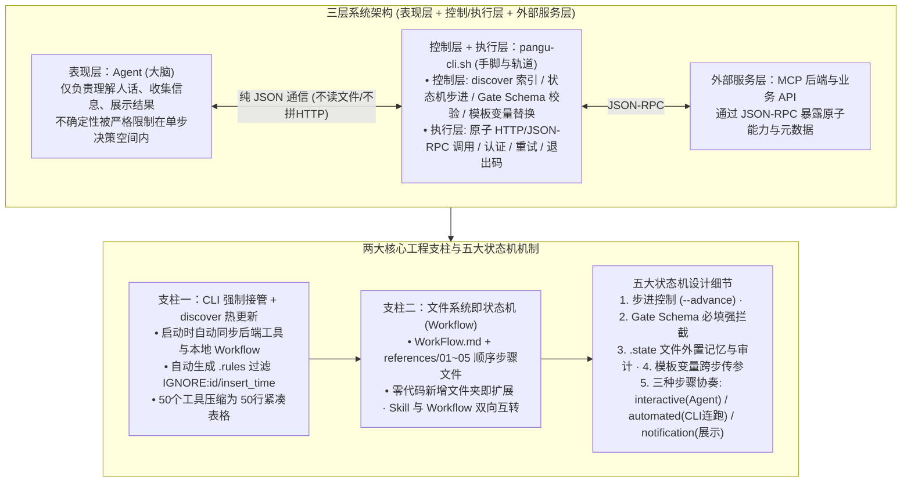

# 当我把AI变成一个“算法”：Skill工程化设计的心路历程

## 1. TL;DR

1. **核心理念：把 Agent 当成“算法”来用（为概率性河水修筑确定性河道）**：不再靠堆砌 Prompt 祈祷模型不犯错，而是让 Agent 仅保留最擅长的“理解自然语言、做判断、组织表达”，将流程顺序、数据格式、API 调用与状态持久化全部抽离给 Agent 触碰不到的确定性程序（`pangu-cli.sh`）。
2. **第一根支柱：CLI 接管一切确定性事务与 `discover` 实时自生长**：禁止 Agent 直接拼装 HTTP 请求或主动调用 `read_file` 读冗长工具文档；激活时由 `CLI discover` 实时扫描 MCP 后端工具与本地 `workflows/` 目录，自动生成过滤了系统自增字段（`IGNORE:id / insert_time / update_time`）的 `.rules` 规则文件，将 50 个工具压缩为一张 **50 行紧凑表格** 注入上下文。
3. **第二根支柱：目录即工作流（Workflow）与 Skill/Workflow 双向无损转化**：每个复合业务场景对应一个 `WorkFlow.md` 加 `references/` 下按数字前缀排序的步骤文件（如 `01-collect-project-info.md` → `05-summary.md`）；无需修改任何代码或重启服务，丢入新文件夹即可横向扩展能力，且独立 Skill 与嵌入式子 Workflow 可直接通过复制 `references/` 目录互相转化。
4. **五大状态机工程细节：`.state` 外置记忆、Schema Gate、模板变量与三类步骤协奏**：将步骤推进状态外置到 `.state` 文件（Agent 无状态接力且全链路可审计）；用 **Gate Schema** 强校验必填项；用 **模板变量** 由 CLI 在后台跨步传递参数；将步骤划分为 `interactive`（Agent 交互收集）、`automated`（CLI 提交 Gate 后内部自动连跑 API）与 `notification`（Agent 展示确认），构建 **表现层（Agent）+ 控制/执行层（CLI）+ 外部服务层（MCP）** 三层架构。

## 2. 问题定义与背景

### 2.1 AI 在工程落地中到底在哪里翻车？
复盘生产环境中 Agent 的失败案例，翻车点高度集中在“让概率模型干确定性的苦力活”：
- **协议与格式拼装错误**：手拼 HTTP 请求漏掉认证 Header、写 YAML 缩进错位、调接口把 `userId` 写成 `user_id`。
- **工具检索与上下文污染**：传统方案让 Agent 自己调用 `read_file` 去读几十份工具 Schema 文档，经常读错文件、读到过期缓存，且 50 个工具的完整 JSON Schema 直接撑爆上下文窗口。
- **多步长链路状态遗忘**：在 5 步以上的“应用接入向导”中，让 Agent 靠上下文自己记住第 1 步填的 `project_name` 传给第 4 步，极易在中间轮次发生遗忘或张冠李戴。

### 2.2 核心问题重构
真正该问的问题不是“怎么写更好的提示词”，而是：**“怎么设计一个让 AI 在每个时刻都只需要关注最少信息的执行环境？”**

## 3. 知识框架

## 4. 核心内容拆解

### 4.1 第一根支柱：CLI 接管确定性执行与 `discover` 实时世界同步

1. **剥夺 Agent 的 `read_file` 与手拼 HTTP 权限**：
   - 旧模式：Agent 自己查文档、拼请求 → 漏 Header、拼错字段。
   - 新模式：Agent 的信息获取路径被 CLI 完全托管，只需输出结构化指令（如 `调用 create_project，参数：name=foo, host=bar.com`），认证、重试、超时与协议封装全部由 `pangu-cli.sh` 确定性完成。
2. **`discover`：不仅是加载工具，而是“同步世界状态 + 自动生成 `.rules`”**：
   - 每次 Skill 激活时自动执行 `CLI discover`，扫描 MCP 后端接口并自动生成 `.rules` 过滤规则（如自动标记 `IGNORE:id`、`IGNORE:insert_time`、`IGNORE:update_time` 等由后端自动分配的字段，绝不让这些无用字段出现在 Agent 视野里）。
   - **极致上下文压缩**：面对 **50 个工具**，Agent 上下文里只增加一张 **50 行的精简表格**，而非 50 份冗长的 JSON Schema 文档。

### 4.2 第二根支柱：目录结构即工作流（Workflow）与五大状态机机制

1. **零代码横向扩展与 Skill/Workflow 无损互转**：
   - 每个复合流程对应 `workflows/<name>/WorkFlow.md`（仅含 YAML `name + description`）与 `references/01-xxx.md ~ 05-xxx.md` 步骤文件；新增业务流程只需放入一个 Markdown 文件夹，下次 `discover` 自动建立索引。
   - **双向可组合性**：一个独立的 `permission-set-skill` 只需将其 `references/` 目录复制过来即可嵌入大型“应用接入向导”成为子 Workflow；反之成熟的 Workflow 也可一键拆出成为独立 Skill。
2. **五大状态机核心机制**：
   - **细节一：单步视野隔离**：Agent 每次只能看到**当前所处那一步**的 Markdown 指引，走完一步调用 `--advance` 才由 CLI 吐出下一步指引，彻底杜绝跳步与抢跑。
   - **细节二：Gate Schema 强校验闸门**：在步骤文件 YAML 头定义 `gate.schema`（如 `project_name`、`host`、`admins` 均为 `required: true`）；Agent 调用 `--advance --gate-data '{...}'` 时，若缺必填项或类型不符，CLI 直接拒绝推进并返回缺失字段提示。
   - **细节三：`.state` 外置状态与接力审计**：所有历史步骤的输入输出均持久化在本地 `.state` 文件中；Agent 无需假装有长记忆，每次激活只需问 CLI“我们到哪了”即可像接力赛一样继续，且排障时打开 `.state` 文件即可精确审计每一步数据。
   - **细节四：模板变量托管跨步数据流**：第 2 步“创建项目”需要引用第 1 步收集的 `project_name` 时，无需让 Agent 在上下文里搬运字符串，而是在第 2 步定义中直接写模板变量，由 CLI 引擎在后台从 `.state` 自动替换注入。
   - **细节五：三种步骤类型（`interactive` / `automated` / `notification`）的高效协奏**：

| 步骤类型 | 核心职责 | 实际执行主体 | 运行机制说明 |
| :--- | :--- | :--- | :--- |
| **`interactive`** | 与用户对话收集信息或确认 | **Agent** | Agent 根据当前步指引向用户提问，收齐后通过 `--gate-data` 提交给 CLI |
| **`automated`** | 调用后端 API 执行确定性操作 | **CLI 内部自动连跑** | 当上一步 `interactive` 提交 Gate 通过后，CLI 在内部**自动连续执行**紧随其后的 `automated` 步骤并把下一步指引直接返回，省去一次无意义的 LLM 往返 |
| **`notification`** | 展示阶段性总结或最终结果 | **Agent** | CLI 将汇总数据渲染好交由 Agent 向用户友好呈现 |

## 5. 数据速查表

| 指标 | 原文数值 | 语境 / 条件 |
| :--- | :--- | :--- |
| **工具列表上下文压缩比** | `50 个` 工具仅占 `50 行` 表格 | 替代传统的 50 份完整 Schema 文档，且自动过滤 `IGNORE` 系统字段 |
| **示例权限集创建工作流步数** | `5 步`（`01` 至 `05`） | `01` 收集项目信息 → `02` 调 API 建项目 → `03` 收集角色信息 → `04` 调 API 建角色 → `05` 摘要确认 |
| **系统架构分层数** | `3 层`（表现层 + 控制/执行层 + MCP 后端） | 表现层为 Agent，控制层与执行层合一于 `pangu-cli.sh`，外部服务为 MCP |
| **工作流步骤分类数** | `3 种`（`interactive` / `automated` / `notification`） | 区分需 LLM 交互的步骤与可由 CLI 内部静默连跑的 API 步骤 |

## 6. 踩坑与教训 / 可迁移的设计原则

| 错误做法 | 失败表现或原因 | 原文应对（可迁移的设计原则） |
| :--- | :--- | :--- |
| **让 Agent 自己调用 `read_file` 去读工具文档并手拼 HTTP/YAML 请求** | 可能读错文件或塞入过长文档撑爆上下文，且概率模型手拼请求极易漏 Header、写错缩进或混淆 `userId/user_id` | **CLI 强制接管信息获取与协议执行**：Agent 不读文件、不拼 HTTP，仅通过纯 JSON 与 CLI 交互，由 CLI `discover` 吐出精简表格并执行原子调用 |
| **把后端接口返回的所有数据库原始字段（含 `id`、`insert_time` 等）原封不动暴露给 Agent** | 模型在调用创建接口时试图自己瞎编 `id` 或时间戳，导致接口报错并浪费 Token | **`discover` 自动生成 `.rules` 过滤规则**：同步工具时自动识别并标记 `IGNORE:id / insert_time / update_time`，在规则层将其从 Agent 视野中抹除 |
| **把 5 步复合流程一次性全写在一段长 Prompt 里让 Agent 自己记状态、传参数** | 模型容易跳步、漏填必填项，或在多轮对话后把第 1 步收集的参数传错给第 4 步 | **外置 `.state` 状态机 + Gate Schema + 模板变量**：每次只给 Agent 看当前一步，过 Gate 才推进，`automated` 步骤由 CLI 用模板变量从 `.state` 自动取值执行 |

## 7. 记忆锚点

- **“LLM 是一条概率性的河，Skill 工程化不是驯服河水，而是给它修筑带闸门的确定性河道”**：表现层留给灵动的河水（Agent 理解与表达），控制层与执行层交给坚固的河床与闸门（`pangu-cli.sh` 状态机与 Gate Schema）。
- **“Agent 不读文件、不记状态、不传跨步变量、不跑纯自动步骤”**：四剥夺换来四确定——`discover` 喂表、`.state` 存状态、模板变量传参、`automated` 步骤 CLI 内部静默连跑。

## 8. 复习卡片

1. 作者提出“把 AI 变成一个算法来用”的核心设计思想是什么，在三层架构中 Agent、CLI 和 MCP 各自承担什么职责？::核心思想是让 Agent 只负责最擅长的“理解自然语言、做判断、组织表达（表现层）”，而将流程顺序、数据格式、状态管理（控制层）与原子 HTTP 调用、认证重试（执行层）全部抽离到确定性的 `pangu-cli.sh` 脚本中，外部原子能力则由 MCP 后端通过 JSON-RPC 提供。
2. 为什么作者禁止 Agent 调用 `read_file` 去读取工具说明文档，而是设计了 `CLI discover` 机制？::因为让 Agent 自己调 `read_file` 可能读错文件或因文档过长撑爆上下文；`CLI discover` 在激活时实时同步后端工具与本地 Workflow，自动生成过滤了 `IGNORE:id / insert_time` 等系统字段的 `.rules` 文件，使 50 个工具在上下文中仅占一张 50 行的紧凑表格。
3. 在这套状态机设计中，是如何实现“独立 Skill”与“嵌入式子 Workflow”之间的无损复用的？::每个流程均由 `WorkFlow.md` 与 `references/` 下按编号排序的步骤 Markdown 文件组成，流程拼接逻辑固化在文件系统目录中；因此只需将独立 Skill 的 `references/` 目录复制过来即可作为子 Workflow 嵌入大流程，无需重写 Prompt 或修改 CLI 代码。
4. 系统是如何解决 Agent 在多步骤流程中“跳步漏填”、“跨轮次遗忘状态”和“步骤间传参出错”这三个痛点的？::① 用单步视野隔离与 `Gate Schema`（强校验 `required` 字段与类型）防止跳步漏填；② 将全部进度与输入输出外置持久化到 `.state` 文件，实现无状态接力与可审计；③ 用模板变量由 CLI 从 `.state` 自动读取前序步骤字段注入后续步骤，无需 Agent 记忆搬运。
5. Workflow 中的 `interactive`、`automated` 和 `notification` 三种步骤类型是如何协同减少不必要 LLM 调用的？::`interactive` 由 Agent 与用户对话收集数据；一旦 Agent 提交 `--gate-data` 通过校验，紧随其后的 `automated` 步骤会由 CLI 在内部自动取模板变量调用 API 执行完毕，直接把下一个 `interactive` 或 `notification`（结果展示）步骤返回给 Agent，省去了中间纯工具调用的 LLM 往返。

## 9. 知识关联

- **本仓库主题索引**：[Harness与模型协同](../../20_topics/Harness%E4%B8%8E%E6%A8%A1%E5%9E%8B%E5%8D%8F%E5%90%8C.md) · [Agent任务恢复](../../20_topics/Agent%E4%BB%BB%E5%8A%A1%E6%81%A2%E5%A4%8D.md) · [Agent成本与上下文预算](../../20_topics/Agent%E6%88%90%E6%9C%AC%E4%B8%8E%E4%B8%8A%E4%B8%8B%E6%96%87%E9%A2%84%E7%AE%97.md) · [Agent工程循环](../../20_topics/Agent%E5%B7%A5%E7%A8%8B%E5%BE%AA%E7%8E%AF.md) · [Skill设计与治理](../../20_topics/Skill%E8%AE%BE%E8%AE%A1%E4%B8%8E%E6%B2%BB%E7%90%86.md)
- **候选双链概念**：[[Skill状态机设计]] · [[CLI控制层托管]] · [[Gate-Schema强校验]] · [[外置state状态文件]] · [[河水与河道隐喻]]

## 10. 原文参考资料

1. 腾讯内部工程实践：`pangu-cli.sh` 状态机驱动的 Skill 与 Workflow 编排引擎（含 `create-permission-set` 五步权限配置工作流示例）。

> [!note]- 校对报告
> - **校对状态**：已按原文逐页核对通过（共 19 页 PDF）。
> - **核心数据与页码溯源**：
>   - “把 Agent 当成一个算法来用”、修渠引水核心理念与 AI 翻车典型案例（漏 Header、YAML 缩进错、`userId` 写为 `user_id`）：见 `p.1–4`。
>   - 第一根支柱 CLI 强制接管（禁止 Agent 调 `read_file`、`discover` 实时同步生成 `.rules` 过滤 `IGNORE:id / insert_time / update_time`、50 个工具仅占 50 行表格）：见 `p.5–7`。
>   - 第二根支柱 Workflow 目录结构（`WorkFlow.md` + `references/01~05`、`permission-set-skill` 双向复用）：见 `p.8–11`。
>   - 五大状态机细节（`--advance` 步进、`gate.schema` 校验 `project_name/host/admins`、`.state` 文件外置记忆与可审计、模板变量跨步传参、`interactive / automated / notification` 三种步骤类型）及三层架构（表现层 Agent + 控制/执行层 `pangu-cli.sh` + MCP 后端）：见 `p.12–17`。
