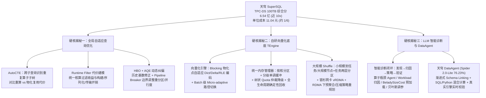

# 腾讯大数据 SuperSQL 刷新 TPC-DS 世界纪录，性能、性价比双料第一

## 1. TL;DR

腾讯自研下一代大数据自适应计算平台 **天穹 SuperSQL** 在国际权威基准 **TPC-DS 100TB** 官方榜单中取得 **综合性能成绩 `6.54 亿`**（约为此前最高纪录的近 `10 倍`）、**单位性能成本 `11.04 元`**（仅为此前的约 `1/6`），在数据写入、串行查询、并行查询（4 路并发共 396 次查询）和数据更新四大环节全面刷新纪录。这一突破背后依托三大核心技术支柱：① **全局自适应查询优化器**（通过 `AutoCTE` 跨分支提取公共子计划、将 `Runtime Filter` 构建/传输/应用开销纳入代价模型、结合 `HBO` 历史基数修正与以 `Pipeline Breaker` 为边界的 `AQE` 运行时动态纠偏）；② **自研通用向量化计算底座 `TEngine`**（物化点感知数据特征自适应选择 `Dict/Delta/RLE` 编码、算子/Batch 级 `Micro-adaptive`、树状仲裁统一内存管理器，以及结合银杉智能网卡 **vRDMA** 内核旁路/零拷贝/逐包多路径喷洒的自适应两层 Shuffle）；③ **大模型驱动的智能诊断与天穹 `DataAgent`**（性能诊断闭环使相关任务耗时降 `20.9%`、CPU 核时降 `46%`，`DataAgent` 以 **`76.23%`** 准确率登顶企业级 Text-to-SQL 评测 **Spider 2.0-Lite**）。

## 2. 核心概念

### 核心系统与优化原语定义

- **TPC-DS 100TB 基准测试**：国际事务处理性能委员会（TPC）制定的 PB/百 TB 级数据分析权威基准，模拟大型电商数年交易、退货、库存与订单明细，要求经过独立审计，在 `100TB` 规模且存在严重非均匀分布（易引发数据倾斜长尾）的数据上完整执行**数据导入（写入）、99 类复杂分析查询（含串行与 4 路并发共 396 次查询）及持续数据插入/更新（数据维护）**全流程，同时考核综合性能与单位性能成本。
- **AutoCTE（自动公共表表达式提取）**：突破显式语法边界，自动识别复杂 SQL 不同子查询或算子分支中的重复算子子树，综合比较“重复执行”与“公共结果物化、读取和复用”的代价，仅抽取真正有正收益的公共子计划进行复用。
- **HBO（History-Based Optimization）与 AQE（Adaptive Query Execution）**：
  - **HBO**：利用历史相似查询执行产生的真实基数、选择率和资源消耗修正静态统计信息误差。
  - **AQE**：在当前查询运行过程中，针对 MPP 数据库缺少天然 Stage 边界的特点，以阻塞算子（Blocking Operator）形成的 **`Pipeline Breaker`** 作为运行时观测与调整边界，局部自适应调整下游数据重分区与执行并行度。
- **TEngine 与 Micro-adaptive**：天穹 SuperSQL 自研的统一流批向量化计算执行层（支持 CPU/GPU 异构及 SQL/Python 混合计算）；其 `Micro-adaptive` 能力将自适应调优粒度从查询计划下沉至具体算子（Grouping、Join、DFP、表达式计算）与向量化 Batch，实时随数据分布切换执行路径。
- **vRDMA 软硬协同 Shuffle**：基于腾讯银杉智能网卡构建的 Shuffle 数据面，实现全程内核旁路（Kernel Bypass）、零拷贝、硬件 `RTO/SACK` 重传确认、自研拥塞控制与逐包喷洒（Packet Spraying）多条等价路径，且兼容标准 Verbs 免应用改造。

### 查询优化三大机制对比：各自解决什么传统 CBO/RBO 盲区？

| 优化机制 | 传统 RBO/CBO 的局限与痛点 | SuperSQL 核心设计机制 | 收益边界与权衡条件 |
|---|---|---|---|
| **AutoCTE** | 优化范围受限于显式语法边界，无法发现分散在不同子查询/算子分支中的相同扫描、连接与聚合逻辑 | 自动匹配重复算子子树，通过代价模型对比“重算成本 vs 物化+读取成本”决定是否抽取复用 | 并非所有重复子树都无脑物化，仅当物化读取总成本低于重复计算时才触发抽取 |
| **Runtime Filter 代价建模** | 传统优化器往往只看动态过滤收益，忽略了构建、序列化、网络传输和探测本身的 CPU/内存/网络开销 | 将过滤选择率、构建端规模、过滤器大小、数据分布及生成/传输/应用成本统一纳入全局 CBO 模型 | 让优化器能端到端比较“启用 vs 不启用 Runtime Filter”的真实总成本，避免负优化 |
| **HBO + Pipeline Breaker AQE** | 多列相关性、复杂谓词与数据倾斜导致静态基数估算误差沿多层算子逐级放大，引发错误 Join 顺序与大规模 Shuffle 长尾 | 事前用 HBO 历史真实基数修正估算；事中以阻塞算子（`Pipeline Breaker`）为边界采集真实运行信息动态调整下游分区与并行度 | 解决了传统流式 MPP 引擎缺少天然 Stage 边界、难以中途纠偏的难题 |

## 3. 知识框架

## 4. 关键要点与机制详解

### 4.1 复杂负载下的查询优化：识别重复计算 → 感知执行代价 → 运行时动态纠偏

**核心主张：面对 100TB 级非均匀分布与 99 类复杂分析 SQL，单靠静态统计信息必然在多层算子传递中失真；必须打通“编译期全局复用 + 动态算子全成本建模 + 执行期 Pipeline Breaker 动态纠偏”三道防线。**

- **遇到什么问题**：复杂报表与自动生成 SQL 中充斥跨分支重复计算；`Runtime Filter` 在构建端过大或选择率不高时反而拖慢网络与 CPU；数据倾斜使静态基数估算失准，一次错误的 Join 顺序就会引爆 Shuffle 数据膨胀与集群长尾。
- **采用什么机制**：
  1. **`AutoCTE` 全局计算复用**：跨越子查询语法边界识别重复算子子树，由代价模型权衡重复执行与物化复用开销，免除人工改写 SQL。
  2. **`Runtime Filter` 端到端代价建模**：将 Join 构建端生成过滤器、序列化、网络下推传输及扫描端探测的资源开销与过滤收益放进同一代价公式，打通优化器与执行层的信息壁垒。
  3. **`HBO` + `AQE`（基于 `Pipeline Breaker`）**：利用历史真实执行统计辅助编译期计划生成；在运行期利用 Grouping、Sort、Build 等阻塞算子构成的 `Pipeline Breaker` 收集真实中间结果分布，动态修正下游算子的数据重分区策略与并行度。

### 4.2 自研通用向量化计算底座 `TEngine`：从 CPU 流水线、内存字节到 vRDMA 网络的极致压榨

**核心主张：当数千核心集群面临网络通信风暴、CPU 流水线停顿与长尾效应三大难题时，必须在算子内部做运行时微自适应（Micro-adaptive），并用 vRDMA 软硬协同颠覆“网络是慢资源”的传统假设。**

- **机制一：运行时自适应向量化引擎（突破编译期静态优化瓶颈）**：
  - **物化点自适应编码**：利用 Grouping、Join、Sort、Window 等算子管线中天然的 Blocking 停顿点，在运行时动态统计数据特征，自适应选择 **`Dict`、`Delta`、`RLE`** 等编码对中间数据进行动态压缩与内存布局重构。
  - **算子与 Batch 级 `Micro-adaptive`**：在 Grouping、Join、DFP、表达式计算等核心算子中，以向量化 Batch 为粒度实时捕获数据分布变化，动态切换最优执行路径。
- **机制二：统一内存管理器（全生命周期零泄漏与抗压仲裁）**：
  - 采用**按核分区、分级单调缓冲、树状资源跟踪与按查询生命周期回收**：定制化内存分配器统一管理不同规格对象并支撑内存数据 `Spill` 落盘；面临内存压力时通过树状 Quota 智能仲裁精准控制查询取消或降级；无论任务正常结束还是异常取消均确保内存确定性回收。
- **机制三：自适应两层 Shuffle 与银杉网卡 `vRDMA` 软硬协同**：
  - **遇到什么问题**：传统固定点对点 Shuffle 在大规模扩容时连接数呈平方级暴增、数据分布碎片化，海量小包穿透 TCP/IP 协议栈引发严重上下文切换与系统态开销。
  - **采用什么机制**：
    1. **自适应并发分区模型**：小规模集群下数据分区直接到任务（Task）级别；大规模集群下自动切换为**“节点（Node）到任务（Task）两层分区”**，突破 MPP 并发连接上限。
    2. **银杉智能网卡 `vRDMA`**：全程内核旁路、零拷贝，由硬件处理 `RTO/SACK` 重传确认并配合自研拥塞控制算法，利用**逐包喷洒（Packet Spraying）多条等价路径**打满冗余带宽，且完全兼容标准 Verbs 接口（应用零改造）。
    3. 🔥 **RDMA 下执行策略重规划**：由于 `vRDMA` 的高带宽与超低CPU开销使**“网络是慢资源、必须用 CPU 算力换网络带宽”的传统前提失效**，TEngine 在线探测并自适应调整 Shuffle 前的**预聚合（Pre-aggregation）与序列化压缩**生效边界，避免不必要的 CPU 压缩/预聚合反而拖慢整体流水线。

### 4.3 大模型驱动的智能诊断闭环与天穹 `DataAgent`

**核心主张：将大模型融入数仓内核运维（问题发现→根因定位→策略生成→效果验证）与业务端 Text-to-SQL（渐进式 Schema Linking + SQL/Python 混合计算 + 真实引擎实时校验），打通从算得快到用得好的全链路。**

- **平台智能诊断三大落地方向**：
  1. **平台性能分析 Agent**：依托算子级细粒度可观测体系，辅助研发定位解决 **`20 余项`** 算子性能与运行环境问题，挖掘 **`10 余项`** SQL 优化器及 I/O 优化新策略，使相关任务**端到端耗时降低 `20.9%`、CPU 核时降低 `46%`**。
  2. **Workload 异常归因助手**：基于自动化知识采集对异常 Workload 和慢算子做细粒度归因，**诊断正确率 `> 90%`**，**工单问题解决准确率达 `69.2%`**。
  3. **数据加速与参数调优推荐**：
     - 热点数据预加载：采用优化版 **`BeladySizeCost` 算法**自动制定预加载策略，使**慢 SQL 数量下降 `25%`、P50 耗时降低 `27%`**；
     - 参数调优：引入优化版**贝叶斯黑盒优化算法**自动推荐配置，使 **SQL 耗时降低 `32%`、CPU 时间降低 `66%`**。
- **天穹 `DataAgent`（登顶 Spider 2.0-Lite 公开榜单，准确率 `76.23%`）**：
  - **解决痛点**：真实企业数仓单库上百张表、元数据残缺、分析逻辑极其复杂。
  - **自研 Agent Harness 三步自检闭环**（参评系统与线上版本完全一致，由 `hy3`、`GLM`、`DeepSeek` 等开源模型驱动，支持私有化部署）：
    1. **精准定位**：通过数据画像与**渐进式 Schema Linking**，从上百张候选表中精准锁定目标库表；
    2. **混合计算**：采用 **“SQL 负责取数、Python 负责计算”** 的混合模式，兼顾海量数据过滤聚合效率与复杂统计计算灵活性；
    3. **实时校验**：每一步生成均交由真实引擎执行校验，报错或异常实时回传修正，逼近正确答案。

## 5. 数据速查表

| 指标 | 原文数值 | 语境 / 条件 |
|---|---|---|
| TPC-DS 100TB 综合性能成绩 | **`6.54 亿`**（此前最高纪录的近 `10 倍`） | TPC 官网正式上线的 TPC-DS 100TB 官方榜单（经独立审计） |
| TPC-DS 100TB 单位性能成本 | **`11.04 元`**（此前纪录的约 `1/6`） | TPC-DS 100TB 官方榜单性价比指标 |
| 测试查询类别与并发规模 | `99 类`分析任务，`4 路`并发共处理 `396 次`复杂查询 | 覆盖数据加载、串行查询、并发吞吐与数据维护全流程 |
| 数据写入阶段耗时 | **`449.4 秒`**（较此前纪录 `3427.1 秒` 快 `7.6 倍`） | TPC-DS 100TB 数据加载环节 |
| 串行查询阶段耗时 | **`177.5 秒`**（提速达 `16.5 倍`） | TPC-DS 100TB 单流串行执行 99 类查询 |
| 并行查询阶段耗时 | 两次合计 **`898.8 秒`**（快 `11.7 倍`） | TPC-DS 100TB 四路并发吞吐测试环节 |
| 数据更新阶段耗时 | 两次合计 **`196.9 秒`**（快 `6.7 倍`） | TPC-DS 100TB 持续数据插入与更新维护环节 |
| 平台性能分析 Agent 成效 | 解决 `20+ 项`问题、挖掘 `10+ 项`策略；端到端耗时 **`-20.9%`**、CPU 核时 **`-46%`** | 相关优化任务的内部评估结果 |
| Workload 异常归因准确率 | 诊断正确率 **`> 90%`**，工单问题解决准确率 **`69.2%`** | 数仓问题根因诊断助手内部落地数据 |
| `BeladySizeCost` 热点预加载收益 | 慢 SQL 数量 **`-25%`**，P50 耗时 **`-27%`** | 热点数据加速自动预加载策略 |
| 贝叶斯黑盒参数调优收益 | SQL 耗时 **`-32%`**，CPU 时间 **`-66%`** | 自动推荐配置参数调优 |
| 天穹 `DataAgent` Spider 2.0-Lite 成绩 | 准确率 **`76.23%`**（排名第一） | 企业级 Text-to-SQL 权威评测 Spider 2.0-Lite 公开榜单（超越 Snowflake、Oracle 等方案） |

## 6. 踩坑与教训 / 可迁移的设计原则

### 踩坑与教训（错误做法 → 失败表现或原因 → 原文应对）

1. **在引入高性能 RDMA 网络后仍沿用传统的 Shuffle 预聚合与强压缩阈值**：
   - **错误做法**：底层已切换为内核旁路、零拷贝的 `vRDMA`，但执行引擎仍按“网络是慢资源”的旧假设，在 Shuffle 前耗费大量 CPU 做预聚合与重度序列化压缩。
   - **失败表现或原因**：网络早已不再是瓶颈，过度预聚合和压缩反而吃满 CPU，造成计算流水线停顿。
   - **原文应对**：在 TEngine 中对 Shuffle 相关策略（预聚合、序列化压缩）的生效边界进行在线探测与自适应重规划，把硬件网络红利真正释放为端到端提速。
2. **无条件启用 `Runtime Filter` 或无脑物化所有重复子查询**：
   - **错误做法**：只要看到 Join 就下推 `Runtime Filter`，只要看到相似子查询就物化成临时表。
   - **失败表现或原因**：当构建端数据量极大或过滤选择率低时，过滤器的构建、序列化和网络广播开销会超过过滤收益；小代价子查询物化落盘再读取反而比直接算更慢。
   - **原文应对**：将 `Runtime Filter` 的生成/传输/应用成本与 `AutoCTE` 的物化/读取成本全部纳入 CBO 全局代价模型，凭净收益决策是否启用。

### 可迁移的设计原则

- **复杂数仓 Text-to-SQL 切忌“让大模型一步裸写超长 SQL”**：面对上百张表和复杂业务口径，应借鉴 `DataAgent` 的三步 Harness 模式——**① 渐进式 Schema Linking 缩圈选表 → ② SQL 负责取数 + Python 负责复杂计算分工 → ③ 每步交由真实引擎执行校验并将报错回传自修正**。

## 7. 记忆锚点

1. **榜单战绩与三支柱锚点**：「TPC-DS 100TB 拿 6.54 亿分（近 10 倍）、成本 11.04 元（约 1/6）：优化器靠 `AutoCTE + Runtime Filter 代价建模 + HBO/AQE`，执行层 TEngine 靠 `物化点自适应编码 + 树状内存管理 + vRDMA 两层 Shuffle`，智能层靠 `LLM 诊断闭环 + DataAgent（Spider 2.0-Lite 76.23%）`。」

## 8. 复习卡片

天穹 SuperSQL 在 TPC-DS 100TB 官方榜单上的综合性能得分、单位性能成本以及四大测试环节的耗时分别是多少？::综合性能成绩为 `6.54 亿`（近此前最高纪录的 10 倍），单位性能成本为 `11.04 元`（约此前纪录的 1/6）；数据写入耗时 `449.4 秒`（快 7.6 倍）、串行查询耗时 `177.5 秒`（快 16.5 倍）、两次并行查询合计 `898.8 秒`（快 11.7 倍）、两次数据更新合计 `196.9 秒`（快 6.7 倍）。
SuperSQL 查询优化器中的 `AutoCTE`、`Runtime Filter 代价建模` 和 `HBO + AQE` 各自解决什么问题？::`AutoCTE` 跨子查询自动识别重复算子子树并权衡物化复用成本；`Runtime Filter 代价建模` 将过滤器构建、传输、探测开销与过滤收益统一纳入全局计划决策；`HBO` 用历史真实基数修正静态估算，`AQE` 则以阻塞算子（`Pipeline Breaker`）为边界在运行时动态调整下游重分区与并行度。
自研向量化计算底座 `TEngine` 的两项运行时自适应能力是什么？::① 感知数据特征的自适应编码计算（在 Grouping、Join、Sort、Window 等 Blocking 物化节点动态积累数据特征，自适应选择 `Dict`、`Delta`、`RLE` 编码压缩并重构内存布局）；② `Micro-adaptive` 能力（将调优粒度下沉至算子与向量化 Batch，随数据变化动态切换执行路径）。
`TEngine` 如何解决数千核心大规模集群下的 Shuffle 连接数暴增与网络通信风暴？::① 采用自适应并发分区模型（小规模直接分区到任务级，大规模结合“节点到任务”两层分区）；② 基于银杉智能网卡 `vRDMA` 实现内核旁路、零拷贝、硬件 `RTO/SACK` 与逐包多路径喷洒；③ 针对 RDMA 高速网络在线重规划预聚合与序列化压缩的生效边界。
SuperSQL 的大模型智能诊断体系在热点数据预加载和参数调优上分别采用了什么算法，取得了什么报告效果？::热点数据加速采用优化版 `BeladySizeCost` 算法自动制定预加载策略（慢 SQL 数量下降 `25%`、P50 耗时降低 `27%`）；参数调优引入优化版贝叶斯黑盒优化算法自动推荐配置（SQL 耗时降低 `32%`、CPU 时间降低 `66%`）。
天穹 `DataAgent` 在 Spider 2.0-Lite 榜单上的准确率是多少？其 Agent Harness 闭环包含哪三项核心机制？::准确率为 `76.23%`；其闭环包含：① 数据画像与渐进式 Schema Linking（从上百张候选表中精准定位目标表）；② “SQL 负责取数、Python 负责计算”的混合计算模式；③ 每一步生成均经真实引擎执行校验并实时回传错误自我修正。

## 9. 知识关联

### 本库主题入口与已有关联笔记

- [分布式计算与数据管道](../../20_topics/%E5%88%86%E5%B8%83%E5%BC%8F%E8%AE%A1%E7%AE%97%E4%B8%8E%E6%95%B0%E6%8D%AE%E7%AE%A1%E9%81%93.md)：TPC-DS 100TB 分布式查询优化、TEngine 向量化引擎与 vRDMA Shuffle 架构。
- [云网络系统研究](../../20_topics/%E4%BA%91%E7%BD%91%E7%BB%9C%E7%B3%BB%E7%BB%9F%E7%A0%94%E7%A9%B6.md)：银杉智能网卡 vRDMA 内核旁路、零拷贝、硬件 RTO/SACK 与多路径逐包喷洒。
- [Agent评测与反馈](../../20_topics/Agent%E8%AF%84%E6%B5%8B%E4%B8%8E%E5%8F%8D%E9%A6%88.md)：天穹 DataAgent 在 Spider 2.0-Lite 上的执行校验闭环与平台性能诊断 Agent。

### 候选双链（供 Obsidian 知识库导航）

- **腾讯数据与 AI BI 系列**：[[腾讯Omega AI BI架构]]、[[K8s与Ray协同调度]]
- **数据库与大数据核心技术**：[[TPC-DS 基准测试]]、[[自适应查询执行 AQE]]、[[向量化执行引擎 Vectorized Execution]]、[[Text-to-SQL 与 Spider 2.0]]

## 10. 原文参考资料

- **本目录归档文件**：[RAW.pdf](RAW.pdf)｜[MD.md](MD.md)
- **原文提及的标准基准与技术组件**：
  - 国际基准：TPC-DS 100TB 官方榜单（Transaction Processing Performance Council）、Spider 2.0-Lite 公开榜单
  - 腾讯自研组件与模型：天穹 SuperSQL、通用向量化计算底座 `TEngine`、银杉智能网卡 `vRDMA`、天穹 `DataAgent`（由混元 `hy3`、`GLM`、`DeepSeek` 等模型驱动）

> [!note]- 校对报告
> - **覆盖度核验**：已完整通读 `MD.md`（共 12 页，p.1–10 为技术正文与业务价值总结，p.11 为招聘图片页，p.12 为阅读量与留言尾页）并核对 `META.json` 记录。完整覆盖 TPC-DS 100TB 成绩与四环节耗时对比、天穹 SuperSQL 架构定位、复杂负载查询优化三机制（AutoCTE、Runtime Filter 代价建模、HBO+AQE）、TEngine 向量化底座三机制（自适应编码与 Micro-adaptive、统一内存管理器、自适应两层 Shuffle 与银杉 vRDMA）、大模型驱动智能诊断三方向及天穹 DataAgent（Spider 2.0-Lite）。
> - **关键数据逐项核对**：
>   1. **TPC-DS 100TB 指标**（p.1–2）：规模 `100TB`，综合成绩 `6.54 亿`（近 `10 倍`），单位性能成本 `11.04 元`（约 `六分之一`）；`99 类`分析任务、`4 组`并发共 `396 次`复杂查询；数据写入 `449.4 秒`（对比此前纪录 `3427.1 秒`，快 `7.6 倍`），串行查询 `177.5 秒`（提速 `16.5 倍`），并行查询两次合计 `898.8 秒`（快 `11.7 倍`），数据更新两次合计 `196.9 秒`（快 `6.7 倍`）。
>   2. **智能诊断与 DataAgent 指标**（p.8–9）：性能分析 Agent 定位解决 `20 余项`算子/环境问题、挖掘 `10 余项`新策略，相关任务端到端耗时降低 `20.9%`、CPU 核时降低 `46%`；Workload 异常归因诊断正确率 `> 90%`、工单解决准确率 `69.2%`；`BeladySizeCost` 预加载使慢 SQL 数量下降 `25%`、P50 耗时降低 `27%`；贝叶斯黑盒参数调优使 SQL 耗时降低 `32%`、CPU 时间降低 `66%`；天穹 `DataAgent` 在 Spider 2.0-Lite 准确率达 `76.23%`。
> - **事实边界与局限说明**：所有榜单成绩与内部优化百分比均按官方发布文陈述记录，未作独立复跑或跨场景外推；第 10 页三项客户价值（降成本、快决策、简架构）属于概括性总结，未附具体客户量化案例。
> - **格式自检**：全文仅 1 个 H1 标题；正文、表格、Mermaid 图与复习卡片均无页码/章节出处标注；复习卡片共 6 条，严格采用单行 `问题::答案` 格式。
