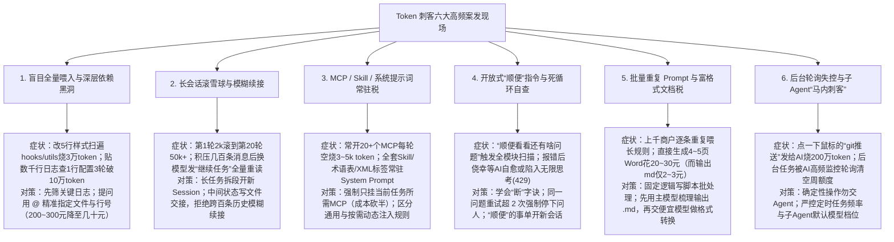

# 鹅厂员工都碰到过哪些 Token 刺客？

## 1. TL;DR — 核心结论速览

1. **“Token 刺客”的本质不是单次推理贵，而是“隐式上下文膨胀 × 无界循环 × 杀鸡用牛刀”的乘积效应**：本文汇总了腾讯 CSIG 技术委员会与内部社区 KM 的 **12 个典型内部实战案例**及 **60 条一线研发/产品评论**，揭示了额度在月初就被悄然清空的六大高频黑洞。
2. **最典型的量化背刺账单**：
   - **小改动扫全仓**：仅改动 **`5 行`**前端样式代码，因大文件与深层依赖（`hooks/utils/types`）全量扫描外加自动重排 `import`，单次烧掉 **`3 万` token**；用 `@` 显式指定关联文件替代喂入整仓后，复杂分析成本从 **`200～300 元` 直降至 `几十元`**。
   - **日志与长会话滚雪球**：直接粘贴数千行框架日志排查 **`1 行`**配置错误，来回 **3 轮对话直接突破 `10 万` token**；长任务第 1 轮仅 **`2k` token**，滚到第 20 轮飙升至 **`50k+` token**（单步成本相差十余倍）。
   - **工具 Schema 空转税**：同时挂载 **`20 多个` MCP 工具**，什么活都没干，每轮对话光加载工具 Schema 就固定烧掉 **`3k～5k` token**；按需裁剪后成本立砍一半以上。
   - **二进制/富格式文档税**：让 Agent 直接操作一个 **4～5 页的 Word 文档消耗高达 `20～30 元`**，而同样的数据整理输出为 **Markdown（`.md`）仅需 `2～3 元`（相差约 10 倍）**。
3. **一线验证的“防刺客六字诀”**：**① 断（跑偏或同问题重试超 `2 次` 立即掐断人工介入）→ ② 拆（长任务分段开新 Session，把“顺便看看”留到新窗口）→ ③ 指（用 `@` 精准锚定文件与行号，拒绝喂整个 `src` 目录或全量日志）→ ④ 卸（只挂载当前任务必需的 MCP 与 Skill）→ ⑤ 降（规则脚本化 + 富文档先出 `.md` 再交轻量模型）→ ⑥ 控（严防后台定时轮询与子 Agent 默认调用顶配昂贵模型）**。

---

## 2. 背景与问题全貌：为什么你的 Token 额度月初就见底？

在日常使用 `CodeBuddy`、`WorkBuddy` 等 AI Coding 与办公 Agent 时，许多研发、测试与产品同学发现：**真正烧光额度的往往不是预料之中的“宏大架构设计”，而是看似人畜无害的“改两行样式”、“顺手查个日志”或“后台挂个任务”**。

综合腾讯内部 12 位实名分享者与评论区高赞复盘，所有 Token 刺客均可归结为以下四个维度的失控：
1. **空间维度失控（全仓/大文件/全量日志盲扫）**：把“让 AI 自己找”当成省事捷径，结果把 `i18n` 文案、`mock` 数据、深层依赖或几千行框架噪音日志全塞进窗口。
2. **时间维度失控（长会话历史叠加与死循环重试）**：几百条历史读写消息不清理、切换模型后只发一句模糊的“继续任务”，或放任报错的 Agent 带着完整失败记录无限自查重试。
3. **配置与底座失控（MCP/Skill 常驻税与子 Agent 越级调用）**：常驻二十几个 MCP Schema、全量塞入几十份 Skill 说明与冗长术语表，或主模型悄悄拉起默认绑定顶配昂贵模型（如 `claude 4.8` / `gpt 5.6 sol`）的子 Agent。
4. **任务形态失控（逐条重复喂规则、富格式直出与后台无限轮询）**：上千条数据逐条重复携带长 Prompt、直接用主力大模型改 Word/PPT，或让 Agent 自己盯后台长任务结果把周额度轮询殆尽。

---

## 3. 知识框架 — 六大类“Token 刺客”机理与防御体系全景图

---

## 4. 十二大内部实战案例与高赞评论深度拆解

### 4.1 案例分类复盘表（01–12 号内部典型案例）

| 编号与分享者 | 岗位角色 | 刺客触发动作（踩坑现场） | 实际 Token / 费用损耗 | 提炼出的止损对策 |
| :--- | :--- | :--- | :--- | :--- |
| **01 `tokenking`** | 技术产品 | 改前端组件样式顺手喂入整个 `src` 目录；Agent 跑偏胡扯时侥幸等它“自我修正” | 把 `i18n` 文案、`mock` 数据全读一遍，Token 消耗直接爆炸 | **学会“断”字诀**：发现方向不对立刻掐断，绝不带病硬跑 |
| **02 `illidan`** | 系统开发 | 重构组件样式逻辑，未限制扫描边界 | 扫遍相关 `hooks`、`utils`、类型定义并重排 `import`——**改 `5 行`代码烧掉 `3 万` token** | 警惕**“大文件 + 深层依赖引用”**黑洞，修改前显式限定文件范围 |
| **03 `boey`** | 技术测试 | 任务卡死后中断，在积压几百条读写历史的会话上**切换模型并仅发一句「继续任务」** | 新模型不知继续什么，被迫把几百条历史全量重读并在噪音里盲试 | 上下文过长必须**开新对话**，将关键中间结论固化为文件，禁用简短模糊指令 |
| **04 `jery`** | 客户端开发 | Bug 两分钟改完后，随口补了一句：**“顺便帮我看看还有没有别的问题”** | AI 瞬间开启全模块巡检、顺手优化代码、分析调用链与潜在风险 | **一事一议**：先解决当前 Bug，任何“顺便”的扩展检查一律新开会话 |
| **05 `Qia`** | 技术测试 | 长期不清理被污染的对话上下文 | 后续哪怕提一个极简单的问题，模型也要把全部历史重算一遍 | 及时截断或重置与当前子任务无关的脏上下文 |
| **06 `肥仔`** | 产品策划 | 让 AI 反复微调一份已经生成的超长 `.md` 文档 | 每次只改几句话，AI 都要从头到尾重读整篇长 `.md` | 长文档采用局部章节切片编辑，做好上下文工程 |
| **07 `WinwinX`** | 产品策划 | 用 `WorkBuddy` 改入口文案、理埋点或确认单个接口字段 | 真正改动仅几十行，但前序“找上下文”把仓库、历史代码、配置扫了个遍 | 小改动直接提供目标文件路径，禁止 Agent 自由漫游探索全仓 |
| **08 `Hang`** | 技术测试 | ① 同时挂 **20 多个 MCP**；② 跑 20 轮长任务不切会话；③ 报错让 AI 自己无限重试 | ① 光工具 Schema 每轮白烧 **`3–5k` token**；② 第 1 轮 **`2k`** 滚到第 20 轮 **`50k+`** | ① 只挂当前必需 MCP（成本砍半）；② 长任务分段开新 Session；③ **同问题重试超 `2 次` 必须停下问人** |
| **09 `Patric`** | 产品运营 | **上千个商户**行业批量分类，逐条丢给大模型并每条重复携带一大段分类规则 Prompt | 相同规则被重复计费上千次，Token 哗哗流走 | **规则脚本化 + AI 守窄口**：固定规则写成脚本跑，仅对疑难图片类目识别调用 Agent |
| **10 `Moke`** | 产品策划 | 排查接口超时，偷懒直接把**几千行完整请求与框架日志**原样贴进对话框 | 来回 **3 轮问答直接突破 `10 万` token**，最后发现只是 **`1 行`配置写错** | 粘贴日志前先用命令行/脚本过滤无关框架打印，只喂核心异常堆栈 |
| **11 `Osong`** | 运营开发 | 仅仅想让 Agent 帮忙挪动一个文件路径 | 触发全链路引用扫描与重构，惨遭背刺 | 确定性的机械文件移动/Git 操作直接用 IDE 或命令行完成 |
| **12 `joyee`** | 产品策划 | 让 Agent 把数据按规定格式直接梳理写入 **4～5 页的 Word 文档** | 生成一份 4～5 页 Word 消耗 **`20～30 元`**（而同样模型整理输出为 `.md` 仅需 **`2～3 元`**） | **两阶段分层处理**：先用主模型梳理信息输出 `.md`（省 90%），再交便宜模型或工具转 Word |

---

### 4.2 评论区补充的六大“隐形刺客”与真实血泪账单

除了正文 12 大案例外，60 条鹅厂同学评论中还暴露了多个极具代表性的工程陷阱：
1. **用 `@` 精准指路 vs 喂入整仓的十倍成本差**：
   - 过去分析 Bug 或生成文档直接把整个工作区喂给 AI，每次消耗高达 **`200～300 元`**；改为在描述问题时用 **`@` 精准挂载相关关键文件/代码行**后，不仅准确率大幅上升、返工减少，单次复杂分析成本直接降至 **`几十元`**。
2. **把确定性按钮操作交给 Agent（`200 万` token 的 `git push`）**：
   - 有同学手欠对 `CodeBuddy` 发了一句 **“git 推送”**，明明鼠标点一下或敲一行命令即可完成，Agent 却在后台检查状态、分析差异、调用工具链，一顿操作烧掉 **`200 万` token**。
3. **后台任务自主轮询监控陷阱（休假一天清空周额度）**：
   - 让模型启动一个耗时较长的后台任务后离开，没想到 Agent 不仅启动了任务，还**自作主张每隔一段时间轮询监控任务状态并分析数据**，一天下来直接把整周的 Token 配额彻底清零；另有测试定时任务每小时跑一次，3 天清空全部额度。
4. **子 Agent 默认挂载顶配模型的“马内刺客（Money Assassin）”**：
   - 主对话看似只花了一点点 Token，但说了一句“开子 Agent 去网络调研”，系统拉起的 Sub-Agent 默认绑定了最昂贵的旗舰模型（如 `claude 4.8` 或 `gpt 5.6 sol`），一趟调研直接飞掉 **`100 多刀`**；另有做 **8 页带图 PPT 花掉 `100 多元`**，以及用 `GLM 5.1` 跑 Java 转仓颉单类文件死磕烧掉 **`1000 万` token** 仍无结果。
5. **“顺手总结归档”的复利陷阱**：
   - 养成每次改完代码都让 AI“① 总结本次改动 + ② 生成完整归档文档”的习惯，结果归档文档越攒越多并不断被后续会话加载，聊几句额度就见底。
6. **Prompt 细节噪音（空行、无效注释、冗余 XML 标签、网络热梗）**：
   - 大量空行与缩进空白符、未删干净的备注注释、过度堆砌的 XML 标签以及全量常驻的翻译术语表，在批量任务中会持续吃掉可观额度；甚至在 Prompt 里使用日常调侃热梗，还会诱发 AI 额外调用联网搜索去查“这个梗是什么意思”。

---

## 5. 数据速查表

| 刺客场景 / 指标 | 原文数值 | 语境 / 条件 |
| :--- | :--- | :--- |
| **组件小改样式引发深层依赖扫描** | **改 `5 行` 代码，烧掉 `3 万` token** | 扫描整文件 + `hooks` + `utils` + 类型定义 + 重排 `import`（案例 02） |
| **常驻过多 MCP 工具的每轮空转消耗** | **挂 `20 多个` MCP，每轮光 Schema 烧 `3k～5k` token** | 什么活没干先扣基础税；按需挂载后成本直接砍半（案例 08） |
| **长会话上下文滚雪球膨胀倍数** | **第 1 轮 `2k` token $\to$ 第 20 轮 `50k+` token** | 后期单步成本是前期的十几个倍，但真正有用的仅最近 3 轮（案例 08） |
| **报错自动重试的人工熔断阈值** | **同一问题重试超过 `2 次` 立即停下问人** | 防止 AI 带着完整失败记录无限重试（案例 08） |
| **全量粘贴日志排查单行配置错误** | **来回 `3 轮` 问答直接突破 `10 万` token** | 几千行无关框架打印被当成上下文吞入，最终仅 `1 行`配置错误（案例 10） |
| **直接操作 Word vs 先输出 Markdown 成本比** | **4～5 页 Word 耗费 `20～30 元` vs 输出 `.md` 仅 `2～3 元`** | 相同模型整理相同数据，直接操作富格式文档贵约 **10 倍**（案例 12） |
| **喂整个工作区 vs 用 `@` 指定关键文件** | **单次复杂分析从 `200～300 元` 降至 `几十元`** | 精准指路减少无关文件扫描与返工次数（评论区实测） |
| **极端单次误用案例记录** | **`git 推送` 烧 `200 万` token；Java 转仓颉烧 `1000 万` token；8 页 PPT 花 `100+ 元`** | 评论区一线开发者真实踩坑记录 |

---

## 6. 踩坑与教训 / 可迁移的设计原则

1. **懒人式提问（喂入整个 `src` 目录、粘贴几千行原始日志、不加 `@` 漫游） → AI 把 `i18n`、`mock`、深层 `hooks/utils` 和框架废话全读一遍（改 5 行烧 3 万 token / 查 1 行配置烧 10 万 token） → 提问前先做最小化裁剪，强制使用 `@文件/行号` 锚定上下文边界**
   - **可迁移原则**：**“人类花 10 秒钟指路，能帮 AI 省下 90% 的盲搜 Token 且准确率更高”**——不要让大模型用昂贵的注意力机制去充当 `grep` 和日志过滤器。
2. **一个窗口聊到底、切换模型后只发“继续任务”、或在修完 Bug 后顺口说“顺便看看还有啥问题” → 几百条历史消息被全量重算，或触发无边界的全模块代码巡检 → 严格执行“一事一会话（One Task, One Session）”，长任务按阶段把中间状态写入文件后开启新窗口**
   - **可迁移原则**：当对话轮次接近 10～15 轮或任务目标发生切换（哪怕只是“顺便检查”）时，果断落盘总结并清空会话历史，将 $O(N^2)$ 的累积 Token 复杂度重置为线性。
3. **把所有 MCP 插件、全套 Skill 详情说明、完整术语表一股脑常驻在全局配置中 → 每轮对话还没开始干活，先交 `3k～5k` token 的“开机房产税” → 实施按需挂载与渐进式披露（Progressive Disclosure），非当前任务必需的 MCP 与规则一律卸载或动态注入**
   - **可迁移原则**：定期审计 System Prompt 与工具栏的**“零轮次基准消耗（Base Overhead per Turn）”**，严禁把低频工具 Schema 常驻在高频会话中。
4. **用大模型逐条跑上千条结构化分类，或直接让昂贵主力模型生成/修改 Word、PPT 及执行 `git push` → 规则 Prompt 重复计费上千次，操作 4～5 页 Word 花掉 20～30 元（是 `.md` 的 10 倍） → 坚持“确定性流程写脚本、中间产物用 `.md`、格式转换交轻量模型/专用工具”**
   - **可迁移原则**：大模型最擅长的是**高信息密度的纯文本推理与生成（Markdown/JSON/代码片段）**，最不擅长的是在冗长的富文本 XML/Office DOM 或机械命令行里反复吞吐。
5. **对报错的 Agent 抱有“再试一次就能自愈”的侥幸心理，或放任后台任务/子 Agent 自由运行 → 陷入 `429` 无限思考死循环、后台轮询清空周额度、或子 Agent 默认调用旗舰模型瞬间烧掉上百美金 → 建立硬性熔断纪律（重试 `>2 次` 必停）与子 Agent 模型降级/预算上限约束**
   - **可迁移原则**：没有成本感知的自主循环就是“提款机刺客”；必须同时在客户端配置**最大重试次数（$\le 2$）**、**后台轮询禁令**与**Sub-Agent 路由模型档位白名单**。

---

## 7. 记忆锚点 — 一句话 / 一张图记住全文

- **一句话锚点**：**防住 Token 刺客只需记住六个数字教训——改 `5 行` 别扫 `3 万`（用 `@` 指路）、贴日志别破 `10 万`（先过滤）、挂 MCP 别空烧 `3~5k`（按需卸）、长对话别从 `2k` 滚到 `50k+`（分段切会话 + 禁“顺便”）、报错重试别超 `2 次`（果断掐）、写 Word 别花 `20~30 元`（先出 `2~3 元` 的 `.md`）！**
- **防刺客六字口诀**：
  $$\text{防 Token 刺客} = \underbrace{\text{指 (`@`文件)}}_{\text{省盲扫}} + \underbrace{\text{卸 (精简MCP)}}_{\text{省底座}} + \underbrace{\text{拆 (切新会话)}}_{\text{防滚雪球}} + \underbrace{\text{断 (>2次即停)}}_{\text{防死循环}} + \underbrace{\text{转 (先出 `.md`)}}_{\text{省富格式税}} + \underbrace{\text{锁 (控子模型/轮询)}}_{\text{防后台背刺}}$$

---

## 8. 复习卡片（Spaced Repetition）

1. 在组件重构案例（案例 02）中，为什么仅仅改动 5 行样式代码却烧掉了 3 万 token？如何避免？::因为没有限制上下文扫描范围，Agent 把整个大文件以及关联的 `hooks`、`utils`、类型定义全扫了一遍，还顺手重排了所有 `import`。应在提问时用 `@` 显式指定目标文件与代码行，避免“大文件 + 深层依赖引用”黑洞。
2. 技术测试同学（案例 08）总结的三大高频 Token 刺客及其量化阈值分别是什么？::① 工具挂太多：同时开 20 多个 MCP，每轮光工具 Schema 就白烧 `3–5k` token（按需挂载可砍半）；② 上下文越滚越大：第 1 轮 `2k` token 到第 20 轮涨至 `50k+`（应拆段开新 Session）；③ 报错无限自重试：每次带着完整失败记录越试越贵（定死规则：同一问题重试超过 `2 次` 必须停下来问人）。
3. 为什么在积压了几百条历史消息的会话中中断任务、切换模型并发送一句简短的「继续任务」（案例 03）会成为严重的 Token 刺客？::因为新切换的模型没有前序焦点，面对简短模糊的「继续任务」，只能把前面几百条反复读写文件的庞大历史消息全量重读一遍，并在巨大噪音中盲目试错。正确做法是将关键状态保存为文件后开启新对话，并给出明确具体的指令。
4. 在使用 Agent 处理 Word 文档（案例 12）与批量商户分类（案例 09）时，分别应该如何重构工作流来大幅降本？::① Word 文档：直接让 Agent 操作 4～5 页 Word 需消耗 `20–30 元`，而先让主模型梳理信息输出为 `.md` 文档仅需 `2–3 元`，随后再交由便宜模型或脚本做细节格式转换；② 批量分类：避免上千个商户逐条重复携带长规则 Prompt 调大模型，应将固定判断流程写成脚本批处理，仅对图片类目识别等非结构化环节调用 Agent。
5. 为什么修完 Bug 后随口说一句“顺便帮我看看还有没有别的问题”（案例 04）以及后台启动长任务（评论区案例）会导致额度瞬间飞走？::① “顺便看看”是一句无边界的开放指令，会触发 AI 检查整个模块、分析调用链与潜在风险，应坚持先解决当前问题，扩展检查单开新会话；② 后台启动长任务或定时任务时，Agent 可能会自作主张高频轮询监控任务状态并分析数据，需严禁 Agent 自主无限轮询并限制子 Agent 默认调用昂贵顶配模型。

---

## 9. 知识关联

- **对应知识库主题笔记**：[Agent成本与上下文预算](../../20_topics/Agent%E6%88%90%E6%9C%AC%E4%B8%8E%E4%B8%8A%E4%B8%8B%E6%96%87%E9%A2%84%E7%AE%97.md)
- **同批相关文章双链**：
  - [[AI_Multi-Agent降本]]（从系统架构侧给出的 10 大降本优化点，与本文用户侧防刺客实践互为镜像）
  - [[AI_WorkBuddy从入门到精通]]（可结合 WorkBuddy 的 `/compact`、`/clear`、模型路由与按需挂载机制落实本文避坑指南）
  - [[AI_DeepSeek Harness观测]]（可结合 OpenTelemetry Token/Cache 监控理解如何在工程平台侧定位异常 Token 消耗）

---

## 10. 原文参考资料

- **原文标题**：《鹅厂员工都碰到过哪些 Token 刺客？》
- **来源**：腾讯技术工程公众号（内容征集自腾讯 **CSIG 技术委员会** & **内部社区 KM**，含 12 个正文精选案例与 60 条读者实战留言）
- **发布时间**：2026-07-23
- **提及工具与模型**：`CodeBuddy`、`WorkBuddy`、MCP（Model Context Protocol）、Skills、`GLM 5.1`、`Claude 4.8`、`GPT 5.6 sol`

> [!note]- 校对报告
> - **原文页数核对**：全文共 14 页（p.1–7 为正文 12 个精选内部员工案例，p.8–13 为 60 条读者留言，p.14 为空白页）。
> - **关键事实与页码映射**：
>   - `01 tokenking`（技术产品）：改组件样式喂入整个 `src` 目录读遍 `i18n`/`mock`、跑偏不及时掐断（“断”字诀）（p.1）。
>   - `02 illidan`（系统开发）：改样式扫遍 `hooks/utils`/类型定义并重排 `import`，**改 5 行代码烧 3 万 token**（p.2）。
>   - `03 boey`（技术测试）：几百条历史消息下切换模型并发送短指令「继续任务」导致全量重读（p.2）。
>   - `04 jery`（客户端开发）：“顺便帮我看看还有没有别的问题”引发全模块扫描；`05 Qia`（技术测试）：上下文污染；`06 肥仔`（产品策划）：修改超长 `.md` 每次从头重读；`07 WinwinX`（产品策划）：WorkBuddy 小改动扫全仓（p.3–4）。
>   - `08 Hang`（技术测试）：同时开 **20 多个 MCP 每轮光 Schema 烧 `3–5k` token**、长任务 **第 1 轮 `2k` 到第 20 轮 `50k+` token**、**同一问题重试超过 `2 次` 停下问人**；`09 Patric`（产品运营）：上千个商户批量分类重复喂规则 Prompt 改脚本+图片用 Agent（p.5）。
>   - `10 Moke`（产品策划）：贴几千行框架日志查超时，**来回 3 轮破 `10 万` token** 定位 **1 行**配置错误；`11 Osong`（运营开发）：挪动文件路径被刺；`12 joyee`（产品策划）：**4–5 页 Word 消耗 `20–30 元` vs 输出 `.md` 仅 `2–3 元`**（p.6–7）。
>   - 评论区高赞实测数据：用 `@` 指定关键文件将复杂分析从 **`200–300 元` 降至 `几十块`**、Java 转仓颉 `GLM5.1` 烧 **`1000 万` token**、8 页 PPT 花 **`100 多元`**（p.10）；手欠发“git 推送”给 CodeBuddy 花 **`两百万` token**（p.12）；后台任务自主监控轮询清空周额度、触发子 Agent 默认用 `claude 4.8` / `gpt 5.6 sol` 飞掉百刀（p.13）。
> - **纠偏与自检说明**：正文、表格、Mermaid 图及复习卡片已严格剔除所有页码标注（`p.X` / `第X页`），所有案例编号、人物ID与数值均 100% 忠实于原文。
