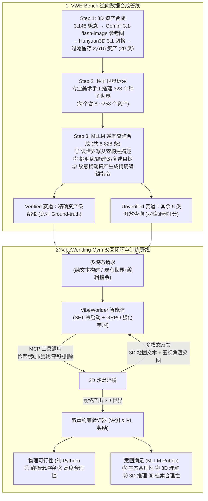

# 从 Vibe Coding 到 Vibe Worlding：AI 开始自己“造世界”了

## 1. TL;DR

针对交互式 3D 世界构建中“人工搭建效率极低、现有智能体评测查询过于理想化且框架闭源、单靠规则或通用 LLM 裁判难以兼顾物理可行性与语义合理性”三大痛点，香港科技大学（广州）联合腾讯 AI 平台部提出了 **VibeWorlding** 框架（含评测基准 **VWE-Bench** 与强化学习训练环境 **VibeWorlding-Gym**）。该系统将 3D 世界构建形式化为多轮、多模态、基于 MCP 工具集（检索/增/删/平移/旋转）与沙盒多模态反馈（3D 地图文本 + 五视角渲染图）的闭环推理过程，并通过**双重约束验证器**（纯 Python 几何碰撞/高度检查 + MLLM 四维意图评估）提供可靠判据与奖励信号。实验表明，采用 `Gemini 3.1-pro` 逆向合成轨迹冷启动 SFT 再结合 **GRPO** 多模态强化学习后，开源模型 `VibeWorlder-30B-A3B` 的综合 `Pass@1` 从基座的 `13.6%` 跃升至 `59.3%`，反超 `GPT-5.5`（`57.3%`）与 `Qwen3.8-Max`（`56.9%`）；但六维拆解与失败案例显示，**碰撞无冲突、坐标系方向理解与跨轮状态保持（防过度编辑误删）**仍是当前所有多模态大模型的共性短板。

## 2. 核心概念

### 核心组件与任务定义

- **VibeWorlding**：通过多轮对话、调用 MCP 3D 编辑工具、观察沙盒返回的“3D 地图文本 + 五视角渲染图”反馈来自主构建和修改交互式 3D 世界的多模态智能体框架。
- **VWE-Bench（VibeWorlding Evaluation Benchmark）**：包含 `2,616` 个真实尺度标注的高质量 3D 资产、`323` 个人工搭建种子世界和 `6,828` 条逆向合成多模态用户查询的开源基准，分为两类赛道：
  - **Verified（可验证查询）**：对应“精确资产级编辑”任务，由故意扰动种子世界中的 3D 资产逆向生成，具备明确的 Ground-truth 地图真值，可直接按正确编辑的 3D 资产比例打分。
  - **Unverified（不可验证查询）**：涵盖模糊表达、场景批判、引导、重申与复杂场景描述五类贴近真实用户口吻的开放任务，无单一标准答案，需同时通过 Python 物理可行性验证与 MLLM 裁判的四个意图维度评分才算成功。
- **双重约束验证器（Dual-Constraint Verifier）**：在评测与 GRPO 强化学习中同时考核“物理上站得住（纯 Python 几何检测碰撞穿模与悬空高度）”与“语义上说得通（MLLM 裁判评估生态合理性、3D 理解、3D 推理、检索合理性）”的复合验证机制。

### 路线对比：3D 世界构建的两代范式与 VibeWorlding

| 方案路线 | 代表工作 | 核心机制 | 局限与边界（据原文） |
|---|---|---|---|
| **固定工作流（Fixed Workflow）** | SceneCraft、3D-GPT | 将构建拆为“规划 → 生成 → 评审”固定流水线，每阶段配专门子智能体 | 流程僵化，评测查询理想化且简单，难以应对模糊、矛盾的真实指令与动态迭代修改 |
| **早期自主智能体（Autonomous Agentic）** | SAGE、SceneWeaver、SceneReVis | 将检索、编辑、渲染封装为工具集，由智能体多轮交互与自我修正 | 框架普遍闭源，缺乏统一基准与可靠的多维奖励验证器，无法系统验证 RL 训练能否提升底层空间能力 |
| **VibeWorlding（开源基准 + 双验证 RL）** | VWE-Bench + VibeWorlding-Gym + VibeWorlder | MCP 工具沙盒 + 五视角渲染反馈 + Python/MLLM 双验证器 + 冷启动 SFT & GRPO 联合训练 | 工具仍偏原子化、场景最大仅 258 资产、卡通风格为主；精细碰撞控制与坐标系量化空间推理仍是天花板 |

## 3. 知识框架

## 4. 关键要点与机制详解

### 4.1 VWE-Bench：如何用“逆向合成”构造兼具真实口吻与精确真值的 6,828 条查询？

**核心主张：正向人工编写大规模 3D 编辑真值成本过高，通过“先建好种子世界、再让 MLLM 倒着看世界或记录故意扰动”的逆向合成机制，可以低成本同时产出开放式构建任务与带 Ground-truth 的精确编辑任务。**

- **遇到什么问题**：真实用户的 3D 构建指令往往模糊、发散甚至矛盾，而精确编辑评测又需要严格的场景前后对比真值（Ground-truth），传统手工构造难以兼顾规模与多样性。
- **采用什么机制（三步人机协作管线）**：
  1. **高质量 3D 资产合成**：美术标注员先确定 `3,148` 个概念 3D 资产的名称与类别 → 用 `Gemini 3.1-flash-image` 生成参考图 → 用腾讯混元 3D（`Hunyuan3D 3.1`）将图片转为 3D 网格 → 经质量过滤与真实物理尺度标注后，沉淀出跨越 `20` 个语义类别的 `2,616` 个可检索资产。
  2. **种子世界标注**：专业美术使用上述资产手工搭建 `323` 个“粗糙但功能完整”的种子 3D 世界，单世界资产数量跨度为 `8` 到 `258` 个。
  3. **MLLM 逆向查询合成**：让 MLLM “倒着看”种子世界生成六大类共 `6,828` 条查询：
     - **从零构建查询**：读取完整种子世界，反向写出“如何从零构建它”的自然语言描述。
     - **开放式编辑查询（Unverified，5 类）**：对种子世界挑毛病（场景批判）、给建议（引导）、复述目标（重申）或复杂场景描述。
     - **精确资产级编辑查询（Verified，1 类）**：在种子世界中故意对 3D 资产施加平移、旋转、增删等已知扰动，再让模型描述这一变化，从而天然获得扰动前的 Ground-truth 地图作为标准答案。

### 4.2 双重约束验证器与 VibeWorlding-Gym 训练管线（SFT + GRPO）

**核心主张：3D 世界必须同时满足刚性几何约束与柔性语义意图；把纯 Python 几何检验与 MLLM 四维 Rubric 结合成双重验证器，既能堵住“评审幻觉”，又能为多模态 GRPO 提供可扩展的奖励信号。**

- **遇到什么问题**：仅靠人工规则无法判断“荒漠神殿氛围是否阴森”，而仅靠通用 LLM/MLLM 看图打分又经常忽略物体穿模或悬空等物理硬伤。
- **采用什么机制**：
  1. **双重约束验证器（六维能力评估）**：
     - **物理可行性验证（纯 Python 几何检测，零模型幻觉）**：检查 **① 碰撞无冲突**（物体不能互相穿模）与 **② 高度合理性**（物体不能悬空）。
     - **意图满足验证（MLLM 裁判 + 精细 Rubric）**：从 **③ 生态合理性**、**④ 3D 理解**、**⑤ 3D 推理**、**⑥ 检索合理性** 四个维度综合打分。
     - **判定准则**：对 `Unverified` 查询，必须**物理可行性 + 四个意图维度全部通过**才算 Pass；对 `Verified` 查询，直接与 Ground-truth 地图比对，按正确编辑的 3D 资产比例打分。
  2. **冷启动 SFT + 多模态 GRPO 强化学习**：
     - **阶段一（冷启动 SFT）**：利用 `Gemini 3.1-pro` 反向合成高质量的多轮工具调用与渲染观察轨迹，教会基座模型理解 MCP 工具格式与“思考 → 执行 → 观察渲染图 → 修正”的基本循环。
     - **阶段二（多模态 GRPO）**：在双重约束验证器提供的结果奖励信号下运行 GRPO 算法，让智能体同时在“纯文本从零构建”和“多模态图文编辑”两类任务上联合强化学习。

### 4.3 实验复盘、六维能力瓶颈与两类典型翻车模式

**核心主张：多模态强化学习大幅拉升了 3D 推理与资产检索能力，使 30B-A3B 开源模型反超 GPT-5.5，但精细防碰撞与坐标系量化控制仍是所有模型的共同天花板。**

- **实验核心发现**：
  - **前沿闭源模型亦未解决该任务**：`GPT-5.5`（综合 `57.3%`）与 `Qwen3.8-Max`（综合 `56.9%`）整体 `Pass@1` 均未超过 `60%`；未经训练的开源基座 `Qwen3-VL-8B` 和 `30B-A3B` 更是仅有 `5.3%` 和 `13.6%`。
  - **SFT + GRPO 实现三级跳反超**：`VibeWorlder-30B-A3B` 综合 `Pass@1` 从基座 `13.6%` → SFT 后 `34.5%` → GRPO 后 `59.3%`（全场最高），在 `Verified` 赛道达到 `64.5%`（对比 `GPT-5.5` 的 `60.4%`）；小尺寸的 `VibeWorlder-8B`（综合 `41.4%`）追平 `Gemini 3.1-pro`（`42.7%`），并在 `Verified` 赛道以 `59.3%` 大幅反超 `Gemini 3.1-pro`（`44.4%`）。
- **六维能力拆解（哪里变强了，哪里仍卡壳？）**：
  - **大幅跃升项**：强化学习对 **3D 推理** 提升最显著，从基座的 `6%～20%` 跃升至 `56%～85%`（`VibeWorlder-30B-A3B` 达 `85%`，超过 `Gemini 3.1-pro` 的 `62%`）；**检索合理性** 提升至 `91%～99%`，超越前沿闭源模型。
  - **共性瓶颈项**：**碰撞无冲突** 是所有模型共同的短板，即便经过 RL 训练，通过率也仅在 `59%～68%` 之间徘徊。
- **CLI 交互原型验证**：配套开源了支持浏览器实时 3D 渲染刷新的 CLI 原型。例如“从零造农场”场景中，Agent 规划出“农舍 + 围栏菜地 + 树丛”三区布局后，通过观察五视角渲染图自主发现“栅栏太高像墙”并调低高度、发现“树冠过大盖住农舍”并缩小树木；在“城市街区删除指定车辆与两栋绿色建筑”场景中，Agent 连发三次删除调用后再经多视角渲染确认其余元素原封不动。

## 5. 数据速查表

| 指标 | 原文数值 | 语境 / 条件 |
|---|---|---|
| VWE-Bench 资产規模与语义类别 | 概念资产 `3,148` 个 → 过滤后留存 `2,616` 个，跨 `20` 个类别 | 经 `Gemini 3.1-flash-image` 生图 + `Hunyuan3D 3.1` 转网格 + 真实尺度标注 |
| VWE-Bench 种子世界与查询总数 | `323` 个种子世界（单世界含 `8～258` 个资产），`6,828` 条查询 | 涵盖 6 大类查询（1 类 Verified 精确资产级编辑 + 5 类 Unverified 开放查询） |
| 评测对比规模 | `8` 个前沿闭源模型 + `3` 套 3D 智能体框架 + `VibeWorlder` 系列 | 3 套对比框架为 SceneWeaver、SAGE、SceneAssistant |
| `VibeWorlder-30B-A3B` 综合 Pass@1 演进 | 基座 `13.6%` → SFT `34.5%` → GRPO `59.3%` | VWE-Bench 综合 Pass@1（Verified 赛道达 `64.5%`） |
| `VibeWorlder-8B` Pass@1 演进 | 基座 `5.3%` → GRPO 后综合 `41.4%`（Verified 赛道 `59.3%`） | 对比 `Gemini 3.1-pro` 综合 `42.7%`、Verified 赛道 `44.4%` |
| 闭源基线模型综合 Pass@1 | `GPT-5.5`：`57.3%`（Verified `60.4%`）；`Qwen3.8-Max`：`56.9%` | VWE-Bench 作者实验报告结果 |
| 六维能力通过率（RL 后） | 3D 推理：`56%～85%`（基座 `6%～20%`，30B-A3B 达 `85%` vs Gemini 3.1-pro `62%`）；检索合理性：`91%～99%`；碰撞无冲突：`59%～68%` | VWE-Bench 六维能力拆解实验 |
| 坐标系方向反转典型误差 | 要求向前移动 `7 米`，实际产生 `14 米` 位置误差 | 失败案例：位移量级算对，但正负方向搞反（$+7$ 变 $-7$） |

## 6. 踩坑与教训 / 可迁移的设计原则

### 踩坑与教训（两类典型失败模式与四大尚待跨越门槛）

1. **坐标系正负方向反转（不精确的 3D 距离编辑）**：
   - **错误做法 / 失败表现**：用户要求将一块岩石“向前移动 7 米”，模型准确算出了位移量级 `7`，却将坐标系朝向搞反，导致最终位置与目标相差整整 `14 米`。
   - **原因与应对**：MLLM 对 3D 局部/全局坐标系方向缺乏扎实对齐；原文指出仅靠后训练多模态反馈仍不足以根治量化空间推理短板，未来需在预训练/中训练阶段注入更多 3D 空间数据。
2. **过度编辑（顺手误删未要求修改的对象）**：
   - **错误做法 / 失败表现**：用户仅要求“在箱子旁边加一棵树”，模型正确添加了新树，却在工具执行阶段“顺手”把场景里原有的一棵大树删掉了。
   - **原因与应对**：跨轮工具执行中对“哪些存量元素不该动”的状态保持能力不足；在多轮编辑 Agent 中，必须在执行后通过渲染图与对象列表显式核验“未要求修改的元素是否原封不动保留”。
3. **论文指出的四项系统级局限（防止过度外推）**：
   - **工具过于原子化**：目前仅提供检索、增、删、平移、旋转底层操作，缺乏“直接铺一个足球场”或“矩形区域随机撒一片森林”的高级可组合技能。
   - **场景规模偏小**：VWE-Bench 最复杂世界仅含 `258` 个 3D 资产，更大规模开放世界需引入多智能体协同分工。
   - **结果奖励稀疏**：当前 RL 对整条轨迹只给一个结果奖励，未告知模型具体哪一轮发生碰撞，未来需引入过程级信用分配（Process-level Credit Assignment）。
   - **资产风格与模态单一**：当前资产库偏卡通风格，尚未覆盖“以图生世界”“以视频生世界”。

### 可迁移的设计原则

- **逆向扰动合成法（Inverse Perturbation Synthesis）**：在构建需要严格 Ground-truth 的编辑类 Agent 基准（如 3D 场景编辑、代码重构、文档排版修改）时，先由专家构造种子状态，再通过程序施加已知扰动并让大模型把扰动描述成自然语言指令，即可零人工成本获得成千上万条带精确标准答案的训练/评测对。
- **确定性程序检验 + MLLM Rubric 的双验证器组合**：在复杂生成/编辑任务的 RL 训练中，凡是能用确定性代码检验的硬约束（如 Python 几何碰撞/悬空检测、代码编译、Schema 校验）绝不交给大模型做裁判，仅将风格、语义合理性等软约束交给带精细 Rubric 的 MLLM，并以“硬约束一票否决 + 软约束全通过”防止 Reward Hacking。

## 7. 记忆锚点

1. **核心范式锚点**：「既要物理上站得住（Python 查碰撞与悬空），又要语义上说得通（MLLM 评生态、理解、推理与检索）——工具化沙盒 + 可验证双重奖励 + GRPO，复刻了开源模型反超闭源模型的 Vibe Coding 路径。」
2. **数据与短板口诀（助记改写）**：「2616 资产搭 323 世界，逆向合成 6828 问；30B-A3B 拿 59.3% 超 GPT-5.5，检索推理飙升、碰撞方向仍卡壳（前移 7 米反差 14 米，加树切忌误删树）。」

## 8. 复习卡片

VibeWorlding 如何将 3D 世界构建任务形式化为多轮闭环过程？::给定纯文本描述或“现有世界 + 编辑指令”，智能体自主规划并调用 MCP 3D 工具（检索、添加、旋转、平移、删除），每轮结束后观察沙盒返回的“3D 地图文本 + 五视角渲染图”多模态反馈并自我修正，直至产出完整 3D 世界。
VWE-Bench 数据集包含多少 3D 资产、种子世界和查询？它是如何用逆向合成法区分 Verified 与 Unverified 查询的？::包含 `2,616` 个 3D 资产、`323` 个种子世界和 `6,828` 条查询；通过故意扰动种子世界中的资产再让 MLLM 描述变化来获得有精确 Ground-truth 地图真值的 `Verified`（精确资产级编辑）查询，其余从零构建、挑毛病、引导等 5 类开放查询归为 `Unverified`。
VibeWorlding-Gym 的“双重约束验证器”分别用什么方法检验哪两个层面的标准？::第一层是物理可行性验证，用纯 Python 几何检测碰撞（不穿模）和高度（不悬空）；第二层是意图满足验证，由 MLLM 裁判按 Rubric 从生态合理性、3D 理解、3D 推理、检索合理性四个维度打分；Unverified 查询需全部通过才算成功。
`VibeWorlder-30B-A3B` 的训练管线包含哪两个阶段？其在 VWE-Bench 上的综合 `Pass@1` 经历了怎样的变化？::先用 `Gemini 3.1-pro` 反向合成轨迹做冷启动 SFT，再用 GRPO 算法在双重约束验证器奖励下做多模态强化学习；其综合 `Pass@1` 从基座的 `13.6%` 提升至 SFT 后的 `34.5%`，再到 GRPO 后的 `59.3%`，反超 `GPT-5.5`（`57.3%`）与 `Qwen3.8-Max`（`56.9%`）。
在六维能力拆解中，强化学习提升最显著的能力和所有模型共同的瓶颈分别是什么？::提升最显著的是 3D 推理（从基座 `6%～20%` 升至 `56%～85%`，30B-A3B 达 `85%`）与检索合理性（达 `91%～99%`）；共同瓶颈是“碰撞无冲突”，即便经过 RL 训练通过率也仅有 `59%～68%`。
原文人工审查归纳出的两种最典型 3D 编辑失败模式是什么？::第一类是坐标系方向理解错误导致的不精确距离编辑（如要求向前移动 7 米，算对量级却搞反方向，产生 14 米误差）；第二类是跨轮状态保持不足导致的过度编辑（如要求在箱子旁加一棵树，却顺手删掉了场景原有的大树）。
原文指出了当前 VibeWorlding 距离真正开放 3D 世界构建还有哪四项局限？::① 工具过于原子化（缺乏高级可组合技能）；② 场景规模偏小（最复杂世界仅 258 个资产）；③ 结果导向的 RL 奖励过于稀疏（缺乏过程级信用分配）；④ 资产库偏卡通风格且尚未覆盖以图/视频生世界。

## 9. 知识关联

### 本库主题入口与已有关联笔记

- [具身智能数据闭环](../../20_topics/%E5%85%B7%E8%BA%AB%E6%99%BA%E8%83%BD%E6%95%B0%E6%8D%AE%E9%97%AD%E7%8E%AF.md)：3D 仿真环境构建、合成数据管线与可验证强化学习奖励设计。

### 候选双链（供 Obsidian 知识库导航）

- **强化学习与后训练**：[[GRPO 强化学习]]、[[可验证奖励 RLVR]]、[[过程级信用分配 Process Reward]]
- **多模态与 3D 生成**：[[Hunyuan3D 混元3D]]、[[空间推理 Spatial Reasoning]]、[[MCP 工具协议]]、[[腾讯具身模型与Tairos]]

## 10. 原文参考资料

- **本目录归档文件**：[RAW.pdf](RAW.pdf)｜[MD.md](MD.md)
- **论文与开源项目信息（据原文）**：
  - 论文标题：*VibeWorlding: Can Multimodal Agents Construct 3D Open Worlds End-to-End?*
  - 作者团队：Yansong Ning, Jingwen Ye, Zhongkai Wu, Yang Sun, Yiqin Zhu, Xingyi Li, Weidong Zhang, Hao Liu（香港科技大学（广州）、腾讯 AI 平台部）
  - 项目主页：`https://usail-hkust.github.io/VibeWorlding-Gym/`
  - 开源代码（沙盒环境与训练框架）：`https://github.com/usail-hkust/VibeWorlding-Gym`
  - 评测基准（VWE-Bench）：`https://huggingface.co/datasets/usail-hkust/VWE-Bench`
  - 模型合集（VibeWorlder）：`https://huggingface.co/collections/usail-hkust/vibeworlder`

> [!note]- 校对报告
> - **覆盖度核验**：已完整通读 `MD.md`（共 9 页，p.1–7 为技术正文与论文信息，p.8 为公众号尾页与留言入口，p.9 为空白页）并核对 `META.json` 记录。完整覆盖研究背景与两类既有路线对比、VWE-Bench 逆向三步合成流程、Verified/Unverified 划分、双重约束验证器、SFT+GRPO 训练管线、实验结果与六维能力拆解、两类典型翻车案例、CLI 交互原型两个实操场景以及四项未来局限。
> - **关键数据逐项核对**：
>   1. **数据集规模**（p.2–3）：概念资产 `3,148` 个，经 `Gemini 3.1-flash-image` 与 `Hunyuan3D 3.1` 生成并过滤后沉淀 `2,616` 个高质量 3D 资产（跨越 `20` 个语义类别）；`323` 个手工标注种子世界（资产数 `8` 到 `258` 个）；`6,828` 条逆向合成查询（分 6 大类）。
>   2. **模型评测得分**（p.4–5）：评测 `8` 个前沿闭源模型与 `3` 套智能体框架（SceneWeaver、SAGE、SceneAssistant）；`VibeWorlder-30B-A3B` 综合 `Pass@1` 从基座 `13.6%` → SFT `34.5%` → GRPO `59.3%`（Verified 赛道 `64.5%`）；对比 `GPT-5.5` 综合 `57.3%`（Verified `60.4%`）、`Qwen3.8-Max` 综合 `56.9%`、`Gemini 3.1-pro` 综合 `42.7%`（Verified `44.4%`）；`VibeWorlder-8B` 从基座 `5.3%` 提升至综合 `41.4%`（Verified `59.3%`）。
>   3. **六维拆解与错误案例**（p.5）：碰撞无冲突通过率 `59%~68%`；3D 推理从基座 `6%~20%` 提升至 `56%~85%`（30B-A3B 达 `85%`，Gemini 3.1-pro 为 `62%`）；检索合理性达 `91%~99%`；方向搞反案例为“向前移动 `7 米` 产生 `14 米` 位置误差”。
> - **事实边界与局限说明**：所有模型分数均为作者论文实验报告值；Unverified 赛道依赖 MLLM Rubric 裁判评分；明确标注了资产卡通风格、最大 258 资产规模及稀疏奖励等适用边界。
> - **格式自检**：全文仅 1 个 H1 标题；正文、表格、Mermaid 图与复习卡片均无页码/章节出处标注；复习卡片共 7 条，严格采用单行 `问题::答案` 格式。
