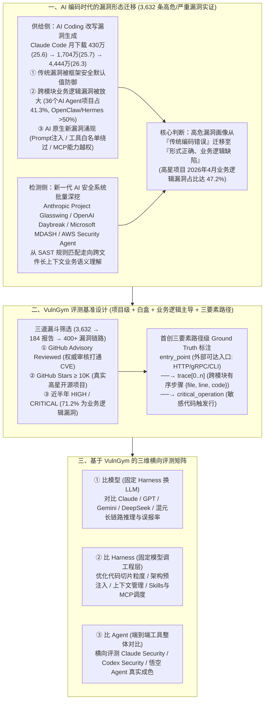

# 从3632个漏洞看AI时代的评测基准重构！VulnGym基准发布

## 1. TL;DR

1. **AI 编码时代漏洞画像的惊人反转**：腾讯悟空安全团队统计了 GitHub Advisory（2025 年 1 月至 2026 年 4 月）共 **3,632 条** 高危/严重漏洞，发现 **业务逻辑漏洞** 占比持续飙升；尤其在 `Stars ≥ 10K` 的高星开源项目中，业务逻辑漏洞占比从 2025 年前三季度的 `21.4%` 反转飙升至 2026 年 4 月的 **47.2%**（在 36 个头部 AI Agent 项目中更达 **41.3%**，OpenClaw 与 Hermes 均超 **50%**）。
2. **供给侧与检测侧的双重驱动力**：一方面，AI Coding 工具（如 Claude Code 月下载量从 2025 年 6 月 **430 万** 暴增至 2026 年 3 月 **4,444 万**）天然遵循框架安全默认值从而稀释了 SQLi/XSS 等“肌肉记忆型”传统漏洞，却因缺乏跨模块长上下文业务契约认知而放大了“形式正确、业务逻辑缺陷”及 Prompt 注入、MCP 越权等新漏洞；另一方面，新一代 AI 安全系统（Project Glasswing、Daybreak 等）开始批量挖出过去 SAST/DAST 看不见的深层业务缺陷。
3. **现有评测基准的系统性失配与 VulnGym 破局**：传统函数级二分类基准（Devign/BigVul）、合成玩具基准（OWASP/Juliet）与黑盒 CTF 基准（CyberGym）均无法评测“真实项目级白盒业务逻辑漏洞”；腾讯悟空联合港中文、复旦、港大、北大、中科院信工所发布 **VulnGym**，从 3,632 条报告中严选 **184 条** 高星项目高危漏洞、提取 **400+ 条** 漏洞路径（业务逻辑漏洞占 **71.2%**）。
4. **首创三要素路径级标注与三维横向评测尺子**：VulnGym 摒弃传统的二分类或 `patch diff`，为每条样本提供人工审核的 **`entry_point`（外部可达入口）× `trace[]`（跨模块有序步骤 `{file, line, code}`）× `critical_operation`（敏感触发点）** 三要素标注，精准区分“蒙对位置”与“完整理解漏洞”；可作为统一标尺横向评测 **底层模型、Harness 工程与 Agent 工具整体**。

## 2. 问题定义与背景

### 2.1 反直觉统计：为什么高星项目与 AI-Native 项目的业务逻辑漏洞占比反而更高？
腾讯悟空代码安全团队对 GitHub Advisory (Reviewed) 在 **2025 年 1 月至 2026 年 4 月** 期间披露的 **3,632 条** 高危/严重漏洞（高危 `2,768` 条 + 严重 `864` 条）进行了系统性打标与抽检分析（文中将“业务逻辑漏洞”定义为：攻击者不违反任何技术语法规则，仅通过滥用合法功能达成系统设计者未预期结果的缺陷）：
- **2025 年 10 月成为关键转折点**：2025 年前三季度，`Stars ≥ 10K` 高星项目的业务逻辑漏洞占比还低于整体均值（`21.4% vs 24.1%`）；但自 **2025 年 10 月** 起趋势显著反转，过去半年高星项目业务逻辑漏洞平均占比超 **38.9%**，并在 **2026 年 4 月达到 47.2%**（接近半数）。
- **AI Agent 生态成为重灾区**：在筛选出的 **36 个头部 AI Agent 项目**（共 `500+` 条漏洞报告）中，业务逻辑漏洞占比高达 **41.3%**（比整体均值高出约 `10 个百分点`）；而在 2026 年初爆火的 **OpenClaw** 与 **Hermes** 等代表性项目中，业务逻辑漏洞占比更是**超过 50%**。

### 2.2 现有安全评测基准的三大失配
| 现有基准流派 | 代表数据集 | 评测粒度与形态 | 核心失配原因 |
| :--- | :--- | :--- | :--- |
| **传统函数级二分类 / Diff** | Devign、BigVul、CVEFixes | 函数或单文件级 / 白盒 | Ground Truth 仅为 `vulnerable/not` 或 `diff`，且压倒性偏向 SQLi / XSS / 内存越界等 LLM 已极少犯错的传统 CWE |
| **合成玩具上下文基准** | OWASP Benchmark、Juliet | 合成代码片段 / 白盒 | 缺乏真实多模块工程依赖，无法复现跨文件、跨流程的业务状态机与鉴权推理 |
| **黑盒 Exploit 导向基准** | CyberGym 等 CTF 基准 | 运行时服务 / 黑盒 | 考察对运行服务的动态攻击利用，无法替代白盒源码级缺陷定位与长链路归因 |

## 3. 知识框架

## 4. 核心内容拆解

### 4.1 深度归因：为什么 AI 时代业务逻辑漏洞比例陡增？

1. **供给侧（AI Coding 改变了漏洞产生方式）**：
   - 以 Claude Code 为例，其月下载量从 **2025 年 6 月的 430 万** 跃升至 **7 月的 1,704 万**，并在 **2026 年 3 月达到 4,444 万**，这两个爆发节点恰好对应高星项目业务逻辑漏洞占比在 **2025 年 10 月**（持续高于均值）与 **2026 年 3~4 月**（冲上 `47.2%`）的两次跃升。
   - **三层结构性演化**：
     - **第一层（传统漏洞被自然防御）**：LLM 生成代码时天然倾向使用参数化查询、输出转义、类型安全 API 等框架安全默认值，“肌肉记忆型”低级编码错误在新代码中被显著稀释。
     - **第二层（业务逻辑漏洞被放大）**：LLM 擅长补齐局部“看起来合理”的代码，但难以长期持有跨模块的项目特有业务契约（如“谁是管理员”、“哪个接口需二次鉴权”、“多租户资源如何隔离”），极易写出语法与局部形式完全正确、却违背全局业务规则的代码。
     - **第三层（AI 生态自带的新型漏洞）**：涌现出 **Prompt 注入、工具白名单绕过、MCP 能力越权** 等传统 CWE 难以覆盖的 AI 原生业务逻辑缺陷。
2. **检测侧（AI 安全工具开始挖出“过去看不见”的漏洞）**：
   - 随着 Anthropic **Project Glasswing**、OpenAI **Daybreak**、Microsoft **MDASH**、**AWS Security Agent** 以及腾讯 **悟空代码安全 Agent**（已在知名开源项目中累计发现并确认 **400+ 个 0day 漏洞**）登场，检测工具从传统 SAST/DAST 的正则与语法树匹配，进化到跨文件理解长上下文业务语义，从而将大量潜伏已久的业务逻辑缺陷批量挖掘出来。

### 4.2 VulnGym 的数据筛选漏斗与样本分布

由腾讯悟空安全团队联合 **香港中文大学 ARISE Lab、复旦大学系统软件与安全实验室、香港大学 JC STEM Lab of Intelligent Cybersecurity、北京大学 Narwhal-Lab、中国科学院信息工程研究所网络威胁分析研究室** 六家机构共同构建：
1. **三道严格筛选漏斗（从 3,632 条浓缩至 184 条报告 / 400+ 条路径）**：
   - **筛选 ① 来源权威（`GitHub Advisory · Reviewed`）**：仅保留经 GitHub 安全团队人工审核并与 CVE 体系打通的公告，剔除未审核噪声。
   - **筛选 ② 项目真实（`GitHub Star ≥ 10K`）**：仅保留 Star 数破万、有真实生产部署与广泛产业依赖的开源项目，剔除玩具仓库与废弃项目。
   - **筛选 ③ 时效与严重性（`近半年 · HIGH / CRITICAL`）**：仅保留近半年披露的高危与严重漏洞，锚定 AI 编码时代的最新漏洞形态。
2. **71.2% 业务逻辑主导 + 传统漏洞对照**：
   - 最终提取的 **400+ 条漏洞路径** 中，**71.2%** 为跨模块业务逻辑漏洞（涵盖授权绕过、认证缺失、Agent 能力边界绕过等），其余 **28.8%** 保留代码/命令注入、路径穿越、反序列化等传统漏洞作为对照基线。

### 4.3 核心工程创新：从“二分类”走向“三要素路径级标注”

传统基准只看 Agent 报出的文件名或函数名是否与 `patch diff` 重合，无法判断 Agent 是“真正理解了攻击链路”还是“瞎猫碰上死耗子蒙对了一个位置”。VulnGym 为每条漏洞路径提供人工审核的 **三要素位置标注**：
- **`entry_point`（外部可达入口）**：攻击者可直接触达的入口点（如 HTTP Handler、gRPC Interceptor、前端交互位点、CLI 命令入口）。
- **`trace[0...n]`（跨模块推理链路）**：从 `entry_point` 到 `critical_operation` 之间有序的跨文件/跨模块数据流与控制流步骤，每一步精确记录为 `{file, line, code}`。
- **`critical_operation`（敏感代码操作 / 缺陷触发点）**：缺陷真正被触发的那一行核心代码（如 `innerHTML` 赋值、绕过 Auth 的条件判断、工具白名单比较、状态机跳过）。

| 标注与评测维度 | 传统漏洞基准（Devign / BigVul 等） | VulnGym 基准 |
| :--- | :--- | :--- |
| **Ground Truth 形态** | `vulnerable / not` 二分类或 `patch diff` | `entry_point × trace[] × critical_operation` 三要素位置 |
| **评测可解释性** | 仅给出命中 / 未命中布尔结果 | 入口、跨模块中间链路、缺陷触发点逐项对齐评分 |
| **能否区分“蒙对位置”** | ❌ 否（报出大文件即算命中） | ✅ 是（必须完整还原从入口到触发点的因果路径） |
| **跨模块推理能力评测** | ❌ 大多不支持（局限于单函数/单文件） | ✅ 原生支持（绑定完整特定版本代码仓库 Commit） |

### 4.4 基于 VulnGym 的三维控制变量评测法

围绕漏洞检测系统的三个核心变量（**底层模型、Harness 工程、Agent 工具整体**），VulnGym 提供了三种标准化的对比范式：
1. **比模型（固定 Harness，只换底层 LLM）**：在同一套代码切分与工具链下，横向对比 Claude、GPT、Gemini、DeepSeek、混元等模型的漏报率、误报率以及长链路跨文件推理时的断链位置。
2. **比 Harness（固定模型，只调工程层）**：量化评估每次喂多少代码、是否预先注入项目架构图、上下文如何压缩管理、Skills / MCP / Sub-Agent 如何调度对检测率的影响——**这是距离工程落地最近、性价比最高的优化空间**。
3. **比 Agent（端到端工具整体对比）**：在同一批真实高星项目漏洞上直接同台竞技 Claude Security、Codex Security 与自研安全 Agent，用确定性数字回答“谁是真有用、谁是花架子”。

## 5. 数据速查表

| 指标 | 原文数值 | 语境 / 条件 |
| :--- | :--- | :--- |
| **GitHub Advisory 统计样本总量** | `3,632 条`（高危 `2,768` + 严重 `864`） | 2025 年 1 月至 2026 年 4 月期间状态为 Reviewed 的高危/严重漏洞 |
| **全样本整体业务逻辑漏洞占比** | `31.14%`（`1,131 / 3,632`） | 2025 年 1 月至 2026 年 4 月全量样本均值 |
| **整体业务逻辑漏洞年度爬升** | 2025 全年 `25.67%`（`382/1,488`）→ 2026 年 1–4 月 `34.93%`（`749/2,144`） | 2026 年前 4 个月比 2025 全年整体上升 `9.26 个百分点` |
| **高星项目（`Stars ≥ 10K`）年度爬升** | 2025 全年 `26.11%`（`141/540`）→ 2026 年 1–4 月 `39.59%`（`382/965`） | 高星项目在 2025 年 10 月后出现明显反转，近半年均值超 `38.9%` |
| **高星项目趋势反转前后对比** | 2025 前三季度 `21.4%`（低于整体 `24.1%`）→ 2026 年 4 月达 `47.2%` | 2026 年 4 月高星项目中业务逻辑漏洞已接近半数 |
| **Claude Code 月下载量增长曲线** | `430 万`（2025.06）→ `1,704 万`（2025.07）→ `4,444 万`（2026.03） | AI Coding 普及时间点与业务逻辑漏洞两次跃升高度吻合 |
| **头部 AI Agent 项目业务逻辑漏洞占比** | `41.3%`（来自 `36 个` 头部项目、`500+` 条报告） | 比全样本均值高约 `10 个百分点`；OpenClaw 与 Hermes 均超 `50%` |
| **VulnGym 筛选漏斗与路径规模** | 从 `3,632 条` 筛出 `184 条` 报告，提取 `400+ 条` 漏洞路径 | 满足 Reviewed + `Stars ≥ 10K` + 近半年 HIGH/CRITICAL |
| **VulnGym 业务逻辑漏洞占比** | `71.2%` | 锚定跨模块业务逻辑漏洞，其余 `28.8%` 为传统注入/路径穿越/反序列化等 |
| **腾讯悟空 Agent 累计 0day 战绩** | 发现并确认 `400+ 个` 0day 漏洞 | 获微软、英伟达、Apache 等致谢，团队曾发布 AI 生成代码安全评测集 `A.S.E` |

## 6. 踩坑与教训 / 可迁移的设计原则

| 错误做法 | 失败表现或原因 | 原文应对（可迁移的设计原则） |
| :--- | :--- | :--- |
| **继续沿用 SQLi / XSS / 缓冲区溢出为主的传统函数级基准（如 Devign/BigVul）评测 AI 安全工具** | LLM 写代码默认采用参数化与安全 API，传统“肌肉记忆型”缺陷在新代码中已大幅减少，旧标尺失去区分信号 | **将评测重心迁移至“项目级真实业务逻辑漏洞”（VulnGym `71.2%` 占比）**：重点考察授权绕过、多租户隔离缺失、Prompt 注入、工具白名单绕过与 MCP 越权 |
| **用合成代码片段（OWASP/Juliet）评测代码安全 Agent** | 合成样例没有跨文件调用链与复杂的业务架构上下文，测不出 Agent 在真实巨型仓库中的检索与长链路推理能力 | **坚持真实高星项目级评测单元（`Stars ≥ 10K` 绑定特定 Commit）**：让 Agent 在完整真实开源仓库中进行多文件检索与上下文组装 |
| **仅用二分类（`vulnerable / not`）或 `patch diff` 文件重合度作为评测 Ground Truth** | 无法区分安全 Agent 是“真正理解了跨模块攻击路径”还是“瞎蒙猜中了一个高频大文件” | **采用 `entry_point × trace[] × critical_operation` 三要素路径级标注**：逐项对齐外部入口、有序跨模块步骤（`{file, line, code}`）与最终敏感触发行 |
| **在优化安全 Agent 时同时改动底层模型、提示词与上下文检索策略** | 变量混杂导致无法判断检测率提升或退化到底源于模型升级还是工程层调整 | **基于统一基准实施三维控制变量评测（比模型 / 比 Harness / 比 Agent）**：固定 Harness 测模型推理上限，固定模型测架构预注入与上下文管理性价比 |

## 7. 记忆锚点

- **“47.2% 与 >50% 的警钟”**：2026 年 4 月 `Stars ≥ 10K` 高星项目的高危漏洞中近一半（**47.2%**）是业务逻辑漏洞，OpenClaw 与 Hermes 等 AI Agent 项目更超过 **50%**——AI 消灭了低级语法拼写漏洞，却批量制造了“形式极其规范、业务鉴权漏穿”的新型隐患。
- **“Entry × Trace × Critical 三点定乾坤”**：不再问“这段函数有没有毒”，而是考“从哪个入口进（`entry_point`）、经过哪几步跨文件流转（`trace[]`）、在哪一行触发敏感越权（`critical_operation`）”，彻底杜绝安全评测中的“蒙答案”。
- **“一把尺子量三层：比模型、比 Harness、比 Agent”**：用 `3,632 → 184 → 400+` 严选出的真实高星项目漏斗，把模糊的“感觉安全工具变强了”变成可复现的工程数字。

## 8. 复习卡片

1. 根据腾讯悟空团队对 3,632 条高危/严重漏洞的统计，2025 年至 2026 年初开源项目（尤其是 `Stars ≥ 10K` 高星项目与 AI Agent 项目）的漏洞分布发生了什么反直觉变化？::整体业务逻辑漏洞占比从 2025 全年的 `25.67%` 升至 2026 年 1–4 月的 `34.93%`；`Stars ≥ 10K` 高星项目在 2025 年 10 月后反转，2026 年 4 月业务逻辑漏洞占比高达 `47.2%`；36 个头部 AI Agent 项目平均达 `41.3%`，OpenClaw 与 Hermes 等项目更超过 `50%`。
2. 为什么随着 AI Coding 工具（如 Claude Code）的普及，代码中“传统漏洞”和“业务逻辑漏洞”的比例会出现一降一升？::一方面，LLM 生成代码时天然倾向遵循参数化查询、转义和类型安全 API 等框架默认值，使传统“肌肉记忆型”缺陷被自然防御；另一方面，LLM 缺乏对项目跨模块业务规则（如管理员角色边界、多租户隔离、MCP 与工具白名单鉴权）的全局长期持有，极易生成“形式正确但业务逻辑存在缺陷”的代码。
3. 现有主流漏洞评测基准（如 Devign/BigVul、OWASP/Juliet、CyberGym）在评测新一代白盒安全 Agent 时存在哪三大系统性失配？::Devign/BigVul 等局限于单函数二分类且偏向传统 CWE；OWASP/Juliet 为合成玩具代码，无法复现跨模块推理；CyberGym 等属于黑盒运行时攻击评测，无法直接衡量白盒源码理解与缺陷定位能力。
4. VulnGym 是通过哪三道筛选条件从 3,632 条报告中构建出数据集的，最终规模与漏洞结构如何？::三道筛选条件为：① `GitHub Advisory Reviewed`（人工审核且打通 CVE）；② `GitHub Stars ≥ 10K`（真实高星开源项目）；③ 近半年披露的 `HIGH / CRITICAL` 漏洞；最终保留 `184 条` 漏洞报告、提取 `400+ 条` 漏洞路径，其中 `71.2%` 为业务逻辑漏洞。
5. VulnGym 的“三要素路径级标注”具体包含哪三个部分，相比传统的二分类或 `patch diff` 有什么核心优势？::包含 `entry_point`（外部可达入口）、`trace[]`（从入口到触发点的有序跨文件/跨模块步骤 `{file, line, code}`）和 `critical_operation`（敏感代码触发点）；核心优势是能逐项对齐评估跨模块推理过程，精确区分“工具蒙对了一个位置”和“工具完整理解了漏洞链路”。
6. 如何利用 VulnGym 对漏洞检测方案进行“比模型、比 Harness、比 Agent”的三维评估？::① 比模型：固定 Harness 与工具，替换不同底层 LLM 对比漏报/误报与长链路推理能力；② 比 Harness：固定底层模型，调优代码喂入粒度、架构信息预注入、上下文管理与 Skills/MCP 调度（性价比最高的优化层）；③ 比 Agent：端到端对比 Claude Security、Codex Security 等整体工具的实战检测效果。

## 9. 知识关联

- **本仓库主题索引**：[Agent评测与反馈](../../20_topics/Agent%E8%AF%84%E6%B5%8B%E4%B8%8E%E5%8F%8D%E9%A6%88.md) · [Harness与模型协同](../../20_topics/Harness%E4%B8%8E%E6%A8%A1%E5%9E%8B%E5%8D%8F%E5%90%8C.md) · [异常监控与稳定性](../../20_topics/%E5%BC%82%E5%B8%B8%E7%9B%91%E6%8E%A7%E4%B8%8E%E7%A8%B3%E5%AE%9A%E6%80%A7.md) · [Agent安全与权限](../../20_topics/Agent%E5%AE%89%E5%85%A8%E4%B8%8E%E6%9D%83%E9%99%90.md)
- **候选双链概念**：[[VulnGym评测基准]] · [[业务逻辑漏洞]] · [[三要素路径级标注]] · [[AI生成代码安全]] · [[白盒安全Agent]]

## 10. 原文参考资料

1. VulnGym 开源代码仓库与评测套件：[https://github.com/Tencent/VulnGym](https://github.com/Tencent/VulnGym)
2. VulnGym HuggingFace 数据集：[https://huggingface.co/datasets/tencent/VulnGym](https://huggingface.co/datasets/tencent/VulnGym)
3. 联合发布机构：腾讯悟空代码安全团队（WuKong, Tencent）、香港中文大学 ARISE Lab、复旦大学系统软件与安全实验室、香港大学 JC STEM Lab of Intelligent Cybersecurity、北京大学 Narwhal-Lab、中国科学院信息工程研究所网络威胁分析研究室。
4. 对照评测基准与行业安全系统：Devign、BigVul、CVEFixes、OWASP Benchmark、Juliet、SWE-Bench、CyberGym、A.S.E（腾讯悟空发布的项目级 AI 生成代码安全评测集），以及 Anthropic Project Glasswing、OpenAI Daybreak、Microsoft MDASH、AWS Security Agent、Claude Security、Codex Security。

> [!note]- 校对报告
> - **校对状态**：已按原文逐页核对通过（共 12 页 PDF）。
> - **核心数据与页码溯源**：
>   - `3,632 条` 漏洞报告（2025 年 1 月至 2026 年 4 月 GitHub Advisory Reviewed，高危 `2,768` + 严重 `864`）、高星项目 4 月业务逻辑漏洞占比 `47.2%`、六家联合发布机构、VulnGym `400+` 条路径与 `71.2%` 业务逻辑漏洞占比及开源链接：见 `p.1–2`。
>   - 详细统计表（整体 `31.14%` [1,131/3,632]、2025 全年 `25.67%` [382/1,488]、2026 年 1–4 月 `34.93%` [749/2,144]、`Stars ≥ 10K` 2025 全年 `26.11%` [141/540]、2026 年 1–4 月 `39.59%` [382/965]）：见 `p.2`。
>   - 2025 前三季度高星项目 vs 整体（`21.4% vs 24.1%`）、2025 年 10 月反转后近半年超 `38.9%`、Claude Code 月下载量（2025.06 `430 万` → 2025.07 `1,704 万` → 2026.03 `4,444 万`）：见 `p.3–4`。
>   - 供给侧三层演化（`36 个` 头部 AI Agent 项目 `500+` 漏洞中业务逻辑漏洞占 `41.3%`，OpenClaw 与 Hermes 超 `50%`，Prompt 注入/工具白名单绕过/MCP 越权）与检测侧系统（Project Glasswing、Daybreak、MDASH、AWS Security Agent）：见 `p.4–5`。
>   - 现有评测基准三维失配分析（Devign/BigVul、OWASP/Juliet、CyberGym）：见 `p.5–7`。
>   - VulnGym 三道筛选条件（`3,632 → 184 条报告 → 400+ 链路`，`71.2%` 业务逻辑漏洞）与 `entry_point × trace[] × critical_operation` 三要素位置标注：见 `p.7–9`。
>   - 三维横向评测用法（比模型、比 Harness、比 Agent）及腾讯悟空团队背景（累计发现确认 `400+` 0day 漏洞、发布 `A.S.E` 评测集）：见 `p.9–11`。
