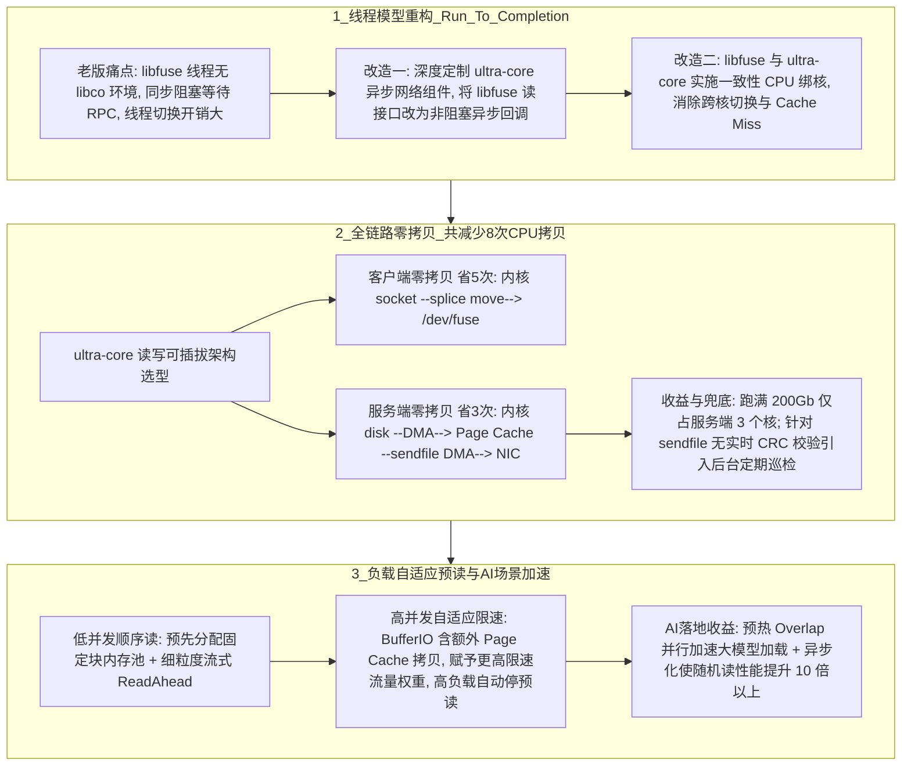

# WFS跑满200Gb TCP

## 1. TL;DR

受 DeepSeek 开源基于 RDMA 的高性能文件系统 **3FS** 启发，微信 WFS 团队针对内部庞大存量集群**不支持 RDMA** 的现实约束，启动了 **WFS Ultra 传统 TCP 网络极限性能优化项目**。通过三大核心工程突破——（1）**Run-To-Completion 线程模型**（深度定制 `ultra-core` 异步网络组件改造 `libfuse` + 一致性绑核）；（2）**全链路零拷贝**（客户端 `splice` 消除 5 次拷贝 + 服务端 `sendfile` 消除 3 次拷贝，全链路共砍掉 **8 次 CPU 拷贝**，服务端跑满 200Gb 仅占 **3 个 CPU 核心**）；（3）**负载自适应流式预读**（内存池防抖 + 对 `BufferIO` 赋予更高限速权重动态熔断预读）——WFS 成为**业界首个在不依赖 RDMA 的传统 TCP 网络下，单客户端 Fio 跑满 200Gb 网卡带宽的分布式文件系统（DFS）**，在同等 200Gb 环境下 DirectIO 与 BufferIO 吞吐均超越 RDMA 加持的 3FS，随机读性能较常规实现提升 **10 倍以上**，并在内部稳定运行半年。

## 2. 问题定义与背景

### 2.1 存量 TCP 集群跑 AI 重负载的痛点
DeepSeek 开源的 3FS 借助 RDMA 硬件绕过内核协议栈实现了极高吞吐。然而在超大规模互联网存量基础设施中，全面普及 RDMA 网卡与无损交换机面临极高的硬件改造周期与成本。而在传统 TCP + FUSE（用户态文件系统）架构下，老版本 `wfsfuse` 存在三大性能枷锁：
1. **同步阻塞线程模型**：`libfuse` 创建的传统工作线程不具备 `libco` 协程环境，每个读请求独占一个线程同步等待 RPC 返回，高并发下线程暴增、上下文切换与 Cache Miss 极其严重。
2. **全链路高达 8 次 CPU 数据拷贝**：客户端需经历 5 次拷贝，服务端需经历 3 次拷贝，海量内存带宽与 CPU 算力被白白消耗在搬运字节上。
3. **高低并发下的预读矛盾**：低并发顺序读需要预读提速，但高并发下预读（尤其是叠加 `BufferIO` 的 Page Cache 拷贝）反而会抢占 CPU 与内存带宽，拖垮整体吞吐。

## 3. 知识框架

## 4. 核心内容拆解

### 4.1 Run-To-Completion 线程模型（`libfuse` + `ultra-core`）
1. **`libfuse` 异步非阻塞化改造**：重新设计 `libfuse` 的读接口调用逻辑，接入深度定制的 **`ultra-core` 异步网络组件**。工作线程发起 RPC 读请求后无需阻塞等待，立即返回处理下一个请求；当网络响应到达时，通过 `ultra-core` 异步回调函数完成后半段处理，将请求发起与结果处理彻底解耦。
2. **一致性 CPU 绑核（Core Binding）策略**：将 `libfuse` 与 `ultra-core` 的线程逻辑深度整合，并严格绑定到固定的物理 CPU 核心上运行，消除线程在多核间漂移造成的上下文切换与 CPU L1/L2 Cache Miss，使整条请求链路近似等效于在单个线程内一气呵成（Run-To-Completion）。

### 4.2 全链路零拷贝：砍掉 8 次 CPU 拷贝
依托 `ultra-core` 读写可插拔架构，团队对比多种 Linux 内核收发原语后，敲定了 **“客户端 `splice` + 服务端 `sendfile`”** 的黄金零拷贝组合：
1. **客户端零拷贝（消除 5 次拷贝）**：
   - **老版链路（5 次拷贝）**：`内核 socket` $\to$ `userspace` $\to$ `反序列化` $\to$ `缓存` $\to$ `fuse buffer` $\to$ `/dev/fuse`。
   - **新版链路（0 次用户态拷贝）**：配合自定义网络协议格式，利用 Linux `splice` 系统调用直接将数据页从 `内核 socket` 移动（`splice move`）至 `/dev/fuse` 管道，完全绕过用户空间。
2. **服务端零拷贝（消除 3 次拷贝，跑满 200Gb 仅用 3 核）**：
   - **老版链路（3 次拷贝）**：`内核 disk` $\to$ `userspace` $\to$ `序列化` $\to$ `内核 socket`。
   - **新版链路（纯 DMA 传输）**：采用 `sendfile` 接口，数据从磁盘经 DMA 读入内核 `Page Cache`，再由 DMA 直接从 `Page Cache` 推送至网卡（NIC），全程不经过用户态、不消耗 CPU 拷贝周期。实测服务端打满 **200Gb 带宽仅占用 3 个 CPU 核心**。
   - **工程权衡与静默损坏兜底**：启用 `sendfile` 后数据不进用户态，因此**无法在读取路径上执行实时软件 CRC 校验**。为规避磁盘静默数据损坏风险，团队配套引入了**后台定期巡检机制**进行兜底。

### 4.3 负载自适应流式预读与 AI 场景落地
1. **内存池 + 细粒度流式预读**：针对低并发顺序读，探测到顺序访问模式时主动触发 `ReadAhead`。为避免动态申请大块预读内存引发延迟抖动，采用**预分配固定大小内存块的内存池（Memory Pool）**，并以细粒度流式预读在有限内存配额下最大化单流吞吐。
2. **区分 `BufferIO` 与 `DirectIO` 的加权自适应限速**：在多并发高负载下，预读带来的额外内存操作会反噬客户端整体读性能；特别是 **`BufferIO` 模式本身比 `DirectIO` 多一次内核 Page Cache 拷贝**，若再叠加预读拷贝会导致吞吐严重劣化。因此系统在限速统计流量时**为 `BufferIO` 赋予更大的惩罚权重**，一旦总负载达到阈值便自动熔断停止预读，优先保障高并发主链路带宽。
3. **两大 AI 业务收益**：
   - **预热 Overlap 加速大模型加载**：将模型参数预热加载与训练/推理框架初始化并行重叠（Overlap）执行，显著压缩不同规模大模型的冷启动时间。
   - **异步化加速高并发随机读**：在内部生产环境实测中，相同并发条件下 WFS Ultra 的**随机读性能相比常规实现提升达 10 倍以上**。

## 5. 数据速查表

| 指标 | 原文数值 | 语境 / 条件 |
| :--- | :--- | :--- |
| **Fio 单客户端极限读带宽** | 跑满 **200Gb** 网卡带宽 | 1 台 `T0-CM6AX` Client 对 6 台 `T0-CM6AX` Server，纯传统 TCP 网络（业界首个无 RDMA 跑满 200Gb 的 DFS） |
| **对比 RDMA 3FS 表现** | DirectIO 与 BufferIO 吞吐均**超越 3FS** | 在同等 200Gb 测试集群环境下对比不同块大小读吞吐 |
| **全链路减少的 CPU 拷贝次数** | 共减少 **8 次**（客户端 **5 次** + 服务端 **3 次**） | 客户端采用 `splice`，服务端采用 `sendfile` + DMA |
| **服务端跑满 200Gb 的 CPU 开销** | 仅占用 **3 个** CPU 核心 | 启用 `sendfile` 零拷贝模式后的服务端实测负载 |
| **高并发随机读性能提升倍数** | **10 倍以上** | 内部生产环境相同并发下，WFS Ultra 异步化版本对比常规实现 |
| **内部生产稳定运行周期** | **半年** | 自项目落地至发文前已在微信内部生产环境稳定运行 6 个月 |

## 6. 踩坑与教训 / 可迁移的设计原则

| 错误做法 | 失败表现或原因 | 原文应对（可迁移的设计原则） |
| :--- | :--- | :--- |
| **在 FUSE 客户端直接沿用 `libfuse` 默认的同步线程模型等待远程 RPC** | 由于 `libfuse` 线程无协程上下文，只能靠堆砌大量操作系统线程提并发，引发剧烈的上下文切换与 Cache Miss | **FUSE 异步回调解耦 + 一致性绑核（Run-To-Completion）原则**：将 `libfuse` 读接口非阻塞化并对接异步网络引擎（`ultra-core`），同时将文件与网络处理线程固定绑核 |
| **在用户态执行协议反序列化、缓存中转后再写入 `/dev/fuse`** | 客户端单次读请求产生多达 5 次内存拷贝，200Gb 高速网卡下 CPU 内存带宽瞬间成为死穴 | **自定义协议头对齐 + 内核态 `splice`/`sendfile` 穿透原则**：通过协议格式设计使数据载荷可直接由 `socket` 经 `splice` 移交 `/dev/fuse`，服务端用 `sendfile` 直通网卡 |
| **启用 `sendfile` 零拷贝后忽视数据完整性校验缺失问题** | `sendfile` 绕过了用户态 CPU，导致无法在在线读路径实时计算校验数据块 CRC，存在返回静默损坏数据的隐患 | **在线零拷贝提速 + 离线异步巡检解耦原则**：将耗时的 CRC 校验从在线关键路径剥离，通过后台定期全量/增量巡检兜底数据可靠性 |
| **无论并发高低、无论 DirectIO 还是 BufferIO 均无差别开启预读（ReadAhead）** | 高并发下预读争抢资源，尤其在 `BufferIO` 下叠加 Page Cache 拷贝会导致吞吐断崖式下跌 | **I/O 模式差异化加权熔断原则**：预读内存使用固定内存池防抖；限速器对 `BufferIO` 赋予更高流量权重，高负载时自动关停预读 |

## 7. 记忆锚点

- **WFS Ultra 破局三剑客**：“**`ultra-core` 异步绑核跑到底，客户端 `splice` 省五拷，服务端 `sendfile` 省三拷（3 核喂饱 200G），预读加权防 `BufferIO` 反噬。**”
- **核心战绩数字**：“**1 对 6 机器，0 RDMA 依赖，砍 8 次拷贝，3 核跑满 200Gb，随机读快 10 倍。**”

## 8. 复习卡片

微信 WFS Ultra 是在怎样的硬件与网络约束下实现了对标乃至超越 DeepSeek 3FS 的读吞吐表现的？::在内部庞大存量集群不支持 RDMA 硬件的约束下，基于传统 TCP 网络（1 台 T0-CM6AX 客户端 + 6 台 T0-CM6AX 服务端），成为业界首个不依赖 RDMA 即可用 Fio 跑满 200Gb 网卡带宽的分布式文件系统。
老版本 `wfsfuse` 为什么会陷入严重的线程切换开销，WFS Ultra 是如何改造为 Run-To-Completion 模型的？::老版由 `libfuse` 创建的线程没有 `libco` 协程环境，每个读请求必须同步阻塞等待 RPC 返回；WFS Ultra 将 `libfuse` 读接口改造为异步非阻塞模式并接入定制的 `ultra-core` 异步回调机制，同时实施 `libfuse/ultra-core` 一致性 CPU 绑核以减少 Cache Miss。
WFS Ultra 是如何通过“全链路零拷贝”减少 8 次 CPU 拷贝的？::1. 客户端（减少 5 次拷贝）：利用 `ultra-core` 配合自定义协议格式与 Linux `splice` 接口，将数据从内核 `socket` 直接 `splice move` 到 `/dev/fuse`，省去用户态反序列化与缓存拷贝；2. 服务端（减少 3 次拷贝）：采用 `sendfile` 接口，通过 DMA 将数据从磁盘经 Page Cache 直接发往网卡（NIC），服务端跑满 200Gb 仅需 3 个 CPU 核心。
服务端启用 `sendfile` 零拷贝模式会带来什么副作用，WFS 团队是如何规避该风险的？::因为数据完全不经过用户态 CPU，服务端无法在读取时进行实时 CRC 数据校验；团队通过引入后台“定期巡检”机制来降低访问到静默损坏数据的概率。
为什么 WFS 的负载自适应预读机制要对 `BufferIO` 赋予比 `DirectIO` 更大的限速权重？::因为 `BufferIO` 模式本身存在额外的内核 Page Cache 拷贝，若在高并发下再叠加预读带来的拷贝开销，会导致客户端读性能严重下降；赋予 `BufferIO` 更大权重可在系统高负载时优先自动停止预读。
尽管传统 TCP 优化已能跑满 200Gb 带宽，文章末尾指出 RDMA 在哪些场景下依然具备不可替代的优势？::在对延迟极其敏感的场景（如大模型推理的 KVCache 传输）以及更大吞吐量级（如 400Gb+）的网卡环境中，RDMA 依然具备更高的性能上限。

## 9. 知识关联

- **本库通用主题**：[云网络系统研究](../../20_topics/%E4%BA%91%E7%BD%91%E7%BB%9C%E7%B3%BB%E7%BB%9F%E7%A0%94%E7%A9%B6.md) · [异常监控与稳定性](../../20_topics/%E5%BC%82%E5%B8%B8%E7%9B%91%E6%8E%A7%E4%B8%8E%E7%A8%B3%E5%AE%9A%E6%80%A7.md) · [AI研发协同](../../20_topics/AI%E7%A0%94%E5%8F%91%E5%8D%8F%E5%90%8C.md) · [分布式计算与数据管道](../../20_topics/%E5%88%86%E5%B8%83%E5%BC%8F%E8%AE%A1%E7%AE%97%E4%B8%8E%E6%95%B0%E6%8D%AE%E7%AE%A1%E9%81%93.md)
- **候选双链**：[[Linux零拷贝splice与sendfile]] · [[FUSE用户态文件系统异步化]] · [[DeepSeek-3FS与RDMA存储]] · [[大模型冷启动加载加速]]

## 10. 原文参考资料

- 原文标题：《微信 WFS 传统 TCP 网络 Fio 跑满 200Gb 网卡实践》（作者：微信 WFS 团队，发布于 2026-02-11）
- 对标开源项目：DeepSeek 3FS（Fire-Flyer File System）。

> [!note]- 校对报告
> - **页码溯源汇总**：
>   - `p.1–2`：DeepSeek 3FS 背景、存量集群无 RDMA 约束、1 台 Client 对 6 台 Server（`T0-CM6AX`）测试环境及业界首个传统 TCP 跑满 200Gb 网卡的 DFS 结论。
>   - `p.2–3`：Run-To-Completion 线程模型（`libfuse` 无 `libco` 痛点、`ultra-core` 异步回调解耦、一致性 CPU 绑核减少 Cache Miss）。
>   - `p.3–5`：`ultra-core` 读写可插拔架构、客户端 5 次拷贝简化为 `socket -> splice move -> /dev/fuse`、服务端 3 次拷贝简化为 `sendfile` 纯 DMA 传输（跑满 200Gb 仅占 3 核，针对无实时 CRC 校验采用定期巡检兜底）。
>   - `p.5–9`：预分配内存池细粒度流式预读、`BufferIO` 高权重自适应限速熔断、预热 Overlap 加速大模型加载、高并发随机读提升 10 倍以上及 RDMA 在 KVCache 低延迟场景的未来演进。
> - **核验结论**：全文所有架构细节、拷贝次数、核心占用数与性能倍数均与原文严格一致。
