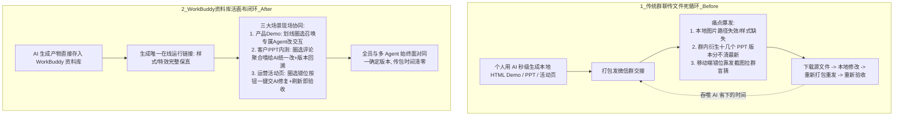

# WorkBuddy 资料库：从三大场景开始，让多人多 Agent 轻松协作

## 1. TL;DR

当 AI 将个人生成 HTML Demo、客户方案 PPT 或活动页面的耗时从一周压缩到几秒钟后，团队协同的真正瓶颈转移到了**产物交接与多轮修改**：一旦仍沿用“导出本地压缩包 → 发微信群 → 丢失样式/多版本满天飞 → 截图拉会排查 → 重新打包重发”的旧路径，AI 省下的生成时间会被交接摩擦彻底吞噬。**WorkBuddy 资料库**的核心设计是将死在本地文件里的静态产物托管为**在线可运行、可评论、可划线圈选召唤专属 Agent 现场微调的“实时协作活画布”**。文章围绕**产品 Demo 交接、客户方案 PPT 多角色共创（文中注明内测中、即将上线）、运营活动页第一现场修 Bug** 三大高频痛点场景，展示了如何让产品、研发、销售、售后、运营及各自的专属 Agent 在同一个唯一直链页面上并行标记、聚合评论喂给 AI 修改并追溯版本，从而将跨角色传包与版本对齐成本清零。

## 2. 核心概念

- **AI 时代的协同新矛盾（生成快 vs 交接卡壳）**：核心矛盾已从“AI 能不能帮我把东西做出来”转变为“东西做出来之后，怎么让团队顺畅地接过去、继续高效地做下去”。
- **在线可协作活页面 / 实时协作画布（WorkBuddy 资料库）**：将 Vibe Coding 生成的本地 HTML Demo、活动页或 PPT 存入云端资料库后形成的统一在线链接；它既保留完整的运行时样式、图片与交互效果（告别“在我电脑上明明是好的”），又支持多人直接在画面上划线圈选、发表评论、召唤各自的专属 Agent 就地修改并实时刷新验收。
- **划线圈选 + 专属 Agent 现场微调**：协作者（产品、研发、运营、测试）无需下载源码或口头描述位置，直接在运行页面中圈选目标组件（如弹窗、错位按钮、PPT 图表），输入自然语言指令（如“把这个弹窗改成抽屉式”）交由专属 Agent 直接完成代码或内容修改。

## 3. 知识框架

以下流程图按正文整理，对比传统“本地压缩包群聊传文件”死循环与 WorkBuddy 资料库“单链接多人多 Agent 活画布”协同闭环：

## 4. 关键要点与机制详解

### 4.1 三大核心协同场景的 Before / After 机制对照

**核心主张**：无论是产品交互原型、跨部门销售 PPT 还是紧急上线的运营页面，消除交接摩擦的关键都是**不让产物离开在线运行环境**，把评论、圈选定位、AI 修改与版本回溯收敛在同一个 URL 内。

| 协同场景 | 传统本地交接的失败表现（Before） | WorkBuddy 资料库协同机制（After） | 关键功能与状态边界 |
|---|---|---|---|
| **场景一：产品新功能 Demo 交接** | 产品经理 Vibe Coding 出本地 HTML Demo，打包发给研发后**本地图片路径失效、样式缺失、特效不显示**；每改一个交互都要本地改代码、重打包、重发压缩包 | 存入资料库变为“在线可协作活页面”：研发点开链接直接试手感、用评论互动；产品与研发可**直接划线圈选任意区域，各自召唤专属 Agent 现场微调**（如“把这个弹窗改成抽屉式”） | 多人多 Agent 在同一画布并行处理，所有人眼前永远是正在运行、最确定的同一个版本 |
| **场景二：客户方案 PPT 多角色协同** | 销售用 AI 生成客户方案 PPT 发群确认，产品提功能意见、技术下载改参数再传回、售后补客户背景，半天内群里出现 **N 个版本与零散材料**，无人分清哪版最新 | PPT 存入资料库：产品圈选某页评论功能偏差，技术标注图表让 AI 编辑参数；**销售可将页面内所有人的评论与反馈一起打包喂给 AI 一次性完成修改**，且支持版本管理随时回溯被 AI 改丢的细节 | ⚠️ **原文明确标注该功能处于“内测中，即将上线”状态**，不可当作已全量正式发布功能 |
| **场景三：运营活动页发布前夜紧急修 Bug** | 运营用 AI 搭好用户征集活动页，上线前晚发现移动端按钮错位且点击无效；连夜拉设计/产品/研发进群，经历“**截图发群 → 找源文件 → 确认问题 → 研发改完重发 → 运营重拿文件验收**”，几分钟生成的页面折腾半天 | 活动页传入资料库变为“实时协作画布”：运营或测试直接在问题按钮上**“划线圈选 + 标记意见”**精准定位；研发直接在当前页排查代码，或**一键把带标记的页面丢给 AI 智能修复**；运营刷新界面同步验收 | 从制作、修 Bug 到上线全程不脱离同一个链接，传文件时间清零 |

### 4.2 延伸团队场景与工作流范式转移

**核心主张**：当 AI 把单点生产成本压到极低后，团队工具必须从“文件传输管道”升级为“人机共创工作台”。

- **更多可扩展场景**
  - 原文指出除上述三大场景外，资料库还可用于：**行政团队**搭建意见反馈工作台、**市场团队**将历史各类宣发材料整合归档至统一资料库。
- **核心操作步骤提炼（从个人生成到团队交付）**
  1. **入库托管**：将 AI 生成的 HTML 原型、活动页面或文档直接存入 WorkBuddy 资料库，获取统一在线链接（消除本地相对路径与环境依赖）。
  2. **圈选标注**：协作者在运行态页面中直接用“划线圈选 + 评论标记”定位需调整的 UI 组件、错位按钮或文案图表。
  3. **召唤 Agent 就地修改**：单点修改可由各角色直接在圈选区召唤专属 Agent 执行；多方意见汇总（如 PPT 会签）可将全部页面评论一次性喂给 AI 批量完成修订。
  4. **刷新验收与版本兜底**：协作者直接刷新同一链接验收修改效果；若 AI 修改误删细节，通过内置版本管理回退恢复。

## 5. 数据速查表

| 指标 / 维度           | 原文描述与数值                        | 语境 / 条件                               |
| ----------------- | ------------------------------ | ------------------------------------- |
| 核心覆盖场景数           | $3$ 大核心场景（外加行政、市场 $2$ 个延伸场景举例） | 产品 Demo 交接、客户方案 PPT 协同、运营活动页第一现场修 Bug |
| AI 生成耗时 vs 传统手搓耗时 | 传统需一星期手搓 $\to$ AI 几秒钟 / 几分钟生成  | 用于对比说明生成提速后，群聊传压缩包与拉群修 Bug 反而耗时半天     |
| PPT AI 协同功能发布状态   | 内测中，即将上线                       | 原文第二节标题明确标注的状态边界                      |

## 6. 踩坑与教训 / 可迁移的设计原则

### 常见踩坑与应对

| 错误做法                                    | 失败表现或原因                                           | 原文应对策略                                            |
| --------------------------------------- | ------------------------------------------------- | ------------------------------------------------- |
| **将 Vibe Coding 生成的本地 HTML 直接打包发微信群交接** | 接收方电脑缺少本地图片路径或样式依赖，打开后画面“缺胳膊少腿”、特效失效，且每次微调都要重打包重发 | 存入 WorkBuddy 资料库转为在线活页面，通过唯一链接共享完整运行态与交互手感        |
| **多角色会签 AI 产物时各自下载修改再传回群聊**             | 短时间内衍生十几个“最终版_最新”文件与零散聊天意见，合并成本高且极易漏改             | 在线圈选评论，将多方评论一次性聚合喂给 AI 统一修改，并用版本管理兜底防改丢           |
| **页面出 Bug 时仅靠手机截图发群拉研发排查**              | 研发缺少需求背景、DOM 上下文与源文件，只能对着截图盲猜，反复传文件验收耗费半天         | 在实时协作画布上对准故障组件直接“划线圈选 + 标记意见”，研发原地查代码或一键交 AI 智能修复 |

### 可迁移的设计原则

- **“第一现场”上下文绑定原则**：在多人多 Agent 协作流中，反馈意见（评论）、空间定位（划线圈选 DOM/图表区域）与运行时源码必须绑定在同一个在线现场——让修复 Agent 直接拿到“带空间标记的运行态页面”，远比人工用文字转述截图高效准确。
- **版本回溯是放手让多 Agent 改稿的安全垫**：当允许不同角色的专属 Agent 或汇总 AI 直接修改共享产物时，必须配套细粒度的版本管理，确保任何被 AI 意外改丢的细节都能一键追溯恢复。

## 7. 记忆锚点

- **原文核心矛盾锚点**：“当下的核心矛盾已经变了：不再是‘AI 能不能帮我把东西做出来’，而是‘东西做出来之后，怎么让团队顺畅地接过去、继续高效地做下去’。”
- **协同范式口诀（助记改写）**：“告别本地传压缩包，单链托管变活画布；划线圈选召专属 Agent，聚合评论带版本回溯。”

## 8. 复习卡片

为什么文章认为在 AI 时代“产出越快，协作反而越卡壳”？::因为个人用 AI 几秒钟就能生成 Demo、PPT 或活动页，但如果团队仍沿用“导出本地文件—发微信群—等回复—下载修改重传”的旧模式，省下的生成时间很快就会被样式丢失、版本混乱和多轮传包验收吞噬。
产品经理将 Vibe Coding 生成的本地 HTML Demo 直接打包发给研发会遇到什么典型问题，WorkBuddy 资料库如何解决？::本地打包发送常出现本地图片路径失效、样式缺失、特效无法显示（“在我电脑上是好的”），且微调需反复重打包；存入资料库后变为在线活页面，研发打开链接即可试手感，双方还能直接划线圈选区域召唤专属 Agent 现场微调。
在客户方案 PPT 多角色确认场景中，WorkBuddy 资料库（内测中）提供了哪三项核心协同能力？::一是产品、技术、售后可直接在页面对应位置圈选评论或标注图表让 AI 编辑；二是销售可将大家在页面里的所有评论和反馈一起喂给 AI 批量完成修改；三是提供版本管理，一旦细节被 AI 改丢可随时追溯恢复。
当运营用 AI 搭建的活动页在上线前夜出现移动端按钮错位且点击无效时，传统排查流与资料库“第一现场”修复流有何不同？::传统流程需“截图发群→找源文件→确认问题→研发改完重发→运营拿文件重验”，往往折腾半天；资料库模式下运营直接在错位按钮上“划线圈选+标记意见”，研发原地排查或一键把带标记的页面丢给 AI 修复，运营刷新同一链接即可完成验收。
为什么说“划线圈选 + 召唤专属 Agent”比群聊文字沟通更适合 AI 产物迭代？::因为划线圈选直接在运行态画布上锁定了目标 UI 组件或内容区域，省去了人工截图和口头解释上下文的损耗，让不同角色的专属 Agent 能在同一确定版本上并行精准修改。

## 9. 知识关联

- **桌面 Agent 与协同工作流**：[[桌面Agent与工作流]]（[桌面Agent与工作流](../../20_topics/桌面Agent与工作流.md)）、[[AI研发协同]]（[AI研发协同](../../20_topics/AI研发协同.md)）
- **工具发布与多 Agent 协同**：[[模型与开发工具发布]]（[模型与开发工具发布](../../20_topics/模型与开发工具发布.md)）、[[Harness与模型协同]]（[Harness与模型协同](../../20_topics/Harness与模型协同.md)）
- **本篇原始与转写材料**：[原始 PDF](RAW.pdf) · [逐页转写文本](MD.md)

## 10. 原文参考资料

原文为腾讯技术工程发布的 WorkBuddy 资料库产品场景介绍（作者：夏夏，WorkBuddy 资料库产品运营），未引用外部论文或开源代码仓库。文中明确标注“PPT AI 协同”功能处于“内测中，即将上线”状态，本笔记严格按原文状态记录。

> [!note]- 校对报告
> **覆盖度**：基于 `MD.md` 与 `META.json` 完整覆盖 PDF 第 1–5 页全部正文（导语与三大痛点引出 p.1；一、产品 Demo 交接 Before/After p.1–2；二、PPT AI 协同 Before/After 及内测标注 p.3–4；三、运营活动发布第一现场修 Bug Before/After p.4–5；总结：从两人传文件到多人多 Agent 实时共创及行政/市场延伸场景 p.5）。第 6 页为公众号阅读量与留言区，已核对排除。
>
> **一致性抽查**：
>
> | 核对项 | 笔记值 | 原文值与位置 | 结果 |
> |---|---|---|---|
> | 三大核心场景 | 产品 Demo 交接、PPT AI 协同、运营活动发布修 Bug | p.1–5 | 一致 |
> | 产品 Demo 圈选微调示例指令 | “把这个弹窗改成抽屉式” | p.2 | 一致 |
> | PPT AI 协同功能状态 | 内测中，即将上线 | p.3 | 一致 |
> | 传统活动页排障五步链路 | 截图发群 ➔ 找源文件 ➔ 确认问题 ➔ 研发改完重发 ➔ 运营重新拿文件验收 | p.4 | 一致 |
> | 延伸场景举例 | 行政搭建意见反馈工作台、市场整合历史宣发材料 | p.5 | 一致 |
>
> **推断与异常**：未引入超出原文的技术推断。原文属产品功能与协作方法介绍，未披露底层多 Agent 并发冲突合并算法细节，笔记如实反映原文颗粒度，并将“PPT AI 协同”明确限定为原文标注的“内测中，即将上线”状态。
>
> **日期与格式**：发布日期依据 PDF 第 1 页页眉 `Sep 17, 2026, 2:50 AM`，frontmatter `date` 记为 `2026-09-17`；全文保持唯一 H1，正文、表格、图注与复习卡片均不含页码与章节标注；复习卡片共 5 条，均为单行 `问题::答案` 格式；Mermaid 图表未实际渲染。
