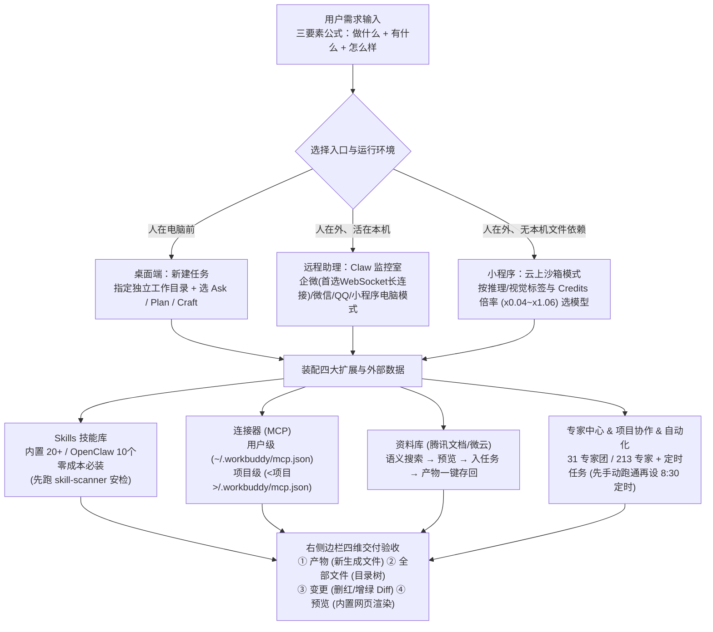

# 3万字长文带你 WorkBuddy 从入门到精通

## 1. TL;DR

本文是腾讯桌面端全能 AI 工作台 **WorkBuddy**（基于 OpenClaw 生态，账号与 Credits 额度与 CodeBuddy 互通）的官方 3 万字全景操作手册，提炼自腾讯内部 **`12,000` 名内测员工**的一线实践。文章系统拆解了 WorkBuddy 的四大核心工作机制：① **三级放权与目录边界**（`Ask` 只读问答、`Plan` 先出方案待审、`Craft` 直接改文件，配合按任务类型隔离的**工作目录**与右侧栏**产物/全部文件/红绿变更对比/网页预览**四维验收）；② **多端运行环境分工**（桌面多任务并行工作台 vs. 固定 `Claw` 目录、单会话保留历史的**助理远程监控室** vs. 微信小程序的**“云上沙箱 / 电脑直连”双模式**及 `x0.04～x1.06` Credits 模型倍率选型）；③ **五层能力扩展体系**（内置 `20+` 种并兼容 OpenClaw 上万技能的 **Skills**、区分用户级与项目级 `mcp.json` 的**连接器**、涵盖 `31` 个专家团 / `213` 位专家 / `14` 大品类的**专家中心**、免下载直通腾讯文档的**资料库**、以及内置 `11` 个零配置模板的**灵感/探索**）；④ **定时自动化与 10 个零成本必装 Skill 实战**，并附带了完整的 Mac/Windows 安装排障命令与三层运行时安全防护说明。

## 2. 核心概念

### 核心工作模式、执行环境与能力组件对比

#### （1）三种工作模式（授权梯度）

| 工作模式 | 权限边界与行为特征 | 适用场景与安全前提 |
|---|---|---|
| **问一问（`Ask` 模式）** | **只读不改**：只能查看工作目录文件并回答问题，绝不修改电脑上的任何文件 | 先问清文件内容（如查合同违约金条款、总结表格）、确认思路后再切 `Craft` 执行 |
| **想一想（`Plan` 模式）** | **先审后做**：查看文件后先输出分步执行计划与拟修改文件清单，不直接动文件 | 任务复杂、跨多文件修改或希望对执行过程有强掌控感时，人点头后再开工 |
| **做一做（默认 `Craft` 模式）** | **直接动手**：拥有最大文件操作权限，直接整理文件夹、生成报告/PPT、改代码 | 日常高频交付效率最高；🔥 **前提：必须先指定独立工作目录并对重要原文件做好备份** |

#### （2）三种运行入口与环境对比

| 维度 | 桌面端「新建任务」 | 桌面端「助理（Claw）页面」 | 微信小程序（移动端双模式） |
|---|---|---|---|
| **核心定位** | 人在电脑前的日常主力多任务工作台 | 手机（企微/微信/QQ/飞书/钉钉）远程遥控电脑的本地“监控室” | 移动随身办公：**云上模式**（云端沙箱即开即用）+ **电脑模式**（远程操控本机） |
| **工作目录** | 可自由指定任意文件夹（未指定则自动新建独立目录） | **固定使用名为 `Claw` 的专属文件夹**，不可自由更改 | 云上模式用云端沙箱/云盘；电脑模式读写本机桌面/Claw 目录（需电脑开机联网未休眠，锁屏不影响） |
| **并发与上下文** | 支持同时开多个独立任务窗口并行干活（注意本地文件并发操作会竞争资源），可随时清空上下文 | **仅单一对话窗口**，不可新建并行任务，**不可清空上下文**（完整保留历史） | 云上模式支持选择模型（`Hy3 preview` 至 `GLM-5.1`）与自动步骤拆解 |

#### （3）能力扩展四层次：Skill vs. 专家 vs. 专家团 vs. 探索（灵感）

| 能力层级 | 形象比喻 | 核心定义与组成关系 | 何时选用？（决策判据） |
|---|---|---|---|
| **技能（Skill）** | 锅碗瓢盆（厨具/工具箱） | 让 AI 具备某种具体工具操作能力（内置 `>20` 种，兼容 OpenClaw 社区上万个 Skill，支持自然语言自建） | 需要 AI 能够执行某类具体操作（如读 PDF、跑浏览器、转音频、操作 Obsidian） |
| **专家（Agent 型）** | 某菜系大厨（AI 顾问） | 具备特定领域知识与思维人设的单角色（如全栈工程师吴八哥、数据分析师数妙妙、UI 设计师像素君） | 有一个明确属于某专业领域的单点问题，需要比通用对话更专业的视角 |
| **专家团（Team 型）** | 完整后厨团队（AI 协作团队） | 多角色按 SOP 自动拆解、并行执行、完整交付（如软件开发团含交付总监齐活林、PM 许清楚、架构师高见远、研发寇豆码、QA 严过关；共 `31` 个专家团、`213` 位专家、`14` 大品类） | 任务复杂且跨职能（如从零开发软件、完整策划案），需要多角色配合与质量验收 |
| **探索 / 灵感** | 成品菜肴展示柜（滤镜库） | 预装好的 `11` 个场景模板库，一键点击“制作我的版本”即可将 **Prompt + Skill + 专家** 零配置自动就位 | 新手不知道怎么写 Prompt / 选什么 Skill，或老用户想省去重复配置快速启动常见任务 |

## 3. 知识框架



## 4. 关键要点与机制详解

### 4.1 外部系统打通：连接器（MCP 双级配置）与资料库“找-用-存”闭环

**核心主张：连接器解决“跨平台操作外部工具”，资料库解决“云端文档免下载上传闭环”；MCP 配置需按复用范围严格区分用户级与项目级。**

- **连接器（Connectors / MCP）的用户级 vs. 项目级配置**：
  - 官方内置支持 QQ 邮箱、腾讯文档、腾讯乐享、TAPD、微云等，并支持通过腾讯云开发者社区 MCP 市场（`https://cloud.tencent.com/developer/mcp`）接入自定义 MCP Server。
  - **两级配置文件路径与分工**：
    - 🌐 **用户级（一劳永逸型）**：路径为 `/Users/<用户名>/.workbuddy/mcp.json`，配置一次后所有项目（文件夹）通用（如通知同事的企业微信群机器人）。
    - 📁 **项目级（精准定制型）**：路径为 `/<项目文件夹名称>/.workbuddy/mcp.json`，仅对当前项目文件夹生效，实现跨项目环境与凭证隔离。
  - **企业微信群机器人（`wecom-bot-mcp-server`）标准配置示例**：

```json
{
  "mcpServers": {
    "wecom": {
      "command": "uvx",
      "args": [
        "wecom-bot-mcp-server"
      ],
      "env": {
        "WECOM_WEBHOOK_URL": "https://qyapi.weixin.qq.com/cgi-bin/webhook/send?key=your-webhook-key"
      }
    }
  }
}
```

- **资料库（云端文档直通车）的四步闭环**：
  - 告别传统的“去腾讯文档下载 → 发给 AI → 处理完再手动上传”流程，授权微信/QQ 扫码连接腾讯文档后直接实现：**① 搜索即找到（支持自然语言语义检索与文件类型筛选）→ ② 点击即在 WorkBuddy 内直接预览 → ③ 一键添加到当前任务加工 → ④ 在右侧「产物」区点击“上传到云端”一键存回对应资料库**。

### 4.2 微信小程序双模式与云上模型 Credits 倍率选型策略

**核心主张：根据任务是否需要“视觉理解（看图/OCR）”与“推理复杂度”按倍率阶梯选模型，简单任务与高难任务之间存在高达 26.5 倍（`x0.04` vs `x1.06`）的成本差距。**

| 模型名称 | 能力标签 | Credits 消耗倍率 | 原文推荐适用场景 |
|---|---|---|---|
| **`Hunyuan-2.0-Thinking`** | 推理 | **`x0.04`** | 最便宜的纯文本模型，适合大批量简单文本处理 |
| **`Hy3 preview`** | 推理 + 视觉 | **`x0.04`**（限时折扣） | 超低成本的图片相关简单任务 |
| **`Deepseek-V4-Flash`** | 推理 + 视觉 | **`x0.13`** | 常规最便宜的有视觉能力模型，快速图片理解、简单 OCR |
| **`GLM-4.7`** | 推理 | **`x0.23`** | **日常首选**——写文案、改代码、问答、通用对话 |
| **`Deepseek-V4-Pro`** | 推理 + 视觉 | **`x0.25`**（限时折扣） | 需要理解图片内容的分析任务，兼顾性价比 |
| **`Deepseek-V3.2`** | 推理 | **`x0.29`** | 代码编写与调试、数据分析、中英翻译等通用场景 |
| **`Kimi-K2.5`** | 推理 + 视觉 | **`x0.45`** | 截图分析、图片转文档、OCR 识别、看图说话 |
| **`GLM-5.0`** | 推理 | **`x0.80`** | 多步骤复杂任务、长文分析、深度推理链场景 |
| **`GLM-5.1`** | 推理 | **`x1.06`** | 复杂代码架构设计、高难度数学/逻辑题、需要最强智能的任务 |

### 4.3 高效“养虾”方法论、定时自动化规程与 10 个零成本必装 Skill

- **高效使用原则与清晰指令三要素公式**：
  - **先 PC 端痛点起步，别一上来就折腾远程**：远程 Claw 依赖 PC 常开不休眠，且长任务反馈不如 PC 端直观；新手应先在桌面端跑通痛点。
  - **任务指令三要素公式**：**`做什么（明确动作与目标） + 有什么（提供工作目录/参考素材/背景） + 怎么样（指定输出格式、结构与验收标准）`**。若不知如何开口，可先反向提问：「我想做 XX，你需要我提供哪些信息？」
  - **定时自动化安全规程（以每日 8:30 邮件早报为例）**：① 先在 QQ 邮箱网页版开启 `POP3/IMAP/SMTP` 获取**授权码**（注意：是短信验证生成的授权码，绝非 QQ 登录密码）；② 在对话框配置 SMTP 后，**必须先手动触发跑通一次**（约 2–3 分钟完成搜天气、抓资讯、读任务、发邮件）并验收内容；③ 确认无误后再下指令设为 `每天早上 8:30 自动运行`。
- **最值得装的 10 个零成本（免额外付费 API Key）Skill 速查表**（均来自 `sundial-org/awesome-openclaw-skills`）：

| 序号与 Skill 名称 | 安装名 | 解决的核心痛点与典型场景 |
|---|---|---|
| **1. Agent Browser** | `agent-browser` | 赋予 AI 点击、滚动、展开页面、截屏和抓取动态网页（如公众号、小红书、后台页）的双手 |
| **2. 办公文档四件套** | `pdf` / `docx` / `pptx` / `xlsx` | 走本地工具链零 API 费：PDF 抽表/OCR/拆合、Word 排版批注、PPT 压缩重做、Excel 清洗补公式 |
| **3. Local Whisper** | `local-whisper` | 模型下载后纯本地离线将会议录音、微信语音、播客转为文字并提炼行动清单 |
| **4. 视频下载与提取** | `yt-dlp-downloader` | 支持 **B 站（Bilibili）** 与 YouTube 视频/音频/字幕下载，打通视频转学习笔记链路 |
| **5. 联网搜索** | `web-search` | 解决模型知识截止期盲区，遇到“最近/最新/现在”先查证据再归纳，防凭记忆瞎编 |
| **6. Obsidian 接入** | `obsidian` | 直接读写、检索本地 Obsidian Vault，将每日 WorkBuddy 产出自动归档为双链笔记 |
| **7. 技能安全安检** 🔥 | `skill-scanner` | **新手必装第一道闸**：第三方 Skill 本质是他人代码，安装后会自动在装新 Skill 前扫描可疑依赖、恶意脚本与硬编码私有配置并输出审计报告 |
| **8. 自我改进记忆** | `self-improvement` | 自动记录任务失败原因与用户纠正过的偏好（如跨会话记住“湖北人不爱吃辣”），避免重复踩同一坑 |
| **9. 技能导购发现** | `find-skills` | 根据自然语言角色或需求（如“我是产品经理，推荐适合我的 skill”）筛选并对比候选 Skill |
| **10. 前端审美设计** | `frontend-design` | 消除 AI 页面千篇一律的“蓝紫渐变 + 圆角模板味”，生成有审美层次的落地页与活动页 |

```text
# 原文提供的一键安全审计并批量安装 10 大零成本 Skill 提示词模板：
帮我检查当前 WorkBuddy 工作区里已经安装了哪些 Skills。先安装并使用 skill-scanner，对下面准备安装的 Skills 做安全检查。
如果扫描通过，再继续安装下面这些还没有安装的 Skills 到 .WorkBuddy 下：
- agent-browser, pdf, docx, pptx, xlsx, local-whisper, yt-dlp-downloader, web-search, obsidian, skill-scanner, self-improvement, find-skills, frontend-design
要求：
1. 只安装当前还没有安装的 Skills，已经安装的不要重复安装。
2. 安装时把每个 Skill 依赖的东西也一并装好，比如 uv、ffmpeg、node、npm、obsidian-cli 等。
3. 每个 Skill 都先读取它自己的 SKILL.md / 安装说明，再决定依赖怎么装。
4. 如果某个 Skill 需要付费 API、API Key、模型下载或额外手动配置，请先明确告诉我，不要默认跳过。
5. 安装完成后，给我一份清单：已安装、刚安装、额外装了哪些依赖、还有哪些需要我手动配置。
```

### 4.4 全链路安全架构与高频故障排障（FAQ）

- **产品方披露的四层安全防护机制**：
  1. **事前边界**：`Ask / Plan / Craft` 三级权限模式 + 安全中心黑白名单 + 第三方 Skill 安装前安全扫描。
  2. **运行时三层防诱导（防 Prompt Injection）**：入口层输入清理与高危命令拦截 → 运行层上下文隔离、命令注入检测与敏感操作人工确认 → 兜底层异常熔断 + 文件系统/网络/命令三类沙箱隔离。
  3. **数据与删除保护**：全链路 TLS 加密传输、最小权限原则、批量删除确认与删除进回收站防误删。
  4. **身份与凭证安全**：企业接入腾讯统一身份 `OneID`（支持 SSO、敏感操作二次认证、离职即时回收）；API Key 与令牌通过**操作系统原生密钥链（Keychain）**加密存储，运行时按需调用、用后即销。
- **高频安装与运维排障指令**：
  - **Mac 安装报错“安装包已损坏”**：原因是 Finder 从 DMG 拖拽 `.app` 目录包到 `/Applications` 时非原子复制，若文件被占用会导致新旧文件短暂混合触发 `codesign/spctl` 校验失败 → **解决：重启电脑释放文件句柄后再安装**。
  - **Mac 报错“无法写入程序用户数据”**：在终端执行以下三行命令修复 `~/.WorkBuddy` 权限后重启软件：

```bash
sudo mkdir -p ~/.WorkBuddy
sudo chown -R $(whoami) ~/.WorkBuddy
sudo chmod 775 ~/.WorkBuddy
```

## 5. 数据速查表

| 指标 | 原文数值 | 语境 / 条件 |
|---|---|---|
| 内部实践提炼样本规模 | 腾讯 **`12,000` 名**内测员工 | 提炼出 10 个高价值应用场景的样本基数 |
| 内置 Skills 与社区兼容规模 | 内置 **超过 `20 种`**；兼容 OpenClaw 社区 **上万个** 技能 | 支持零代码自然语言创建自定义 Skill |
| 专家中心规模 | **`31` 个**专家团、**`213` 位**专家、覆盖 **`14` 大品类** | 截至文章发布时点统计 |
| 探索（灵感）预置场景模板数 | **`11` 个**预置场景模板 | 每个模板预配好 Prompt + Skill + 适配专家 |
| 小程序云上模式 Credits 倍率跨度 | 最低 **`x0.04`**（`Hunyuan-2.0-Thinking` / `Hy3 preview`）至最高 **`x1.06`**（`GLM-5.1`） | 官方示例：`x0.18` 模型比 `x0.95` 便宜约 `5 倍` |
| 邮件早报任务单次执行耗时与定时示例 | 单次执行约 **`2～3 分钟`**；定时示例为 **每天早上 `8:30`** | 搜索天气 → 抓资讯 → 读任务 → 生成文案 → 发 QQ 邮箱 |

## 6. 踩坑与教训 / 可迁移的设计原则

### 踩坑与教训（错误做法 → 失败表现或原因 → 原文应对）

1. **未设独立工作目录、未做备份就直接开 `Craft` 模式处理重要文件夹，或开多个任务并发改同一批本地文件**：
   - **错误做法**：在桌面根目录或未备份的重要目录直接让 `Craft` 模式批量改文件，或开多个任务同时读写同一目录。
   - **失败表现或原因**：`Craft` 拥有直接增删改权限，一旦指令有歧义易误改其他文件；且 FAQ 明确指出**多任务并行时本地文件操作会竞争资源**。
   - **原文应对**：每类任务单独建专用文件夹设为工作目录；高危修改前先用 `Plan` 模式看计划并备份；验收时务必打开右侧栏「变更」标签页核对红（删）绿（增）Diff。
2. **配置 QQ 机器人 URL 回调时保留默认 `https://` 前缀，或配置企微 SMTP 时填入 QQ 登录密码**：
   - **错误做法**：在 QQ 开放平台粘贴回调地址时直接连带 `https://` 粘贴导致出现双前缀，或在 SMTP 配置中填入邮箱登录密码。
   - **失败表现或原因**：回调校验失败无法连通；QQ 邮箱 SMTP 必须使用开启服务后短信验证生成的**独立授权码**而非登录密码。
   - **原文应对**：企业微信接入优先选择免填 Webhook 的 **WebSocket 长连接**；QQ 回调注意去除重复 `https://`；邮箱配置使用专属 SMTP 授权码。
3. **不加甄别直接安装来历不明的第三方 Skill**：
   - **错误做法**：看到社区热门 Skill 就直接安装运行，忽略其本质是第三方可执行代码。
   - **失败表现或原因**：可能夹带恶意脚本、可疑依赖或硬编码私人路径导致隐私泄露。
   - **原文应对**：首批必装 `skill-scanner`，强制执行“先扫描输出安全审计报告，通过后再安装”。

### 可迁移的设计原则

- **复杂自动化任务的“先小步手动跑通、再固化定时”原则**：任何准备设为每日定时的任务（如早报、数据汇总），必须先在交互对话中手动触发跑通一次完整闭环，核实数据源、耗时与投递渠道（注意企微 Bot 当时暂不支持自动化主动推送，邮件或小程序推送更稳妥）后，再转为定时任务。
- **跨设备与部署边界认知**：WorkBuddy 的配置与会话记录**存储在本地、不跨设备同步**，且**暂不支持服务器或容器部署**；电脑运行主要消耗内存与网络带宽（AI 计算在云端，CPU 占用低），外出用手机“电脑模式”远程控制时只需保持电脑开机、联网且未休眠（锁屏不影响连接）。

## 7. 记忆锚点

1. **能力分层金句锚点**：「Skill 是锅碗瓢盆（工具能力），专家是不同菜系的大厨（能力 + 领域经验），专家团是完整后厨团队（多角色 + 协作 SOP），探索是成品菜肴展示柜（Prompt + Skill + 专家一键就位）。」
2. **安全操作口诀（助记改写）**：「先设目录再开 Craft，复杂变更先看 Plan；装 Skill 先跑 `skill-scanner`，改文件必查右侧红绿「变更」；外接 MCP 分清用户级与项目级，定时任务先手动跑通再设闹钟。」

## 8. 复习卡片

WorkBuddy 的 `Ask`、`Plan`、`Craft` 三种工作模式在权限边界上有什么区别？::`Ask` 模式只读不改（仅查看文件并回答问题）；`Plan` 模式先查看文件并输出分步执行计划与拟修改文件清单，经用户确认后再执行；`Craft` 模式拥有最大权限可直接操作文件，使用前应限定独立工作目录并备份重要文件。
桌面端的「新建任务」与「助理（Claw）页面」在工作目录、并发能力和上下文管理上有何不同？::「新建任务」可自由指定工作目录、支持同时开启多个独立任务并行处理（但并发操作本地文件会竞争资源）且可随时清空上下文；「助理（Claw）页面」专为手机远程控制设计，固定使用 `Claw` 文件夹、仅单一对话窗口无法并行、且不可清空上下文（完整保留历史记录）。
WorkBuddy 的「技能（Skill）」、「专家」、「专家团」和「探索（灵感）」各自解决什么层面的问题？::Skill 提供具体工具操作能力（内置 20+ 种）；专家提供单一领域的专业顾问人设与视角（213 位）；专家团组织多角色按 SOP 分工协作完成复杂交付（31 个团）；探索则提供 11 个预配好 Prompt + Skill + 专家的零配置模板，供一键复刻启动。
在 WorkBuddy 中配置自定义 MCP 连接器时，「用户级」与「项目级」配置文件的路径和适用场景分别是什么？::用户级路径为 `/Users/<用户名>/.workbuddy/mcp.json`，配置一次后所有项目文件夹通用（适合企业微信通知机器人等全局工具）；项目级路径为 `/<项目文件夹>/.workbuddy/mcp.json`，仅对当前项目生效，用于隔离特定项目依赖与凭证。
WorkBuddy 右侧边栏的四个标签页分别展示什么内容？修改文件类任务应重点看哪个？::四个标签页分别是「产物」（当前对话全新生成的文件，支持预览与 Finder 定位）、「全部文件」（当前工作目录树状结构）、「变更」（红删绿增的改动前后 Diff 对比）和「预览」（内置直接渲染开发的网页）；修改文件任务应重点检查「变更」以防越界误改。
在微信小程序「云上模式」中，最便宜的纯文本模型、最便宜的带视觉能力模型、日常首选通用模型和最强推理模型分别是哪几个（含 Credits 倍率）？::最便宜纯文本模型是 `Hunyuan-2.0-Thinking`（`x0.04`）；最便宜带视觉模型是限时折扣的 `Hy3 preview`（`x0.04`）与常规的 `Deepseek-V4-Flash`（`x0.13`）；日常首选通用模型是 `GLM-4.7`（`x0.23`）；最强复杂推理模型是 `GLM-5.1`（`x1.06`）。
当 Mac 版 WorkBuddy 安装提示“安装包已损坏”或“无法写入程序用户数据”时，各自的根因与解决办法是什么？::“已损坏”是因为从 DMG 拖拽 `.app` 到 `/Applications` 时非原子复制导致新旧文件短暂混合触发 `codesign/spctl` 校验失败，重启电脑释放文件句柄即可解决；“无法写入用户数据”是因为目录权限不足，需修改 `/Users` 读写权限或在终端执行 `sudo mkdir -p ~/.WorkBuddy && sudo chown -R $(whoami) ~/.WorkBuddy && sudo chmod 775 ~/.WorkBuddy`。
WorkBuddy 在运行时如何防范提示词注入（Prompt Injection）与第三方 Skill 风险？凭证是如何存储的？::通过三层防护防诱导：入口层做输入清理与高危命令拦截，运行层做上下文隔离、命令注入检测与敏感操作确认，兜底层配熔断机制与文件/网络/命令三类沙箱隔离；第三方 Skill 安装前由安全扫描（如 `skill-scanner`）检测恶意脚本；API 密钥与令牌通过操作系统原生密钥链（Keychain）加密存储，按需调用、用后即销。

## 9. 知识关联

### 本库主题入口与已有关联笔记

- [桌面Agent与工作流](../../20_topics/%E6%A1%8C%E9%9D%A2Agent%E4%B8%8E%E5%B7%A5%E4%BD%9C%E6%B5%81.md)：WorkBuddy 桌面端、Claw 远程助理、小程序云上/电脑双模式与右侧四维验收面板。
- [Agent成本与上下文预算](../../20_topics/Agent%E6%88%90%E6%9C%AC%E4%B8%8E%E4%B8%8A%E4%B8%8B%E6%96%87%E9%A2%84%E7%AE%97.md)：云上模式模型 Credits 倍率（`x0.04～x1.06`）分层选型与多任务上下文隔离。
- [Agent安全与权限](../../20_topics/Agent%E5%AE%89%E5%85%A8%E4%B8%8E%E6%9D%83%E9%99%90.md)：`Ask/Plan/Craft` 三级授权、工作目录边界、`skill-scanner` 审计、原生密钥链与 OneID 认证。

### 候选双链（供 Obsidian 知识库导航）

- **WorkBuddy 与 Skill 生态系列**：[[WorkBuddy 多人协作]]、[[WorkBuddy使用技巧]]、[[腾讯WorkBuddy Agent产品实践]]、[[SkillHub技能治理与发现]]、[[长在企微里的AI助手]]

## 10. 原文参考资料

- **本目录归档文件**：[RAW.pdf](RAW.pdf)｜[MD.md](MD.md)
- **原文提供的官网、市场与开源 Skill 仓库链接**：
  - WorkBuddy 下载与官网：`https://www.codebuddy.cn/work/`（Credits 采购：`https://www.codebuddy.cn/profile/plan`）
  - 腾讯云开发者社区 MCP 市场（司外）：`https://cloud.tencent.com/developer/mcp`
  - 腾讯设计 Ardot 体验（替代受限的 Figma 官方 MCP）：`https://d.qq.com`
  - 10 大推荐零成本 Skill 仓库（`sundial-org/awesome-openclaw-skills`）：`agent-browser`、`pdf / docx / pptx / xlsx`、`local-whisper`、`yt-dlp-downloader`、`web-search`、`obsidian`、`skill-scanner`、`self-improvement`、`find-skills`、`frontend-design`

> [!note]- 校对报告
> - **覆盖度核验**：已完整核对 `MD.md`（共 199 页，p.1–194 为安装、功能篇、养虾实践案例、高效技巧、10 个零成本 Skill、FAQ 与安全相关正文，p.194–199 为视频合集入口与公众号留言尾页）及 `META.json` 记录。完整覆盖 Windows/Mac 安装更新、Ask/Plan/Craft 三模式、工作目录、内置 20+ Skills、多任务新建 vs Claw 助理页、企微/微信/QQ/小程序（云上与电脑双模式及 9 款模型 Credits 倍率表）、项目页、右侧四标签面板（产物/全部文件/变更/预览）、连接器（用户级与项目级 `mcp.json` 及企微 Bot 示例）、专家中心（31 专家团/213 专家/14 品类）、定时自动化（QQ 邮箱 SMTP 8:30 早报全流程）、资料库（腾讯文档闭环）、灵感（11 个预置模板）、12000 内测员工提炼的实践场景、高效技巧三要素公式、10 个零成本 Skill 详解与一键安装 Prompt、FAQ 全部排障项（含 DMG 损坏原理与 `chmod 775 ~/.WorkBuddy` 命令）及全链路安全架构。
> - **关键数据逐项核对**：
>   1. **规模与配置数字**（p.20, p.82, p.113, p.129, p.153, p.156, p.161）：内置超过 `20 种` 技能包，兼容 OpenClaw 上万个技能；专家中心含 `31` 个专家团、`213` 位专家、`14` 大品类；灵感含 `11` 个预置模板；提炼自腾讯 `12000` 内测员工实践；早报执行耗时约 `2-3 分钟`、定时设置为每天早上 `8:30`；模型 Credits 倍率：`Hy3 preview x0.04`（限时折扣）、`Hunyuan-2.0-Thinking x0.04`、`Deepseek-V4-Flash x0.13`、`GLM-4.7 x0.23`、`Deepseek-V4-Pro x0.25`（限时折扣）、`Deepseek-V3.2 x0.29`、`Kimi-K2.5 x0.45`、`GLM-5.0 x0.80`、`GLM-5.1 x1.06`（正文示例 `x0.18` 比 `x0.95` 便宜约 `5 倍`）。
>   2. **路径与命令核对**（p.113, p.124, p.186）：用户级 MCP 路径 `/Users/<用户名>/.workbuddy/mcp.json`、项目级 `/<项目文件夹>/.workbuddy/mcp.json`；企微 MCP 命令 `uvx wecom-bot-mcp-server`、环境变量 `WECOM_WEBHOOK_URL`；Mac 权限修复命令 `sudo mkdir -p ~/.WorkBuddy`、`sudo chown -R $(whoami) ~/.WorkBuddy`、`sudo chmod 775 ~/.WorkBuddy`。
> - **事实边界与局限说明**：保留了原文首尾提示的“产品持续迭代、界面与模型限时折扣以当前版本为准”以及安全设计属于产品方陈述、仍需最小授权与备份的边界说明。
> - **格式自检**：全文仅 1 个 H1 标题；正文、表格、Mermaid 图与复习卡片均无页码/章节出处标注；复习卡片共 8 条，严格采用单行 `问题::答案` 格式。
