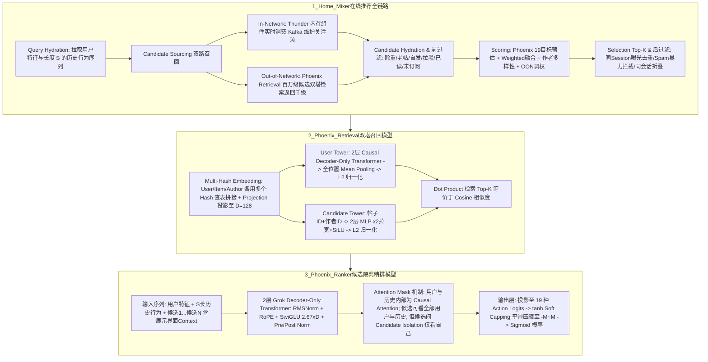

# X平台推荐算法

## 1. TL;DR

本文由腾讯广告推荐技术团队深度拆解了马斯克旗下 `xai-org/x-algorithm` 开源的 X 平台（原 Twitter）“For You”信息流推荐系统。核心结论是：
1. **开源边界与意图**：本次仅开源了在线请求视角的**召回、精排推理与策略/过滤代码**（未开源训练 Loss、样本组织与多目标融合权重），且模型超参较小（如序列长度 `history_seq_len = 32`、层数 `2`），属于生产架构的简化 Demo，旨在向广告主与公众展示推荐透明性。
2. **Home Mixer 端到端管道**：由 `Query Hydration` $\to$ `Candidate Sourcing`（内存级关注流 **Thunder** + 全局向量检索 **Phoenix Retrieval**） $\to$ `Candidate Hydration` $\to$ `前过滤` $\to$ `Scoring`（基于 Grok-1 改造的 **Phoenix Scorer** 预估 **19 个动作目标** + 多样性/圈外打分） $\to$ `Selection` $\to$ `后过滤` 组成。
3. **四大算法设计亮点**：（1）**Multi-Hash Embeddings**：对用户 ID、作者 ID、帖子 ID 均采用多哈希函数查表拼接再线性投影以消解哈希冲突；（2）**去人工特征工程（No Hand Engineered Features）**；（3）**召回双塔**：用户塔采用双层 Causal Attention Decoder-Only Transformer 取全局 Mean Pooling + L2 归一化，内容塔采用 2 层 SiLU MLP + L2 归一化；（4）**精排 Candidate Isolation（候选隔离注意力）**：候选帖子可 Attention 全部用户特征与历史行为序列，但候选帖子之间严格屏蔽、仅能看到自身（作者还勘误了 X 官方文档配图中误将用户历史画成双向注意力的错误，源码实为 Causal Attention）。

## 2. 问题定义与背景

### 2.1 开源背景与覆盖范围
X 平台在 GitHub 仓库 `xai-org/x-algorithm` 中开源了支撑“For You”信息流推荐的在线架构。正如马斯克所言，尽管算法仍有大量改进空间，但实时透明公开算法演进在社交媒体行业尚属首例。
从工业界工程视角审视，需要明确其**已开源与未开源边界**：
- **已开源**：`Home Mixer` 整体编排、内存关注流存储 `Thunder`、基于 `Grok-1` 改造的 `Phoenix` 召回与精排推理模型（`grok.py`、`recsys_retrieval_model.py`、`recsys_model.py`）及前后置过滤规则。
- **未开源 / 留白**：离线模型训练代码（Loss 函数、正负样本采样组织）、多目标加权融合（`Weighted Scorer`）的具体正负向权重参数，以及文档提及但代码未实际消费的 `Candidate Hydration` 多模态/文本特征。

## 3. 知识框架

## 4. 核心内容拆解

### 4.1 Home Mixer 在线架构与 Thunder 内存引擎
1. **双路召回（Candidate Sourcing）**：
   - **关注流内召回（In-Network — Thunder）**：`Thunder` 是纯内存存储引擎，实时消费 Kafka 中的帖子创建与删除事件，按用户维护其近期原创、回复、转发与视频帖，自动淘汰过期帖子，为关注流提供极低延迟的内存级检索。
   - **关注流外召回（Out-of-Network — Phoenix Retrieval）**：利用双塔向量检索从全局百万级非关注池中捞回千级潜在兴趣帖。
2. **双层过滤防线（前过滤 vs 后过滤）**：
   - **前过滤（送入精排打分前）**：剔除重复帖、过期老帖、用户自己发的帖、屏蔽作者/屏蔽关键词的帖、历史已读帖以及非订阅不可见帖，节约精排算力。
   - **后过滤（Top-K 截断后）**：补充拦截 Meta 信息残缺帖、内容雷同帖、**同 Session 已曝光帖**、已被删除或被识别为 Spam/暴力的违规帖，并对同一推文下多次交互的 Conversation 线程做折叠去重。

### 4.2 Phoenix 召回模型（Retrieval）：Decoder-Only 双塔设计
1. **Multi-Hash Embedding 查表机制**：
   - 为避免超大基数 ID 的哈希冲突并省去词表准入维护，对 `UserID`、`ItemID（TwitterID）`、`AuthorID` 均采用 `num_*_hashes = 2` 个独立哈希函数查表，将查出的多个向量拼接（Concatenate）后通过可学习的 `Projection` 矩阵投影至 `D = 128` 维（无效用户 Padding 为 0）。
   - 用户历史行为序列（长度 $S=32$）的每个位置拼接了：历史帖子的多哈希向量 + 历史作者的多哈希向量 + **19 种历史行为类型**投影向量 + **产品界面 ID**（词表大小 16，One-Hot 查表），再统一投影到 $D$ 维。
2. **双塔非对称结构**：
   - **User Tower**：输入为 `[用户特征, 历史行为1, ..., 历史行为S]`，经过 **2 层 Causal Self-Attention 的 Decoder-Only Transformer**；注意其输出并非取最后一个 Token 做 Next Item Prediction，而是对**所有位置做平均池化（Mean Pooling）后再做 L2 归一化**。
   - **Candidate Tower**：仅输入候选帖子 ID 与作者 ID 的多哈希拼接投影，经过 **2 层 MLP（Linear $\times 2$ 拉宽 $\to$ SiLU 激活 $\to$ Linear 投影）** 后做 L2 归一化。
   - **相似度检索**：双塔输出均已 L2 归一化，直接通过点积（Dot Product，等价于余弦相似度 Cosine）从百万级候选中检索千级 Top-$K$。

### 4.3 Phoenix 精排模型（Ranking）：候选隔离注意力与源码勘误
1. **输入构造与 Candidate Isolation（候选隔离注意力）**：
   - 精排将 `[用户特征, 历史行为1...S, 候选1...候选N]`（候选帖相比召回额外拼入了“即将在哪个产品界面展示”的上下文特征）打包进同一个序列送入 **2 层 Decoder-Only Transformer**，一次性完成对所有候选帖的打分。
   - **官方架构图勘误（代码级核实）**：X 官方文档示意图误将用户特征与历史行为画成了双向全注意力（Full Bidirectional Attention）；作者核对源码确认：**用户特征与历史行为序列内部采用的是标准的单向因果注意力（Causal Attention）**，而候选帖子段采用特制的 **Candidate Isolation Mask**——每个候选帖子可以 Attention 到所有的用户特征与历史行为，但**候选帖子之间完全不可互见（只能看到自己）**，从而保证单篇候选帖的打分绝对独立于同 Batch 内的其他候选帖顺序或组合。
2. **Grok-1 同源微架构细节**：
   - 采用 **Pre-Norm + Post-Norm** 双重归一化（基于 `RMSNorm`）、旋转位置编码 **RoPE（RotaryEmbedding）**、**SwiGLU FFN**（隐层维度为 $2.67 \times D$，扩展因子 `widening_factor = 2`）以及注意力输出缩放系数 `attn_output_multiplier = 0.125`。代码中实现了 GQA（Grouped Query Attention），Demo 配置中 `num_q_heads = num_kv_heads = 2`，`key_size = 64`。
   - **输出层与 Soft Capping**：提取历史序列之后的各个候选位置隐状态，乘以 `[Hidden_Dim, 19]` 权重矩阵得到 **19 种交互动作**（正向如 `like/reply/repost/click/share`，负向如 `block/mute/report`）的原始 Logits；随后使用 **`tanh` Soft Capping** 将 Logits 平滑限幅至 $[-M, M]$ 区间，最后经 `Sigmoid` 转化为 $[0, 1]$ 概率并送入 `Weighted Scorer` 做正负向线性加权融合。

## 5. 数据速查表

| 指标 / 超参数 | 原文数值 | 语境 / 条件 |
| :--- | :--- | :--- |
| **Phoenix 召回量级漏斗** | **百万级**候选 $\to$ 返回**千级**候选 | 用于 Out-of-Network（非关注流）潜在兴趣帖子检索 |
| **多目标行为预估维度 (`num_actions`)** | **19 个**动作目标 | 含正向（`like`, `reply`, `repost`, `click`, `share` 等）与负向（`block`, `mute`, `report`），精排输出形状为 `[batch_size, num_candidates, 19]` |
| **Demo 模型向量维度 (`emb_size`)** | `128` | 召回与精排共享的基础隐层维度 $D$（训练精度为 `BF16 + FP32`） |
| **历史行为序列长度 (`history_seq_len`)** | `32` | 不足 $S=32$ 时零填充 Padding，体现开源配置为简化 Demo 版 |
| **单次精排最大候选数 (`candidate_seq_len`)** | `8` | Demo 配置下一次前向推理同时打分的候选帖数量 $C$ |
| **多哈希函数数量 (`num_*_hashes`)** | 用户 `2` / 帖子 `2` / 作者 `2` | Multi-Hash Embedding Lookup 消解哈希冲突 |
| **产品界面词表大小** | `16` | One-Hot 查表，用于刻画历史发生界面与候选展示上下文界面 |
| **Transformer 层数与注意力头配置** | `2` 层 / `Q=2, KV=2` / `key_size=64` | 注意力输出缩放系数 `0.125`，SwiGLU FFN 维度为 $2.67 \times D$ |

## 6. 踩坑与教训 / 可迁移的设计原则

| 错误做法 | 失败表现或原因 | 原文应对（可迁移的设计原则） |
| :--- | :--- | :--- |
| **把多个候选物品拼进同一个 Transformer 序列精排时，直接开启普通 Causal 或双向 Attention** | 候选物品 $i$ 的打分会受到排在它前方的候选物品 $1 \dots i-1$ 的交叉干扰，导致同一物品在不同候选组合或顺序下打分不一致、破坏线上排序一致性 | **Candidate Isolation（候选隔离掩码）原则**：构造特殊 Attention Mask，让所有候选共享用户的 Causal 历史上下文（实现 KV Cache 复用加速），但严格屏蔽候选之间的互注意力，确保单物品打分独立性 |
| **轻信开源项目 README 的架构示意图而不核对底层源码** | X 官方文档配图将用户历史序列画成了双向 Attention，若照图复现会偏离真实训练/推理逻辑 | **源码级 Mask 核验原则**：精排与召回的 Attention Mask 必须以底层算子实现为准（源码实为用户历史段 Causal Attention + 候选段对角线自注意） |
| **在召回双塔的 User Tower（Decoder-Only）中机械照搬 LLM 只取最后一个 Token 的输出** | 推荐行为序列存在局部噪声与跳跃，仅取末尾 Token 容易丢失长期多元兴趣 | **全序列 Mean Pooling + L2 归一化原则**：在 User Tower 顶层对所有位置输出取平均池化并做 L2 归一化，融合全序列兴趣表征 |
| **在超大规模动态内容池中维护庞大的中心化 ID 词典映射** | 社交平台每秒产生海量新帖，传统词表准入与淘汰工程极其沉重 | **Multi-Hash Embedding + 线性投影原则**：使用多个独立 Hash 函数查表拼接并经可学习矩阵投影，免除动态词表管理且有效缓解单 Hash 冲突 |

## 7. 记忆锚点

- **Home Mixer 推荐流水线**：“**关注流找 Thunder（Kafka 写内存），圈外流找 Phoenix（双塔百万捞千）；前过滤省算力，19 目标算总分，后过滤防刷屏。**”
- **Phoenix 精排三大精髓**：“**多哈希免词表、Causal 算历史、Candidate Isolation 隔候选（KV 共享一次算完 N 个候选且互不串味）。**”

## 8. 复习卡片

X 平台开源的 `x-algorithm`（Home Mixer）是如何划分“关注内（In-Network）”与“关注外（Out-of-Network）”两条召回通道的？::关注内（In-Network）由内存存储引擎 Thunder 负责，它实时消费 Kafka 中的帖子创建/删除事件并维护用户近期原创、回复、转发与视频帖；关注外（Out-of-Network）由 Phoenix Retrieval 双塔模型负责，从全局百万级候选中基于向量点积检索出千级候选。
Phoenix 召回双塔模型的 User Tower 和 Candidate Tower 分别采用了什么网络结构？::User Tower 采用 2 层带 Causal Self-Attention 的 Decoder-Only Transformer，对所有位置输出做平均池化（Mean Pooling）后再做 L2 归一化；Candidate Tower 仅输入帖子 ID 与作者 ID，采用 2 层 MLP（2 倍拉宽 + SiLU 激活 + 线性投影）后做 L2 归一化。
Phoenix 模型是如何处理用户 ID、帖子 ID 和作者 ID 的 Embedding 查表的？::采用 Multi-Hash Embeddings（多哈希查表）：对每个 ID 使用多个（配置中为 2 个）独立哈希函数查表以缓解哈希冲突，将多个哈希向量拼接（Concatenate）后再通过可学习的 Projection 矩阵投影到 D 维（128 维）。
什么是精排模型中的“候选隔离（Candidate Isolation）”注意力机制，它有什么工程与算法优势？::在将 `[用户特征, 历史行为序列, 候选1...候选N]` 拼接送入 Transformer 一次性打分时，通过特殊 Attention Mask 让用户与历史内部保持 Causal Attention，每个候选帖子可以关注全部用户特征与历史行为，但候选帖子之间互相屏蔽（只能看到自己）；既复用了用户侧计算、实现单次前向给 N 个候选打分，又保证了每个候选打分不受其他候选干扰。
作者在审阅 Phoenix 精排源码时发现了 X 官方文档示意图中的什么错误？::X 官方示意图将用户与历史行为序列部分画成了双向注意力（Full Bidirectional Attention），但源码实际实现的是单向因果注意力（Causal Attention）。
Phoenix 精排模型的输出层是如何从隐状态生成最终排序分数的？::提取每个候选位置的输出乘以权重矩阵得到 19 种交互动作（包含点赞、回复、转发等正向行为及拉黑、举报等负向行为）的原始 Logits，先经 `tanh` Soft Capping 平滑压缩到 `[-M, M]`，再过 Sigmoid 转为 `[0, 1]` 概率，最后由 Weighted Scorer 进行加权线性融合并结合多样性与 OON 调权。

## 9. 知识关联

- **本库通用主题**：[检索与文档解析](../../20_topics/%E6%A3%80%E7%B4%A2%E4%B8%8E%E6%96%87%E6%A1%A3%E8%A7%A3%E6%9E%90.md) · [模型与开发工具发布](../../20_topics/%E6%A8%A1%E5%9E%8B%E4%B8%8E%E5%BC%80%E5%8F%91%E5%B7%A5%E5%85%B7%E5%8F%91%E5%B8%83.md) · [推荐系统与多模态评测](../../20_topics/%E6%8E%A8%E8%8D%90%E7%B3%BB%E7%BB%9F%E4%B8%8E%E5%A4%9A%E6%A8%A1%E6%80%81%E8%AF%84%E6%B5%8B.md)
- **候选双链**：[[HiGR列表生成推荐]] · [[Cagra向量检索实践]] · [[Target-Attention与Candidate-Isolation]] · [[多目标推荐MMoE与PLE]]

## 10. 原文参考资料

- 原文标题：《马斯克说到做到：开源 X 平台核心推荐算法》（作者：腾讯广告推荐技术团队，周超博士，发布于 2026-02-12）
- 开源项目地址：`https://github.com/xai-org/x-algorithm`（核心模块：`home-mixer`、`thunder`、`phoenix`）。

> [!note]- 校对报告
> - **页码溯源汇总**：
>   - `p.1–2`：核心结论三点总览、开源边界说明（仅开源在线召回/精排推理与策略过滤，未开源训练 Loss 与样本组织）及 `xai-org/x-algorithm` 背景。
>   - `p.3–6`：Home Mixer 整体架构（Query Hydration、Thunder 与 Phoenix Retrieval 双路召回、Candidate Hydration、前过滤、19 目标 Phoenix Scorer 与 Weighted/Author diversity/OON 打分、Selection、后过滤）及四大关键设计理念。
>   - `p.6–9`：Phoenix 召回双塔源码拆解（Multi-Hash 查表、19 种历史行为类型、界面词表 16、User Tower 2 层 Causal Decoder-Only + Mean Pooling + L2 归一化、Candidate Tower 2 层 SiLU MLP、Demo 参数配置表）。
>   - `p.10–14`：Phoenix 精排源码拆解、官方文档示意图勘误（用户历史实为 Causal Attention 而非双向注意力）、Candidate Isolation 掩码机制、Grok-1 微架构组件（RMSNorm、RoPE、SwiGLU $2.67 \times D$、Soft Capping `tanh`、Sigmoid 19 维输出）与 Weighted Scorer 正负向行为融合。
> - **核验结论**：全文所有模型结构、超参数数值及源码勘误细节均与原文逐页核对一致。
