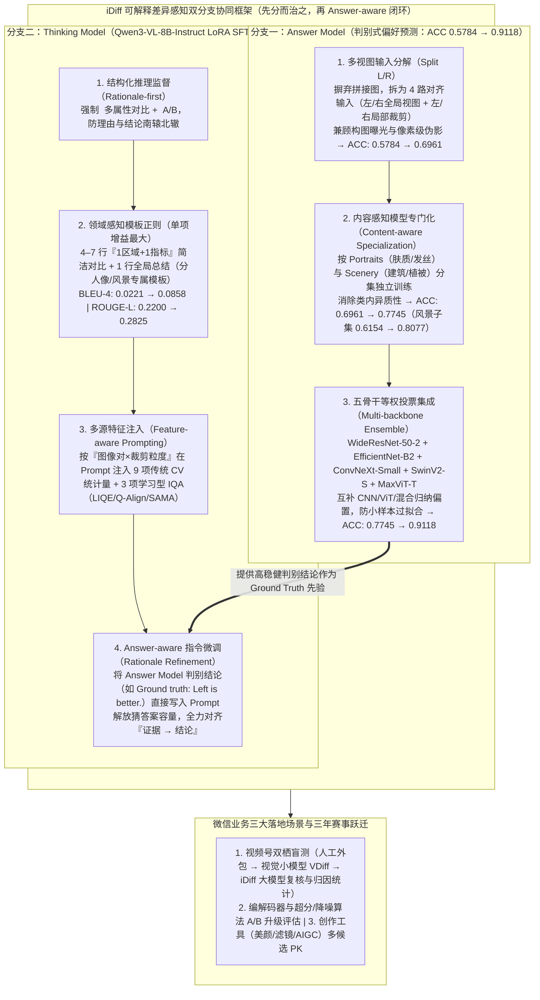

# 微信测试团队斩获 CVPR 2026 NTIRE RAIM 挑战赛冠军

> **原文信息**：作者 `孙暕晖`（微信测试中心 IH-VQA 团队队长，比赛队员：`岳新立`、`侯欢`、`邵涛`），发布于 2026-06-12 02:36（广东），公众号「腾讯技术工程」。

---

## 1. TL;DR

1. **赛事夺冠与核心突破** —— 在 OPPO Y-Lab 与香港理工大学 VC-Lab 联合主办的 **CVPR 2026 NTIRE 第 3 届 RAIM（Professional IQA - Track 1）** 挑战赛中，微信测试中心 **IH-VQA 团队**凭借首创的 **iDiff 可解释成对差异感知框架（Interpretable Difference-aware Framework for Pairwise IQA）**，在偏好准确率（ACC）与思维链推理质量双维度刷新基线，以 **Final Score `0.7305`** 夺冠（领先亚军 VCIP Pi Group `0.7253`、季军 I² Group `0.7040`），实现该团队 2024–2026 连续三年在国际顶级视觉质量赛事登顶。
2. **为什么传统标量打分与直接用通用 MLLM 不够用？** —— 视频号与影像工程不仅需要知道「A 比 B 高 0.07 分」，更需要可归因的解释（差在肤质纹理、噪点还是动态范围）；而通用 MLLM 面临两大硬伤：**前端 ViT/CLIP 编码器 resize 丢失像素级高分辨率失真细节**，以及**输出「A 更清晰自然」等空泛套话而非影像工程细粒度对比**。
3. **iDiff 核心哲学：判别归判别，解释归解释（双分支分治与耦合）** —— 鉴于判别式模型擅长稳健打分却不会说话、生成式 MLLM 会说话却易幻觉自相矛盾，iDiff 设计了训练期独立优化、推理期耦合的双分支架构：**`Answer Model`（专注鲁棒判别式偏好预测）** + **`Thinking Model`（专注结构化专家级推理生成）**。
4. **`Answer Model` 三级提分阶梯（ACC 从 `0.5784` 跃升至 `0.9118`）** —— ① **多视图输入分解（Split L/R）**：摒弃原始左右拼接图，显式拆解为 **4 个对齐输入**（左/右全局视图 + 左/右裁剪局部视图），ACC 从 **`0.5784` 升至 `0.6961`**；② **内容感知模型专门化**：按 **Portraits（人像）** 与 **Scenery（风景）** 拆分子集独立训练消除类内异质性，ACC 升至 **`0.7745`**（风景子集从 `0.6154` 跃升至 **`0.8077`**）；③ **5 骨干等权投票集成**（`WideResNet-50-2`、`EfficientNet-B2`、`ConvNeXt-Small`、`Swin Transformer V2-S`、`MaxViT-T`），ACC 跃升至 **`0.9118`**（在小样本下比按验证集加权更防过拟合）。
5. **`Thinking Model` 四步渐进增强与三大业务落地** —— 基于 **Qwen3-VL-8B-Instruct（LoRA SFT）**（并在 MiniCPM-V-4.5 等 4 款模型验证通用性），依次引入：① **`<thinking> + <answer>` 结构化先讲依据再下判断**；② **领域感知模板正则**（`4–7 行简洁对比 + 1 行全局总结`，每行聚焦「1 区域 + 1 指标」，使 BLEU-4 从 **`0.0221` 暴涨至 `0.0858`**、ROUGE-L 从 **`0.2200` 升至 `0.2825`**）；③ **多源特征注入**（9 项传统 CV 统计量 + 3 项学习型 IQA 指标追加进 Prompt）；④ **Answer-aware 指令微调**（将 Answer Model 结论如 `Ground truth: Left is better.` 直接写入 Prompt 做理由精修）。目前已在**微信视频号双栖盲测、编解码器/画质算法 A/B 升级评估、一线创作工具（美颜/滤镜/AIGC）多候选 PK** 三大场景规模化落地。

---

## 2. 问题定义与背景

### 2.1 业务痛点与通用 MLLM 的两道坎

在微信视频号、实时音视频通话、直播、朋友圈等业务中，传统的标量 IQA（MOS、PSNR、SSIM、SAMA、Q-Align）只能回答「谁分高」，无法回答工程团队真正关心的归因问题：*新版编解码器在哪些场景退化了？A/B 设备成片到底差在肤质、噪点还是动态范围？AIGC 修图候选图为什么人工觉得这张更好？*
而直接拿现成通用 MLLM 上手会撞上两道坎：
1. **高分辨率细节在前端丢失**：专业摄影失真线索（纹理、噪点、伪影）是像素级的，通用 ViT/CLIP 为迁就 Token 预算将图 resize 到低分辨率，关键线索直接被压没。
2. **外行套话与幻觉**：通用 MLLM 只会说「图像 A 看起来更清晰自然」，不会用「肤质纹理 vs 修复伪影」「高光留白 vs 动态范围」等专业影像工程语言做细粒度对比，且极易出现理由与结论自相矛盾。

---

## 3. 知识框架

---

## 4. 核心内容拆解

### 4.1 赛事任务与双口径评价体系

1. **数据集构成（OPPO Y-Lab & 香港理工 VC-Lab 构建）**：
   - 聚焦专业摄影中的 **人像（Portraits）** 与 **风景（Scenery）** 两大主类；
   - 每条样本含一对高分辨率图像（Image A 与 Image B），标注包括：**专家偏好（Expert Preference，A/B 二选一）** + **推理段落（Reasoning Paragraph，涵盖纹理、真实感、噪声、动态范围、伪影等专业解释）**。
2. **双口径评分公式**：
   - **Preference Accuracy（ACC）**：二分类偏好预测准确率；
   - **Reasoning Quality（推理质量）**：融合语义相似度（**`BLEU-4 + ROUGE-L`**）与 **LLM Judge**（从逻辑连贯性、幻觉控制、图像内容对齐三维度打分）；
   - **最终得分**：$$\text{Final Score} = 0.5 \times \text{Phase 2 Score（验证集）} + 0.5 \times \text{Phase 3 Score（隐藏测试集 + LLM Judge）}$$。

---

### 4.2 Answer Model：三项核心技术将判别准确率推至 91.18%

1. **多视图输入分解（Multi-view Input Decomposition，Split L/R）**：
   - **痛点**：赛事原始数据将左/右候选图及全局/局部裁剪打包在单张拼接图里，直接输入相当于把两张图「糊」在一起，模型只能靠隐式特征区分。
   - **方案**：显式拆解为 **4 个对齐输入**（左全局视图、右全局视图、左裁剪局部视图、右裁剪局部视图），同时捕捉全局感知一致性（构图、曝光、自然度）与局部像素失真（纹理、噪声、伪影）。
   - **消融收益**：仅此一项便将整体准确率从 **`0.5784` 提升至 `0.6961`**，且在 5 种不同骨干网络上一致有效。
2. **内容感知模型专门化（Content-aware Model Specialization）**：
   - **痛点**：人像（关注面部纹理、肤质平滑度、发丝边界、修复伪影）与风景（关注建筑结构、植被、文字清晰度、整体自然度）的质量线索差异巨大，混合训练会导致特征学习互相稀释。
   - **方案**：将训练集划分为 **Portraits / Scenery** 两个子集，分别训练独立的 Answer Model。
   - **消融收益**：整体准确率进一步从 **`0.6961` 提升至 `0.7745`**，其中 **Scenery（风景）子集准确率从 `0.6154` 暴涨至 `0.8077`**。
3. **多骨干等权投票集成（Multi-backbone Ensemble）**：
   - **方案**：融合 CNN 系（对局部纹理与边缘敏感）、Transformer 系（对全局一致性与长距离依赖占优）及混合架构共 **5 个异构骨干**：**`WideResNet-50-2`、`EfficientNet-B2`、`ConvNeXt-Small`、`Swin Transformer V2-S`、`MaxViT-T`**。
   - **为什么选简单等权投票而非验证集加权？** 实验证明在小样本成对 IQA 场景下，**跨骨干等权投票将整体准确率从 `0.7745` 大幅推高至 `0.9118`**，且显著优于「易过拟合验证集的加权融合版本」。

---

### 4.3 Thinking Model：四步渐进式增强写出专家级评语

团队以 **`Qwen3-VL-8B-Instruct`** 为基座进行 LoRA SFT（同时在 `MiniCPM-V-4.5`、`GLM-4.6V-Flash`、`Ovis2.5-9B`、`InternVL3.5-8B` 上验证了该渐进策略的跨模型通用性）：
1. **第一步：结构化推理监督（Structured Reasoning Supervision）**
   - 强制采用 `<thinking> ... </thinking><answer> A / B </answer>` 的 **rationale-first（先讲依据、再下判断）** 范式，防止理由与结论自相矛盾。
2. **第二步：模板化推理正则（Template-based Reasoning Regularization，单项增益最大）**
   - 强制生成 **`4–7 行简洁对比 + 1 行强制性全局总结`**，每行严格聚焦**「一个区域 + 一个指标」**；
   - 并按语义域定制专属模板（Portraits 模板聚焦肤质纹理/发丝边缘/衣物区域；Scenery 模板聚焦背景纹理/建筑结构/植被/边缘过渡）；
   - **消融收益**：仅此一项就将 **`BLEU-4` 从 `0.0221` 提升近 4 倍至 `0.0858`**（通用模板为 `0.0801`，领域专属模板进一步升至 `0.0858`），**`ROUGE-L` 从 `0.2200` 提升至 `0.2825`**。
3. **第三步：多源特征注入（Multi-source Feature Injection）**
   - 针对极其相似的图像对仅靠视觉特征易「凭直觉乱猜」的问题，按「图像对 × 裁剪粒度」在 User Prompt 中显式注入两类量化特征作为辅助证据：
     - **9 项传统 CV 物理统计量**：`Laplacian`、`Tenengrad`、噪声标准差、高频比、边缘密度、熵、曝光相关比、色彩度、平均亮度；
     - **3 项学习型 IQA 语义指标**：`LIQE`、`Q-Align`、`SAMA`。
4. **第四步：Answer-aware 指令微调（Answer-aware Instruction Tuning / Rationale Refinement）**
   - 将上游 `Answer Model` 预测出的高稳健结论直接作为先验写入 Prompt（例如：`Ground truth: Left is better.`），让 `Thinking Model` 不再重复预测 Answer Token，而是把全部生成容量用于精修支撑该结论的推理过程，彻底打通双分支闭环。

---

## 5. 数据速查表

| 指标 | 原文数值 | 语境 / 条件 |
| :--- | :--- | :--- |
| CVPR 2026 NTIRE RAIM Track 1 最终得分 | **冠军 iDiff `0.7305`（亚军 VCIP Pi Group `0.7253`，季军 I² Group `0.7040`）** | `Final Score = 0.5 × Phase 2 Score + 0.5 × Phase 3 Score` |
| 多视图输入分解（Split L/R）后 ACC | **从 `0.5784` 提升至 `0.6961`（拆为 4 个对齐输入）** | 左/右全局视图 + 左/右裁剪局部视图 |
| 内容感知专门化（Portraits / Scenery 分训）后 ACC | **整体升至 `0.7745`（其中 Scenery 子集从 `0.6154` 跃升至 `0.8077`）** | 按人像与风景拆分子集独立训练 Answer Model |
| 5 骨干等权投票集成后最终 ACC | **从 `0.7745` 跃升至 `0.9118`** | 融合 `WideResNet-50-2 / EfficientNet-B2 / ConvNeXt-Small / SwinV2-S / MaxViT-T` |
| 模板化推理正则结构与文本指标提升 | **`4–7 行对比 + 1 行总结`；BLEU-4 从 `0.0221` 升至 `0.0858`，ROUGE-L 从 `0.2200` 升至 `0.2825`** | 通用模板 BLEU-4 为 `0.0801`，领域专属模板进一步达 `0.0858` |
| 多源特征注入指标数量 | **9 项传统 CV 统计量 + 3 项学习型 IQA 指标（`LIQE / Q-Align / SAMA`）** | 按「图像对 × 裁剪粒度」格式化追加至 User Prompt |
| Thinking Model 主基座与验证模型群 | **主基座 `Qwen3-VL-8B-Instruct`（LoRA SFT）+ 4 款跨模型验证** | 跨模型验证含 `MiniCPM-V-4.5 / GLM-4.6V-Flash / Ovis2.5-9B / InternVL3.5-8B` |
| IH-VQA 团队三年国际顶赛战绩 | **2024 CVPR VQA 亚军 → 2025 CVPR NTIRE & ICCV MIPI 双冠 → 2026 CVPR NTIRE RAIM 冠军** | 演进路线：`VQA 打分 → iMatch 图文匹配 → iDetex 细节诊断 → iDiff 成对推理` |

---

## 6. 踩坑与教训 / 可迁移的设计原则

| 错误做法 | 失败表现或原因 | 原文应对 |
| :--- | :--- | :--- |
| 试图用单一模型（纯判别回归模型或纯 MLLM 生成模型）同时搞定「高准确率偏好预测」与「专家级长文解释」 | 判别式模型（如 MUSIQ/SAMA）不会开口讲理由；生成式 MLLM（如 Q-Align/DepictQA）在细粒度对比时判别不稳定、易出现幻觉与前后矛盾 | 提出 **iDiff 双分支分治架构**：训练期 `Answer Model` 与 `Thinking Model` 独立优化互不干扰，推理期通过 **Answer-aware 指令微调**耦合闭环 |
| 直接将赛事提供的「左右候选图 + 全局/局部裁剪」单张拼接图原样塞给视觉编码器 | 两张图被「糊」在一起，且通用 ViT/CLIP resize 会压丢像素级伪影与噪点，基线准确率仅 `0.5784` | 实施 **多视图输入分解（Split L/R）**，显式拆解为 **4 路对齐输入**（左/右全局 + 左/右局部裁剪），准确率直接跳升至 `0.6961` |
| 把人像（Portraits）和风景（Scenery）样本混在一起训练单个判别模型，或按验证集精度给多模型加权融合 | 人像看肤质发丝、风景看建筑植被，混训导致特征学习互相稀释（风景仅 `0.6154`）；小样本下按验证集加权极易过拟合 | 实施 **内容感知专门化**按语义域分训（风景升至 `0.8077`），并对 5 类异构骨干采用稳健的**简单等权投票融合**（准确率达 `0.9118`） |
| 让 MLLM 自由发挥撰写画质对比评语，或仅依赖纯视觉 Token 判断极度相似的图像对 | 自由生成方差极大、套话连篇（BLEU-4 仅 `0.0221`）；面对极细微画质差异时视觉编码器「看不出差别」只能瞎猜 | 引入 **`4–7 行（1 区域 + 1 指标）+ 1 行总结`** 的领域专属模板正则（BLEU-4 涨近 4 倍），并在 Prompt 中显式注入 **9 项传统 CV 物理量 + 3 项学习型 IQA 分数** |

---

## 7. 记忆锚点

1. **核心架构口诀**：「**判别归判别（Answer Model 冲 91.18% 准确率），解释归解释（Thinking Model 写专家评语），最后用 Answer-aware 指令微调（`Ground truth: Left is better.`）合龙**。」
2. **Answer Model 三级跳数字**：`0.5784`（拼接图基线）$\xrightarrow{\text{4路多视图拆解}}$ `0.6961` $\xrightarrow{\text{人像/风景分训}}$ `0.7745` $\xrightarrow{\text{5骨干等权投票}}$ **`0.9118`**。
3. **Thinking Model 四步增强**：`<thinking>` 先讲依据 → `4–7 行 + 1 行` 领域模板（BLEU-4 从 `0.0221` 升至 `0.0858`）→ `9 项 CV + 3 项 IQA` 特征注入 → `Answer-aware` 理由精修。

---

## 8. 复习卡片

1. 为什么在微信视频号等真实影像工程中，传统的标量画质分（如 PSNR、SSIM、Q-Align）和直接调用通用 MLLM 都不够用？::传统标量打分只能告诉业务「A 比 B 高 0.07 分」，无法给出可对照、可归因的解释（如究竟差在肤质、噪点还是动态范围）；而直接用通用 MLLM 一方面会在前端 ViT/CLIP resize 时丢掉像素级高分辨率失真细节，另一方面容易输出「A 更清晰自然」的空泛套话甚至产生前后矛盾的幻觉。
2. iDiff 框架为什么要设计成「Answer Model + Thinking Model」双分支结构，两者是如何协同闭环的？::因为判别式模型擅长稳健打分却不会生成自然语言解释，生成式 MLLM 擅长写解释但在细粒度对比中判别不稳定；iDiff 让 `Answer Model` 专注判别预测、`Thinking Model` 专注推理生成，两分支在训练期独立优化，在推理期通过「Answer-aware 指令微调」将 Answer Model 的稳健结论（如 `Ground truth: Left is better.`）直接写入 Thinking Model 的 Prompt，让后者把全部容量用于对齐「证据→结论」的理由精修。
3. iDiff 的 `Answer Model` 是通过哪三项核心设计将成对偏好准确率从 `0.5784` 一步步提升到 `0.9118` 的？::① 多视图输入分解（Split L/R）：摒弃原始单张拼接图，显式拆解为左/右全局视图 + 左/右裁剪局部视图 4 个对齐输入，准确率升至 `0.6961`；② 内容感知模型专门化：按 Portraits（人像）和 Scenery（风景）分集独立训练以消除类内异质性，准确率升至 `0.7745`（风景子集从 `0.6154` 跃升至 `0.8077`）；③ 5 骨干等权投票集成：融合 `WideResNet-50-2`、`EfficientNet-B2`、`ConvNeXt-Small`、`Swin Transformer V2-S`、`MaxViT-T`，在小样本下避免加权过拟合，准确率跃升至 `0.9118`。
4. iDiff 的 `Thinking Model`（基于 Qwen3-VL-8B-Instruct）采用了哪四步渐进式增强策略，其中单项增益最大的是哪一步？::依次采用：① 结构化推理监督（`<thinking> + <answer>` 先讲依据再下结论）；② 模板化推理正则（强制生成 `4–7 行「1区域+1指标」简洁对比 + 1 行全局总结` 的人像/风景专属模板，此项增益最大，将 BLEU-4 从 `0.0221` 提升至 `0.0858`、ROUGE-L 从 `0.2200` 提升至 `0.2825`）；③ 多源特征注入（在 Prompt 中注入 Laplacian 等 9 项传统 CV 统计量与 LIQE/Q-Align/SAMA 3 项学习型 IQA 指标）；④ Answer-aware 指令微调。
5. iDiff 在微信视频号及相关业务中已经落地了哪三大核心场景，团队三年来的技术演进脉络是什么？::三大落地场景为：① 视频号 vs 竞品双栖盲测（从人工外包、视觉小模型 VDiff 升级为 iDiff 大模型复核与差异维度统计）；② 编解码器与超分/降噪算法 A/B 升级客观可解释评估；③ 一线创作工具（美颜、滤镜、AIGC 特效）多候选批量 PK 归档。团队三年演进脉络为：画质打分（VQA，2024 亚军）→ 细粒度图文匹配（iMatch，2025 冠军）→ 细节可解释诊断（iDetex，2025 冠军）→ 专家级成对推理（iDiff，2026 冠军）。

---

## 9. 知识关联

- **已有主题**：[Agent评测与反馈](../../20_topics/Agent%E8%AF%84%E6%B5%8B%E4%B8%8E%E5%8F%8D%E9%A6%88.md) · [因果推断与评测归因](../../20_topics/%E5%9B%A0%E6%9E%9C%E6%8E%A8%E6%96%AD%E4%B8%8E%E8%AF%84%E6%B5%8B%E5%BD%92%E5%9B%A0.md) · [决策知识结构化](../../20_topics/%E5%86%B3%E7%AD%96%E7%9F%A5%E8%AF%86%E7%BB%93%E6%9E%84%E5%8C%96.md) · [Harness与模型协同](../../20_topics/Harness%E4%B8%8E%E6%A8%A1%E5%9E%8B%E5%8D%8F%E5%90%8C.md) · [推荐系统与多模态评测](../../20_topics/%E6%8E%A8%E8%8D%90%E7%B3%BB%E7%BB%9F%E4%B8%8E%E5%A4%9A%E6%A8%A1%E6%80%81%E8%AF%84%E6%B5%8B.md)
- **候选新主题**：[[iDiff成对可解释画质评估]] · [[判别与生成双分支协同]] · [[多源物理特征提示注入]]

---

## 10. 原文参考资料

1. **冠军论文（CVPR 2026 Workshop NTIRE）**：*iDiff: Interpretable Difference-aware Framework for Pairwise Image Quality Assessment*（`https://openaccess.thecvf.com/content/CVPR2026W/NTIRE/html/Yue_iDiff_Interpretable_Difference-aware_Framework_for_Pairwise_Image_Quality_Assessment_CVPRW_2026_paper.html`）
2. **CVPR 2026 NTIRE RAIM 比赛主页**：`https://www.codabench.org/competitions/12789/#/pages-tab`
3. **对比基准与骨干模型**：MUSIQ、MANIQA、SAMA、LIQE、Q-Align、DepictQA、Co-Instruct；`WideResNet-50-2`、`EfficientNet-B2`、`ConvNeXt-Small`、`Swin Transformer V2-S`、`MaxViT-T`；`Qwen3-VL-8B-Instruct`、`MiniCPM-V-4.5`、`GLM-4.6V-Flash`、`Ovis2.5-9B`、`InternVL3.5-8B`。

> [!note]- 校对报告
> - **校对状态**：已根据 `MD.md` 全文（共 13 页 PDF 转写文本，第 13 页为空白页）逐一核对。
> - **核心数据与事实页码溯源**：
>   - 微信测试中心 IH-VQA 团队（队长孙暕晖，队员岳新立、侯欢、邵涛）、CVPR 2026 NTIRE 第 3 届 RAIM Track 1 冠军（Final Score `0.7305`，亚军 VCIP Pi Group `0.7253`，季军 I² Group `0.7040`）、2025 NTIRE 与 ICCV MIPI 冠军背景、论文与比赛链接：见 PDF 第 1–2 页。
>   - 传统标量打分局限与直接用通用 MLLM 的两大坎（前端 ViT/CLIP resize 丢失像素级失真细节、输出套话不会影像工程细粒度对比）：见 PDF 第 3–4 页。
>   - 数据集（OPPO Y-Lab & 香港理工 VC-Lab 构建，Portraits 与 Scenery 两类）、双口径评价规则（`ACC` + `BLEU-4 / ROUGE-L / LLM Judge`，`Final Score = 0.5 × Phase 2 + 0.5 × Phase 3`）、三阶段赛程时间表：见 PDF 第 4–5 页。
>   - iDiff 双分支设计动机（判别式模型 MUSIQ/MANIQA/SAMA vs MLLM 评估器 Q-Align/DepictQA/Co-Instruct）：见 PDF 第 6–7 页。
>   - Answer Model 三大模块与消融数据：3.2.1 多视图输入分解拆为 4 个对齐输入（ACC `0.5784 → 0.6961`）；3.2.2 内容感知专门化按 Portraits/Scenery 分训（ACC `→ 0.7745`，Scenery 从 `0.6154 → 0.8077`）；3.2.3 5 骨干等权投票集成（ACC `→ 0.9118`）：见 PDF 第 7–8 页。
>   - Thinking Model（Qwen3-VL-8B-Instruct LoRA SFT 及 4 款模型通用性验证）四步增强：3.3.1 `<thinking>+<answer>`；3.3.2 `4–7 行对比 + 1 行总结` 模板正则（BLEU-4 `0.0221 → 0.0858`，通用模板 `0.0801`，ROUGE-L `0.2200 → 0.2825`）；3.3.3 9 项传统 CV 统计量 + 3 项学习型 IQA 注入；3.3.4 Answer-aware 指令微调（`Ground truth: Left is better.`）：见 PDF 第 8–9 页。
>   - 三大业务落地场景（视频号双栖盲测从 VDiff 到 iDiff、编解码器/算法 A/B 升级评估、一线创作工具多候选 PK）与 2024–2026 三年赛事跃迁总结：见 PDF 第 10–11 页。
