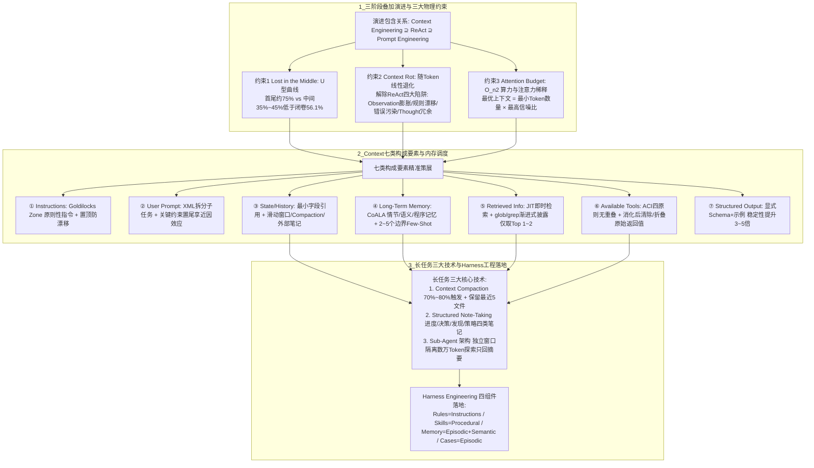

# 别再只卷 Prompt 了，真正拉开 Agent 差距的是 Context Engineering

## 1. TL;DR

本文结合 Anthropic《Effective Context Engineering for AI Agents》与《Building Effective Agents》、Philipp Schmid 七要素拆解、普林斯顿 CoALA 认知记忆架构及斯坦福《Lost in the Middle》实证研究，系统构建了生产级 Agent 的 **Context Engineering（上下文工程）** 知识体系。全文指出：AI 应用已从优化单次调用的 **Prompt Engineering**、只进不出的 **ReAct 多轮循环** 演进到管理全生命周期信息空间的 **Context Engineering**（三者为包含叠加关系：`Context Engineering ⊇ ReAct ⊇ Prompt Engineering`）。受限于三大物理约束——**Lost in the Middle（U 型位置曲线，中间位置开卷正确率 $35\%\sim 45\%$ 甚至低于闭卷基线 $56.1\%$）、Context Rot（随轮次推进关键指令被稀释导致慢性退化）与 Attention Budget（$O(n^2)$ 注意力代价）**，上下文不是越大越安全，核心公式是 `最优上下文 = 最小 Token 数量 × 最高信噪比`。工程落地上，需围绕 **七类构成要素**（系统指令 Goldilocks Zone、用户提示、状态与历史、长期记忆、JIT 即时检索信息、ACI 工具定义与返回清理、结构化输出），综合运用 **长任务三大核心技术（Context Compaction 自动压缩、Structured Note-Taking 结构化外部笔记、Sub-Agent 子智能体上下文隔离）** 精准破解 ReAct 四大陷阱，并通过 **Harness Engineering 四组件（Rules / Skills / Memory / Cases）** 将上下文管理沉淀为可版本化的团队资产。

## 2. 核心概念

- **Context Engineering（上下文工程）**：Anthropic 将其定义为从不断演化的海量潜在信息宇宙中，通过**策展（Curating，主动选择剪裁而非堆砌）、最优（Optimal，信噪比最高而非最多）、演化（Ever-evolving，每轮调用前动态维护）** 填充有限上下文窗口的艺术与科学；在 Karpathy 的“LLM OS”类比中，上下文窗口是 **RAM（工作内存）**，而 Context Engineering 就是操作系统的**内存调度器**。
- **三大物理约束（Lost in the Middle / Context Rot / Attention Budget）**：
  - **Lost in the Middle（中间迷失）**：模型对上下文开头（首因效应，约 $75\%$ 正确率）和结尾（近因效应，约 $70\%\sim 75\%$）召回率高，夹在中间时正确率坍陷至 $35\%\sim 45\%$，甚至低于不给文档的闭卷基线（$56.1\%$）。
  - **Context Rot（上下文腐化）**：随着 Token 增加，模型准确召回信息的能力线性下降；长任务中历史与工具输出稀释了初始规范（如第 1 轮规定 `camelCase`，到第 40 轮退化出 `snake_case`），属于慢性退化而非崩溃。
  - **Attention Budget（注意力预算）**：Transformer 自注意力复杂度为 $O(n^2)$（$1\text{K Token}$ 基准为 $1\times$，$10\text{K}$ 为 $100\times$，$128\text{K}$ 约 $16384\times$，$200\text{K}$ 约 $40000\times$），每一个无关 Token 都在主动损耗有效信号强度。
- **Goldilocks Zone（系统指令适中区间）**：系统指令粒度既不能太精细（列 180 条 `IF-AND` 枚举导致脆弱、高维护且难覆盖未知场景），也不能太宽泛（“请专业处理问题”零实质约束），而应给出明确的角色边界、核心原则与工具分工原则。
- **ACI（Agent-Computer Interface，Agent-计算机接口）**：将工具定义（名称、适用/不适用描述、参数示例）与返回格式设计视同人机交互中的 UI/UX 设计；如果人类工程师看文档都分不清该调哪个工具，Agent 同样会选错。
- **CoALA 记忆四分类**：将 Agent 记忆划分为始终在场的 **工作记忆（Working Memory，即上下文窗口）** 与按需检索的三类外部长期记忆——**情节记忆（Episodic，历史轨迹/Cases）**、**语义记忆（Semantic，RAG 领域知识/事实）**、**程序记忆（Procedural，Skills/Rules/工具与提示模板）**。

## 3. 知识框架

以下流程图按正文整理，展示从范式演进、三大物理约束、七类构成要素到长任务三大技术与 Harness 四组件映射的完整体系：



## 4. 关键要点与机制详解

### 4.1 范式演进与三大物理约束：为什么“信息越多越好”是错误直觉

**核心主张**：现在大多数 Agent 的失败不再是模型能力的失败，而是上下文的失败——把所有可能相关的信息塞进大窗口不仅导致 $O(n^2)$ 成本激增，更会因 U 型位置盲区与信号稀释拉低任务成功率。

- **三阶段范式演进对比（包含叠加而非替代）**

| 演进阶段 | 代表年代 | 核心解决的问题 | 基本工作单元 | 上下文管理方式与局限 |
|---|---|---|---|---|
| **1. Prompt Engineering** | 2020—2022 | 如何写好输入措辞让 LLM 输出更好（Zero/Few-shot, CoT） | 单次 LLM 调用 | 手动设计、一次性使用；硬边界是“单轮任务” |
| **2. ReAct 范式** | 2022—2024 | 如何让 LLM 主动调用外部工具分多步完成任务（`Thought → Action → Observation`） | 多轮 TAO 循环 | **隐式只进不出、不做管理**；$20\sim 50$ 步后上下文无限膨胀退化 |
| **3. Context Engineering** | 2025—现在 | 如何在正确的时机、以正确的格式向有限窗口提供高信噪比信息与工具 | Agent 完整生命周期 | **显式工程化、每轮调用前迭代策展**（像 OS 内存调度器管理 RAM） |

- **三大实验与物理约束的工程推论**
  1. **Lost in the Middle 的四条位置铁律**：既然第 1 位（$\approx 75\%$）和最后一位（$\approx 70\%\sim 75\%$）召回最高、中间位置（$\approx 35\%\sim 45\%$）甚至低于闭卷基线（$56.1\%$），工程排版必须遵循：① 最重要的系统安全与核心规范放在 `System Prompt` **最开头**（利用首因效应）；② 当前任务最关键的约束放在 `User Prompt` **最结尾**（利用近因效应）；③ 检索到的文档把最相关的放在第一位或最后一位；④ 严禁把关键规则夹在大量工具调用记录中间。
  2. **Context Rot 与 Attention Budget**：随着上下文从 $1\text{K}$ 涨到 $10\text{K}$、$50\text{K}$、$128\text{K}$、$200\text{K}$，自注意力计算量呈 $1\times \to 100\times \to 2500\times \to 16384\times \to 40000\times$ 暴涨；即使未来窗口扩至 $100$ 万 Token（如 Gemini 1.5 Pro），$1$ 万 Token 的关键指令同样会被 $90$ 万 Token 的无关噪音淹没。

### 4.2 Context 七类构成要素的设计规范与 ACI 准则

**核心主张**：区分“简陋 Demo”与“神奇产品”的不是调用模型的代码，而是在调用前如何系统化组装、精简和淘汰进入窗口的七类要素（例如安排会议邮件示例：简陋 Demo 只传原句导致反问时间；神奇产品在调用前主动收集日历、历史邮件语气、联系人重要性与发邀请工具，直接一步完成改期提议与邀约发送）。

| 构成要素 | 核心设计原则与正反例要点 |
|---|---|
| **① Instructions / System Prompt** | 落在 **Goldilocks Zone（原则性指令）**：用 Markdown 标题或 XML 标签分区（`## 角色`、`## 核心原则`、`## 工具使用`），不写 180 条 `if-else` 脆性规则，也不写空洞口号；核心安全限制置顶 |
| **② User Prompt** | 输入模糊时优先澄清而非盲猜；多子任务用 XML 标签或编号拆分防漏做；长背景材料下将最关键要求放在末尾 |
| **③ State / History** | **对话历史**用“滑动窗口 / Compaction / 外部笔记”三级管理；**任务状态（Task State）**严禁全量注入几百行目录树或几十个配置字段，坚持“**只注入最小必需字段、用路径/ID 引用代替内容本身、阶段变化后及时清理陈旧状态**” |
| **④ Long-Term Memory** | 对应 CoALA 情节/语义/程序记忆，跨会话持久但必须**按需检索注入**；Few-Shot 示例控制在 **$2\sim 5$ 个**，优先挑选易混淆边界场景而非简单教科书示例 |
| **⑤ Retrieved Information（RAG）** | 摒弃“宁多勿少”的预加载，采用 **Just-in-Time（JIT）即时检索** 与 **渐进式披露**（如 Claude Code 先用 `head` 看前几行、用 `grep` 定位片段，最后才精读关键函数），只取最相关的 **$1\sim 2$ 条** 文档以保高信噪比 |
| **⑥ Available Tools（ACI 设计）** | 遵循 ACI 四原则：① **名称自描述**（`read_file` 优于 `get_content`）；② **写清适用与不适用场景**；③ **工具间功能零重叠**（消除 `search_all` / `search_recent` / `find_relevant` 五工具重叠乱象）；④ **参数具体并给示例值，禁模糊 `any`**。🔥 **工具返回值管理**：返回精简结构化数据而非原始 API 响应；结果被 Agent 消化后立即从历史移除或折叠为摘要（最轻量的 Compaction） |
| **⑦ Structured Output** | 明确声明 JSON Schema 并附示例（**格式稳定性比只说“输出 JSON”高 $3\sim 5$ 倍**）；需要思维链时强制规定“先分析、再结论”分区 |

### 4.3 长任务三大核心技术：Compaction、结构化笔记与 Sub-Agent 隔离

**核心主张**：超过 10 轮的长程任务必须打破单窗口线性追加的惯性，用自动压缩重置窗口、用外部笔记跨越窗口重置、用子 Agent 隔离高消耗探索。

- **技术一：Context Compaction（上下文自动压缩）**
  - **触发机制**：当对话 Token 达到窗口上限的 **$70\%\sim 80\%$**（实战代码中设为 `compact_at = 0.75`，代码重构激进场景可设 $60\%$）时自动触发，用“系统提示 + 压缩摘要 + 最近几轮原始对话”重新初始化窗口。
  - **Anthropic 压缩原则**：先优化召回率（确保关键目标、已完成步骤、关键决策及理由、当前处理文件与剩余问题、未解决错误与约束、用户偏好不丢），再优化精确率（剔除原始工具输出、重复尝试、冗长错误日志）。
  - **经过验证的压缩 Prompt 模板（完整保留原文）**：
    ```text
    You are compacting a conversation history for an AI coding agent. Preserve the following information:
    1. The original task goal and any clarifications made
    2. All completed steps and their outcomes
    3. Key decisions made and the reasoning behind them
    4. Current state: what file is being worked on, what problem remains
    5. Any unresolved errors or known constraints
    6. Any important user preferences mentioned
    Compress the following into a structured summary under 600 tokens. Do NOT include: raw tool outputs, duplicate attempts, verbose error logs.
    Output format: ## Task Overview ## Progress ## Current State ## Key Decisions ## Open Issues
    ```
  - 🔥 **Claude Code 关键实现细节**：触发 Compaction 时，除了保留压缩摘要，还会**额外保留“最近访问的 5 个文件”内容**——因为摘要负责“知道发生了什么”，而最近文件负责“知道当前正在看什么”。
- **技术二：Structured Note-Taking（结构化外部笔记）**
  - **与 Compaction 的本质区别**：Compaction 是窗口快满时的**被动摘要**（像笔记本写满了翻回去写总结）；Structured Note-Taking 是执行过程中的**主动卸载**（边做任务边把关键信息抄到窗口外的持久化文件中，如 `TODO.md`，即使窗口重置无数次也能像 Claude 玩《宝可梦》历经数千步那样无缝续接队伍状态与计划）。
  - **四类结构化笔记划分**：
    1. **进度笔记（Progress Notes）**：已经做了什么（如 `[✓] auth_service.go 已重构；[ ] order_service.go 待处理`）。
    2. **决策笔记（Decision Notes）**：为什么这样做（如“选 JWT 而非 Session，因无状态水平扩展需要”）。
    3. **发现笔记（Finding Notes）**：途中发现的重要事实（如“发现 `payment_service` 每请求调 `auth_service` 3 次冗余”）。
    4. **策略笔记（Strategy Notes）**：下一步行动顺序（如“1. 修冗余调用 → 2. 处理 panic → 3. 统一 error handling”）。
- **技术三：Sub-Agent Architecture（子 Agent 上下文隔离）**
  - 源自 Orchestrator-Workers 模式，从 Context Engineering 视角看其最大价值是**用上下文隔离（Context Isolation）换取规模扩展（Scale）**。
  - 例如撰写大模型竞品分析报告：4 个子 Agent 各自独立探索 OpenAI（耗 $\sim 15\text{K Token}$）、Anthropic（$\sim 12\text{K}$）、Google（$\sim 10\text{K}$）、国内大模型（$\sim 11\text{K}$），各自只向主 Agent 返回约 $1500$ 字精炼摘要；主 Agent 仅接收约 $6000\text{ Token}$ 汇总即可写出高质量报告，避免了单 Agent 顺序探索累积 $50000+\text{ Token}$ 触发严重 Context Rot。

### 4.4 破解 ReAct 四大上下文陷阱与 Python 实战闭环

**核心主张**：ReAct 的根本缺陷是“只进不出”，Context Engineering 通过针对性清理 Observation、重置置顶规则、过滤错误轨迹与压缩冗余 Thought，使 50 轮长任务在 $20\text{K}\sim 23\text{K Token}$ 水位下保持与第 1 轮一致的质量。

- **ReAct 四大陷阱与 CE 破解机制对照表**

| ReAct 典型陷阱 | 产生原因与量级估算 | 临床症状 | Context Engineering 精准破解机制 |
|---|---|---|---|
| **① Observation 无限膨胀** | 单次工具返回 $500\sim 5000\text{ Token}$，50 轮累计可超 $80000\text{ Token}$ | 早已消化完毕的原始文件内容与日志占满窗口 | **⑥ 工具结果管理**：消化后立即主动清除，或用简短摘要替换原始返回值 |
| **② 规则漂移（Rule Drift）** | 随 TAO 轮次增长，开头的系统指令被推入上下文中间洼地 | 前 10 轮严守 `camelCase`，第 20 轮偶发出错，第 30 轮彻底混用 `snake_case` | **① 指令位置 + ③ 历史压缩**：关键规则置顶于 `System Prompt`；每次 Compaction 重置窗口后规则重回首位 |
| **③ 错误轨迹污染（Error Contamination）** | 失败的 `Thought` 与报错 `Observation` 永久留在历史中 | 错误信息像“谣言”一样持续误导后续轮次判断，导致重复犯错 | **③ 历史压缩 + ④ 外部笔记**：Compaction 时只提取有效轨迹、过滤错误记录；经验教训写入外部笔记 |
| **④ Thought 冗余积累** | 每轮 $100\sim 500\text{ Token}$，40 轮累计约 $8000\text{ Token}$，仅最近 $3\sim 5$ 轮有用 | 过时的中间推理纯耗注意力预算 | **③ 历史压缩（Compaction）**：摘要只保留关键决策与结论，丢弃早期中间推理过程 |

- **Context-Aware Code Review Agent 完整可运行参考代码**
  - 原文提供了一套将 `TokenBudget`、`StructuredNotes`、`ContextWindow`（映射七要素）与 `JITRetriever` 组装成闭环的 Python 实现：
    ```python
    """Context Engineering 实战：Context-Aware Code Review Agent"""
    from dataclasses import dataclass, field
    import json

    @dataclass
    class TokenBudget:
        """应对 Attention Budget 约束的预算管理器"""
        max_tokens: int = 100_000
        compact_at: float = 0.75  # 超过 75% 触发压缩
        warn_at: float = 0.60     # 超过 60% 发出警告
        def usage_ratio(self, used: int) -> float:
            return used / self.max_tokens

    @dataclass
    class StructuredNotes:
        """上下文窗口之外的外部持久化笔记（对应 CoALA 情节 / 语义记忆）"""
        progress: list = field(default_factory=list)
        decisions: list = field(default_factory=list)
        findings: list = field(default_factory=list)
        strategy: list = field(default_factory=list)
        def add_finding(self, text: str):
            self.findings.append(f"[发现] {text}")
        def to_context_string(self) -> str:
            # 放置在系统提示末尾，利用近因效应
            parts = []
            if self.progress:
                parts += ["## 已完成工作", *self.progress]
            if self.findings:
                parts += ["## 重要发现", *self.findings]
            return "\n".join(parts)

    @dataclass
    class ContextWindow:
        """七类要素的落地映射：本类持有 ①③④⑥⑦ 五个字段；
        ② User Prompt 由 add_turn() 动态传入；
        ⑤ Retrieved Information 由外部 JITRetriever 检索后写入 state"""
        instructions: str = "## 角色\n你是 Go 代码审查助手..."  # ① Instructions
        tools: list = field(default_factory=list)              # ⑥ Available Tools，职责清晰无歧义
        history: list = field(default_factory=list)            # ③ State/History，需主动管理
        state: dict = field(default_factory=dict)              # ③ State/History，只放最小字段
        output_format: str = "[文件名:行号] 问题 -> 建议"        # ⑦ Structured Output
        notes: StructuredNotes = field(default_factory=StructuredNotes)  # ④ Long-Term Memory
        budget: TokenBudget = field(default_factory=TokenBudget)
        def estimate_tokens(self) -> int:
            text = self.instructions + json.dumps(self.history) + \
                json.dumps(self.state) + self.notes.to_context_string()
            return len(text) // 4  # 近似：1 Token ≈ 4 字符
        def add_turn(self, role: str, content: str):
            self.history.append({"role": role, "content": content})
            used = self.estimate_tokens()
            ratio = self.budget.usage_ratio(used)
            if ratio >= self.budget.compact_at:
                self._compact()  # 触发 Context Compaction
            elif ratio >= self.budget.warn_at:
                print(f"[警告] Token 使用率 {ratio:.0%}")
        def _compact(self):
            """生产环境应调用 LLM 生成摘要，而非简单截取"""
            if len(self.history) <= 3:
                return
            early, recent = self.history[:-3], self.history[-3:]
            for turn in early:
                if turn["role"] == "assistant":
                    self.notes.add_finding(turn["content"][:150])  # 卸载到外部笔记
            self.history = [{"role": "system",
                             "content": f"[历史已压缩：{len(early)} 轮已摘要]"}] + recent

    class JITRetriever:
        """即时检索：只拉取与当前问题最相关的 1~2 条，信噪比优先于召回率"""
        def __init__(self, kb: dict):
            self.kb = kb
        def retrieve(self, query: str, top_k: int = 2) -> list:
            hits = []
            for doc_id, content in self.kb.items():
                if any(k in content.lower() for k in query.lower().split()):
                    hits.append(f"[{doc_id}] {content[:300]}")
                if len(hits) >= top_k:
                    break
            return hits
    ```

### 4.5 Context Engineering 与 Harness Engineering 的四组件映射

**核心主张**：Context Engineering 回答“为什么要管理上下文、管理哪七类要素”，而 Harness Engineering 回答“如何把这些管理沉淀为可 Git 版本化、跨团队共享的工程资产”。

| Harness 四组件 | 典型工程文件 / 载体 | 对应的 Context Engineering 要素 | 对应的 CoALA 记忆类型 | 解决的核心工程痛点 |
|---|---|---|---|---|
| **1. Rules** | `CLAUDE.md` / `.cursor/rules` | ① Instructions（系统指令） | 程序记忆（Procedural） | 将临时对话规则变为 Git 版本化共享资产 |
| **2. Skills** | `.codebuddy/skills/*.md` | ④ Long-Term Memory + 少样本方法 | 程序记忆（Procedural） | 将验证过的标准作业步骤封装为按需加载模块 |
| **3. Memory** | 向量 DB / 持久化笔记文件（如 `TODO.md`） | ④ Long-Term Memory（情节+语义） | 情节记忆 / 语义记忆 | 跨会话沉淀历史经验、踩坑与架构知识 |
| **4. Cases** | 案例库 / 评测回归集 | ④ Long-Term Memory（Few-shot 基础） | 情节记忆（Episodic） | 固化真实样本用于少样本消歧与防退化评测 |

## 5. 数据速查表

| 指标 / 维度 | 原文数值 | 语境 / 条件 |
|---|---|---|
| Token 与字符换算经验值 | 英文 $1\text{ Token} \approx 4$ 个字符；中文 $1\text{ Token} \approx 1.5\sim 2$ 个汉字 | 300 字中文约 $150\sim 200\text{ Token}$；300 行 Go 文件（约 8000 字符）约 $2000\sim 3000\text{ Token}$ |
| 典型模型窗口上限参考值 | GPT-4 Turbo：$128,000\text{ Token}$；Claude 3.7：$200,000\text{ Token}$；Gemini 1.5 Pro：$100$ 万 Token | 文中用于说明窗口容量与注意力代价的对比基准 |
| Lost in the Middle 位置正确率对比 | 开头（第 1 位）$\approx 75\%$；中间位置 $\approx 35\%\sim 45\%$；结尾（最后一位）$\approx 70\%\sim 75\%$；闭卷（Closed-book）基线 $56.1\%$ | 斯坦福 Liu et al. 多文档问答实验（10~20 篇文档，夹在中间时开卷甚至低于闭卷基线） |
| 自注意力 $O(n^2)$ 相对计算量 | $1\text{K}=1\times$；$10\text{K}=100\times$；$50\text{K}=2500\times$；$128\text{K}\approx 16384\times$；$200\text{K}\approx 40000\times$ | 随上下文 Token 增长的平方级算力开销 |
| Few-Shot 示例与 JIT 检索最佳条数 | Few-Shot 示例：$2\sim 5$ 个；JIT 即时检索：最相关的 $1\sim 2$ 个文档 | 信噪比优先于堆砌数量 |
| 显式 Schema + 示例对 JSON 稳定性提升 | 格式稳定性高 $3\sim 5$ 倍 | 对比仅在提示词里写一句“输出 JSON” |
| Context Compaction 触发阈值与保留文件数 | 通常在窗口 $70\%\sim 80\%$ 触发（Coding 激进场景 $60\%$，代码示例 $75\%$ 触发、$60\%$ 告警）；压缩摘要 $<600\text{ tokens}$；Claude Code 额外保留最近访问的 $5$ 个文件 | 兼顾历史概要（发生过什么）与当前工作现场（正在看什么） |
| 竞品分析 Sub-Agent Token 账本对比 | 4 个子 Agent 探索共耗约 $48,000\text{ Token}$（$15\text{K}+12\text{K}+10\text{K}+11\text{K}$），主 Agent 仅收 4 份摘要共约 $6,000\text{ Token}$（每份约 $1500$ 字） | 单 Agent 顺序跑则会膨胀至 $50,000+\text{ Token}$ 触发严重 Context Rot |
| 50 轮任务“无 CE vs 有 CE”Token 走势 | 第 15 轮：$45\text{K}$ vs $8\text{K}$（1 次压缩）；第 30 轮：$85\text{K}$（规则淹没）vs $23\text{K}$；第 45 轮：$120\text{K}$（重复审查）vs $20\text{K}$（3 次压缩）；第 50 轮：失败 vs 高质量完成 | 数字化对比主动上下文管理对长程行为稳定性的决定作用 |

## 6. 踩坑与教训 / 可迁移的设计原则

### 五大常见反模式与应对

| 反模式（错误直觉） | 失败表现或原因 | 原文应对策略 |
|---|---|---|
| **反模式 1：“更多上下文更安全”的堆砌幻觉** | 把所有可能相关的文档、全量目录树、全部历史都塞进窗口，触发 Lost in the Middle 与 Context Rot，中间位置开卷正确率甚至低于闭卷 | 遵循 `最优上下文 = 最小 Token 数量 × 最高信噪比`；用 JIT 即时检索（只取 Top 1~2）和渐进式披露（`head`/`grep`）替代预加载 |
| **反模式 2：注册十几个功能重叠的工具（工具越多越好）** | 工具定义白占 Token，且面对 `search_all` / `search_recent` / `find_relevant` 等重叠工具时模型陷入选择困惑、错误率飙升 | 遵循 ACI 四原则：工具集求“够用”而非“全面”，名称自描述、边界无重叠、写明适用与不适用场景并给参数示例 |
| **反模式 3：把 System Prompt 写成几千字的枚举规则表** | 像写 180 条 `if-else` 一样枚举边缘情况，既浪费 Token 又极脆弱，遇到未枚举场景不知所措 | 控制在 **Goldilocks Zone（适中区间）**：提供角色定位、核心安全边界与工具使用原则，让模型基于原则推理 |
| **反模式 4：永久保留原始工具调用返回结果** | 一次读文件或 API 调用返回 $3000+\text{ Token}$，50 轮累积超 $80\text{K Token}$ 垃圾数据，把开头的系统规范推入中间盲区引发规则漂移 | 将工具返回值视为临时数据：设计工具时返回精简结构，一旦被 Agent 消化即从对话历史中清除或折叠为摘要 |
| **反模式 5：迷信 $200\text{K}$ / $100\text{万}$ 超大上下文窗口能替代上下文管理** | 大窗口只是推迟溢出而不能消除信号稀释与 $O(n^2)$ 延迟成本，关键指令在百万 Token 中同样会被稀释失灵 | 超过 10 轮的复杂 Agent 必须配套 Context Compaction、Structured Note-Taking 与 Sub-Agent 隔离 |

### 可迁移的设计原则

- **首尾锚定排布法则（Primacy & Recency Anchoring）**：在组装每次发往 LLM 的消息序列时，将不可违背的全局宪法与安全红线永远钉在 `System Prompt` 第一段（且每次 Compaction 重置窗口后保持在首位），而将本轮最容易被漏掉的输出格式与业务约束放在最新一条 `User Prompt` 或系统状态注入的末尾，彻底避开中间性能洼地。
- **“摘要管过去、最近文件管现场、外部笔记管全局”的三重记忆协同**：长程 Coding Agent 单靠 LLM 摘要会丢失正在编辑的代码细节，单靠滑动窗口会忘记最初目标；必须组合使用 **Compaction 摘要（<600 tokens）+ 固定保留最近访问的 5 个文件全文 + 实时卸载到窗口外的四类结构化笔记（进度/决策/发现/策略）**。

## 7. 记忆锚点

- **原文核心公式与诊断锚点**：“现在大多数 Agent 的失败已经不再是模型的失败，而是上下文的失败；最优上下文 = 最小 Token 数量 × 最高信噪比。”
- **体系总纲口诀（助记改写）**：“首尾放规则，中间防迷失；指令守适中，工具重 ACI；消化清返回，满窗留五文；笔记卸窗外，子体隔噪音。”

## 8. 复习卡片

Prompt Engineering、ReAct 与 Context Engineering 三个阶段是什么关系，为什么说 ReAct 在长任务中会失效？::三者是包含叠加关系（`Context Engineering ⊇ ReAct ⊇ Prompt Engineering`）；Prompt Engineering 只优化单轮输入，ReAct 引入了多轮“思考→行动→观察”循环但上下文“只进不出”，在 $20\sim 50$ 轮长任务中会陷入 Observation 无限膨胀、规则漂移、错误轨迹污染与 Thought 冗余四大陷阱。
斯坦福《Lost in the Middle》实验发现了什么规律，直接导出了哪四条上下文排版规则？::实验发现答案位于上下文开头（约 $75\%$）和结尾（约 $70\%\sim 75\%$）时正确率高，夹在中间时暴跌至 $35\%\sim 45\%$ 甚至低于无文档闭卷基线（$56.1\%$）；因此工程上必须：① 最重要系统指令放 System Prompt 开头；② 当前关键约束放用户消息结尾；③ 最相关检索文档放首位或末位；④ 避免把关键规则夹在大量工具记录中间。
什么是 System Prompt 设计的“Goldilocks Zone（适中区间）”？::指系统指令的粒度既不能太精细（如枚举 180 条 if-else 规则，维护极贵、消耗 Token 且遇未知场景即失效），也不能太宽泛（如“请专业回答”，零实质约束），而应通过结构化分区提供清晰的角色边界、核心原则与工具分工准则。
Anthropic 提出的 ACI（Agent-Computer Interface）要求遵循哪四条工具定义原则，工具返回值该如何管理？::四原则为：① 名称自描述（如 `read_file`）；② 说明适用与不适用场景；③ 工具间功能无重叠；④ 参数描述具体并给示例值（避免模糊 `any`）。工具返回值应精简结构化，且一旦被 Agent 消化后就应从历史中移除或折叠为摘要。
长任务中的 Context Compaction（上下文压缩）与 Structured Note-Taking（结构化笔记）有什么本质区别，Claude Code 在 Compaction 时有什么特殊技巧？::Compaction 是窗口接近上限（如 $70\%\sim 80\%$）时被动触发的 LLM 历史摘要与窗口重置；Structured Note-Taking 则是执行中主动将进度、决策、发现、策略四类关键信息实时卸载到窗口外的持久化文件中。Claude Code 在 Compaction 时除摘要外还会额外保留“最近访问的 5 个文件”内容，兼顾历史概要与当前代码现场。
什么时候应该采用 Sub-Agent（子智能体）架构，它如何解决 Context Rot 问题？::当任务可拆解为多个低耦合的独立探索子方向、单条探索预计消耗数千至数万 Token、且对深度要求高于实时性时应采用 Sub-Agent；它让每个 Worker 在独立干净窗口中完成高消耗探索，只向主 Agent 返回千字级精炼摘要，用上下文隔离阻止噪音污染主 Agent。
传统预加载检索与 Just-in-Time（JIT）即时检索/渐进式披露有何区别，为什么检索文档并非越多越好？::预加载在推理前一次性塞入大量可能相关的文档，极易引入无关噪音触发 Lost in the Middle；JIT 即时检索与渐进式披露（如先用 `head`/`grep` 探索再按需精读）在推理遇到需求时只拉取最相关的 $1\sim 2$ 条信息，确保高信噪比。
Harness Engineering 的四个核心组件（Rules、Skills、Memory、Cases）如何映射到 Context Engineering 与 CoALA 记忆框架？::`Rules`（如 `CLAUDE.md`）对应 ① Instructions 与程序记忆，解决规则版本化共享；`Skills` 对应 ④ 长期记忆与程序记忆，固化标准作业步骤；`Memory` 对应情节与语义长期记忆，跨会话沉淀经验；`Cases` 对应情节记忆与少样本库，支撑消歧与评测。

## 9. 知识关联

- **上下文预算与压缩治理**：[[Agent成本与上下文预算]]（[Agent成本与上下文预算](../../20_topics/Agent成本与上下文预算.md)）、[[Agent长期记忆]]（[Agent长期记忆](../../20_topics/Agent长期记忆.md)）、[[Agent任务恢复]]（[Agent任务恢复](../../20_topics/Agent任务恢复.md)）
- **Harness 架构与工程循环**：[[Harness与模型协同]]（[Harness与模型协同](../../20_topics/Harness与模型协同.md)）、[[Agent工程循环]]（[Agent工程循环](../../20_topics/Agent工程循环.md)）、[[Prompt优化]]（[Prompt优化](../../20_topics/Prompt优化.md)）、[[Skill设计与治理]]（[Skill设计与治理](../../20_topics/Skill设计与治理.md)）
- **本篇原始与转写材料**：[补采完整 PDF](RAW_补采001.pdf) · [补采逐页转写](MD_补采001.md) · [早期采集 PDF](RAW.pdf) · [早期转写](MD.md) · [提炼 Prompt 合集](PROMPT.md)

## 10. 原文参考资料

原文明确引用的 4 篇核心文献及行业观点出处如下（仅作原文线索保存，未联网访问核验）：

1. Anthropic Engineering Team, *Effective Context Engineering for AI Agents*, Sep 2025 (`https://www.anthropic.com/engineering/effective-context-engineering-for-ai-agents`)
2. Anthropic, *Building Effective Agents*, 2024 (`https://www.anthropic.com/engineering/building-effective-agents`)
3. Nelson F. Liu et al., *Lost in the Middle: How Language Models Use Long Contexts*, TACL 2024 (`https://arxiv.org/html/2307.03172v1`)
4. Theodore R. Sumers, Shunyu Yao et al., *Cognitive Architectures for Language Agents (CoALA)*, TMLR 2024 (`https://arxiv.org/pdf/2309.02427`)
5. Philipp Schmid, *The New Skill in AI is Not Prompting, It's Context Engineering*, June 2025 / Andrej Karpathy (X Platform, July 2025) / Tobi Lütke (Shopify internal memo, April 2025)
6. 文中金融客服指令与压缩 Prompt 模板已按本库规范单独摘录于同目录 [PROMPT.md](PROMPT.md) 中

> [!note]- 校对报告
> **覆盖度**：基于 `MD_补采001.md` 与 `META.json` 完整覆盖补采版 PDF 第 1–28 页全部技术正文（1. 引言：从 Prompt Engineering → ReAct → Context Engineering 三阶段演进 p.1–3；2. 什么是 Context Engineering：Anthropic 策展/最优/演化定义、Karpathy LLM OS 类比、Token 换算表与 CoALA 四类记忆架构 p.3–6；3. 核心思想：Lost in the Middle U 型曲线与闭卷基线、Context Rot、Attention Budget $O(n^2)$ 算力表及核心公式 p.6–9；4. Context 七类构成要素、会议邮件正反例、Goldilocks Zone、任务状态三原则、ACI 四原则与结构化输出 p.9–14；5. 长任务三大核心技术：Context Compaction 压缩模板与最近 5 文件、Structured Note-Taking 四类笔记与宝可梦案例、Sub-Agent 竞品分析报告算例 p.15–17；6. 检索策略：预检索 vs JIT 即时检索、渐进式披露与 Claude Code 混合策略 p.17–18；7. ReAct 循环积累表、四大上下文陷阱、CE 破解表与 50 轮任务对比表 p.18–21；8. Python 代码实战：`TokenBudget`、`StructuredNotes`、`ContextWindow`、`JITRetriever` 与闭环运行 p.21–24；9. 五大常见误区与反模式 p.24–25；10. Context Engineering 与 Harness 四组件映射及 Claude Code 对照表 p.25–26；11. 适用场景判断表、三大典型场景应用与百万窗口思考 p.26–28；12. 三句话总结与参考文献 p.28）。第 29 页为公众号阅读量与留言区，已核对排除。
>
> **一致性抽查**：
>
> | 核对项 | 笔记值 | 原文值与位置 | 结果 |
> |---|---|---|---|
> | Lost in the Middle 正确率与闭卷基线 | 开头 $\approx 75\%$、中间 $\approx 35\%\sim 45\%$、结尾 $\approx 70\%\sim 75\%$；闭卷基线 $56.1\%$ | p.6–7 | 一致 |
> | 注意力计算量相对倍数 | $1\text{K}=1\times, 10\text{K}=100\times, 50\text{K}=2500\times, 128\text{K}\approx 16384\times, 200\text{K}\approx 40000\times$ | p.8 | 一致 |
> | 压缩 Prompt 限制与 Claude Code 保留文件数 | 摘要 `< 600 tokens`；额外保留最近访问的 5 个文件 | p.15–16 | 一致 |
> | 竞品分析 4 个子 Agent Token 消耗 | $15\text{K} / 12\text{K} / 10\text{K} / 11\text{K}$，各回约 1500 字摘要（主 Agent 收约 $6\text{K Token}$ vs 单 Agent $50\text{K}+$） | p.17 | 一致 |
> | 50 轮任务无 CE vs 有 CE 对比 | 第 15 轮 $45\text{K}$ vs $8\text{K}$；第 30 轮 $85\text{K}$ vs $23\text{K}$；第 45 轮 $120\text{K}$ vs $20\text{K}$ | p.20 | 一致 |
>
> **推断与异常**：未引入超出原文的技术推断。文中 Token 增长表与竞品分析 Token 消耗均为作者给出的工程估算示意，已在表格语境中标明；Python 实战代码未在本地环境实际执行。
>
> **日期与格式**：发布日期依据 PDF 第 1 页页眉 `Sep 14, 2026, 2:36 AM`，frontmatter `date` 记为 `2026-09-14`；全文保持唯一 H1，正文、表格、图注与复习卡片均不含页码与章节标注；复习卡片共 8 条，均为单行 `问题::答案` 格式；Mermaid 图表未实际渲染。
