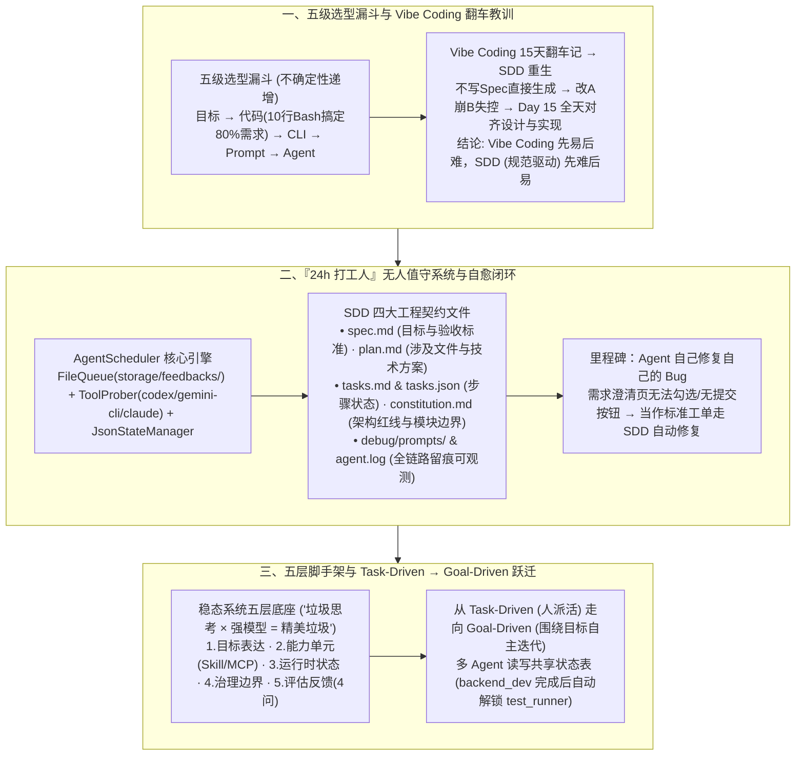

# 十年老技术开发的 AI Agent 探索之路

## 1. TL;DR

1. **打破“人肉盯窗”的并发上限（4~6 个终端）与极简技术选型漏斗**：人类开发者一天最多同时盯 **4~6 个** Agent 终端窗口（下午精力下降甚至管不了 3 个），破局之道是把高频工作改造成可自动运转的系统；同时遵循 **“目标 → 代码 → CLI → Prompt → Agent”** 五级决策漏斗——**80% 的 AI 需求用 10 行 Bash（如 `cron + curl`）就能搞定**，切勿把确定性脚本问题强行套上高不确定性的 Agent 循环。
2. **15 天 Vibe Coding 翻车实录与 SDD（规范驱动开发）重生**：在开发“24h 打工人”系统初期，不写 Spec 直接 Vibe Coding 导致前几天爽快、随后陷入“改 A 崩 B”的泥潭，直到 **Day 15** 花整整一天对齐文档与实现才重获控制权——证明 **“Vibe Coding 是先易后难，SDD（`spec.md → plan.md → tasks.md + constitution.md`）是先难后易”**。
3. **24h 无人值守架构与“Agent 自己修好自己的 Bug”**：基于文件队列（`storage/feedbacks/`）、多工具探测调度器（`codex / gemini-cli / claude`）、结构化状态落盘（`tasks.json` + `debug/prompts/`）与架构宪法（`constitution.md`），系统不仅实现了 24 小时无人值守，还在需求澄清页面出现“无法勾选选项且无提交按钮”的交互 Bug 时，像处理普通需求一样走完 SDD 流程自主定位并修复了自身代码。
4. **从 Task-Driven（任务编排）向 Goal-Driven（目标驱动）的终极跃迁**：“24h 在线不等于 24h 迭代”，只要任务仍需人工逐条派发，人就依然是瓶颈；通过补齐 **目标表达、能力单元、运行时状态、治理边界、评估反馈（4 个持续校准问题）** 五层脚手架，让多个子 Agent（如 `backend_dev` 与依赖它的 `test_runner`）围绕共享状态文件自主推进与交接。

## 2. 问题定义与背景

### 2.1 第一道墙：为什么开了多个 AI 终端后，人反而成了最大瓶颈？
作者作为十年老后台开发，在重度使用 AI Coding 工具时撞上了三个物理极限：
- **注意力吞吐上限**：一个人一天最多只能同时看管 **4~6 个 Agent 窗口**（上午精力充沛能管 5 个，下午犯困连 3 个都顾不过来）。
- **状态漂移与经验清零**：多窗口频繁切换导致上下文丢失、判断标准漂移；今天好不容易调通的排障经验，明天新开会话又得重来一遍。
- **过度设计（Over-engineering）陷阱**：市面上大量项目明明用 `cron + curl` 加 **10 行 Bash 脚本** 就能稳定完成的定时采集与处理，却非要套一层 LangChain + Agent 循环 + Tool Calling，结果既慢又脆弱。

### 2.2 五级技术选型漏斗：能用上层确定性手段解决的，绝不下沉到 Agent
| 决策层级 | 核心动作与适用场景 | 不确定性 |
| :--- | :--- | :--- |
| **1. 目标层** | 先想清楚到底要解决什么真问题（很多伪需求想清楚后根本不用写代码） | **最低（0）** |
| **2. 代码层** | 规则明确的逻辑直接写成确定性代码或 10 行 Bash 脚本（覆盖 **80%** 常见需求） | **极低** |
| **3. CLI 层** | 将常用操作封装为带标准输入输出与退出码的命令行工具 | **低** |
| **4. Prompt 层** | 单次输入输出固定、无需多步分支探索的文本生成与转换 | **中等** |
| **5. Agent 层** | 唯有面对环境开放、路径未知、需根据中间反馈动态决策的任务才上 Agent | **最高** |

## 3. 知识框架

## 4. 核心内容拆解

### 4.1 Vibe Coding 翻车记与 SDD（规范驱动开发）底座

1. **Day 1 ~ Day 15 的真实教训**：
   - 在开发“24h 打工人”系统初期，作者完全不写设计文档，直接对着 AI 喊“帮我加个什么功能”（Vibe Coding）。前几天进展神速，但随着模块增多，AI 开始频繁破坏已有逻辑、状态定义前后矛盾，排查成本指数级飙升。
   - **Day 15 的生死转折**：作者停下所有新功能开发，花整整一天时间做 **“设计与实现对齐”**，补齐了四份核心工程契约文件，才让系统真正具备自动化演进能力：
     - **`spec.md`（规格说明）**：将模糊的抱怨（如“分页有问题”）转化为可验证的明确目标与验收标准（如“切换页码时保持筛选条件不变”）；
     - **`plan.md`（技术方案）**：明确要修改哪些文件、模块边界与实现步骤；
     - **`tasks.md` & `tasks.json`（任务清单与机器状态）**：供人类阅读的步骤说明与供调度程序读写的 JSON 状态；
     - **`constitution.md`（架构宪法）**：固化代码组织规范、命名约定与模块依赖红线，强制 AI 生成方案时遵守。
2. **Agent 自己修好自己的 Bug**：
   - 上线后作者发现“需求澄清页面”渲染出了问题列表，但**无法勾选确认选项且缺少提交按钮**。作者没有手改代码，而是把这条 Bug 直接作为一条新反馈投递进系统队列；Agent 沿着 `spec → plan → tasks` 标准路径并遵循 `constitution.md`，自主定位前端交互组件缺失并完成了修复提交。

### 4.2 24h 无人值守系统的可观测性与持续评估（Eval 4 问）

1. **调度器与全链路留痕架构（`AgentScheduler`）**：
   - 通过 `FileQueue("storage/feedbacks/")` 接收任务，`ToolProber(["codex", "gemini-cli", "claude"])` 动态探测调度底层 CLI Coding 工具，`JsonStateManager("storage/state/")` 管理断点状态，并将每一步的完整输入保存在 `debug/prompts/`、运行日志保存在 `debug/agent.log`——确保出了 Bug 不用靠猜，打开目录即可复现。
2. **持续校准的 4 个 Eval 核心问题**：
   - 不同于传统软件“上线前测一次”，面向开放环境的 Agent 必须持续回答四个问题：
     1. **需求澄清是否稳定？**（源头不稳意味着下游执行全部白跑）；
     2. **任务拆解是否越来越合理？**（拆解粒度直接决定执行成功率）；
     3. **新加入的某个 Skill 是否真的提高了成功率？**（防止“加了等于没加”的自我感动）；
     4. **失败案例是在收敛还是在发散？**（检验治理护栏是否真正生效）。
3. **稳态 Agent 系统的五层架构铁律**：
   - **1. 目标表达** → **2. 能力单元（Skill / 工具 / MCP 标准协议）** → **3. 运行时状态** → **4. 治理边界（Policy）** → **5. 评估反馈（Eval / Trace）**。作者警句：**“垃圾的思考乘以强大的模型，等于精美的垃圾。”**

### 4.3 认知终局：从 Task-Driven（任务编排）走向 Goal-Driven（目标驱动）

1. **为什么“24h 在线”不等于“24h 迭代”？**
   - 在 Task-Driven 模式下，虽然系统能 24 小时干活，但“现在最值得做什么、遇到阻塞换路径还是等待、下一步推哪个方向”仍然依赖人类不断喂任务——**只要活还需要人来派，人就依然是系统的吞吐瓶颈**。
2. **Task-Driven vs Goal-Driven 对标与落地五前提**：

| 维度 | Task-Driven（任务驱动） | Goal-Driven（目标驱动） |
| :--- | :--- | :--- |
| **核心解决的问题** | 解决 **“单次执行”** 问题（让系统能跑起来） | 解决 **“持续迭代”** 问题（让系统围绕目标自主向前） |
| **人类主要成本** | 事中持续人工拆解、派活与传话 | 前期目标建模、状态机设计与治理边界定义 |
| **多 Agent 协同方式** | 人工在中间把 A 的输出贴给 B | 各 Agent 自主读写共享状态表（如 `backend_dev` 跑完为热点查询加 Redis 缓存后，自动触发 `depends_on: ["backend_dev"]` 的 `test_runner` 执行回归与压测） |

- **走向 Goal-Driven 的 5 个前提**：① 目标表达可量化判断；② 允许/禁止的治理边界清晰；③ 状态与上下文全自动持久化；④ 具备客观的自动化验收机制；⑤ 具备阻塞自愈或定时 Review（如 `next_review`）熔断机制。

## 5. 数据速查表

| 指标 | 原文数值 | 语境 / 条件 |
| :--- | :--- | :--- |
| **人工盯管 Agent 终端并发上限** | `4~6 个` 窗口/天（下午犯困时 `< 3 个`） | 人类注意力与上下文切换导致的硬性生理瓶颈 |
| **极简脚本可覆盖的 AI 需求比例** | `80%` 的需求用 `10 行 Bash` 即可搞定 | 如定时采集用 `cron + curl` 远比套 LangChain + Agent 稳定 |
| **技术选型决策层级数** | `5 层`（目标 → 代码 → CLI → Prompt → Agent） | 按不确定性从最低到最高排序的工程选型漏斗 |
| **Vibe Coding 失控并被迫重构节点** | `Day 15`（第 15 天） | 花整整 1 天对齐设计与实现，确立 `spec / plan / tasks / constitution` |
| **底层调度器探测的 CLI 工具数** | `3 款`（`codex`、`gemini-cli`、`claude`） | `ToolProber` 支持的多后端编码执行引擎 |
| **持续评估（Eval）核心校准问题数** | `4 个` 问题 | 需求澄清稳定性、任务拆解合理性、Skill 真实增益、失败收敛度 |
| **稳态 Agent 系统必备架构层数** | `5 层` + Goal-Driven `5 个` 前提 + `6 步` 落地路径 | 目标表达、能力单元、运行时状态、治理边界、评估反馈 |

## 6. 踩坑与教训 / 可迁移的设计原则

| 错误做法 | 失败表现或原因 | 原文应对（可迁移的设计原则） |
| :--- | :--- | :--- |
| **明明一个 `cron + curl` 定时脚本就能搞定的需求，非要套一层 LangChain + Agent 循环** | 引入不必要的大模型概率抖动、延迟与 Token 成本，稳定性反而远不如 10 行写死的 Bash 脚本 | **严守“目标 → 代码 → CLI → Prompt → Agent”五级漏斗**：只有前四层确定性手段无法解决的开放动态问题，才动用 Agent |
| **不写 Spec、不立架构规矩，直接对着 AI 开启多日 Vibe Coding** | 前三天看似一日千里，到第 15 天代码结构腐烂、改东坏西，连小 Bug 都无法定位 | **践行先难后易的 SDD（规范驱动开发）**：强制走 `spec.md → plan.md → tasks.md` 流水线，并用 `constitution.md` 锁死命名规范与模块边界 |
| **只看最终结果不存中间 Prompt 与状态，出了 Bug 靠翻终端聊天记录或瞎猜** | 多步 Agent 一旦跑偏，根本分不清是需求澄清错了、计划拆错了还是某步工具执行挂了 | **文件系统级全链路留痕（`tasks.json` + `debug/prompts/` + `agent.log`）**：把每一步生成的 Prompt、状态变迁与日志落盘，让排障像查普通后端日志一样确定 |
| **满足于“人想好任务喂给 Agent 跑”的 Task-Driven 模式，自己沦为人肉派单机** | 系统虽然 24 小时在线，但人一睡觉或去开会，迭代就彻底停滞，人依然是系统的最大瓶颈 | **通过共享状态表与依赖图升级至 Goal-Driven**：让主会话只管高层目标与验收，各专职子 Agent（如 `backend_dev`、`test_runner`）根据 `depends_on` 状态自主接力推进 |

## 7. 记忆锚点

- **“80% 的 AI 需求 10 行 Bash 就够了；垃圾的思考 × 强大的模型 = 精美的垃圾”**：十年老开发最清醒的两句工程箴言——克制滥用 Agent 的冲动，把精力花在定义清晰的 `spec.md` 与 `constitution.md` 上。
- **“Day 15 的痛定思痛：Vibe Coding 是先易后难，SDD 是先难后易”**：花一整天补齐 `spec + plan + tasks + constitution` 后，系统不仅能 24 小时无人值守，甚至能自己修好自己界面上的交互 Bug。
- **“24h 在线 ≠ 24h 迭代：Task-Driven 解决执行，Goal-Driven 解决迭代”**：把人类从“4~6 个终端的传话筒”解放为“目标与治理边界的设计者”。

## 8. 复习卡片

1. 为什么作者说“人肉盯 Agent 窗口”存在天然瓶颈？他提出的五级技术选型决策层级是什么？::因为受注意力和精力限制，一个人一天最多只能同时看管 `4~6 个` Agent 窗口（下午犯困时甚至不到 3 个），且状态易漂移、经验难复用；五级选型漏斗按不确定性从低到高依次为：`目标 → 代码（10 行 Bash 可搞定 80% 需求）→ CLI → Prompt → Agent`。
2. 作者在开发“24h 打工人”系统时经历了怎样的 Vibe Coding 翻车，最终通过哪四份核心文件构建了 SDD（规范驱动开发）体系？::初期不写文档直接让 AI 写代码，导致系统迅速失控，直到 `Day 15` 被迫停工花一整天对齐设计与实现；最终确立了 `spec.md`（明确目标与验收标准）、`plan.md`（涉及文件与实现方案）、`tasks.md / tasks.json`（可执行步骤与机器状态）以及 `constitution.md`（代码组织规范与模块边界宪法）。
3. 为什么“24h 打工人”系统能够自己修好自己需求澄清页面上的交互 Bug？::因为系统具备三大基础设施：① 清晰的项目结构与日志/Prompt 留痕（`debug/prompts/`）；② 标准化的 SDD 流程（将自身 Bug 也当作普通需求走完 `spec → plan → tasks`）；③ `constitution.md` 架构约束，使 AI 能在既有框架规范内精准定位并修复问题而非自由发挥。
4. 面向开放环境的 Agent 系统，需要通过哪 4 个持续评估（Eval）问题来校准系统健康度？::① 需求澄清是否稳定（防止下游白跑）；② 任务拆解是否越来越合理（决定执行效率）；③ 某个新增 Skill 是否真的提高了成功率（避免无效堆砌）；④ 失败案例是在收敛还是在发散。
5. 稳态 Agent 系统必须包含哪五层底座？Task-Driven 与 Goal-Driven 的核心区别是什么？::五层底座为：目标表达、能力单元（Skill/工具/MCP）、运行时状态、治理边界（Policy）与评估反馈（Eval/Trace）；Task-Driven 是人把事想好派给系统执行（解决单次执行问题，人仍是派活瓶颈），Goal-Driven 是多 Agent 围绕共享状态表与依赖关系（如 `depends_on`）自主推进迭代（解决持续迭代问题）。

## 9. 知识关联

- **本仓库主题索引**：[Agent工程循环](../../20_topics/Agent%E5%B7%A5%E7%A8%8B%E5%BE%AA%E7%8E%AF.md) · [Agent任务恢复](../../20_topics/Agent%E4%BB%BB%E5%8A%A1%E6%81%A2%E5%A4%8D.md) · [Agent评测与反馈](../../20_topics/Agent%E8%AF%84%E6%B5%8B%E4%B8%8E%E5%8F%8D%E9%A6%88.md) · [Harness与模型协同](../../20_topics/Harness%E4%B8%8E%E6%A8%A1%E5%9E%8B%E5%8D%8F%E5%90%8C.md) · [AI研发协同](../../20_topics/AI%E7%A0%94%E5%8F%91%E5%8D%8F%E5%90%8C.md)
- **候选双链概念**：[[规范驱动开发SDD]] · [[Goal-Driven目标驱动]] · [[五级技术选型漏斗]] · [[constitution架构宪法]] · [[24h无人值守Agent]]

## 10. 原文参考资料

1. 作者自研项目：`24h 打工人` 无人值守研发 Agent 系统（集成 `codex`、`gemini-cli`、`claude` 与 MCP 协议）。

> [!note]- 校对报告
> - **校对状态**：已按原文逐章核对通过（共 17 页 PDF）。
> - **核心数据与页码溯源**：
>   - `4-6 个` 终端并发上限（上午管 5 个、下午管不了 3 个）、`80%` 的 AI 需求 `10 行 Bash` 就够了（`cron + curl` vs LangChain）、五级决策漏斗（`目标 → 代码 → CLI → Prompt → Agent`）：见 `p.1–3`。
>   - Vibe Coding 翻车时间线、`Day 15` 设计与实现对齐、Vibe Coding 先易后难 vs SDD 先难后易：见 `p.4–5`。
>   - `AgentScheduler` 伪代码（`FileQueue`、`ToolProber(["codex", "gemini-cli", "claude"])`、`JsonStateManager`）、目录结构（`spec.md`、`plan.md`、`tasks.md`、`tasks.json`、`debug/prompts/`、`agent.log`）及第五章 Agent 自修需求澄清页 Bug（`constitution.md`）：见 `p.6–9`。
>   - Eval 4 个持续校准问题、稳态系统 5 层底座（“垃圾的思考乘以强大的模型，等于精美的垃圾”）、MCP 标准化：见 `p.10–13`。
>   - 第八章 Task-Driven vs Goal-Driven 对比表、Goal-Driven 5 个前提、多 Agent 状态协同示例（`backend_dev` + `test_runner`）与 6 步落地路径：见 `p.13–16`。
