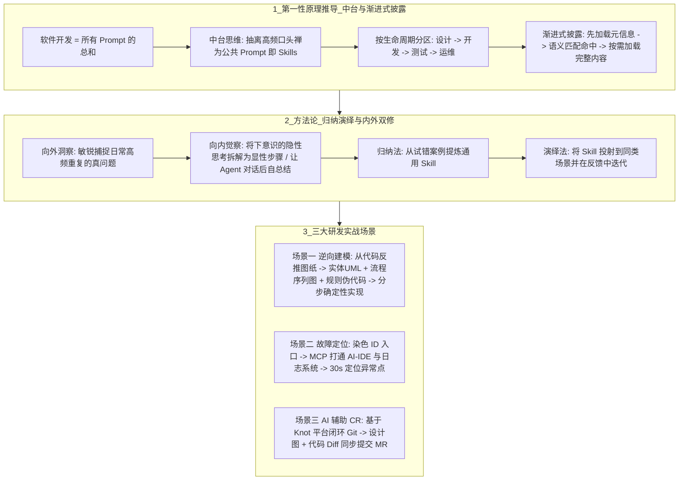

# 从具体问题开发Skills

## 1. TL;DR

本文从软件工程“中台复用”视角出发，剖析了 Agent Skills 的本质、设计哲学、构建方法论与三大研发落地场景。核心结论是：
1. **Skills 的本质是“公共 Prompt 的中台化复用”**：如果把软件开发全过程视为所有 Prompt 的总和，那么高频重复的“口头禅”与领域 SOP 就应当按“设计 $\to$ 开发 $\to$ 测试 $\to$ 运维”生命周期抽离沉淀为 Skills。
2. **设计哲学是“恰好而非更多（渐进式披露）”**：受限于大模型有限的上下文窗口（桌面大小），Skills 必须采用分级缓存式的渐进式加载——初始仅注入元信息，语义命中后再按需加载完整指令，防止上下文污染与幻觉。
3. **开发方法论是“先归纳、后演绎，向外洞察 + 向内觉察”**：通过“向外洞察”捕捉高频真问题，通过“向内觉察”将工程师隐性的排查与设计思维显性化（或让 Agent 在对话结束后自我复盘提炼）。
4. **三大实战落地**：在**需求迭代（逆向建模）**中围绕“实体（UML 类图）、流程（序列图）、规则（伪代码+文字）”先还原图纸再分步编码；在**问题定位**中通过 MCP 打通 AI-IDE 与日志系统，顺着染色 ID 在 **30 秒内**定位异常；在**AI 辅助 CR** 中结合 Knot 平台将设计图与代码 Diff 一并提交 MR，大幅降低代码审查认知负荷。

## 2. 问题定义与背景

### 2.1 “屠龙刀找龙”的行业迷思
随着各类提供数万个 Skills 的技能市场兴起，开发者面临两大困境：
- **脱离具体场景谈方案**：手握酷炫的“屠龙刀（外部通用 Skills）”，却不知道自己的“龙（具体研发痛点）”在哪里，照搬外部 Skill 往往水土不服。
- **人肉打字瓶颈与隐性经验流失**：在日常 Vibe Coding 中，开发者反复输入相同的约束与排查口头禅，AI 产出速度反而受限于人类打字速度；同时，资深工程师腦海中的“下意识排查与建模经验”未能沉淀为团队可共享的资产。

### 2.2 为什么在 AI 时代“经验”终于可以低成本沉淀了？
过去几十年软件工程难以低成本复用个人隐性经验，是因为缺乏统一的载体；而在 AI 时代，**人类自然语言（结合伪代码/图表）成为了全新的“编程语言”**，任何能以文字形式显性化沉淀的领域知识都能被大模型直接理解并执行，并推动系统设计从“仅面向人理解”转向“同时提供面向人理解与面向 AI 理解的双重版本”。

## 3. 知识框架

## 4. 核心内容拆解

### 4.1 Skills 的本质推导与“渐进式披露”哲学
1. **从中台架构到 Skills 定义**：软件架构中台的核心是“抽离相同功能、减少重复建设”。同理，将 Vibe Coding 中的高频口头禅封装为快捷键/模块，即得到结论：**公共的 Prompt 就是 Skills**。将其按“设计 $\to$ 开发 $\to$ 测试 $\to$ 运维”分类，即可构建覆盖软件工程全周期的技能矩阵。
2. **上下文桌面隐喻与渐进式披露（Progressive Disclosure）**：
   - 大模型的上下文窗口就像一张固定大小的办公桌，若一次性塞入成百上千个 Skills 的全文，桌面会彻底混乱，导致 AI 胡言乱语、幻觉激增。
   - 因此 Skills 的核心设计哲学是“**不是让 AI 知道更多，而是让 AI 在恰当的时间知道恰当的事**”——采用类似分级缓存的渐进式加载机制，输入 Prompt 时仅附带 Skills 的极简元信息（Metadata），由 AI 按语义匹配命中后，才按需加载对应的实际内容。

### 4.2 如何开发高价值 Skills：归纳演绎与“向外洞察 + 向内觉察”
1. **从归纳法到演绎法的闭环**：
   - 传统学校教育侧重从公理推导答案的**演绎法**，但真实工程中的“经验”本质上是大脑在日复一日试错中提炼规律的“人肉强化学习”，属于**归纳法**（正如作者举例：连续三天吃 100 元麦当劳夜宵导致次日晨起不适，归纳出“睡前不吃定理”，再将其分享给同事小明改善不适即演绎法）。
   - 开发 Skills 必须遵循“**先归纳（将工作案例提炼固化为 Skill） $\to$ 后演绎（应用到同类问题并在反馈中迭代）**”的路径。
2. **真正的壁垒：向外洞察 + 向内觉察**：
   - **向外洞察（发现真问题）**：Skill 与问题是一体两面，在 AI 逐步取代“解决问题能力”的时代，**精准捕捉日常工作中反复出现的真问题**是最难被替代的核心能力。
   - **向内觉察（显性化隐性思维）**：大多数问题并非新问题，只是工程师习惯了“下意识”解决而未复盘。开发 Skill 需要像禅修内观一样，将自己排查 Bug、拆解需求的每一步操作与判断逻辑梳理清楚。
   - **让 Agent 帮写 Skill 的技巧**：用 AI 解决完一个复杂问题后，**不要急着关闭对话框**，直接追加一句 Prompt 让 Agent 回顾整场对话的交互过程，自动总结提炼为可复用的 Skill。

### 4.3 三大高频工程实战案例
1. **案例一：逆向建模（Reverse Modeling）赋能存量需求迭代**
   - **痛点**：软件迭代如同在动态变化的房子上继续盖房，面对存量工程新需求时，原有的“设计图纸”往往早已缺失或过时，直接让 AI 用自然语言盲写代码极易翻车。
   - **逆向建模三要素与显化表达**：先通过现有代码反推还原“图纸”，回答三个核心问题（是什么？有什么变更？）：
     1. **实体（Entities）**：用传统 **UML 类图**还原对象及其关系，并用**不同颜色**标记本次需求的改动点；
     2. **流程（Processes）**：用不同抽象层级的**序列图（Sequence Diagram）**表达调用链路，既能把握全局又能下钻细节；
     3. **规则（Rules）**：自然语言过于抽象且一人一种理解，规则最推荐用 **“伪代码 + 文字”** 表达——因为“**最好的 Prompt 其实就是代码本身**”。
   - **三步确定性实现（熵最小化）**：严格对应图纸分步驱动 AI：第一步只新增/修改实体 $\to$ 第二步实现流程函数（内部细节全部 Mock，此时即可直接介入测试） $\to$ 第三步填充具体业务规则细节。每完成一步即 Review 一步、验证一步，彻底告别 Vibe Coding 的大段返工。
2. **案例二：染色 ID 驱动的 30 秒极速问题定位**
   - **向内觉察还原链路**：复盘人类排查线上问题的标准动作——从上游群里丢过来的一个**染色 ID（Trace/Coloring ID）**出发，顺藤摸瓜查日志、比对代码分支。
   - **工程打通与实效**：通过 **MCP** 打通本地 AI-IDE 与日志系统（或基于内置了 Skills、MCP、子 Agent、知识库与 Git 集成的 **Knot 平台**低成本搭建专属排障 Agent）。实测在上游同学抛来染色 ID 后，仅需 **30 秒**即可精准定位到代码异常点。
3. **案例三：设计图 + Diff 联动的 AI 辅助 CR**
   - 将 AI-CR 与 Git MR 流程闭环打通，并把逆向建模产出的**设计图（UML/序列图）与代码 Diff 一起提交至 MR**，同时服务于自动化 AI-CR 与人工 CR，显著降低代码审查的理解成本。

## 5. 数据速查表

| 指标 / 概念映射 | 原文数值 / 表达式 | 语境 / 条件 |
| :--- | :--- | :--- |
| **染色 ID 故障定位耗时** | **30s 内** | 通过 MCP 打通 AI-IDE 与日志系统，结合问题定位 Skill 实测定位异常点 |
| **归纳法生活类比案例** | 睡前吃 **100 元**麦当劳连续 **3 天** $\to$ 同事实践 **1 周** | 用于阐释从个体试错提炼规律（归纳法）到赋能他人解决同类问题（演绎法） |
| **逆向建模三大核心要素** | **1. 实体（UML 类图） · 2. 流程（序列图） · 3. 规则（伪代码+文字）** | 存量代码需求迭代时先反推图纸，明确三者的现状与变更点 |
| **确定性编码三步走顺序** | **先新增实体 $\to$ 再写流程函数（细节全 Mock 并测试） $\to$ 最后补规则细节** | 一步一 Review、一步一验证，使研发过程整体熵最小化 |
| **一站式 Agent 搭建平台** | **Knot 平台** | 内置 Skills、MCP、子 Agent、知识库并打通 Git，支持脱离本地编辑器运行 |

## 6. 踩坑与教训 / 可迁移的设计原则

| 错误做法 | 失败表现或原因 | 原文应对（可迁移的设计原则） |
| :--- | :--- | :--- |
| **盲目从外部技能网站下载成百上千个通用 Skills 全量塞给 AI** | 一方面占满上下文窗口（桌面混乱）引发严重幻觉；另一方面外部 Skill 脱离具体业务场景，无法解决真实痛点 | **问题驱动索引 + 渐进式披露原则**：永远从自己高频遇到的具体问题出发去检索并改造 Skill（借鉴而非照搬）；架构上仅加载元信息，按需渐进式披露正文 |
| **在存量项目需求迭代中跳过设计，直接用抽象自然语言让 AI 写业务代码** | 缺少现有工程的“图纸”约束，且自然语言描述复杂业务规则极易产生歧义，导致 AI 反复改错、大规模返工 | **逆向建模先行 + 伪代码写规则 + Mock 分步实现原则**：先反推实体 UML 与流程序列图，用“伪代码+文字”定义规则，再按“实体 $\to$ Mock 流程 $\to$ 规则细节”分步编码验证 |
| **用 AI 艰难排完一个棘手问题后直接关掉聊天窗口** | 整个交互过程中试错出的有效上下文与排查路径随之湮灭，下次遇到同类问题又要从头手打 Prompt | **对话尾声自省沉淀原则**：解决问题后不急着关窗口，追加一句指令让 Agent 复盘整场 Prompt 交互过程并自动总结生成初版 Skill |

## 7. 记忆锚点

- **Skills 四句真言**：“**公共 Prompt 即中台，渐进披露防污染；向外洞察抓真龙，向内觉察化无形。**”
- **逆向建模三件套**：“**实体画 UML（颜色标变更），流程拉序列图（缩放看细节），规则写伪代码（最好的 Prompt 就是代码本身）。**”

## 8. 复习卡片

从软件工程“中台”视角看，Agent Skills 的本质定义是什么？::如果把软件开发过程看作所有 Prompt 的总和，那么抽离出来的高频可复用的“公共 Prompt”就是 Skills。
为什么 Skills 的设计哲学强调“不是让 AI 知道更多，而是让 AI 在恰当的时间知道恰当的事”？::因为大模型的上下文窗口如同固定大小的桌面，全量塞入所有 Skills 会导致上下文混乱与幻觉增多；因此必须通过分级缓存式的“渐进式披露”，先加载元信息，语义匹配后再加载实际内容。
开发高质量个人或团队 Skills 需要哪两项核心的底层思维能力？::1. 向外洞察：敏锐捕捉日常工作中反复出现的真问题；2. 向内觉察：将自己下意识分析、拆解、解决问题的隐性过程梳理为 AI 可理解的显性步骤（也可在解决完问题后让 Agent 自动复盘对话生成）。
什么是“逆向建模”，它围绕哪三个核心要素及对应的表达方式展开？::逆向建模是指在存量系统需求迭代前，先从现有代码反推出“设计图纸”；它围绕三个要素展开：1. 实体关系（用 UML 类图 + 颜色标记变更）；2. 流程（用不同抽象层次的序列图）；3. 规则（用伪代码 + 文字，因为最好的 Prompt 就是代码本身）。
完成逆向建模后，如何让 AI 分步实现代码以使“整体的熵最小化”？::严格按图纸分三步实现：第一步先完成实体的新增/修改；第二步完成流程函数并将细节全部 Mock（此时即可直接介入测试）；第三步再补充具体的业务规则细节，做到完成一步、Review 一步、验证一步。
作者是如何将线上问题定位耗时缩短到 30 秒以内的？::通过“向内觉察”将人类顺着“染色 ID”查日志、看代码的排查链路固化为 Skill，并借助 MCP（或 Knot 平台）打通 AI-IDE 与日志系统、Git 仓库，实现从染色 ID 到异常代码点的自动化定位。

## 9. 知识关联

- **本库通用主题**：[AI研发协同](../../20_topics/AI%E7%A0%94%E5%8F%91%E5%8D%8F%E5%90%8C.md) · [问题澄清](../../20_topics/%E9%97%AE%E9%A2%98%E6%BE%84%E6%B8%85.md) · [解决问题](../../20_topics/%E8%A7%A3%E5%86%B3%E9%97%AE%E9%A2%98.md) · [Skill设计与治理](../../20_topics/Skill%E8%AE%BE%E8%AE%A1%E4%B8%8E%E6%B2%BB%E7%90%86.md)
- **候选双链**：[[渐进式披露与上下文预算]] · [[逆向工程与领域驱动设计]] · [[MCP日志排障闭环]] · [[AI辅助代码审查CR]]

## 10. 原文参考资料

- 原文标题：《Skills 开发技能指南：OpenClaw 也好，Skills 也好，都别脱离具体场景谈方案》（作者：吕昊俣，发布于 2026-03-13）
- 关联内部平台：腾讯 Knot 智能体平台（集成 Skills、MCP、子 Agent、知识库与 Git）。

> [!note]- 校对报告
> - **页码溯源汇总**：
>   - `p.1–3`：从中台“复用”推导 Skills 定义（公共的 Prompt 就是 Skills）、按“设计 $\to$ 开发 $\to$ 测试 $\to$ 运维”分类、上下文桌面隐喻与渐进式披露（Progressive Disclosure）。
>   - `p.3–5`：人类语言成为新编程语言、面向 AI 设计系统、归纳法与演绎法（100 元麦当劳夜宵类比）、向外洞察 + 向内觉察，以及对话结束后加一句 Prompt 让 Agent 自动总结沉淀 Skill。
>   - `p.6–8`：逆向建模三要素（实体 UML 类图颜色标变更、流程序列图、规则伪代码+文字）与三步确定性实现（新增实体 $\to$ 流程函数全 Mock 可测 $\to$ 补充规则细节）。
>   - `p.9–10`：染色 ID + MCP 打通日志与代码实现 30s 内定位异常点、Knot 平台介绍、设计图 + 代码 Diff 联合提交 MR 的 AI 辅助 CR 闭环。
> - **核验结论**：全文核心论点、工程案例与量化数据均与原文逐页核对一致。
